# 画廊3

[返回总目录](../README.md) · [按服装类型查找](../categories.md) · [标签索引](../tags.md)

英文提示词按来源原样保留；例图为来源站 JPG 的本地副本。编号仅用于查找，不代表服装名称。

<a id="kisegaeningyou-0208"></a>

## 服装208

- 来源 ID：`kisegaeningyou-0208`；画廊：画廊3。
- [在线例图](https://assets.quicktagcloud.com/images/kisegaeningyou/kisegaeningyou-0208.jpg?v=6d20bfe768b10e76) · [原始 PNG](https://assets.quicktagcloud.com/originals/kisegaeningyou/kisegaeningyou-0208.png?v=6d20bfe768b10e76) · [来源图鉴](https://novelai.quicktagcloud.com/?c=kisegaeningyou)

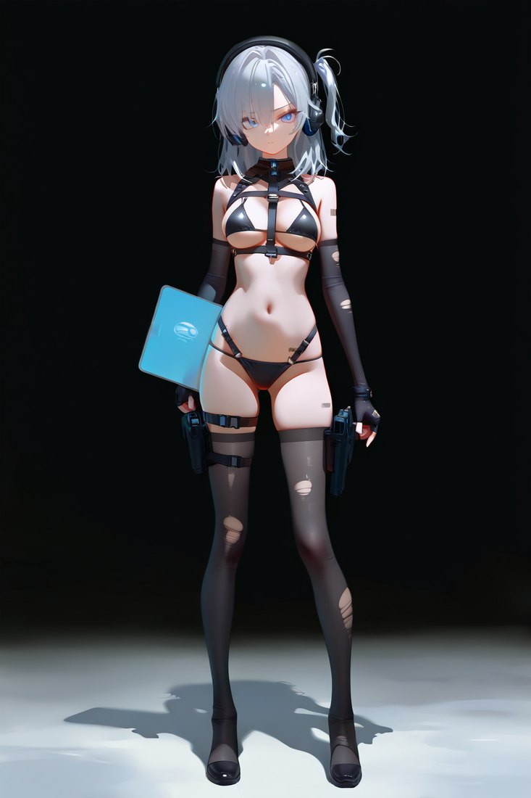

```text
barcode tattoo, fingerless gloves, elbow gloves, torn gloves, black gloves, bare shoulders, black thighhighs, black bikini, harness, evealing clothes, thigh strap, torn thighhighs, tablet pc, holstered weapon, underboob, thigh holster, headphones, gun,
```

<a id="kisegaeningyou-0209"></a>

## 服装209

- 来源 ID：`kisegaeningyou-0209`；画廊：画廊3。
- [在线例图](https://assets.quicktagcloud.com/images/kisegaeningyou/kisegaeningyou-0209.jpg?v=53a1f80f21557e01) · [原始 PNG](https://assets.quicktagcloud.com/originals/kisegaeningyou/kisegaeningyou-0209.png?v=53a1f80f21557e01) · [来源图鉴](https://novelai.quicktagcloud.com/?c=kisegaeningyou)

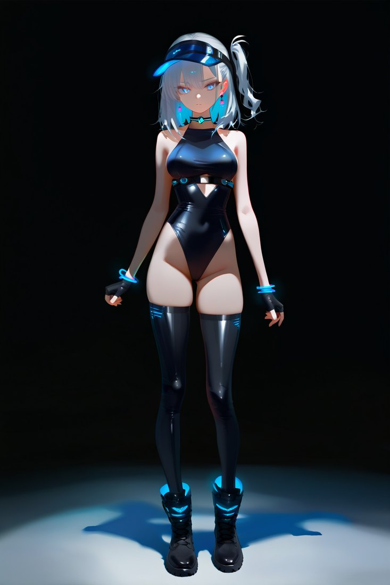

```text
black fabric, glowing trim, high-waisted bottoms, halter top, led strips, glowing patterns, fingerless gloves, neon bracelets, thighhighs, combat boots, glowing visor cap, holographic visor, led choker, neon anklets, cyber earrings, glowing belt buckle,
```

<a id="kisegaeningyou-0210"></a>

## 服装210

- 来源 ID：`kisegaeningyou-0210`；画廊：画廊3。
- [在线例图](https://assets.quicktagcloud.com/images/kisegaeningyou/kisegaeningyou-0210.jpg?v=406d3608bf6cf3f2) · [原始 PNG](https://assets.quicktagcloud.com/originals/kisegaeningyou/kisegaeningyou-0210.png?v=406d3608bf6cf3f2) · [来源图鉴](https://novelai.quicktagcloud.com/?c=kisegaeningyou)

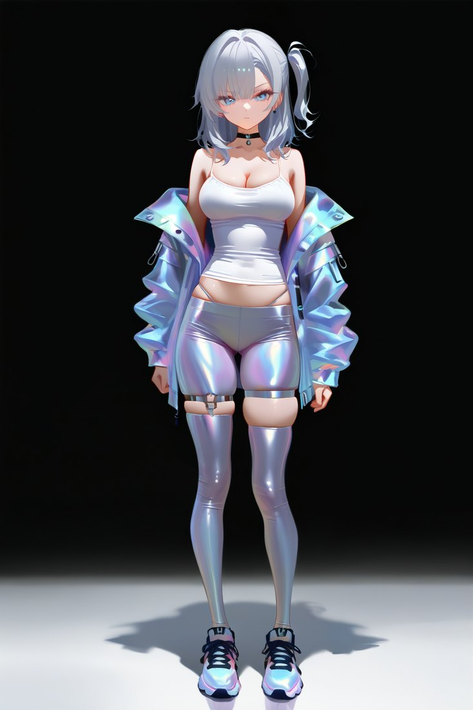

```text
black choker, sneakers, tight pants, pantylines, tight, holographic jacket, iridescent jacket, off shoulder jacket, highleg panties, shiny clothes, open jacket, bursting breasts, camisole, thigh strap, skindentation,
```

<a id="kisegaeningyou-0211"></a>

## 服装211

- 来源 ID：`kisegaeningyou-0211`；画廊：画廊3。
- [在线例图](https://assets.quicktagcloud.com/images/kisegaeningyou/kisegaeningyou-0211.jpg?v=d946081205dbe157) · [原始 PNG](https://assets.quicktagcloud.com/originals/kisegaeningyou/kisegaeningyou-0211.png?v=d946081205dbe157) · [来源图鉴](https://novelai.quicktagcloud.com/?c=kisegaeningyou)

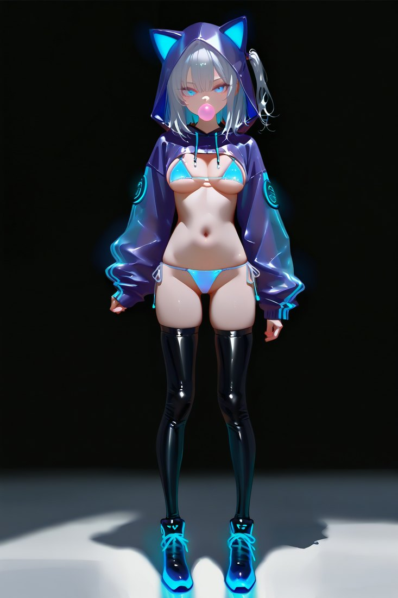

```text
(cyborg theme shoes:1.1), (glowing shoes:1.2), (see-through:1.1), (latex clothes:1.1), (chewing gum:1.1), navel, (black thighhighs:1.05), hood up, shrug \(clothing\), glowing bikini, side-tie bikini bottom, purple hoodie, underboob, cropped hoodie, long sleeves,
```

<a id="kisegaeningyou-0212"></a>

## 服装212

- 来源 ID：`kisegaeningyou-0212`；画廊：画廊3。
- [在线例图](https://assets.quicktagcloud.com/images/kisegaeningyou/kisegaeningyou-0212.jpg?v=4b8c32b1008ae100) · [原始 PNG](https://assets.quicktagcloud.com/originals/kisegaeningyou/kisegaeningyou-0212.png?v=4b8c32b1008ae100) · [来源图鉴](https://novelai.quicktagcloud.com/?c=kisegaeningyou)

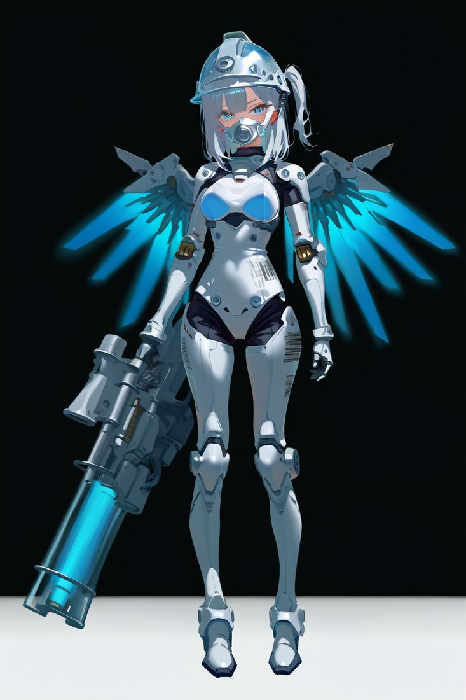

```text
holding big gun, mechanical hands, (transparent glass helmet, wearing transparent glass mask:1.2), horrorwire, screw, machinery factory, barcode, exposed mechanical components, thrusters, laser, circuit, mechanical wings,
```

<a id="kisegaeningyou-0213"></a>

## 服装213

- 来源 ID：`kisegaeningyou-0213`；画廊：画廊3。
- [在线例图](https://assets.quicktagcloud.com/images/kisegaeningyou/kisegaeningyou-0213.jpg?v=465d59c8a234a60c) · [原始 PNG](https://assets.quicktagcloud.com/originals/kisegaeningyou/kisegaeningyou-0213.png?v=465d59c8a234a60c) · [来源图鉴](https://novelai.quicktagcloud.com/?c=kisegaeningyou)

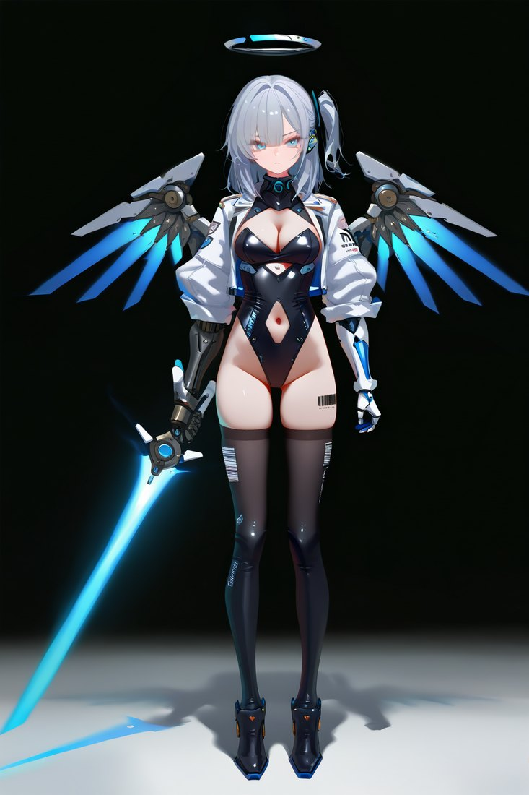

```text
halo, energy sword, planted mechanical ears, mechanical tail, mechanical wings, (single mechanical arm:1.2), (black highleg leotard:1.1), (barcode on leg:1.1), black thighhighs, cleavage cutout, navel cutout, white jacket,
```

<a id="kisegaeningyou-0214"></a>

## 服装214

- 来源 ID：`kisegaeningyou-0214`；画廊：画廊3。
- [在线例图](https://assets.quicktagcloud.com/images/kisegaeningyou/kisegaeningyou-0214.jpg?v=0578ddbbd9dd925a) · [原始 PNG](https://assets.quicktagcloud.com/originals/kisegaeningyou/kisegaeningyou-0214.png?v=0578ddbbd9dd925a) · [来源图鉴](https://novelai.quicktagcloud.com/?c=kisegaeningyou)

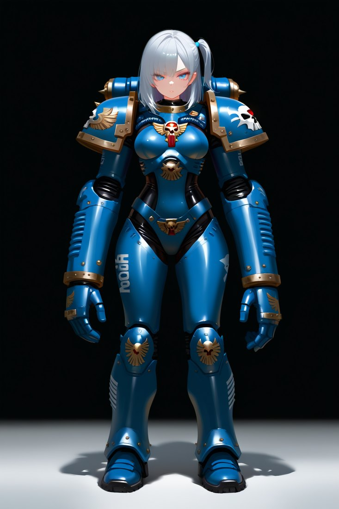

```text
warhammer 40k, terminator armor, power armor, oversized limbs,
```

<a id="kisegaeningyou-0215"></a>

## 服装215

- 来源 ID：`kisegaeningyou-0215`；画廊：画廊3。
- [在线例图](https://assets.quicktagcloud.com/images/kisegaeningyou/kisegaeningyou-0215.jpg?v=7e08b07213be0453) · [原始 PNG](https://assets.quicktagcloud.com/originals/kisegaeningyou/kisegaeningyou-0215.png?v=7e08b07213be0453) · [来源图鉴](https://novelai.quicktagcloud.com/?c=kisegaeningyou)

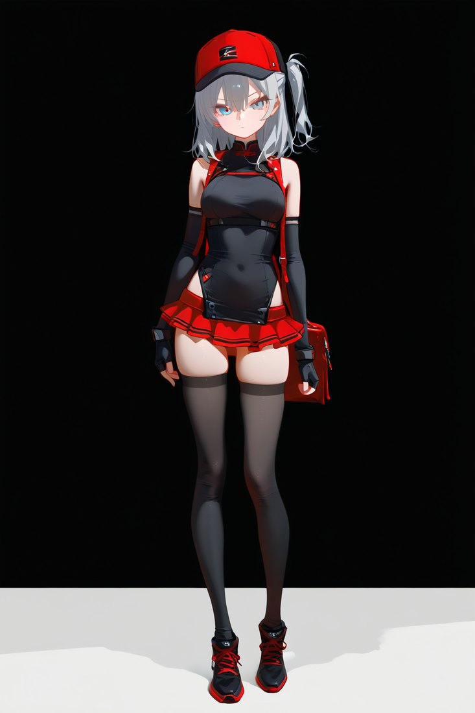

```text
black thighhighs, red headwear, fingerless gloves, black shirt, black gloves, zettai ryouiki, bag, baseball cap, microskirt, elbow gloves, bare shoulders,
```

<a id="kisegaeningyou-0216"></a>

## 服装216

- 来源 ID：`kisegaeningyou-0216`；画廊：画廊3。
- [在线例图](https://assets.quicktagcloud.com/images/kisegaeningyou/kisegaeningyou-0216.jpg?v=58cd9edb9dc0f858) · [原始 PNG](https://assets.quicktagcloud.com/originals/kisegaeningyou/kisegaeningyou-0216.png?v=58cd9edb9dc0f858) · [来源图鉴](https://novelai.quicktagcloud.com/?c=kisegaeningyou)

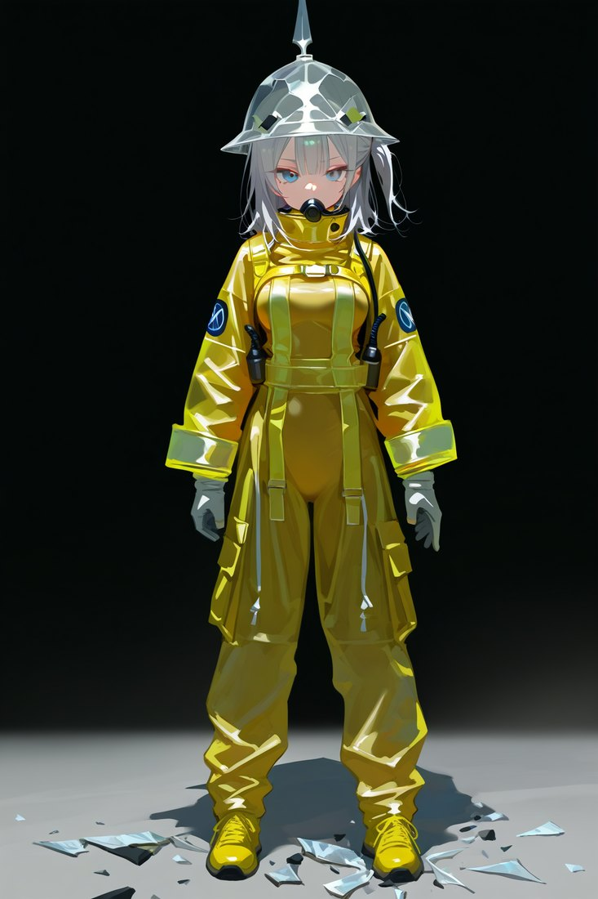

```text
(yellow chemical protective clothing:1.1), (large broken glass helmet:1.3), oxygen tanks, mask,
```

<a id="kisegaeningyou-0217"></a>

## 服装217

- 来源 ID：`kisegaeningyou-0217`；画廊：画廊3。
- [在线例图](https://assets.quicktagcloud.com/images/kisegaeningyou/kisegaeningyou-0217.jpg?v=210229bab8a9ef3d) · [原始 PNG](https://assets.quicktagcloud.com/originals/kisegaeningyou/kisegaeningyou-0217.png?v=210229bab8a9ef3d) · [来源图鉴](https://novelai.quicktagcloud.com/?c=kisegaeningyou)

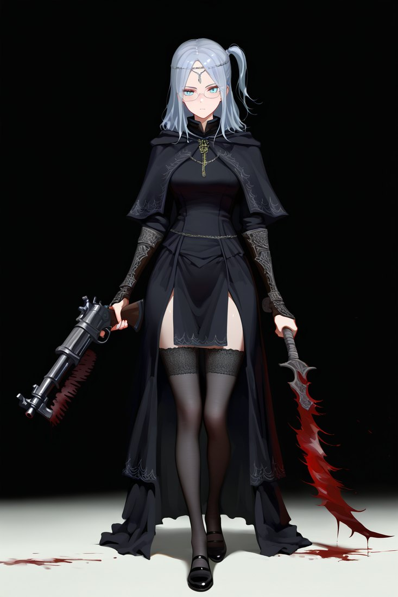

```text
(bloodborne:1.2), glasses, (black silk stockings:1.1), capelet, circlet, black gothic empire waist dress, meat saw knife, blood sword, flint gun,
```

<a id="kisegaeningyou-0218"></a>

## 服装218

- 来源 ID：`kisegaeningyou-0218`；画廊：画廊3。
- [在线例图](https://assets.quicktagcloud.com/images/kisegaeningyou/kisegaeningyou-0218.jpg?v=1f6125a5854d3827) · [原始 PNG](https://assets.quicktagcloud.com/originals/kisegaeningyou/kisegaeningyou-0218.png?v=1f6125a5854d3827) · [来源图鉴](https://novelai.quicktagcloud.com/?c=kisegaeningyou)

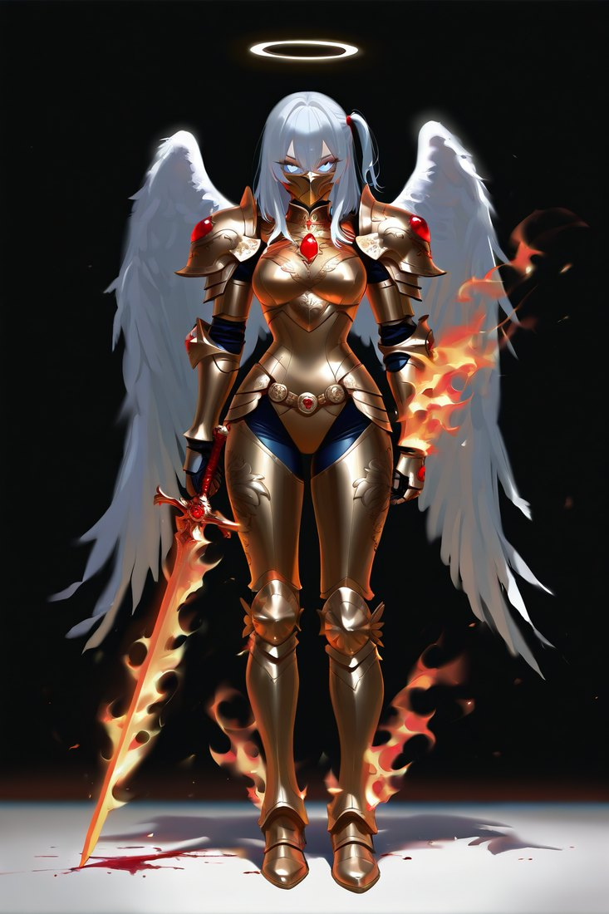

```text
angel wings, armor, blade encarmine, blood angels, cherub, fire, flaming sword, glowing eyes, gold armor, halo, mask, ornate armor, ornate weapon, pauldrons, power armor, red gemstone, shoulder armor, teardrop-shaped gem,
```

<a id="kisegaeningyou-0219"></a>

## 服装219

- 来源 ID：`kisegaeningyou-0219`；画廊：画廊3。
- [在线例图](https://assets.quicktagcloud.com/images/kisegaeningyou/kisegaeningyou-0219.jpg?v=89a259cffc73b6fd) · [原始 PNG](https://assets.quicktagcloud.com/originals/kisegaeningyou/kisegaeningyou-0219.png?v=89a259cffc73b6fd) · [来源图鉴](https://novelai.quicktagcloud.com/?c=kisegaeningyou)

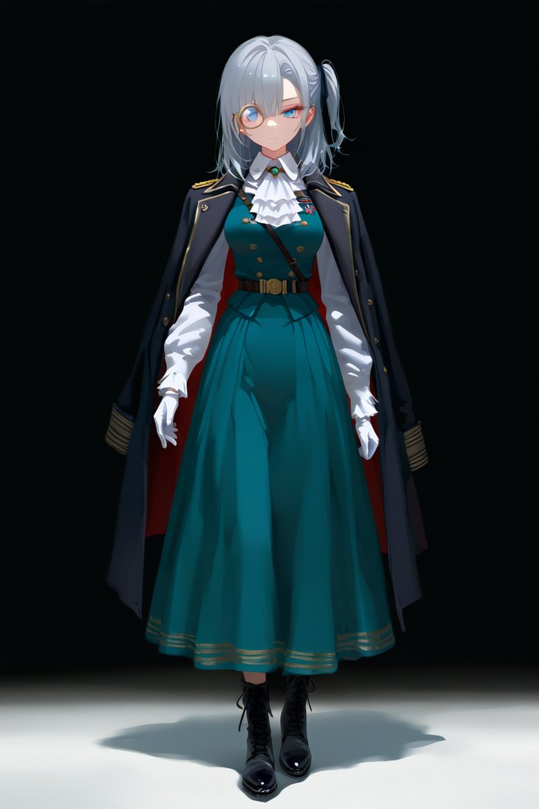

```text
victorian fashion, aqua skirt, (round monocle:1.1), ascot, vest, belt, military uniform, boots, black coat, (coat on shoulders:1.1), collared white shirt, white gloves, long skirt, long sleeves,
```

<a id="kisegaeningyou-0220"></a>

## 服装220

- 来源 ID：`kisegaeningyou-0220`；画廊：画廊3。
- [在线例图](https://assets.quicktagcloud.com/images/kisegaeningyou/kisegaeningyou-0220.jpg?v=8ae08e15204c1b10) · [原始 PNG](https://assets.quicktagcloud.com/originals/kisegaeningyou/kisegaeningyou-0220.png?v=8ae08e15204c1b10) · [来源图鉴](https://novelai.quicktagcloud.com/?c=kisegaeningyou)

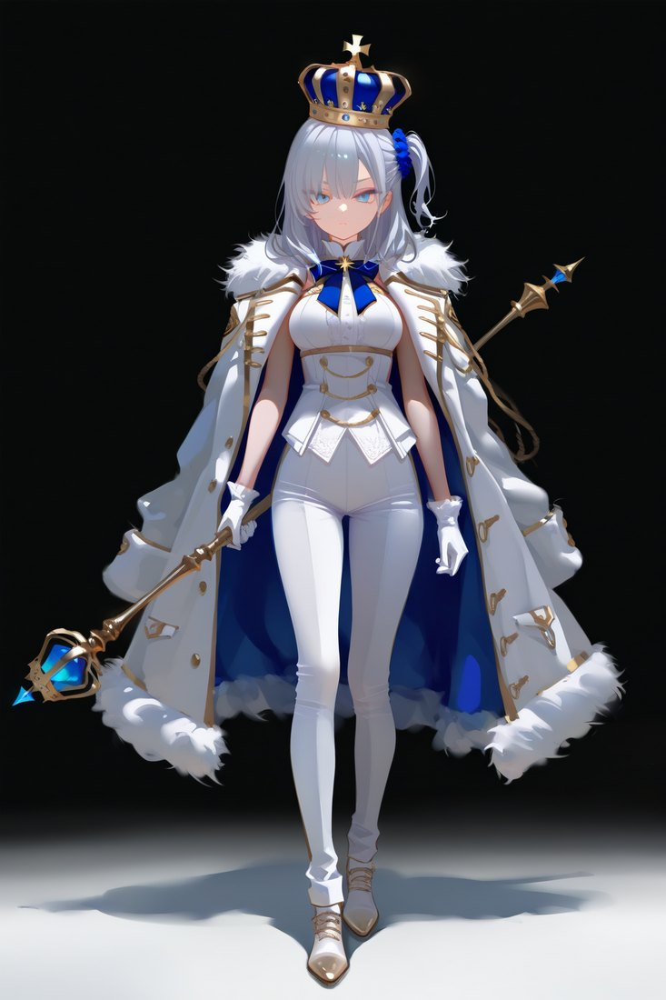

```text
crown, scepter, coat on shoulders, bowtie, fur-trimmed coat, gloves, hair scrunchie, high collar, head flower, white pants,
```

<a id="kisegaeningyou-0221"></a>

## 服装221

- 来源 ID：`kisegaeningyou-0221`；画廊：画廊3。
- [在线例图](https://assets.quicktagcloud.com/images/kisegaeningyou/kisegaeningyou-0221.jpg?v=fee492e89a285438) · [原始 PNG](https://assets.quicktagcloud.com/originals/kisegaeningyou/kisegaeningyou-0221.png?v=fee492e89a285438) · [来源图鉴](https://novelai.quicktagcloud.com/?c=kisegaeningyou)

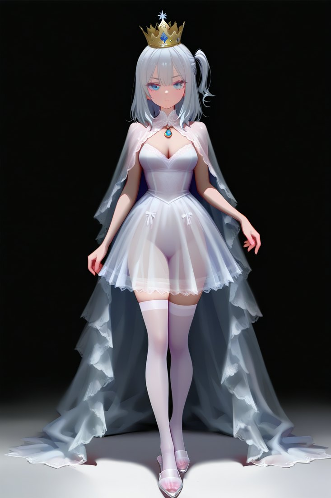

```text
(see-through shoes, glass slippers:1.2), crown, princess, gorgeous aristocratic attire, princess dress, white thighhighs,
```

<a id="kisegaeningyou-0222"></a>

## 服装222

- 来源 ID：`kisegaeningyou-0222`；画廊：画廊3。
- [在线例图](https://assets.quicktagcloud.com/images/kisegaeningyou/kisegaeningyou-0222.jpg?v=8b03d87929669649) · [原始 PNG](https://assets.quicktagcloud.com/originals/kisegaeningyou/kisegaeningyou-0222.png?v=8b03d87929669649) · [来源图鉴](https://novelai.quicktagcloud.com/?c=kisegaeningyou)

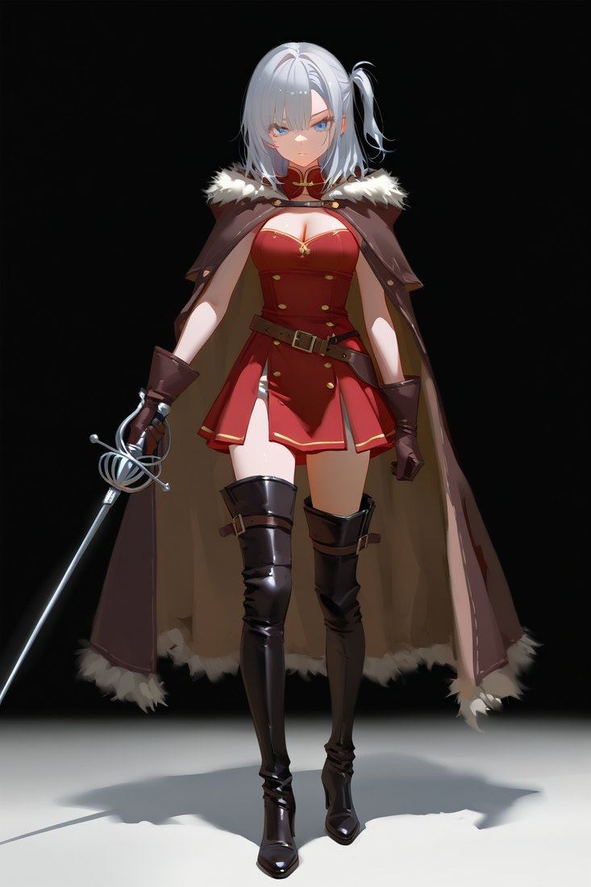

```text
red dress, cleavage, brown cape, fur-trimmed cape, brown leather belt, golden belt buckle, brown leather gloves, black leather thigh boots, high heel boots, holding silver rapier,
```

<a id="kisegaeningyou-0223"></a>

## 服装223

- 来源 ID：`kisegaeningyou-0223`；画廊：画廊3。
- [在线例图](https://assets.quicktagcloud.com/images/kisegaeningyou/kisegaeningyou-0223.jpg?v=846f7db15a0f8dfe) · [原始 PNG](https://assets.quicktagcloud.com/originals/kisegaeningyou/kisegaeningyou-0223.png?v=846f7db15a0f8dfe) · [来源图鉴](https://novelai.quicktagcloud.com/?c=kisegaeningyou)

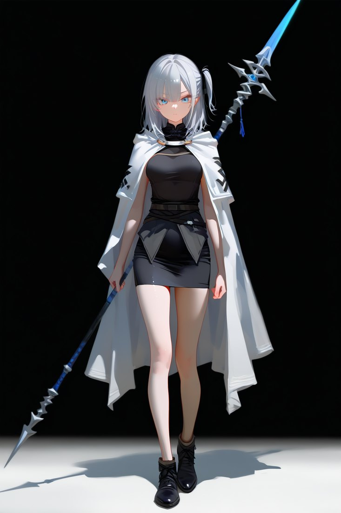

```text
black shirt, white cloak, spear, black pencil skirt, sleeveless, loose clothes, black chinese armor,
```

<a id="kisegaeningyou-0224"></a>

## 服装224

- 来源 ID：`kisegaeningyou-0224`；画廊：画廊3。
- [在线例图](https://assets.quicktagcloud.com/images/kisegaeningyou/kisegaeningyou-0224.jpg?v=342ae4140d7d9dad) · [原始 PNG](https://assets.quicktagcloud.com/originals/kisegaeningyou/kisegaeningyou-0224.png?v=342ae4140d7d9dad) · [来源图鉴](https://novelai.quicktagcloud.com/?c=kisegaeningyou)


```text
(fur hat:1.1), red headwear, brown gloves, dark red coat, fur trim, buttons, (holding flintlock:1.2), (renaissance period:1.1), gunfire, bracket, crossbody tool belt,
```

<a id="kisegaeningyou-0225"></a>

## 服装225

- 来源 ID：`kisegaeningyou-0225`；画廊：画廊3。
- [在线例图](https://assets.quicktagcloud.com/images/kisegaeningyou/kisegaeningyou-0225.jpg?v=ab327d1708433556) · [原始 PNG](https://assets.quicktagcloud.com/originals/kisegaeningyou/kisegaeningyou-0225.png?v=ab327d1708433556) · [来源图鉴](https://novelai.quicktagcloud.com/?c=kisegaeningyou)

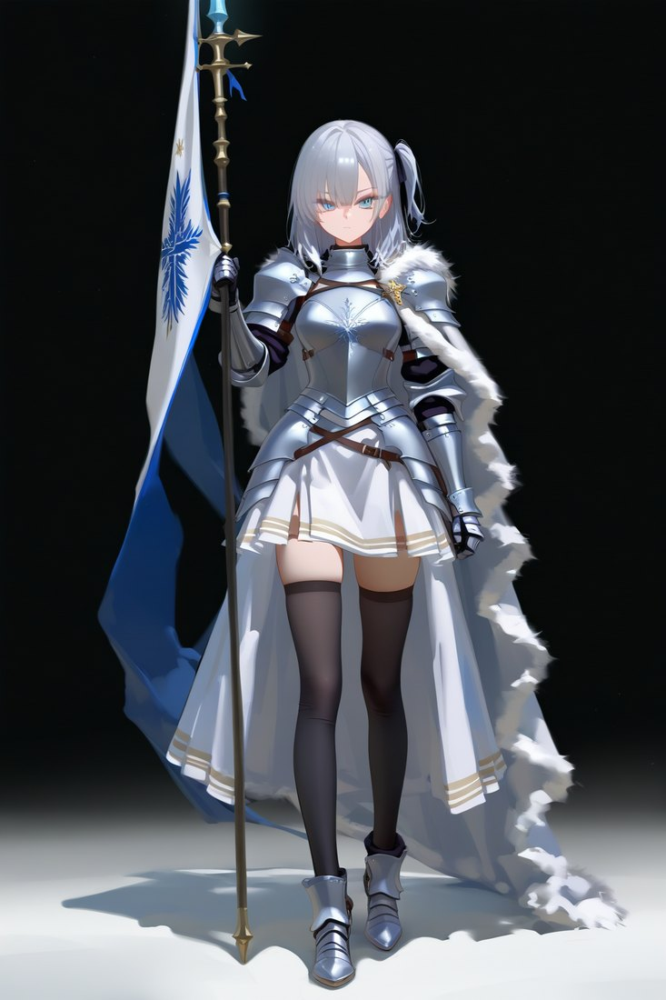

```text
armor, armored dress, banner, black thighhighs, fur trim, gauntlets, holding flag, thighhighs, white dress,
```

<a id="kisegaeningyou-0226"></a>

## 服装226

- 来源 ID：`kisegaeningyou-0226`；画廊：画廊3。
- [在线例图](https://assets.quicktagcloud.com/images/kisegaeningyou/kisegaeningyou-0226.jpg?v=6f2ca7e92fced8ac) · [原始 PNG](https://assets.quicktagcloud.com/originals/kisegaeningyou/kisegaeningyou-0226.png?v=6f2ca7e92fced8ac) · [来源图鉴](https://novelai.quicktagcloud.com/?c=kisegaeningyou)

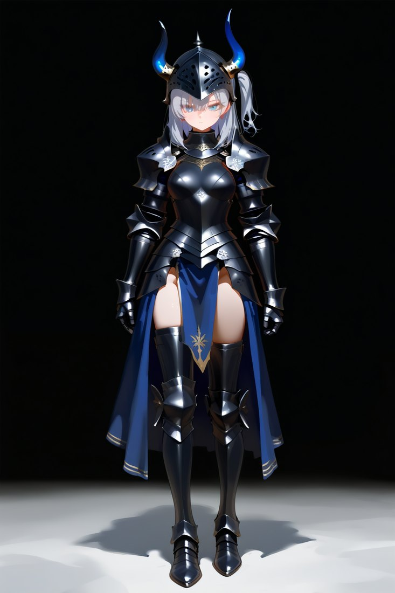

```text
knight, no cape, black armor, horned helmet, gauntlets, armored boots, full armor,
```

<a id="kisegaeningyou-0227"></a>

## 服装227

- 来源 ID：`kisegaeningyou-0227`；画廊：画廊3。
- [在线例图](https://assets.quicktagcloud.com/images/kisegaeningyou/kisegaeningyou-0227.jpg?v=fbd383344991d1e8) · [原始 PNG](https://assets.quicktagcloud.com/originals/kisegaeningyou/kisegaeningyou-0227.png?v=fbd383344991d1e8) · [来源图鉴](https://novelai.quicktagcloud.com/?c=kisegaeningyou)

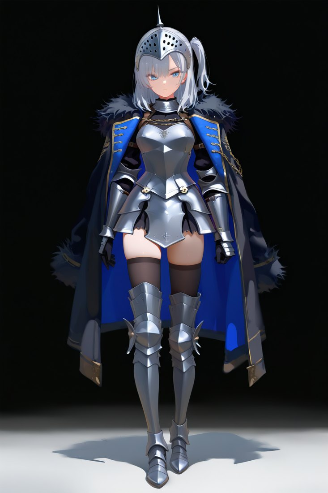

```text
armor, armored dress, black gloves, black legwear, chain, fur trim, gauntlets, greaves, helmet, jacket, thigh boots, open jacket, jacket on shoulders,
```

<a id="kisegaeningyou-0228"></a>

## 服装228

- 来源 ID：`kisegaeningyou-0228`；画廊：画廊3。
- [在线例图](https://assets.quicktagcloud.com/images/kisegaeningyou/kisegaeningyou-0228.jpg?v=3c3a2c1f4895bea6) · [原始 PNG](https://assets.quicktagcloud.com/originals/kisegaeningyou/kisegaeningyou-0228.png?v=3c3a2c1f4895bea6) · [来源图鉴](https://novelai.quicktagcloud.com/?c=kisegaeningyou)

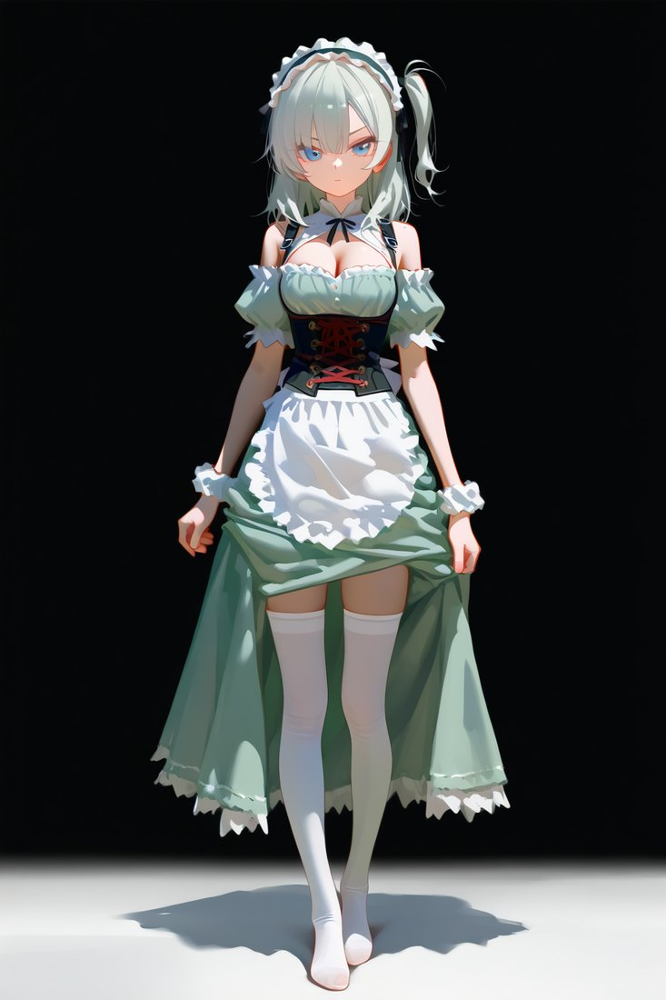

```text
cleavage cutout, bare shoulders, corset, dirndl, frilled hairband, german clothes, (light green dress, long dress:1.2), waist apron, white thighhighs, wrist scrunchie,
```

<a id="kisegaeningyou-0229"></a>

## 服装229

- 来源 ID：`kisegaeningyou-0229`；画廊：画廊3。
- [在线例图](https://assets.quicktagcloud.com/images/kisegaeningyou/kisegaeningyou-0229.jpg?v=4adc45efb6cdd6be) · [原始 PNG](https://assets.quicktagcloud.com/originals/kisegaeningyou/kisegaeningyou-0229.png?v=4adc45efb6cdd6be) · [来源图鉴](https://novelai.quicktagcloud.com/?c=kisegaeningyou)

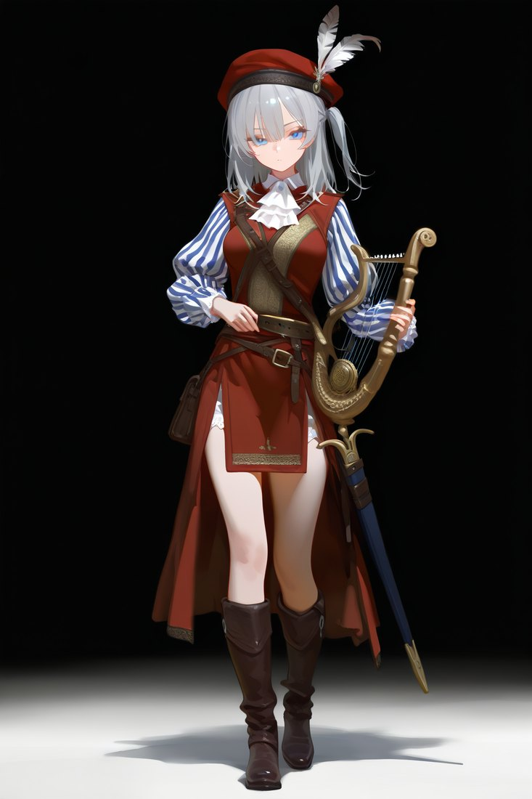

```text
(european clothing, celtic:1.1), red tunic, feather hair ornaments, (bard:1.1), frilled, tool belt, bag, scabbard, ascot, puff sleeves, vertical striped sleeves, brown leather vest, hat, (playing harp:1.1), dress, pattern trim clothin, knee boots,
```

<a id="kisegaeningyou-0230"></a>

## 服装230

- 来源 ID：`kisegaeningyou-0230`；画廊：画廊3。
- [在线例图](https://assets.quicktagcloud.com/images/kisegaeningyou/kisegaeningyou-0230.jpg?v=299cdd0d9ee95341) · [原始 PNG](https://assets.quicktagcloud.com/originals/kisegaeningyou/kisegaeningyou-0230.png?v=299cdd0d9ee95341) · [来源图鉴](https://novelai.quicktagcloud.com/?c=kisegaeningyou)

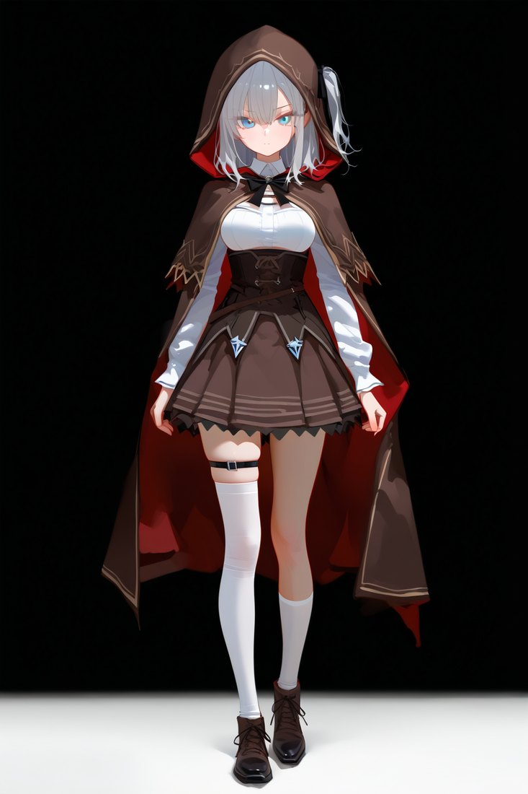

```text
black bow, brown capelet, brown cloak, brown hoodie, brown skirt, capelet, hood up, hooded capelet, knee strap, red shawl, single thighhigh, white shirt,
```

<a id="kisegaeningyou-0231"></a>

## 服装231

- 来源 ID：`kisegaeningyou-0231`；画廊：画廊3。
- [在线例图](https://assets.quicktagcloud.com/images/kisegaeningyou/kisegaeningyou-0231.jpg?v=9714e76c2fcc4819) · [原始 PNG](https://assets.quicktagcloud.com/originals/kisegaeningyou/kisegaeningyou-0231.png?v=9714e76c2fcc4819) · [来源图鉴](https://novelai.quicktagcloud.com/?c=kisegaeningyou)

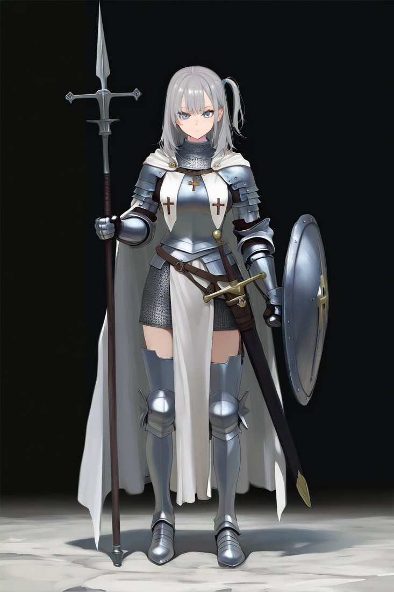

```text
holding polearm, (armor under clothes:1.2), sword, sheath, chainmail, waist curtains, pelvic curtain, breast curtains, cross, tunic, (war nun:1.1), armor, holding shield, spear, belt, cape, scabbard, sheathed, knight, white cape, gloves, gauntlets,
```

<a id="kisegaeningyou-0232"></a>

## 服装232

- 来源 ID：`kisegaeningyou-0232`；画廊：画廊3。
- [在线例图](https://assets.quicktagcloud.com/images/kisegaeningyou/kisegaeningyou-0232.jpg?v=45466252d689ef6c) · [原始 PNG](https://assets.quicktagcloud.com/originals/kisegaeningyou/kisegaeningyou-0232.png?v=45466252d689ef6c) · [来源图鉴](https://novelai.quicktagcloud.com/?c=kisegaeningyou)

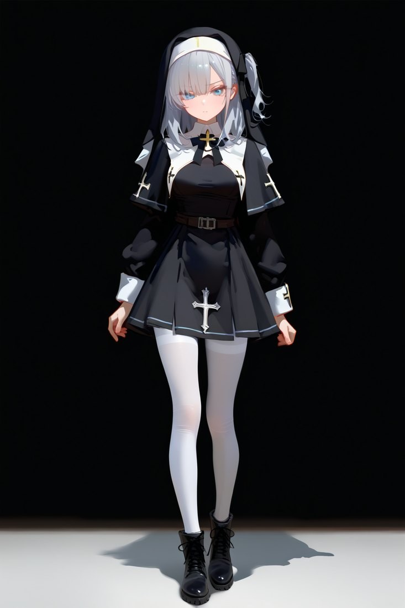

```text
black dress, short dress, nun, black boots, white pantyhose, black capelet, black headwear, black bow, belt, bowtie, cross, habit,
```

<a id="kisegaeningyou-0233"></a>

## 服装233

- 来源 ID：`kisegaeningyou-0233`；画廊：画廊3。
- [在线例图](https://assets.quicktagcloud.com/images/kisegaeningyou/kisegaeningyou-0233.jpg?v=1e7c43bd6a3ca791) · [原始 PNG](https://assets.quicktagcloud.com/originals/kisegaeningyou/kisegaeningyou-0233.png?v=1e7c43bd6a3ca791) · [来源图鉴](https://novelai.quicktagcloud.com/?c=kisegaeningyou)

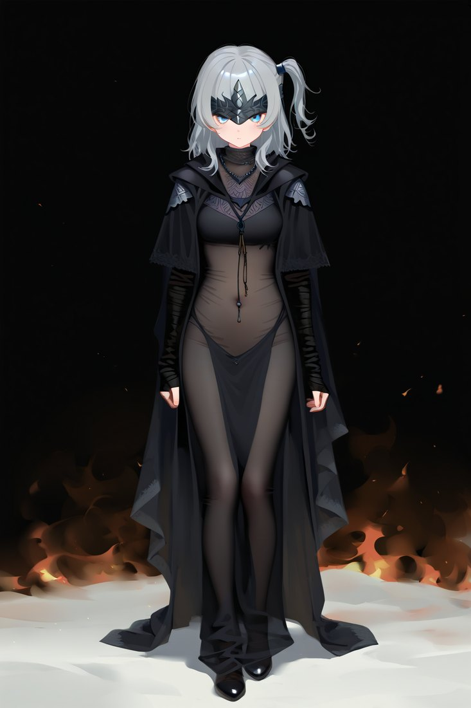

```text
(fire keeper \(cosplay\):1.3), covered eyes, eye mask, black see-through dress, revealing clothes, black bodystocking, see-through, black cape, black capelet, choker, pendant,
```

<a id="kisegaeningyou-0234"></a>

## 服装234

- 来源 ID：`kisegaeningyou-0234`；画廊：画廊3。
- [在线例图](https://assets.quicktagcloud.com/images/kisegaeningyou/kisegaeningyou-0234.jpg?v=e0f289d8b12a1d1b) · [原始 PNG](https://assets.quicktagcloud.com/originals/kisegaeningyou/kisegaeningyou-0234.png?v=e0f289d8b12a1d1b) · [来源图鉴](https://novelai.quicktagcloud.com/?c=kisegaeningyou)

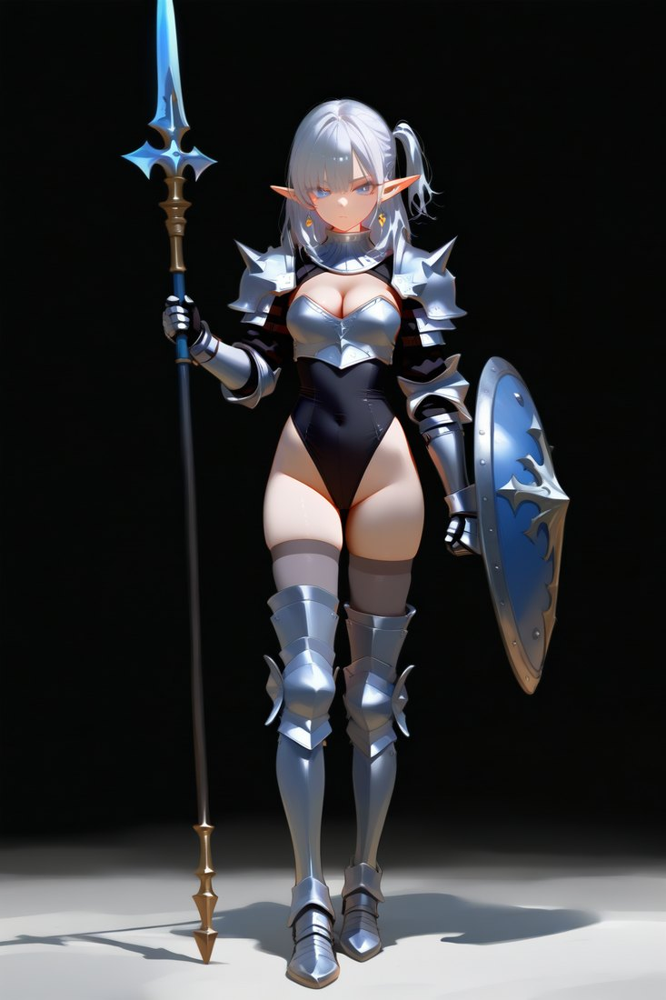

```text
armor, shield, polearm, helmet, holding weapon, pauldrons, shoulder armor, gauntlets, holding polearm, looking at viewer, greaves, clothing cutout, holding shield, armored boots, earrings, covered navel, spear, black leotard, cleavage, shoulder spikes, vambraces, gorget, grey thighhighs, breastplate, highleg, pointy ears, cleavage cutout, highleg leotard, gloves,
```

<a id="kisegaeningyou-0235"></a>

## 服装235

- 来源 ID：`kisegaeningyou-0235`；画廊：画廊3。
- [在线例图](https://assets.quicktagcloud.com/images/kisegaeningyou/kisegaeningyou-0235.jpg?v=e9094508182ac01f) · [原始 PNG](https://assets.quicktagcloud.com/originals/kisegaeningyou/kisegaeningyou-0235.png?v=e9094508182ac01f) · [来源图鉴](https://novelai.quicktagcloud.com/?c=kisegaeningyou)

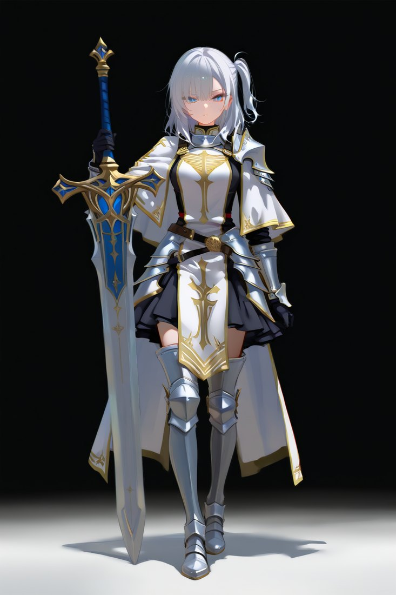

```text
full armor, white tabard, long sleeves, gold trim, white side capelet, dark side shoulder armor, black gloves, argyle, belt, layered dress, thigh boots, holding greatsword,
```

<a id="kisegaeningyou-0236"></a>

## 服装236

- 来源 ID：`kisegaeningyou-0236`；画廊：画廊3。
- [在线例图](https://assets.quicktagcloud.com/images/kisegaeningyou/kisegaeningyou-0236.jpg?v=558df0f817ca2094) · [原始 PNG](https://assets.quicktagcloud.com/originals/kisegaeningyou/kisegaeningyou-0236.png?v=558df0f817ca2094) · [来源图鉴](https://novelai.quicktagcloud.com/?c=kisegaeningyou)

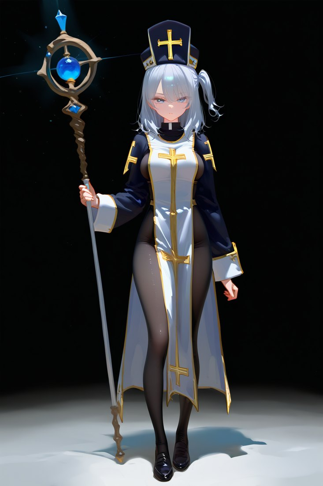

```text
holding staff, mage staff, priest, black bodystocking, (white tabard:1.1), shiny clothes, priest hat,
```

<a id="kisegaeningyou-0237"></a>

## 服装237

- 来源 ID：`kisegaeningyou-0237`；画廊：画廊3。
- [在线例图](https://assets.quicktagcloud.com/images/kisegaeningyou/kisegaeningyou-0237.jpg?v=e1333ae6154a511e) · [原始 PNG](https://assets.quicktagcloud.com/originals/kisegaeningyou/kisegaeningyou-0237.png?v=e1333ae6154a511e) · [来源图鉴](https://novelai.quicktagcloud.com/?c=kisegaeningyou)

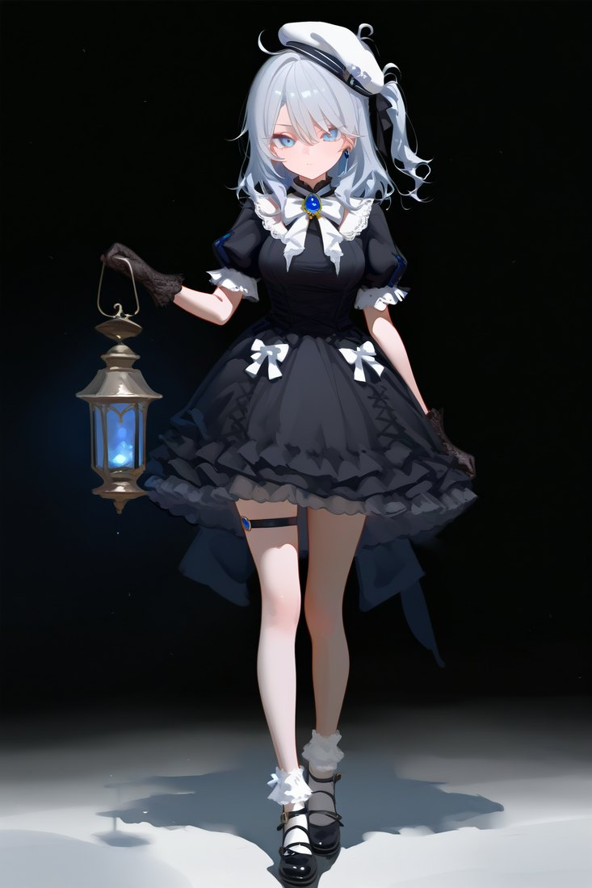

```text
holding lantern, black gloves, blue brooch, black dress, white headwear, lace gloves, puffy short sleeves, lolita fashion, thigh strap, blue gemstone, cowlick, frills, white bow,
```

<a id="kisegaeningyou-0238"></a>

## 服装238

- 来源 ID：`kisegaeningyou-0238`；画廊：画廊3。
- [在线例图](https://assets.quicktagcloud.com/images/kisegaeningyou/kisegaeningyou-0238.jpg?v=1a794220f9f49aa7) · [原始 PNG](https://assets.quicktagcloud.com/originals/kisegaeningyou/kisegaeningyou-0238.png?v=1a794220f9f49aa7) · [来源图鉴](https://novelai.quicktagcloud.com/?c=kisegaeningyou)

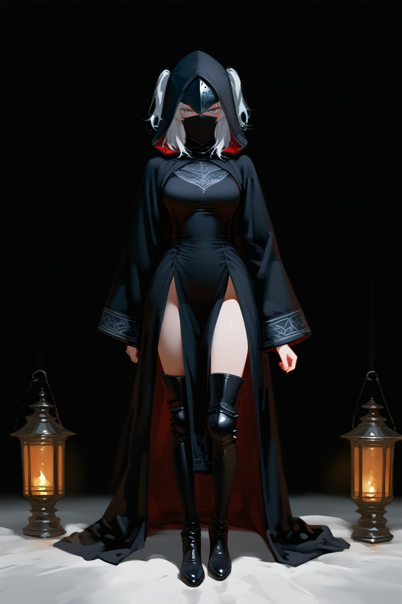

```text
black hood, (hood up, hood covered face:1.2), big hood, black robe, long dress, black thigh boots, long sleeve, (knight's helmet:0.9), lantern,
```

<a id="kisegaeningyou-0239"></a>

## 服装239

- 来源 ID：`kisegaeningyou-0239`；画廊：画廊3。
- [在线例图](https://assets.quicktagcloud.com/images/kisegaeningyou/kisegaeningyou-0239.jpg?v=9b56284202032ff0) · [原始 PNG](https://assets.quicktagcloud.com/originals/kisegaeningyou/kisegaeningyou-0239.png?v=9b56284202032ff0) · [来源图鉴](https://novelai.quicktagcloud.com/?c=kisegaeningyou)

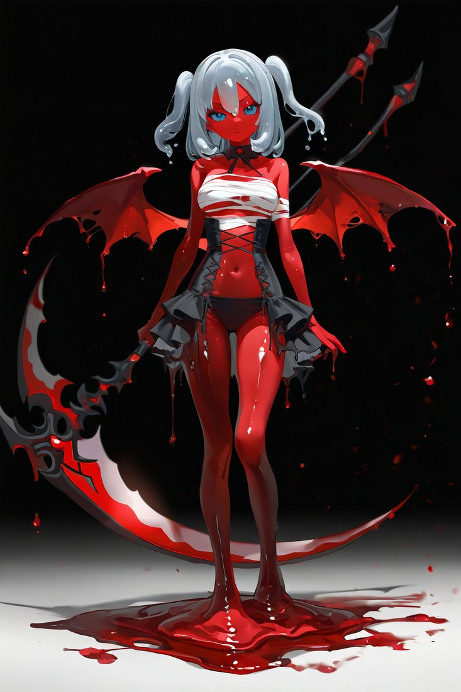

```text
(slime girl, liquid skin, membrane \(anatomy\), red skin, red wings, blood:1.2), holding scythe, red scythe, blood scythe, torn clothes, navel, budget sarashi, black dress, gothic lolita, cross-laced clothes, bare shoulders,
```

<a id="kisegaeningyou-0240"></a>

## 服装240

- 来源 ID：`kisegaeningyou-0240`；画廊：画廊3。
- [在线例图](https://assets.quicktagcloud.com/images/kisegaeningyou/kisegaeningyou-0240.jpg?v=e1a47990e65faa0c) · [原始 PNG](https://assets.quicktagcloud.com/originals/kisegaeningyou/kisegaeningyou-0240.png?v=e1a47990e65faa0c) · [来源图鉴](https://novelai.quicktagcloud.com/?c=kisegaeningyou)

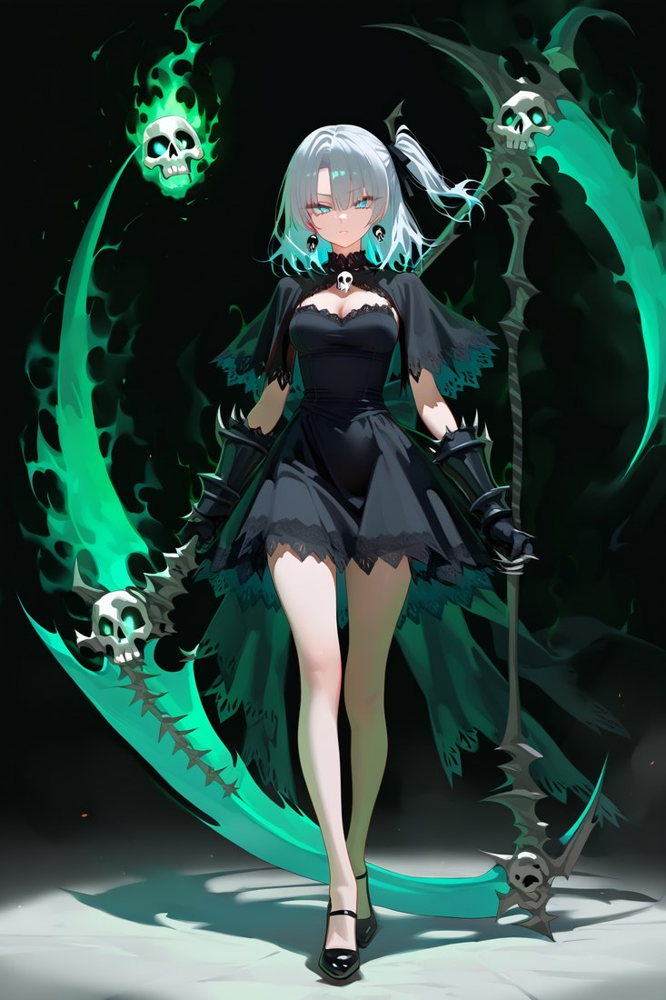

```text
hitodama, (black dress:1.3), lace trim dress, scythe, wings, pantylines, chain, (claws:1.2), (skull:1.2), green fire, gauntlets, (claws gloves:1.2), capri pants, high heels, (burning green fire skull:1.3), totenkopf, earrings, (flaming weapon:0.65), (levitation:1.3), (green aura:1.3), (aura surrounding:1.3), (green fire on scythe:1.3), (demonic powers:1.3), magical, green fire, dark aura, (holding scythe:1.3),
```

<a id="kisegaeningyou-0241"></a>

## 服装241

- 来源 ID：`kisegaeningyou-0241`；画廊：画廊3。
- [在线例图](https://assets.quicktagcloud.com/images/kisegaeningyou/kisegaeningyou-0241.jpg?v=b0fa65039f9eec0f) · [原始 PNG](https://assets.quicktagcloud.com/originals/kisegaeningyou/kisegaeningyou-0241.png?v=b0fa65039f9eec0f) · [来源图鉴](https://novelai.quicktagcloud.com/?c=kisegaeningyou)

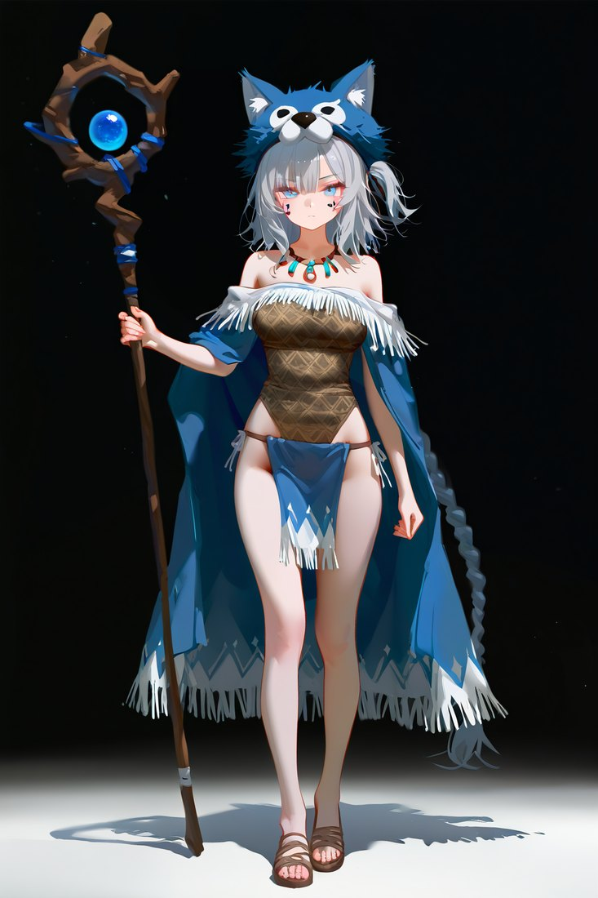

```text
(wolf hat:1.2), (holding wooden staff:1.1), magic on staff, bare shoulder, cape, vest, loincloth, patterned top, patterned clothing, necklace, fringe trim, pattern trim, (sylvan girl:1.2), (face tattoo:1.1), very long braid, pattern trim, crossbody,
```

<a id="kisegaeningyou-0242"></a>

## 服装242

- 来源 ID：`kisegaeningyou-0242`；画廊：画廊3。
- [在线例图](https://assets.quicktagcloud.com/images/kisegaeningyou/kisegaeningyou-0242.jpg?v=72be3c79d8b28ae4) · [原始 PNG](https://assets.quicktagcloud.com/originals/kisegaeningyou/kisegaeningyou-0242.png?v=72be3c79d8b28ae4) · [来源图鉴](https://novelai.quicktagcloud.com/?c=kisegaeningyou)

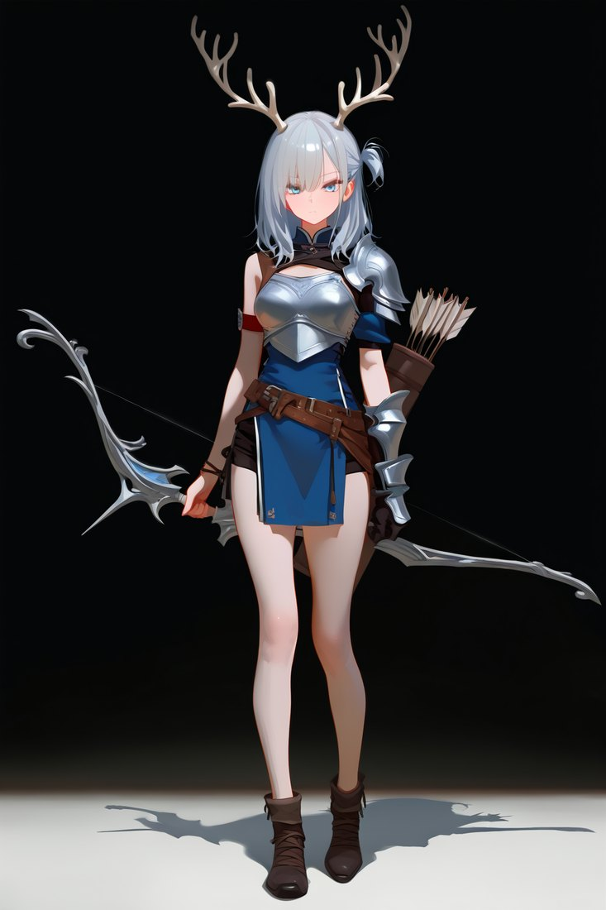

```text
(antlers:1.2), armband, armor, arrow \(projectile\), bow \(weapon\), breastplate, brown belt, chiton, hair bun, holding bow\(weapon\), quiver, single glove,
```

<a id="kisegaeningyou-0243"></a>

## 服装243

- 来源 ID：`kisegaeningyou-0243`；画廊：画廊3。
- [在线例图](https://assets.quicktagcloud.com/images/kisegaeningyou/kisegaeningyou-0243.jpg?v=14c7e323dac2e6a3) · [原始 PNG](https://assets.quicktagcloud.com/originals/kisegaeningyou/kisegaeningyou-0243.png?v=14c7e323dac2e6a3) · [来源图鉴](https://novelai.quicktagcloud.com/?c=kisegaeningyou)

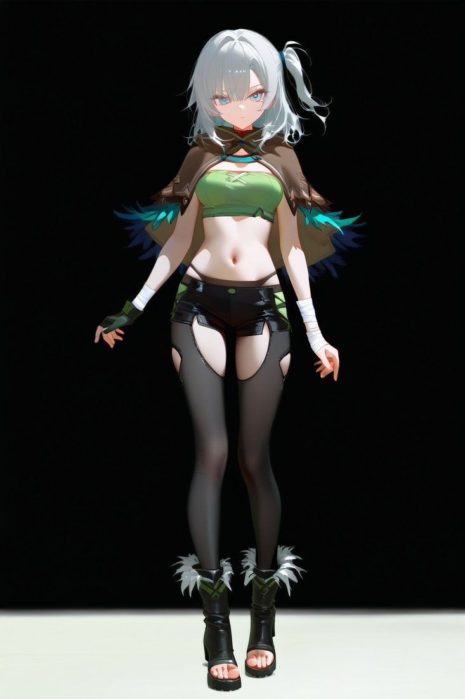

```text
brown capelet, (green tube top:1.1), single fingerless glove, bandged wrist, bandaged hand, navel, short shorts, midriff, (thigh cutout:1.3), (black pantyhose, thigh inner vent:1.2), (toeless footwear, open heel boots, toes:1.3), feather trim,
```

<a id="kisegaeningyou-0244"></a>

## 服装244

- 来源 ID：`kisegaeningyou-0244`；画廊：画廊3。
- [在线例图](https://assets.quicktagcloud.com/images/kisegaeningyou/kisegaeningyou-0244.jpg?v=641041094fc17c02) · [原始 PNG](https://assets.quicktagcloud.com/originals/kisegaeningyou/kisegaeningyou-0244.png?v=641041094fc17c02) · [来源图鉴](https://novelai.quicktagcloud.com/?c=kisegaeningyou)

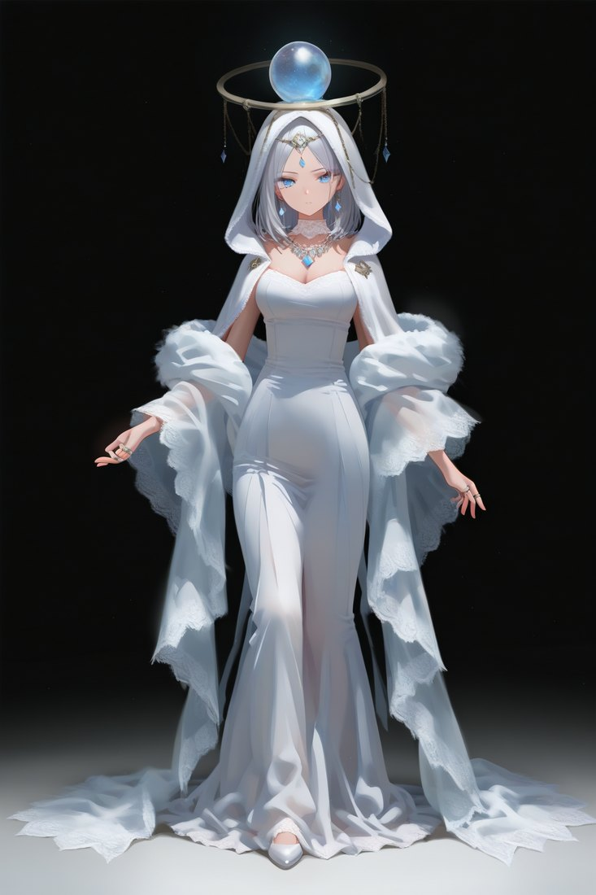

```text
diamond \(shape\), white flower on headdress, (pure white shawl:1.2), (silver head chain:1.1), necklace, lace choker, ring, hood up, forehead jewel, earrings, crystal ball,
```

<a id="kisegaeningyou-0245"></a>

## 服装245

- 来源 ID：`kisegaeningyou-0245`；画廊：画廊3。
- [在线例图](https://assets.quicktagcloud.com/images/kisegaeningyou/kisegaeningyou-0245.jpg?v=a7c5586517c8975c) · [原始 PNG](https://assets.quicktagcloud.com/originals/kisegaeningyou/kisegaeningyou-0245.png?v=a7c5586517c8975c) · [来源图鉴](https://novelai.quicktagcloud.com/?c=kisegaeningyou)

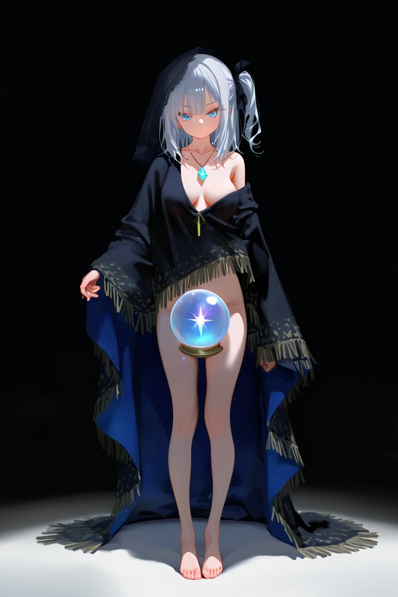

```text
black veil, (fortune teller:1.2), single bare shoulder, collarbone, (crystal ball:1.2), pendant necklace, long sleeves with intricate patterns, naked poncho, starry sky print black poncho,
```

<a id="kisegaeningyou-0246"></a>

## 服装246

- 来源 ID：`kisegaeningyou-0246`；画廊：画廊3。
- [在线例图](https://assets.quicktagcloud.com/images/kisegaeningyou/kisegaeningyou-0246.jpg?v=d8d5655d61095cc2) · [原始 PNG](https://assets.quicktagcloud.com/originals/kisegaeningyou/kisegaeningyou-0246.png?v=d8d5655d61095cc2) · [来源图鉴](https://novelai.quicktagcloud.com/?c=kisegaeningyou)

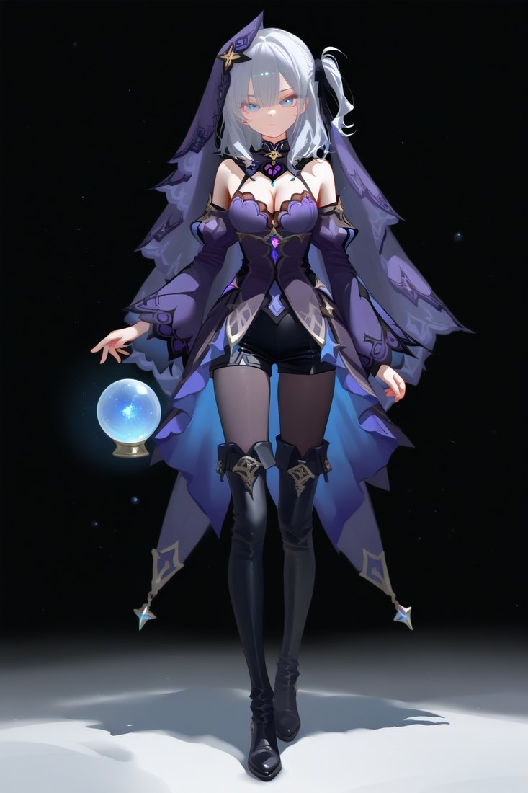

```text
pantyhose under shorts, bare shoulders, purple veil, cleavage, shorts, detached sleeves, purple dress, thigh boots, magical crystal ball,
```

<a id="kisegaeningyou-0247"></a>

## 服装247

- 来源 ID：`kisegaeningyou-0247`；画廊：画廊3。
- [在线例图](https://assets.quicktagcloud.com/images/kisegaeningyou/kisegaeningyou-0247.jpg?v=956190f8f2218896) · [原始 PNG](https://assets.quicktagcloud.com/originals/kisegaeningyou/kisegaeningyou-0247.png?v=956190f8f2218896) · [来源图鉴](https://novelai.quicktagcloud.com/?c=kisegaeningyou)

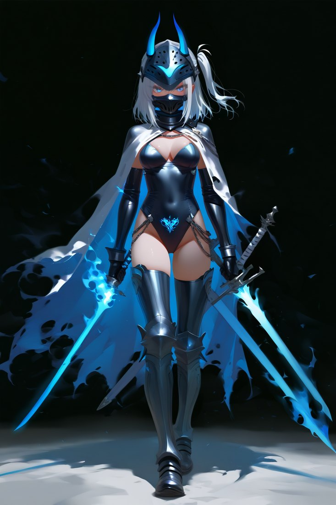

```text
helmet, (devil tattoo:1.1), (walking, blue fire, holding sword:1.1), (sword glowing:1.2), chains, (wearing tattered clothes:1.1), (torn cloak:1.2), soul,
```

<a id="kisegaeningyou-0248"></a>

## 服装248

- 来源 ID：`kisegaeningyou-0248`；画廊：画廊3。
- [在线例图](https://assets.quicktagcloud.com/images/kisegaeningyou/kisegaeningyou-0248.jpg?v=065cc5d2077c7c5d) · [原始 PNG](https://assets.quicktagcloud.com/originals/kisegaeningyou/kisegaeningyou-0248.png?v=065cc5d2077c7c5d) · [来源图鉴](https://novelai.quicktagcloud.com/?c=kisegaeningyou)

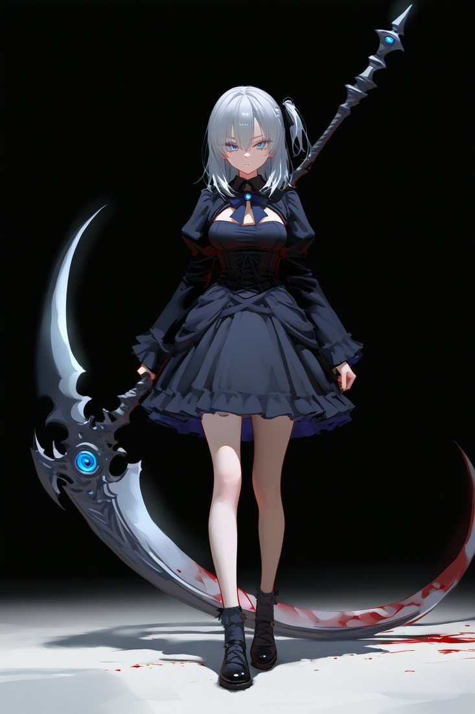

```text
raven, blood, gothic dress, lantern, (giant scythe:1.1),
```

<a id="kisegaeningyou-0249"></a>

## 服装249

- 来源 ID：`kisegaeningyou-0249`；画廊：画廊3。
- [在线例图](https://assets.quicktagcloud.com/images/kisegaeningyou/kisegaeningyou-0249.jpg?v=fbe67066dfd771d1) · [原始 PNG](https://assets.quicktagcloud.com/originals/kisegaeningyou/kisegaeningyou-0249.png?v=fbe67066dfd771d1) · [来源图鉴](https://novelai.quicktagcloud.com/?c=kisegaeningyou)

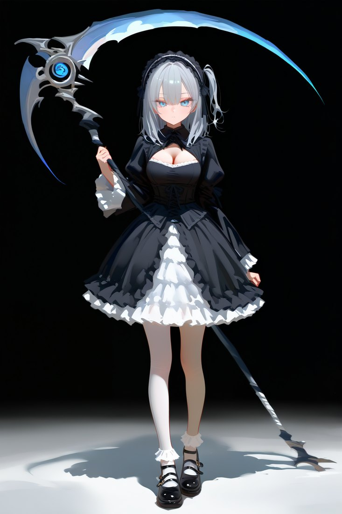

```text
cleavage cutout, gothic lolita style, lolita hairband, lolita fashion, black shoes, holding (huge:1.1) scythe \(weapon\),
```

<a id="kisegaeningyou-0250"></a>

## 服装250

- 来源 ID：`kisegaeningyou-0250`；画廊：画廊3。
- [在线例图](https://assets.quicktagcloud.com/images/kisegaeningyou/kisegaeningyou-0250.jpg?v=b4a9eb20ed9351e0) · [原始 PNG](https://assets.quicktagcloud.com/originals/kisegaeningyou/kisegaeningyou-0250.png?v=b4a9eb20ed9351e0) · [来源图鉴](https://novelai.quicktagcloud.com/?c=kisegaeningyou)

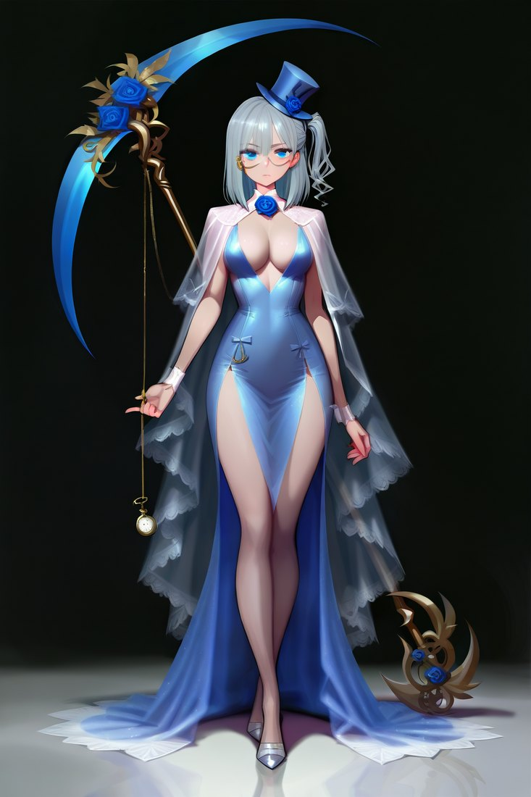

```text
(blue roses, pocket watch, gorgeous:1.2), high slit silk evening gown, transparent evening gown, low cut, transparent gown, top hat, monocle, death scythe, huge scythe, red blade, golden leg ornaments,
```

<a id="kisegaeningyou-0251"></a>

## 服装251

- 来源 ID：`kisegaeningyou-0251`；画廊：画廊3。
- [在线例图](https://assets.quicktagcloud.com/images/kisegaeningyou/kisegaeningyou-0251.jpg?v=71f95410d9607918) · [原始 PNG](https://assets.quicktagcloud.com/originals/kisegaeningyou/kisegaeningyou-0251.png?v=71f95410d9607918) · [来源图鉴](https://novelai.quicktagcloud.com/?c=kisegaeningyou)

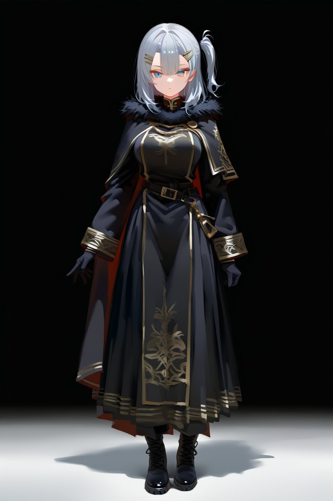

```text
hair clips, black robe, fur collar, black long tabard, long skirt, boots, gold trim, belt, long sleeves, side cape, black gloves,
```

<a id="kisegaeningyou-0252"></a>

## 服装252

- 来源 ID：`kisegaeningyou-0252`；画廊：画廊3。
- [在线例图](https://assets.quicktagcloud.com/images/kisegaeningyou/kisegaeningyou-0252.jpg?v=164e97b1a2322ddc) · [原始 PNG](https://assets.quicktagcloud.com/originals/kisegaeningyou/kisegaeningyou-0252.png?v=164e97b1a2322ddc) · [来源图鉴](https://novelai.quicktagcloud.com/?c=kisegaeningyou)

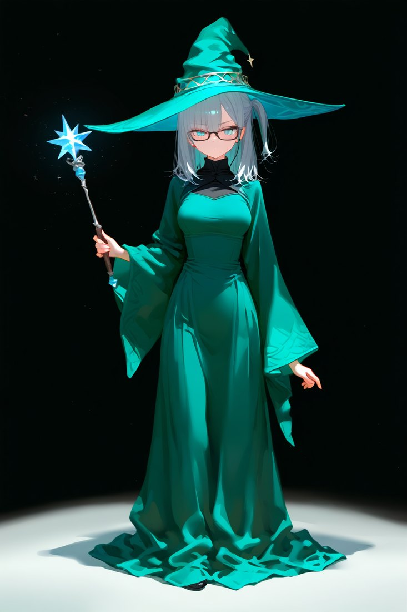

```text
black-framed eyewear, black shirt, dress, glasses, green dress, high collar, holding wand, long sleeves, wide sleeves, wizard hat,
```

<a id="kisegaeningyou-0253"></a>

## 服装253

- 来源 ID：`kisegaeningyou-0253`；画廊：画廊3。
- [在线例图](https://assets.quicktagcloud.com/images/kisegaeningyou/kisegaeningyou-0253.jpg?v=61a3d8dc54cacea2) · [原始 PNG](https://assets.quicktagcloud.com/originals/kisegaeningyou/kisegaeningyou-0253.png?v=61a3d8dc54cacea2) · [来源图鉴](https://novelai.quicktagcloud.com/?c=kisegaeningyou)

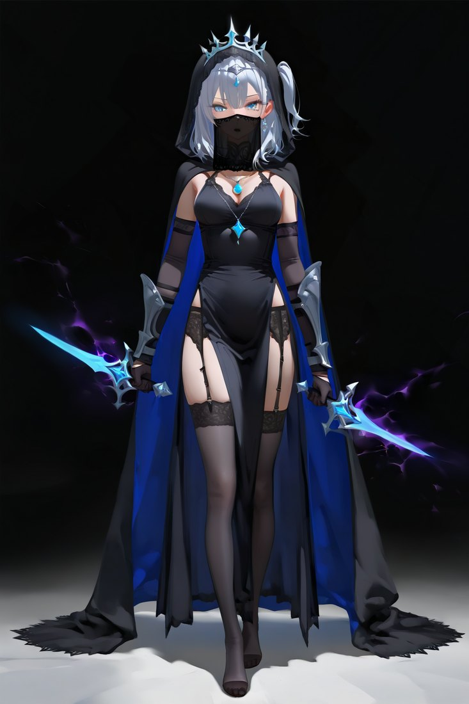

```text
tiara, light blue gem, pendant, necklace, lace trimmed black stockings, garter belt, elbow gloves, (side silk, sleeveless dress, skirt, long cape, robe, black hood, black mouth veil, armguard:1.2), purple energy power, holding dagger,
```

<a id="kisegaeningyou-0254"></a>

## 服装254

- 来源 ID：`kisegaeningyou-0254`；画廊：画廊3。
- [在线例图](https://assets.quicktagcloud.com/images/kisegaeningyou/kisegaeningyou-0254.jpg?v=c5babf5df7ed2ef6) · [原始 PNG](https://assets.quicktagcloud.com/originals/kisegaeningyou/kisegaeningyou-0254.png?v=c5babf5df7ed2ef6) · [来源图鉴](https://novelai.quicktagcloud.com/?c=kisegaeningyou)

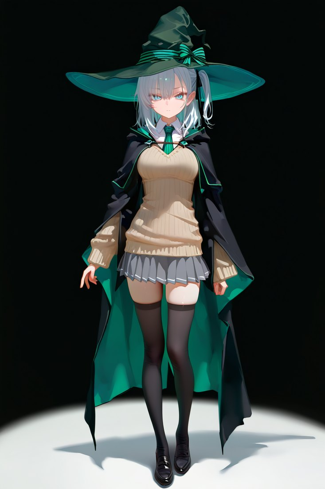

```text
(wing collar:1.2), (green lining, ribbed sweater, beige sweater:1.1), wide sleeves, large hat, black witch hat, black robes, green hat bow, green ribbed necktie, grey skirt, lowleg skirt, pleated skirt, white shirt, black thighhigh,
```

<a id="kisegaeningyou-0255"></a>

## 服装255

- 来源 ID：`kisegaeningyou-0255`；画廊：画廊3。
- [在线例图](https://assets.quicktagcloud.com/images/kisegaeningyou/kisegaeningyou-0255.jpg?v=b36171e0aea03450) · [原始 PNG](https://assets.quicktagcloud.com/originals/kisegaeningyou/kisegaeningyou-0255.png?v=b36171e0aea03450) · [来源图鉴](https://novelai.quicktagcloud.com/?c=kisegaeningyou)

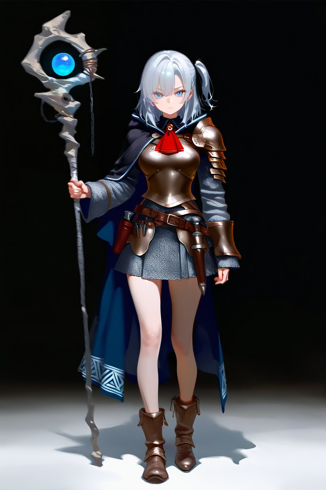

```text
necromancer, wizard, holding a staff, skull staff, (hooded:1.2), (one shoulder cape:1.1), (black shoulder armor with gold trim:1.1), leather armguard, (chain mail lining:1.1), (brown leather-armor vest:1.1), cardigan, red ascot, (edge pattern trim clothing:1.2), long sleeves, tool belt,
```

<a id="kisegaeningyou-0256"></a>

## 服装256

- 来源 ID：`kisegaeningyou-0256`；画廊：画廊3。
- [在线例图](https://assets.quicktagcloud.com/images/kisegaeningyou/kisegaeningyou-0256.jpg?v=45cceda8381ee3dc) · [原始 PNG](https://assets.quicktagcloud.com/originals/kisegaeningyou/kisegaeningyou-0256.png?v=45cceda8381ee3dc) · [来源图鉴](https://novelai.quicktagcloud.com/?c=kisegaeningyou)

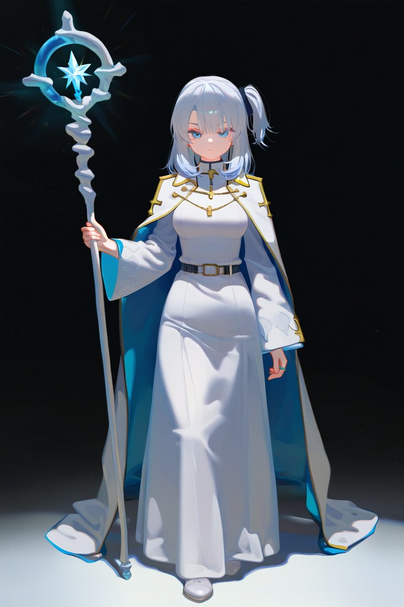

```text
bishop, (formal white bishop dress:1.1), (white bishop coat:1.2), white mage, white cape, detached sleeves, long sleeves, ring, belt, formal dress, (clear crystal mage staff made by blue jade with awesome decoration:1.2), holding mage staff,
```

<a id="kisegaeningyou-0257"></a>

## 服装257

- 来源 ID：`kisegaeningyou-0257`；画廊：画廊3。
- [在线例图](https://assets.quicktagcloud.com/images/kisegaeningyou/kisegaeningyou-0257.jpg?v=1ec30e199fadfd3a) · [原始 PNG](https://assets.quicktagcloud.com/originals/kisegaeningyou/kisegaeningyou-0257.png?v=1ec30e199fadfd3a) · [来源图鉴](https://novelai.quicktagcloud.com/?c=kisegaeningyou)

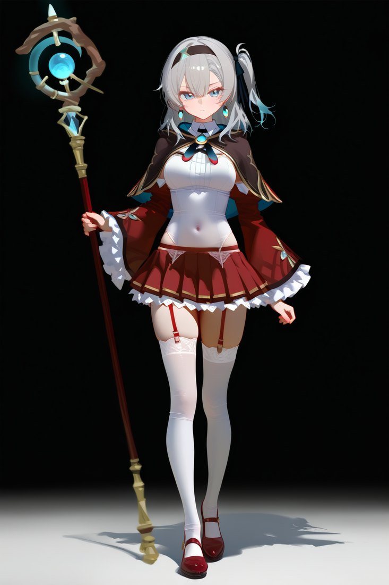

```text
(red sleeves:1.2), detached sleeves, long frilled sleeves, wide sleeves, ribbed sleeves, red garter belt, red garter straps, (white shirt, covered navel:1.3), white thighhighs, black capelet, short capelet, black hairband, red pleated skirt, frilled skirt, gold trim, earrings, (red mage staff:1.2),
```

<a id="kisegaeningyou-0258"></a>

## 服装258

- 来源 ID：`kisegaeningyou-0258`；画廊：画廊3。
- [在线例图](https://assets.quicktagcloud.com/images/kisegaeningyou/kisegaeningyou-0258.jpg?v=537b79f8cf6aac7d) · [原始 PNG](https://assets.quicktagcloud.com/originals/kisegaeningyou/kisegaeningyou-0258.png?v=537b79f8cf6aac7d) · [来源图鉴](https://novelai.quicktagcloud.com/?c=kisegaeningyou)

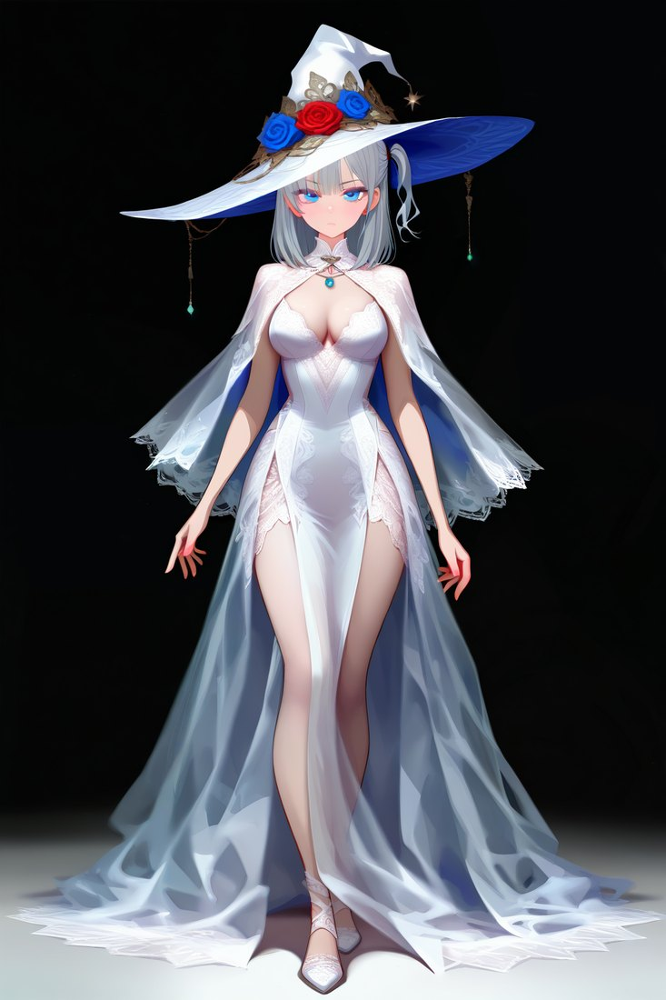

```text
gorgeous western dresses, complex costume design. elegant style, lace and accessories, jewelry details, contrast color, witch hat, red rose elements, knolling layout, many parts,
```

<a id="kisegaeningyou-0259"></a>

## 服装259

- 来源 ID：`kisegaeningyou-0259`；画廊：画廊3。
- [在线例图](https://assets.quicktagcloud.com/images/kisegaeningyou/kisegaeningyou-0259.jpg?v=2ec10c644869b511) · [原始 PNG](https://assets.quicktagcloud.com/originals/kisegaeningyou/kisegaeningyou-0259.png?v=2ec10c644869b511) · [来源图鉴](https://novelai.quicktagcloud.com/?c=kisegaeningyou)


```text
(black witch hat, black coat:1.2), (black fingerless gloves:1.1), blouse, undone necktie, denim shorts, white shirt, big bag, shoulder bag,
```

<a id="kisegaeningyou-0260"></a>

## 服装260

- 来源 ID：`kisegaeningyou-0260`；画廊：画廊3。
- [在线例图](https://assets.quicktagcloud.com/images/kisegaeningyou/kisegaeningyou-0260.jpg?v=bde94961cc9119bf) · [原始 PNG](https://assets.quicktagcloud.com/originals/kisegaeningyou/kisegaeningyou-0260.png?v=bde94961cc9119bf) · [来源图鉴](https://novelai.quicktagcloud.com/?c=kisegaeningyou)


```text
(red witch hat:1.2), brown nails, fingerless gloves, green-tinted eyewear, sunglasses, navel, shorts, crop top, chain, ring,
```

<a id="kisegaeningyou-0261"></a>

## 服装261

- 来源 ID：`kisegaeningyou-0261`；画廊：画廊3。
- [在线例图](https://assets.quicktagcloud.com/images/kisegaeningyou/kisegaeningyou-0261.jpg?v=94e0dc4d7b0b21be) · [原始 PNG](https://assets.quicktagcloud.com/originals/kisegaeningyou/kisegaeningyou-0261.png?v=94e0dc4d7b0b21be) · [来源图鉴](https://novelai.quicktagcloud.com/?c=kisegaeningyou)


```text
black gothic lolita fashion, holding white giant hammer \(weapon\), wings \(blurred\), white lace, pink frills, ribbons, pink accessories,
```

<a id="kisegaeningyou-0262"></a>

## 服装262

- 来源 ID：`kisegaeningyou-0262`；画廊：画廊3。
- [在线例图](https://assets.quicktagcloud.com/images/kisegaeningyou/kisegaeningyou-0262.jpg?v=53dd12feb674cf6b) · [原始 PNG](https://assets.quicktagcloud.com/originals/kisegaeningyou/kisegaeningyou-0262.png?v=53dd12feb674cf6b) · [来源图鉴](https://novelai.quicktagcloud.com/?c=kisegaeningyou)


```text
black nails, asymmetrical legwear, black choker, bridal gauntlets, clothing cutout, detached sleeves, earrings, groin, hair flower, hair ornament, high heels, highleg leotard, leotard, mismatched legwear, navel piercing, pubic tattoo, sidelocks, single thigh boot, thigh gap, thighhighs, waist cape,
```

<a id="kisegaeningyou-0263"></a>

## 服装263

- 来源 ID：`kisegaeningyou-0263`；画廊：画廊3。
- [在线例图](https://assets.quicktagcloud.com/images/kisegaeningyou/kisegaeningyou-0263.jpg?v=1890096e7362d933) · [原始 PNG](https://assets.quicktagcloud.com/originals/kisegaeningyou/kisegaeningyou-0263.png?v=1890096e7362d933) · [来源图鉴](https://novelai.quicktagcloud.com/?c=kisegaeningyou)


```text
mecha musume, body armor, white armor, black armor, chest tattoo, heart tattoo, thighhighs, high heel boots, thigh boots, center opening, elbow gloves, see-through skirt, collarbone, navel, showgirl skirt, chest jewel, purple print, skindentation, covered navel, black leotard, glowing energy wings, neon trim,
```

<a id="kisegaeningyou-0264"></a>

## 服装264

- 来源 ID：`kisegaeningyou-0264`；画廊：画廊3。
- [在线例图](https://assets.quicktagcloud.com/images/kisegaeningyou/kisegaeningyou-0264.jpg?v=53f1555d58fee6da) · [原始 PNG](https://assets.quicktagcloud.com/originals/kisegaeningyou/kisegaeningyou-0264.png?v=53f1555d58fee6da) · [来源图鉴](https://novelai.quicktagcloud.com/?c=kisegaeningyou)


```text
(valkyrie:1.2), holding polearm, polearm, armor, armored bodysuit, armored boots, armored gloves, armored skirt, black bodysuit, breastplate, fingerless gloves, hip armor, leg armor, shoulder armor, two-sided capelet,
```

<a id="kisegaeningyou-0265"></a>

## 服装265

- 来源 ID：`kisegaeningyou-0265`；画廊：画廊3。
- [在线例图](https://assets.quicktagcloud.com/images/kisegaeningyou/kisegaeningyou-0265.jpg?v=6b288ec60edb5e9c) · [原始 PNG](https://assets.quicktagcloud.com/originals/kisegaeningyou/kisegaeningyou-0265.png?v=6b288ec60edb5e9c) · [来源图鉴](https://novelai.quicktagcloud.com/?c=kisegaeningyou)


```text
feather hair ornament, long fingernails, sharp fingernails, bare shoulders, revealing clothes, white thighhighs, wrist guards, pelvic curtain, midriff,
```

<a id="kisegaeningyou-0266"></a>

## 服装266

- 来源 ID：`kisegaeningyou-0266`；画廊：画廊3。
- [在线例图](https://assets.quicktagcloud.com/images/kisegaeningyou/kisegaeningyou-0266.jpg?v=3f47d125c04bf8fb) · [原始 PNG](https://assets.quicktagcloud.com/originals/kisegaeningyou/kisegaeningyou-0266.png?v=3f47d125c04bf8fb) · [来源图鉴](https://novelai.quicktagcloud.com/?c=kisegaeningyou)


```text
armlet, bikini armor, bracelet, circlet, earrings, eyelashes, gold chain, gold choker, gold trim, green gemstone, head chain, loincloth, navel, neck ring, necklace, pelvic curtain, red cape, skindentation, midriff, thigh strap, thighlet, tiara,
```

<a id="kisegaeningyou-0267"></a>

## 服装267

- 来源 ID：`kisegaeningyou-0267`；画廊：画廊3。
- [在线例图](https://assets.quicktagcloud.com/images/kisegaeningyou/kisegaeningyou-0267.jpg?v=b13444832a43be18) · [原始 PNG](https://assets.quicktagcloud.com/originals/kisegaeningyou/kisegaeningyou-0267.png?v=b13444832a43be18) · [来源图鉴](https://novelai.quicktagcloud.com/?c=kisegaeningyou)


```text
yellow basketball uniform, (the word on clothes that says laker 8:1.2), smile teeth,
```

<a id="kisegaeningyou-0268"></a>

## 服装268

- 来源 ID：`kisegaeningyou-0268`；画廊：画廊3。
- [在线例图](https://assets.quicktagcloud.com/images/kisegaeningyou/kisegaeningyou-0268.jpg?v=168bed0daf23b6d2) · [原始 PNG](https://assets.quicktagcloud.com/originals/kisegaeningyou/kisegaeningyou-0268.png?v=168bed0daf23b6d2) · [来源图鉴](https://novelai.quicktagcloud.com/?c=kisegaeningyou)


```text
grey dress, sleevesless, (bandages, torn clothes, bandaged arm, bandaged head, bandaged leg:1.2), anklet, collarbone, no shoes, feet,
```

<a id="kisegaeningyou-0269"></a>

## 服装269

- 来源 ID：`kisegaeningyou-0269`；画廊：画廊3。
- [在线例图](https://assets.quicktagcloud.com/images/kisegaeningyou/kisegaeningyou-0269.jpg?v=9d2bf2f2f0b2ed8f) · [原始 PNG](https://assets.quicktagcloud.com/originals/kisegaeningyou/kisegaeningyou-0269.png?v=9d2bf2f2f0b2ed8f) · [来源图鉴](https://novelai.quicktagcloud.com/?c=kisegaeningyou)


```text
arm strap, bare shoulders, black dress, black hands, chain, cracked skin, gradient skin, high collar, holding polearm, hole on body, hood up, hooded dress, impaled, pale skin, side slit,
```

<a id="kisegaeningyou-0270"></a>

## 服装270

- 来源 ID：`kisegaeningyou-0270`；画廊：画廊3。
- [在线例图](https://assets.quicktagcloud.com/images/kisegaeningyou/kisegaeningyou-0270.jpg?v=6ca06a7428c9d1e3) · [原始 PNG](https://assets.quicktagcloud.com/originals/kisegaeningyou/kisegaeningyou-0270.png?v=6ca06a7428c9d1e3) · [来源图鉴](https://novelai.quicktagcloud.com/?c=kisegaeningyou)


```text
holding revolver, red scarf, black wide-brimmed hat, silver studs, brown leather jacket, high-collared shirt, adorned with intricate silver embroidery, brown leather gloves, elbows gloves, necktie, dress pants, white shirt, cowboy boots,
```

<a id="kisegaeningyou-0271"></a>

## 服装271

- 来源 ID：`kisegaeningyou-0271`；画廊：画廊3。
- [在线例图](https://assets.quicktagcloud.com/images/kisegaeningyou/kisegaeningyou-0271.jpg?v=0a10f2c41b48be88) · [原始 PNG](https://assets.quicktagcloud.com/originals/kisegaeningyou/kisegaeningyou-0271.png?v=0a10f2c41b48be88) · [来源图鉴](https://novelai.quicktagcloud.com/?c=kisegaeningyou)


```text
floral print, bowtie, shoulder armor, sleeveless, wrist ribbon, cross necklace, wide sleeves, collared dress, holding weapon, (floating sword, greatsword, huge weapon:1.2), shoulder cutout,
```

<a id="kisegaeningyou-0272"></a>

## 服装272

- 来源 ID：`kisegaeningyou-0272`；画廊：画廊3。
- [在线例图](https://assets.quicktagcloud.com/images/kisegaeningyou/kisegaeningyou-0272.jpg?v=7b2c9e4f2392f597) · [原始 PNG](https://assets.quicktagcloud.com/originals/kisegaeningyou/kisegaeningyou-0272.png?v=7b2c9e4f2392f597) · [来源图鉴](https://novelai.quicktagcloud.com/?c=kisegaeningyou)


```text
(see-through white ghost costume:1.1), hood up, sleeves past wrists, wide sleeves, white robe, very long dress,
```

<a id="kisegaeningyou-0273"></a>

## 服装273

- 来源 ID：`kisegaeningyou-0273`；画廊：画廊3。
- [在线例图](https://assets.quicktagcloud.com/images/kisegaeningyou/kisegaeningyou-0273.jpg?v=ea3e81e51915560a) · [原始 PNG](https://assets.quicktagcloud.com/originals/kisegaeningyou/kisegaeningyou-0273.png?v=ea3e81e51915560a) · [来源图鉴](https://novelai.quicktagcloud.com/?c=kisegaeningyou)


```text
bare shoulders, blue headband, feet, ghost, hairclip, hitodama, see-through clothes, skull hair ornament, sleeves past fingers, toes, torn clothes, white dress, white thighhighs, will-o'-the-wisp \(mythology\),
```

<a id="kisegaeningyou-0274"></a>

## 服装274

- 来源 ID：`kisegaeningyou-0274`；画廊：画廊3。
- [在线例图](https://assets.quicktagcloud.com/images/kisegaeningyou/kisegaeningyou-0274.jpg?v=035ddeeed1e1a1a5) · [原始 PNG](https://assets.quicktagcloud.com/originals/kisegaeningyou/kisegaeningyou-0274.png?v=035ddeeed1e1a1a5) · [来源图鉴](https://novelai.quicktagcloud.com/?c=kisegaeningyou)


```text
(eyes mask, feather mask:1.2), form fitting suit, silk cape, high heels, elbow gloves, pearl necklace, hidden wires, gold embroidery, diamond tiara,
```

<a id="kisegaeningyou-0275"></a>

## 服装275

- 来源 ID：`kisegaeningyou-0275`；画廊：画廊3。
- [在线例图](https://assets.quicktagcloud.com/images/kisegaeningyou/kisegaeningyou-0275.jpg?v=40ed76e17786ebf8) · [原始 PNG](https://assets.quicktagcloud.com/originals/kisegaeningyou/kisegaeningyou-0275.png?v=40ed76e17786ebf8) · [来源图鉴](https://novelai.quicktagcloud.com/?c=kisegaeningyou)


```text
flower over eye, white thighhighs, white dress, purple ascot, purple trim, purple shirt, white gloves, gauntlets, white jacket, close-fitting dress, single slit, long sleeves, white skirt,
```

<a id="kisegaeningyou-0276"></a>

## 服装276

- 来源 ID：`kisegaeningyou-0276`；画廊：画廊3。
- [在线例图](https://assets.quicktagcloud.com/images/kisegaeningyou/kisegaeningyou-0276.jpg?v=bc365ba7d9d8fbf3) · [原始 PNG](https://assets.quicktagcloud.com/originals/kisegaeningyou/kisegaeningyou-0276.png?v=bc365ba7d9d8fbf3) · [来源图鉴](https://novelai.quicktagcloud.com/?c=kisegaeningyou)


```text
frilly white dress, yellow ribbons, brown capelet with hood, stuffed sheep toy, white panties, white stockings, (brown medieval peasant shoes:1.1), holding basket,
```

<a id="kisegaeningyou-0277"></a>

## 服装277

- 来源 ID：`kisegaeningyou-0277`；画廊：画廊3。
- [在线例图](https://assets.quicktagcloud.com/images/kisegaeningyou/kisegaeningyou-0277.jpg?v=b4cb9bce772b91b3) · [原始 PNG](https://assets.quicktagcloud.com/originals/kisegaeningyou/kisegaeningyou-0277.png?v=b4cb9bce772b91b3) · [来源图鉴](https://novelai.quicktagcloud.com/?c=kisegaeningyou)


```text
apron, wolf ears, dress, fang, fingernails, red hooded cloak, red frilly dress, sharp fingernails, stuffed sheep toy, white panties, white stockings, holding basket,
```

<a id="kisegaeningyou-0278"></a>

## 服装278

- 来源 ID：`kisegaeningyou-0278`；画廊：画廊3。
- [在线例图](https://assets.quicktagcloud.com/images/kisegaeningyou/kisegaeningyou-0278.jpg?v=9f37dff9c4599d10) · [原始 PNG](https://assets.quicktagcloud.com/originals/kisegaeningyou/kisegaeningyou-0278.png?v=9f37dff9c4599d10) · [来源图鉴](https://novelai.quicktagcloud.com/?c=kisegaeningyou)


```text
red plugsuit, bodysuitskin tight, interface headset, pilot suit, no shoes, covered feet,
```

<a id="kisegaeningyou-0279"></a>

## 服装279

- 来源 ID：`kisegaeningyou-0279`；画廊：画廊3。
- [在线例图](https://assets.quicktagcloud.com/images/kisegaeningyou/kisegaeningyou-0279.jpg?v=9a67d6424a58be1e) · [原始 PNG](https://assets.quicktagcloud.com/originals/kisegaeningyou/kisegaeningyou-0279.png?v=9a67d6424a58be1e) · [来源图鉴](https://novelai.quicktagcloud.com/?c=kisegaeningyou)


```text
miniskirt, sleeveless shirt, hair bow, black skirt, pleated skirt, white shirt, black sailor collar, black thighhighs, thigh boots, black footwear, zettai ryouiki, white bow, white hairband, collared shirt, sailor shirt, detached sleeves, black sleeves, hairclip, number tattoo, arm tattoo, shoulder tattoo,
```

<a id="kisegaeningyou-0280"></a>

## 服装280

- 来源 ID：`kisegaeningyou-0280`；画廊：画廊3。
- [在线例图](https://assets.quicktagcloud.com/images/kisegaeningyou/kisegaeningyou-0280.jpg?v=17b48815dddf80c5) · [原始 PNG](https://assets.quicktagcloud.com/originals/kisegaeningyou/kisegaeningyou-0280.png?v=17b48815dddf80c5) · [来源图鉴](https://novelai.quicktagcloud.com/?c=kisegaeningyou)


```text
double-breasted, detached sleeves, sleeves past wrists, white dress, vertical-striped pantyhose, blue necktie, white pantyhose, bare shoulders, hair flower, flower wreath, long sleeves, white bow, white footwear, footwear bow, sleeveless dress, white sleeves, buttons, sailor collar,
```

<a id="kisegaeningyou-0281"></a>

## 服装281

- 来源 ID：`kisegaeningyou-0281`；画廊：画廊3。
- [在线例图](https://assets.quicktagcloud.com/images/kisegaeningyou/kisegaeningyou-0281.jpg?v=2f17494c1e6f184b) · [原始 PNG](https://assets.quicktagcloud.com/originals/kisegaeningyou/kisegaeningyou-0281.png?v=2f17494c1e6f184b) · [来源图鉴](https://novelai.quicktagcloud.com/?c=kisegaeningyou)


```text
black skirt, pleated skirt, white shirt, fingerless gloves, black gloves, black pantyhose, brown pantyhose, id card, black necktie, collared shirt, open jacket, pocket, uniform, high-waist skirt, shirt tucked in, green coat, coat on shoulders, thighband pantyhose,
```

<a id="kisegaeningyou-0282"></a>

## 服装282

- 来源 ID：`kisegaeningyou-0282`；画廊：画廊3。
- [在线例图](https://assets.quicktagcloud.com/images/kisegaeningyou/kisegaeningyou-0282.jpg?v=7273cf52783afe8c) · [原始 PNG](https://assets.quicktagcloud.com/originals/kisegaeningyou/kisegaeningyou-0282.png?v=7273cf52783afe8c) · [来源图鉴](https://novelai.quicktagcloud.com/?c=kisegaeningyou)


```text
bare shoulders, collarbone, strapless, blue bikini, armlet, blue gemstone, crystal bikini, gem bikini,
```

<a id="kisegaeningyou-0283"></a>

## 服装283

- 来源 ID：`kisegaeningyou-0283`；画廊：画廊3。
- [在线例图](https://assets.quicktagcloud.com/images/kisegaeningyou/kisegaeningyou-0283.jpg?v=b482f6a0a5678c55) · [原始 PNG](https://assets.quicktagcloud.com/originals/kisegaeningyou/kisegaeningyou-0283.png?v=b482f6a0a5678c55) · [来源图鉴](https://novelai.quicktagcloud.com/?c=kisegaeningyou)


```text
floral print white kimono, floral print white thighhigh, hair flower, sash, obi, long sleeves, wide sleeves, side slit, tabi,
```

<a id="kisegaeningyou-0284"></a>

## 服装284

- 来源 ID：`kisegaeningyou-0284`；画廊：画廊3。
- [在线例图](https://assets.quicktagcloud.com/images/kisegaeningyou/kisegaeningyou-0284.jpg?v=4d1b76df4e4a9fdd) · [原始 PNG](https://assets.quicktagcloud.com/originals/kisegaeningyou/kisegaeningyou-0284.png?v=4d1b76df4e4a9fdd) · [来源图鉴](https://novelai.quicktagcloud.com/?c=kisegaeningyou)


```text
(reverse bunnysuit:1.2), heart pasties, white gloves, thigh strap, topless,
```
