# 泳装

[总目录](../README.md) · [原站分类目录](../categories.md) · [英文标签索引](../tags.md) · [服装与构图组合指南](../../README.md)

标题、分类、说明、正负提示词按来源保留；多例图逐张列出。原站标记和说明为参考资料，不作为维护指令。

<a id="raven_composition-0001"></a>

## 泳装

ID：`raven_composition-0001`；分类：泳装；来源标记：`safe`。

来源说明：

> 泳装总类；用于游泳、洗浴或海滩活动的服装。

正向提示词：

```text
swimsuit
```

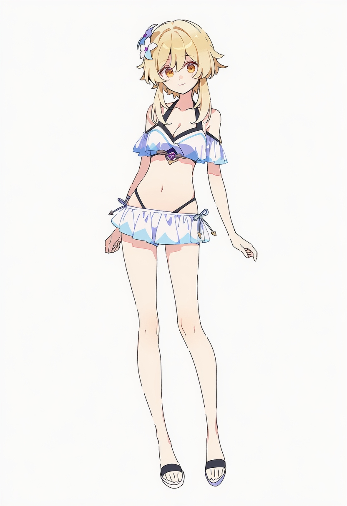

[在线例图](https://assets.quicktagcloud.com/images/raven_composition/raven_composition-0001.jpg?v=748db4d16ceb20e3)

<a id="raven_composition-0002"></a>

## 比基尼

ID：`raven_composition-0002`；分类：泳装；来源标记：`safe`。

来源说明：

> 女性两件式泳装的核心 tag，通常由胸罩式上装和内裤式下装组成，并明显露出腹部。

正向提示词：

```text
bikini
```


[在线例图](https://assets.quicktagcloud.com/images/raven_composition/raven_composition-0002.jpg?v=2760a2b5d049ccec)

<a id="raven_composition-0003"></a>

## 背心式两件泳装

ID：`raven_composition-0003`；分类：泳装；来源标记：`safe`。

来源说明：

> 上下装仍分离，但上衣长度更长、接近背心，对腹部覆盖更多。

正向提示词：

```text
tankini
```

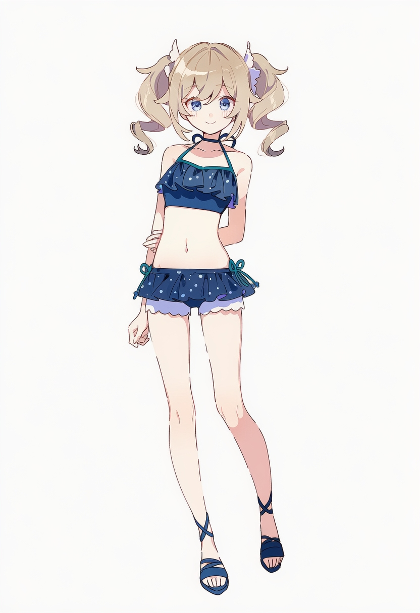

[在线例图](https://assets.quicktagcloud.com/images/raven_composition/raven_composition-0003.jpg?v=f3870f4768a32106)

<a id="raven_composition-0004"></a>

## 三角杯比基尼上衣

ID：`raven_composition-0004`；分类：泳装；来源标记：`safe`。

来源说明：

> 上装由两个明显三角形罩杯构成。

正向提示词：

```text
triangle_bikini_top
```


[在线例图](https://assets.quicktagcloud.com/images/raven_composition/raven_composition-0004.jpg?v=25a88010aa5f4a95)

<a id="raven_composition-0005"></a>

## 前系带比基尼上衣

ID：`raven_composition-0005`；分类：泳装；来源标记：`safe`。

来源说明：

> 上装在胸前通过绳结或蝴蝶结系合。

正向提示词：

```text
front-tie_bikini_top
```

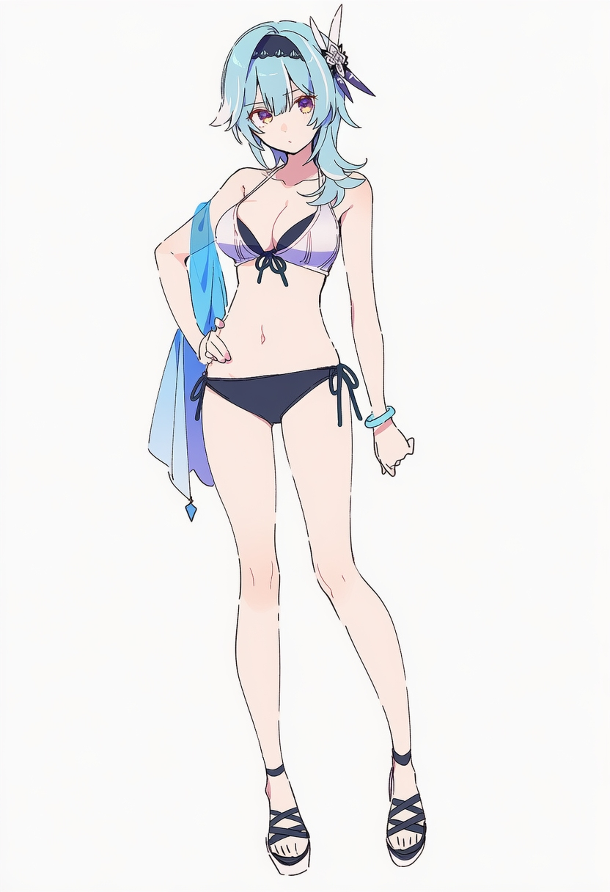

[在线例图](https://assets.quicktagcloud.com/images/raven_composition/raven_composition-0005.jpg?v=8f9e19c94449e2f9)

<a id="raven_composition-0006"></a>

## 多带式比基尼上衣

ID：`raven_composition-0006`；分类：泳装；来源标记：`safe`。

来源说明：

> 上装具有多条额外肩带、胸带或装饰带。

正向提示词：

```text
multi-strapped_bikini_top
```

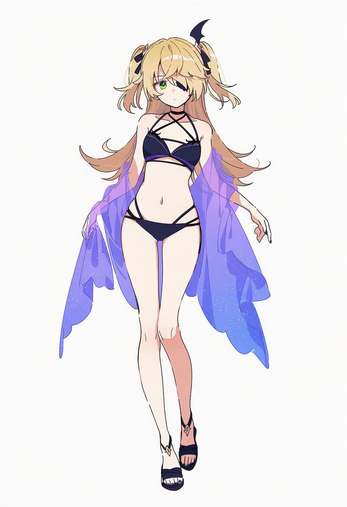

[在线例图](https://assets.quicktagcloud.com/images/raven_composition/raven_composition-0006.jpg?v=24e674718f780e2f)

<a id="raven_composition-0007"></a>

## 吊带式比基尼上衣

ID：`raven_composition-0007`；分类：泳装；来源标记：`safe`。

来源说明：

> 上装以狭长布料或带状结构向颈肩方向延伸，形成 sling 式轮廓。

正向提示词：

```text
sling_bikini_top
```

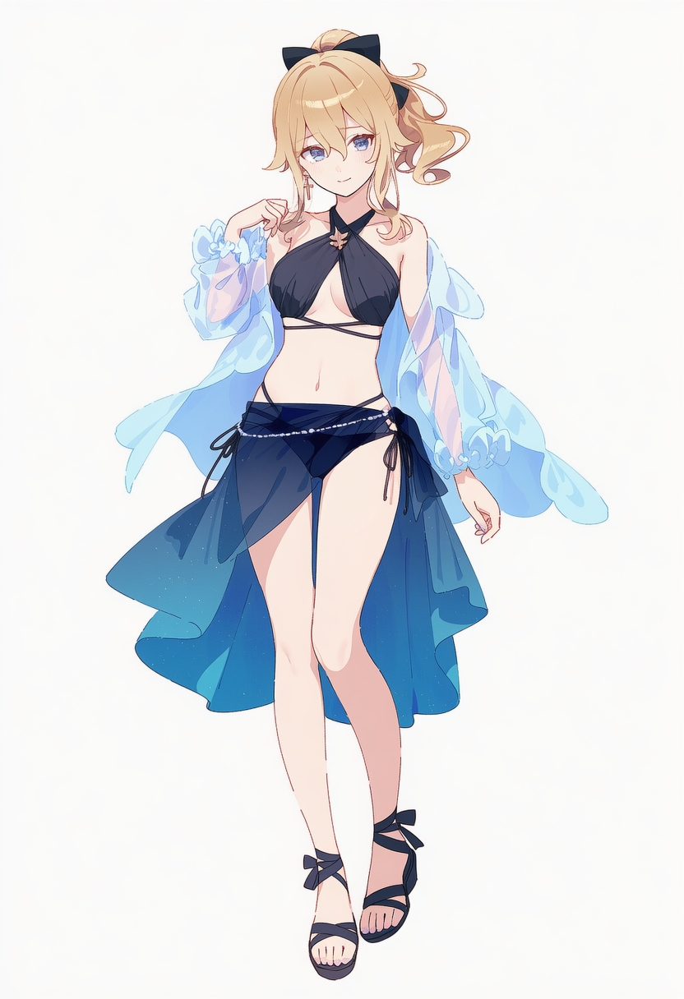

[在线例图](https://assets.quicktagcloud.com/images/raven_composition/raven_composition-0007.jpg?v=ff498324d1404c7d)

<a id="raven_composition-0008"></a>

## 无肩带比基尼

ID：`raven_composition-0008`；分类：泳装；来源标记：`safe`。

来源说明：

> 上装没有肩带，主要依靠胸围处固定。

正向提示词：

```text
strapless_bikini
```


[在线例图](https://assets.quicktagcloud.com/images/raven_composition/raven_composition-0008.jpg?v=303eb43b2187736a)

<a id="raven_composition-0009"></a>

## 露肩比基尼

ID：`raven_composition-0009`；分类：泳装；来源标记：`safe`。

来源说明：

> 上装结构位于肩线以下，突出裸露肩部。

正向提示词：

```text
off-shoulder_bikini
```


[在线例图](https://assets.quicktagcloud.com/images/raven_composition/raven_composition-0009.jpg?v=293ed0f7eb90167e)

<a id="raven_composition-0010"></a>

## 单肩比基尼

ID：`raven_composition-0010`；分类：泳装；来源标记：`safe`。

来源说明：

> 上装只由一侧肩部固定，形成明显不对称结构。

正向提示词：

```text
single-shoulder_bikini
```

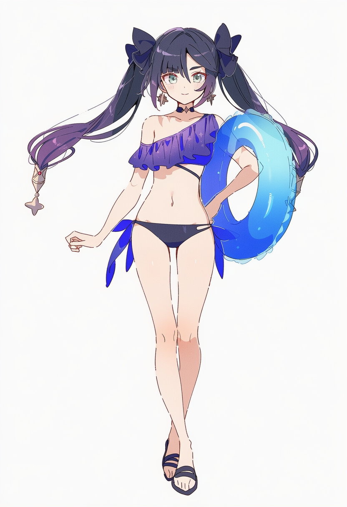

[在线例图](https://assets.quicktagcloud.com/images/raven_composition/raven_composition-0010.jpg?v=61ccef4305807b31)

<a id="raven_composition-0011"></a>

## 眼罩式比基尼

ID：`raven_composition-0011`；分类：泳装；来源标记：`safe`。

来源说明：

> 罩杯面积极小、以小片状结构进行局部覆盖，形态类似 eyepatch。

正向提示词：

```text
eyepatch_bikini
```

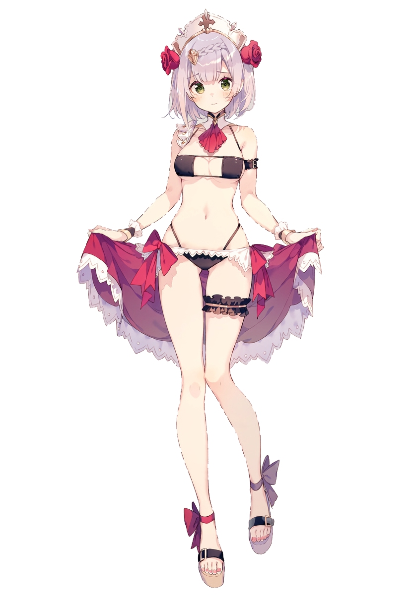

[在线例图](https://assets.quicktagcloud.com/images/raven_composition/raven_composition-0011.jpg?v=d8fcfa564a5fd4cd)

<a id="raven_composition-0012"></a>

## 短裤比基尼

ID：`raven_composition-0012`；分类：泳装；来源标记：`safe`。

来源说明：

> 下装为短裤式，而非普通三角泳裤。

正向提示词：

```text
bikini_shorts
```

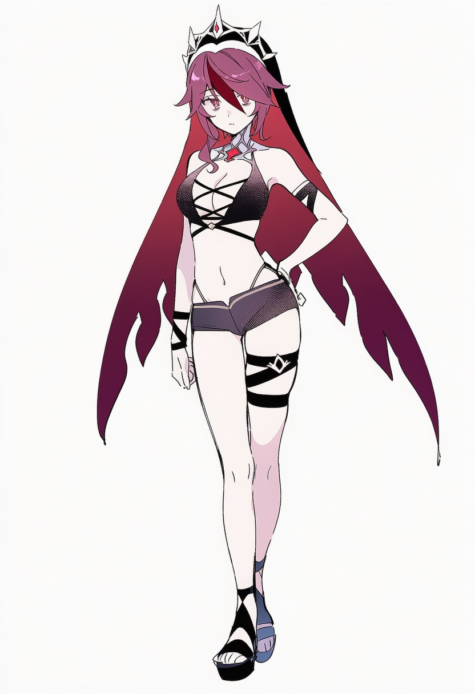

[在线例图](https://assets.quicktagcloud.com/images/raven_composition/raven_composition-0012.jpg?v=b631d102f904d681)

<a id="raven_composition-0013"></a>

## 裙式比基尼

ID：`raven_composition-0013`；分类：泳装；来源标记：`safe`。

来源说明：

> 下装为短裙或明显带裙摆的比基尼。

正向提示词：

```text
bikini_skirt
```

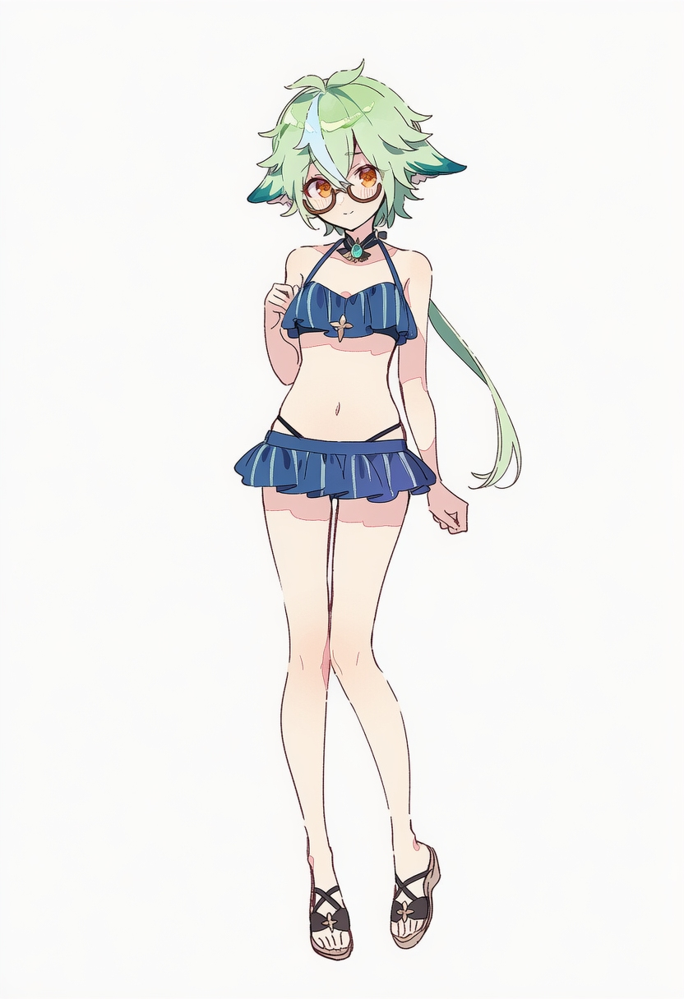

[在线例图](https://assets.quicktagcloud.com/images/raven_composition/raven_composition-0013.jpg?v=83db82be33b8dfc2)

<a id="raven_composition-0014"></a>

## 侧系带比基尼下装

ID：`raven_composition-0014`；分类：泳装；来源标记：`safe`。

来源说明：

> 下装在腰胯两侧通过绳带打结固定。

正向提示词：

```text
side-tie_bikini_bottom
```

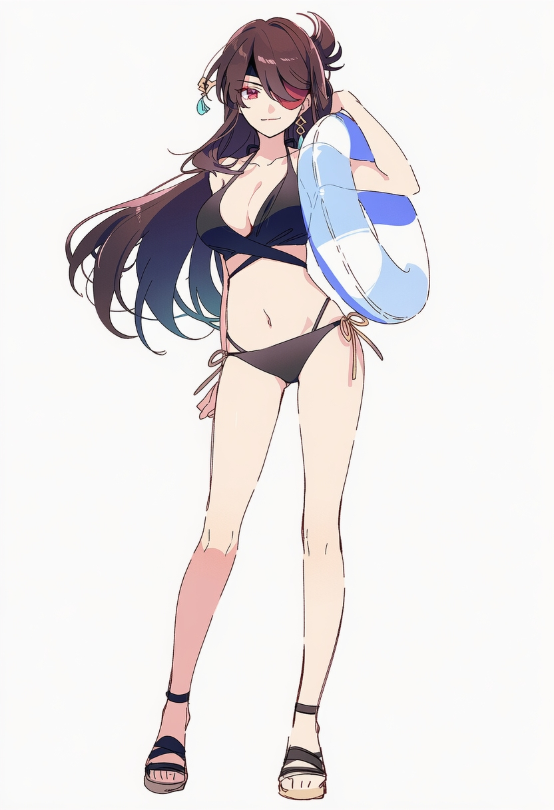

[在线例图](https://assets.quicktagcloud.com/images/raven_composition/raven_composition-0014.jpg?v=0a39be3e3781b354)

<a id="raven_composition-0015"></a>

## 多带式比基尼下装

ID：`raven_composition-0015`；分类：泳装；来源标记：`safe`。

来源说明：

> 腰侧或胯部由多条带状结构组成。

正向提示词：

```text
multi-strapped_bikini_bottom
```

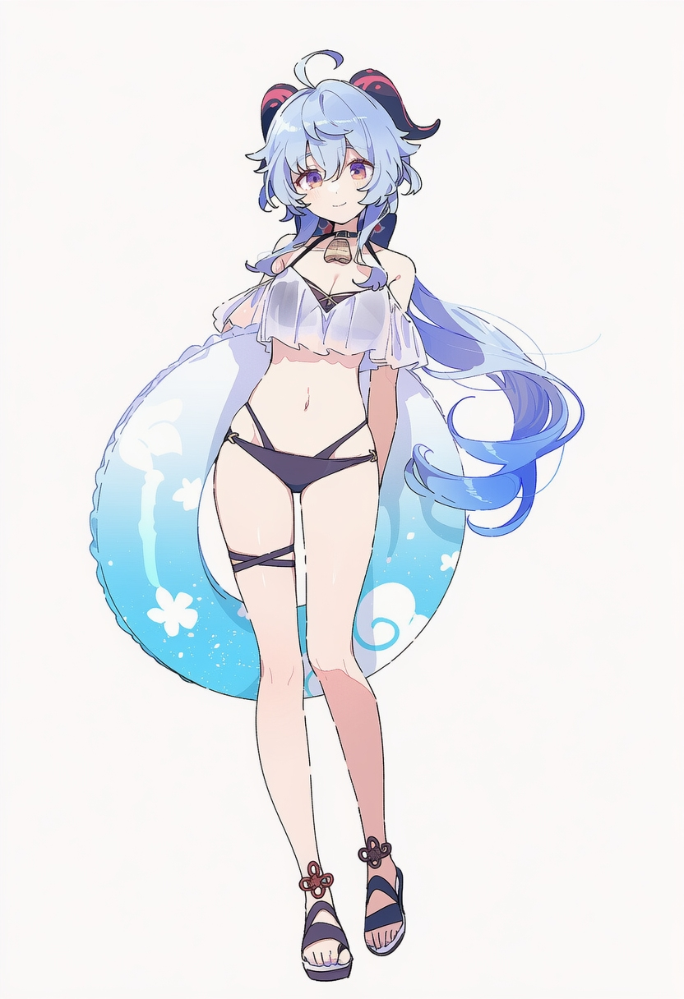

[在线例图](https://assets.quicktagcloud.com/images/raven_composition/raven_composition-0015.jpg?v=514c775db295524d)

<a id="raven_composition-0016"></a>

## 高开腿比基尼

ID：`raven_composition-0016`；分类：泳装；来源标记：`safe`。

来源说明：

> 下装腿口向髋部高位延伸，增加髋部和腿部裸露。

正向提示词：

```text
highleg_bikini
```


[在线例图](https://assets.quicktagcloud.com/images/raven_composition/raven_composition-0016.jpg?v=d4c21a409d224073)

<a id="raven_composition-0017"></a>

## 低开腿比基尼

ID：`raven_composition-0017`；分类：泳装；来源标记：`safe`。

来源说明：

> 下装腿口较低，对髋部和臀部覆盖更多。

正向提示词：

```text
lowleg_bikini
```


[在线例图](https://assets.quicktagcloud.com/images/raven_composition/raven_composition-0017.jpg?v=eff43030c88cd492)

<a id="raven_composition-0018"></a>

## 丁字裤比基尼

ID：`raven_composition-0018`；分类：泳装；来源标记：`safe`。

来源说明：

> 下装采用 thong 式结构，臀部覆盖很少。

正向提示词：

```text
thong_bikini
```

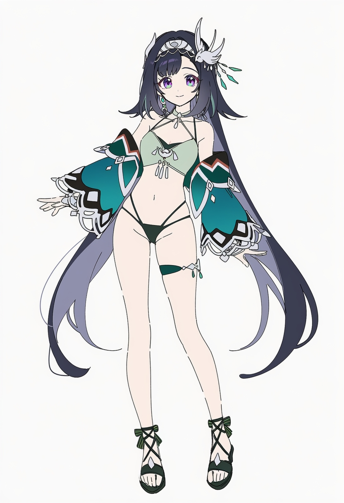

[在线例图](https://assets.quicktagcloud.com/images/raven_composition/raven_composition-0018.jpg?v=23c28390665d41fb)

<a id="raven_composition-0019"></a>

## O环下装

ID：`raven_composition-0019`；分类：泳装；来源标记：`safe`。

来源说明：

> 下装以圆环连接腰带或布料。

正向提示词：

```text
o-ring_bottom
```

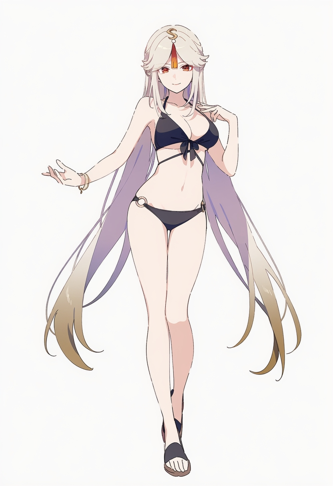

[在线例图](https://assets.quicktagcloud.com/images/raven_composition/raven_composition-0019.jpg?v=476367fb0958dd82)

<a id="raven_composition-0020"></a>

## 微型比基尼

ID：`raven_composition-0020`；分类：泳装；来源标记：`safe`。

来源说明：

> 整体布料面积显著缩小，只保留很少覆盖。

正向提示词：

```text
micro_bikini
```

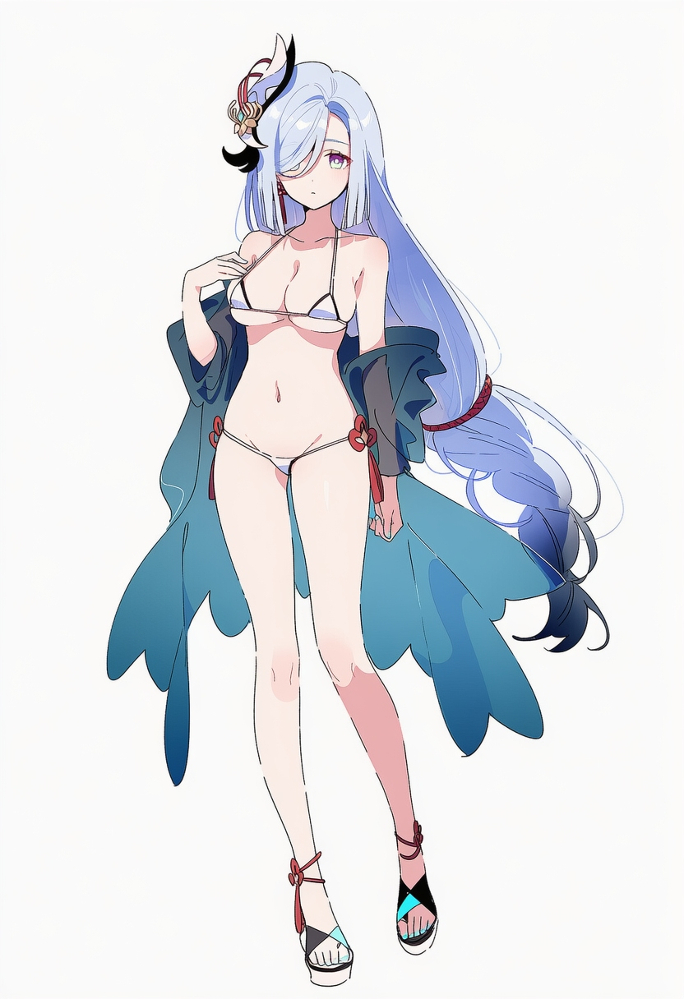

[在线例图](https://assets.quicktagcloud.com/images/raven_composition/raven_composition-0020.jpg?v=7211d1d6d699cc19)

<a id="raven_composition-0021"></a>

## 细绳比基尼

ID：`raven_composition-0021`；分类：泳装；来源标记：`safe`。

来源说明：

> 以细绳连接较小布片，带状结构占比高。

正向提示词：

```text
string_bikini
```

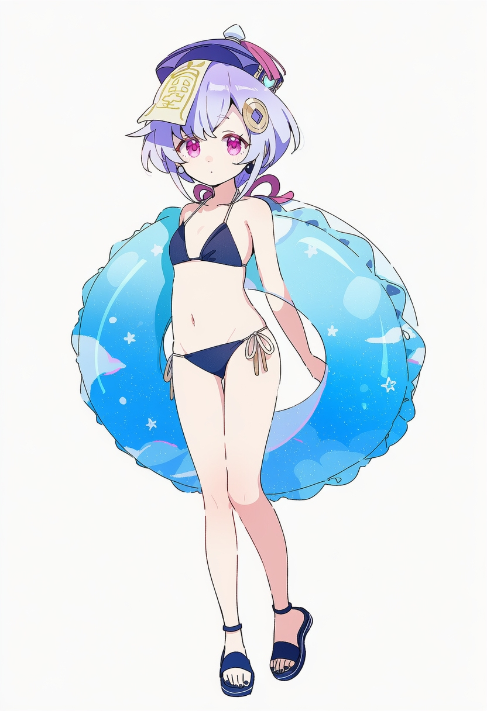

[在线例图](https://assets.quicktagcloud.com/images/raven_composition/raven_composition-0021.jpg?v=4d20041f2a1083ed)

<a id="raven_composition-0022"></a>

## 椒盐卷饼式比基尼 / 交叉缠绕比基尼

ID：`raven_composition-0022`；分类：泳装；来源标记：`safe`。

来源说明：

> 布料或带子在躯干处明显交叉、缠绕，形成类似 pretzel 的交织轮廓。

正向提示词：

```text
pretzel_bikini
```

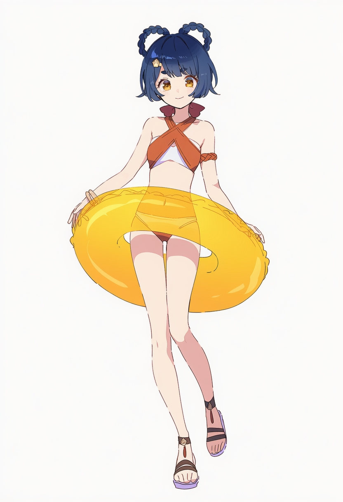

[在线例图](https://assets.quicktagcloud.com/images/raven_composition/raven_composition-0022.jpg?v=30ce4cbe3478c355)

<a id="raven_composition-0023"></a>

## 交叉系带比基尼

ID：`raven_composition-0023`；分类：泳装；来源标记：`safe`。

来源说明：

> 通过明显的 X 形交叉绳带连接泳装边缘或主体。

正向提示词：

```text
cross-laced_bikini
```

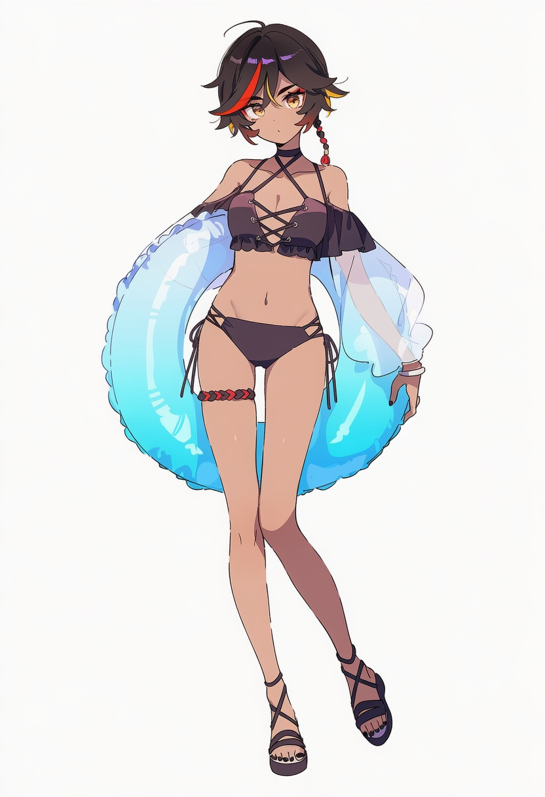

[在线例图](https://assets.quicktagcloud.com/images/raven_composition/raven_composition-0023.jpg?v=7ec5d7623049b1a4)

<a id="raven_composition-0024"></a>

## O环比基尼

ID：`raven_composition-0024`；分类：泳装；来源标记：`safe`。

来源说明：

> 使用圆形环件连接布料或带子，圆环是结构节点。

正向提示词：

```text
o-ring_bikini
```

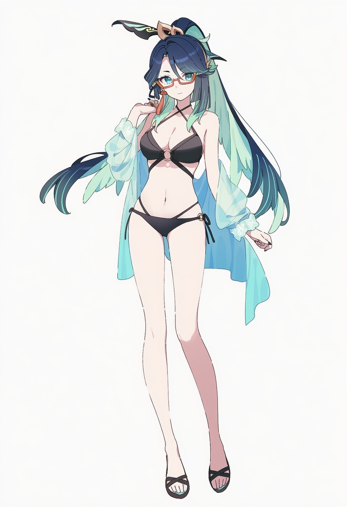

[在线例图](https://assets.quicktagcloud.com/images/raven_composition/raven_composition-0024.jpg?v=73ecbb1afa9c431e)

<a id="raven_composition-0025"></a>

## O环上装

ID：`raven_composition-0025`；分类：泳装；来源标记：`safe`。

来源说明：

> 上衣使用圆环连接罩杯、肩带或胸带。

正向提示词：

```text
o-ring_top
```

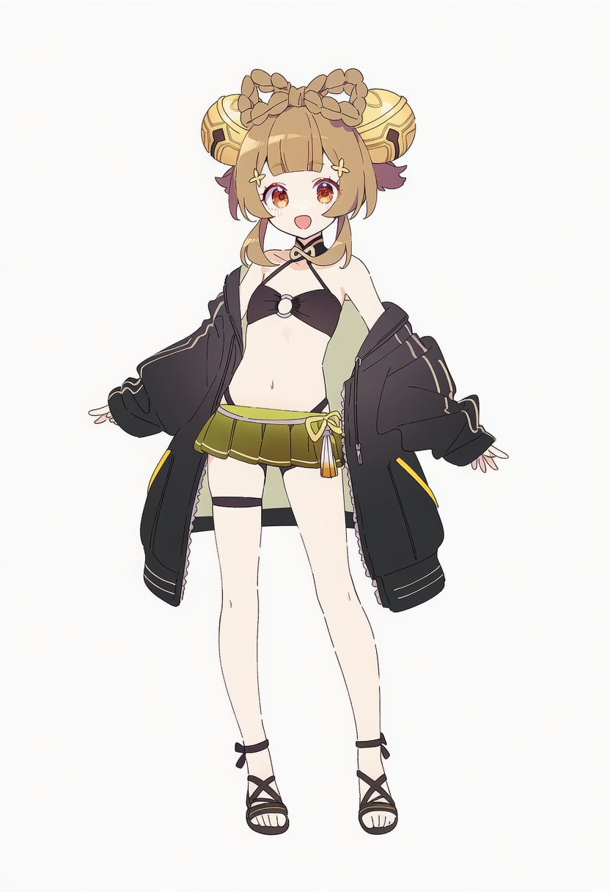

[在线例图](https://assets.quicktagcloud.com/images/raven_composition/raven_composition-0025.jpg?v=29697619507cea07)

<a id="raven_composition-0026"></a>

## 运动比基尼

ID：`raven_composition-0026`；分类：泳装；来源标记：`safe`。

来源说明：

> 偏运动用途的两件式设计，通常固定性和覆盖度更高。

正向提示词：

```text
sports_bikini
```

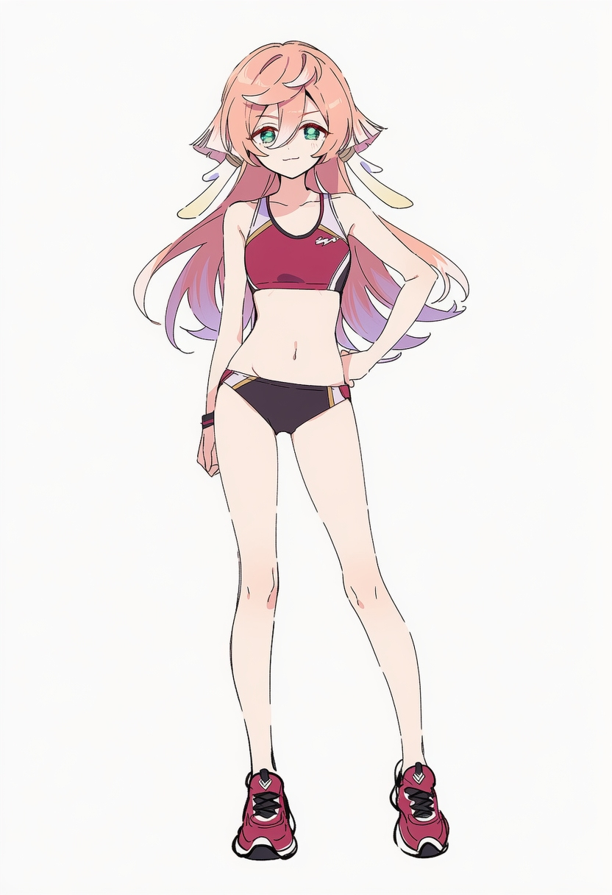

[在线例图](https://assets.quicktagcloud.com/images/raven_composition/raven_composition-0026.jpg?v=ea18a33aa79d592c)

<a id="raven_composition-0027"></a>

## 拉链比基尼

ID：`raven_composition-0027`；分类：泳装；来源标记：`safe`。

来源说明：

> 泳装以拉链作为明显闭合或结构设计。

正向提示词：

```text
zipper_bikini
```

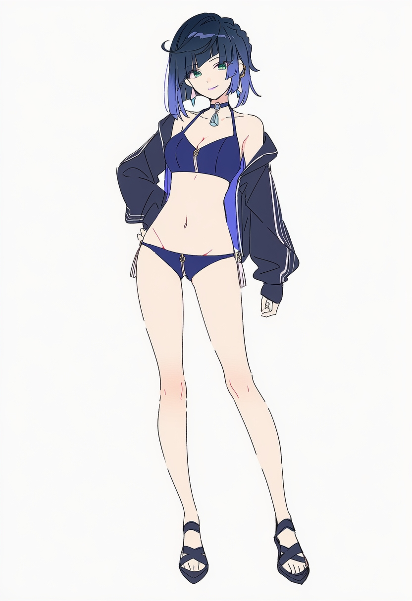

[在线例图](https://assets.quicktagcloud.com/images/raven_composition/raven_composition-0027.jpg?v=5c0cac59ab7ef4d9)

<a id="raven_composition-0028"></a>

## 荷叶边比基尼

ID：`raven_composition-0028`；分类：泳装；来源标记：`safe`。

来源说明：

> 边缘具有明显 frill / 荷叶边。

正向提示词：

```text
frilled_bikini
```

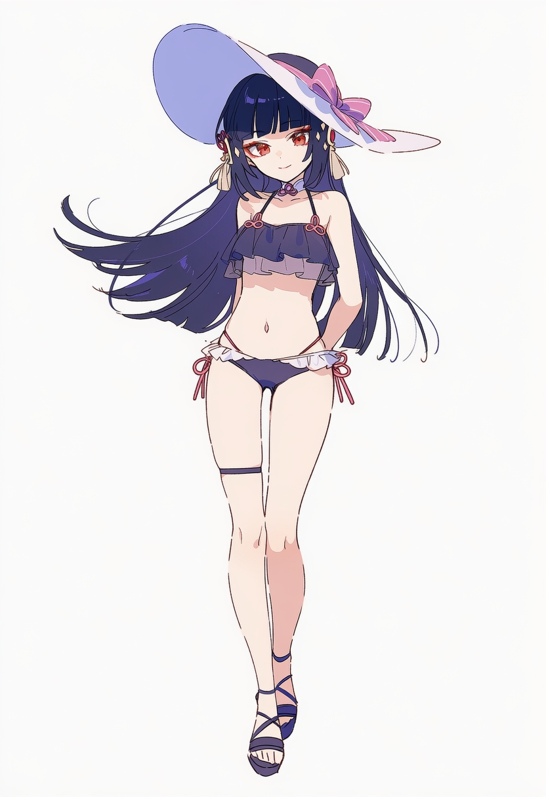

[在线例图](https://assets.quicktagcloud.com/images/raven_composition/raven_composition-0028.jpg?v=92b719f911d54b43)

<a id="raven_composition-0029"></a>

## 宽褶/波浪褶比基尼

ID：`raven_composition-0029`；分类：泳装；来源标记：`safe`。

来源说明：

> 具有明显、较宽的波浪状褶饰。

正向提示词：

```text
ruffle_bikini
```

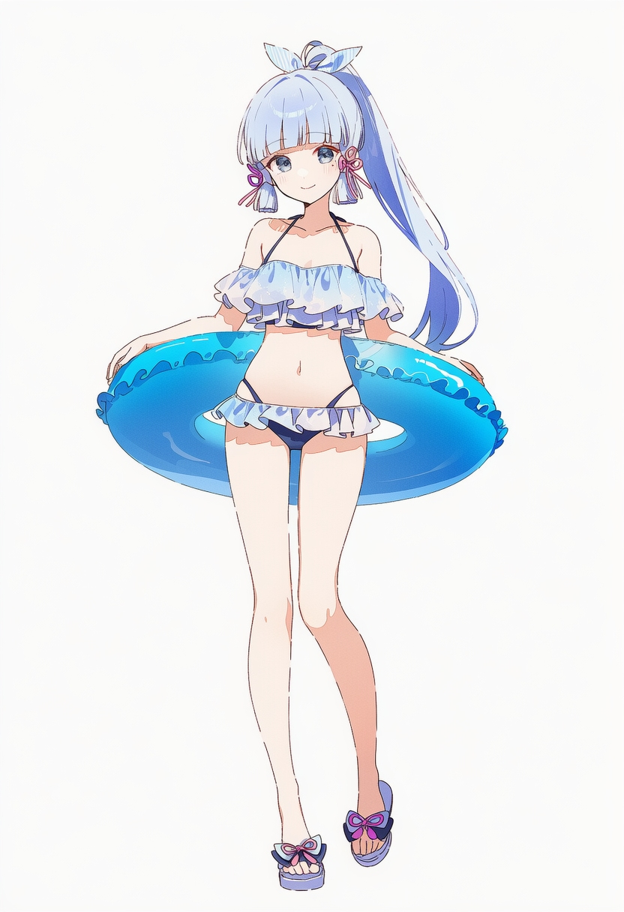

[在线例图](https://assets.quicktagcloud.com/images/raven_composition/raven_composition-0029.jpg?v=c9214282f3435ffb)

<a id="raven_composition-0030"></a>

## 层叠式比基尼

ID：`raven_composition-0030`；分类：泳装；来源标记：`safe`。

来源说明：

> 布料、裙片或褶饰形成明显多层结构。

正向提示词：

```text
layered_bikini
```

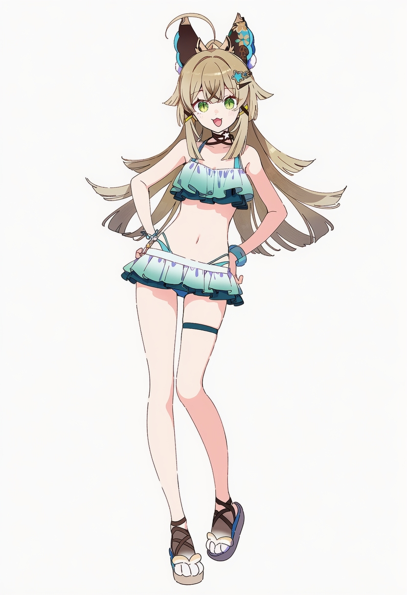

[在线例图](https://assets.quicktagcloud.com/images/raven_composition/raven_composition-0030.jpg?v=f38664b6c0bd1200)

<a id="raven_composition-0031"></a>

## 蕾丝边比基尼

ID：`raven_composition-0031`；分类：泳装；来源标记：`safe`。

来源说明：

> 边缘带蕾丝饰边。

正向提示词：

```text
lace-trimmed_bikini
```

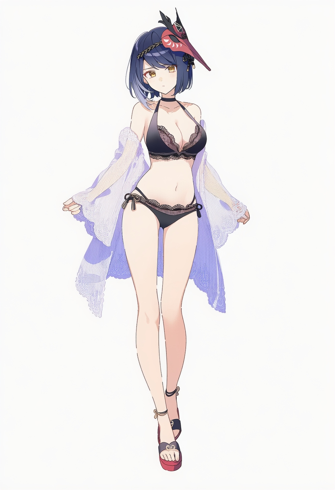

[在线例图](https://assets.quicktagcloud.com/images/raven_composition/raven_composition-0031.jpg?v=05e25d3ee83c0197)

<a id="raven_composition-0032"></a>

## 毛皮边比基尼

ID：`raven_composition-0032`；分类：泳装；来源标记：`safe`。

来源说明：

> 领缘、罩杯边或下装边缘带毛皮/绒毛装饰。

正向提示词：

```text
fur-trimmed_bikini
```

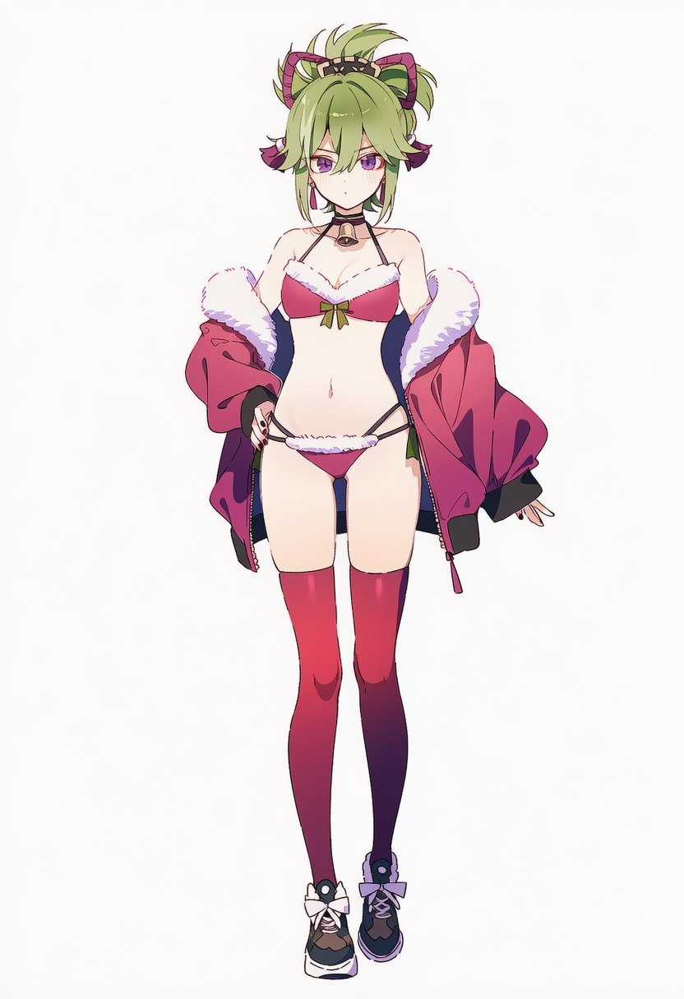

[在线例图](https://assets.quicktagcloud.com/images/raven_composition/raven_composition-0032.jpg?v=ba1de5de444257f4)

<a id="raven_composition-0033"></a>

## 丝带边比基尼

ID：`raven_composition-0033`；分类：泳装；来源标记：`safe`。

来源说明：

> 泳装边缘或主要轮廓带有 ribbon 饰边。

正向提示词：

```text
ribbon-trimmed_bikini
```

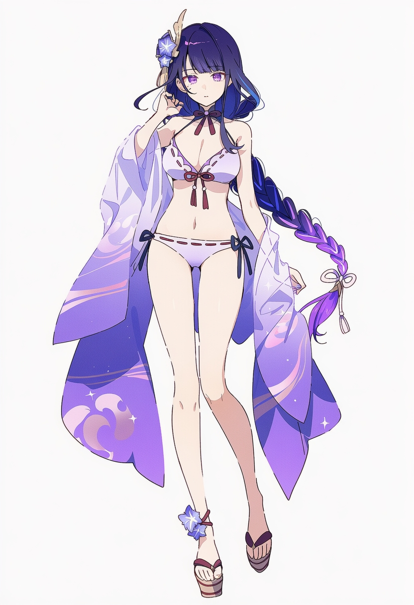

[在线例图](https://assets.quicktagcloud.com/images/raven_composition/raven_composition-0033.jpg?v=1f0f20e7675dc8b5)

<a id="raven_composition-0034"></a>

## 乳胶比基尼

ID：`raven_composition-0034`；分类：泳装；来源标记：`safe`。

来源说明：

> 以 latex/乳胶质感为主要材质特征。

正向提示词：

```text
latex_bikini
```

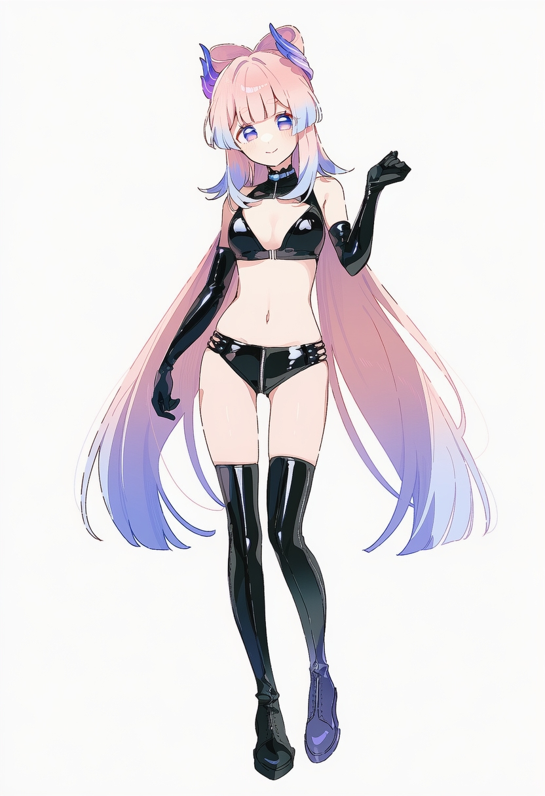

[在线例图](https://assets.quicktagcloud.com/images/raven_composition/raven_composition-0034.jpg?v=6d60b7f7680d6f74)

<a id="raven_composition-0035"></a>

## 透视比基尼

ID：`raven_composition-0035`；分类：泳装；来源标记：`safe`。

来源说明：

> 泳装材质具有明显透视效果。

正向提示词：

```text
see-through_bikini
```

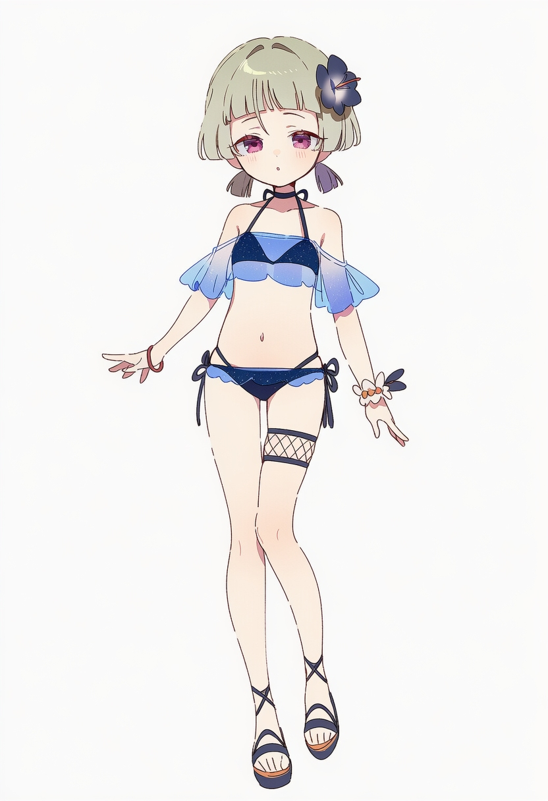

[在线例图](https://assets.quicktagcloud.com/images/raven_composition/raven_composition-0035.jpg?v=38fc85e66996dd8d)

<a id="raven_composition-0036"></a>

## 蝴蝶结比基尼

ID：`raven_composition-0036`；分类：泳装；来源标记：`safe`。

来源说明：

> 以明显蝴蝶结作为主要泳装设计元素。

正向提示词：

```text
bow_bikini
```


[在线例图](https://assets.quicktagcloud.com/images/raven_composition/raven_composition-0036.jpg?v=731c3c7993daafaf)

<a id="raven_composition-0037"></a>

## 比基尼铠甲

ID：`raven_composition-0037`；分类：泳装；来源标记：`safe`。

来源说明：

> 比基尼轮廓与铠甲、防具元素结合。

正向提示词：

```text
bikini_armor
```

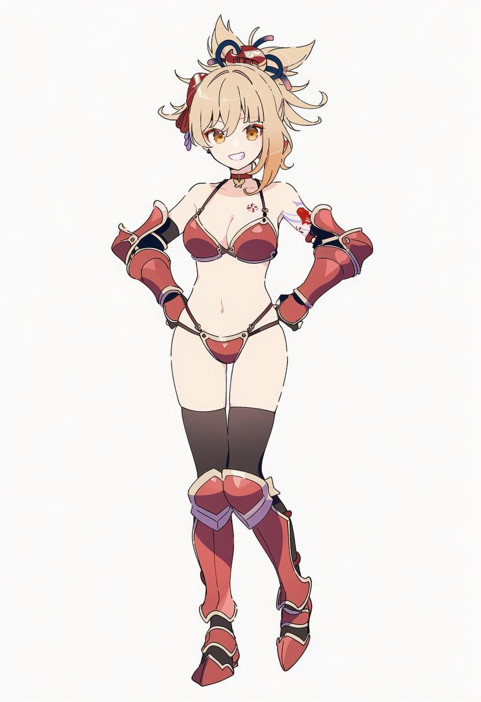

[在线例图](https://assets.quicktagcloud.com/images/raven_composition/raven_composition-0037.jpg?v=3fdb72b6585db1f7)

<a id="raven_composition-0038"></a>

## 新娘比基尼

ID：`raven_composition-0038`；分类：泳装；来源标记：`safe`。

来源说明：

> 融入婚纱、新娘礼服元素的比基尼。

正向提示词：

```text
bridal_bikini
```


[在线例图](https://assets.quicktagcloud.com/images/raven_composition/raven_composition-0038.jpg?v=028c22e174a8d025)

<a id="raven_composition-0039"></a>

## 猫耳比基尼

ID：`raven_composition-0039`；分类：泳装；来源标记：`safe`。

来源说明：

> 泳装本体带猫耳形状的结构或装饰。

正向提示词：

```text
cat_ear_bikini
```

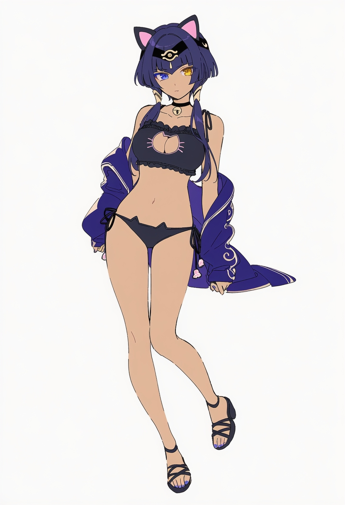

[在线例图](https://assets.quicktagcloud.com/images/raven_composition/raven_composition-0039.jpg?v=3edb22c208ae34a9)

<a id="raven_composition-0040"></a>

## 树叶比基尼

ID：`raven_composition-0040`；分类：泳装；来源标记：`safe`。

来源说明：

> 以叶片或叶片造型作为主要覆盖/造型元素。

正向提示词：

```text
leaf_bikini
```


[在线例图](https://assets.quicktagcloud.com/images/raven_composition/raven_composition-0040.jpg?v=7d2a53ef43d6f38b)

<a id="raven_composition-0041"></a>

## 女仆比基尼

ID：`raven_composition-0041`；分类：泳装；来源标记：`safe`。

来源说明：

> 比基尼与女仆装元素结合，如围裙、褶边或女仆式装饰。

正向提示词：

```text
maid_bikini
```


[在线例图](https://assets.quicktagcloud.com/images/raven_composition/raven_composition-0041.jpg?v=f78a94891bdb1eba)

<a id="raven_composition-0042"></a>

## 水手服比基尼

ID：`raven_composition-0042`；分类：泳装；来源标记：`safe`。

来源说明：

> 比基尼与水手领、领巾等水手服元素结合。

正向提示词：

```text
sailor_bikini
```


[在线例图](https://assets.quicktagcloud.com/images/raven_composition/raven_composition-0042.jpg?v=075b7d4f3329d3dd)

<a id="raven_composition-0043"></a>

## 圣诞比基尼

ID：`raven_composition-0043`；分类：泳装；来源标记：`safe`。

来源说明：

> 比基尼与圣诞老人服装元素结合。

正向提示词：

```text
santa_bikini
```


[在线例图](https://assets.quicktagcloud.com/images/raven_composition/raven_composition-0043.jpg?v=659ce03107586a17)

<a id="raven_composition-0044"></a>

## 贝壳比基尼

ID：`raven_composition-0044`；分类：泳装；来源标记：`safe`。

来源说明：

> 以贝壳或贝壳造型构成主要罩杯/覆盖结构。

正向提示词：

```text
shell_bikini
```

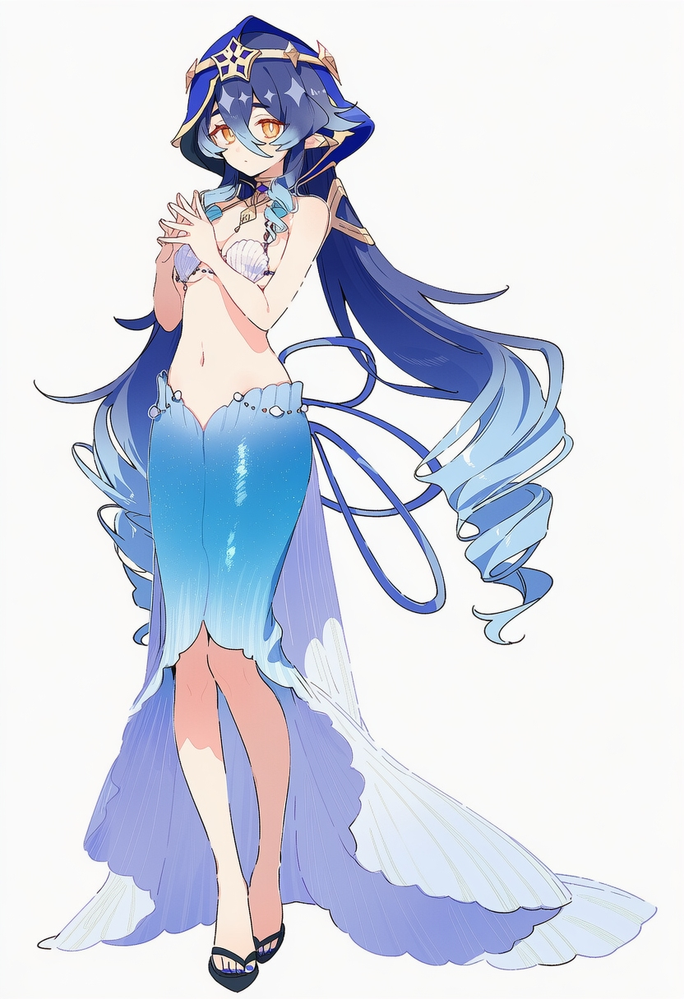

[在线例图](https://assets.quicktagcloud.com/images/raven_composition/raven_composition-0044.jpg?v=dc8da707241fab48)

<a id="raven_composition-0045"></a>

## 面具比基尼

ID：`raven_composition-0045`；分类：泳装；来源标记：`safe`。

来源说明：

> Bikini Wiki 在 See also 中列出的特殊 bikini tag。

正向提示词：

```text
mask_bikini
```

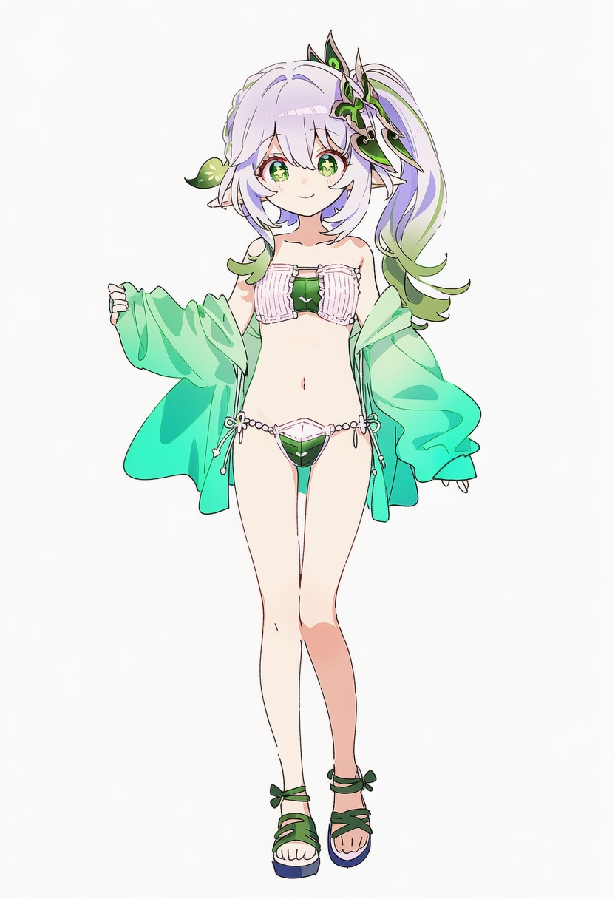

[在线例图](https://assets.quicktagcloud.com/images/raven_composition/raven_composition-0045.jpg?v=627cd04de4ff9c0c)

<a id="raven_composition-0046"></a>

## Bikini jeans

ID：`raven_composition-0046`；分类：泳装；来源标记：`safe`。

来源说明：

> Bikini Wiki See also 中的混合/边界服装 tag。

正向提示词：

```text
bikini_jeans
```


[在线例图](https://assets.quicktagcloud.com/images/raven_composition/raven_composition-0046.jpg?v=b45ea06e8d6dbf1e)

<a id="raven_composition-0047"></a>

## 仅穿比基尼上衣

ID：`raven_composition-0047`；分类：泳装；来源标记：`safe`。

来源说明：

> 只穿比基尼上装，没有对应比基尼下装。

正向提示词：

```text
bikini_top_only
```

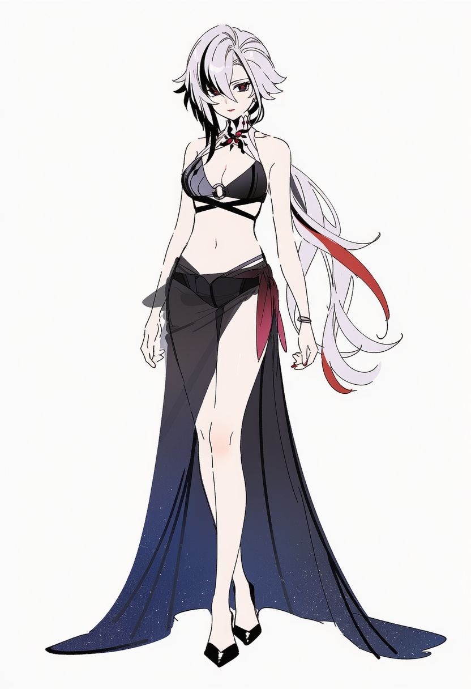

[在线例图](https://assets.quicktagcloud.com/images/raven_composition/raven_composition-0047.jpg?v=b6c33de9e2e4d2da)

<a id="raven_composition-0048"></a>

## 仅穿比基尼下装

ID：`raven_composition-0048`；分类：泳装；来源标记：`safe`。

来源说明：

> 只穿比基尼下装，没有对应上装。

正向提示词：

```text
bikini_bottom_only
```

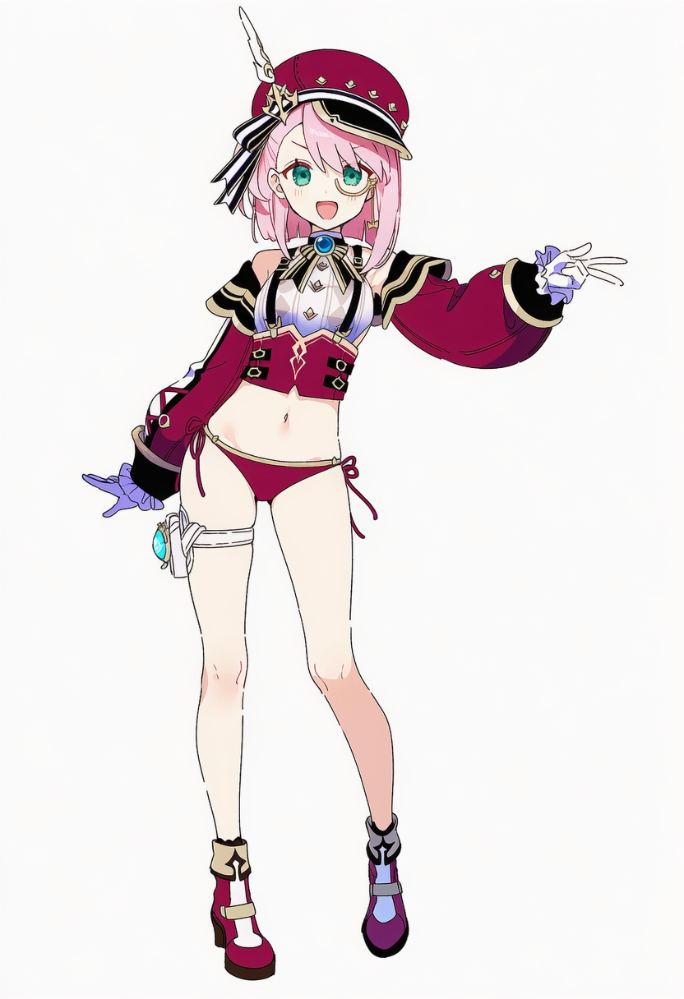

[在线例图](https://assets.quicktagcloud.com/images/raven_composition/raven_composition-0048.jpg?v=ba80fb2e265dbcbd)

<a id="raven_composition-0049"></a>

## 衣服内穿比基尼

ID：`raven_composition-0049`；分类：泳装；来源标记：`safe`。

来源说明：

> 比基尼作为内层，外面穿普通衣物。

正向提示词：

```text
bikini_under_clothes
```

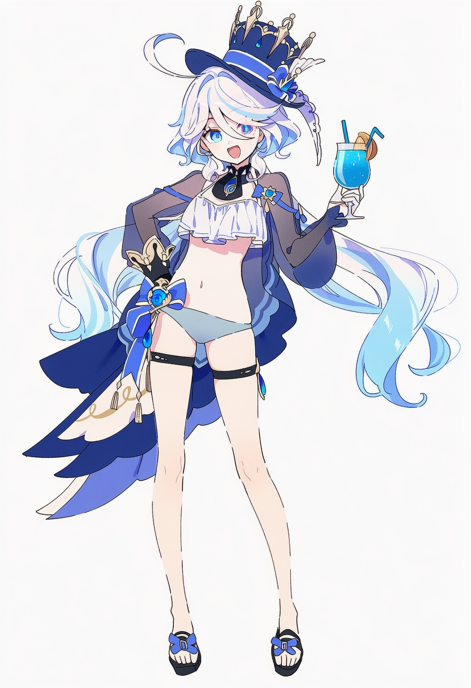

[在线例图](https://assets.quicktagcloud.com/images/raven_composition/raven_composition-0049.jpg?v=24589cf28b055ef7)

<a id="raven_composition-0050"></a>

## 上下未完全系好/未完成穿着

ID：`raven_composition-0050`；分类：泳装；来源标记：`safe`。

来源说明：

> 比基尼处于未完全系好、未完整穿妥的状态。

正向提示词：

```text
undone_bikini
```

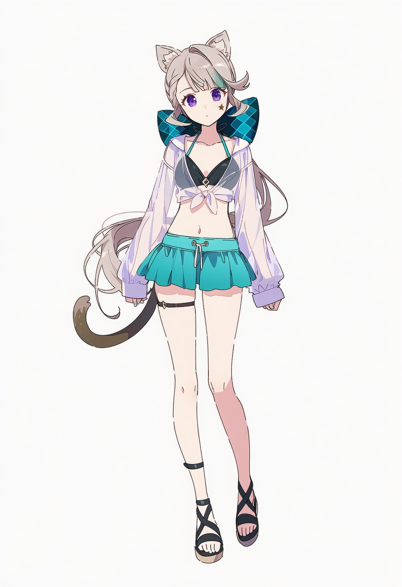

[在线例图](https://assets.quicktagcloud.com/images/raven_composition/raven_composition-0050.jpg?v=7b2034783e8ef8ff)

<a id="raven_composition-0051"></a>

## 上装未系

ID：`raven_composition-0051`；分类：泳装；来源标记：`safe`。

来源说明：

> 比基尼上装绳带未系好。

正向提示词：

```text
untied_bikini_top
```

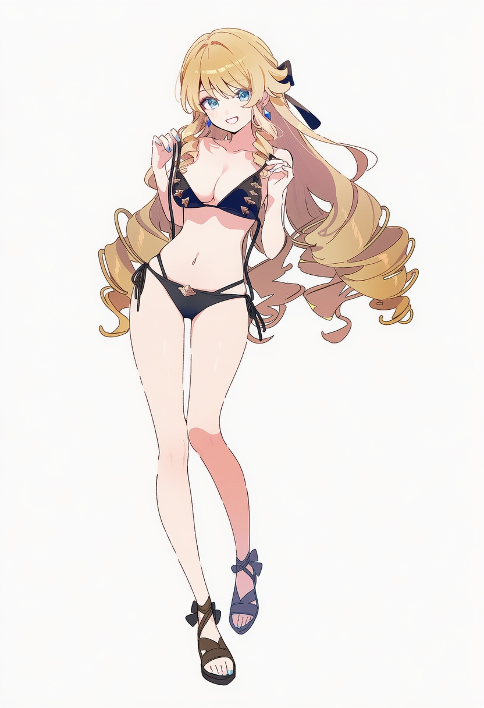

[在线例图](https://assets.quicktagcloud.com/images/raven_composition/raven_composition-0051.jpg?v=7a509007ca3ac0bc)

<a id="raven_composition-0052"></a>

## 下装未系

ID：`raven_composition-0052`；分类：泳装；来源标记：`safe`。

来源说明：

> 比基尼下装绳带未系好。

正向提示词：

```text
untied_bikini_bottom
```

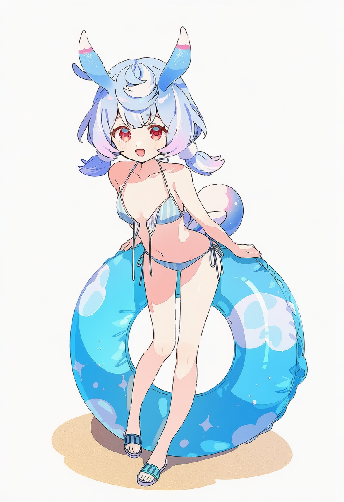

[在线例图](https://assets.quicktagcloud.com/images/raven_composition/raven_composition-0052.jpg?v=369b1eb7c5a30471)

<a id="raven_composition-0053"></a>

## 倒穿比基尼上衣

ID：`raven_composition-0053`；分类：泳装；来源标记：`safe`。

来源说明：

> 将比基尼上衣上下颠倒穿着的方式。

正向提示词：

```text
ayastyle
```

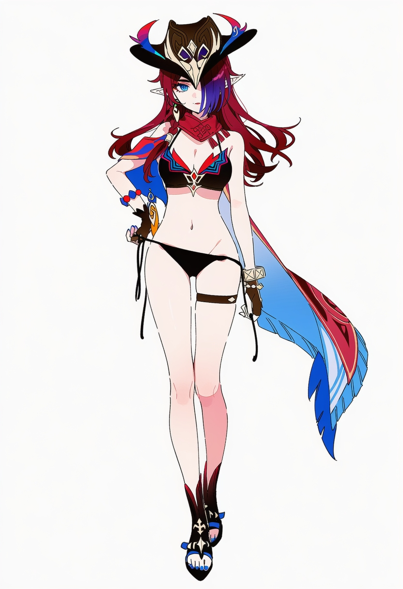

[在线例图](https://assets.quicktagcloud.com/images/raven_composition/raven_composition-0053.jpg?v=4218c568230bf7e7)

<a id="raven_composition-0054"></a>

## 破损比基尼

ID：`raven_composition-0054`；分类：泳装；来源标记：`safe`。

来源说明：

> 比基尼出现明显撕裂或破损。

正向提示词：

```text
torn_bikini
```

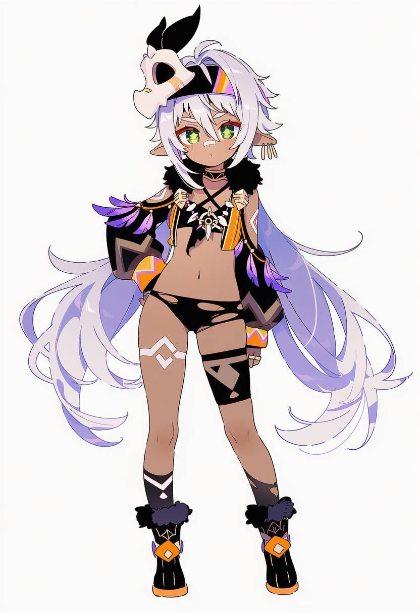

[在线例图](https://assets.quicktagcloud.com/images/raven_composition/raven_composition-0054.jpg?v=ff24658853fdb30a)

<a id="raven_composition-0055"></a>

## 连体泳装

ID：`raven_composition-0055`；分类：泳装；来源标记：`safe`。

来源说明：

> 上装与下装连接为一个整体的泳装。

正向提示词：

```text
one-piece_swimsuit
```

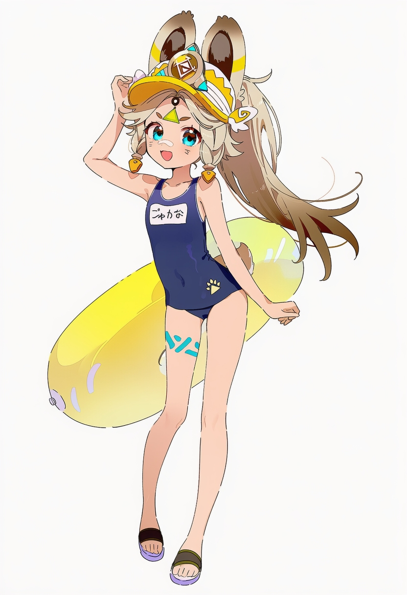

[在线例图](https://assets.quicktagcloud.com/images/raven_composition/raven_composition-0055.jpg?v=2de16e5fc4846dc0)

<a id="raven_composition-0056"></a>

## 休闲连体泳装

ID：`raven_composition-0056`；分类：泳装；来源标记：`safe`。

来源说明：

> 非竞技、非学校制式用途的普通休闲连体泳装。

正向提示词：

```text
casual_one-piece_swimsuit
```

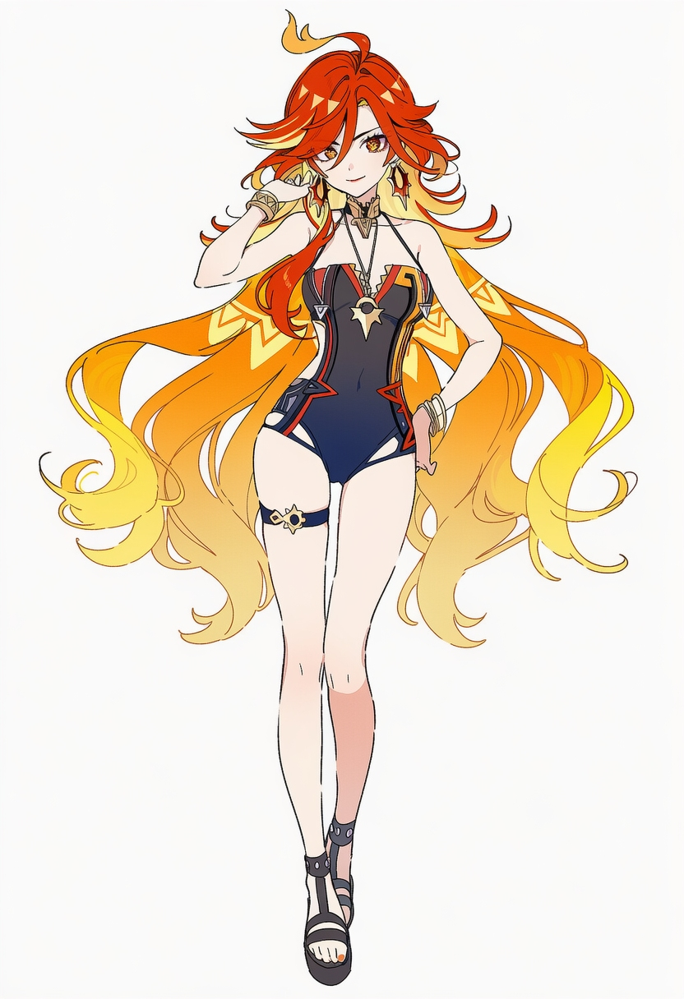

[在线例图](https://assets.quicktagcloud.com/images/raven_composition/raven_composition-0056.jpg?v=6f828f88b93182ab)

<a id="raven_composition-0057"></a>

## 裙式连体泳装 / 泳装连衣裙

ID：`raven_composition-0057`；分类：泳装；来源标记：`safe`。

来源说明：

> 连体泳装带明显裙摆，整体外形接近短裙/连衣裙。

正向提示词：

```text
dress_swimsuit
```

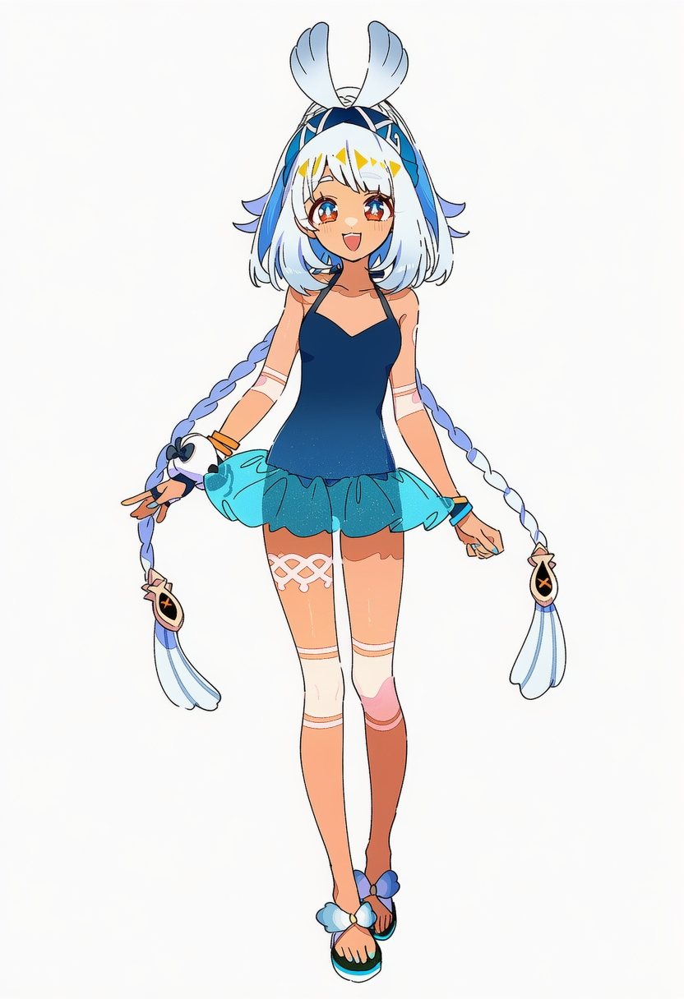

[在线例图](https://assets.quicktagcloud.com/images/raven_composition/raven_composition-0057.jpg?v=6d7faf6cde6a77b6)

<a id="raven_composition-0058"></a>

## 竞技泳装

ID：`raven_composition-0058`；分类：泳装；来源标记：`safe`。

来源说明：

> 面向游泳竞技的贴身低阻力泳装。

正向提示词：

```text
competition_swimsuit
```

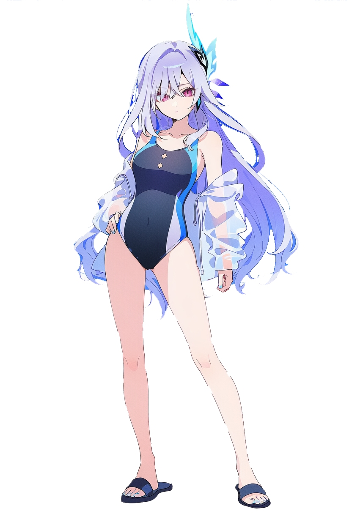

[在线例图](https://assets.quicktagcloud.com/images/raven_composition/raven_composition-0058.jpg?v=68b9c4143aefc04e)

<a id="raven_composition-0059"></a>

## 学校泳装

ID：`raven_composition-0059`；分类：泳装；来源标记：`safe`。

来源说明：

> 学校游泳课等场景的制式泳装。

正向提示词：

```text
school_swimsuit
```

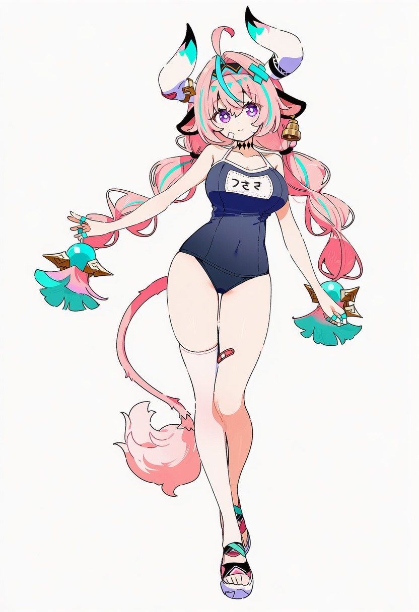

[在线例图](https://assets.quicktagcloud.com/images/raven_composition/raven_composition-0059.jpg?v=1ce584a04d992397)

<a id="raven_composition-0060"></a>

## Monokini / 大面积镂空连体泳装

ID：`raven_composition-0060`；分类：泳装；来源标记：`safe`。

来源说明：

> 整体仍为单件连接，但常通过大面积镂空让视觉接近比基尼。

正向提示词：

```text
monokini
```

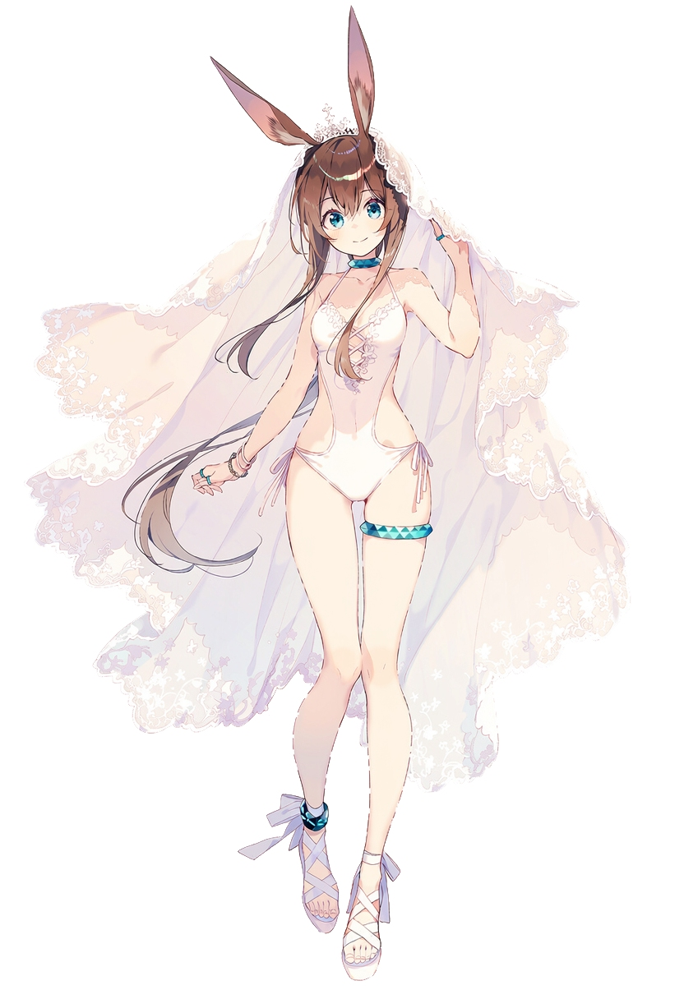

[在线例图](https://assets.quicktagcloud.com/images/raven_composition/raven_composition-0060.jpg?v=1b946971658d959b)

<a id="raven_composition-0061"></a>

## 弹弓泳装 / V字吊带泳装

ID：`raven_composition-0061`；分类：泳装；来源标记：`safe`。

来源说明：

> 极窄布料从胯部向上延伸至肩/颈部，身体两侧大面积开放。

正向提示词：

```text
slingshot_swimsuit
```

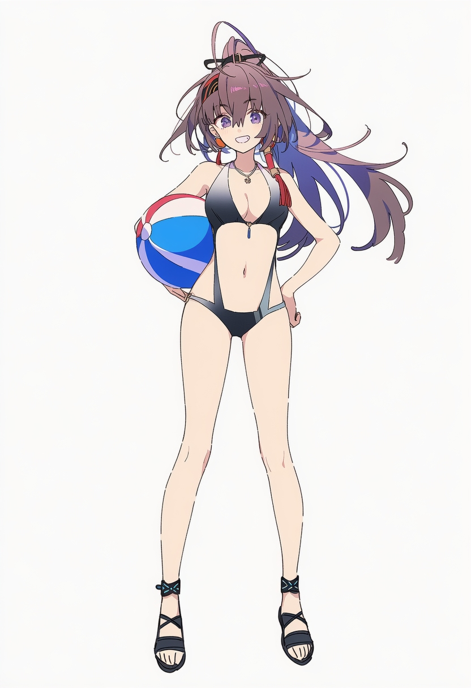

[在线例图](https://assets.quicktagcloud.com/images/raven_composition/raven_composition-0061.jpg?v=463e977a33243073)

<a id="raven_composition-0062"></a>

## 高开腿连体泳装

ID：`raven_composition-0062`；分类：泳装；来源标记：`safe`。

来源说明：

> 连体泳装腿口向髋部高位延伸。

正向提示词：

```text
highleg_one-piece_swimsuit
```

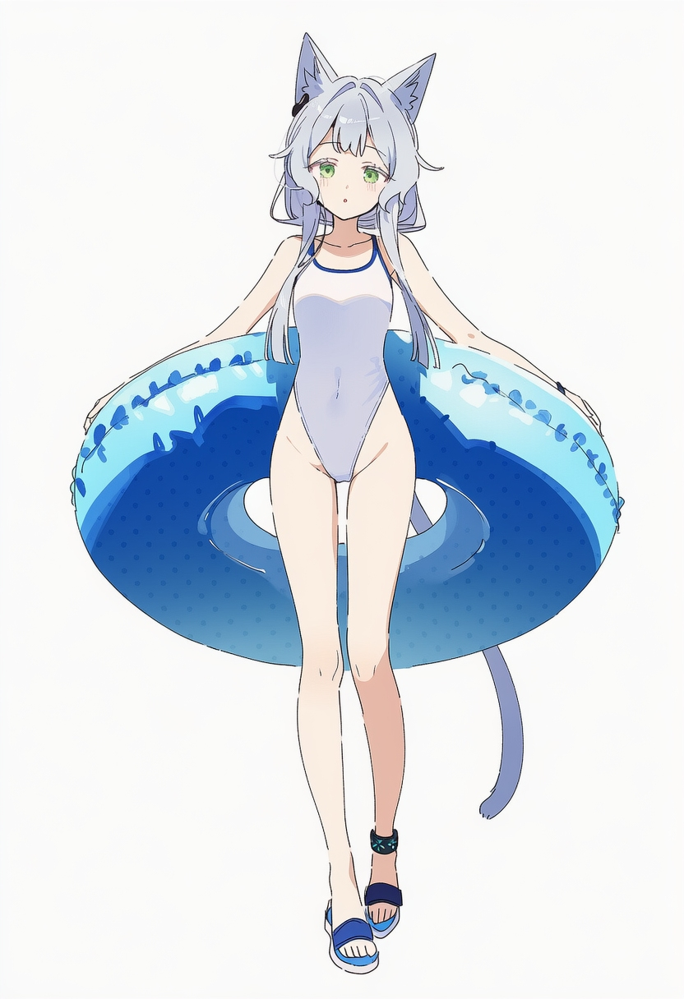

[在线例图](https://assets.quicktagcloud.com/images/raven_composition/raven_composition-0062.jpg?v=1c434ae2d8688c53)

<a id="raven_composition-0063"></a>

## O环连体泳装

ID：`raven_composition-0063`；分类：泳装；来源标记：`safe`。

来源说明：

> 连体泳装用圆环作为布片/带子的连接节点。

正向提示词：

```text
o-ring_one-piece_swimsuit
```

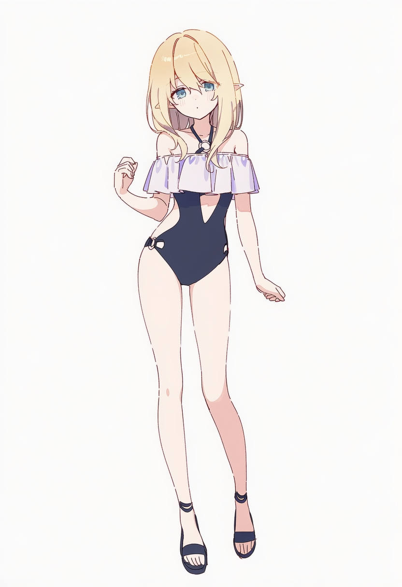

[在线例图](https://assets.quicktagcloud.com/images/raven_composition/raven_composition-0063.jpg?v=0d588dee7944b988)

<a id="raven_composition-0064"></a>

## 露臀泳装

ID：`raven_composition-0064`；分类：泳装；来源标记：`safe`。

来源说明：

> 泳装在臀部区域开放或缺少常规覆盖。

正向提示词：

```text
assless_swimsuit
```


[在线例图](https://assets.quicktagcloud.com/images/raven_composition/raven_composition-0064.jpg?v=ce8a43a74d3431e7)

<a id="raven_composition-0065"></a>

## 十字/交叉结构泳装

ID：`raven_composition-0065`；分类：泳装；来源标记：`safe`。

来源说明：

> 以十字或交叉布片为显著结构特征的泳装 tag。

正向提示词：

```text
cross_swimsuit
```


[在线例图](https://assets.quicktagcloud.com/images/raven_composition/raven_composition-0065.jpg?v=ea7f11b74ec6bca4)

<a id="raven_composition-0066"></a>

## 双层荷叶裙摆泳装

ID：`raven_composition-0066`；分类：泳装；来源标记：`safe`。

来源说明：

> 泳装下部带双层 frill/荷叶边裙摆。

正向提示词：

```text
double_frill_skirt_swimsuit
```


[在线例图](https://assets.quicktagcloud.com/images/raven_composition/raven_composition-0066.jpg?v=ecc54f0b702a2282)

<a id="raven_composition-0067"></a>

## 泳装裙 / 裙摆泳装

ID：`raven_composition-0067`；分类：泳装；来源标记：`safe`。

来源说明：

> 泳装体系中的裙式下装或明显裙摆结构。

正向提示词：

```text
swimsuit_skirt
```


[在线例图](https://assets.quicktagcloud.com/images/raven_composition/raven_composition-0067.jpg?v=2030680c20e4817a)

<a id="raven_composition-0068"></a>

## 复古泳装

ID：`raven_composition-0068`；分类：泳装；来源标记：`safe`。

来源说明：

> 老式/复古泳装，通常覆盖更高、更保守。

正向提示词：

```text
old-fashioned_swimsuit
```


[在线例图](https://assets.quicktagcloud.com/images/raven_composition/raven_composition-0068.jpg?v=1129f3322fa0cb71)

<a id="raven_composition-0069"></a>

## 防晒泳衣 / Rash guard

ID：`raven_composition-0069`；分类：泳装；来源标记：`safe`。

来源说明：

> 紧身游泳上衣，用于防晒、防擦伤，通常带袖。

正向提示词：

```text
rash_guard
```


[在线例图](https://assets.quicktagcloud.com/images/raven_composition/raven_composition-0069.jpg?v=a555d7f8f1e2b498)

<a id="raven_composition-0070"></a>

## 荷叶边连体泳装

ID：`raven_composition-0070`；分类：泳装；来源标记：`safe`。

来源说明：

> 连体泳装带明显荷叶边/褶边。

正向提示词：

```text
frilled_one-piece_swimsuit
```


[在线例图](https://assets.quicktagcloud.com/images/raven_composition/raven_composition-0070.jpg?v=c4f6c437506ea94c)

<a id="raven_composition-0071"></a>

## 蝴蝶结泳装

ID：`raven_composition-0071`；分类：泳装；来源标记：`safe`。

来源说明：

> 以明显蝴蝶结作为泳装主要设计元素。

正向提示词：

```text
bow_swimsuit
```


[在线例图](https://assets.quicktagcloud.com/images/raven_composition/raven_composition-0071.jpg?v=5537059cddfeedd8)

<a id="raven_composition-0072"></a>

## 蕾丝边泳装

ID：`raven_composition-0072`；分类：泳装；来源标记：`safe`。

来源说明：

> 泳装边缘带蕾丝饰边。

正向提示词：

```text
lace-trimmed_swimsuit
```


[在线例图](https://assets.quicktagcloud.com/images/raven_composition/raven_composition-0072.jpg?v=50fcaafad6b067c0)

<a id="raven_composition-0073"></a>

## 丝带边泳装

ID：`raven_composition-0073`；分类：泳装；来源标记：`safe`。

来源说明：

> 泳装边缘或轮廓使用 ribbon 饰边。

正向提示词：

```text
ribbon-trimmed_swimsuit
```


[在线例图](https://assets.quicktagcloud.com/images/raven_composition/raven_composition-0073.jpg?v=3322aaca8f331986)

<a id="raven_composition-0074"></a>

## 层叠泳装

ID：`raven_composition-0074`；分类：泳装；来源标记：`safe`。

来源说明：

> 泳装具有明显多层布片、裙层或叠加结构。

正向提示词：

```text
layered_swimsuit
```


[在线例图](https://assets.quicktagcloud.com/images/raven_composition/raven_composition-0074.jpg?v=3a2aa130a61e868e)

<a id="raven_composition-0075"></a>

## 战术泳装

ID：`raven_composition-0075`；分类：泳装；来源标记：`safe`。

来源说明：

> 将战术装备/功能带、护具等元素与泳装结合。

正向提示词：

```text
tactical_swimsuit
```


[在线例图](https://assets.quicktagcloud.com/images/raven_composition/raven_composition-0075.jpg?v=852b7ebeb5ac8768)

<a id="raven_composition-0076"></a>

## 绷紧泳装

ID：`raven_composition-0076`；分类：泳装；来源标记：`safe`。

来源说明：

> 泳装被身体明显撑紧，出现强烈张力感。

正向提示词：

```text
taut_swimsuit
```


[在线例图](https://assets.quicktagcloud.com/images/raven_composition/raven_composition-0076.jpg?v=0fabf7dd799c152a)

<a id="raven_composition-0077"></a>

## 不可能泳装

ID：`raven_composition-0077`；分类：泳装；来源标记：`safe`。

来源说明：

> 结构在现实中难以正常固定或具有不可能的贴附方式。

正向提示词：

```text
impossible_swimsuit
```


[在线例图](https://assets.quicktagcloud.com/images/raven_composition/raven_composition-0077.jpg?v=8257ba2ac14b6d83)

<a id="raven_composition-0078"></a>

## 破损泳装

ID：`raven_composition-0078`；分类：泳装；来源标记：`safe`。

来源说明：

> 泳装有明显撕裂或破损。

正向提示词：

```text
torn_swimsuit
```


[在线例图](https://assets.quicktagcloud.com/images/raven_composition/raven_composition-0078.jpg?v=844157035556549a)

<a id="raven_composition-0079"></a>

## 湿泳装

ID：`raven_composition-0079`；分类：泳装；来源标记：`safe`。

来源说明：

> 泳装被水打湿，材质呈现湿润状态。

正向提示词：

```text
wet_swimsuit
```


[在线例图](https://assets.quicktagcloud.com/images/raven_composition/raven_composition-0079.jpg?v=b2421c9d72d71f4d)

<a id="raven_composition-0080"></a>

## 衣服内穿泳装

ID：`raven_composition-0080`；分类：泳装；来源标记：`safe`。

来源说明：

> 泳装作为内层，外面穿普通服装。

正向提示词：

```text
swimsuit_under_clothes
```


[在线例图](https://assets.quicktagcloud.com/images/raven_composition/raven_composition-0080.jpg?v=ffccdc743070b668)
