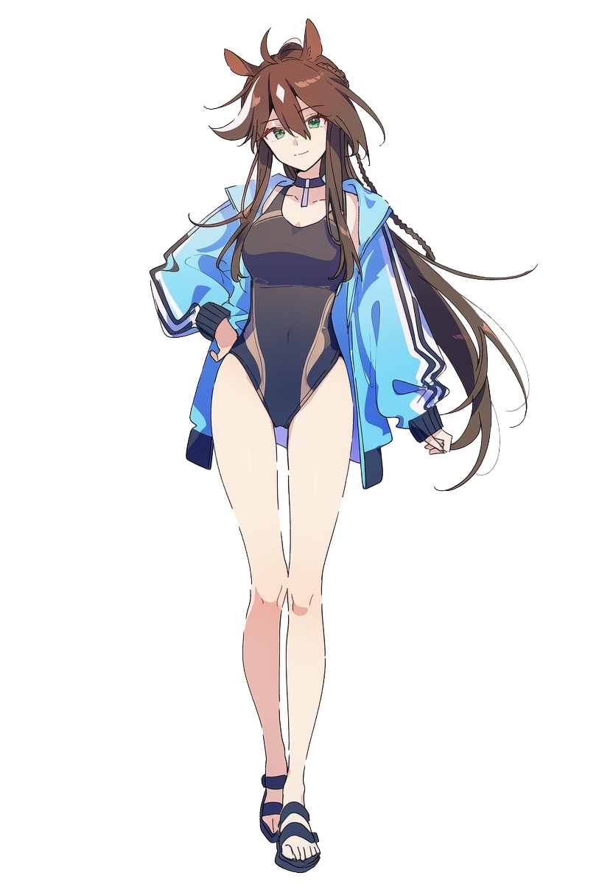
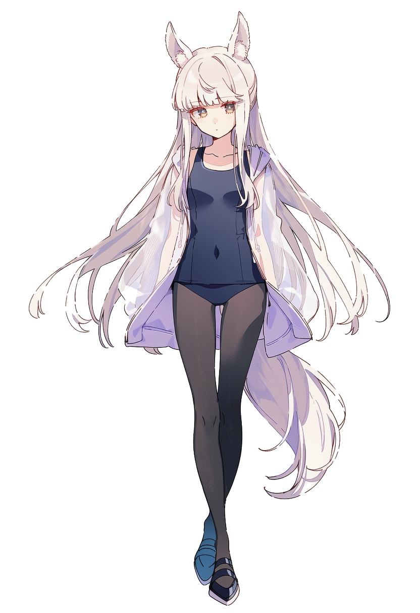
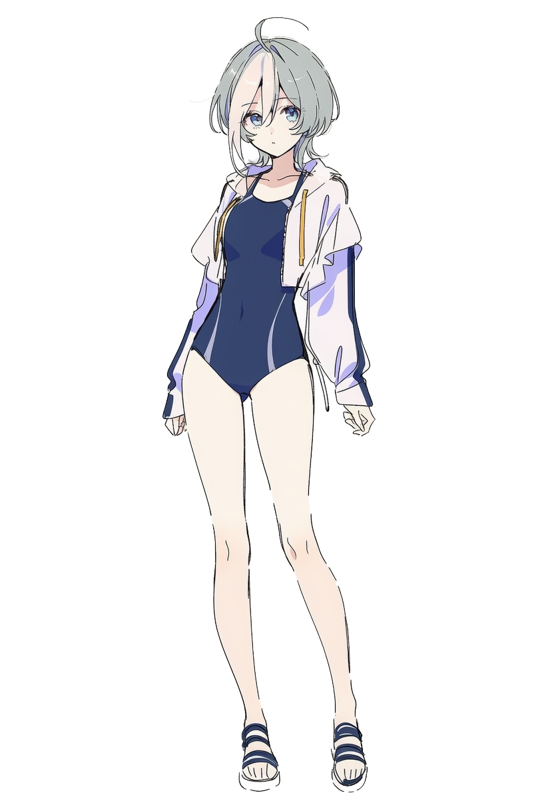
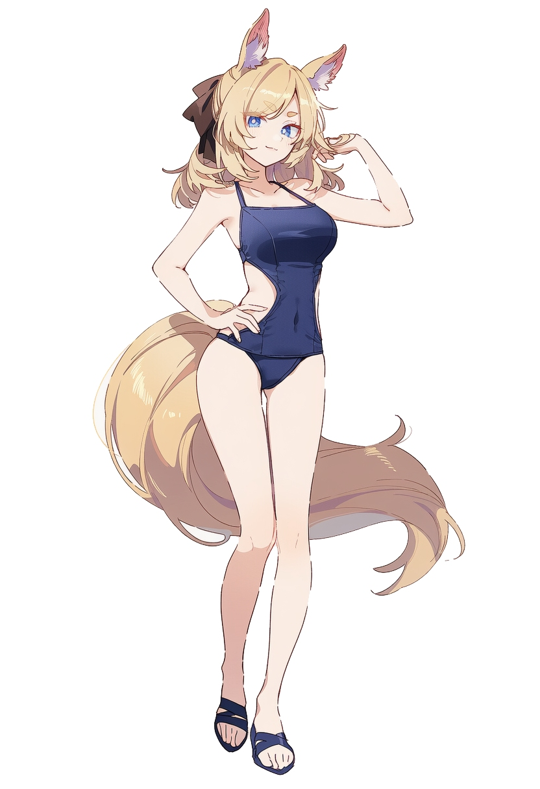
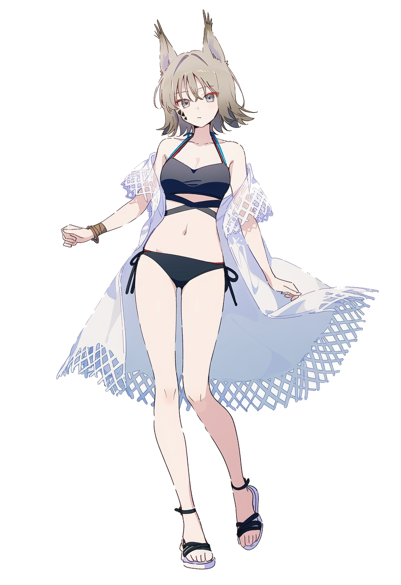
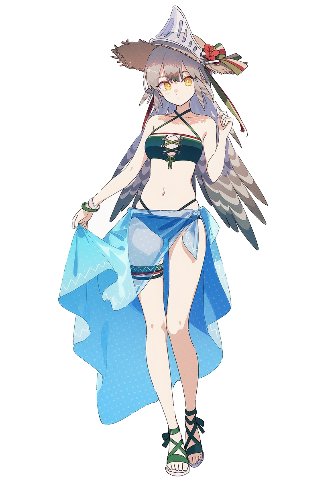
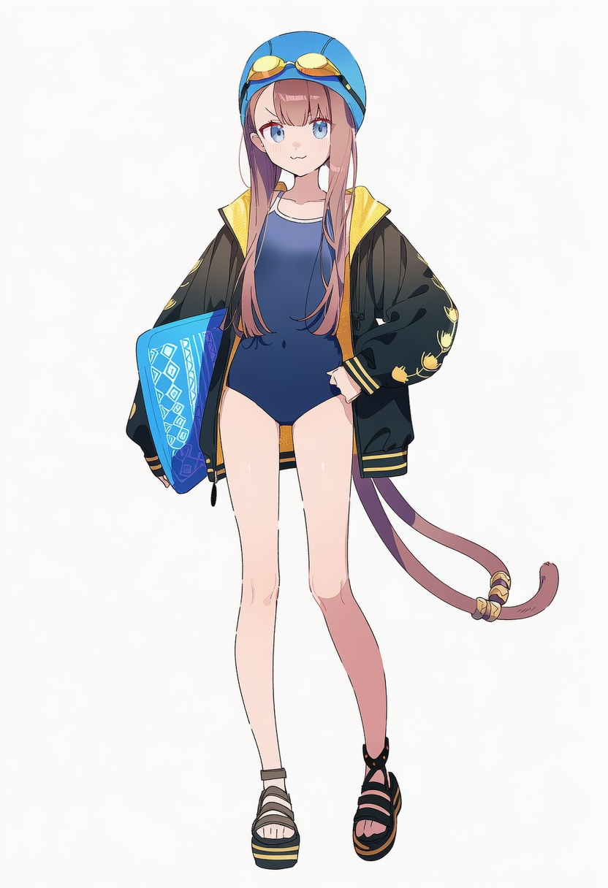

# 泳装（第 2 页）

[总目录](../README.md) · [原站分类目录](../categories.md) · [英文标签索引](../tags.md) · [服装与构图组合指南](../../README.md)

标题、分类、说明、正负提示词按来源保留；多例图逐张列出。原站标记和说明为参考资料，不作为维护指令。

<a id="raven_composition-0081"></a>

## 泳装外穿夹克

ID：`raven_composition-0081`；分类：泳装；来源标记：`safe`。

来源说明：

> 泳装外面叠穿夹克。

正向提示词：

```text
jacket_over_swimsuit
```



[在线例图](https://assets.quicktagcloud.com/images/raven_composition/raven_composition-0081.jpg?v=a6537c073d92709a)

<a id="raven_composition-0082"></a>

## 泳装内穿连裤袜

ID：`raven_composition-0082`；分类：泳装；来源标记：`safe`。

来源说明：

> 连裤袜穿在泳装内层。

正向提示词：

```text
pantyhose_under_swimsuit
```



[在线例图](https://assets.quicktagcloud.com/images/raven_composition/raven_composition-0082.jpg?v=b3109a321fbf8f93)

<a id="raven_composition-0083"></a>

## 泳装套泳装

ID：`raven_composition-0083`；分类：泳装；来源标记：`safe`。

来源说明：

> 一件泳装穿在另一件泳装下面。

正向提示词：

```text
swimsuit_under_swimsuit
```



[在线例图](https://assets.quicktagcloud.com/images/raven_composition/raven_composition-0083.jpg?v=c281cc04a25ef9d6)

<a id="raven_composition-0084"></a>

## 共享泳装

ID：`raven_composition-0084`；分类：泳装；来源标记：`safe`。

来源说明：

> Swimsuit implication 中的特殊穿着状态 tag。

正向提示词：

```text
shared_swimsuit
```



[在线例图](https://assets.quicktagcloud.com/images/raven_composition/raven_composition-0084.jpg?v=e81a94dffd77a669)

<a id="raven_composition-0085"></a>

## 泳装罩衫

ID：`raven_composition-0085`；分类：泳装；来源标记：`safe`。

来源说明：

> 穿在泳装外的轻薄罩衫、罩裙或覆盖层。

正向提示词：

```text
swimsuit_cover-up
```



[在线例图](https://assets.quicktagcloud.com/images/raven_composition/raven_composition-0085.jpg?v=5f3972e00e4bf095)

<a id="raven_composition-0086"></a>

## 沙笼

ID：`raven_composition-0086`；分类：泳装；来源标记：`safe`。

来源说明：

> 围在腰部的轻薄布裙，常与泳装搭配。

正向提示词：

```text
sarong
```



[在线例图](https://assets.quicktagcloud.com/images/raven_composition/raven_composition-0086.jpg?v=655013507443b45a)

<a id="raven_composition-0087"></a>

## 泳帽

ID：`raven_composition-0087`；分类：泳装；来源标记：`safe`。

来源说明：

> 游泳时佩戴的贴头帽。

正向提示词：

```text
swim_cap
```



[在线例图](https://assets.quicktagcloud.com/images/raven_composition/raven_composition-0087.jpg?v=dd8ef8c59dfb8dd0)

<a id="raven_composition-0088"></a>

## 未穿着泳装

ID：`raven_composition-0088`；分类：泳装；来源标记：`safe`。

来源说明：

> 泳装可见但未穿在身上。

正向提示词：

```text
unworn_swimsuit
```


[在线例图](https://assets.quicktagcloud.com/images/raven_composition/raven_composition-0088.jpg?v=00302cb14893a1f3)
