# 衬衫

[总目录](../README.md) · [原站分类目录](../categories.md) · [英文标签索引](../tags.md) · [服装与构图组合指南](../../README.md)

标题、分类、说明、正负提示词按来源保留；多例图逐张列出。原站标记和说明为参考资料，不作为维护指令。

<a id="raven_composition-0089"></a>

## 衬衫 / 上衣

ID：`raven_composition-0089`；分类：衬衫；来源标记：`safe`。

来源说明：

> 泛指穿在上半身的衬衫或类似上衣，是相关 shirt 标签的基础概念。

正向提示词：

```text
shirt
```


[在线例图](https://assets.quicktagcloud.com/images/raven_composition/raven_composition-0089.jpg?v=2f87ac6890534c55)

<a id="raven_composition-0090"></a>

## 有领衬衫

ID：`raven_composition-0090`；分类：衬衫；来源标记：`safe`。

来源说明：

> 带有折叠式衣领的衬衫，包括正装衬衫及较休闲的有领款式。

正向提示词：

```text
collared_shirt
```

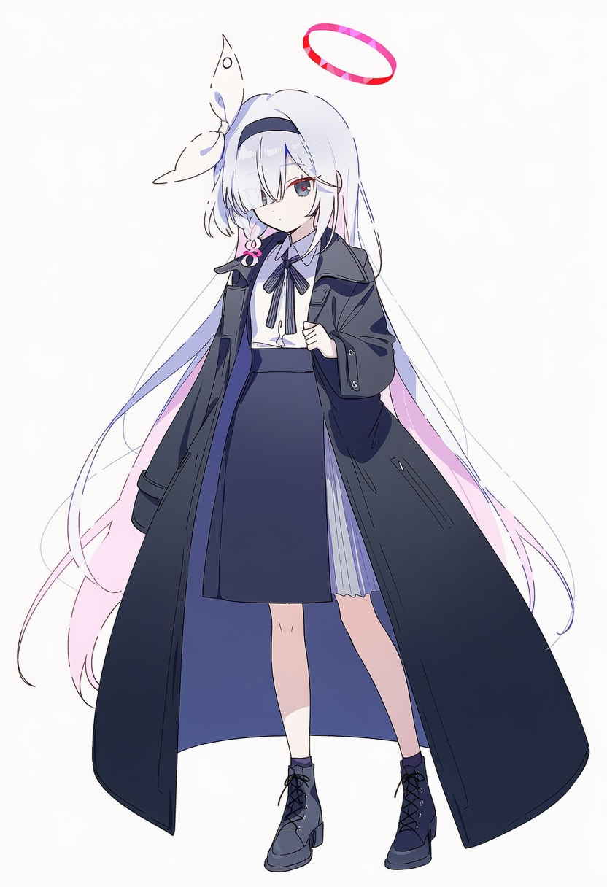

[在线例图](https://assets.quicktagcloud.com/images/raven_composition/raven_composition-0090.jpg?v=31c2ff0b7f29c67c)

<a id="raven_composition-0091"></a>

## 无袖衬衫

ID：`raven_composition-0091`；分类：衬衫；来源标记：`safe`。

来源说明：

> 有领口但没有袖子和肩带的衬衫；带肩带的背心类通常不归入此标签。

正向提示词：

```text
sleeveless_shirt
```

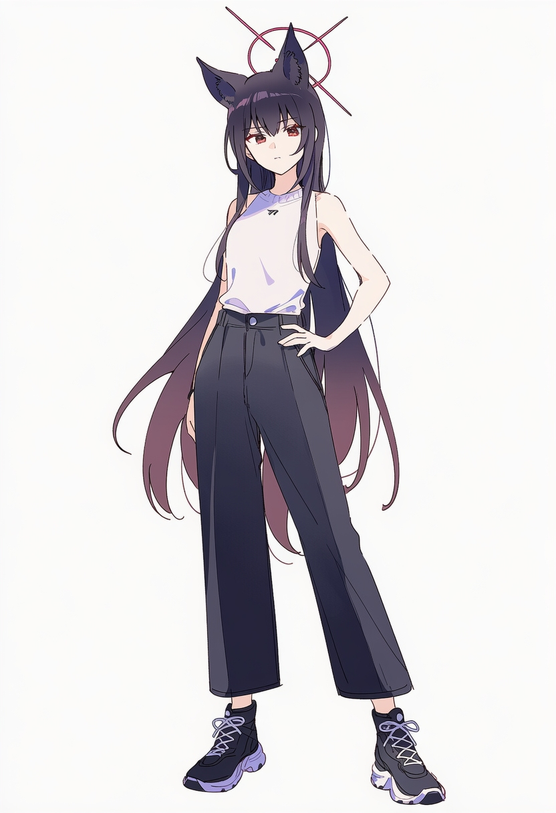

[在线例图](https://assets.quicktagcloud.com/images/raven_composition/raven_composition-0091.jpg?v=1c2141745c5ebbc4)

<a id="raven_composition-0092"></a>

## 正装衬衫

ID：`raven_composition-0092`；分类：衬衫；来源标记：`safe`。

来源说明：

> 较正式的有领前扣式衬衫，常见于商务或礼服搭配。

正向提示词：

```text
dress_shirt
```

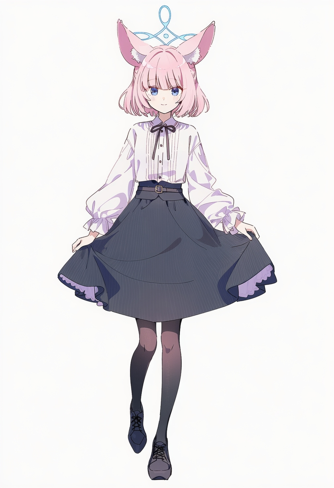

[在线例图](https://assets.quicktagcloud.com/images/raven_composition/raven_composition-0092.jpg?v=26873c46f296d3a9)

<a id="raven_composition-0093"></a>

## 敞开衬衫

ID：`raven_composition-0093`；分类：衬衫；来源标记：`safe`。

来源说明：

> 衬衫被全部或部分解开并敞着穿，重点是前襟处于打开状态。

正向提示词：

```text
open_shirt
```

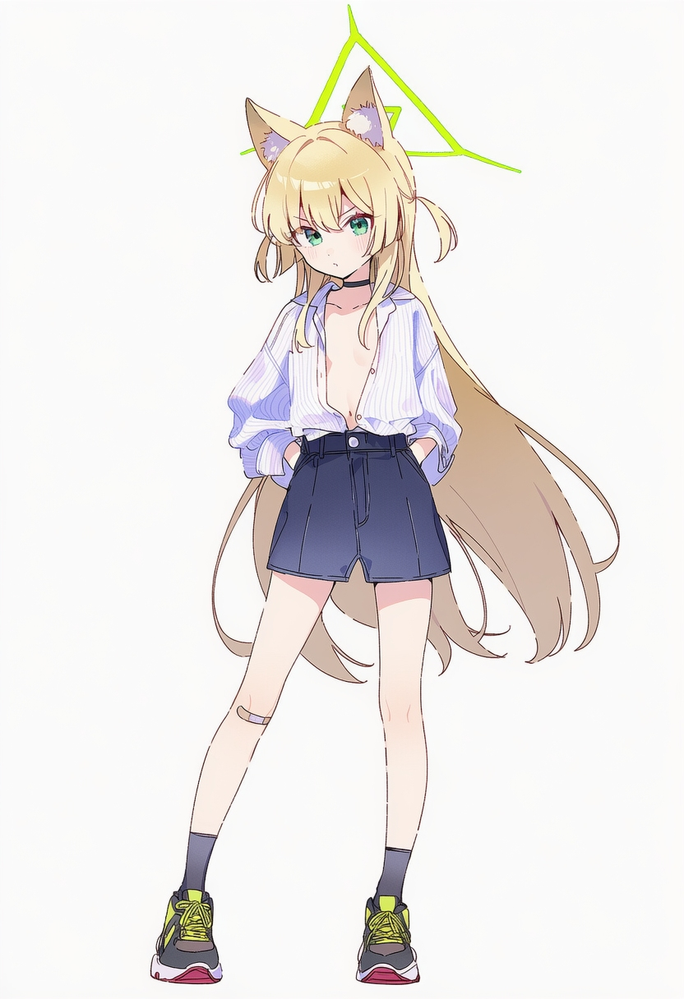

[在线例图](https://assets.quicktagcloud.com/images/raven_composition/raven_composition-0093.jpg?v=e931814dd6d06454)

<a id="raven_composition-0094"></a>

## 掀起上衣

ID：`raven_composition-0094`；分类：衬衫；来源标记：`safe`。

来源说明：

> 把衬衫或类似上衣从下方向上掀起，常用于露出腹部、胸部或内衣。

正向提示词：

```text
shirt_lift
```

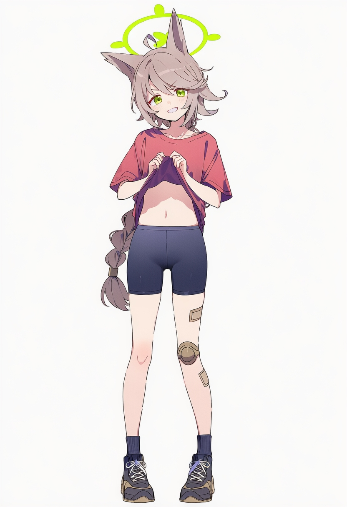

[在线例图](https://assets.quicktagcloud.com/images/raven_composition/raven_composition-0094.jpg?v=c0aeba98847515cf)

<a id="raven_composition-0095"></a>

## T恤

ID：`raven_composition-0095`；分类：衬衫；来源标记：`safe`。

来源说明：

> 无领休闲上衣，传统上多为短袖，也可有其他袖长。

正向提示词：

```text
t-shirt
```


[在线例图](https://assets.quicktagcloud.com/images/raven_composition/raven_composition-0095.jpg?v=7dc381fc0a3d81bd)

<a id="raven_composition-0096"></a>

## 荷叶边衬衫领

ID：`raven_composition-0096`；分类：衬衫；来源标记：`safe`。

来源说明：

> 衬衫、上衣或连衣裙上的褶边/荷叶边领口，而非独立佩戴的领饰。

正向提示词：

```text
frilled_shirt_collar
```

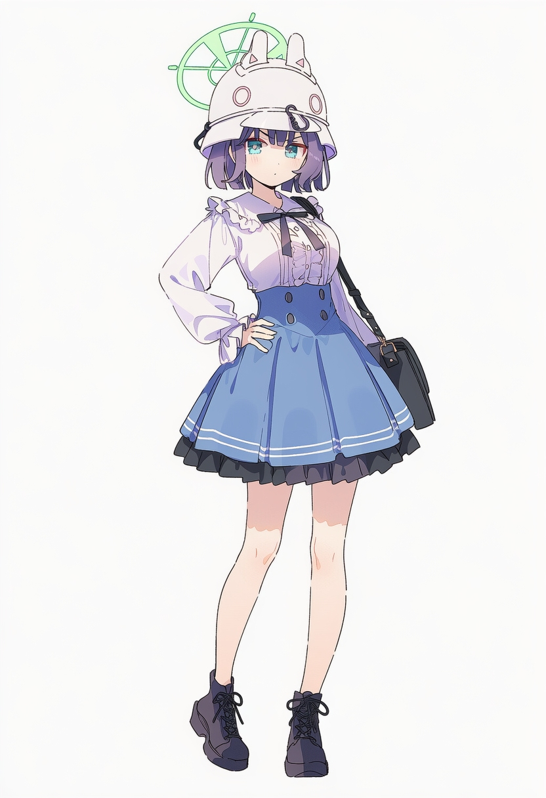

[在线例图](https://assets.quicktagcloud.com/images/raven_composition/raven_composition-0096.jpg?v=21a3ea284e0df6a3)

<a id="raven_composition-0097"></a>

## 衬衫完全扎入下装

ID：`raven_composition-0097`；分类：衬衫；来源标记：`safe`。

来源说明：

> 衬衫下摆完全塞进裤子、裙子等下装中。

正向提示词：

```text
shirt_tucked_in
```

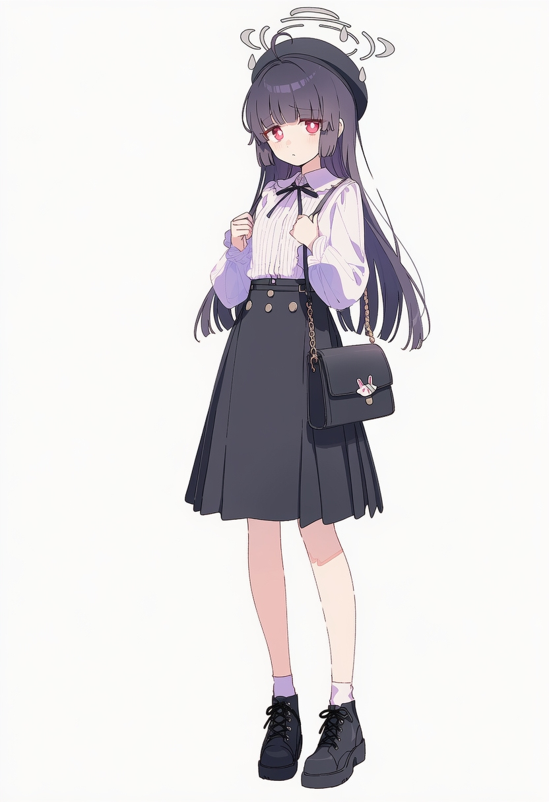

[在线例图](https://assets.quicktagcloud.com/images/raven_composition/raven_composition-0097.jpg?v=5ed151339bd56d04)

<a id="raven_composition-0098"></a>

## 条纹衬衫

ID：`raven_composition-0098`；分类：衬衫；来源标记：`safe`。

来源说明：

> 具有两种或以上颜色条纹形成图案的衬衫，可为横条、竖条或其他方向。

正向提示词：

```text
striped_shirt
```

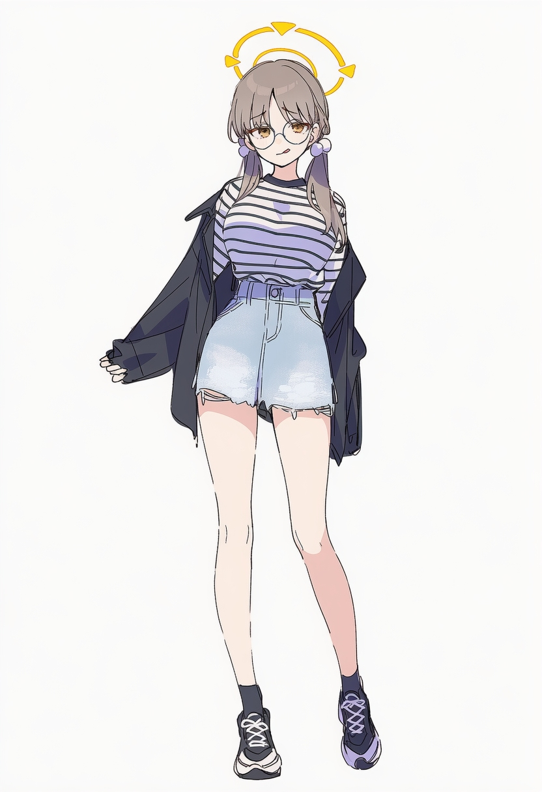

[在线例图](https://assets.quicktagcloud.com/images/raven_composition/raven_composition-0098.jpg?v=3b1872be56984868)

<a id="raven_composition-0099"></a>

## 短款衬衫

ID：`raven_composition-0099`；分类：衬衫；来源标记：`safe`。

来源说明：

> 下摆明显高于腰线的短款衬衫，通常会露出腰腹。

正向提示词：

```text
cropped_shirt
```


[在线例图](https://assets.quicktagcloud.com/images/raven_composition/raven_composition-0099.jpg?v=5690bba20d839c31)

<a id="raven_composition-0100"></a>

## 水手领衬衫

ID：`raven_composition-0100`；分类：衬衫；来源标记：`safe`。

来源说明：

> 带水手领设计的衬衫。

正向提示词：

```text
sailor_shirt
```


[在线例图](https://assets.quicktagcloud.com/images/raven_composition/raven_composition-0100.jpg?v=e3ae01c8852f752c)

<a id="raven_composition-0101"></a>

## 荷叶边衬衫

ID：`raven_composition-0101`；分类：衬衫；来源标记：`safe`。

来源说明：

> 带有褶边、荷叶边等装饰的衬衫。

正向提示词：

```text
frilled_shirt
```

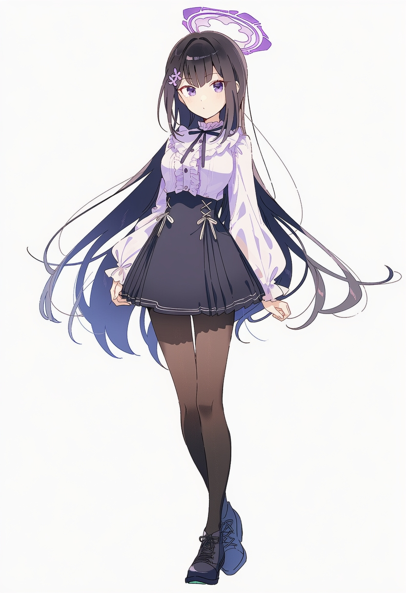

[在线例图](https://assets.quicktagcloud.com/images/raven_composition/raven_composition-0101.jpg?v=942dae94a74beb6b)

<a id="raven_composition-0102"></a>

## 露肩衬衫

ID：`raven_composition-0102`；分类：衬衫；来源标记：`safe`。

来源说明：

> 领口较宽、肩部裸露，袖子落在上臂处且与衣身相连的露肩衬衫。

正向提示词：

```text
off-shoulder_shirt
```

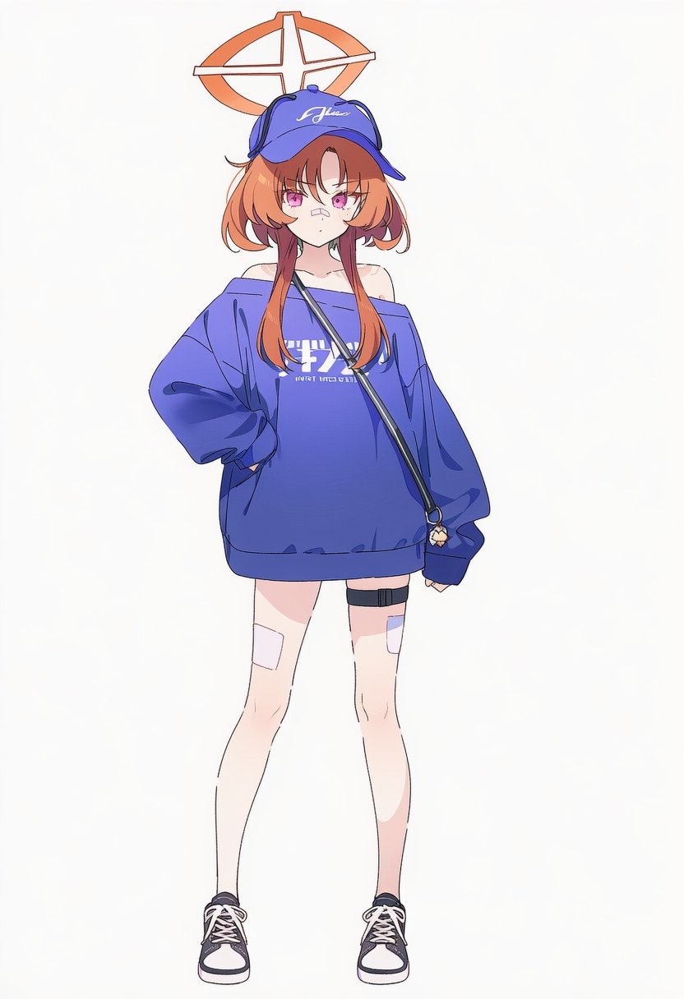

[在线例图](https://assets.quicktagcloud.com/images/raven_composition/raven_composition-0102.jpg?v=baf7dcc3ac9af7d4)

<a id="raven_composition-0103"></a>

## 胸前口袋

ID：`raven_composition-0103`；分类：衬衫；来源标记：`safe`。

来源说明：

> 位于衬衫或其他上衣胸口位置的口袋。

正向提示词：

```text
breast_pocket
```

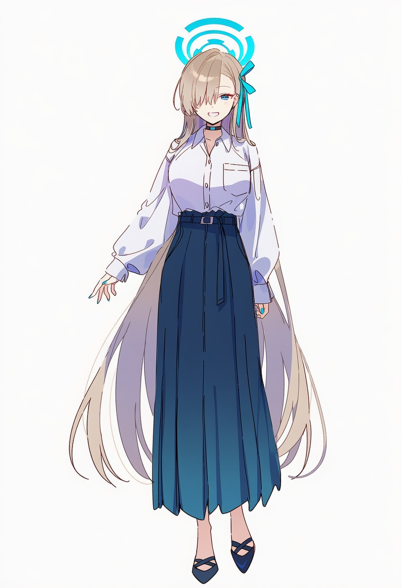

[在线例图](https://assets.quicktagcloud.com/images/raven_composition/raven_composition-0103.jpg?v=456835712b1c576f)

<a id="raven_composition-0104"></a>

## 印花/印字衬衫

ID：`raven_composition-0104`；分类：衬衫；来源标记：`safe`。

来源说明：

> 正面、背面或两面带有文字、图形等印刷内容的衬衫。

正向提示词：

```text
print_shirt
```

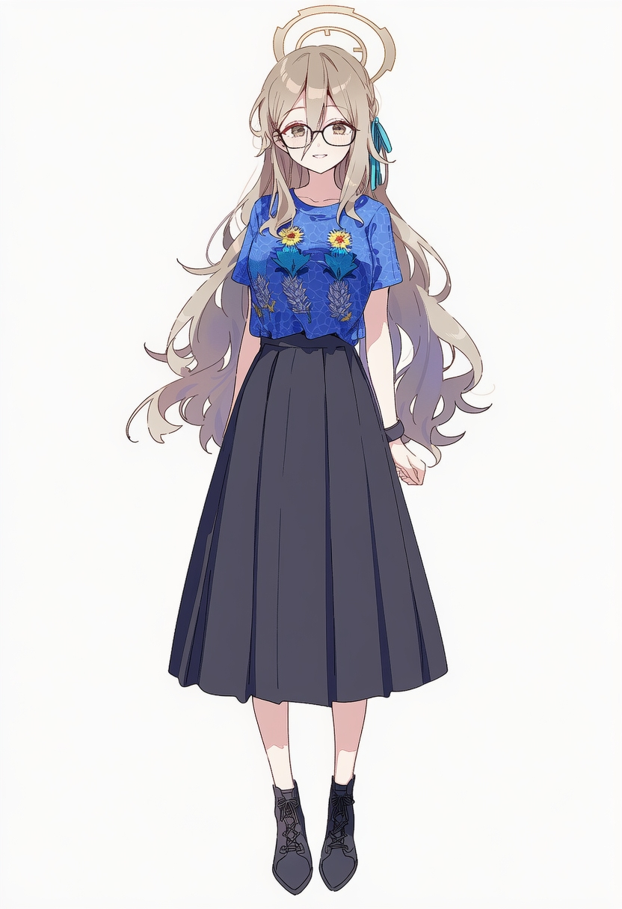

[在线例图](https://assets.quicktagcloud.com/images/raven_composition/raven_composition-0104.jpg?v=e5a8a16323ed1cd1)

<a id="raven_composition-0105"></a>

## 内穿汗衫 / 内衣上衣

ID：`raven_composition-0105`；分类：衬衫；来源标记：`safe`。

来源说明：

> 穿在其他衣物里面的轻薄上衣，通常无领，常作吸汗或打底用途。

正向提示词：

```text
undershirt
```

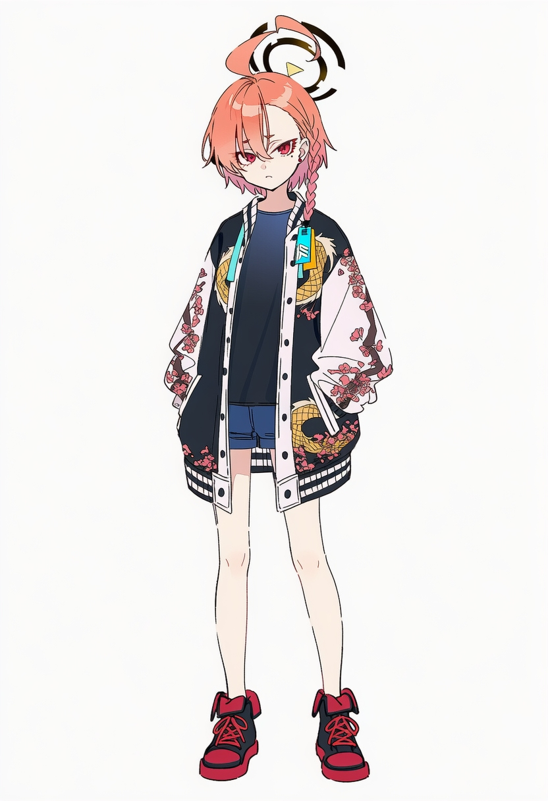

[在线例图](https://assets.quicktagcloud.com/images/raven_composition/raven_composition-0105.jpg?v=25ef62cb3528e4a1)

<a id="raven_composition-0106"></a>

## 下摆打结衬衫

ID：`raven_composition-0106`；分类：衬衫；来源标记：`safe`。

来源说明：

> 衬衫下摆被打结固定，常因此露出腰腹。

正向提示词：

```text
tied_shirt
```

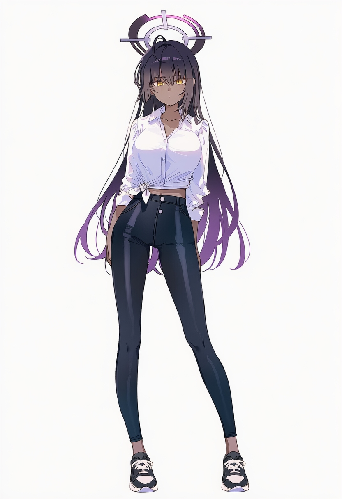

[在线例图](https://assets.quicktagcloud.com/images/raven_composition/raven_composition-0106.jpg?v=1adc6ead46e11afe)

<a id="raven_composition-0107"></a>

## 湿透的衬衫

ID：`raven_composition-0107`；分类：衬衫；来源标记：`safe`。

来源说明：

> 被水或其他液体浸湿的衬衫，浅色款可能因此变得半透明。

正向提示词：

```text
wet_shirt
```

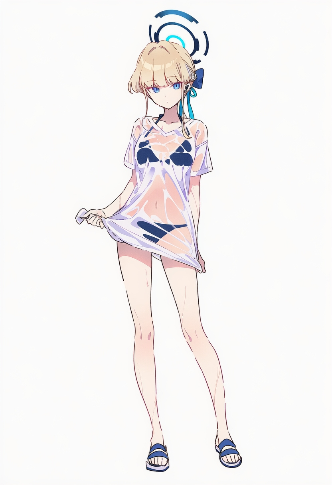

[在线例图](https://assets.quicktagcloud.com/images/raven_composition/raven_composition-0107.jpg?v=29165f260dcdd3c0)

<a id="raven_composition-0108"></a>

## 仅穿衬衫

ID：`raven_composition-0108`；分类：衬衫；来源标记：`safe`。

来源说明：

> 衬衫下面没有穿其他衣物的穿法，常见于宽大或敞开的衬衫。

正向提示词：

```text
naked_shirt
```


[在线例图](https://assets.quicktagcloud.com/images/raven_composition/raven_composition-0108.jpg?v=d3b3a2387291a9a5)

<a id="raven_composition-0109"></a>

## 透视衬衫

ID：`raven_composition-0109`；分类：衬衫；来源标记：`safe`。

来源说明：

> 由于材质薄透或透明而能看见内里的衬衫。

正向提示词：

```text
see-through_shirt
```

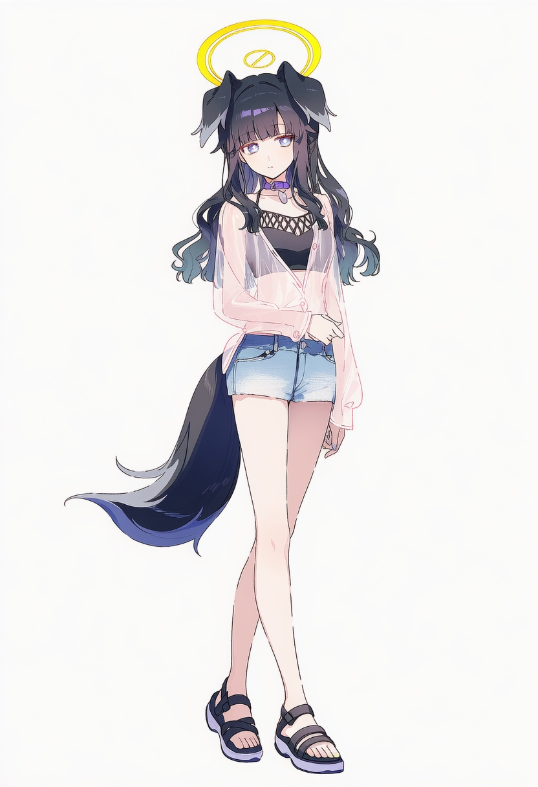

[在线例图](https://assets.quicktagcloud.com/images/raven_composition/raven_composition-0109.jpg?v=c213200a98804a8c)

<a id="raven_composition-0110"></a>

## 体操服上衣

ID：`raven_composition-0110`；分类：衬衫；来源标记：`safe`。

来源说明：

> 学校体操服/体育课制服中的短袖上衣，常见撞色领口或袖口。

正向提示词：

```text
gym_shirt
```

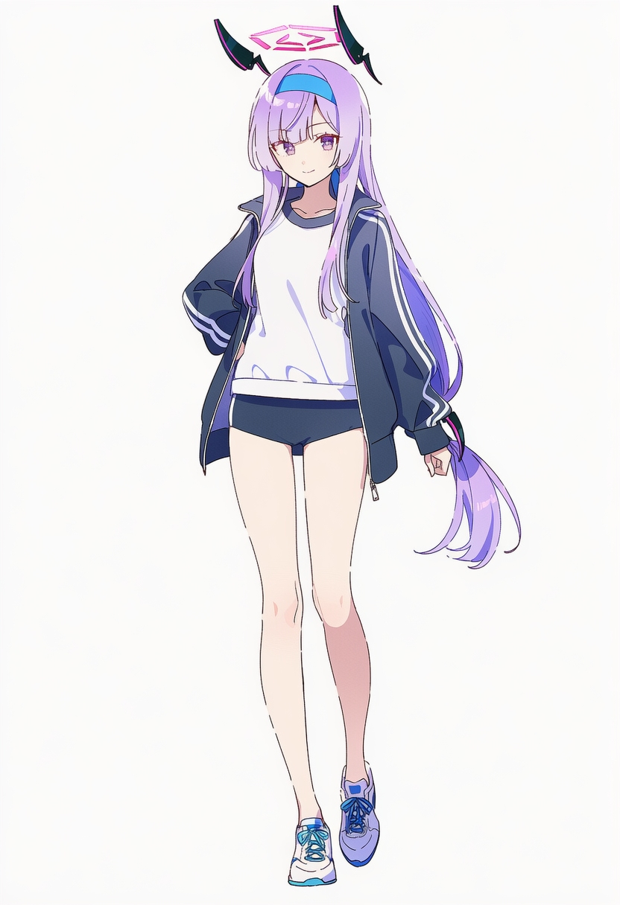

[在线例图](https://assets.quicktagcloud.com/images/raven_composition/raven_composition-0110.jpg?v=1ff0dc0200e8bc87)

<a id="raven_composition-0111"></a>

## 双色衬衫

ID：`raven_composition-0111`；分类：衬衫；来源标记：`safe`。

来源说明：

> 整体设计中恰好包含两种颜色的衬衫，强调双色构成而非某一种具体颜色。

正向提示词：

```text
two-tone_shirt
```

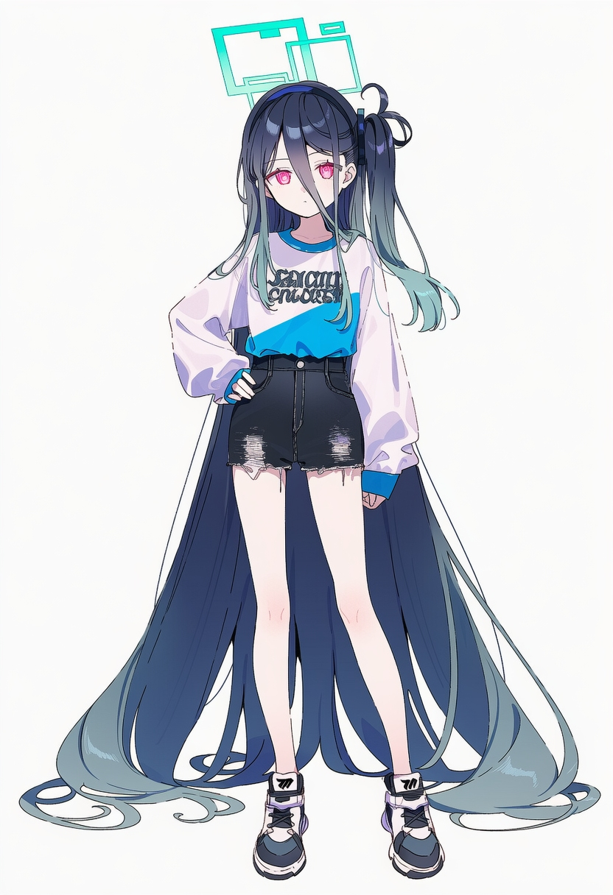

[在线例图](https://assets.quicktagcloud.com/images/raven_composition/raven_composition-0111.jpg?v=6dc05e09681a0036)

<a id="raven_composition-0112"></a>

## 破损衬衫

ID：`raven_composition-0112`；分类：衬衫；来源标记：`safe`。

来源说明：

> 面料出现明显撕裂、破洞或裂口的衬衫。

正向提示词：

```text
torn_shirt
```

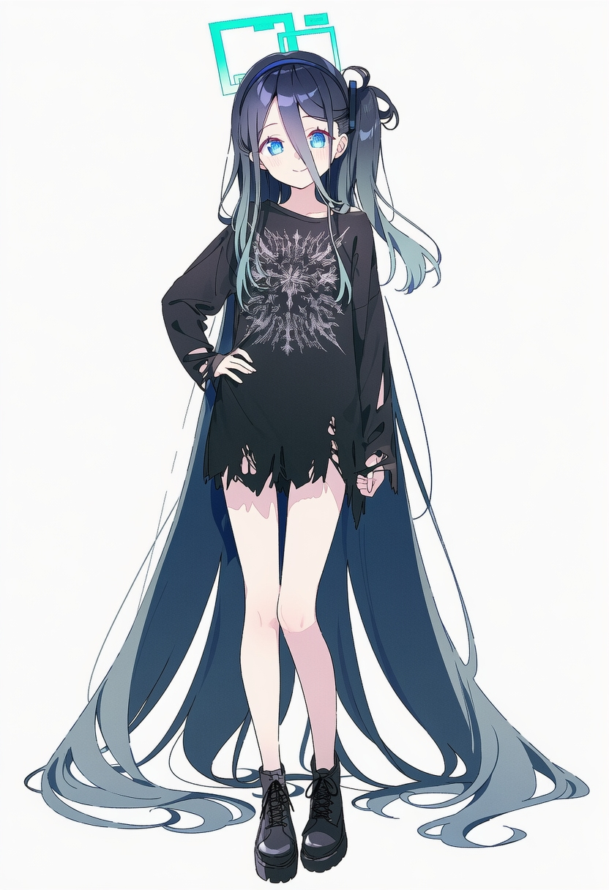

[在线例图](https://assets.quicktagcloud.com/images/raven_composition/raven_composition-0112.jpg?v=95d84dd67bd376bd)

<a id="raven_composition-0113"></a>

## 未穿衬衫

ID：`raven_composition-0113`；分类：衬衫；来源标记：`safe`。

来源说明：

> 角色穿着其他衣物但没有穿衬衫；并不等同于完全裸体。

正向提示词：

```text
no_shirt
```

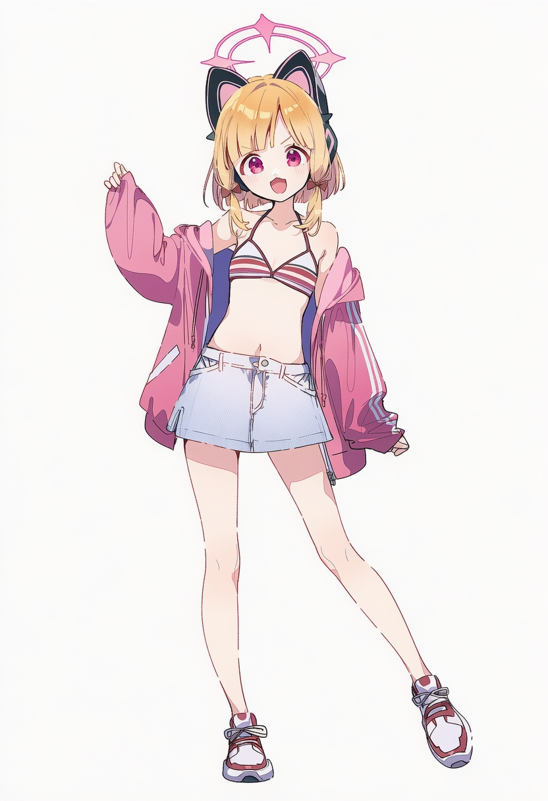

[在线例图](https://assets.quicktagcloud.com/images/raven_composition/raven_composition-0113.jpg?v=fe0d419dfe246911)

<a id="raven_composition-0114"></a>

## 高领衬衫

ID：`raven_composition-0114`；分类：衬衫；来源标记：`safe`。

来源说明：

> 带高翻领/高领结构的普通衬衫，不用于高领毛衣等其他上衣。

正向提示词：

```text
turtleneck_shirt
```

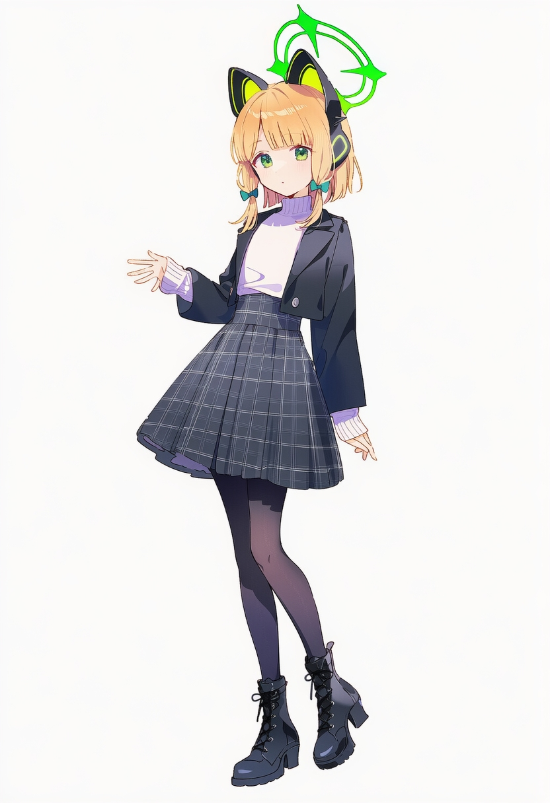

[在线例图](https://assets.quicktagcloud.com/images/raven_composition/raven_composition-0114.jpg?v=e4e56cf5954d16a5)

<a id="raven_composition-0115"></a>

## 竖条纹衬衫

ID：`raven_composition-0115`；分类：衬衫；来源标记：`safe`。

来源说明：

> 条纹方向为纵向的衬衫，是 striped_shirt 的细分类。

正向提示词：

```text
vertical-striped_shirt
```

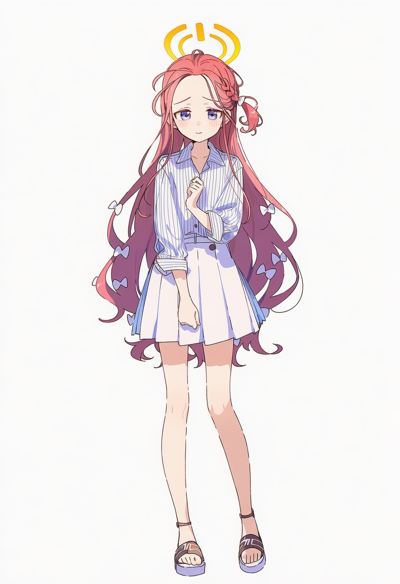

[在线例图](https://assets.quicktagcloud.com/images/raven_composition/raven_composition-0115.jpg?v=2be0e8b427d1a109)

<a id="raven_composition-0116"></a>

## 格纹衬衫

ID：`raven_composition-0116`；分类：衬衫；来源标记：`safe`。

来源说明：

> 带有苏格兰格纹/多线交织格纹图案的衬衫。

正向提示词：

```text
plaid_shirt
```

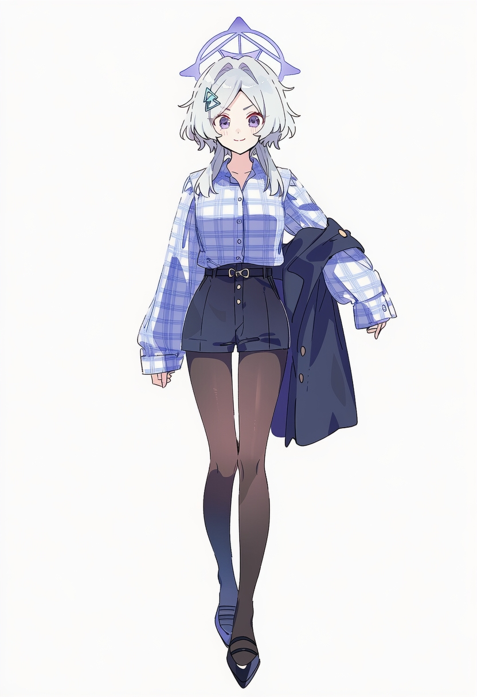

[在线例图](https://assets.quicktagcloud.com/images/raven_composition/raven_composition-0116.jpg?v=fd8f997c7a993fad)

<a id="raven_composition-0117"></a>

## 胸前绷紧的衬衫

ID：`raven_composition-0117`；分类：衬衫；来源标记：`safe`。

来源说明：

> 衣料在胸部之间被拉得很紧并形成绷直褶皱的衬衫状态。

正向提示词：

```text
taut_shirt
```

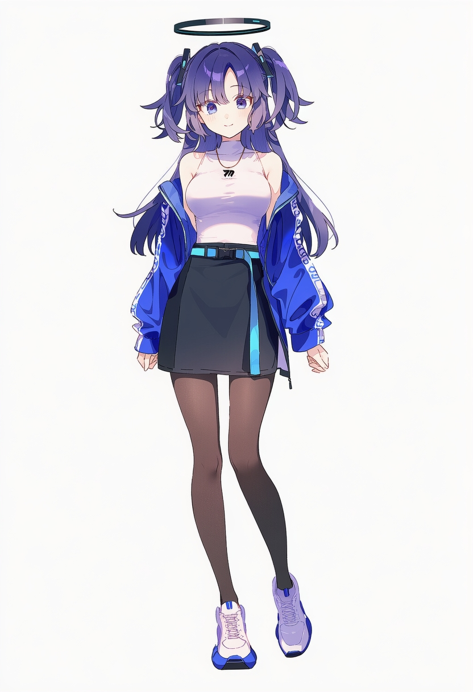

[在线例图](https://assets.quicktagcloud.com/images/raven_composition/raven_composition-0117.jpg?v=14519b6c3d75a315)

<a id="raven_composition-0118"></a>

## 罗纹衬衫

ID：`raven_composition-0118`；分类：衬衫；来源标记：`safe`。

来源说明：

> 面料具有明显罗纹组织，视觉上常表现为细密的纵向纹理。

正向提示词：

```text
ribbed_shirt
```

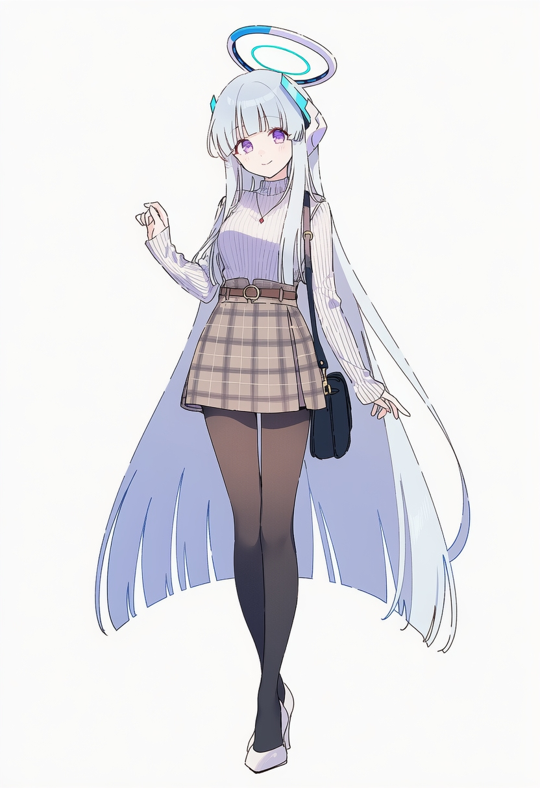

[在线例图](https://assets.quicktagcloud.com/images/raven_composition/raven_composition-0118.jpg?v=9f3a38b92547b18a)

<a id="raven_composition-0119"></a>

## 解开纽扣的衬衫

ID：`raven_composition-0119`；分类：衬衫；来源标记：`safe`。

来源说明：

> 纽扣处于解开状态的衬衫；可完全或部分解开。

正向提示词：

```text
unbuttoned_shirt
```


[在线例图](https://assets.quicktagcloud.com/images/raven_composition/raven_composition-0119.jpg?v=d87a714a2711a6df)

<a id="raven_composition-0120"></a>

## 无肩带衬衫

ID：`raven_composition-0120`；分类：衬衫；来源标记：`safe`。

来源说明：

> 没有肩带、袖子和颈部支撑结构，肩膀与上胸部裸露的衬衫。

正向提示词：

```text
strapless_shirt
```

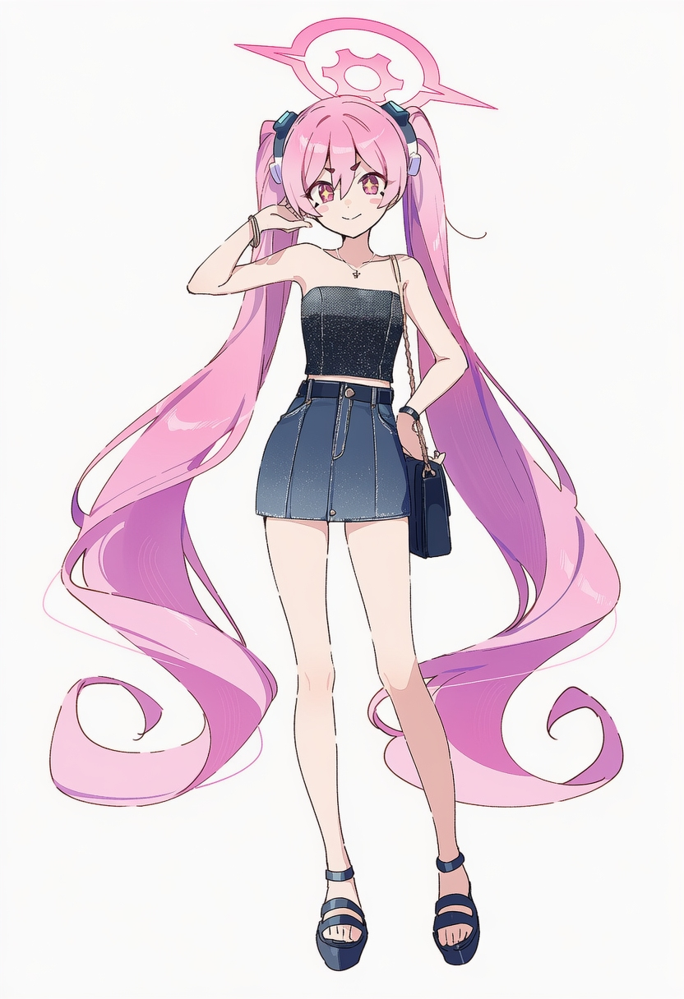

[在线例图](https://assets.quicktagcloud.com/images/raven_composition/raven_composition-0120.jpg?v=8484fe52227d62a7)

<a id="raven_composition-0121"></a>

## 不现实的极贴身衬衫

ID：`raven_composition-0121`；分类：衬衫；来源标记：`safe`。

来源说明：

> 以不符合真实布料物理规律的方式紧贴胸部轮廓的夸张服装表现。

正向提示词：

```text
impossible_shirt
```

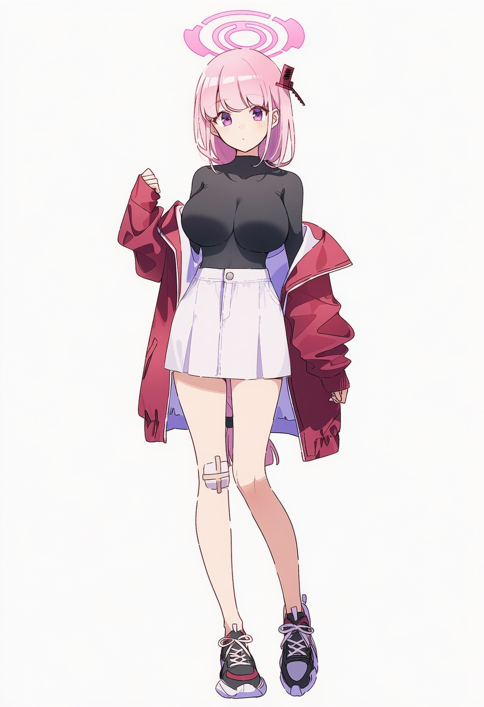

[在线例图](https://assets.quicktagcloud.com/images/raven_composition/raven_composition-0121.jpg?v=aef9f56396dac012)

<a id="raven_composition-0122"></a>

## 超大号衬衫

ID：`raven_composition-0122`；分类：衬衫；来源标记：`safe`。

来源说明：

> 整体尺寸明显大于穿着者合身尺码的衬衫，而不只是袖子较长。

正向提示词：

```text
oversized_shirt
```

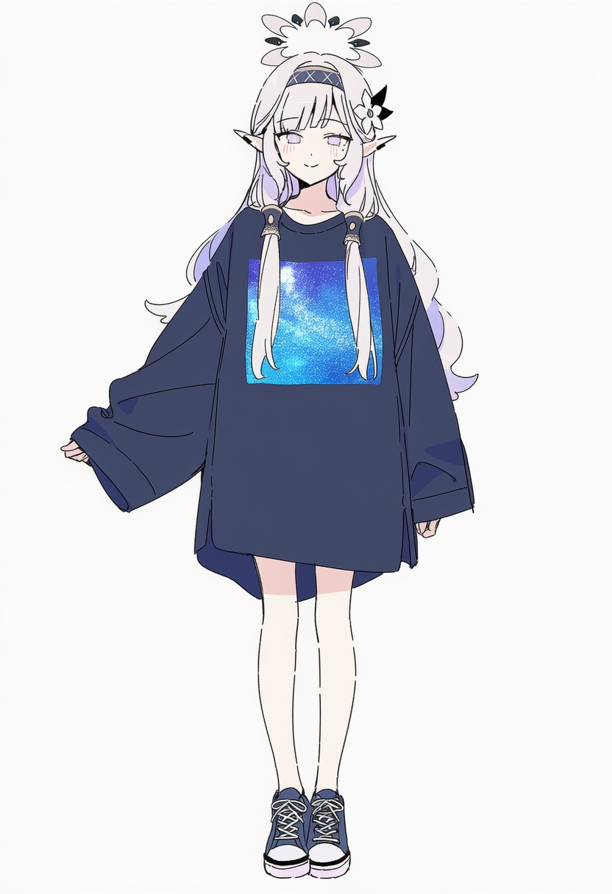

[在线例图](https://assets.quicktagcloud.com/images/raven_composition/raven_composition-0122.jpg?v=208a4c0b8fb57915)

<a id="raven_composition-0123"></a>

## 未穿在身上的衬衫

ID：`raven_composition-0123`；分类：衬衫；来源标记：`safe`。

来源说明：

> 衬衫作为物件出现，但当前没有被穿在身上。

正向提示词：

```text
unworn_shirt
```

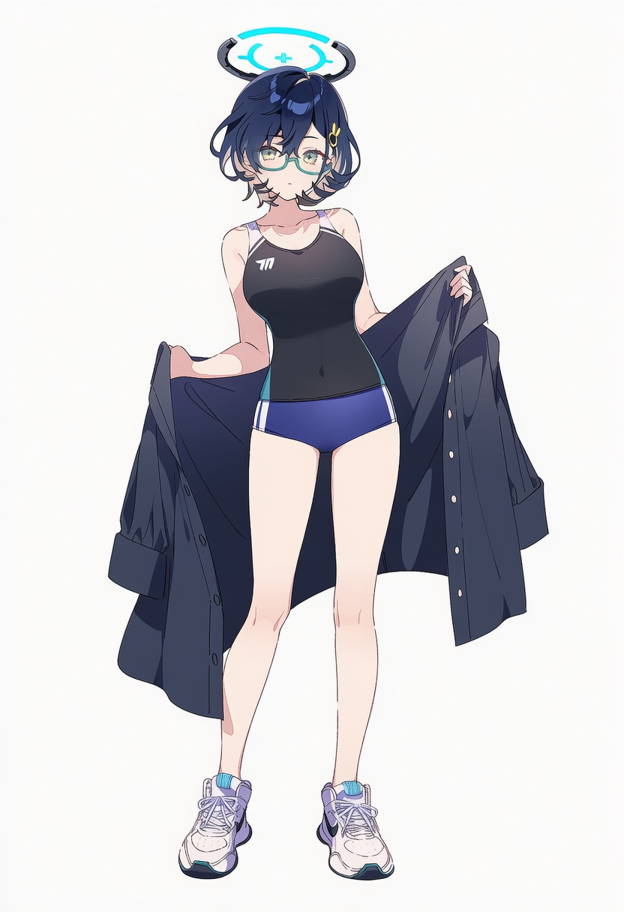

[在线例图](https://assets.quicktagcloud.com/images/raven_composition/raven_composition-0123.jpg?v=7dbed89396e411e8)

<a id="raven_composition-0124"></a>

## 渔网上衣

ID：`raven_composition-0124`；分类：衬衫；来源标记：`safe`。

来源说明：

> 全部或部分使用渔网状网眼材料制作的上衣。

正向提示词：

```text
fishnet_top
```

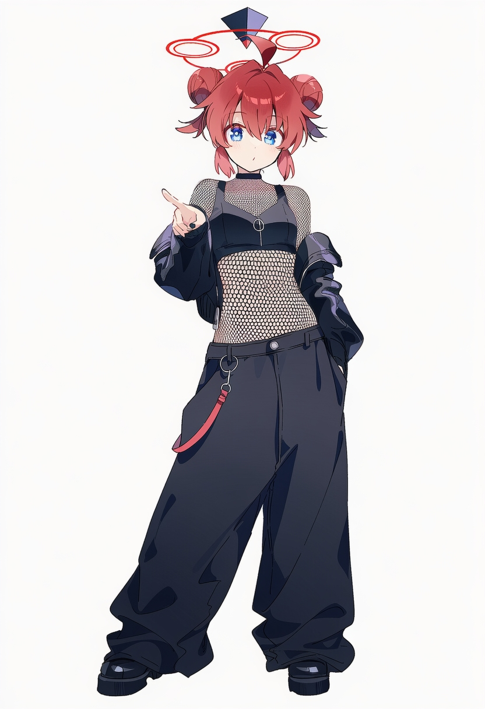

[在线例图](https://assets.quicktagcloud.com/images/raven_composition/raven_composition-0124.jpg?v=3f2fb50cbf5039d4)

<a id="raven_composition-0125"></a>

## 未扎入下装的衬衫

ID：`raven_composition-0125`；分类：衬衫；来源标记：`safe`。

来源说明：

> 衬衫下摆没有塞进裤子或裙子，直接垂在外面。

正向提示词：

```text
untucked_shirt
```


[在线例图](https://assets.quicktagcloud.com/images/raven_composition/raven_composition-0125.jpg?v=058845ab5318efac)

<a id="raven_composition-0126"></a>

## 长款衬衫

ID：`raven_composition-0126`；分类：衬衫；来源标记：`safe`。

来源说明：

> 长度足以覆盖臀部或骨盆区域的长款衬衫。

正向提示词：

```text
long_shirt
```

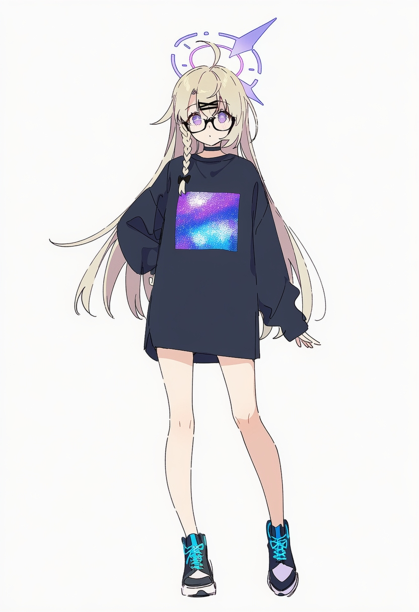

[在线例图](https://assets.quicktagcloud.com/images/raven_composition/raven_composition-0126.jpg?v=cb908c11d49059f9)

<a id="raven_composition-0127"></a>

## 多色衬衫

ID：`raven_composition-0127`；分类：衬衫；来源标记：`safe`。

来源说明：

> 设计中出现两种或以上颜色的衬衫，强调多色构成。

正向提示词：

```text
multicolored_shirt
```

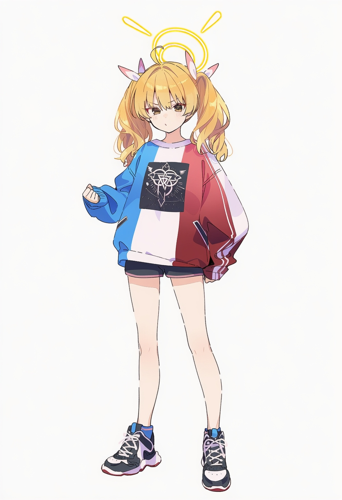

[在线例图](https://assets.quicktagcloud.com/images/raven_composition/raven_composition-0127.jpg?v=4024ff216e9edc5d)

<a id="raven_composition-0128"></a>

## 向下拉衬衫下摆

ID：`raven_composition-0128`；分类：衬衫；来源标记：`safe`。

来源说明：

> 抓住衬衫下摆向下拉，常用于遮挡身体或调整衣服。

正向提示词：

```text
shirt_tug
```

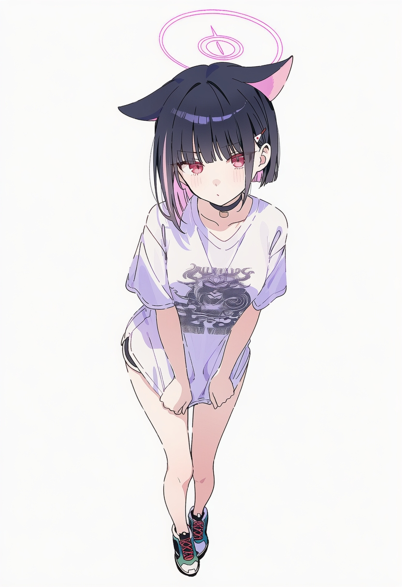

[在线例图](https://assets.quicktagcloud.com/images/raven_composition/raven_composition-0128.jpg?v=8c5be9e0a838359b)

<a id="raven_composition-0129"></a>

## 挂脖衬衫

ID：`raven_composition-0129`；分类：衬衫；来源标记：`safe`。

来源说明：

> 通过颈后或颈部系带支撑、肩部大多裸露的挂脖式衬衫。

正向提示词：

```text
halter_shirt
```

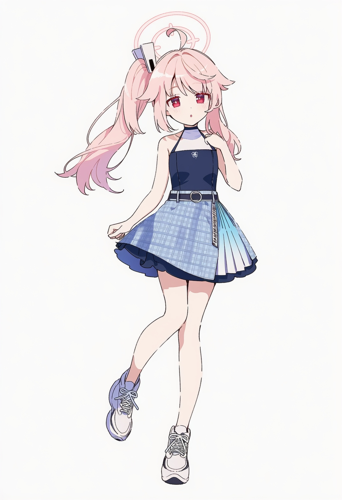

[在线例图](https://assets.quicktagcloud.com/images/raven_composition/raven_composition-0129.jpg?v=fb089d2ca0b72065)

<a id="raven_composition-0130"></a>

## 夏威夷衬衫

ID：`raven_composition-0130`；分类：衬衫；来源标记：`safe`。

来源说明：

> 典型为短袖、有领、宽松并带热带植物或花卉图案的夏威夷风衬衫。

正向提示词：

```text
hawaiian_shirt
```

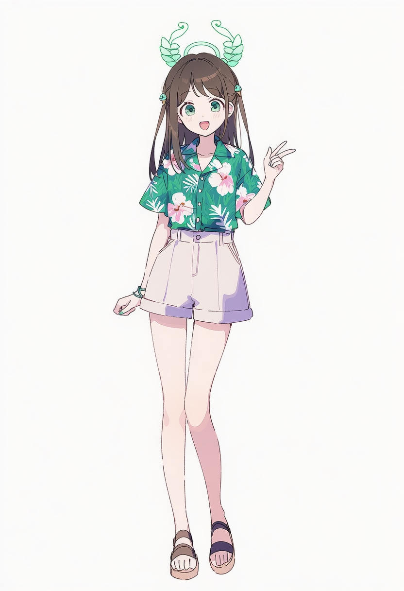

[在线例图](https://assets.quicktagcloud.com/images/raven_composition/raven_composition-0130.jpg?v=b27fb8753586c997)

<a id="raven_composition-0131"></a>

## 紧身衬衫

ID：`raven_composition-0131`；分类：衬衫；来源标记：`safe`。

来源说明：

> 明显贴身、尺寸偏紧的衬衫，但仍属于现实中可实现的穿着效果。

正向提示词：

```text
tight_shirt
```

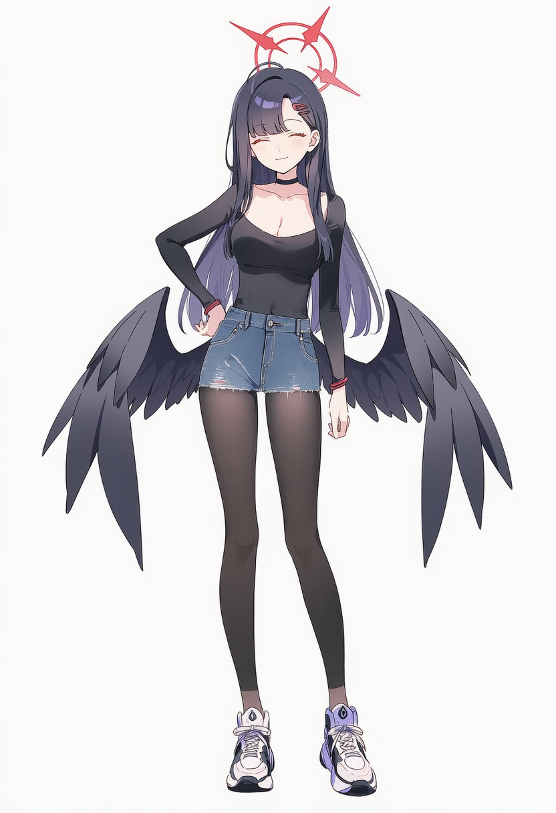

[在线例图](https://assets.quicktagcloud.com/images/raven_composition/raven_composition-0131.jpg?v=069672c4af2b2155)

<a id="raven_composition-0132"></a>

## Polo衫

ID：`raven_composition-0132`；分类：衬衫；来源标记：`safe`。

来源说明：

> 带翻领和短门襟纽扣的套头式休闲上衣，常见于运动或休闲制服。

正向提示词：

```text
polo_shirt
```

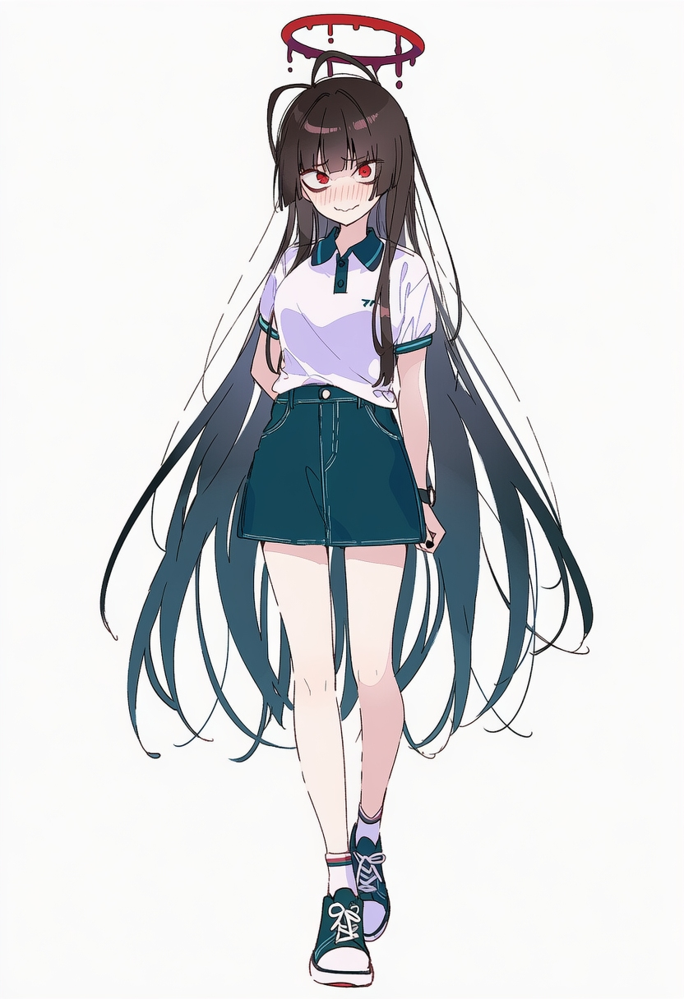

[在线例图](https://assets.quicktagcloud.com/images/raven_composition/raven_composition-0132.jpg?v=140109629a17cf95)

<a id="raven_composition-0133"></a>

## 细条纹衬衫

ID：`raven_composition-0133`；分类：衬衫；来源标记：`safe`。

来源说明：

> 带有细窄、间距规律条纹的衬衫，通常比普通条纹更细。

正向提示词：

```text
pinstripe_shirt
```

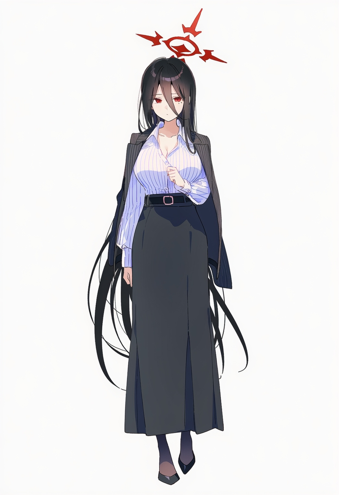

[在线例图](https://assets.quicktagcloud.com/images/raven_composition/raven_composition-0133.jpg?v=37085031f958e46e)

<a id="raven_composition-0134"></a>

## 叠穿式衬衫

ID：`raven_composition-0134`；分类：衬衫；来源标记：`safe`。

来源说明：

> 视觉上表现为多层上衣结构或两件上衣叠穿效果的衬衫。

正向提示词：

```text
layered_shirt
```

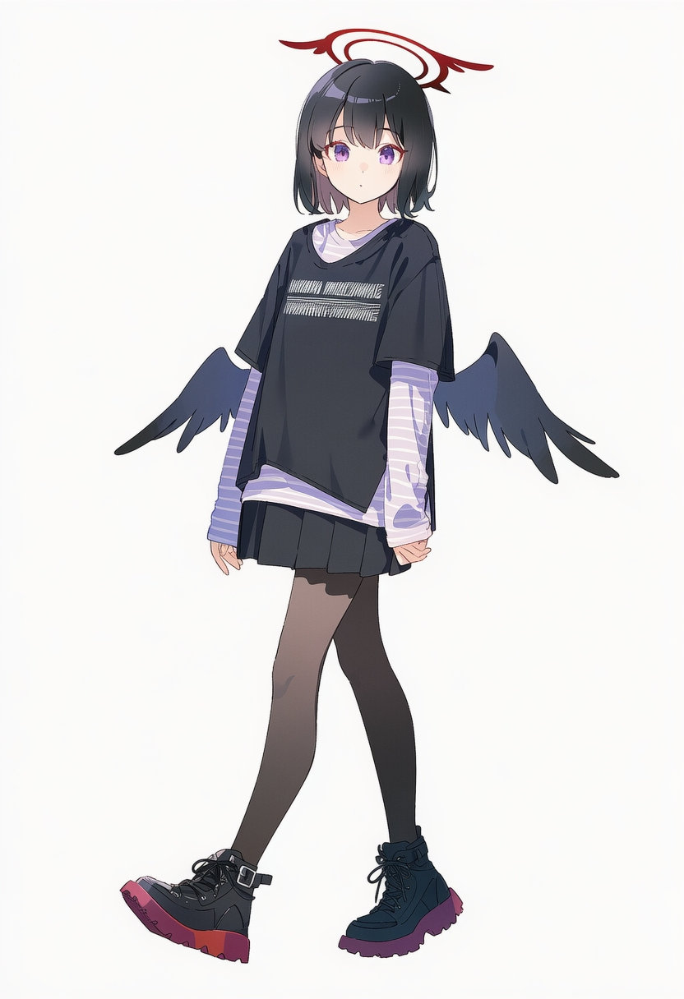

[在线例图](https://assets.quicktagcloud.com/images/raven_composition/raven_composition-0134.jpg?v=e7c4726ba8b7f196)

<a id="raven_composition-0135"></a>

## 交叉系带上衣

ID：`raven_composition-0135`；分类：衬衫；来源标记：`safe`。

来源说明：

> 衣物开口处通过绳带交叉穿系形成装饰或固定结构的上衣。

正向提示词：

```text
cross-laced_top
```

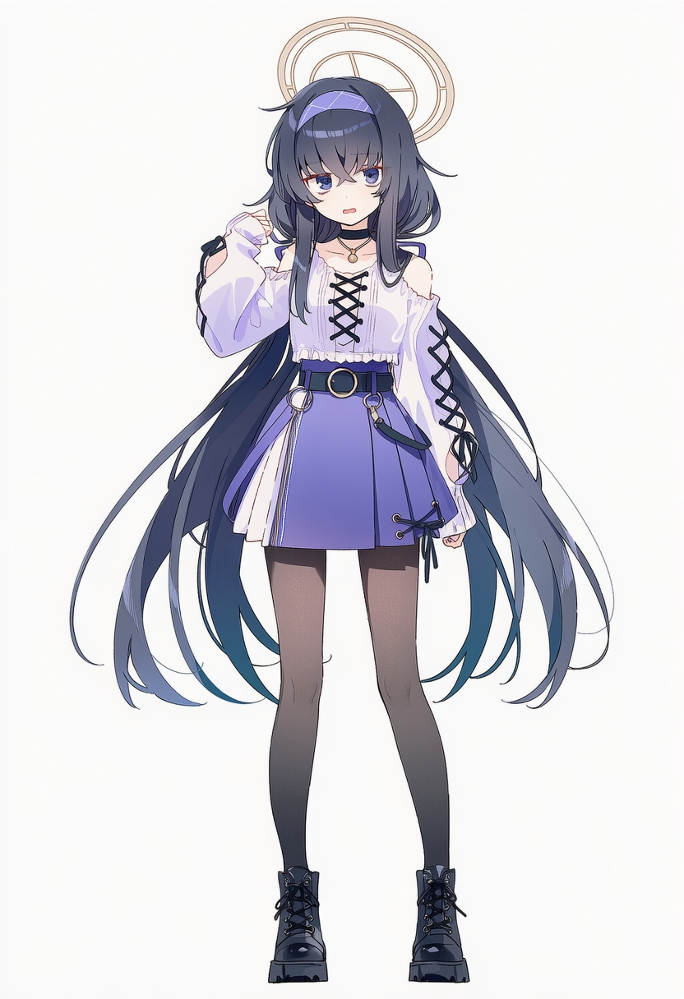

[在线例图](https://assets.quicktagcloud.com/images/raven_composition/raven_composition-0135.jpg?v=7aaa28feeb156690)

<a id="raven_composition-0136"></a>

## 衬衫下再穿一件衬衫

ID：`raven_composition-0136`；分类：衬衫；来源标记：`safe`。

来源说明：

> 一件衬衫穿在另一件衬衫下面，形成两层衬衫叠穿。

正向提示词：

```text
shirt_under_shirt
```

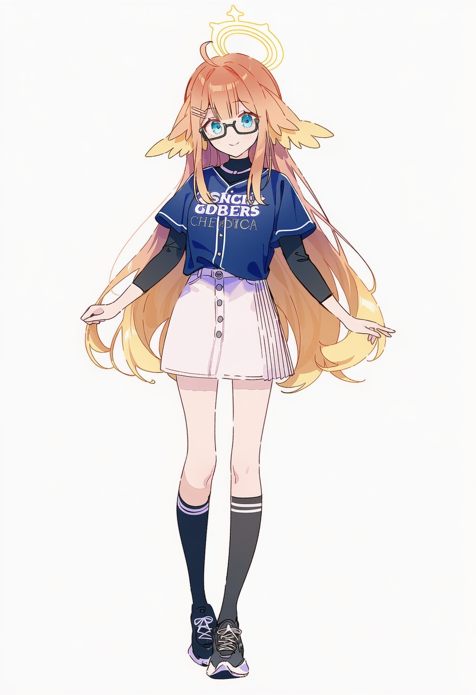

[在线例图](https://assets.quicktagcloud.com/images/raven_composition/raven_composition-0136.jpg?v=3e3649526d40700d)

<a id="raven_composition-0137"></a>

## 抓住他人的衬衫

ID：`raven_composition-0137`；分类：衬衫；来源标记：`safe`。

来源说明：

> 一名角色抓住另一名角色正在穿着的衬衫。

正向提示词：

```text
grabbing_another's_shirt
```

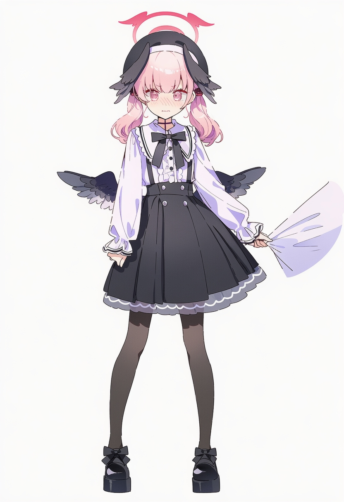

[在线例图](https://assets.quicktagcloud.com/images/raven_composition/raven_composition-0137.jpg?v=3c255b4b9b32bdc5)

<a id="raven_composition-0138"></a>

## 眼镜挂在衣物上

ID：`raven_composition-0138`；分类：衬衫；来源标记：`safe`。

来源说明：

> 眼镜或太阳镜挂在衣领、领口等衣物位置上暂时收纳。

正向提示词：

```text
eyewear_hang
```

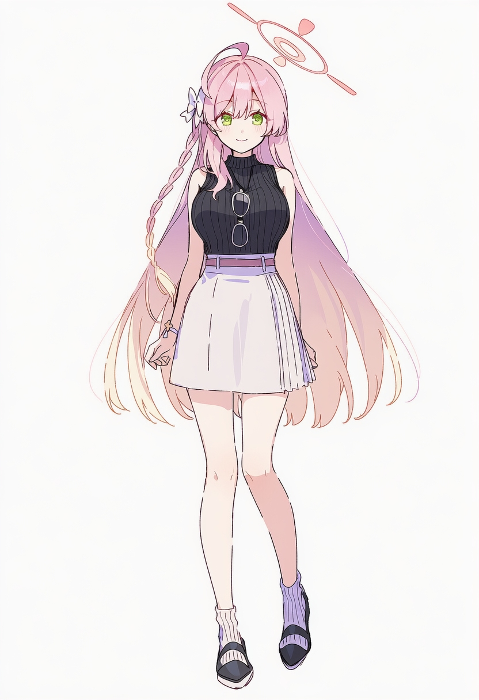

[在线例图](https://assets.quicktagcloud.com/images/raven_composition/raven_composition-0138.jpg?v=d863ea162be34ff8)

<a id="raven_composition-0139"></a>

## 用嘴咬住衬衫

ID：`raven_composition-0139`；分类：衬衫；来源标记：`safe`。

来源说明：

> 用嘴咬住自己正在穿的衬衫下摆，将衣服抬起。

正向提示词：

```text
shirt_in_mouth
```

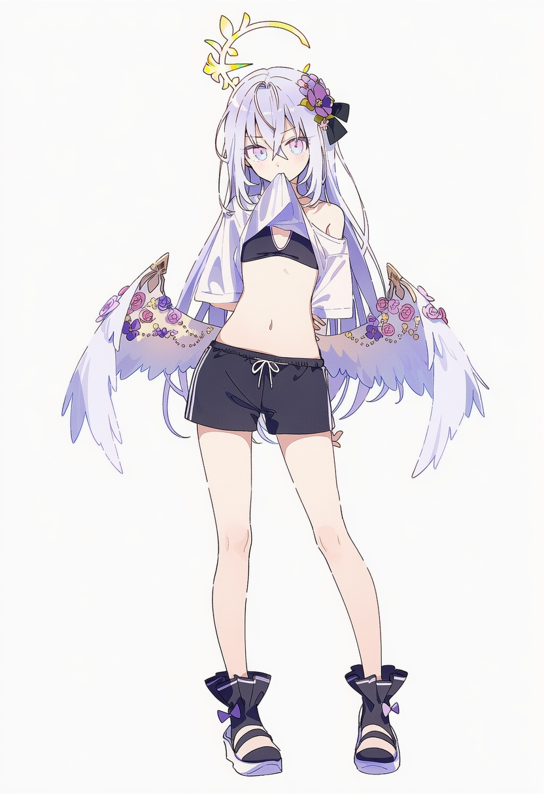

[在线例图](https://assets.quicktagcloud.com/images/raven_composition/raven_composition-0139.jpg?v=4595a79aa0c93e78)

<a id="raven_composition-0140"></a>

## 露侧胸衬衫

ID：`raven_composition-0140`；分类：衬衫；来源标记：`safe`。

来源说明：

> 侧面大幅镂空、露出身体侧部甚至侧胸的衬衫。

正向提示词：

```text
sideless_shirt
```

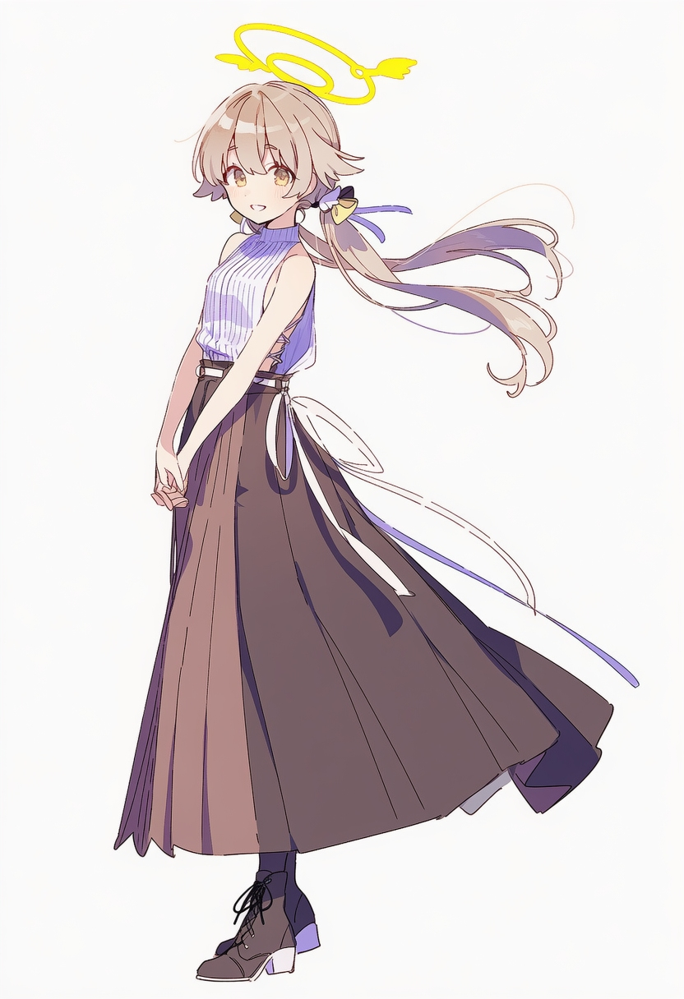

[在线例图](https://assets.quicktagcloud.com/images/raven_composition/raven_composition-0140.jpg?v=bbf3ef2f9a65a27c)

<a id="raven_composition-0141"></a>

## 胸下帐篷状衬衫

ID：`raven_composition-0141`；分类：衬衫；来源标记：`safe`。

来源说明：

> 衬衫在胸部下方被撑出帐篷状空间，常见于胸部较大且下摆被固定的情况。

正向提示词：

```text
tented_shirt
```


[在线例图](https://assets.quicktagcloud.com/images/raven_composition/raven_composition-0141.jpg?v=7db0d7a2604ef09a)

<a id="raven_composition-0142"></a>

## 毛边衬衫

ID：`raven_composition-0142`；分类：衬衫；来源标记：`safe`。

来源说明：

> 领口、袖口、下摆等边缘带有毛绒/皮草镶边的衬衫。

正向提示词：

```text
fur-trimmed_shirt
```

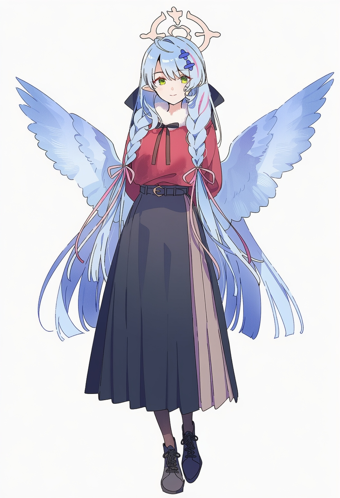

[在线例图](https://assets.quicktagcloud.com/images/raven_composition/raven_composition-0142.jpg?v=817735188b8a7a09)

<a id="raven_composition-0143"></a>

## 手伸进衬衫内

ID：`raven_composition-0143`；分类：衬衫；来源标记：`safe`。

来源说明：

> 手伸入自己或他人的衬衫里面。

正向提示词：

```text
hand_under_shirt
```

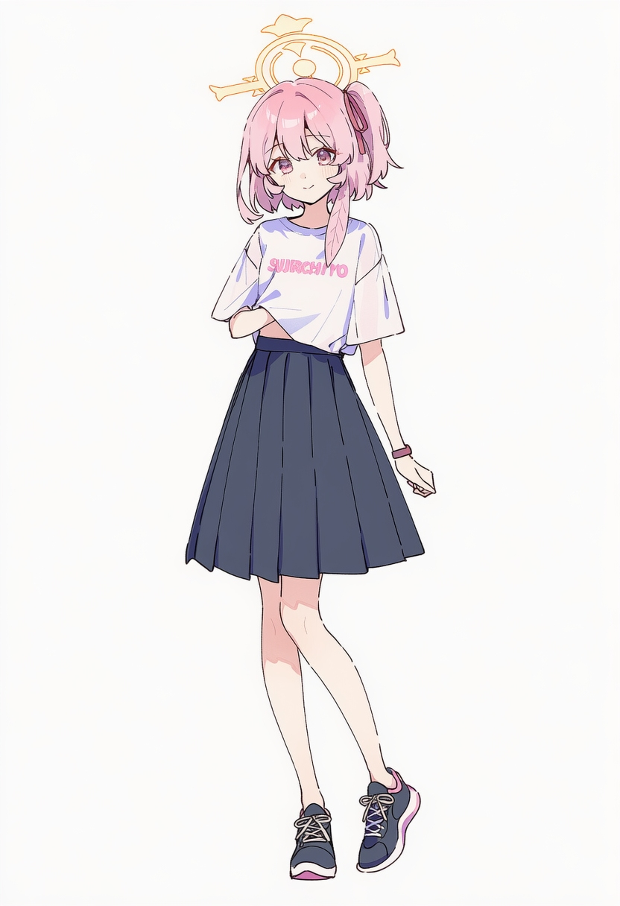

[在线例图](https://assets.quicktagcloud.com/images/raven_composition/raven_composition-0143.jpg?v=bd2f1e402db7896a)

<a id="raven_composition-0144"></a>

## 圆点衬衫

ID：`raven_composition-0144`；分类：衬衫；来源标记：`safe`。

来源说明：

> 带有规律或散布圆点图案的衬衫。

正向提示词：

```text
polka_dot_shirt
```

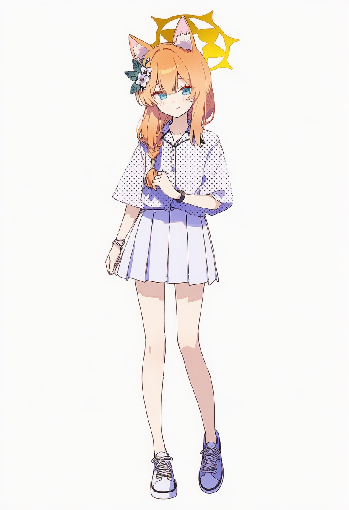

[在线例图](https://assets.quicktagcloud.com/images/raven_composition/raven_composition-0144.jpg?v=e529e57b094e3257)

<a id="raven_composition-0145"></a>

## 宽松衬衫

ID：`raven_composition-0145`；分类：衬衫；来源标记：`safe`。

来源说明：

> 穿着效果宽松、离身，但整体尺码没有夸张到明显过大的程度。

正向提示词：

```text
loose_shirt
```


[在线例图](https://assets.quicktagcloud.com/images/raven_composition/raven_composition-0145.jpg?v=49540a6c9ff5bdbb)

<a id="raven_composition-0146"></a>

## 蕾丝边衬衫

ID：`raven_composition-0146`；分类：衬衫；来源标记：`safe`。

来源说明：

> 仅在边缘使用蕾丝装饰的衬衫，而不是整件由蕾丝制作。

正向提示词：

```text
lace-trimmed_shirt
```

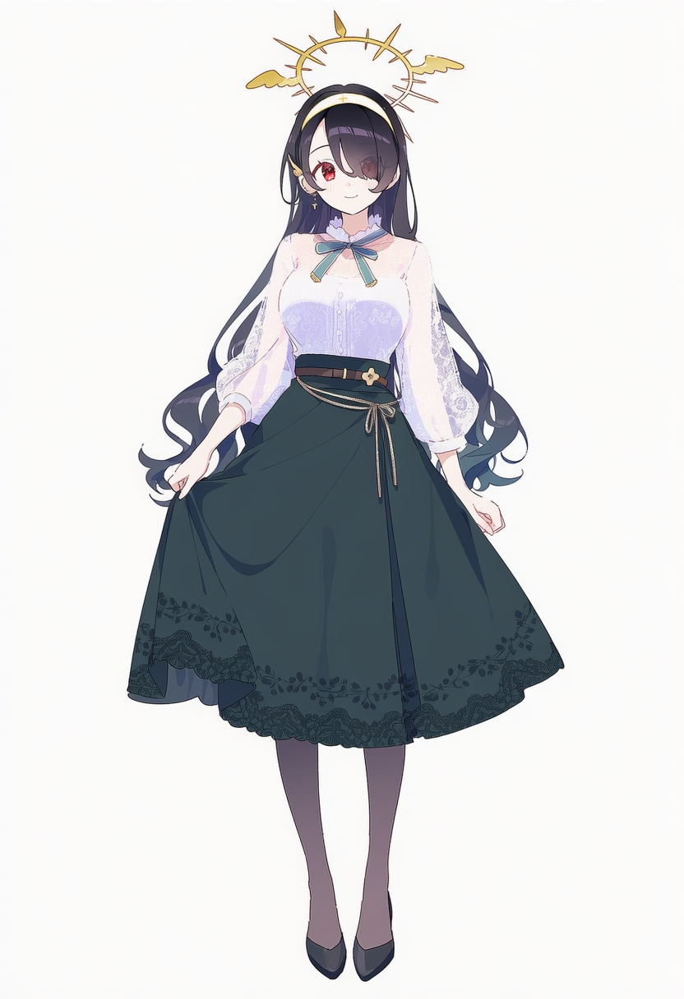

[在线例图](https://assets.quicktagcloud.com/images/raven_composition/raven_composition-0146.jpg?v=f2f0e319a9191fe6)

<a id="raven_composition-0147"></a>

## 胸前悬垂的衬衫

ID：`raven_composition-0147`；分类：衬衫；来源标记：`safe`。

来源说明：

> 衬衫从胸前向外悬垂，在腹部前方形成离身的垂落空间。

正向提示词：

```text
shirt_overhang
```


[在线例图](https://assets.quicktagcloud.com/images/raven_composition/raven_composition-0147.jpg?v=a9973bf43c70bc8d)

<a id="raven_composition-0148"></a>

## 从下往衬衫内窥视

ID：`raven_composition-0148`；分类：衬衫；来源标记：`safe`。

来源说明：

> 视角从衬衫下方向衣内看，与“从领口向下看”的 downblouse 相反。

正向提示词：

```text
upshirt
```


[在线例图](https://assets.quicktagcloud.com/images/raven_composition/raven_composition-0148.jpg?v=18f242e89da390e5)

<a id="raven_composition-0149"></a>

## 棋盘格衬衫

ID：`raven_composition-0149`；分类：衬衫；来源标记：`safe`。

来源说明：

> 带有规则棋盘格/方格图案的衬衫。

正向提示词：

```text
checkered_shirt
```

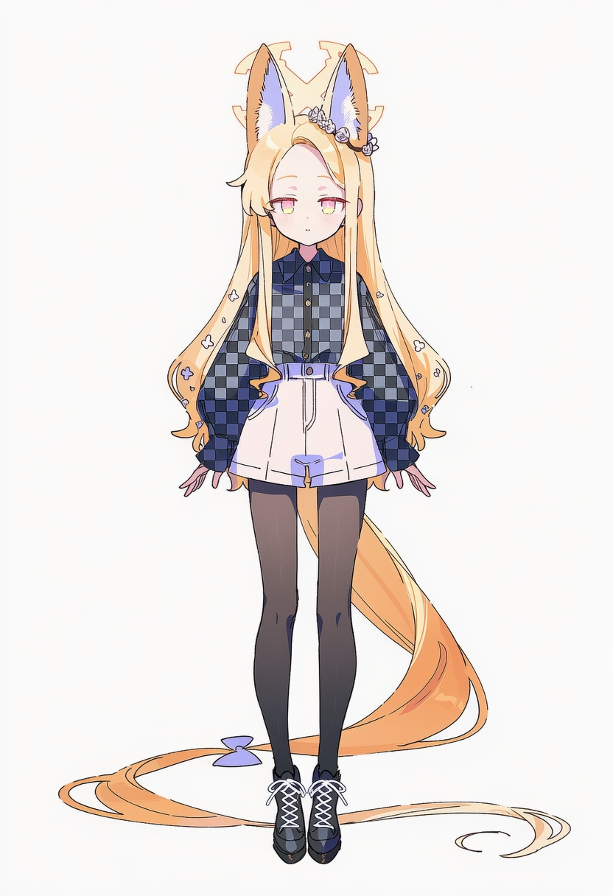

[在线例图](https://assets.quicktagcloud.com/images/raven_composition/raven_composition-0149.jpg?v=d1501641a788319c)

<a id="raven_composition-0150"></a>

## 手持脱下的衬衫

ID：`raven_composition-0150`；分类：衬衫；来源标记：`safe`。

来源说明：

> 角色手中拿着已经脱下、未穿在身上的衬衫。

正向提示词：

```text
holding_shirt
```


[在线例图](https://assets.quicktagcloud.com/images/raven_composition/raven_composition-0150.jpg?v=035eaee0c264cefd)

<a id="raven_composition-0151"></a>

## 衬衫部分扎入下装

ID：`raven_composition-0151`；分类：衬衫；来源标记：`safe`。

来源说明：

> 衬衫只有一部分下摆塞进裤子或裙子，其余部分露在外面。

正向提示词：

```text
shirt_partially_tucked_in
```


[在线例图](https://assets.quicktagcloud.com/images/raven_composition/raven_composition-0151.jpg?v=af82851f382e6188)

<a id="raven_composition-0152"></a>

## 衬衫部分脱下

ID：`raven_composition-0152`；分类：衬衫；来源标记：`safe`。

来源说明：

> 衬衫从肩膀滑下或被拉低到手臂/肘部，但尚未完全脱掉。

正向提示词：

```text
shirt_partially_removed
```


[在线例图](https://assets.quicktagcloud.com/images/raven_composition/raven_composition-0152.jpg?v=24ef03bf5baa93cf)

<a id="raven_composition-0153"></a>

## 衬衫系在腰间

ID：`raven_composition-0153`；分类：衬衫；来源标记：`safe`。

来源说明：

> 脱下的衬衫绑或系在腰间作为搭配。

正向提示词：

```text
shirt_around_waist
```


[在线例图](https://assets.quicktagcloud.com/images/raven_composition/raven_composition-0153.jpg?v=2fb53057c16450fa)

<a id="raven_composition-0154"></a>

## 压缩衣 / 紧身运动衫

ID：`raven_composition-0154`；分类：衬衫；来源标记：`safe`。

来源说明：

> 运动用高弹紧身上衣，通过贴身压力提供肌肉支撑并帮助排汗。

正向提示词：

```text
compression_shirt
```


[在线例图](https://assets.quicktagcloud.com/images/raven_composition/raven_composition-0154.jpg?v=9f4753e14982c6ac)

<a id="raven_composition-0155"></a>

## 毛衣内穿衬衫

ID：`raven_composition-0155`；分类：衬衫；来源标记：`safe`。

来源说明：

> 衬衫穿在毛衣里面，领口、下摆或袖口可能露出。

正向提示词：

```text
shirt_under_sweater
```


[在线例图](https://assets.quicktagcloud.com/images/raven_composition/raven_composition-0155.jpg?v=aaca37b714e623aa)

<a id="raven_composition-0156"></a>

## 衬衫上的蝴蝶结

ID：`raven_composition-0156`；分类：衬衫；来源标记：`safe`。

来源说明：

> 衬衫上附着或系有蝴蝶结装饰。

正向提示词：

```text
shirt_bow
```


[在线例图](https://assets.quicktagcloud.com/images/raven_composition/raven_composition-0156.jpg?v=347264b6c4e95328)

<a id="raven_composition-0157"></a>

## 缎带边衬衫

ID：`raven_composition-0157`；分类：衬衫；来源标记：`safe`。

来源说明：

> 衣缘用缎带装饰的衬衫，常表现为沿边缘延伸的装饰线。

正向提示词：

```text
ribbon-trimmed_shirt
```


[在线例图](https://assets.quicktagcloud.com/images/raven_composition/raven_composition-0157.jpg?v=be168fa1671d1d27)

<a id="raven_composition-0158"></a>

## 花卉印花衬衫

ID：`raven_composition-0158`；分类：衬衫；来源标记：`safe`。

来源说明：

> 面料上带有花朵、植物等花卉印花图案的衬衫。

正向提示词：

```text
floral_print_shirt
```


[在线例图](https://assets.quicktagcloud.com/images/raven_composition/raven_composition-0158.jpg?v=41d7ae728cff5f8a)

<a id="raven_composition-0159"></a>

## 单肩衬衫

ID：`raven_composition-0159`；分类：衬衫；来源标记：`safe`。

来源说明：

> 不对称领口设计，只覆盖一侧肩膀、另一侧肩膀裸露的衬衫。

正向提示词：

```text
single-shoulder_shirt
```


[在线例图](https://assets.quicktagcloud.com/images/raven_composition/raven_composition-0159.jpg?v=213481872b6e27c9)

<a id="raven_composition-0160"></a>

## 防磨衣 / 冲浪衣

ID：`raven_composition-0160`；分类：衬衫；来源标记：`safe`。

来源说明：

> 冲浪、浮潜等水上运动使用的贴身防磨运动上衣，常见长袖。

正向提示词：

```text
rash_guard
```


[在线例图](https://assets.quicktagcloud.com/images/raven_composition/raven_composition-0160.jpg?v=24ea35c406bf9833)

<a id="raven_composition-0161"></a>

## 衬衫内穿比基尼上衣

ID：`raven_composition-0161`；分类：衬衫；来源标记：`safe`。

来源说明：

> 衬衫里面穿着比基尼上衣。

正向提示词：

```text
bikini_top_under_shirt
```


[在线例图](https://assets.quicktagcloud.com/images/raven_composition/raven_composition-0161.jpg?v=5307f70e274b933d)

<a id="raven_composition-0162"></a>

## 带帽衬衫

ID：`raven_composition-0162`；分类：衬衫；来源标记：`safe`。

来源说明：

> 衬衫本身带有连帽结构，但不等同于卫衣类 hoodie。

正向提示词：

```text
hooded_shirt
```


[在线例图](https://assets.quicktagcloud.com/images/raven_composition/raven_composition-0162.jpg?v=ce5e6db7183bcc07)

<a id="raven_composition-0163"></a>

## 迷彩衬衫

ID：`raven_composition-0163`；分类：衬衫；来源标记：`safe`。

来源说明：

> 面料带有军事迷彩式不规则色块图案的衬衫。

正向提示词：

```text
camouflage_shirt
```


[在线例图](https://assets.quicktagcloud.com/images/raven_composition/raven_composition-0163.jpg?v=744f948d478983e7)

<a id="raven_composition-0164"></a>

## 露背衬衫

ID：`raven_composition-0164`；分类：衬衫；来源标记：`safe`。

来源说明：

> 设计上大面积露出背部的衬衫。

正向提示词：

```text
backless_shirt
```


[在线例图](https://assets.quicktagcloud.com/images/raven_composition/raven_composition-0164.jpg?v=72cc8e825040499a)

<a id="raven_composition-0165"></a>

## 部分敞开的衬衫

ID：`raven_composition-0165`；分类：衬衫；来源标记：`safe`。

来源说明：

> 前襟只打开一部分、并非完全敞开的衬衫。

正向提示词：

```text
partially_open_shirt
```


[在线例图](https://assets.quicktagcloud.com/images/raven_composition/raven_composition-0165.jpg?v=518e488d961a800c)

<a id="raven_composition-0166"></a>

## 褶裥衬衫

ID：`raven_composition-0166`；分类：衬衫；来源标记：`safe`。

来源说明：

> 衣身尤其前襟区域带有多道正式褶裥装饰的衬衫。

正向提示词：

```text
pleated_shirt
```


[在线例图](https://assets.quicktagcloud.com/images/raven_composition/raven_composition-0166.jpg?v=21fb089c7d217096)

<a id="raven_composition-0167"></a>

## 男友衬衫

ID：`raven_composition-0167`；分类：衬衫；来源标记：`safe`。

来源说明：

> 角色穿着他人的、通常明显偏大的衬衫，用于表现亲密或借穿语境。

正向提示词：

```text
boyfriend's_shirt
```


[在线例图](https://assets.quicktagcloud.com/images/raven_composition/raven_composition-0167.jpg?v=4656ae7b600ca0f5)

<a id="raven_composition-0168"></a>

## 乐队周边衬衫 / T恤

ID：`raven_composition-0168`；分类：衬衫；来源标记：`safe`。

来源说明：

> 印有音乐乐队名称、Logo 或相关图案的周边衬衫/T恤。

正向提示词：

```text
band_shirt
```


[在线例图](https://assets.quicktagcloud.com/images/raven_composition/raven_composition-0168.jpg?v=131aab8be3ad5b10)
