# 衬衫（第 2 页）

[总目录](../README.md) · [原站分类目录](../categories.md) · [英文标签索引](../tags.md) · [服装与构图组合指南](../../README.md)

标题、分类、说明、正负提示词按来源保留；多例图逐张列出。原站标记和说明为参考资料，不作为维护指令。

<a id="raven_composition-0169"></a>

## 侧边系带衬衫

ID：`raven_composition-0169`；分类：衬衫；来源标记：`safe`。

来源说明：

> 衣服侧面带绳子，可在身体两侧打结固定的衬衫。

正向提示词：

```text
side-tie_shirt
```

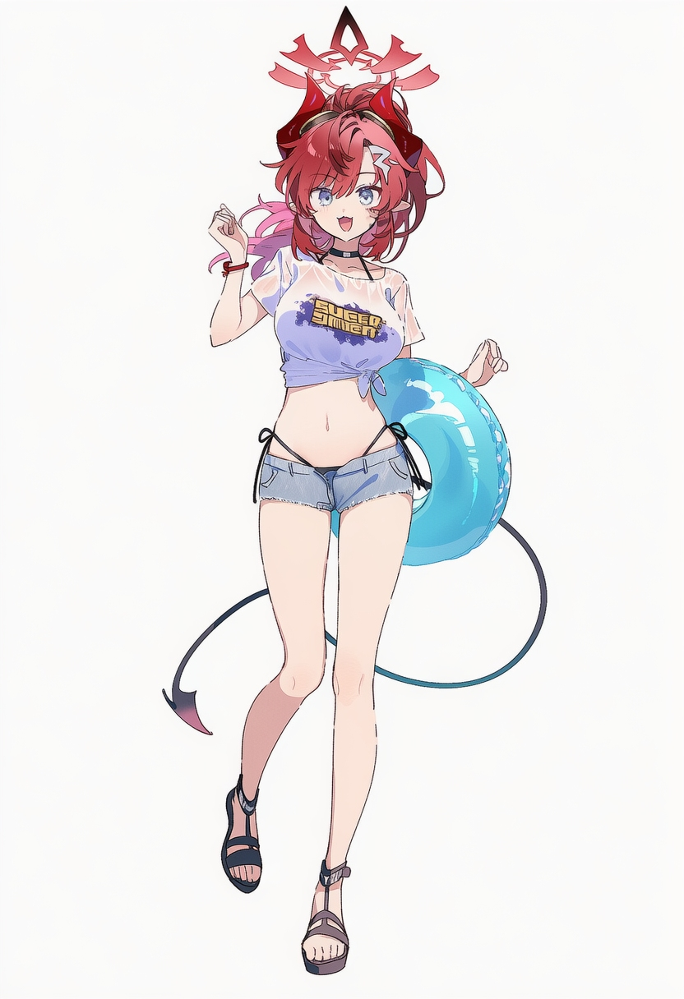

[在线例图](https://assets.quicktagcloud.com/images/raven_composition/raven_composition-0169.jpg?v=d5a5d7aa309a8915)

<a id="raven_composition-0170"></a>

## 美国国旗图案衬衫

ID：`raven_composition-0170`；分类：衬衫；来源标记：`safe`。

来源说明：

> 带有美国国旗元素、配色或星条旗图案的衬衫。

正向提示词：

```text
american_flag_shirt
```

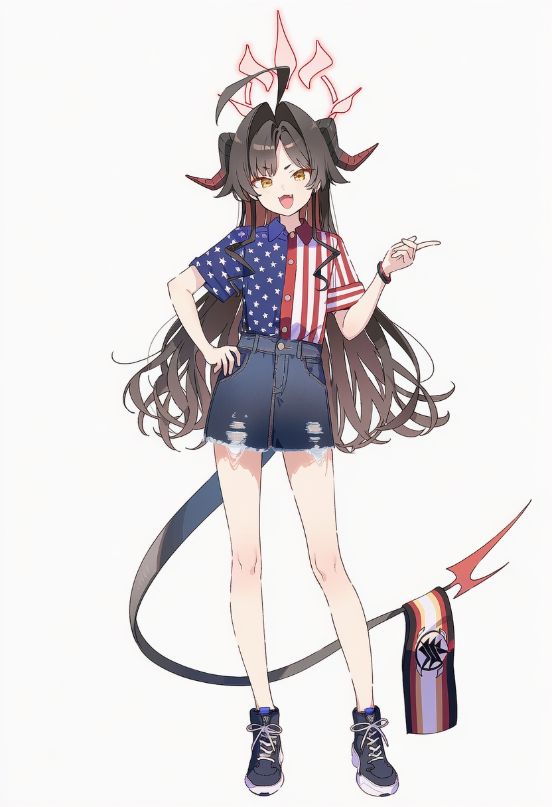

[在线例图](https://assets.quicktagcloud.com/images/raven_composition/raven_composition-0170.jpg?v=3260d3eefe9e95e8)

<a id="raven_composition-0171"></a>

## 和服内穿衬衫

ID：`raven_composition-0171`；分类：衬衫；来源标记：`safe`。

来源说明：

> 衬衫穿在和服里面，常见于特定历史风格或和风混搭。

正向提示词：

```text
shirt_under_kimono
```

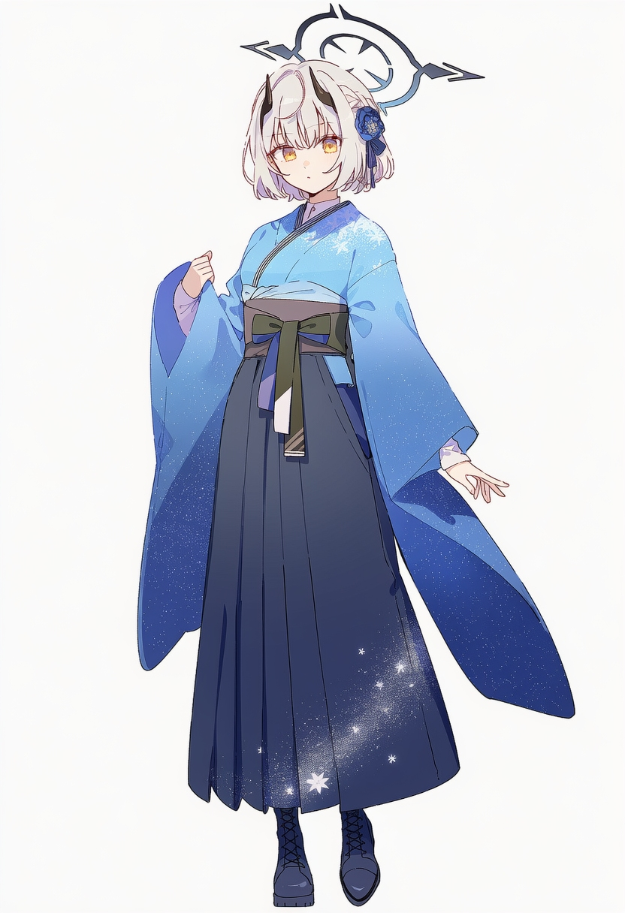

[在线例图](https://assets.quicktagcloud.com/images/raven_composition/raven_composition-0171.jpg?v=a6f05acdb23188fc)

<a id="raven_composition-0172"></a>

## 衬衫滑落

ID：`raven_composition-0172`；分类：衬衫；来源标记：`safe`。

来源说明：

> 衬衫从原本穿着位置滑落或松脱，表现为衣物位置下滑。

正向提示词：

```text
shirt_slip
```

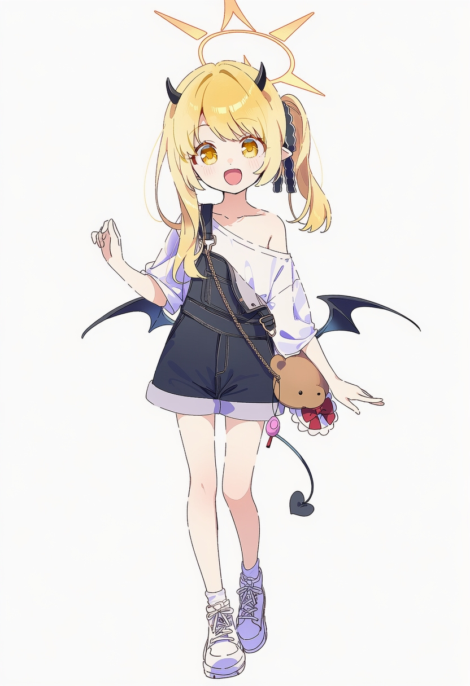

[在线例图](https://assets.quicktagcloud.com/images/raven_composition/raven_composition-0172.jpg?v=e718b84263cab807)

<a id="raven_composition-0173"></a>

## 渐变色衬衫

ID：`raven_composition-0173`；分类：衬衫；来源标记：`safe`。

来源说明：

> 颜色由一种色调连续过渡到另一种色调的渐变设计衬衫。

正向提示词：

```text
gradient_shirt
```

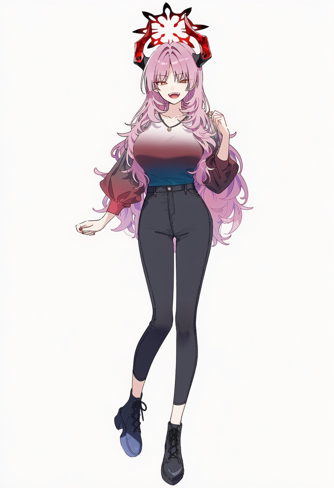

[在线例图](https://assets.quicktagcloud.com/images/raven_composition/raven_composition-0173.jpg?v=7deb214e2649bfd4)

<a id="raven_composition-0174"></a>

## Fate Buster主题衬衫

ID：`raven_composition-0174`；分类：衬衫；来源标记：`safe`。

来源说明：

> Fate/Grand Order 相关官方主题服装，采用 Buster 指令卡设计的红色T恤。

正向提示词：

```text
buster_shirt_(fate)
```

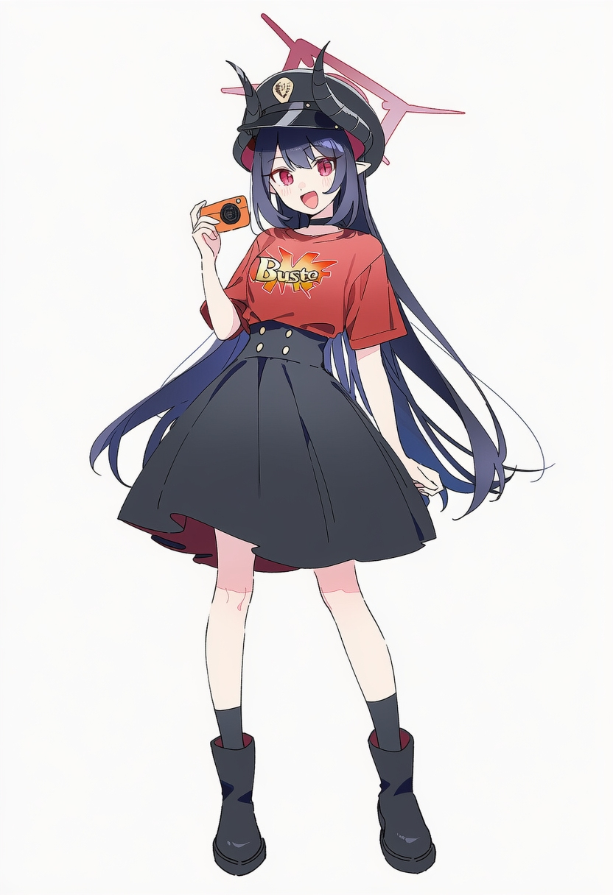

[在线例图](https://assets.quicktagcloud.com/images/raven_composition/raven_composition-0174.jpg?v=2e07d5db0612a4ab)

<a id="raven_composition-0175"></a>

## 菱格纹衬衫

ID：`raven_composition-0175`；分类：衬衫；来源标记：`safe`。

来源说明：

> 带有典型菱形交错格纹（Argyle）的衬衫。

正向提示词：

```text
argyle_shirt
```

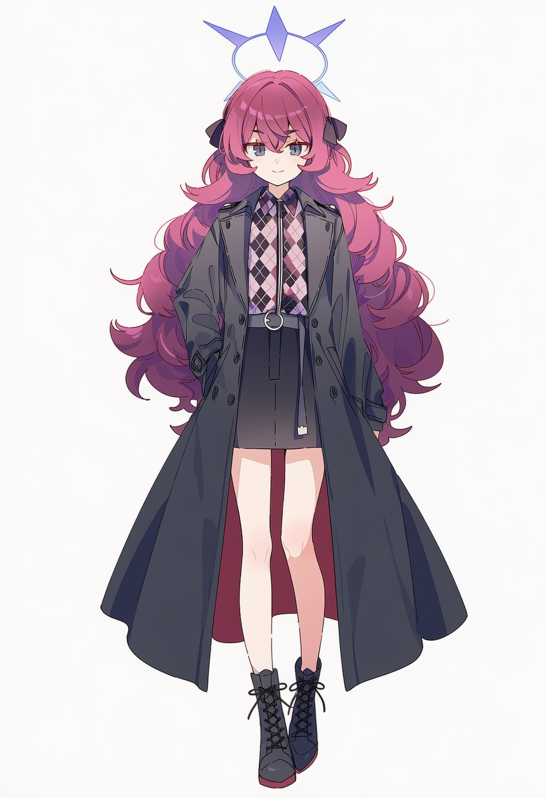

[在线例图](https://assets.quicktagcloud.com/images/raven_composition/raven_composition-0175.jpg?v=ec63d1610cb744b7)

<a id="raven_composition-0176"></a>

## 礼服衬衫

ID：`raven_composition-0176`；分类：衬衫；来源标记：`safe`。

来源说明：

> 与礼服/燕尾服搭配的正式衬衫，常有褶裥前胸、法式袖口等细节。

正向提示词：

```text
tuxedo_shirt
```

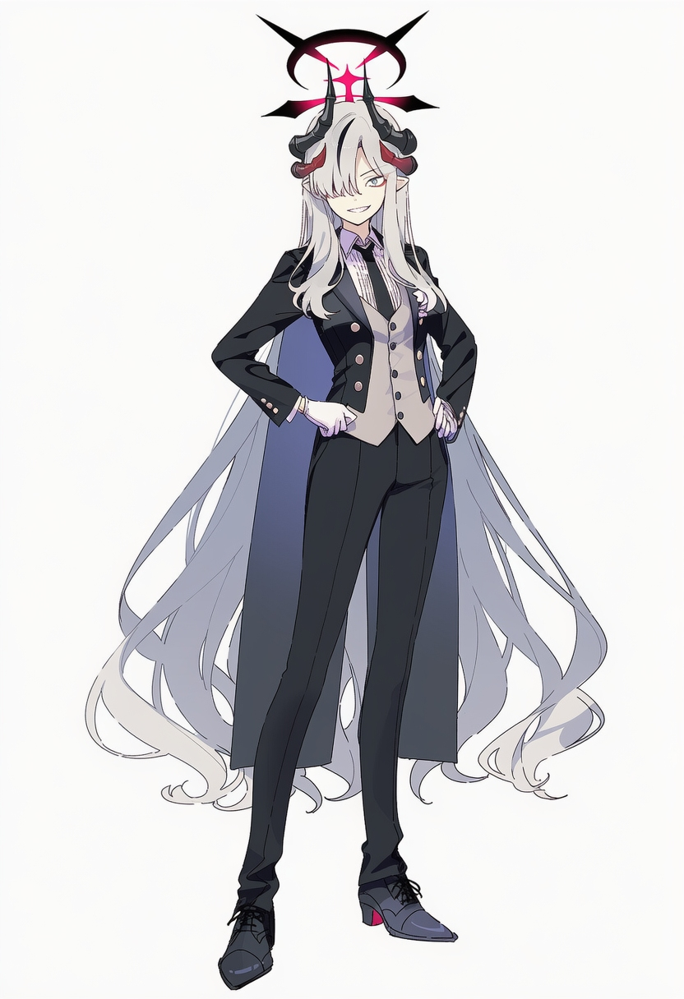

[在线例图](https://assets.quicktagcloud.com/images/raven_composition/raven_composition-0176.jpg?v=6900fa7de210771e)

<a id="raven_composition-0177"></a>

## 斜条纹衬衫

ID：`raven_composition-0177`；分类：衬衫；来源标记：`safe`。

来源说明：

> 条纹以斜向排列的衬衫，是 striped_shirt 的细分类。

正向提示词：

```text
diagonal-striped_shirt
```

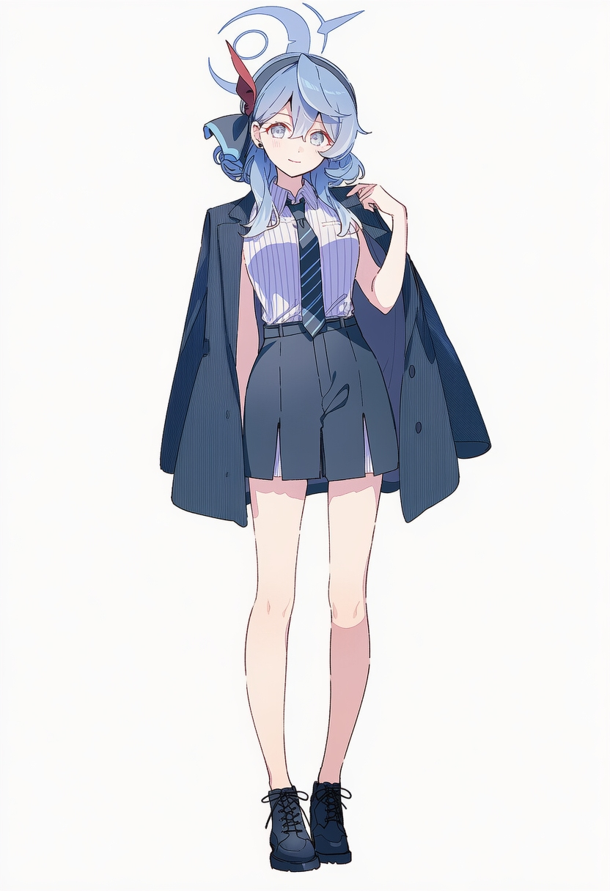

[在线例图](https://assets.quicktagcloud.com/images/raven_composition/raven_composition-0177.jpg?v=888492d3e7afef59)

<a id="raven_composition-0178"></a>

## 不对称衬衫

ID：`raven_composition-0178`；分类：衬衫；来源标记：`safe`。

来源说明：

> 领口、肩部、下摆或整体结构左右明显不对称的衬衫。

正向提示词：

```text
asymmetrical_shirt
```

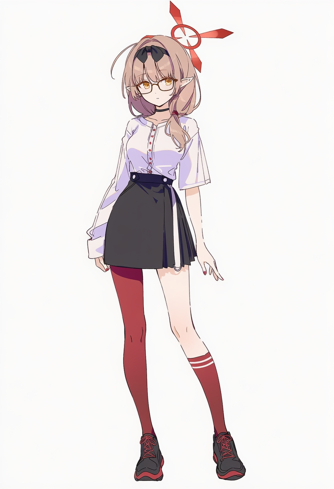

[在线例图](https://assets.quicktagcloud.com/images/raven_composition/raven_composition-0178.jpg?v=ddcb3aa40ce27374)

<a id="raven_composition-0179"></a>

## 衬衫卷起

ID：`raven_composition-0179`；分类：衬衫；来源标记：`safe`。

来源说明：

> 通过卷起衣身的方式把衬衫向上收起，区别于单纯掀起下摆。

正向提示词：

```text
shirt_rolled_up
```

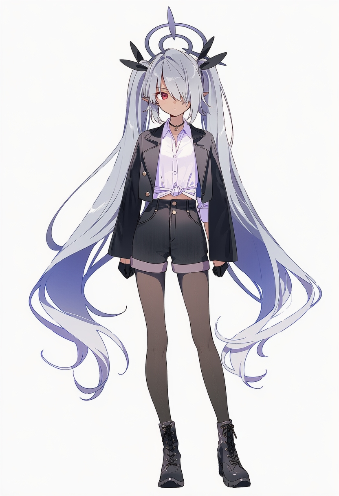

[在线例图](https://assets.quicktagcloud.com/images/raven_composition/raven_composition-0179.jpg?v=1d3ee8db24f4f040)

<a id="raven_composition-0180"></a>

## 衬衫披在肩上

ID：`raven_composition-0180`；分类：衬衫；来源标记：`safe`。

来源说明：

> 衬衫没有正常穿好，而是像披肩一样搭在肩上。

正向提示词：

```text
shirt_on_shoulders
```


[在线例图](https://assets.quicktagcloud.com/images/raven_composition/raven_composition-0180.jpg?v=048c30623cfd8846)

<a id="raven_composition-0181"></a>

## 衬衫外罩在毛衣上

ID：`raven_composition-0181`；分类：衬衫；来源标记：`safe`。

来源说明：

> 毛衣穿在里面、衬衫罩在毛衣外面的反常叠穿方式。

正向提示词：

```text
sweater_under_shirt
```

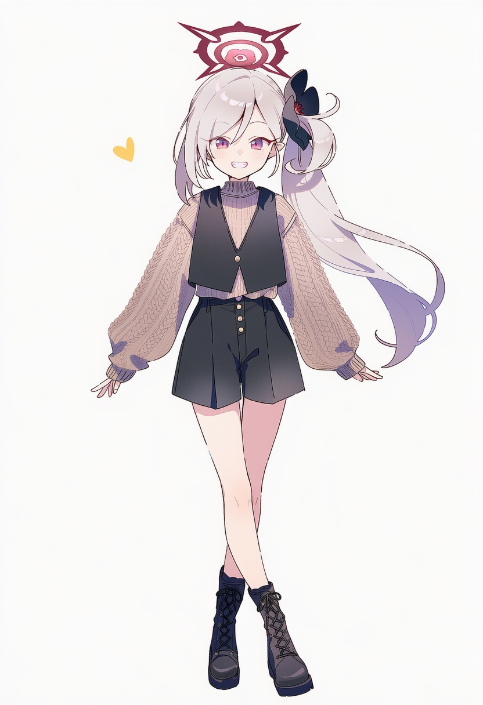

[在线例图](https://assets.quicktagcloud.com/images/raven_composition/raven_composition-0181.jpg?v=e64becf7be1ecbc0)

<a id="raven_composition-0182"></a>

## 蕾丝衬衫

ID：`raven_composition-0182`；分类：衬衫；来源标记：`safe`。

来源说明：

> 整件主要由蕾丝材料制作的衬衫，区别于只有蕾丝包边。

正向提示词：

```text
lace_shirt
```

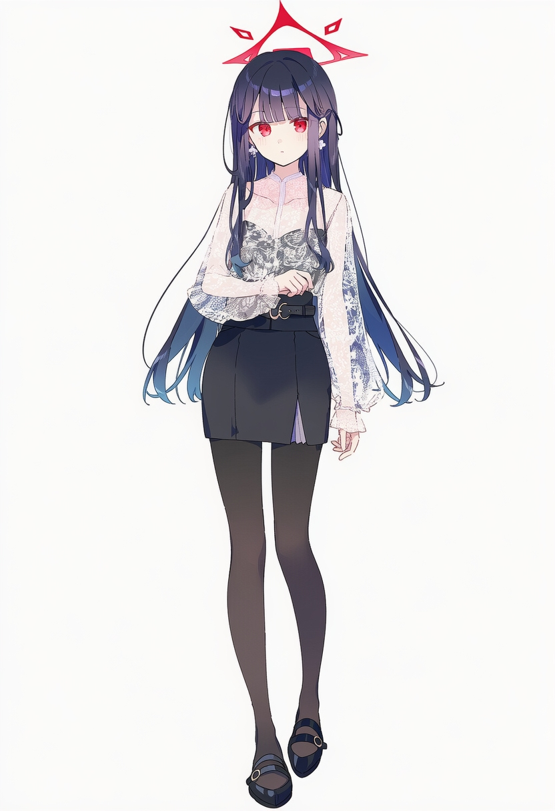

[在线例图](https://assets.quicktagcloud.com/images/raven_composition/raven_composition-0182.jpg?v=4c86a34d78e4cdd4)

<a id="raven_composition-0183"></a>

## 衬衫下摆

ID：`raven_composition-0183`；分类：衬衫；来源标记：`safe`。

来源说明：

> 衬衫尤其是正装衬衫最下方的衣摆部分，常被塞进下装。

正向提示词：

```text
shirttail
```


[在线例图](https://assets.quicktagcloud.com/images/raven_composition/raven_composition-0183.jpg?v=69b5948f2c435643)

<a id="raven_composition-0184"></a>

## 抓/握住衬衫

ID：`raven_composition-0184`；分类：衬衫；来源标记：`safe`。

来源说明：

> 手抓、拉或握住衬衫本身的动作类标签。

正向提示词：

```text
shirt_hold
```


[在线例图](https://assets.quicktagcloud.com/images/raven_composition/raven_composition-0184.jpg?v=d825b3e736d4e93d)

<a id="raven_composition-0185"></a>

## 衬衫外穿连衣裙

ID：`raven_composition-0185`；分类：衬衫；来源标记：`safe`。

来源说明：

> 连衣裙穿在衬衫外面，形成衬衫打底、裙装外搭的组合。

正向提示词：

```text
dress_over_shirt
```

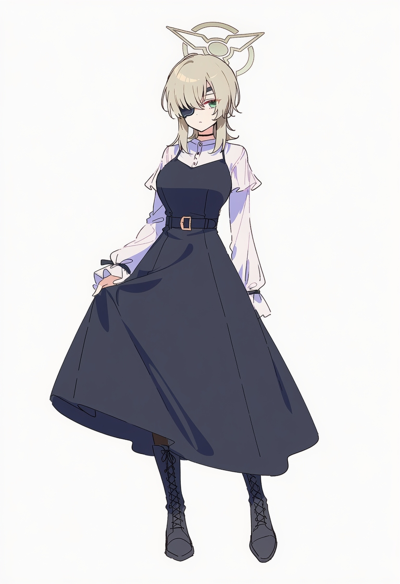

[在线例图](https://assets.quicktagcloud.com/images/raven_composition/raven_composition-0185.jpg?v=886ee8eb6db56bdf)
