# 裙子

[总目录](../README.md) · [原站分类目录](../categories.md) · [英文标签索引](../tags.md) · [服装与构图组合指南](../../README.md)

标题、分类、说明、正负提示词按来源保留；多例图逐张列出。原站标记和说明为参考资料，不作为维护指令。

<a id="raven_composition-0186"></a>

## 裙子

ID：`raven_composition-0186`；分类：裙子；来源标记：`safe`。

来源说明：

> 一件式裙装：上半身的衣身与下方裙摆连接成一件衣服，并向腿部垂下。Danbooru 中它与 skirt（半身裙）严格区分；如果上衣和裙子是分开的，应使用 skirt 而不是 dress。

正向提示词：

```text
dress
```

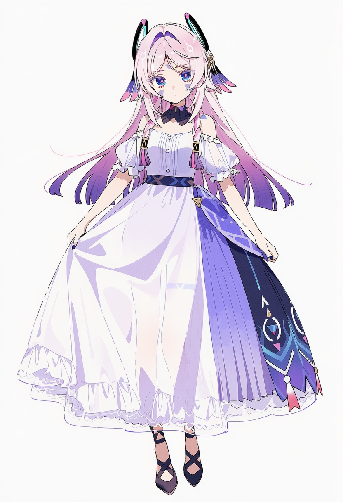

[在线例图](https://assets.quicktagcloud.com/images/raven_composition/raven_composition-0186.jpg?v=240a9377531533a5)

<a id="raven_composition-0187"></a>

## 长连衣裙

ID：`raven_composition-0187`；分类：裙子；来源标记：`safe`。

来源说明：

> 裙摆超过膝盖的连衣裙，通常至少到小腿中部，也可延伸至脚踝或地面。重点是整体长度明显属于长裙，而不是普通及膝长度。

正向提示词：

```text
long_dress
```

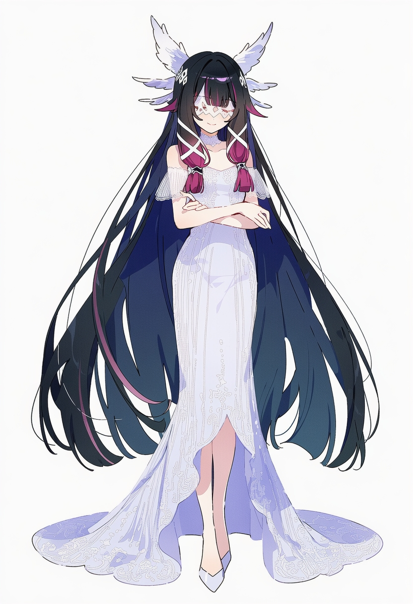

[在线例图](https://assets.quicktagcloud.com/images/raven_composition/raven_composition-0187.jpg?v=575d132dad854dea)

<a id="raven_composition-0188"></a>

## 中长连衣裙

ID：`raven_composition-0188`；分类：裙子；来源标记：`safe`。

来源说明：

> 长度介于短连衣裙和长连衣裙之间的连衣裙，通常在膝盖附近或略上下。用于不够短到 short_dress、也未长到 long_dress 的情况。

正向提示词：

```text
medium_dress
```

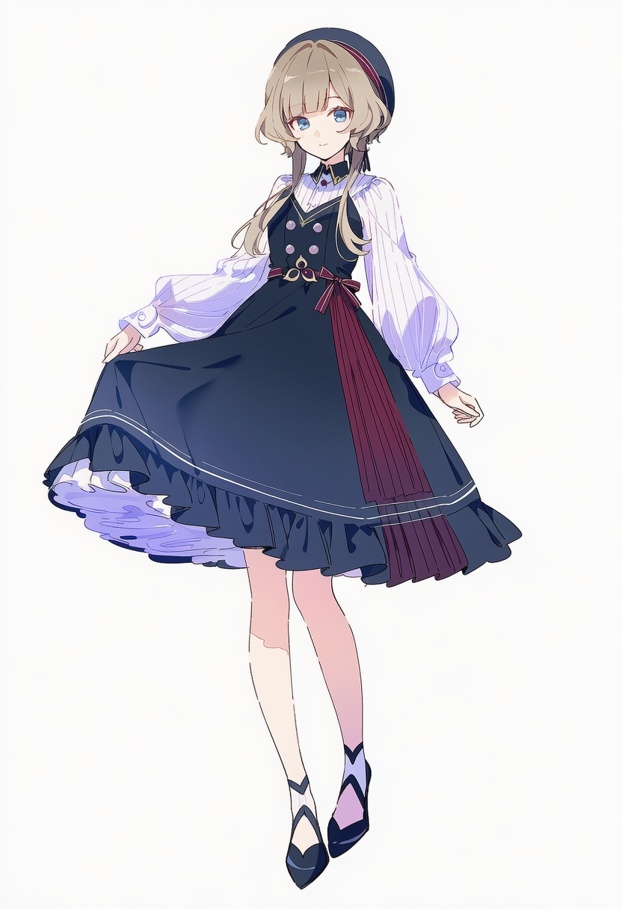

[在线例图](https://assets.quicktagcloud.com/images/raven_composition/raven_composition-0188.jpg?v=0201ffa2095501fe)

<a id="raven_composition-0189"></a>

## 超短连衣裙

ID：`raven_composition-0189`；分类：裙子；来源标记：`safe`。

来源说明：

> 极短连衣裙，裙摆只勉强覆盖胯部/臀部下方，比 short_dress 更短。重点是“极端短”的裙长，而不是普通迷你裙长度。

正向提示词：

```text
microdress
```

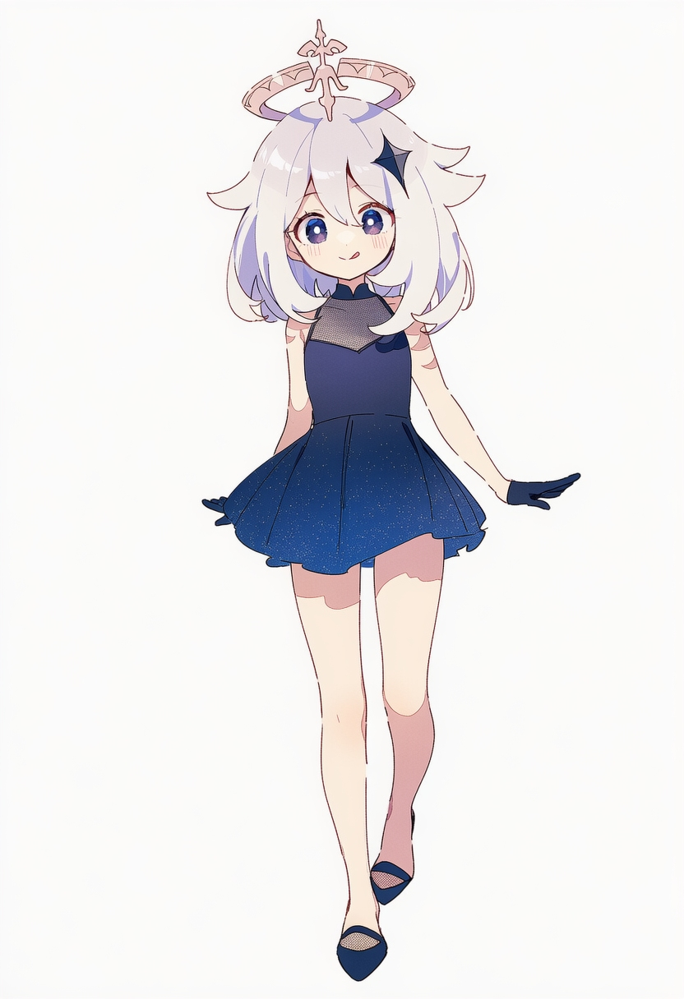

[在线例图](https://assets.quicktagcloud.com/images/raven_composition/raven_composition-0189.jpg?v=06df7164c062f3de)

<a id="raven_composition-0190"></a>

## 短连衣裙

ID：`raven_composition-0190`；分类：裙子；来源标记：`safe`。

来源说明：

> 大致到大腿中部的短连衣裙，通常明显高于膝盖，但仍比 microdress 长。适合普通迷你连衣裙、短款派对裙等。

正向提示词：

```text
short_dress
```

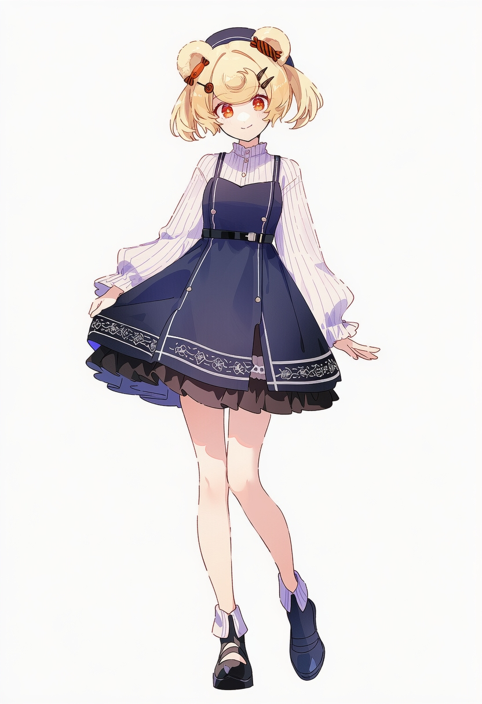

[在线例图](https://assets.quicktagcloud.com/images/raven_composition/raven_composition-0190.jpg?v=29849096d6ca6d23)

<a id="raven_composition-0191"></a>

## 美国国旗图案连衣裙

ID：`raven_composition-0191`；分类：裙子；来源标记：`safe`。

来源说明：

> 以美国国旗图案作为主要视觉特征的连衣裙。

正向提示词：

```text
american_flag_dress
```

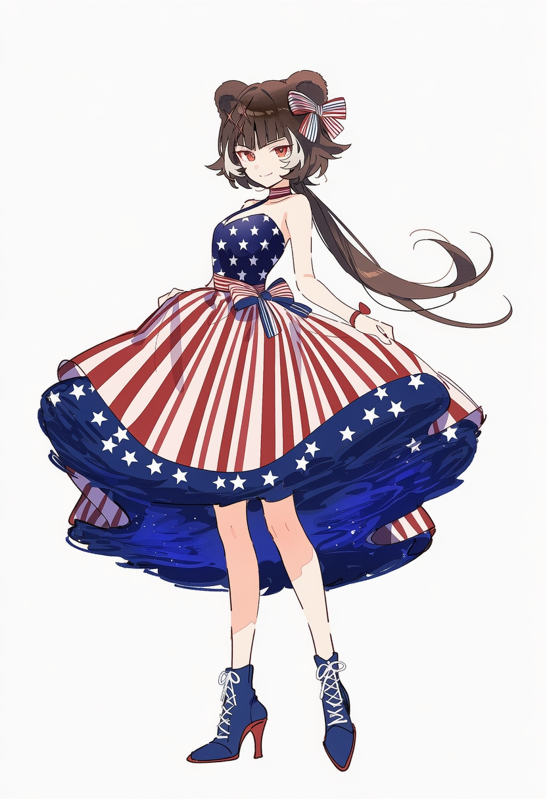

[在线例图](https://assets.quicktagcloud.com/images/raven_composition/raven_composition-0191.jpg?v=1ea34d775eb63aa5)

<a id="raven_composition-0192"></a>

## 菱格纹连衣裙

ID：`raven_composition-0192`；分类：裙子；来源标记：`safe`。

来源说明：

> 以菱格纹（argyle）作为主要视觉特征的连衣裙。

正向提示词：

```text
argyle_dress
```

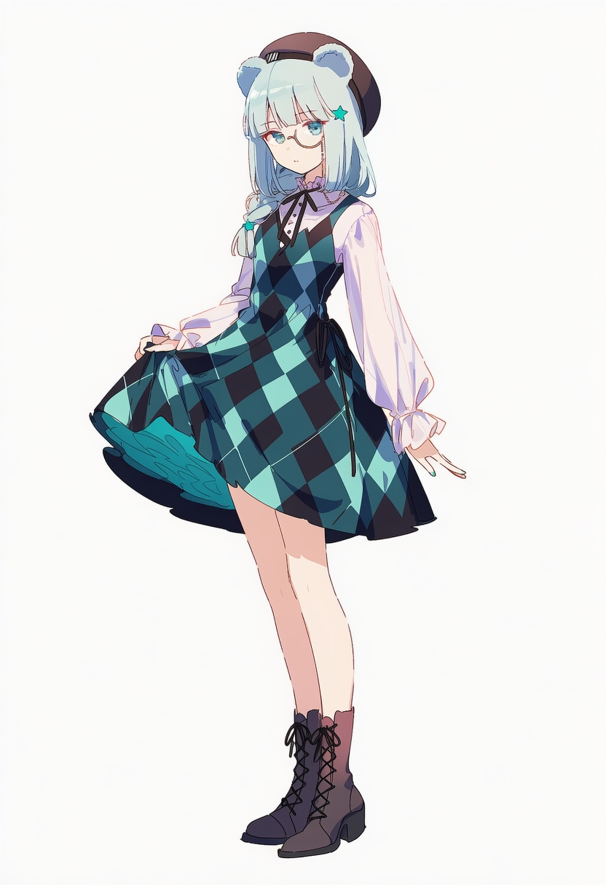

[在线例图](https://assets.quicktagcloud.com/images/raven_composition/raven_composition-0192.jpg?v=4e0a7ca7e1984fa7)

<a id="raven_composition-0193"></a>

## 不对称连衣裙

ID：`raven_composition-0193`；分类：裙子；来源标记：`safe`。

来源说明：

> 不对称剪裁，左右或前后在长度、肩部、领口等处存在明显有意差异的连衣裙。它描述整体剪裁结构，不限定颜色、长度或材质。

正向提示词：

```text
asymmetrical_dress
```

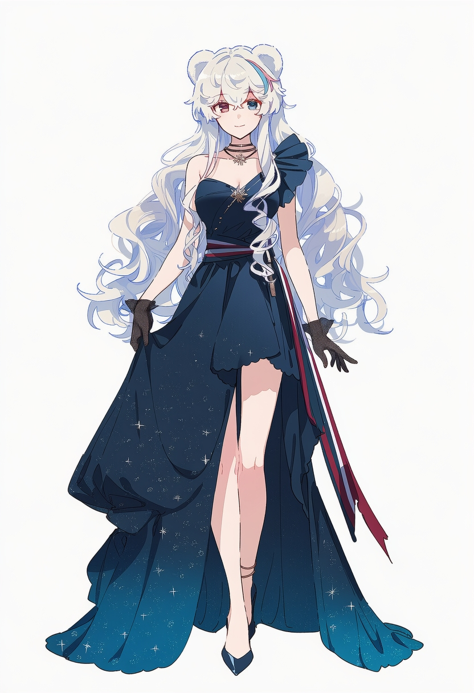

[在线例图](https://assets.quicktagcloud.com/images/raven_composition/raven_composition-0193.jpg?v=9fbfd883c71ba30a)

<a id="raven_composition-0194"></a>

## 棋盘格连衣裙

ID：`raven_composition-0194`；分类：裙子；来源标记：`safe`。

来源说明：

> 以棋盘格作为主要视觉特征的连衣裙。

正向提示词：

```text
checkered_dress
```

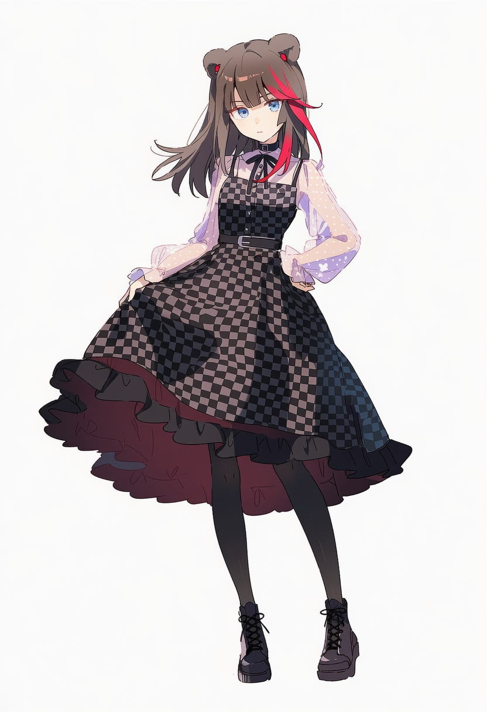

[在线例图](https://assets.quicktagcloud.com/images/raven_composition/raven_composition-0194.jpg?v=b0f5e11e0c8d5c09)

<a id="raven_composition-0195"></a>

## 花卉印花连衣裙

ID：`raven_composition-0195`；分类：裙子；来源标记：`safe`。

来源说明：

> 以花卉印花作为主要视觉特征的连衣裙。

正向提示词：

```text
floral_print_dress
```

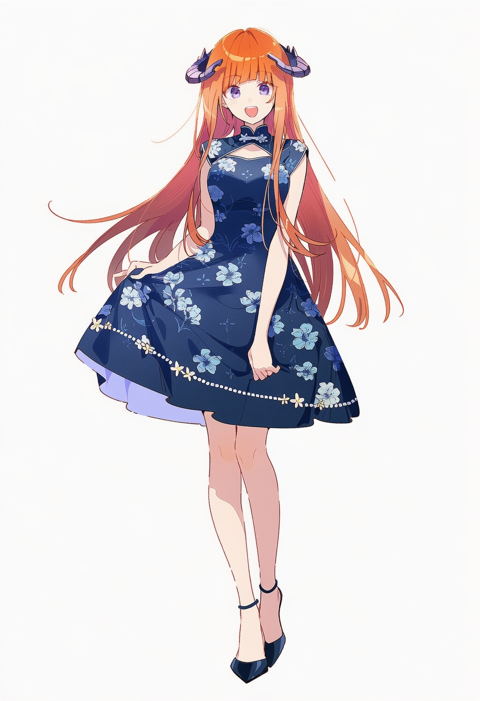

[在线例图](https://assets.quicktagcloud.com/images/raven_composition/raven_composition-0195.jpg?v=60262fd5cf399dbc)

<a id="raven_composition-0196"></a>

## 维希格连衣裙

ID：`raven_composition-0196`；分类：裙子；来源标记：`safe`。

来源说明：

> 以维希格/小方格作为主要视觉特征的连衣裙。

正向提示词：

```text
gingham_dress
```

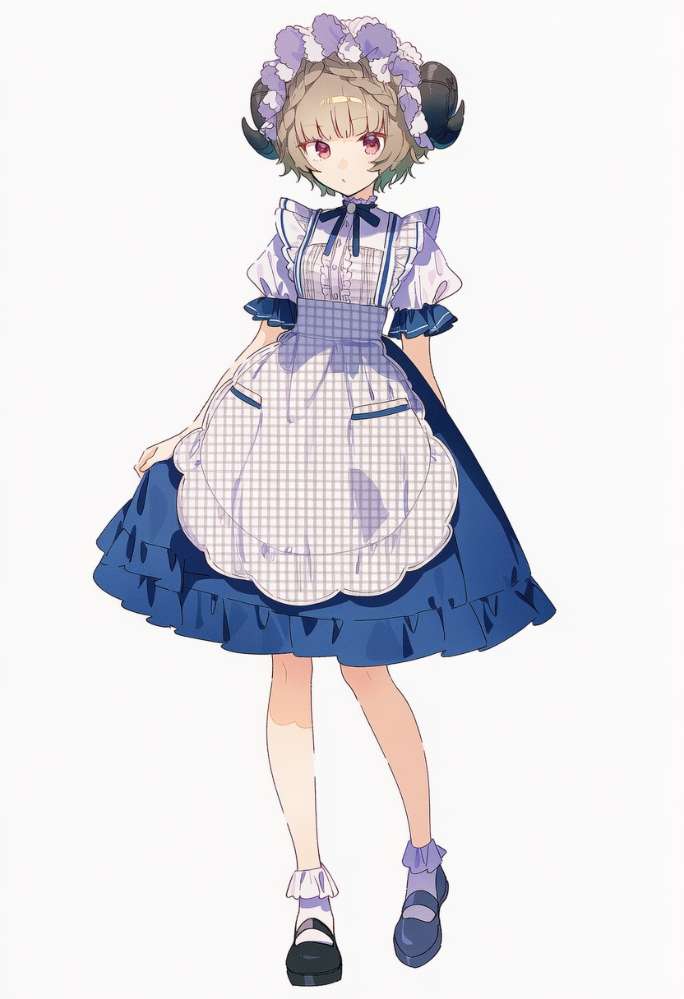

[在线例图](https://assets.quicktagcloud.com/images/raven_composition/raven_composition-0196.jpg?v=f4e188db2fd07565)

<a id="raven_composition-0197"></a>

## 细条纹连衣裙

ID：`raven_composition-0197`；分类：裙子；来源标记：`safe`。

来源说明：

> 以细密竖向针条纹作为主要视觉特征的连衣裙。

正向提示词：

```text
pinstripe_dress
```

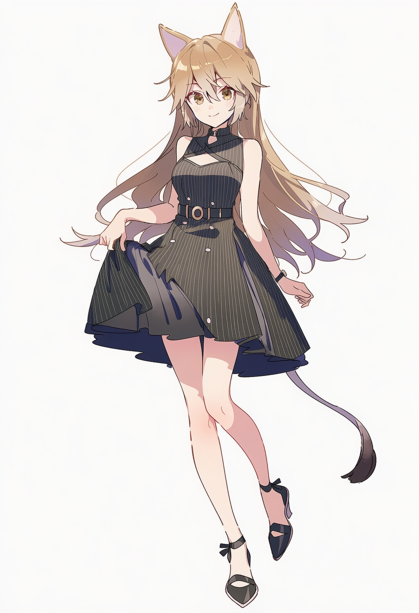

[在线例图](https://assets.quicktagcloud.com/images/raven_composition/raven_composition-0197.jpg?v=fbee617f7355a6b1)

<a id="raven_composition-0198"></a>

## 格纹连衣裙

ID：`raven_composition-0198`；分类：裙子；来源标记：`safe`。

来源说明：

> 以格纹/苏格兰格作为主要视觉特征的连衣裙。

正向提示词：

```text
plaid_dress
```

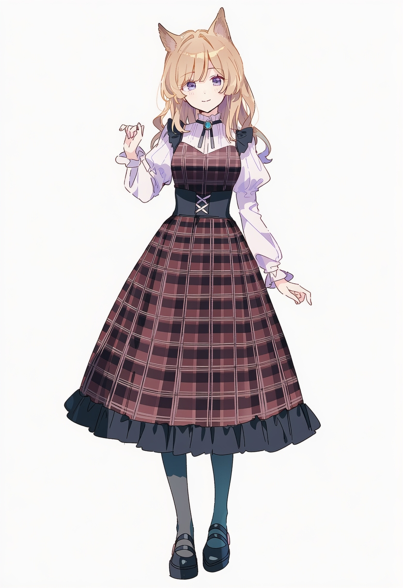

[在线例图](https://assets.quicktagcloud.com/images/raven_composition/raven_composition-0198.jpg?v=1ff80cb8cf3140e0)

<a id="raven_composition-0199"></a>

## 波点连衣裙

ID：`raven_composition-0199`；分类：裙子；来源标记：`safe`。

来源说明：

> 以波点/圆点作为主要视觉特征的连衣裙。

正向提示词：

```text
polka_dot_dress
```

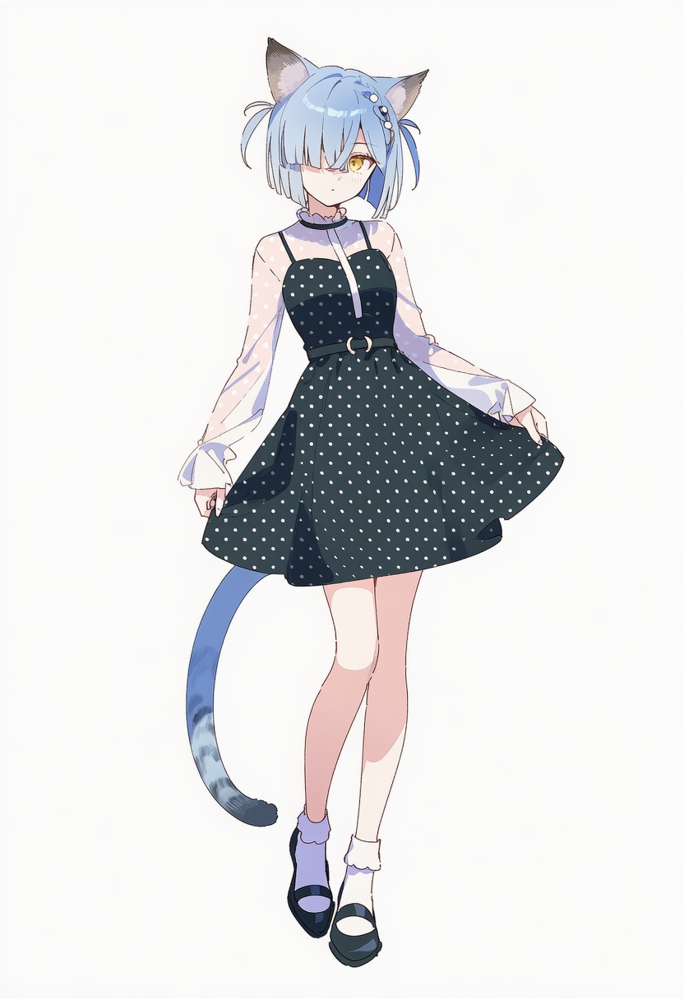

[在线例图](https://assets.quicktagcloud.com/images/raven_composition/raven_composition-0199.jpg?v=d0d2cf97ae8724d0)

<a id="raven_composition-0200"></a>

## 印花连衣裙

ID：`raven_composition-0200`；分类：裙子；来源标记：`safe`。

来源说明：

> 以明显印花作为主要视觉特征的连衣裙。

正向提示词：

```text
print_dress
```

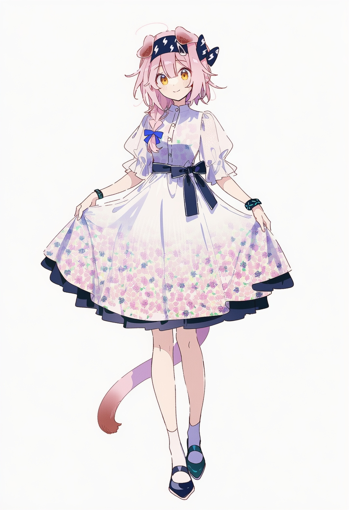

[在线例图](https://assets.quicktagcloud.com/images/raven_composition/raven_composition-0200.jpg?v=cdf058070e9512f3)

<a id="raven_composition-0201"></a>

## 条纹连衣裙

ID：`raven_composition-0201`；分类：裙子；来源标记：`safe`。

来源说明：

> 以条纹作为主要视觉特征的连衣裙。

正向提示词：

```text
striped_dress
```

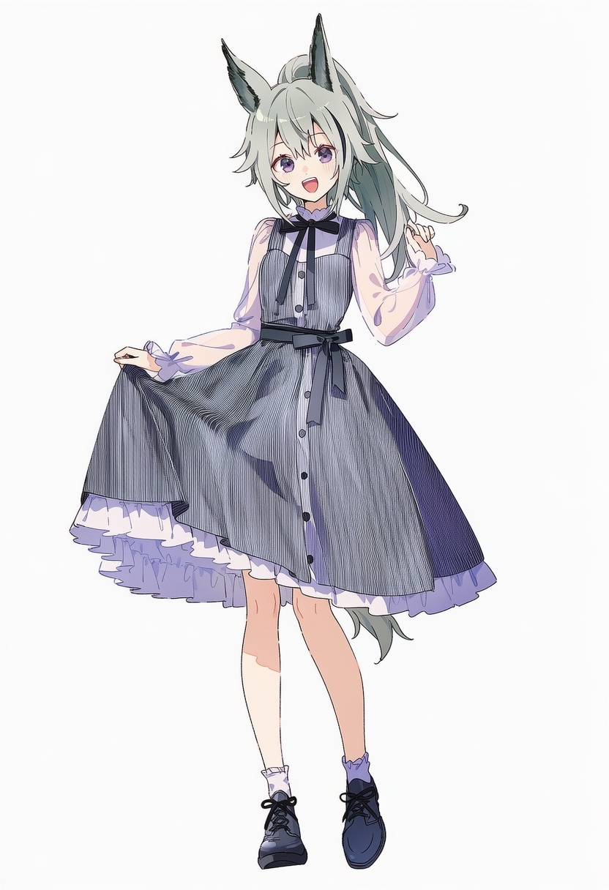

[在线例图](https://assets.quicktagcloud.com/images/raven_composition/raven_composition-0201.jpg?v=c25330c7b8cef7b7)

<a id="raven_composition-0202"></a>

## 竖条纹连衣裙

ID：`raven_composition-0202`；分类：裙子；来源标记：`safe`。

来源说明：

> 以竖向条纹作为主要视觉特征的连衣裙。

正向提示词：

```text
vertical-striped_dress
```

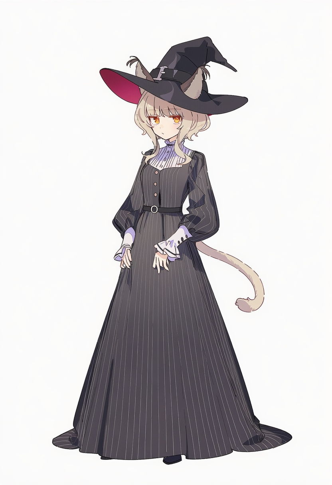

[在线例图](https://assets.quicktagcloud.com/images/raven_composition/raven_composition-0202.jpg?v=16fd0364248a2ac3)

<a id="raven_composition-0203"></a>

## 羽毛饰边连衣裙

ID：`raven_composition-0203`；分类：裙子；来源标记：`safe`。

来源说明：

> 裙装边缘带有明显的羽毛饰边。重点是领口、袖口、裙摆等边缘的装饰处理，而不是整件衣服都由该材料制成。

正向提示词：

```text
feather-trimmed_dress
```

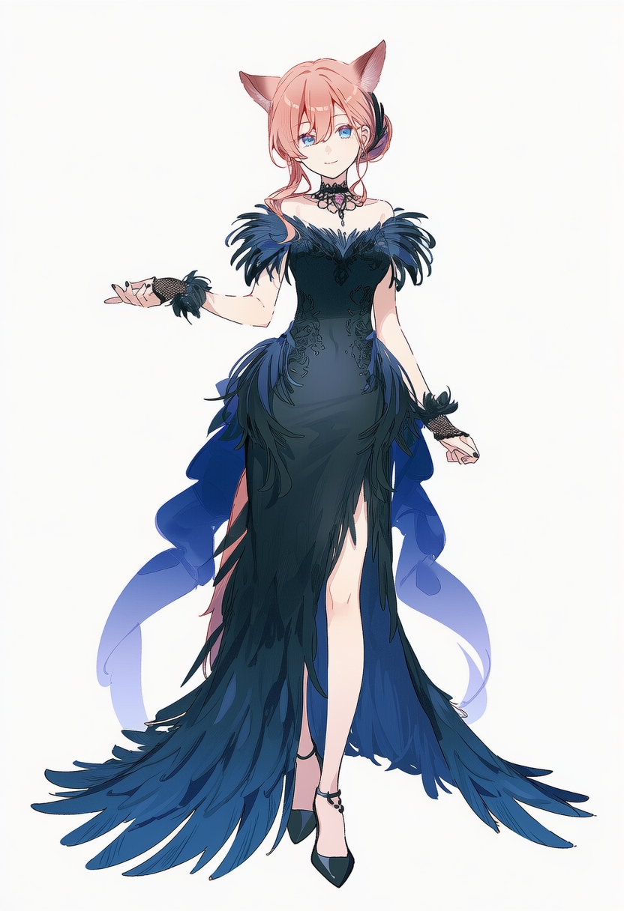

[在线例图](https://assets.quicktagcloud.com/images/raven_composition/raven_composition-0203.jpg?v=90a7c6d1b2785ce8)

<a id="raven_composition-0204"></a>

## 毛皮饰边连衣裙

ID：`raven_composition-0204`；分类：裙子；来源标记：`safe`。

来源说明：

> 裙装边缘带有明显的毛皮/绒毛饰边。重点是领口、袖口、裙摆等边缘的装饰处理，而不是整件衣服都由该材料制成。

正向提示词：

```text
fur-trimmed_dress
```

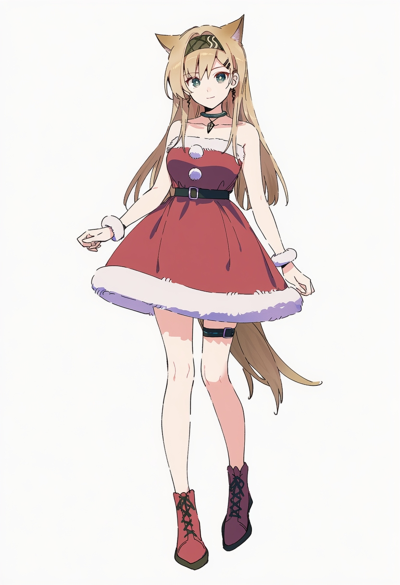

[在线例图](https://assets.quicktagcloud.com/images/raven_composition/raven_composition-0204.jpg?v=e0c0fa58fd02d8f4)

<a id="raven_composition-0205"></a>

## 蕾丝饰边连衣裙

ID：`raven_composition-0205`；分类：裙子；来源标记：`safe`。

来源说明：

> 裙装边缘带有明显的蕾丝饰边。重点是领口、袖口、裙摆等边缘的装饰处理，而不是整件衣服都由该材料制成。

正向提示词：

```text
lace-trimmed_dress
```

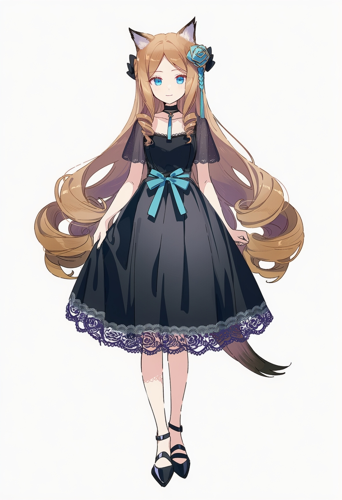

[在线例图](https://assets.quicktagcloud.com/images/raven_composition/raven_composition-0205.jpg?v=8376e3f889ee7429)

<a id="raven_composition-0206"></a>

## 缎带饰边连衣裙

ID：`raven_composition-0206`；分类：裙子；来源标记：`safe`。

来源说明：

> 裙装边缘带有明显的缎带饰边。重点是领口、袖口、裙摆等边缘的装饰处理，而不是整件衣服都由该材料制成。

正向提示词：

```text
ribbon-trimmed_dress
```

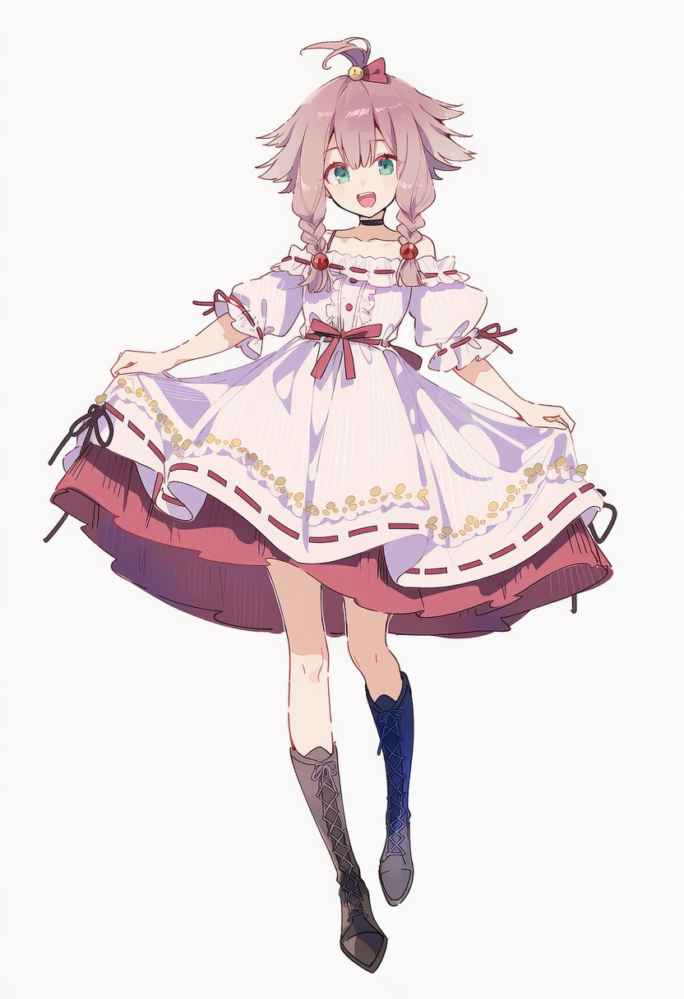

[在线例图](https://assets.quicktagcloud.com/images/raven_composition/raven_composition-0206.jpg?v=e247688acf279b45)

<a id="raven_composition-0207"></a>

## 挂脖连衣裙

ID：`raven_composition-0207`；分类：裙子；来源标记：`safe`。

来源说明：

> 挂脖式连衣裙。上身通过绕过颈后或颈部的带子固定，肩部通常裸露；与单纯无袖或无肩带结构不同。

正向提示词：

```text
halter_dress
```

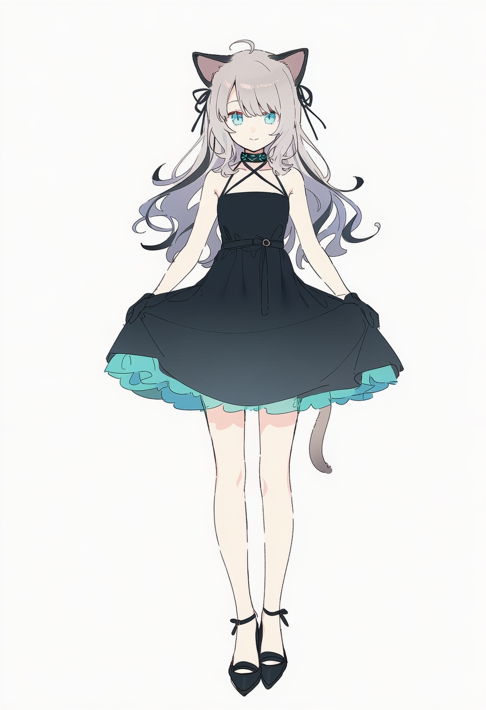

[在线例图](https://assets.quicktagcloud.com/images/raven_composition/raven_composition-0207.jpg?v=069ddec4dcb503b2)

<a id="raven_composition-0208"></a>

## 露肩连衣裙

ID：`raven_composition-0208`；分类：裙子；来源标记：`safe`。

来源说明：

> 露肩连衣裙。领口或袖子落在肩部以下，让肩膀明显外露，但仍可能有袖子或布料环绕上臂。

正向提示词：

```text
off-shoulder_dress
```

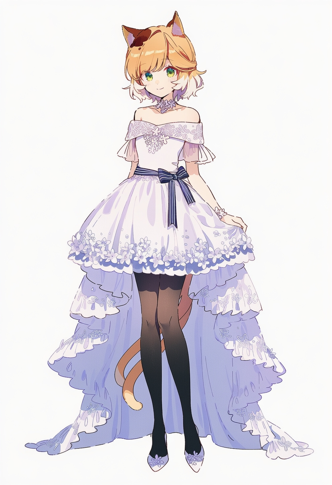

[在线例图](https://assets.quicktagcloud.com/images/raven_composition/raven_composition-0208.jpg?v=1599298cd0cfb3c1)

<a id="raven_composition-0209"></a>

## 无肩带连衣裙

ID：`raven_composition-0209`；分类：裙子；来源标记：`safe`。

来源说明：

> 无肩带连衣裙。上身没有肩带、袖子或挂脖结构来固定，主要靠胸围/腰胯处的贴合支撑；与 off-shoulder_dress 不同。

正向提示词：

```text
strapless_dress
```

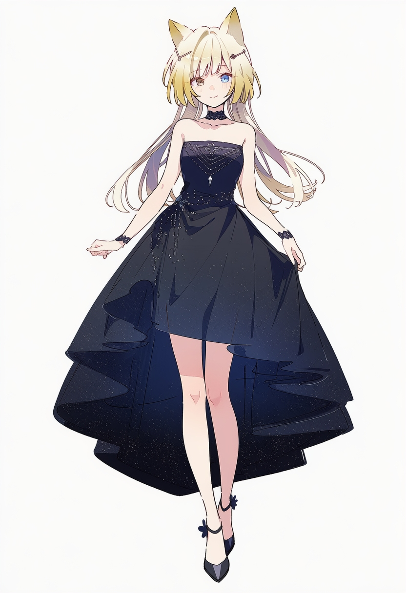

[在线例图](https://assets.quicktagcloud.com/images/raven_composition/raven_composition-0209.jpg?v=4da487ca30800a6b)

<a id="raven_composition-0210"></a>

## 抹胸筒形连衣裙

ID：`raven_composition-0210`；分类：裙子；来源标记：`safe`。

来源说明：

> 抹胸筒形连衣裙，通常是无肩带、近似直筒包裹胸部和躯干的结构。可理解为 strapless_dress 中更强调“筒状抹胸”外形的一类。

正向提示词：

```text
tube_dress
```

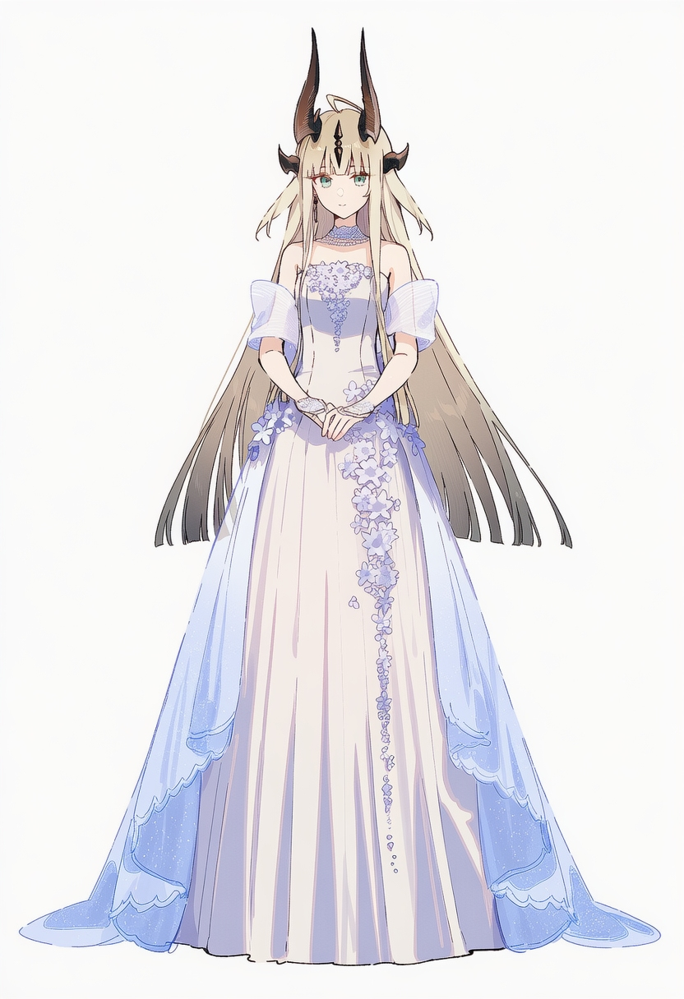

[在线例图](https://assets.quicktagcloud.com/images/raven_composition/raven_composition-0210.jpg?v=3b41b1b630eb4afb)

<a id="raven_composition-0211"></a>

## 高领连衣裙

ID：`raven_composition-0211`；分类：裙子；来源标记：`safe`。

来源说明：

> 带高领/翻领式贴颈领口的连衣裙。裙装本体可长可短，核心特征是衣领向上覆盖颈部。

正向提示词：

```text
turtleneck_dress
```

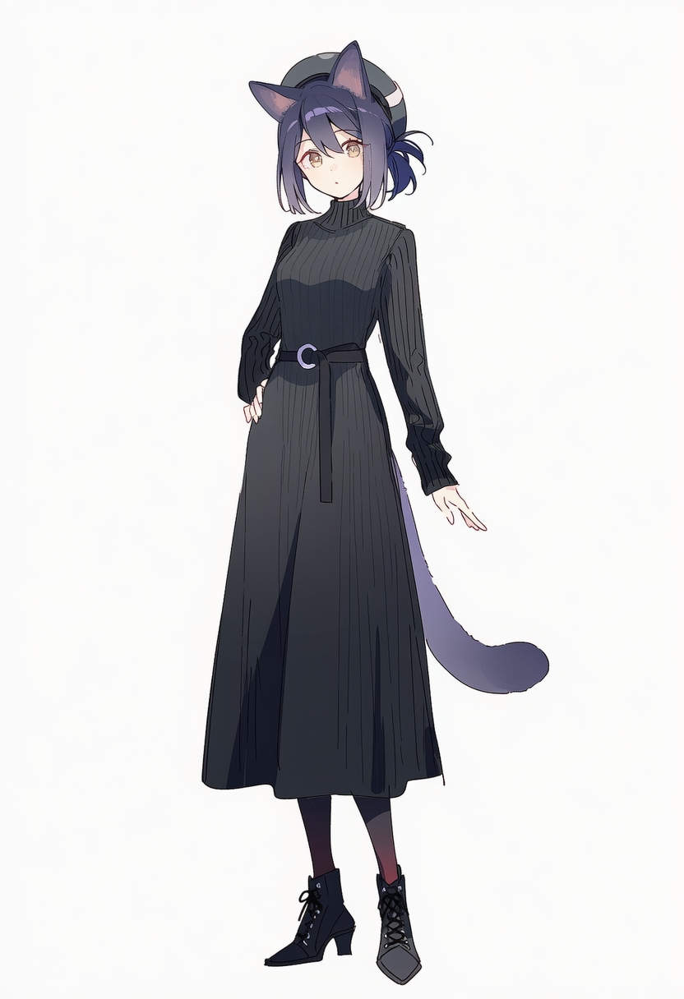

[在线例图](https://assets.quicktagcloud.com/images/raven_composition/raven_composition-0211.jpg?v=b6ab642eba3b15c1)

<a id="raven_composition-0212"></a>

## 无袖连衣裙

ID：`raven_composition-0212`；分类：裙子；来源标记：`safe`。

来源说明：

> 无袖连衣裙。肩部仍有衣身或肩带结构，但没有袖子；不要与完全没有肩部支撑的 strapless_dress 混淆。

正向提示词：

```text
sleeveless_dress
```

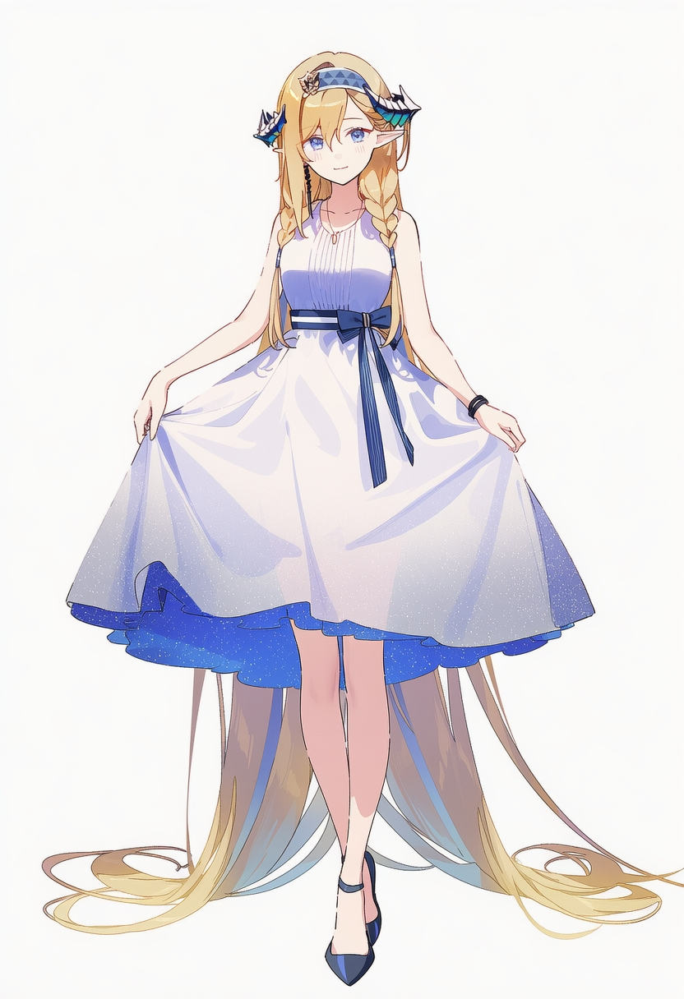

[在线例图](https://assets.quicktagcloud.com/images/raven_composition/raven_composition-0212.jpg?v=5a968a4a9ccef5d4)

<a id="raven_composition-0213"></a>

## 不可能结构连衣裙

ID：`raven_composition-0213`；分类：裙子；来源标记：`safe`。

来源说明：

> “不可能服装”式连衣裙：衣料以现实结构难以维持的方式紧贴、悬浮或覆盖身体，常见于二次元夸张设计。重点是结构在现实中缺乏合理支撑。

正向提示词：

```text
impossible_dress
```

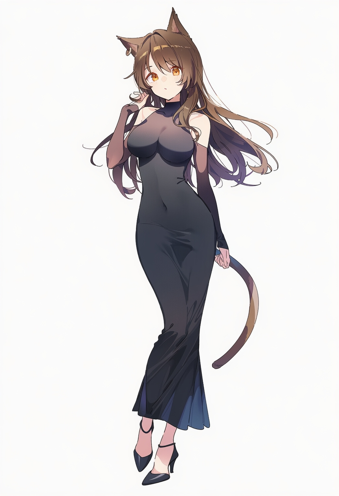

[在线例图](https://assets.quicktagcloud.com/images/raven_composition/raven_composition-0213.jpg?v=1a78094e91b26fb3)

<a id="raven_composition-0214"></a>

## 铅笔裙式连衣裙

ID：`raven_composition-0214`；分类：裙子；来源标记：`safe`。

来源说明：

> 铅笔裙轮廓的连衣裙，腰臀处较贴身，裙摆窄而直，整体形成修长的柱状/铅笔形轮廓。常用于职业、晚宴或成熟风格。

正向提示词：

```text
pencil_dress
```

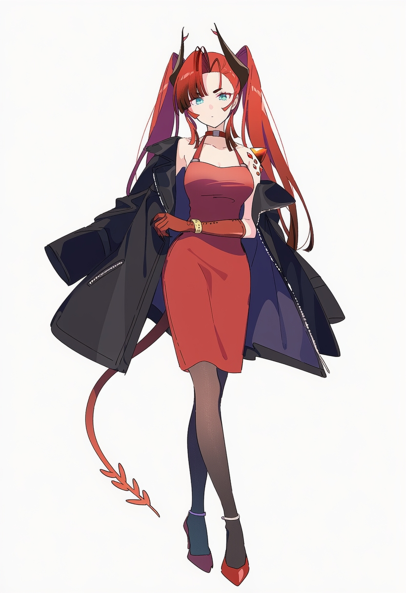

[在线例图](https://assets.quicktagcloud.com/images/raven_composition/raven_composition-0214.jpg?v=c91d6f4ddabb77e3)

<a id="raven_composition-0215"></a>

## 绷紧的连衣裙

ID：`raven_composition-0215`；分类：裙子；来源标记：`safe`。

来源说明：

> 因姿势、身体曲线或拉扯而被绷紧的连衣裙，布料呈明显拉伸张力。它描述当前视觉状态，不等同于衣服本来就是 tight_dress。

正向提示词：

```text
taut_dress
```

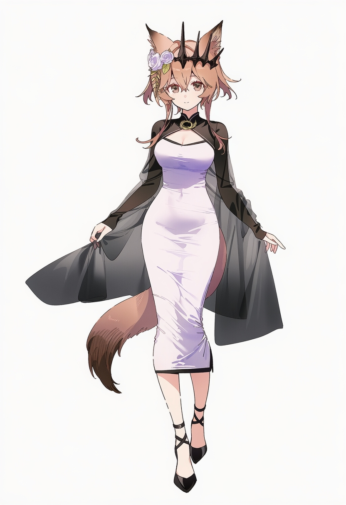

[在线例图](https://assets.quicktagcloud.com/images/raven_composition/raven_composition-0215.jpg?v=406eff3cbee6a1a9)

<a id="raven_composition-0216"></a>

## 紧身连衣裙

ID：`raven_composition-0216`；分类：裙子；来源标记：`safe`。

来源说明：

> 剪裁本身贴合身体曲线的紧身连衣裙。重点是服装设计与版型本身偏紧，而不是临时被动作拉紧。

正向提示词：

```text
tight_dress
```

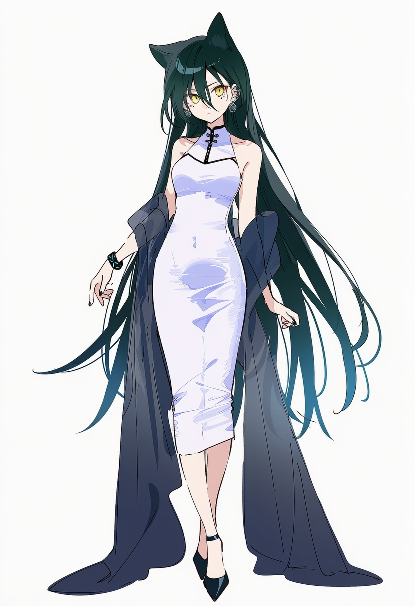

[在线例图](https://assets.quicktagcloud.com/images/raven_composition/raven_composition-0216.jpg?v=b84ee4065e79beaa)

<a id="raven_composition-0217"></a>

## 前短后长连衣裙

ID：`raven_composition-0217`；分类：裙子；来源标记：`safe`。

来源说明：

> 前短后长的连衣裙，裙摆前侧明显高于后侧，形成不对称的高低落差。后摆可以很长，但并不要求拖地。

正向提示词：

```text
high-low_dress
```

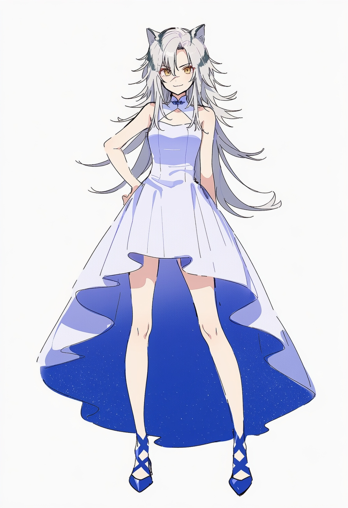

[在线例图](https://assets.quicktagcloud.com/images/raven_composition/raven_composition-0217.jpg?v=f92f0ef6539f12b1)

<a id="raven_composition-0218"></a>

## 铠甲式连衣裙

ID：`raven_composition-0218`；分类：裙子；来源标记：`safe`。

来源说明：

> 将裙装与铠甲/装甲部件结合的连衣裙或裙甲式服装。通常仍保留 dress 的整体轮廓，但包含金属护片、甲胄结构等。

正向提示词：

```text
armored_dress
```

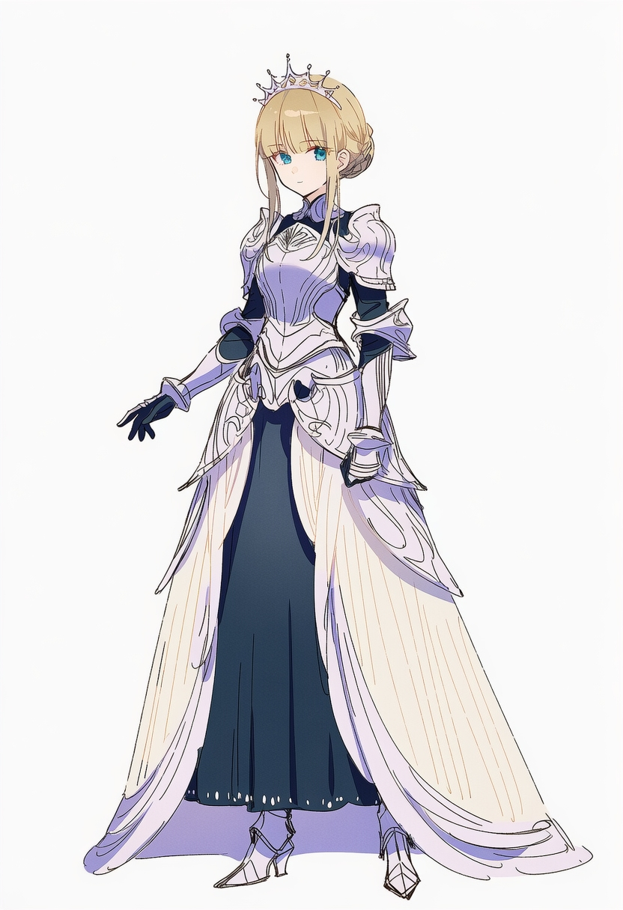

[在线例图](https://assets.quicktagcloud.com/images/raven_composition/raven_composition-0218.jpg?v=7326ac4a38b2253d)

<a id="raven_composition-0219"></a>

## 露背连衣裙

ID：`raven_composition-0219`；分类：裙子；来源标记：`safe`。

来源说明：

> 露背连衣裙。背部有大面积裸露，通常通过低背、绑带或其他结构固定；重点是后背敞开而不是侧面镂空。

正向提示词：

```text
backless_dress
```

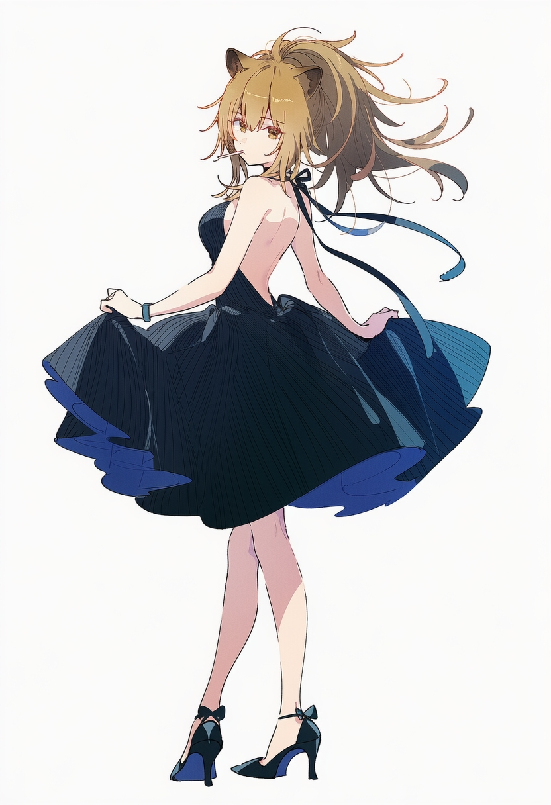

[在线例图](https://assets.quicktagcloud.com/images/raven_composition/raven_composition-0219.jpg?v=3021d37457c02120)

<a id="raven_composition-0220"></a>

## 蛋糕裙式连衣裙

ID：`raven_composition-0220`；分类：裙子；来源标记：`safe`。

来源说明：

> 蛋糕裙式连衣裙，裙摆由多层水平褶边、荷叶边或层叠结构组成，外形像分层蛋糕，通常显得蓬松甜美。

正向提示词：

```text
cake_dress
```

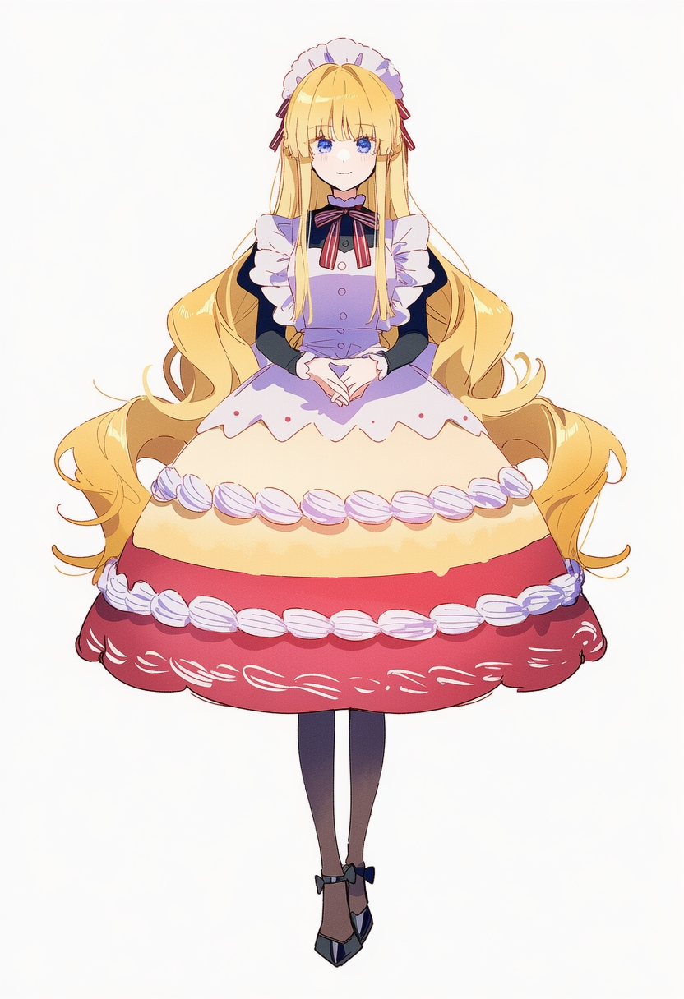

[在线例图](https://assets.quicktagcloud.com/images/raven_composition/raven_composition-0220.jpg?v=d0e6e61eea2fb3bd)

<a id="raven_composition-0221"></a>

## 大衣式连衣裙

ID：`raven_composition-0221`；分类：裙子；来源标记：`safe`。

来源说明：

> 大衣式连衣裙，剪裁像合身外套，常见前中开合、翻领、纽扣等大衣元素，但整体作为一件连衣裙穿着。

正向提示词：

```text
coat_dress
```

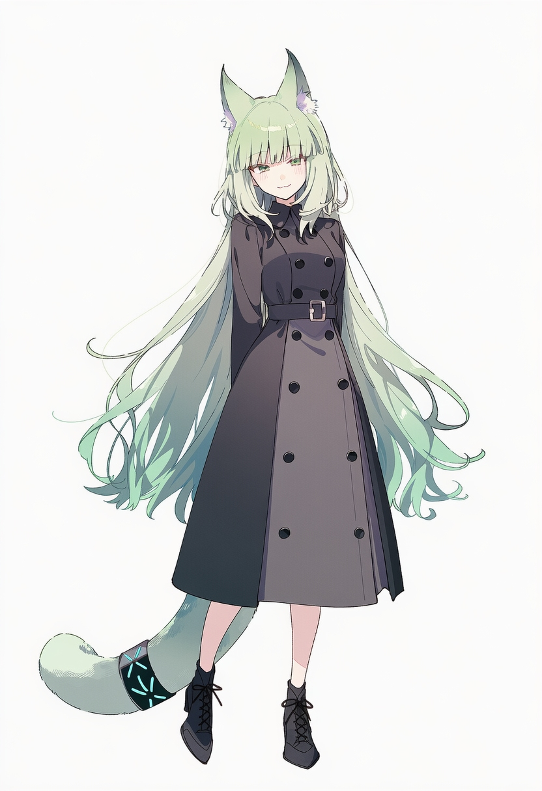

[在线例图](https://assets.quicktagcloud.com/images/raven_composition/raven_composition-0221.jpg?v=f25726dee878c228)

<a id="raven_composition-0222"></a>

## 有领连衣裙

ID：`raven_composition-0222`；分类：裙子；来源标记：`safe`。

来源说明：

> 带明确衣领的连衣裙，例如衬衫领、娃娃领、翻领等。该 tag 只强调“有领”，不限定裙长或风格。

正向提示词：

```text
collared_dress
```

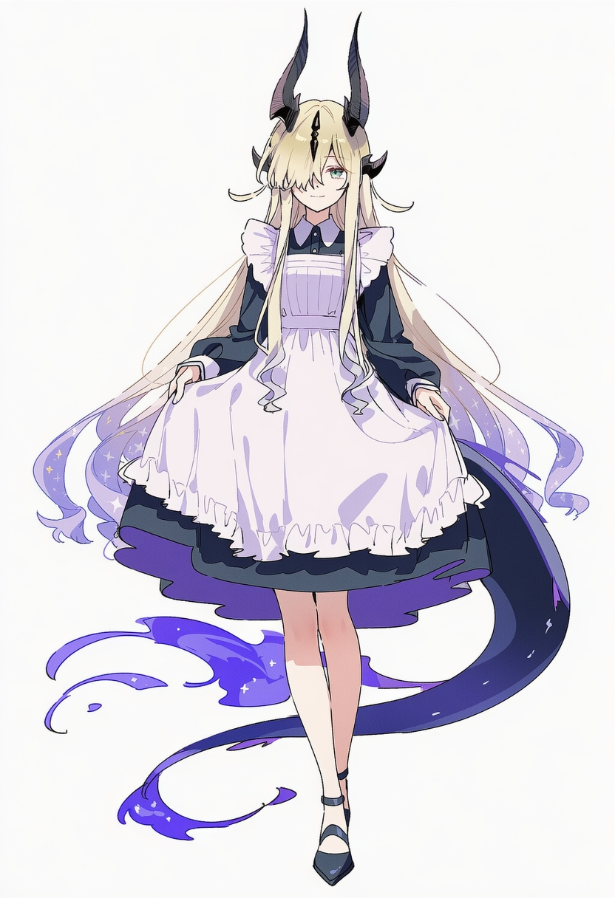

[在线例图](https://assets.quicktagcloud.com/images/raven_composition/raven_composition-0222.jpg?v=9d5b5d58166a9ca8)

<a id="raven_composition-0223"></a>

## 交叉系带连衣裙

ID：`raven_composition-0223`；分类：裙子；来源标记：`safe`。

来源说明：

> 带交叉穿绳/绑带结构的连衣裙，常见于胸前、腰侧或后背。绳带以 X 形交叉连接，是主要可见设计特征。

正向提示词：

```text
cross-laced_dress
```

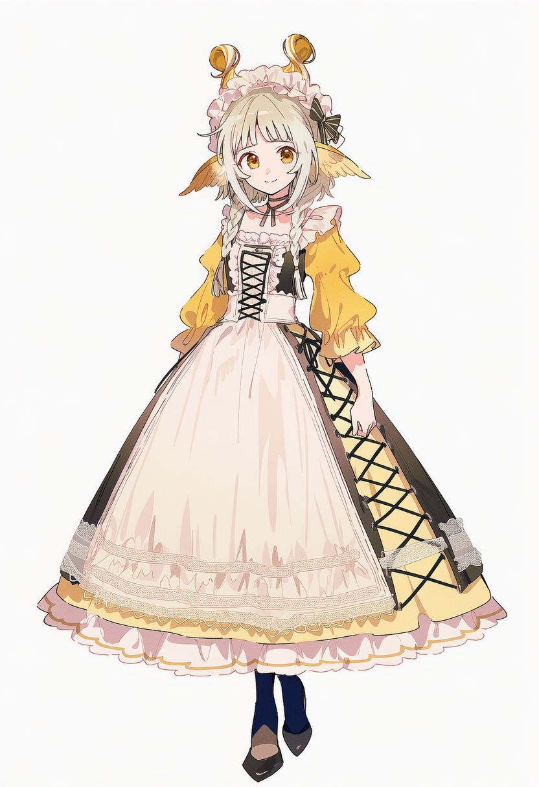

[在线例图](https://assets.quicktagcloud.com/images/raven_composition/raven_composition-0223.jpg?v=cc7a45cff97d3a97)

<a id="raven_composition-0224"></a>

## 牛仔连衣裙

ID：`raven_composition-0224`；分类：裙子；来源标记：`safe`。

来源说明：

> 以牛仔布或明显牛仔质感制作的连衣裙。重点是材质，而不是颜色；可同时拥有吊带、背心裙等其他结构标签。

正向提示词：

```text
denim_dress
```

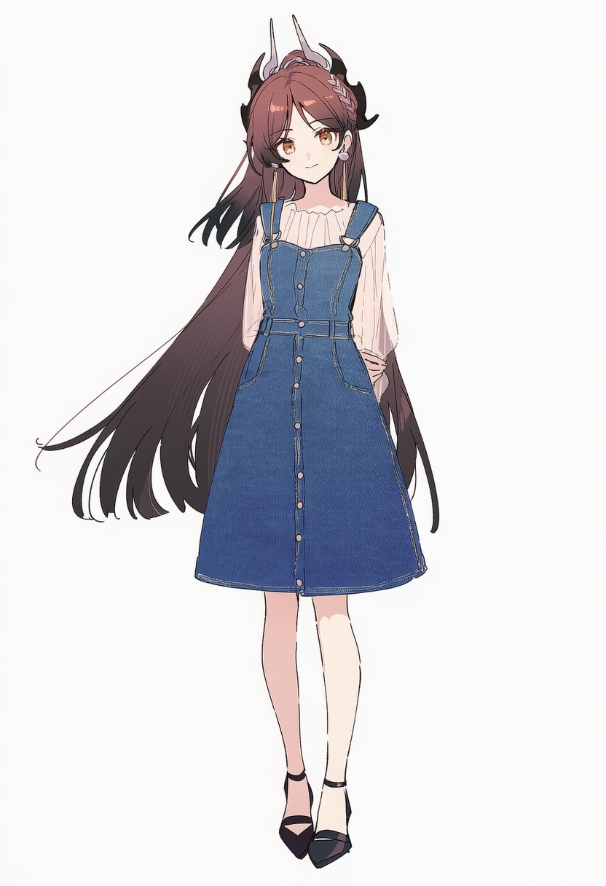

[在线例图](https://assets.quicktagcloud.com/images/raven_composition/raven_composition-0224.jpg?v=4ba33eebaf9db101)

<a id="raven_composition-0225"></a>

## 连衣裙式泳装

ID：`raven_composition-0225`；分类：裙子；来源标记：`safe`。

来源说明：

> 外观或结构类似连衣裙的泳装，通常带有连接在泳衣主体上的裙摆。它仍属于泳装语境，而不是普通日常 dress。

正向提示词：

```text
dress_swimsuit
```

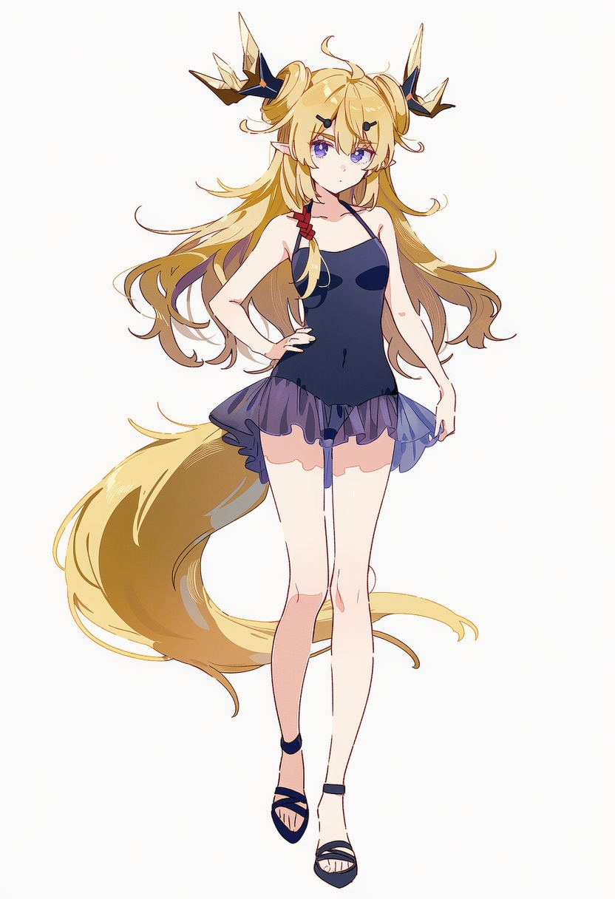

[在线例图](https://assets.quicktagcloud.com/images/raven_composition/raven_composition-0225.jpg?v=2c1c88653a57a08a)

<a id="raven_composition-0226"></a>

## 羽毛装饰连衣裙

ID：`raven_composition-0226`；分类：裙子；来源标记：`safe`。

来源说明：

> 以羽毛作为大面积主体装饰或主要材质视觉效果的连衣裙。与 feather-trimmed_dress 不同，后者只是边缘有羽毛饰边。

正向提示词：

```text
feather_dress
```

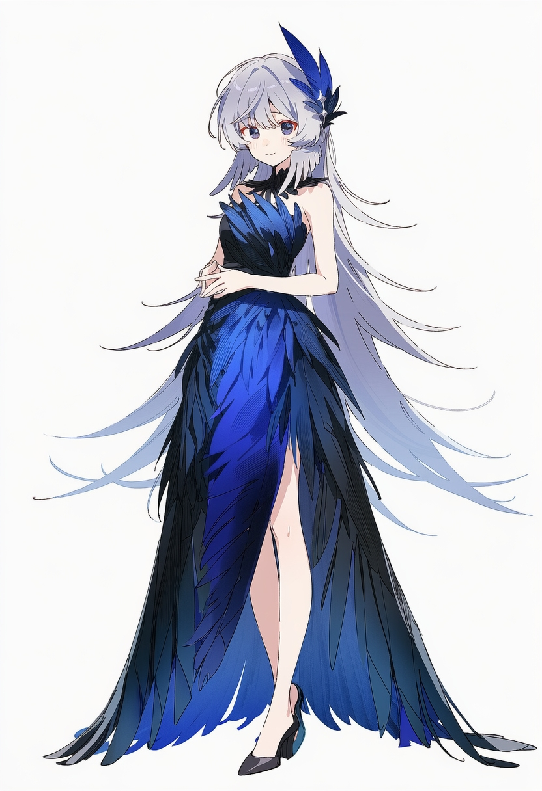

[在线例图](https://assets.quicktagcloud.com/images/raven_composition/raven_composition-0226.jpg?v=1e13cb620b1a67e8)

<a id="raven_composition-0227"></a>

## 花样滑冰裙装

ID：`raven_composition-0227`；分类：裙子；来源标记：`safe`。

来源说明：

> 花样滑冰比赛/表演常见的连体裙装，通常上身贴身并连接短裙摆，兼顾运动自由度和舞台装饰性。

正向提示词：

```text
figure_skating_dress
```

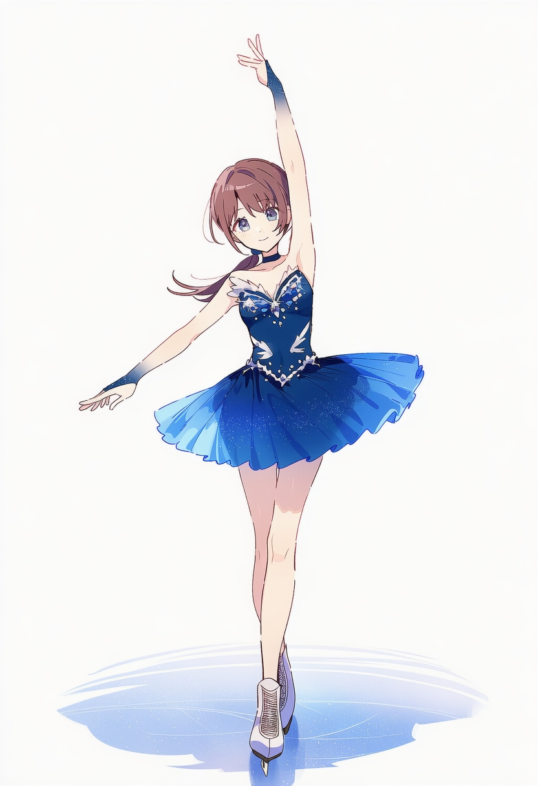

[在线例图](https://assets.quicktagcloud.com/images/raven_composition/raven_composition-0227.jpg?v=4ce083a087ce7c3f)

<a id="raven_composition-0228"></a>

## 褶边/荷叶边连衣裙

ID：`raven_composition-0228`；分类：裙子；来源标记：`safe`。

来源说明：

> 带明显褶边、荷叶边或皱褶装饰的连衣裙。褶边可以位于裙摆、袖口、领口等处，不要求整件都由褶层构成。

正向提示词：

```text
frilled_dress
```

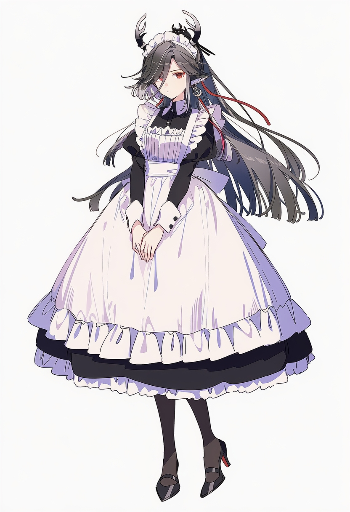

[在线例图](https://assets.quicktagcloud.com/images/raven_composition/raven_composition-0228.jpg?v=f95983e4cce10316)

<a id="raven_composition-0229"></a>

## 闪光/亮粉连衣裙

ID：`raven_composition-0229`；分类：裙子；来源标记：`safe`。

来源说明：

> 表面有明显闪粉、闪片或高密度闪光效果的连衣裙，在光线下呈现强烈亮泽。重点是闪耀的表面视觉，而非单纯高光。

正向提示词：

```text
glitter_dress
```

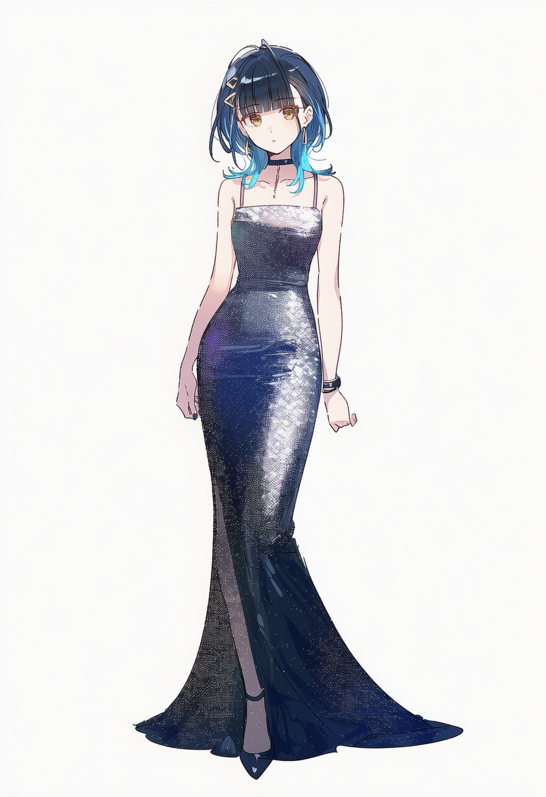

[在线例图](https://assets.quicktagcloud.com/images/raven_composition/raven_composition-0229.jpg?v=8988c0943e7d4a9a)

<a id="raven_composition-0230"></a>

## 半身覆盖式连衣裙

ID：`raven_composition-0230`；分类：裙子；来源标记：`safe`。

来源说明：

> 只覆盖身体一侧或仅保留部分完整裙装结构的特殊连衣裙设计。它通常是实验性/夸张造型，不是普通意义上的半身裙。

正向提示词：

```text
half-dress
```

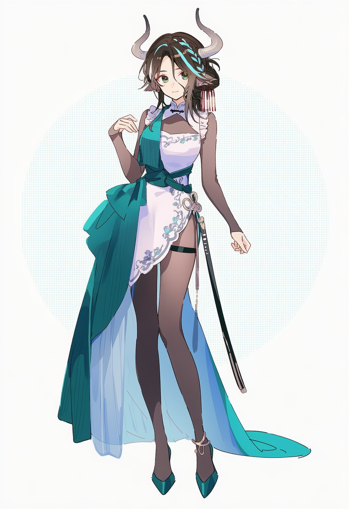

[在线例图](https://assets.quicktagcloud.com/images/raven_composition/raven_composition-0230.jpg?v=54637c00efa741f0)

<a id="raven_composition-0231"></a>

## 高开衩/高腿线连衣裙

ID：`raven_composition-0231`；分类：裙子；来源标记：`safe`。

来源说明：

> 腿部开口或侧面切口极高的连衣裙，使腿根/髋部附近大面积暴露。重点是高腿线设计，不等同于普通 side_slit。

正向提示词：

```text
highleg_dress
```

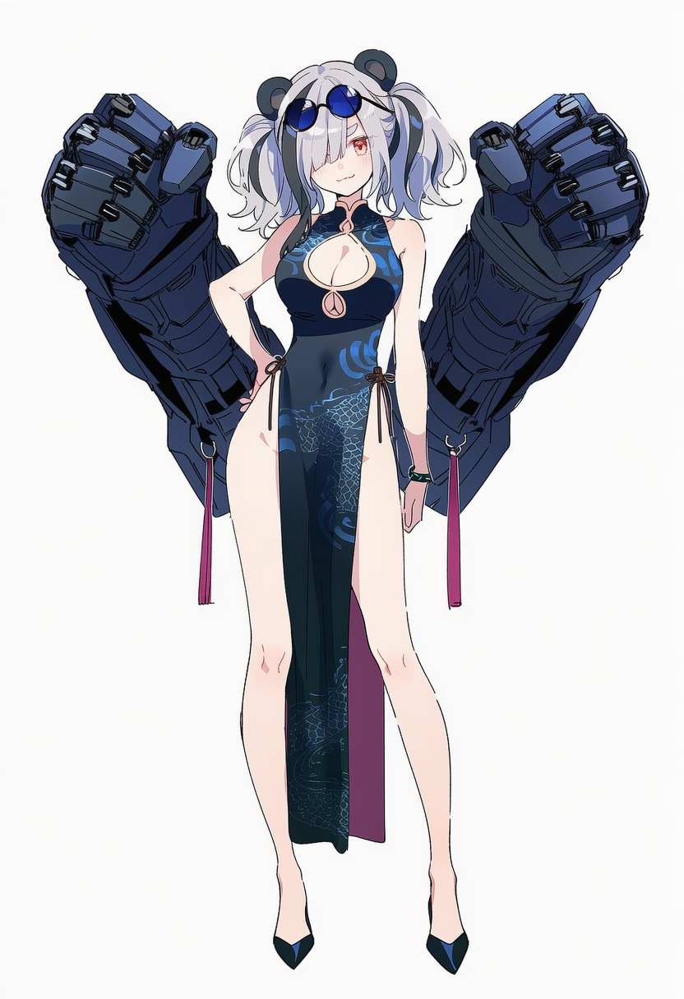

[在线例图](https://assets.quicktagcloud.com/images/raven_composition/raven_composition-0231.jpg?v=deae136b672f13f8)

<a id="raven_composition-0232"></a>

## 连帽连衣裙

ID：`raven_composition-0232`；分类：裙子；来源标记：`safe`。

来源说明：

> 带连帽结构的连衣裙。帽子直接连接在裙装上，常见于休闲、幻想或街头风设计。

正向提示词：

```text
hooded_dress
```

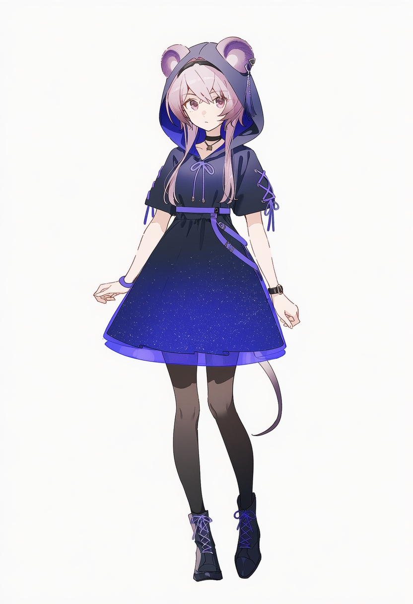

[在线例图](https://assets.quicktagcloud.com/images/raven_composition/raven_composition-0232.jpg?v=f3ccf1946a632902)

<a id="raven_composition-0233"></a>

## 乳胶连衣裙

ID：`raven_composition-0233`；分类：裙子；来源标记：`safe`。

来源说明：

> 由乳胶、橡胶感亮面材质制成的连衣裙，通常紧贴身体并具有高反光、光滑表面。

正向提示词：

```text
latex_dress
```

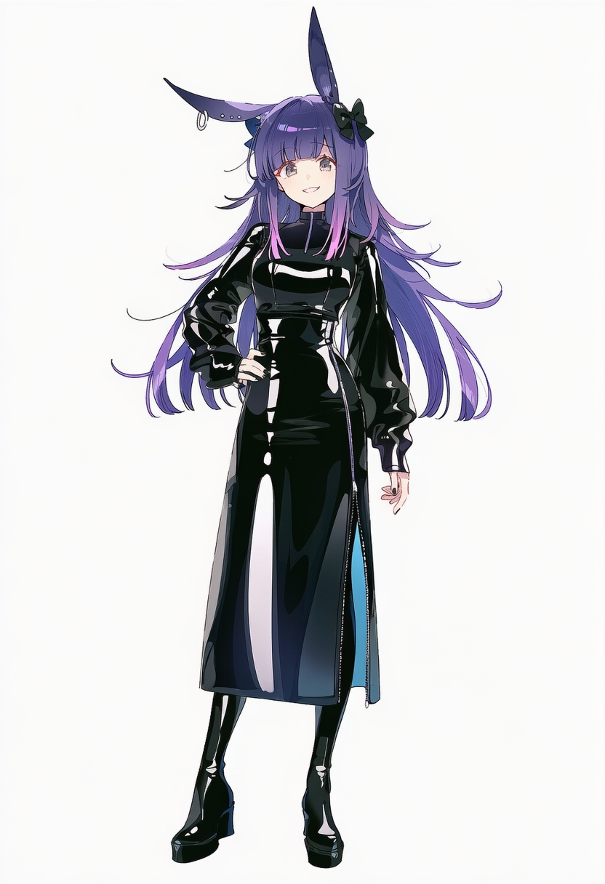

[在线例图](https://assets.quicktagcloud.com/images/raven_composition/raven_composition-0233.jpg?v=e1036d38643f02c1)

<a id="raven_composition-0234"></a>

## 层叠连衣裙

ID：`raven_composition-0234`；分类：裙子；来源标记：`safe`。

来源说明：

> 由多个明显独立层次组成的连衣裙，例如多层裙摆、罩层或叠穿式结构。重点是可辨认的层叠，而不只是普通褶皱。

正向提示词：

```text
layered_dress
```

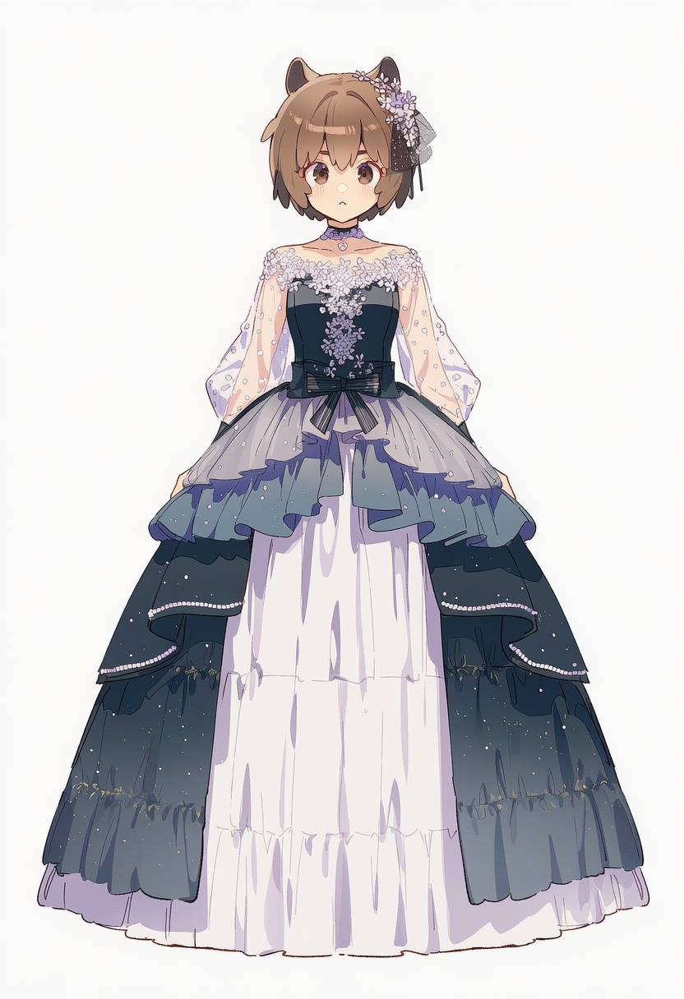

[在线例图](https://assets.quicktagcloud.com/images/raven_composition/raven_composition-0234.jpg?v=da40140e67176f41)

<a id="raven_composition-0235"></a>

## O形环装饰连衣裙

ID：`raven_composition-0235`；分类：裙子；来源标记：`safe`。

来源说明：

> 使用 O 形金属环作为关键连接或装饰部件的连衣裙，常把肩带、胸部、腰部或侧带通过圆环连接起来。

正向提示词：

```text
o-ring_dress
```

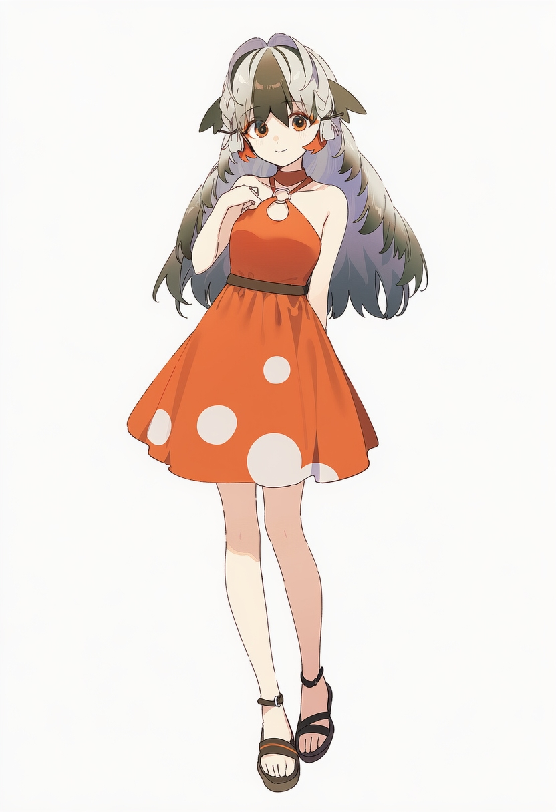

[在线例图](https://assets.quicktagcloud.com/images/raven_composition/raven_composition-0235.jpg?v=ec1734797ddcf4a2)

<a id="raven_composition-0236"></a>

## 背心裙/围裙式连衣裙

ID：`raven_composition-0236`；分类：裙子；来源标记：`safe`。

来源说明：

> 背心裙/围裙式连衣裙，通常无袖并设计为穿在衬衫或上衣外面。常见宽肩带、胸前片和完整裙摆。

正向提示词：

```text
pinafore_dress
```


[在线例图](https://assets.quicktagcloud.com/images/raven_composition/raven_composition-0236.jpg?v=1533108999e5d29e)

<a id="raven_composition-0237"></a>

## 百褶连衣裙

ID：`raven_composition-0237`；分类：裙子；来源标记：`safe`。

来源说明：

> 裙摆或衣身带规则压褶的连衣裙，褶线整齐重复，形成百褶式结构。与单纯荷叶边 frilled_dress 不同。

正向提示词：

```text
pleated_dress
```


[在线例图](https://assets.quicktagcloud.com/images/raven_composition/raven_composition-0237.jpg?v=c77ad764f35d6a57)

<a id="raven_composition-0238"></a>

## Polo 连衣裙

ID：`raven_composition-0238`；分类：裙子；来源标记：`safe`。

来源说明：

> 采用 Polo 衫元素的连衣裙，通常有翻领、短开襟和较运动休闲的上身，同时下方延伸为裙摆。

正向提示词：

```text
polo_dress
```


[在线例图](https://assets.quicktagcloud.com/images/raven_composition/raven_composition-0238.jpg?v=fd0d32546d5837a2)

<a id="raven_composition-0239"></a>

## 蓬蓬连衣裙

ID：`raven_composition-0239`；分类：裙子；来源标记：`safe`。

来源说明：

> 整体具有明显膨胀、蓬松体积感的连衣裙，常依靠多层面料、填充或夸张裙撑形成圆润轮廓。

正向提示词：

```text
puffy_dress
```


[在线例图](https://assets.quicktagcloud.com/images/raven_composition/raven_composition-0239.jpg?v=77c3d984924f6dbd)

<a id="raven_composition-0240"></a>

## 罗纹连衣裙

ID：`raven_composition-0240`；分类：裙子；来源标记：`safe`。

来源说明：

> 使用罗纹针织/纵向凸棱纹理面料的连衣裙，常见于毛衣裙、贴身针织裙等。

正向提示词：

```text
ribbed_dress
```


[在线例图](https://assets.quicktagcloud.com/images/raven_composition/raven_composition-0240.jpg?v=a18697cc20d5d41a)

<a id="raven_composition-0241"></a>

## 水手风连衣裙

ID：`raven_composition-0241`；分类：裙子；来源标记：`safe`。

来源说明：

> 把水手服元素做成一件式连衣裙，通常具有水手领、领巾等特征。它不是上衣和半身裙分开的 serafuku。

正向提示词：

```text
sailor_dress
```


[在线例图](https://assets.quicktagcloud.com/images/raven_composition/raven_composition-0241.jpg?v=b16b67c40fed3e64)

<a id="raven_composition-0242"></a>

## 圣诞老人风连衣裙

ID：`raven_composition-0242`；分类：裙子；来源标记：`safe`。

来源说明：

> 以圣诞老人服装为灵感的连衣裙，常见红白配色、毛绒饰边、帽子等圣诞元素；这里强调款式主题而不是颜色本身。

正向提示词：

```text
santa_dress
```


[在线例图](https://assets.quicktagcloud.com/images/raven_composition/raven_composition-0242.jpg?v=79ee80daf244cebc)

<a id="raven_composition-0243"></a>

## 透视连衣裙

ID：`raven_composition-0243`；分类：裙子；来源标记：`safe`。

来源说明：

> 材质具有明显透明/半透明效果的连衣裙，可透见皮肤或内层衣物。透明程度应是显著设计特征。

正向提示词：

```text
see-through_dress
```


[在线例图](https://assets.quicktagcloud.com/images/raven_composition/raven_composition-0243.jpg?v=511f1ff3ec3825e5)

<a id="raven_composition-0244"></a>

## 侧面镂空连衣裙

ID：`raven_composition-0244`；分类：裙子；来源标记：`safe`。

来源说明：

> 连衣裙两侧大面积敞开或镂空，从腋下到腰胯区域能看到侧身皮肤。重点是“侧面开放”，与露背不同。

正向提示词：

```text
sideless_dress
```


[在线例图](https://assets.quicktagcloud.com/images/raven_composition/raven_composition-0244.jpg?v=908986506caf01df)

<a id="raven_composition-0245"></a>

## 单肩连衣裙

ID：`raven_composition-0245`；分类：裙子；来源标记：`safe`。

来源说明：

> 单肩连衣裙，仅一侧肩部有肩带、袖子或衣料支撑，另一侧肩部裸露，形成明显的不对称领肩结构。

正向提示词：

```text
single-shoulder_dress
```


[在线例图](https://assets.quicktagcloud.com/images/raven_composition/raven_composition-0245.jpg?v=f1c74df2a040b0f8)

<a id="raven_composition-0246"></a>

## 夏日轻便连衣裙

ID：`raven_composition-0246`；分类：裙子；来源标记：`safe`。

来源说明：

> 轻薄、休闲、适合温暖天气的夏季连衣裙，常见细肩带、露肩、轻质面料和宽松裙摆。

正向提示词：

```text
sundress
```


[在线例图](https://assets.quicktagcloud.com/images/raven_composition/raven_composition-0246.jpg?v=44dbd5ff7b331bde)

<a id="raven_composition-0247"></a>

## 毛衣连衣裙

ID：`raven_composition-0247`；分类：裙子；来源标记：`safe`。

来源说明：

> 以毛衣/针织衫结构延长形成的连衣裙，通常采用针织面料，可贴身也可宽松，适合秋冬穿着。

正向提示词：

```text
sweater_dress
```


[在线例图](https://assets.quicktagcloud.com/images/raven_composition/raven_composition-0247.jpg?v=dcc709986f87c278)

<a id="raven_composition-0248"></a>

## 网球连衣裙

ID：`raven_composition-0248`；分类：裙子；来源标记：`safe`。

来源说明：

> 网球运动常见的一件式裙装，上身多为运动背心/POLO式结构，下身连接短裙摆，强调运动功能性。

正向提示词：

```text
tennis_dress
```


[在线例图](https://assets.quicktagcloud.com/images/raven_composition/raven_composition-0248.jpg?v=9c0d00404a8cb48c)

<a id="raven_composition-0249"></a>

## 帐篷廓形连衣裙

ID：`raven_composition-0249`；分类：裙子；来源标记：`safe`。

来源说明：

> 从肩部或胸部向下大幅放宽、几乎不收腰的帐篷廓形连衣裙，整体呈宽松 A 形或锥形。

正向提示词：

```text
tent_dress
```


[在线例图](https://assets.quicktagcloud.com/images/raven_composition/raven_composition-0249.jpg?v=c1a0e1f10c1b0179)

<a id="raven_composition-0250"></a>

## 梯形/伞形连衣裙

ID：`raven_composition-0250`；分类：裙子；来源标记：`safe`。

来源说明：

> 梯形/伞形连衣裙，上窄下宽且腰线不明显，通常从肩部自然向外展开；比 tent_dress 一般更规整、结构化。

正向提示词：

```text
trapeze_dress
```


[在线例图](https://assets.quicktagcloud.com/images/raven_composition/raven_composition-0250.jpg?v=e3cf7e258e50443a)

<a id="raven_composition-0251"></a>

## 拉链连衣裙

ID：`raven_composition-0251`；分类：裙子；来源标记：`safe`。

来源说明：

> 拉链是明显可见设计元素的连衣裙，例如前中、侧面或大幅外露拉链。若拉链只是普通隐藏式闭合，不一定需要使用。

正向提示词：

```text
zipper_dress
```


[在线例图](https://assets.quicktagcloud.com/images/raven_composition/raven_composition-0251.jpg?v=b4ecdc57bc64d7e2)

<a id="raven_composition-0252"></a>

## 鸡尾酒礼服

ID：`raven_composition-0252`；分类：裙子；来源标记：`safe`。

来源说明：

> 半正式社交场合使用的鸡尾酒礼服，通常比晚礼服更短、更轻便，适合宴会、酒会等但不强调拖地隆重感。

正向提示词：

```text
cocktail_dress
```


[在线例图](https://assets.quicktagcloud.com/images/raven_composition/raven_composition-0252.jpg?v=63b7ccef90dc74af)

<a id="raven_composition-0253"></a>

## 晚礼服

ID：`raven_composition-0253`；分类：裙子；来源标记：`safe`。

来源说明：

> 正式晚宴、舞会等场合使用的长款晚礼服，通常比普通 dress 更华丽、正式，常见长裙摆、精致面料和礼服剪裁。

正向提示词：

```text
evening_gown
```


[在线例图](https://assets.quicktagcloud.com/images/raven_composition/raven_composition-0253.jpg?v=f0221c7d8f22053f)

<a id="raven_composition-0254"></a>

## 弗拉门戈裙装

ID：`raven_composition-0254`；分类：裙子；来源标记：`safe`。

来源说明：

> 西班牙弗拉门戈舞蹈/安达卢西亚传统风格裙装，常见修身上身、大量荷叶边、层叠裙摆以及鲜明舞台感。

正向提示词：

```text
flamenco_dress
```


[在线例图](https://assets.quicktagcloud.com/images/raven_composition/raven_composition-0254.jpg?v=0c174414d886d189)

<a id="raven_composition-0255"></a>

## 葬礼礼服

ID：`raven_composition-0255`；分类：裙子；来源标记：`safe`。

来源说明：

> 用于葬礼、悼念等正式哀悼场合的连衣裙，通常剪裁保守、庄重；标签重点是服装用途与场合。

正向提示词：

```text
funeral_dress
```


[在线例图](https://assets.quicktagcloud.com/images/raven_composition/raven_composition-0255.jpg?v=e437c003dd1adedc)

<a id="raven_composition-0256"></a>

## 礼服长裙

ID：`raven_composition-0256`；分类：裙子；来源标记：`safe`。

来源说明：

> 泛指正式、华丽、通常较长的礼服裙装，范围比 evening_gown 更宽，也可用于舞会、宫廷或典礼式长礼服。

正向提示词：

```text
gown
```


[在线例图](https://assets.quicktagcloud.com/images/raven_composition/raven_composition-0256.jpg?v=a84429a5d01b7cc2)

<a id="raven_composition-0257"></a>

## 窄摆束步裙装

ID：`raven_composition-0257`；分类：裙子；来源标记：`safe`。

来源说明：

> 束步式长裙装，裙摆在膝下或脚踝附近非常窄，限制步幅，形成历史上“hobble”式的紧窄下摆。

正向提示词：

```text
hobble_dress
```


[在线例图](https://assets.quicktagcloud.com/images/raven_composition/raven_composition-0257.jpg?v=39c01a224c924c00)

<a id="raven_composition-0258"></a>

## 鱼尾礼服

ID：`raven_composition-0258`；分类：裙子；来源标记：`safe`。

来源说明：

> 鱼尾轮廓礼服，上身和臀腿处贴身，在膝部或小腿以下突然向外展开，形成类似美人鱼尾巴的裙摆。

正向提示词：

```text
mermaid_dress
```


[在线例图](https://assets.quicktagcloud.com/images/raven_composition/raven_composition-0258.jpg?v=20986fa481827a93)

<a id="raven_composition-0259"></a>

## 婚纱

ID：`raven_composition-0259`；分类：裙子；来源标记：`safe`。

来源说明：

> 婚礼中新娘穿着的西式婚纱/礼服，常见白色、长裙摆、蕾丝、头纱等，但核心是“作为婚礼新娘礼服”。

正向提示词：

```text
wedding_dress
```


[在线例图](https://assets.quicktagcloud.com/images/raven_composition/raven_composition-0259.jpg?v=d93c42893670c36e)

<a id="raven_composition-0260"></a>

## 奥黛

ID：`raven_composition-0260`；分类：裙子；来源标记：`safe`。

来源说明：

> 越南奥黛：贴身长上衣两侧高开衩，通常搭配长裤。它在 Danbooru 的 dress 体系中作为传统服装相关 tag，但结构不同于典型西式连衣裙。

正向提示词：

```text
ao_dai
```


[在线例图](https://assets.quicktagcloud.com/images/raven_composition/raven_composition-0260.jpg?v=98e4ef5f47facd41)

<a id="raven_composition-0261"></a>

## 迪恩德尔裙装

ID：`raven_composition-0261`；分类：裙子；来源标记：`safe`。

来源说明：

> 德语区传统女装，典型由紧身胸衣/上衣、衬衫、宽摆裙和围裙组成。它是整套传统服装概念，不应只理解为单一西式 dress。

正向提示词：

```text
dirndl
```


[在线例图](https://assets.quicktagcloud.com/images/raven_composition/raven_composition-0261.jpg?v=e815e877abea231a)

<a id="raven_composition-0262"></a>

## 和服风连衣裙

ID：`raven_composition-0262`；分类：裙子；来源标记：`safe`。

来源说明：

> 借用和服领型、腰带、袖型或纹样，但整体裁剪成西式一件式连衣裙的混合款式；与真正的 kimono 区分。

正向提示词：

```text
kimono_dress
```


[在线例图](https://assets.quicktagcloud.com/images/raven_composition/raven_composition-0262.jpg?v=f6550e09ed510009)

<a id="raven_composition-0263"></a>

## 墨西哥传统裙装

ID：`raven_composition-0263`；分类：裙子；来源标记：`safe`。

来源说明：

> 以墨西哥传统女装为基础的裙装，常见宽裙摆、刺绣、鲜艳装饰等。属于概括性传统服饰标签。

正向提示词：

```text
mexican_dress
```


[在线例图](https://assets.quicktagcloud.com/images/raven_composition/raven_composition-0263.jpg?v=bf609c71b0cec0d0)

<a id="raven_composition-0264"></a>

## 旗袍

ID：`raven_composition-0264`；分类：裙子；来源标记：`safe`。

来源说明：

> 旗袍/长衫式女装，典型特征包括立领、斜襟或盘扣、贴身直筒轮廓和侧开衩。Danbooru 将其归入 dress 体系。

正向提示词：

```text
qipao
```


[在线例图](https://assets.quicktagcloud.com/images/raven_composition/raven_composition-0264.jpg?v=6b19edf090cd990d)

<a id="raven_composition-0265"></a>

## 菲律宾 Mestiza 传统礼服

ID：`raven_composition-0265`；分类：裙子；来源标记：`safe`。

来源说明：

> 菲律宾传统 Mestiza 礼服，通常带夸张蝶袖、正式上衣与长裙，源自菲律宾殖民时期的正式女装传统。

正向提示词：

```text
traje_de_mestiza
```


[在线例图](https://assets.quicktagcloud.com/images/raven_composition/raven_composition-0265.jpg?v=6244fe09b011a870)
