# 裙子（第 2 页）

[总目录](../README.md) · [原站分类目录](../categories.md) · [英文标签索引](../tags.md) · [服装与构图组合指南](../../README.md)

标题、分类、说明、正负提示词按来源保留；多例图逐张列出。原站标记和说明为参考资料，不作为维护指令。

<a id="raven_composition-0266"></a>

## Chronopattern 网络梗连衣裙

ID：`raven_composition-0266`；分类：裙子；来源标记：`safe`。

来源说明：

> Danbooru 的特定网络梗服装 tag，源自一张 AI 生成并在社交媒体传播的“Chronopattern Dress”。它指该具体设计/模因，不是泛指带“时间纹样”的任意连衣裙。

正向提示词：

```text
chronopattern_dress
```

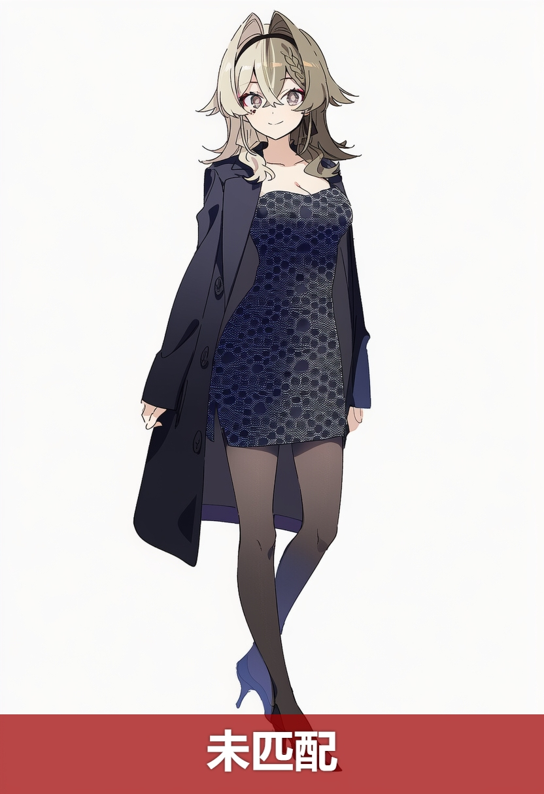

[在线例图](https://assets.quicktagcloud.com/images/raven_composition/raven_composition-0266.jpg?v=2461e555dab8b266)

<a id="raven_composition-0267"></a>

## Daphne 网络梗鸡尾酒裙

ID：`raven_composition-0267`；分类：裙子；来源标记：`safe`。

来源说明：

> Danbooru 的网络梗服装 tag，指创作者 Babie Fluff 推广的一款较暴露的鸡尾酒裙设计。仅用于复刻/引用该特定款式，不代表所有性感鸡尾酒裙。

正向提示词：

```text
daphne_dress
```

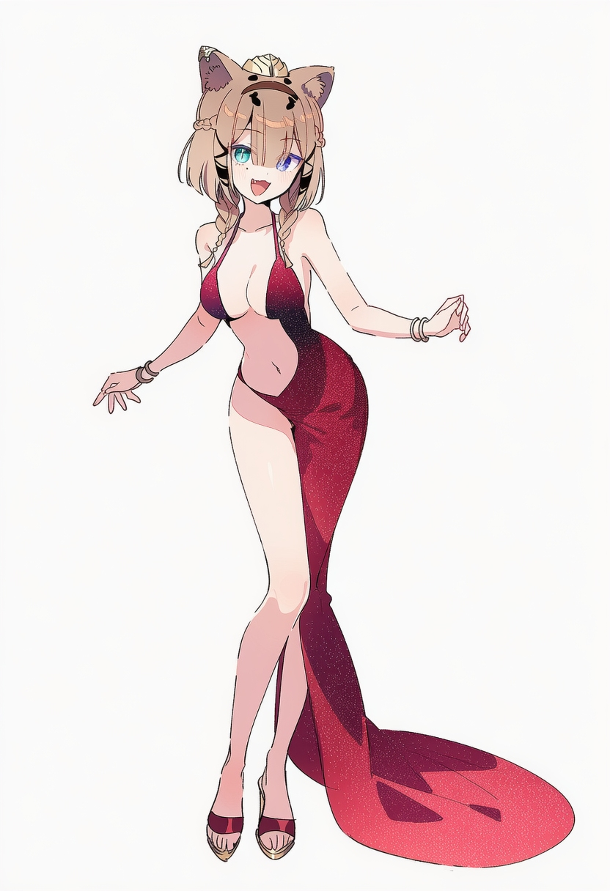

[在线例图](https://assets.quicktagcloud.com/images/raven_composition/raven_composition-0267.jpg?v=aaa720c77d0a90f4)

<a id="raven_composition-0268"></a>

## 东滩风紧身连衣裙

ID：`raven_composition-0268`；分类：裙子；来源标记：`safe`。

来源说明：

> 网络流行的“东滩风”紧身裙造型，通常强调成熟、贴身、曲线感和韩国都市时尚印象。属于特定网络审美/模因式款型，而非标准服装学分类。

正向提示词：

```text
dongtan_dress
```

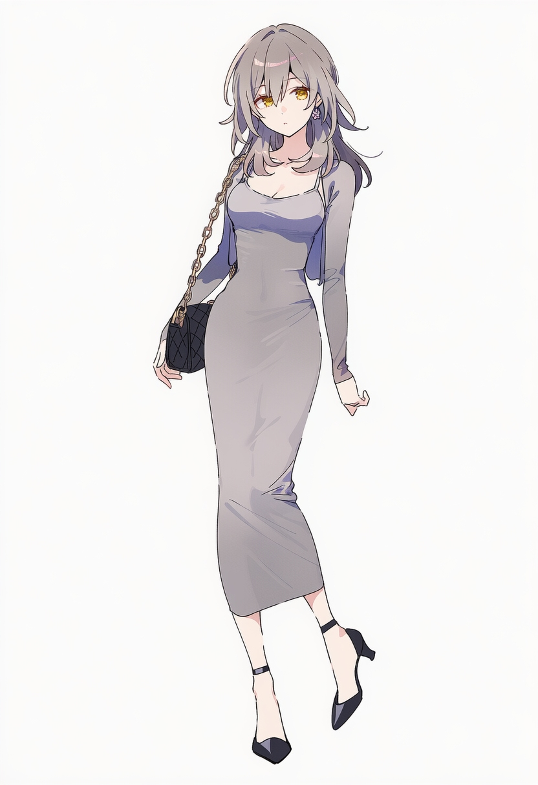

[在线例图](https://assets.quicktagcloud.com/images/raven_composition/raven_composition-0268.jpg?v=98d075b8a0edeaba)

<a id="raven_composition-0269"></a>

## Katlyne 网络梗金色礼服

ID：`raven_composition-0269`；分类：裙子；来源标记：`safe`。

来源说明：

> 2024 年在网络上流行的特定金色不对称礼服设计，因角色换装绘图潮流而形成专名 tag。应仅用于明显复刻该款式的图像。

正向提示词：

```text
katlyne_dress
```

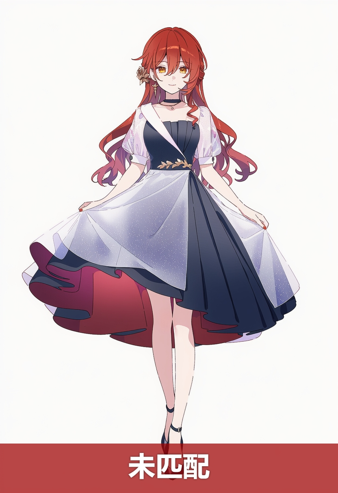

[在线例图](https://assets.quicktagcloud.com/images/raven_composition/raven_composition-0269.jpg?v=b2e299e69b143a32)

<a id="raven_composition-0270"></a>

## Lirika Matoshi 草莓裙

ID：`raven_composition-0270`；分类：裙子；来源标记：`safe`。

来源说明：

> 设计师 Lirika Matoshi 的著名草莓裙：轻薄蓬松的粉色薄纱/网纱礼服，上面布满草莓装饰/刺绣。Danbooru 用该 tag 指这件具体名款及其明显复刻。

正向提示词：

```text
lirika_matoshi_strawberry_dress
```

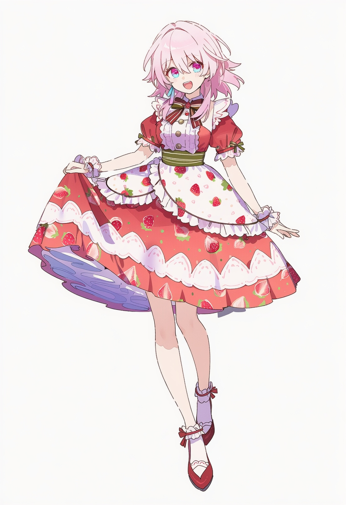

[在线例图](https://assets.quicktagcloud.com/images/raven_composition/raven_composition-0270.jpg?v=34eb34e984a878ec)

<a id="raven_composition-0271"></a>

## Miyan 旗袍梗款

ID：`raven_composition-0271`；分类：裙子；来源标记：`safe`。

来源说明：

> 以网络传播的特定 Miyan 旗袍/中式紧身裙设计为对象的专名 tag。它用于识别该具体款式，而不是所有 qipao。

正向提示词：

```text
miyan's_cheongsam
```

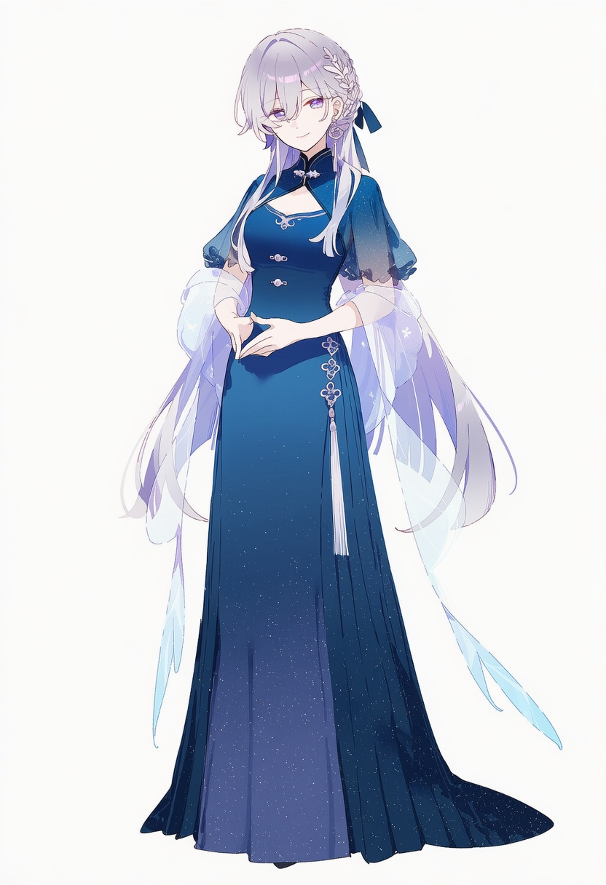

[在线例图](https://assets.quicktagcloud.com/images/raven_composition/raven_composition-0271.jpg?v=ddd38e251baba92e)

<a id="raven_composition-0272"></a>

## Modakawa 镂空链饰鱼尾裙

ID：`raven_composition-0272`；分类：裙子；来源标记：`safe`。

来源说明：

> 因网络角色换装潮流走红的一款 Modakawa 裙装，特点包括挂脖、露背、O 形环、大量细带、髋部镂空和金色链饰，并带鱼尾感。属于特定商品/模因款式。

正向提示词：

```text
modakawa_dress
```

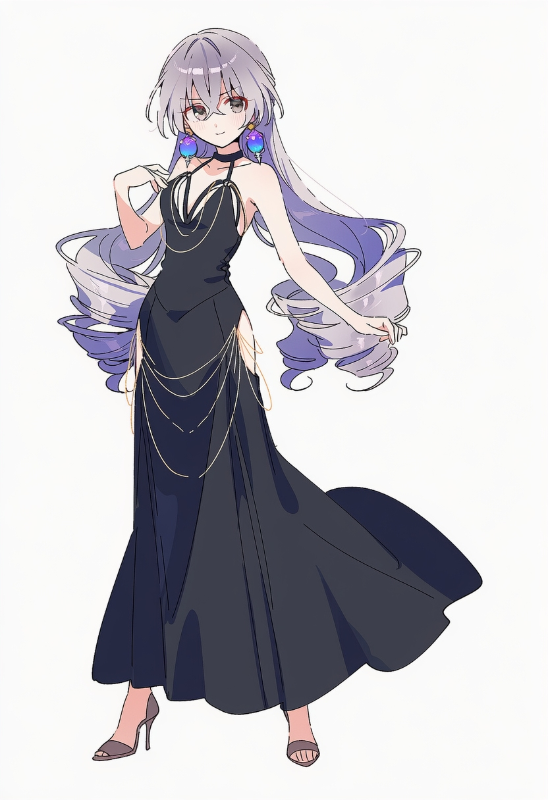

[在线例图](https://assets.quicktagcloud.com/images/raven_composition/raven_composition-0272.jpg?v=15d7e657e0a45e21)

<a id="raven_composition-0273"></a>

## Paciane 网络流行裙装

ID：`raven_composition-0273`；分类：裙子；来源标记：`safe`。

来源说明：

> Danbooru 的特定网络流行裙装专名 tag，用于某一被大量角色换装二创复刻的固定设计。它不是通用服装类别；只有造型能明确对应原款时才适用。

正向提示词：

```text
paciane_dress
```

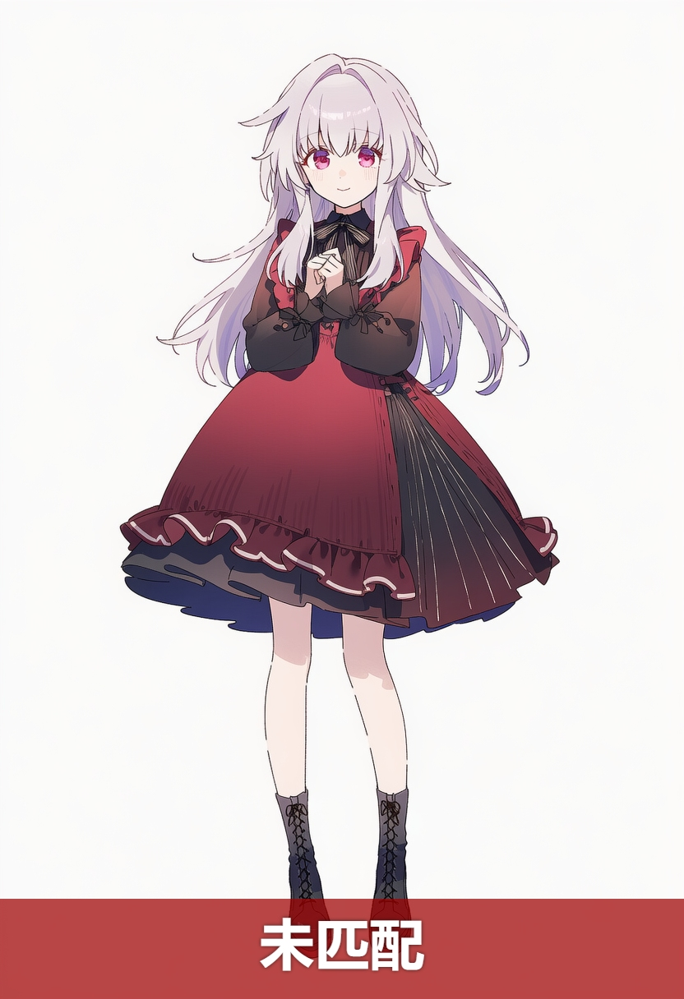

[在线例图](https://assets.quicktagcloud.com/images/raven_composition/raven_composition-0273.jpg?v=c659a95e9e389812)

<a id="raven_composition-0274"></a>

## 透视中式娃娃裙

ID：`raven_composition-0274`；分类：裙子；来源标记：`safe`。

来源说明：

> 把中式/旗袍式元素与透明 babydoll 内衣结合的特定网络流行设计，通常强调立领、盘扣感与薄纱透视。属于专名/模因式款型。

正向提示词：

```text
see-through_china_babydoll
```

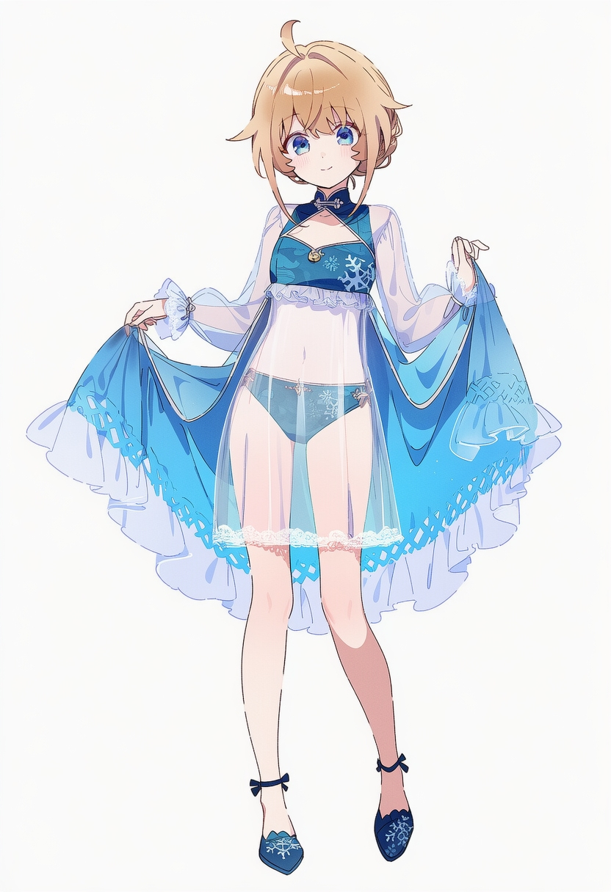

[在线例图](https://assets.quicktagcloud.com/images/raven_composition/raven_composition-0274.jpg?v=e59f12ac1f74908a)

<a id="raven_composition-0275"></a>

## “蓝黑/白金裙”网络梗

ID：`raven_composition-0275`；分类：裙子；来源标记：`safe`。

来源说明：

> 2015 年著名“蓝黑还是白金？”照片中的那条连衣裙及相关再现/模因。这个 tag 指网络事件中的特定裙子，不是泛指普通 dress。

正向提示词：

```text
the_dress
```

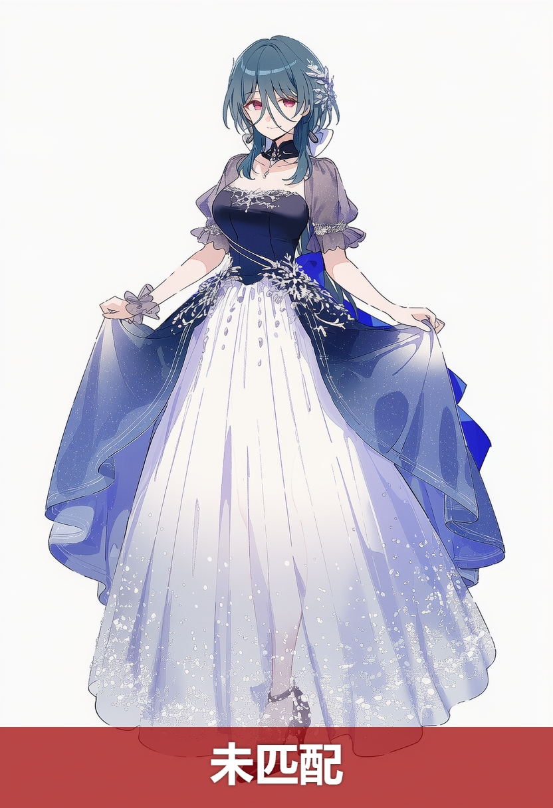

[在线例图](https://assets.quicktagcloud.com/images/raven_composition/raven_composition-0275.jpg?v=861cd82a2362a027)

<a id="raven_composition-0276"></a>

## 连衣裙蝴蝶结

ID：`raven_composition-0276`；分类：裙子；来源标记：`safe`。

来源说明：

> 蝴蝶结直接装饰在连衣裙本体上，例如胸前、腰间或裙摆上的蝴蝶结。描述装饰位置，不等同于头饰或发饰蝴蝶结。

正向提示词：

```text
dress_bow
```

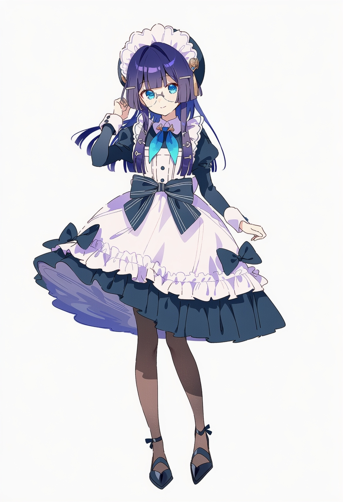

[在线例图](https://assets.quicktagcloud.com/images/raven_composition/raven_composition-0276.jpg?v=6b2b0580fa10b946)

<a id="raven_composition-0277"></a>

## 连衣裙花饰

ID：`raven_composition-0277`；分类：裙子；来源标记：`safe`。

来源说明：

> 花朵造型装饰直接固定在连衣裙上，可能是布花、胸花或裙摆花饰。重点是“裙装上的花饰”。

正向提示词：

```text
dress_flower
```

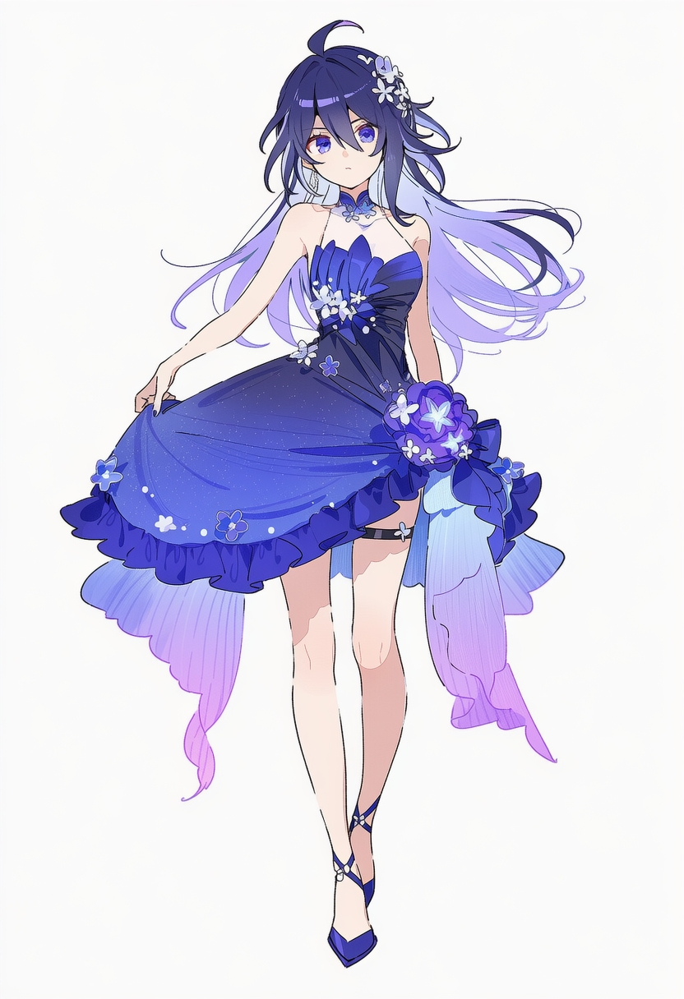

[在线例图](https://assets.quicktagcloud.com/images/raven_composition/raven_composition-0277.jpg?v=e2c5518152b51f94)

<a id="raven_composition-0278"></a>

## 连衣裙缎带

ID：`raven_composition-0278`；分类：裙子；来源标记：`safe`。

来源说明：

> 缎带作为连衣裙本体的明显装饰元素，例如腰带式丝带、垂带或装饰带。

正向提示词：

```text
dress_ribbon
```

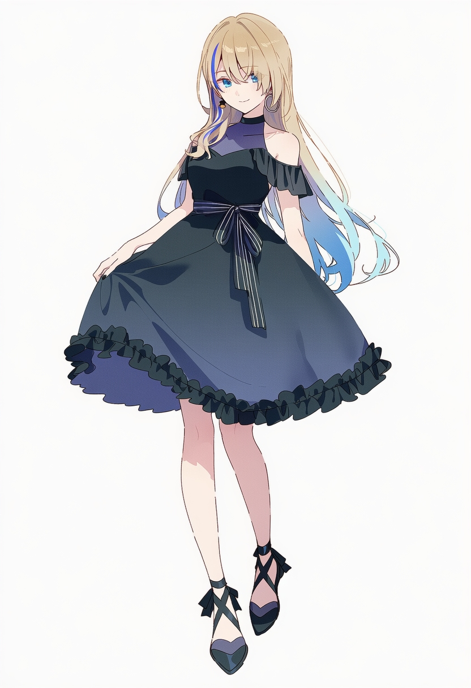

[在线例图](https://assets.quicktagcloud.com/images/raven_composition/raven_composition-0278.jpg?v=293cdc4ec5c5c8cd)

<a id="raven_composition-0279"></a>

## 连衣裙下穿长裤

ID：`raven_composition-0279`；分类：裙子；来源标记：`safe`。

来源说明：

> 角色在连衣裙里面/下面另穿一条长裤，形成 dress + pants 的叠穿搭配。

正向提示词：

```text
pants_under_dress
```

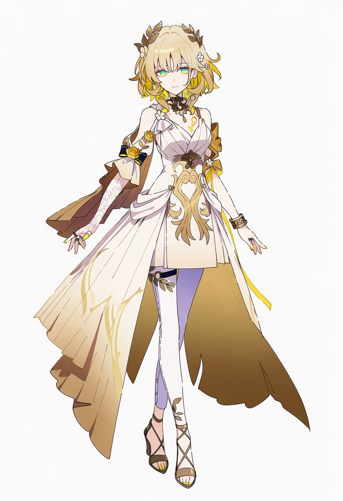

[在线例图](https://assets.quicktagcloud.com/images/raven_composition/raven_composition-0279.jpg?v=4c14034d2ed3475e)

<a id="raven_composition-0280"></a>

## 连衣裙下穿短裤

ID：`raven_composition-0280`；分类：裙子；来源标记：`safe`。

来源说明：

> 角色在连衣裙下另穿短裤，通常用于防走光、运动或层次穿搭。它描述搭配关系，不是裙子款式。

正向提示词：

```text
shorts_under_dress
```

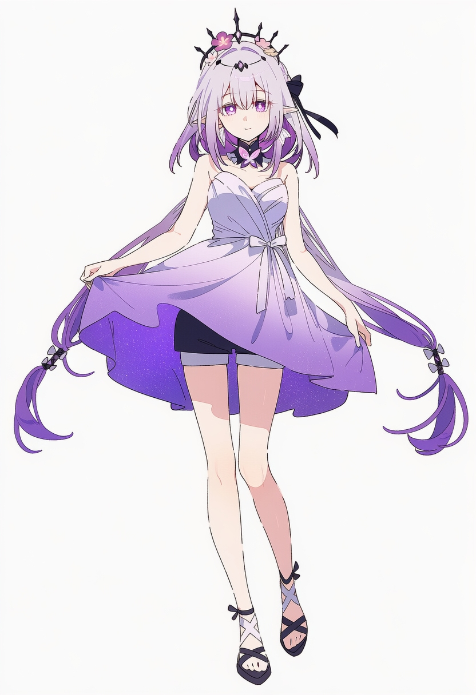

[在线例图](https://assets.quicktagcloud.com/images/raven_composition/raven_composition-0280.jpg?v=c4957c4880549eec)

<a id="raven_composition-0281"></a>

## 连衣裙下另穿半身裙

ID：`raven_composition-0281`；分类：裙子；来源标记：`safe`。

来源说明：

> 在连衣裙下方还能看到另一条独立半身裙，形成裙装叠穿。用于明确存在两件不同裙装的情况。

正向提示词：

```text
skirt_under_dress
```

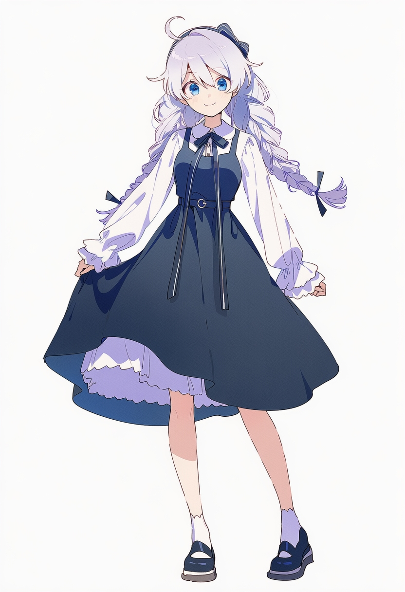

[在线例图](https://assets.quicktagcloud.com/images/raven_composition/raven_composition-0281.jpg?v=09ba19cf7e938bb2)

<a id="raven_composition-0282"></a>

## 薄透睡袍/性感睡裙

ID：`raven_composition-0282`；分类：裙子；来源标记：`safe`。

来源说明：

> 轻薄、柔软、常带蕾丝或半透明材质的女性睡衣/家居内衣，通常比普通 nightgown 更强调性感、轻盈和装饰性。

正向提示词：

```text
negligee
```

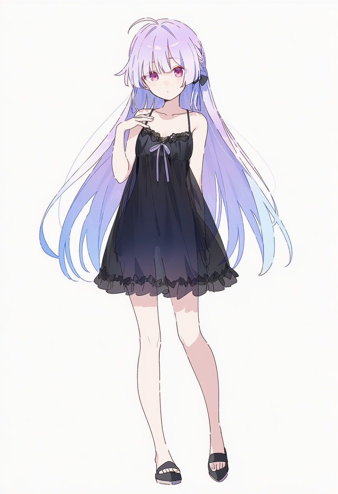

[在线例图](https://assets.quicktagcloud.com/images/raven_composition/raven_composition-0282.jpg?v=7851df2bc8dce42f)

<a id="raven_composition-0283"></a>

## 睡裙

ID：`raven_composition-0283`；分类：裙子；来源标记：`safe`。

来源说明：

> 夜间睡眠穿着的长或中长睡裙，通常宽松、柔软、强调舒适。它属于睡衣体系，不等同于正式 dress。

正向提示词：

```text
nightgown
```

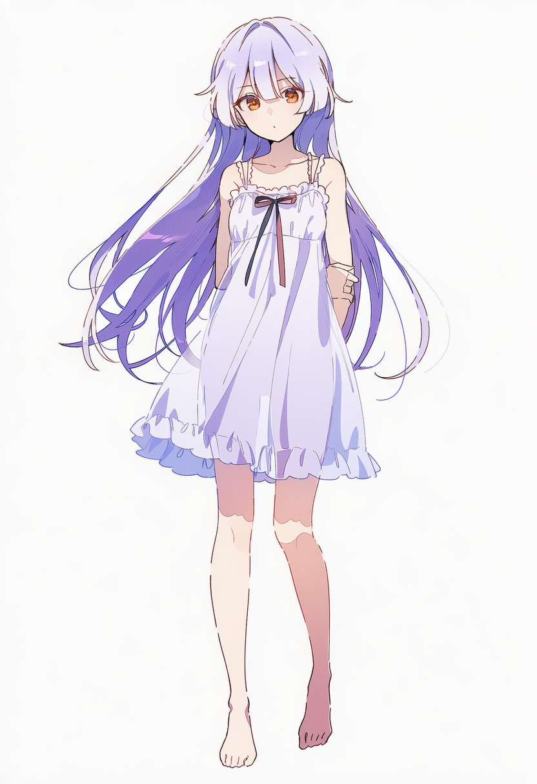

[在线例图](https://assets.quicktagcloud.com/images/raven_composition/raven_composition-0283.jpg?v=0c91b61723d095ac)

<a id="raven_composition-0284"></a>

## 半身裙

ID：`raven_composition-0284`；分类：裙子；来源标记：`safe`。

来源说明：

> 与上衣分开的半身裙，只覆盖腰部以下。Danbooru 中 skirt 与 dress 是互斥的基本概念：如果上身和裙摆连成一件，应标 dress。

正向提示词：

```text
skirt
```

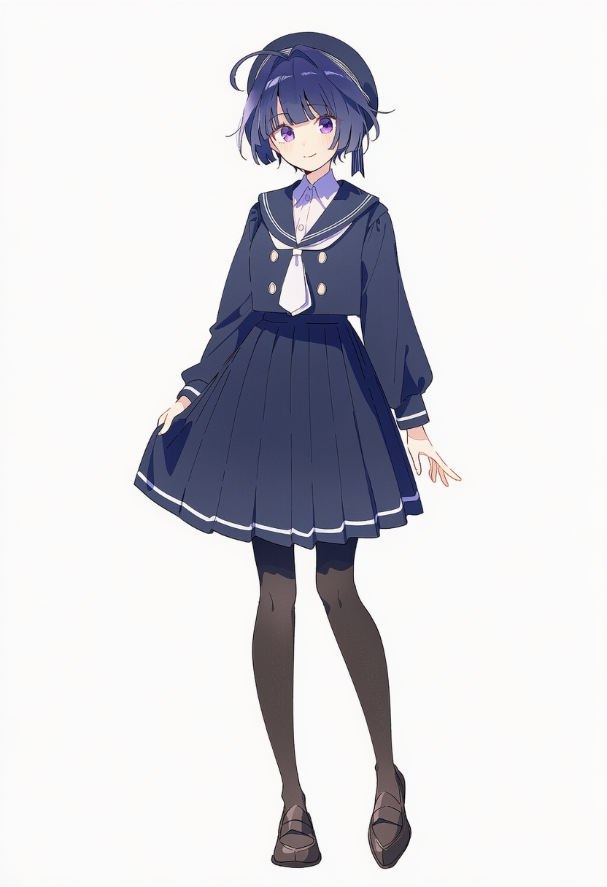

[在线例图](https://assets.quicktagcloud.com/images/raven_composition/raven_composition-0284.jpg?v=0c4e3aa44d66cac8)

<a id="raven_composition-0285"></a>

## 未穿着的连衣裙

ID：`raven_composition-0285`；分类：裙子；来源标记：`safe`。

来源说明：

> 画面中存在一件连衣裙，但没有穿在人物身上，例如拿在手里、挂着、放在床上等。它描述“未穿着状态”。

正向提示词：

```text
unworn_dress
```

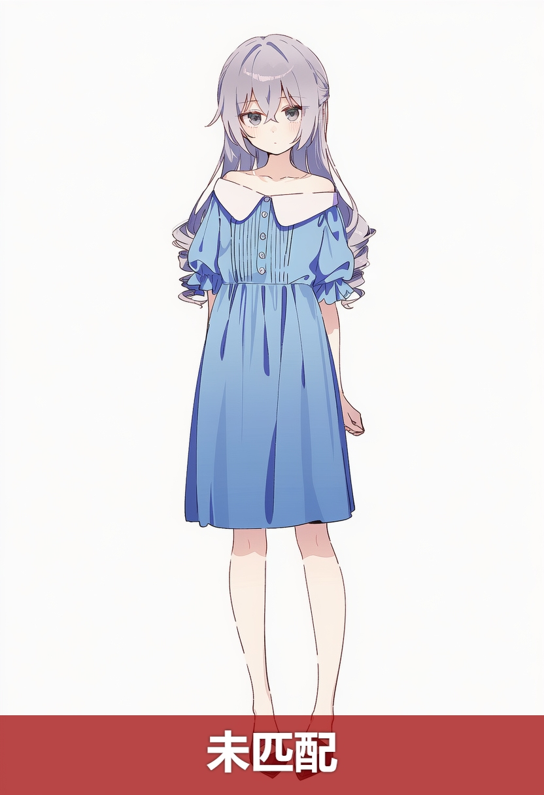

[在线例图](https://assets.quicktagcloud.com/images/raven_composition/raven_composition-0285.jpg?v=1d068d554d2a2780)

<a id="raven_composition-0286"></a>

## 长半身裙

ID：`raven_composition-0286`；分类：裙子；来源标记：`safe`。

来源说明：

> 明显超过膝盖的长半身裙，可到小腿、脚踝甚至地面。只描述裙长，不限定材质或风格。

正向提示词：

```text
long_skirt
```

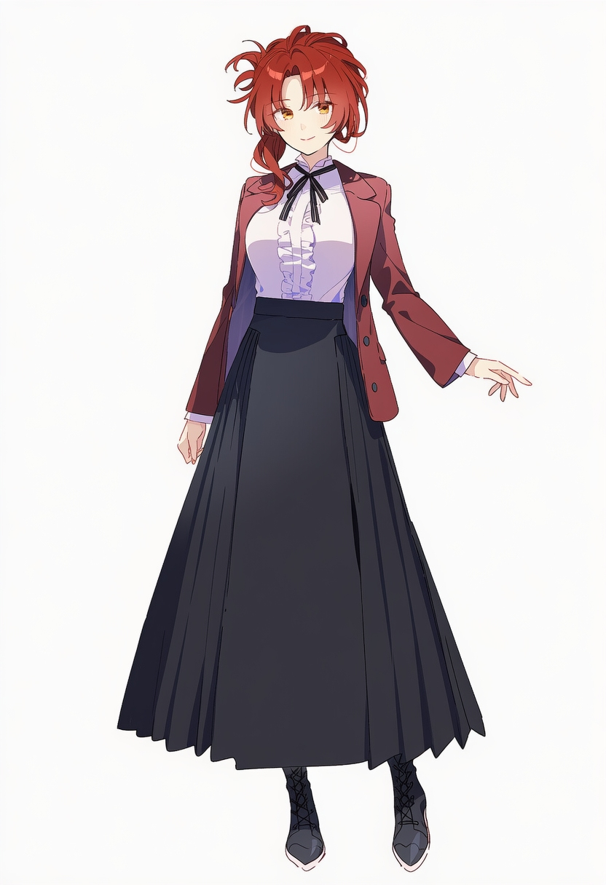

[在线例图](https://assets.quicktagcloud.com/images/raven_composition/raven_composition-0286.jpg?v=e6149132d756a412)

<a id="raven_composition-0287"></a>

## 中长半身裙

ID：`raven_composition-0287`；分类：裙子；来源标记：`safe`。

来源说明：

> 中等长度半身裙，通常在膝盖附近或略上下，介于 miniskirt 和 long_skirt 之间。

正向提示词：

```text
medium_skirt
```

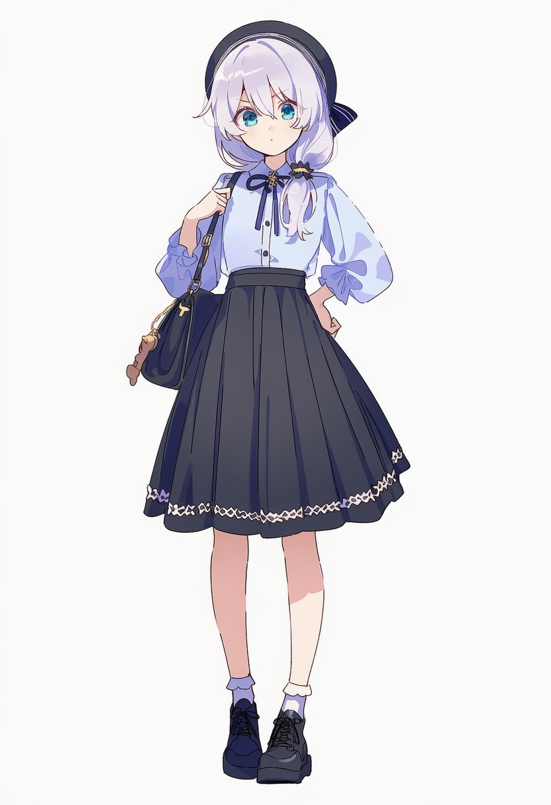

[在线例图](https://assets.quicktagcloud.com/images/raven_composition/raven_composition-0287.jpg?v=ae16f25146b9d4eb)

<a id="raven_composition-0288"></a>

## 超短裙

ID：`raven_composition-0288`；分类：裙子；来源标记：`safe`。

来源说明：

> 极短半身裙，长度比 miniskirt 更短，裙摆接近胯部/臀部下缘，属于极端短裙长度。

正向提示词：

```text
microskirt
```

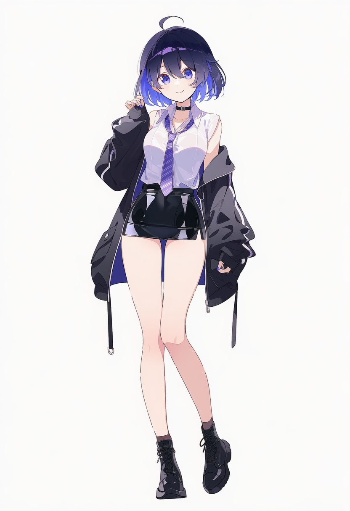

[在线例图](https://assets.quicktagcloud.com/images/raven_composition/raven_composition-0288.jpg?v=ce8aea5e11e1004d)

<a id="raven_composition-0289"></a>

## 迷你裙

ID：`raven_composition-0289`；分类：裙子；来源标记：`safe`。

来源说明：

> 明显高于膝盖的迷你半身裙，通常覆盖到大腿上部或中部，但没有短到 microskirt 的程度。

正向提示词：

```text
miniskirt
```

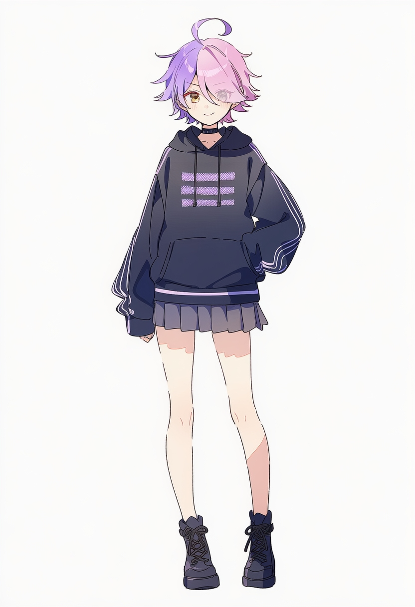

[在线例图](https://assets.quicktagcloud.com/images/raven_composition/raven_composition-0289.jpg?v=197fa4c1ba41f378)

<a id="raven_composition-0290"></a>

## 高腰半身裙

ID：`raven_composition-0290`；分类：裙子；来源标记：`safe`。

来源说明：

> 腰线明显高于自然腰部、常接近肋骨下方的高腰裙。重点是裙腰位置。

正向提示词：

```text
high-waist_skirt
```

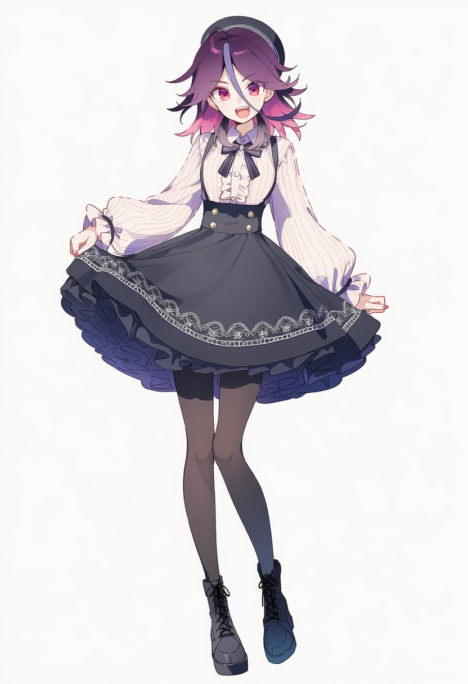

[在线例图](https://assets.quicktagcloud.com/images/raven_composition/raven_composition-0290.jpg?v=85b359693a17e474)

<a id="raven_composition-0291"></a>

## 低腰/低位半身裙

ID：`raven_composition-0291`；分类：裙子；来源标记：`safe`。

来源说明：

> 裙腰/裙体位置被明显拉低，低于正常腰线并向胯部或腿部方向下移的特殊穿着状态/设计。

正向提示词：

```text
lowleg_skirt
```

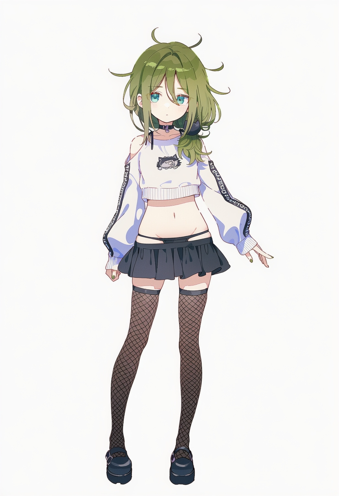

[在线例图](https://assets.quicktagcloud.com/images/raven_composition/raven_composition-0291.jpg?v=f2825545f9bd0784)

<a id="raven_composition-0292"></a>

## 装甲裙

ID：`raven_composition-0292`；分类：裙子；来源标记：`safe`。

来源说明：

> 带有金属护片、甲片或装甲结构的裙状下装，常见于幻想铠甲、战斗服或裙甲。

正向提示词：

```text
armored_skirt
```

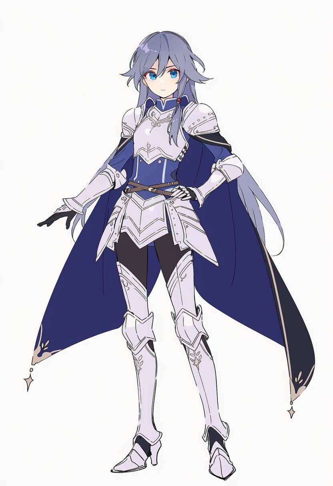

[在线例图](https://assets.quicktagcloud.com/images/raven_composition/raven_composition-0292.jpg?v=47d7de26e29dce71)

<a id="raven_composition-0293"></a>

## 不对称半身裙

ID：`raven_composition-0293`；分类：裙子；来源标记：`safe`。

来源说明：

> 左右、前后或各区域长度/结构明显不对称的半身裙。只要不对称是有意设计而非动作造成即可。

正向提示词：

```text
asymmetrical_skirt
```

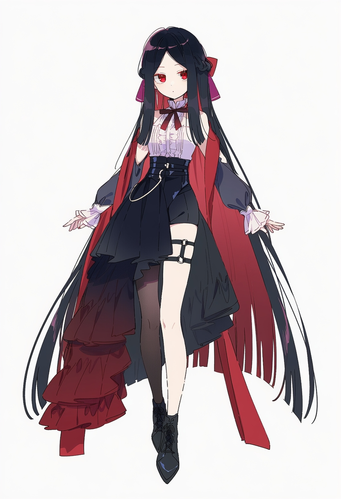

[在线例图](https://assets.quicktagcloud.com/images/raven_composition/raven_composition-0293.jpg?v=8d57cab7476b7cc0)

<a id="raven_composition-0294"></a>

## 泡泡裙

ID：`raven_composition-0294`；分类：裙子；来源标记：`safe`。

来源说明：

> 泡泡裙：裙摆下缘向内收起，使整体鼓起成圆润“气泡”形轮廓，常见蓬松立体感。

正向提示词：

```text
bubble_skirt
```

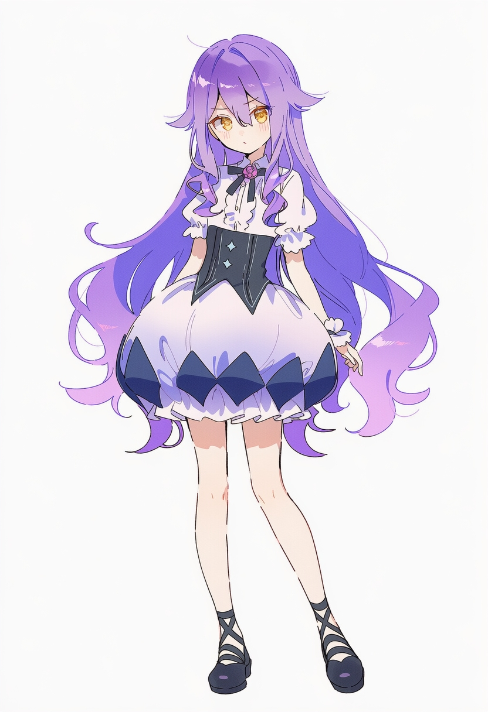

[在线例图](https://assets.quicktagcloud.com/images/raven_composition/raven_composition-0294.jpg?v=31467950936e7038)

<a id="raven_composition-0295"></a>

## 前排扣半身裙

ID：`raven_composition-0295`；分类：裙子；来源标记：`safe`。

来源说明：

> 前侧或侧面有一整排明显纽扣作为开合结构的半身裙，纽扣排列是主要设计特征。

正向提示词：

```text
button_up_skirt
```

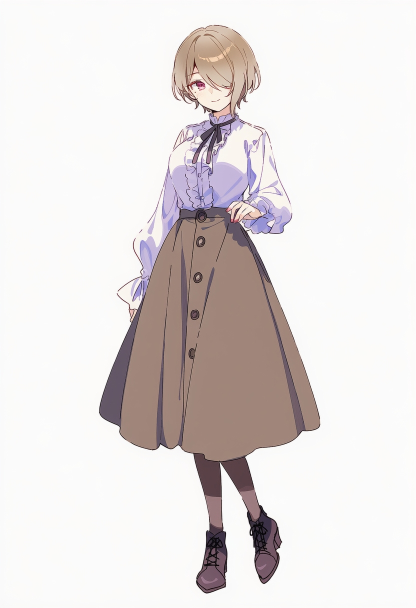

[在线例图](https://assets.quicktagcloud.com/images/raven_composition/raven_composition-0295.jpg?v=b16391df7a73c712)

<a id="raven_composition-0296"></a>

## 交叉系带半身裙

ID：`raven_composition-0296`；分类：裙子；来源标记：`safe`。

来源说明：

> 带交叉穿绳/系带结构的半身裙，常见腰侧、前部或开衩处用 X 形绑带连接。

正向提示词：

```text
cross-laced_skirt
```

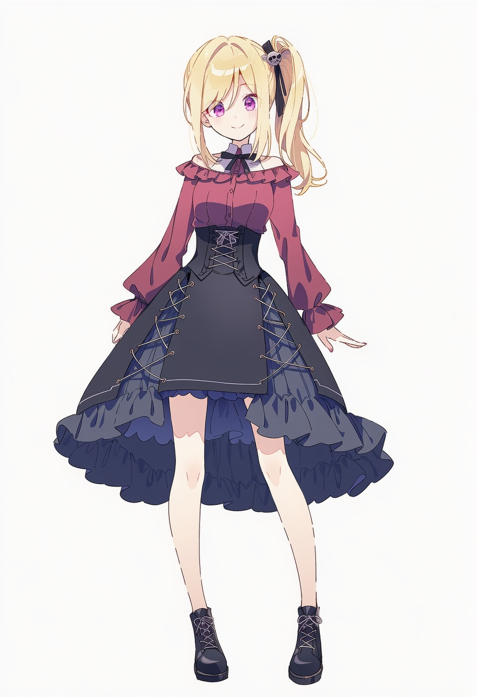

[在线例图](https://assets.quicktagcloud.com/images/raven_composition/raven_composition-0296.jpg?v=e954b3db017672b1)

<a id="raven_composition-0297"></a>

## 花朵造型衬裙

ID：`raven_composition-0297`；分类：裙子；来源标记：`safe`。

来源说明：

> 位于外层裙装下方、带明显花朵主题或花瓣造型的内裙/衬裙层，通常只有部分露出。

正向提示词：

```text
flower_underskirt
```


[在线例图](https://assets.quicktagcloud.com/images/raven_composition/raven_composition-0297.jpg?v=80d5ca994d7566d7)

<a id="raven_composition-0298"></a>

## 水果造型衬裙

ID：`raven_composition-0298`；分类：裙子；来源标记：`safe`。

来源说明：

> 位于外层裙装下方、带水果主题图案或造型的内裙/衬裙层，常作为趣味性内部设计。

正向提示词：

```text
fruit_underskirt
```

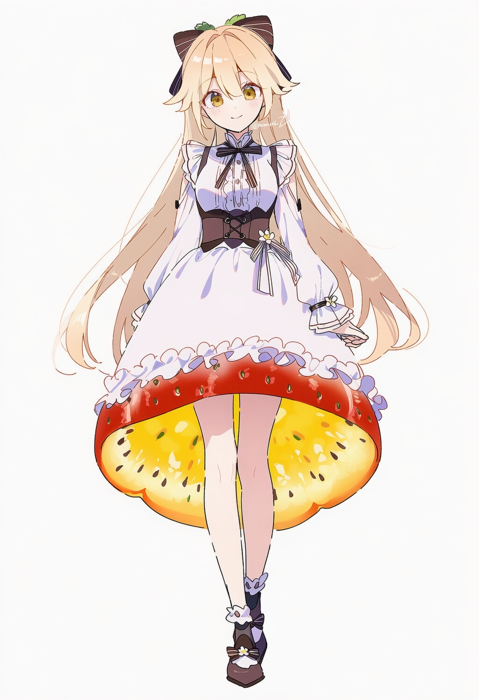

[在线例图](https://assets.quicktagcloud.com/images/raven_composition/raven_composition-0298.jpg?v=2ebb0d190bad2130)

<a id="raven_composition-0299"></a>

## 半覆盖式裙

ID：`raven_composition-0299`；分类：裙子；来源标记：`safe`。

来源说明：

> 只覆盖身体一部分周向区域的裙状结构，例如只覆盖一侧/后侧，另一部分大面积开放。不是普通完整环绕的半身裙。

正向提示词：

```text
half-skirt
```

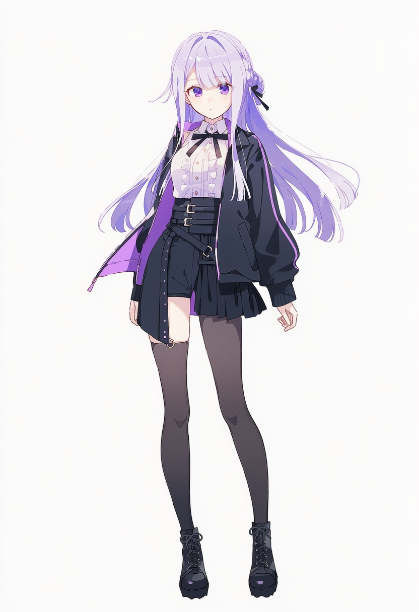

[在线例图](https://assets.quicktagcloud.com/images/raven_composition/raven_composition-0299.jpg?v=1e2c8b28dbcdb7c2)

<a id="raven_composition-0300"></a>

## 前短后长裙

ID：`raven_composition-0300`；分类：裙子；来源标记：`safe`。

来源说明：

> 前短后长的半身裙，前侧裙摆高、后侧明显更长，形成高低不对称轮廓。

正向提示词：

```text
high-low_skirt
```

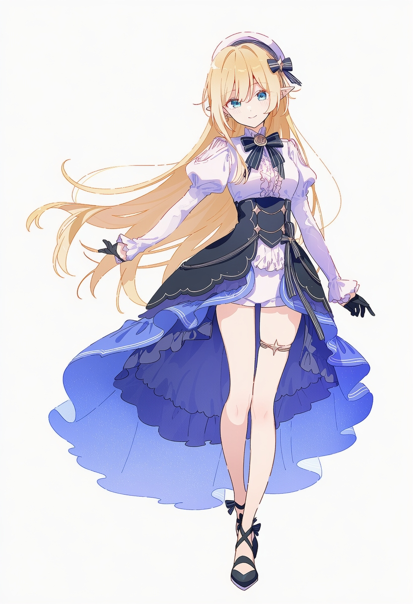

[在线例图](https://assets.quicktagcloud.com/images/raven_composition/raven_composition-0300.jpg?v=c5459687fee197f3)

<a id="raven_composition-0301"></a>

## 束步裙

ID：`raven_composition-0301`；分类：裙子；来源标记：`safe`。

来源说明：

> 束步裙，裙摆非常窄并限制迈步幅度，历史服装中常见于膝下至脚踝位置收紧的长裙。

正向提示词：

```text
hobble_skirt
```

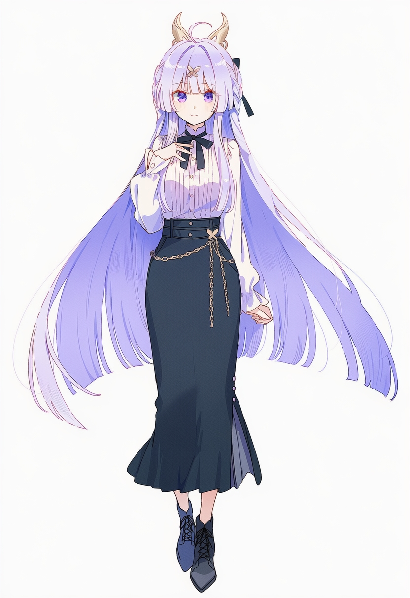

[在线例图](https://assets.quicktagcloud.com/images/raven_composition/raven_composition-0301.jpg?v=d18271baac87ca74)

<a id="raven_composition-0302"></a>

## 裙撑式裙

ID：`raven_composition-0302`；分类：裙子；来源标记：`safe`。

来源说明：

> 依靠裙撑圈/骨架把裙摆撑成巨大圆形或钟形轮廓的裙装，重点是内部支撑结构造成的体积。

正向提示词：

```text
hoop_skirt
```

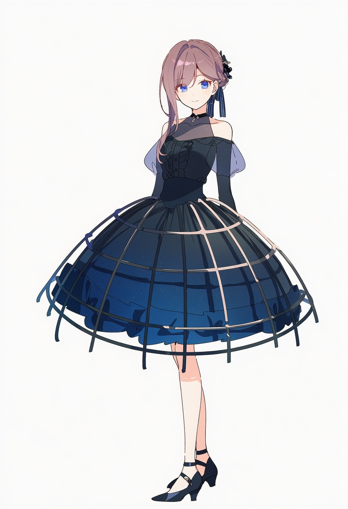

[在线例图](https://assets.quicktagcloud.com/images/raven_composition/raven_composition-0302.jpg?v=a6911ccd65187142)

<a id="raven_composition-0303"></a>

## 层叠半身裙

ID：`raven_composition-0303`；分类：裙子；来源标记：`safe`。

来源说明：

> 有两个或更多清晰可辨的裙摆层、罩层或叠片的半身裙，视觉上呈多层结构。

正向提示词：

```text
layered_skirt
```

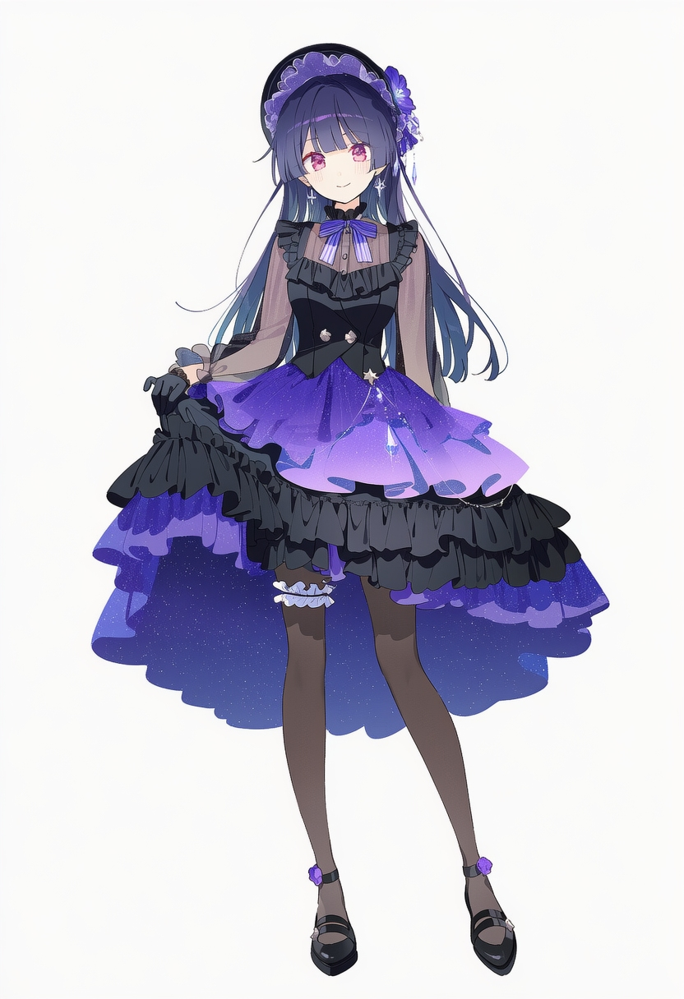

[在线例图](https://assets.quicktagcloud.com/images/raven_composition/raven_composition-0303.jpg?v=e2226f5d6ca79884)

<a id="raven_composition-0304"></a>

## 背带裙

ID：`raven_composition-0304`；分类：裙子；来源标记：`safe`。

来源说明：

> 类似背带裤结构但下身为裙子的背带裙，通常有胸前片和肩带；与仅靠细吊带固定的 suspender_skirt 可区分。

正向提示词：

```text
overall_skirt
```

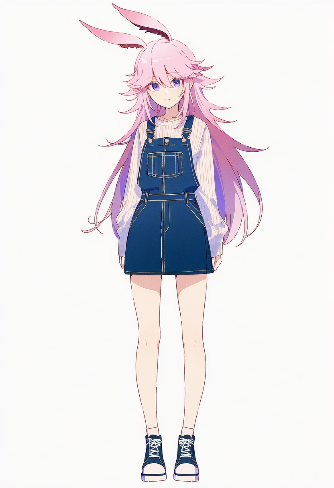

[在线例图](https://assets.quicktagcloud.com/images/raven_composition/raven_composition-0304.jpg?v=295bf3611dba70d9)

<a id="raven_composition-0305"></a>

## 外罩裙

ID：`raven_composition-0305`；分类：裙子；来源标记：`safe`。

来源说明：

> 穿在另一条裙子、裤子或主体服装外面的外罩裙层，通常不承担完整下装功能，而作为额外装饰/造型层。

正向提示词：

```text
overskirt
```

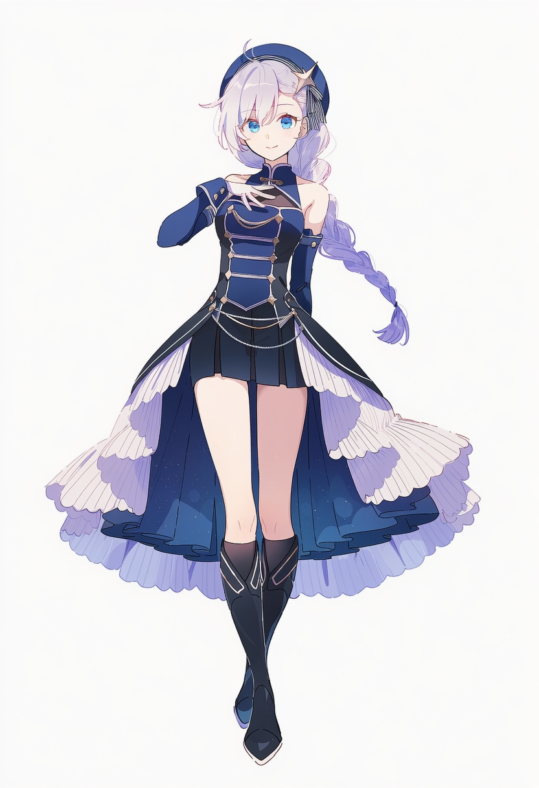

[在线例图](https://assets.quicktagcloud.com/images/raven_composition/raven_composition-0305.jpg?v=85603aadd4203145)

<a id="raven_composition-0306"></a>

## 铅笔裙

ID：`raven_composition-0306`；分类：裙子；来源标记：`safe`。

来源说明：

> 铅笔裙：贴合臀部并向下保持较窄直筒轮廓的半身裙，常见于职业装和成熟正式风格。

正向提示词：

```text
pencil_skirt
```

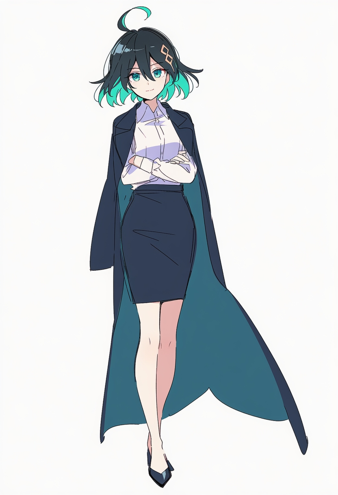

[在线例图](https://assets.quicktagcloud.com/images/raven_composition/raven_composition-0306.jpg?v=edea725c2c6d7e03)

<a id="raven_composition-0307"></a>

## 衬裙

ID：`raven_composition-0307`；分类：裙子；来源标记：`safe`。

来源说明：

> 衬裙，穿在外裙内部以增加蓬度、改善轮廓或防透。Lolita、礼服、历史裙装中常用于撑起裙摆。

正向提示词：

```text
petticoat
```

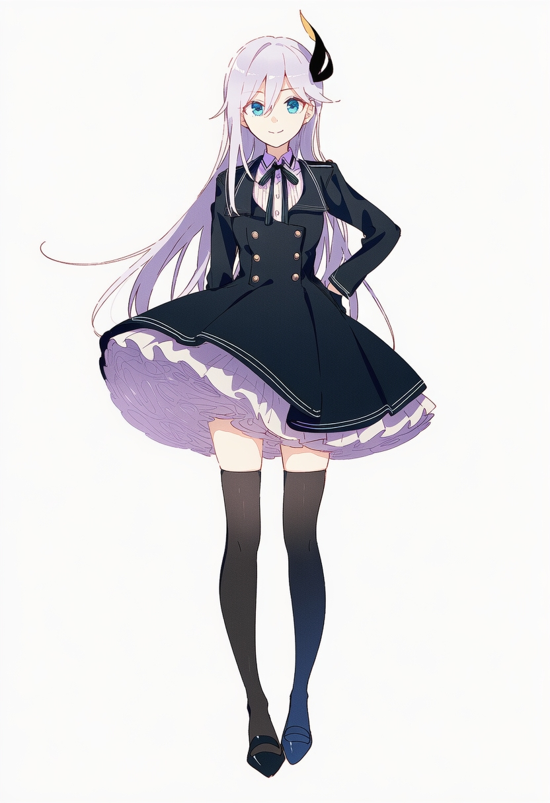

[在线例图](https://assets.quicktagcloud.com/images/raven_composition/raven_composition-0307.jpg?v=4d052a4c70d27324)

<a id="raven_composition-0308"></a>

## 南瓜轮廓裙

ID：`raven_composition-0308`；分类：裙子；来源标记：`safe`。

来源说明：

> 轮廓像南瓜一样鼓起的短裙/中裙，通常腰部和下摆收束、中间膨胀，形成圆球状体积。

正向提示词：

```text
pumpkin_skirt
```


[在线例图](https://assets.quicktagcloud.com/images/raven_composition/raven_composition-0308.jpg?v=7ab29f204e7b3fe3)

<a id="raven_composition-0309"></a>

## 透视裙层

ID：`raven_composition-0309`；分类：裙子；来源标记：`safe`。

来源说明：

> 裙装中的某一层是透明或半透明材质，能够看到下方其他裙层或腿部；强调“透明的独立裙层”。

正向提示词：

```text
see-through_skirt_layer
```

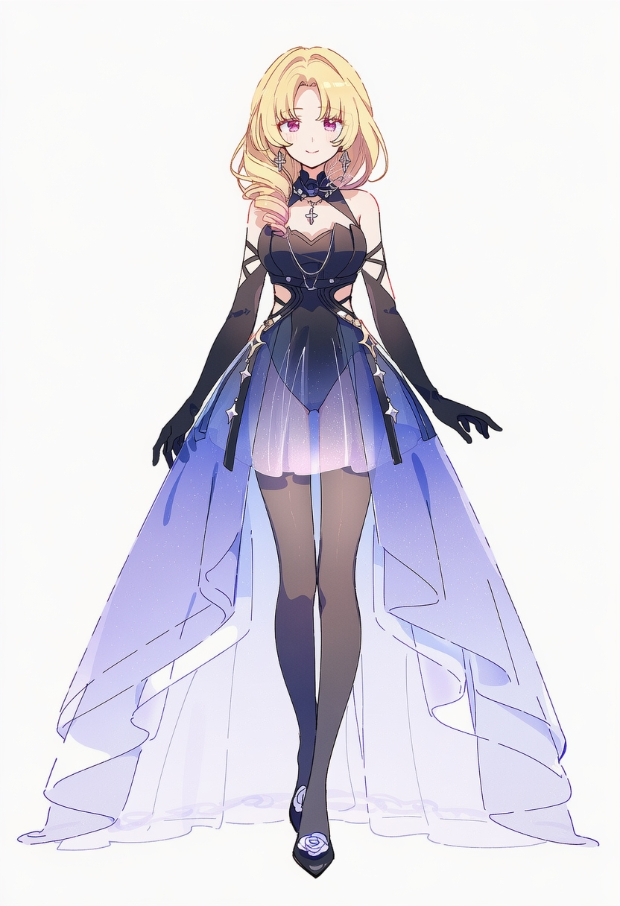

[在线例图](https://assets.quicktagcloud.com/images/raven_composition/raven_composition-0309.jpg?v=e8cb78a94728a147)

<a id="raven_composition-0310"></a>

## 歌舞女郎裙

ID：`raven_composition-0310`；分类：裙子；来源标记：`safe`。

来源说明：

> 舞台歌舞女郎风格的裙装，常有高低不对称、羽毛、亮片、短前摆或夸张后摆，强调表演服效果。

正向提示词：

```text
showgirl_skirt
```

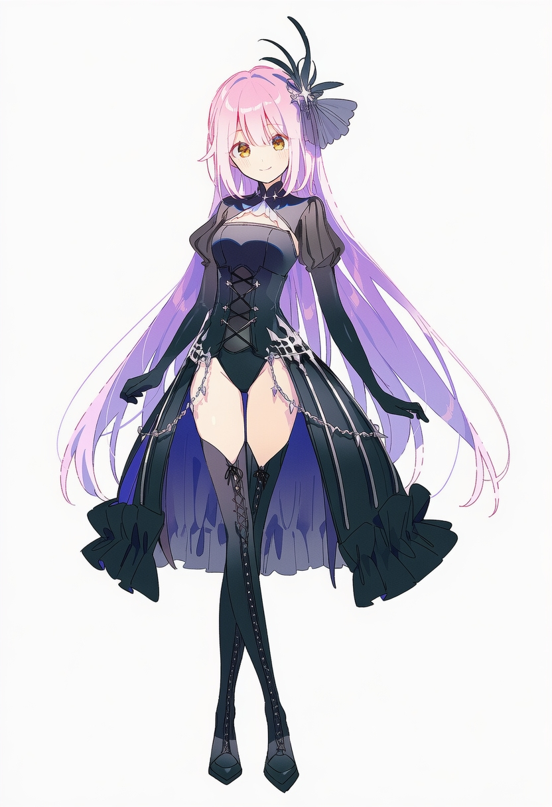

[在线例图](https://assets.quicktagcloud.com/images/raven_composition/raven_composition-0310.jpg?v=2be3cd7073745d6c)

<a id="raven_composition-0311"></a>

## 侧系带裙

ID：`raven_composition-0311`；分类：裙子；来源标记：`safe`。

来源说明：

> 靠一侧系带、蝴蝶结或绳结固定/闭合的半身裙，侧边打结是主要结构特征。

正向提示词：

```text
side-tie_skirt
```

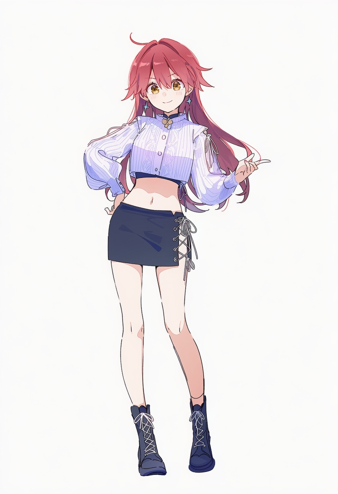

[在线例图](https://assets.quicktagcloud.com/images/raven_composition/raven_composition-0311.jpg?v=f1760ad4a31648e7)

<a id="raven_composition-0312"></a>

## 裙裤

ID：`raven_composition-0312`；分类：裙子；来源标记：`safe`。

来源说明：

> 裙裤：外观看起来像短裙，但实际包含短裤结构，或前方有裙片而下身为短裤。适合需要活动性的设计。

正向提示词：

```text
skort
```

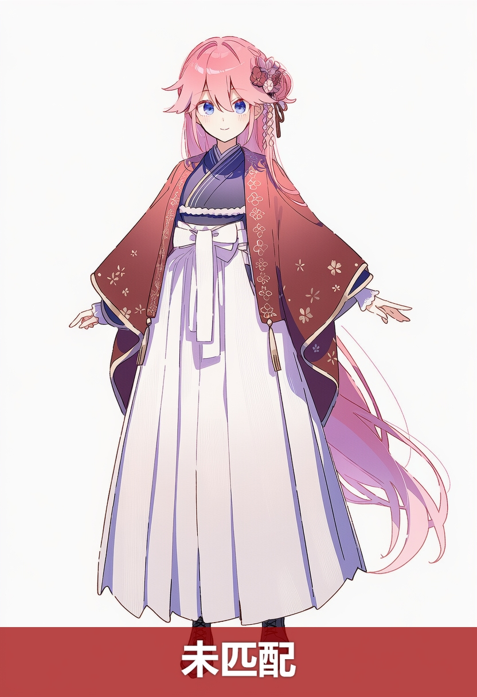

[在线例图](https://assets.quicktagcloud.com/images/raven_composition/raven_composition-0312.jpg?v=ae979699dd1e5273)

<a id="raven_composition-0313"></a>

## 臀部镂空裙

ID：`raven_composition-0313`；分类：裙子；来源标记：`safe`。

来源说明：

> 臀部位置有明显镂空开口的裙子，使臀部部分直接暴露。属于非常特定的 cutout 结构。

正向提示词：

```text
spank_skirt
```

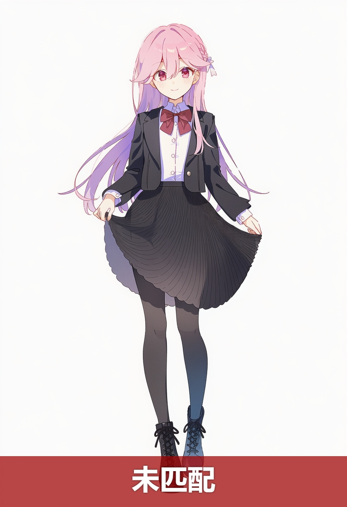

[在线例图](https://assets.quicktagcloud.com/images/raven_composition/raven_composition-0313.jpg?v=f7a0de1264bf7789)

<a id="raven_composition-0314"></a>

## 吊带裙/JSK

ID：`raven_composition-0314`；分类：裙子；来源标记：`safe`。

来源说明：

> 由吊带/背带从肩部支撑的半身裙，常被称作 jumperskirt（JSK）；在 Lolita 中常与衬衫、衬裙一起穿。

正向提示词：

```text
suspender_skirt
```

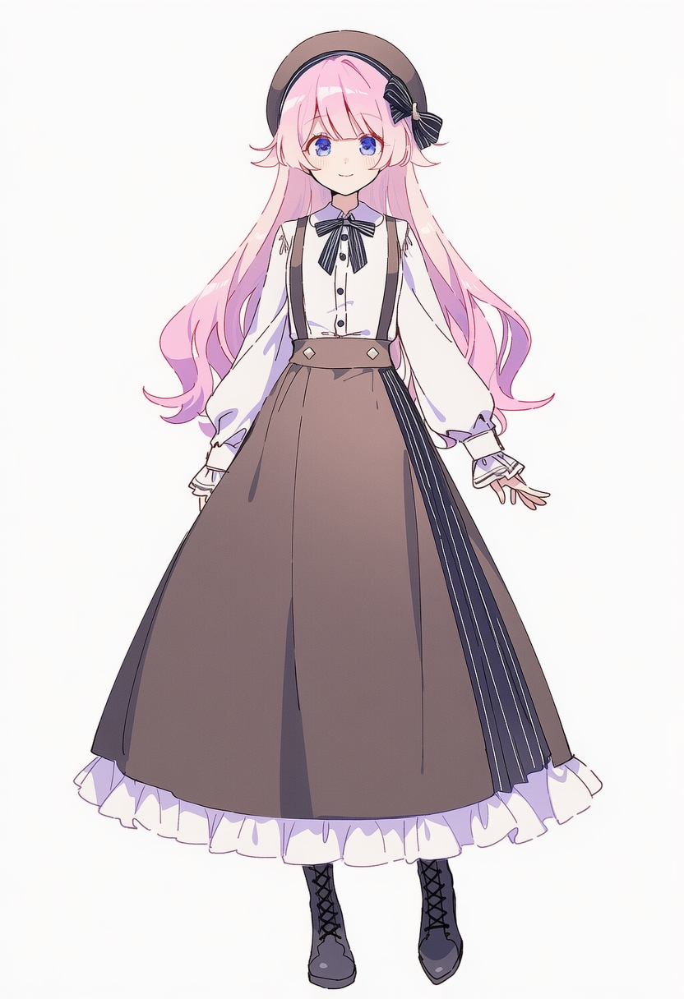

[在线例图](https://assets.quicktagcloud.com/images/raven_composition/raven_composition-0314.jpg?v=9ce57b7699168cde)

<a id="raven_composition-0315"></a>

## 网球裙

ID：`raven_composition-0315`；分类：裙子；来源标记：`safe`。

来源说明：

> 网球运动常见的短裙，通常轻便、便于活动，常采用百褶或 A 字结构；可与运动上衣搭配。

正向提示词：

```text
tennis_skirt
```

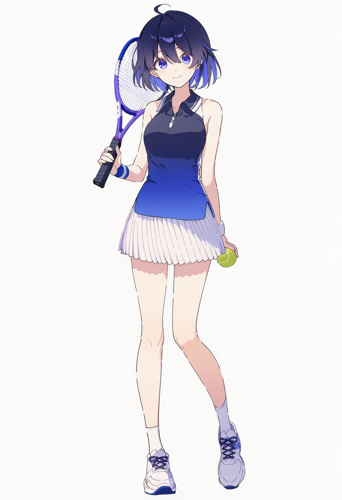

[在线例图](https://assets.quicktagcloud.com/images/raven_composition/raven_composition-0315.jpg?v=110021a67584245e)

<a id="raven_composition-0316"></a>

## 破损半身裙

ID：`raven_composition-0316`；分类：裙子；来源标记：`safe`。

来源说明：

> 存在明显撕裂、破损、缺口或毛边的半身裙。重点是布料受损状态，而不是规则设计的开衩。

正向提示词：

```text
torn_skirt
```

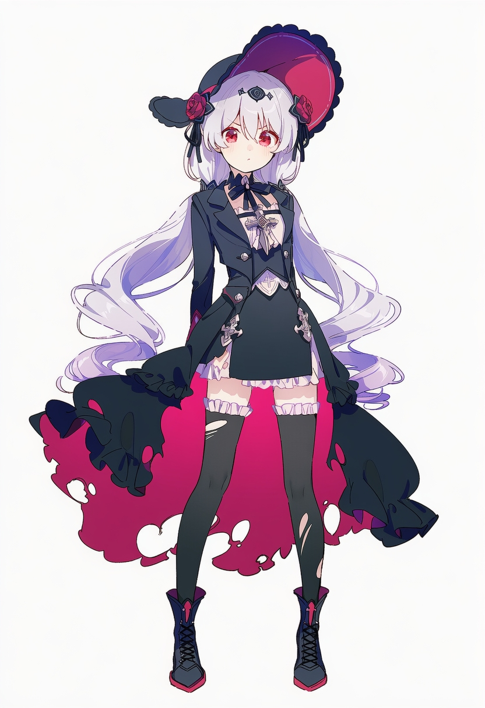

[在线例图](https://assets.quicktagcloud.com/images/raven_composition/raven_composition-0316.jpg?v=6262efc508f81380)

<a id="raven_composition-0317"></a>

## 芭蕾蓬蓬裙（tutu）

ID：`raven_composition-0317`；分类：裙子；来源标记：`safe`。

来源说明：

> 芭蕾舞裙，通常由多层薄纱制成并从腰部向外蓬起。它本质上属于 skirt，不要与带上身连体结构的 ballet_dress 混淆。

正向提示词：

```text
tutu
```

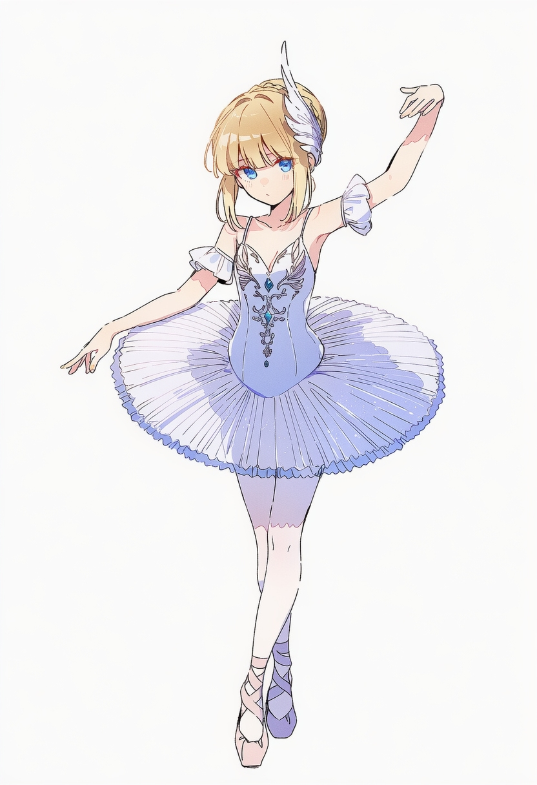

[在线例图](https://assets.quicktagcloud.com/images/raven_composition/raven_composition-0317.jpg?v=b86bb06e7a6cb4fe)

<a id="raven_composition-0318"></a>

## UFO造型裙

ID：`raven_composition-0318`；分类：裙子；来源标记：`safe`。

来源说明：

> 轮廓刻意设计得像飞碟/UFO 的夸张裙装，通常具有宽大、圆盘状或悬浮感的硬挺裙摆。

正向提示词：

```text
ufo_skirt
```


[在线例图](https://assets.quicktagcloud.com/images/raven_composition/raven_composition-0318.jpg?v=d235f0173c36b5b4)

<a id="raven_composition-0319"></a>

## 裹裙

ID：`raven_composition-0319`；分类：裙子；来源标记：`safe`。

来源说明：

> 裹裙，以一片或多片布料环绕腰部并重叠固定，通常通过系带、扣子或结来闭合，而不是完整缝合成圆筒。

正向提示词：

```text
wrap_skirt
```


[在线例图](https://assets.quicktagcloud.com/images/raven_composition/raven_composition-0319.jpg?v=8239d3412534dcbe)

<a id="raven_composition-0320"></a>

## 拉链半身裙

ID：`raven_composition-0320`；分类：裙子；来源标记：`safe`。

来源说明：

> 拉链是明显外观/结构元素的半身裙，例如前中或侧面有可见长拉链。

正向提示词：

```text
zipper_skirt
```


[在线例图](https://assets.quicktagcloud.com/images/raven_composition/raven_composition-0320.jpg?v=78dec294c86e6525)

<a id="raven_composition-0321"></a>

## 袄裙

ID：`raven_composition-0321`；分类：裙子；来源标记：`safe`。

来源说明：

> 中国传统袄裙组合，由上身“袄”和下身“裙”构成。它是成套传统服装概念，其中裙子是独立下装。

正向提示词：

```text
aoqun
```


[在线例图](https://assets.quicktagcloud.com/images/raven_composition/raven_composition-0321.jpg?v=56dad0ddbd448908)

<a id="raven_composition-0322"></a>

## 韩式长裙（chima）

ID：`raven_composition-0322`；分类：裙子；来源标记：`safe`。

来源说明：

> 韩服中的裙子部分，通常为高腰、宽大、长及脚面的裙装，与 jeogori（短上衣）搭配。

正向提示词：

```text
chima
```


[在线例图](https://assets.quicktagcloud.com/images/raven_composition/raven_composition-0322.jpg?v=389e554f048e65b7)

<a id="raven_composition-0323"></a>

## 多提式裹腿下装

ID：`raven_composition-0323`；分类：裙子；来源标记：`safe`。

来源说明：

> 南亚传统下装，以长布围裹、折叠并在腿间处理形成裤/裙之间的外观。它不是典型西式半身裙，但视觉上可呈裙状。

正向提示词：

```text
dhoti
```


[在线例图](https://assets.quicktagcloud.com/images/raven_composition/raven_composition-0323.jpg?v=974bb30c582f7b30)

<a id="raven_composition-0324"></a>

## 福斯塔内拉褶裙

ID：`raven_composition-0324`；分类：裙子；来源标记：`safe`。

来源说明：

> 希腊、阿尔巴尼亚等巴尔干地区的传统男性白色多褶短裙，特点是大量细密褶皱和宽摆。

正向提示词：

```text
fustanella
```


[在线例图](https://assets.quicktagcloud.com/images/raven_composition/raven_composition-0324.jpg?v=b26bfe6a99d2a857)

<a id="raven_composition-0325"></a>

## 短裙式袴

ID：`raven_composition-0325`；分类：裙子；来源标记：`safe`。

来源说明：

> 短款裙式袴，保留袴的高腰、褶裥和系带结构，但长度明显短于传统长袴。

正向提示词：

```text
hakama_short_skirt
```


[在线例图](https://assets.quicktagcloud.com/images/raven_composition/raven_composition-0325.jpg?v=61a40694b265bd29)

<a id="raven_composition-0326"></a>

## 裙式袴

ID：`raven_composition-0326`；分类：裙子；来源标记：`safe`。

来源说明：

> 未分裤腿的裙式袴（行灯袴一类），外观像长百褶裙，与分腿式 hakama 区分。

正向提示词：

```text
hakama_skirt
```


[在线例图](https://assets.quicktagcloud.com/images/raven_composition/raven_composition-0326.jpg?v=0933fe68bf51c0fb)

<a id="raven_composition-0327"></a>

## 马面裙

ID：`raven_composition-0327`；分类：裙子；来源标记：`safe`。

来源说明：

> 中国传统马面裙，典型为前后平整裙门、两侧密褶的长裙结构，明清及后世服饰中常见。

正向提示词：

```text
mamianqun
```


[在线例图](https://assets.quicktagcloud.com/images/raven_composition/raven_composition-0327.jpg?v=5fc248470e4308c9)

<a id="raven_composition-0328"></a>

## 裙褂

ID：`raven_composition-0328`；分类：裙子；来源标记：`safe`。

来源说明：

> 中式婚礼“裙褂”，通常是刺绣上衣与长裙组成的两件式礼服，常见龙凤、金银线等吉祥纹样。

正向提示词：

```text
qungua
```


[在线例图](https://assets.quicktagcloud.com/images/raven_composition/raven_composition-0328.jpg?v=5039d1294fdcecc5)

<a id="raven_composition-0329"></a>

## 襦裙

ID：`raven_composition-0329`；分类：裙子；来源标记：`safe`。

来源说明：

> 汉服体系中的“襦 + 裙”组合，上身短襦/衫与下身长裙分开穿着；不是一件式连衣裙。

正向提示词：

```text
ruqun
```


[在线例图](https://assets.quicktagcloud.com/images/raven_composition/raven_composition-0329.jpg?v=2b30b4802480aeda)

<a id="raven_composition-0330"></a>

## 古埃及申迪特腰裙

ID：`raven_composition-0330`；分类：裙子；来源标记：`safe`。

来源说明：

> 古埃及男性常见的围腰式短裙/腰布，环绕腰胯固定，常见于法老、神祇或历史题材。

正向提示词：

```text
shendyt
```


[在线例图](https://assets.quicktagcloud.com/images/raven_composition/raven_composition-0330.jpg?v=42d99ad810716f21)

<a id="raven_composition-0331"></a>

## 裙下穿骑行短裤

ID：`raven_composition-0331`；分类：裙子；来源标记：`safe`。

来源说明：

> 裙子下面穿贴身骑行短裤/安全裤，常用于运动、防走光或现代休闲搭配。

正向提示词：

```text
bike_shorts_under_skirt
```


[在线例图](https://assets.quicktagcloud.com/images/raven_composition/raven_composition-0331.jpg?v=bb5feac86e4b4a30)

<a id="raven_composition-0332"></a>

## 比基尼裙

ID：`raven_composition-0332`；分类：裙子；来源标记：`safe`。

来源说明：

> 与比基尼泳装配套或属于比基尼套装的短裙/裙片，通常覆盖泳裤外侧，仍属于泳装体系。

正向提示词：

```text
bikini_skirt
```


[在线例图](https://assets.quicktagcloud.com/images/raven_composition/raven_composition-0332.jpg?v=063348309c208875)

<a id="raven_composition-0333"></a>

## 裙下穿比基尼泳裤

ID：`raven_composition-0333`；分类：裙子；来源标记：`safe`。

来源说明：

> 半身裙下方穿着比基尼泳裤，常见于海滩、泳装外搭等情境。它描述内外层搭配关系。

正向提示词：

```text
bikini_under_skirt
```


[在线例图](https://assets.quicktagcloud.com/images/raven_composition/raven_composition-0333.jpg?v=2d66fbe4e639dd3d)

<a id="raven_composition-0334"></a>

## 裙下穿灯笼运动短裤

ID：`raven_composition-0334`；分类：裙子；来源标记：`safe`。

来源说明：

> 半身裙下穿日式灯笼运动短裤（buruma）的搭配，常见于校服/运动题材。

正向提示词：

```text
buruma_under_skirt
```


[在线例图](https://assets.quicktagcloud.com/images/raven_composition/raven_composition-0334.jpg?v=9db25533018c9622)

<a id="raven_composition-0335"></a>

## 和服裙/和风裙

ID：`raven_composition-0335`；分类：裙子；来源标记：`safe`。

来源说明：

> 把和服面料、腰带或传统纹样做成半身裙，或明显具有和服风格的裙装；与完整 kimono 区分。

正向提示词：

```text
kimono_skirt
```


[在线例图](https://assets.quicktagcloud.com/images/raven_composition/raven_composition-0335.jpg?v=a7ee64072b44bbeb)

<a id="raven_composition-0336"></a>

## 半身裙下穿长裤

ID：`raven_composition-0336`；分类：裙子；来源标记：`safe`。

来源说明：

> 半身裙下另穿长裤，形成 skirt-over-pants 的层叠穿法。

正向提示词：

```text
pants_under_skirt
```


[在线例图](https://assets.quicktagcloud.com/images/raven_composition/raven_composition-0336.jpg?v=2855783f55380aff)

<a id="raven_composition-0337"></a>

## 水手服

ID：`raven_composition-0337`；分类：裙子；来源标记：`safe`。

来源说明：

> 日式水手服校服，典型是水手领上衣 + 独立半身裙的两件式制服。水手风连衣裙应使用 sailor_dress 而不是 serafuku。

正向提示词：

```text
serafuku
```


[在线例图](https://assets.quicktagcloud.com/images/raven_composition/raven_composition-0337.jpg?v=fb1ca7604499216f)

<a id="raven_composition-0338"></a>

## 半身裙下穿短裤

ID：`raven_composition-0338`；分类：裙子；来源标记：`safe`。

来源说明：

> 半身裙下另穿短裤，常用于运动、安全裤或层叠搭配。

正向提示词：

```text
shorts_under_skirt
```


[在线例图](https://assets.quicktagcloud.com/images/raven_composition/raven_composition-0338.jpg?v=19b3f1c0ee7bff0d)

<a id="raven_composition-0339"></a>

## 裙装套组

ID：`raven_composition-0339`；分类：裙子；来源标记：`safe`。

来源说明：

> 以半身裙为核心、与上衣或其他部件成套设计的服装组合，强调上下装属于同一套。

正向提示词：

```text
skirt_set
```


[在线例图](https://assets.quicktagcloud.com/images/raven_composition/raven_composition-0339.jpg?v=f2d5a7b8c2ad7730)

<a id="raven_composition-0340"></a>

## 裙装套装

ID：`raven_composition-0340`；分类：裙子；来源标记：`safe`。

来源说明：

> 女式裙装西装套装，通常由西装外套与同面料/同风格半身裙组成，常用于职业或正式场合。

正向提示词：

```text
skirt_suit
```


[在线例图](https://assets.quicktagcloud.com/images/raven_composition/raven_composition-0340.jpg?v=00269801be96ef14)

<a id="raven_composition-0341"></a>

## 和服下穿裙

ID：`raven_composition-0341`；分类：裙子；来源标记：`safe`。

来源说明：

> 和服或和式长袍里面/下面额外穿着独立半身裙，能明确看到裙摆层。

正向提示词：

```text
skirt_under_kimono
```


[在线例图](https://assets.quicktagcloud.com/images/raven_composition/raven_composition-0341.jpg?v=e32cab6b3ed492f3)

<a id="raven_composition-0342"></a>

## 裙裤混合式下装

ID：`raven_composition-0342`；分类：裙子；来源标记：`safe`。

来源说明：

> skirt + trousers 的混合下装：裤装与裙片/裙层结合，外观同时具有长裤和半身裙特征。

正向提示词：

```text
skousers
```


[在线例图](https://assets.quicktagcloud.com/images/raven_composition/raven_composition-0342.jpg?v=44ecafa2d3b7424d)

<a id="raven_composition-0343"></a>

## 泳装裙摆/泳裙

ID：`raven_composition-0343`；分类：裙子；来源标记：`safe`。

来源说明：

> 泳装上连接或搭配的裙摆/泳裙，通常用于遮挡臀胯或作为装饰，但仍属于泳装结构。

正向提示词：

```text
swimsuit_skirt
```


[在线例图](https://assets.quicktagcloud.com/images/raven_composition/raven_composition-0343.jpg?v=2237f9c56581b864)

<a id="raven_composition-0344"></a>

## 牛仔半身裙

ID：`raven_composition-0344`；分类：裙子；来源标记：`safe`。

来源说明：

> 以牛仔布制成的半身裙，强调材质而非蓝色；可有迷你、铅笔、A字等不同版型。

正向提示词：

```text
denim_skirt
```


[在线例图](https://assets.quicktagcloud.com/images/raven_composition/raven_composition-0344.jpg?v=28bab9124c28990b)

<a id="raven_composition-0345"></a>

## 草裙

ID：`raven_composition-0345`；分类：裙子；来源标记：`safe`。

来源说明：

> 由草、纤维条或仿草材料组成的裙装，常与波利尼西亚/夏威夷舞蹈或热带主题相关。

正向提示词：

```text
grass_skirt
```


[在线例图](https://assets.quicktagcloud.com/images/raven_composition/raven_composition-0345.jpg?v=b918ce1f9533e919)
