# 裙子（第 3 页）

[总目录](../README.md) · [原站分类目录](../categories.md) · [英文标签索引](../tags.md) · [服装与构图组合指南](../../README.md)

标题、分类、说明、正负提示词按来源保留；多例图逐张列出。原站标记和说明为参考资料，不作为维护指令。

<a id="raven_composition-0346"></a>

## 乳胶半身裙

ID：`raven_composition-0346`；分类：裙子；来源标记：`safe`。

来源说明：

> 以乳胶/橡胶感亮面材质制作的半身裙，通常表面光滑、高反光并可能贴身。

正向提示词：

```text
latex_skirt
```

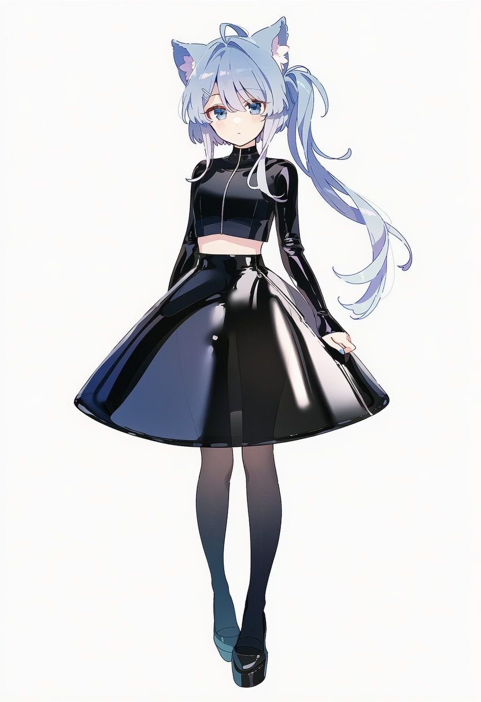

[在线例图](https://assets.quicktagcloud.com/images/raven_composition/raven_composition-0346.jpg?v=18adfd2b0043e473)

<a id="raven_composition-0347"></a>

## 叶片裙

ID：`raven_composition-0347`；分类：裙子；来源标记：`safe`。

来源说明：

> 主要由树叶或仿叶片组成、覆盖腰胯的裙状服装，常见于自然、森林、原始或幻想题材。

正向提示词：

```text
leaf_skirt
```

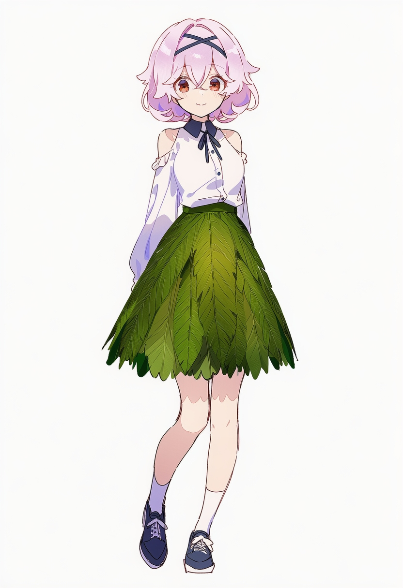

[在线例图](https://assets.quicktagcloud.com/images/raven_composition/raven_composition-0347.jpg?v=28c9799aac6e8f61)

<a id="raven_composition-0348"></a>

## 皮革半身裙

ID：`raven_composition-0348`；分类：裙子；来源标记：`safe`。

来源说明：

> 以皮革或明显仿皮材质制作的半身裙，强调材质，可同时是迷你、铅笔、百褶等款式。

正向提示词：

```text
leather_skirt
```

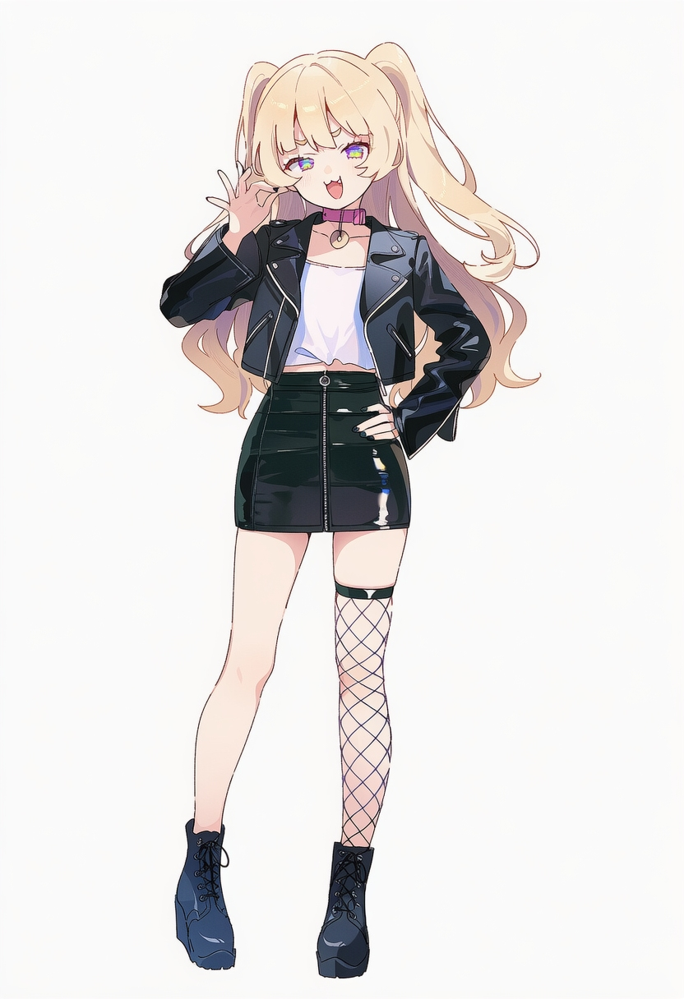

[在线例图](https://assets.quicktagcloud.com/images/raven_composition/raven_composition-0348.jpg?v=54cb5aee428640b7)

<a id="raven_composition-0349"></a>

## 美国国旗图案半身裙

ID：`raven_composition-0349`；分类：裙子；来源标记：`safe`。

来源说明：

> 以美国国旗图案作为主要视觉图案的半身裙。该 tag 只描述图案，可与 miniskirt、pleated_skirt、denim_skirt 等长度/结构/材质标签组合使用。

正向提示词：

```text
american_flag_skirt
```

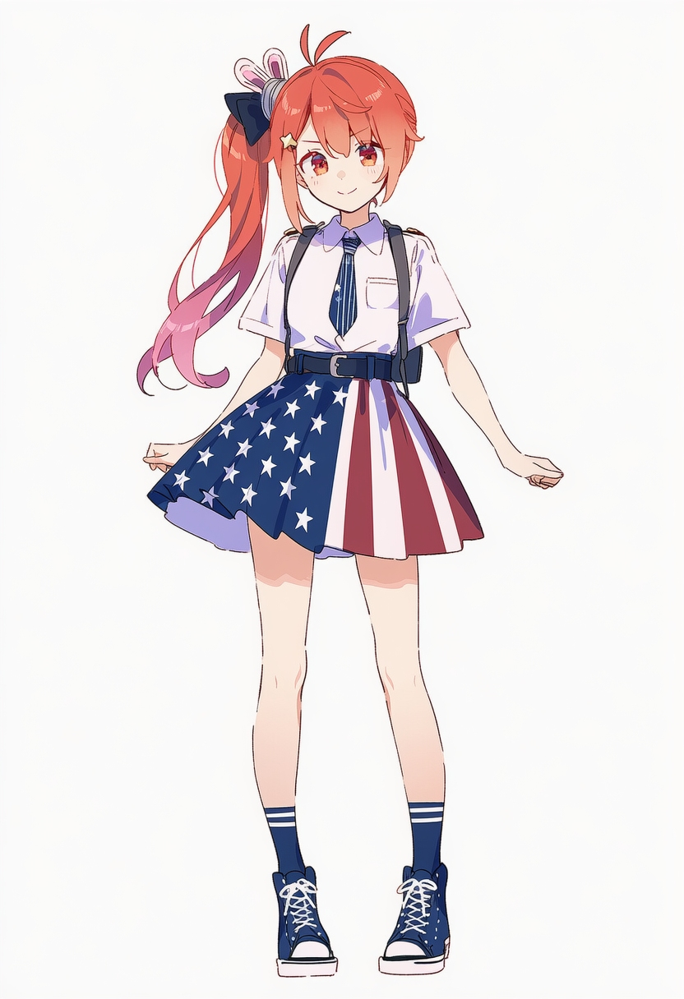

[在线例图](https://assets.quicktagcloud.com/images/raven_composition/raven_composition-0349.jpg?v=964d3bd6d01c7228)

<a id="raven_composition-0350"></a>

## 菱格纹半身裙

ID：`raven_composition-0350`；分类：裙子；来源标记：`safe`。

来源说明：

> 以菱格纹（argyle）作为主要视觉图案的半身裙。该 tag 只描述图案，可与 miniskirt、pleated_skirt、denim_skirt 等长度/结构/材质标签组合使用。

正向提示词：

```text
argyle_skirt
```

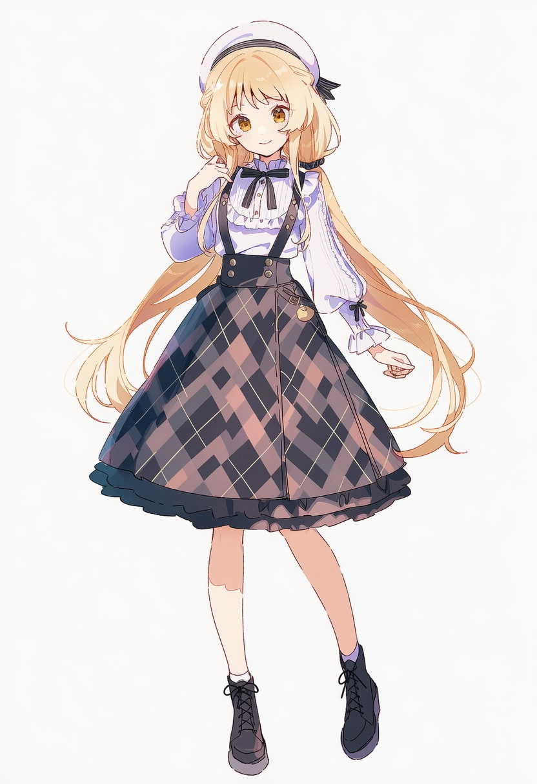

[在线例图](https://assets.quicktagcloud.com/images/raven_composition/raven_composition-0350.jpg?v=be12c5f968eb2aa1)

<a id="raven_composition-0351"></a>

## 迷彩半身裙

ID：`raven_composition-0351`；分类：裙子；来源标记：`safe`。

来源说明：

> 以迷彩图案作为主要视觉图案的半身裙。该 tag 只描述图案，可与 miniskirt、pleated_skirt、denim_skirt 等长度/结构/材质标签组合使用。

正向提示词：

```text
camouflage_skirt
```

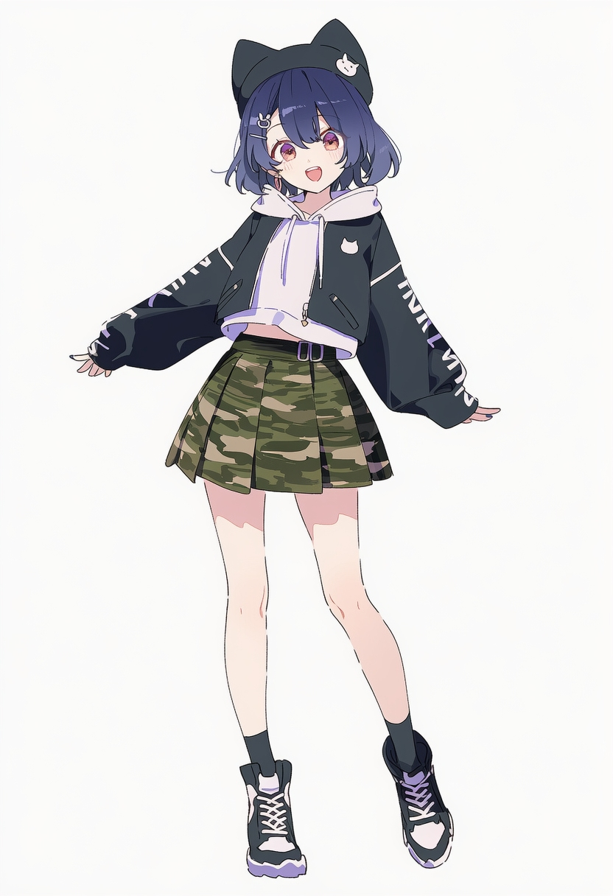

[在线例图](https://assets.quicktagcloud.com/images/raven_composition/raven_composition-0351.jpg?v=084208f594185a00)

<a id="raven_composition-0352"></a>

## 棋盘格半身裙

ID：`raven_composition-0352`；分类：裙子；来源标记：`safe`。

来源说明：

> 以棋盘格作为主要视觉图案的半身裙。该 tag 只描述图案，可与 miniskirt、pleated_skirt、denim_skirt 等长度/结构/材质标签组合使用。

正向提示词：

```text
checkered_skirt
```


[在线例图](https://assets.quicktagcloud.com/images/raven_composition/raven_composition-0352.jpg?v=a68d311d1d4f4d05)

<a id="raven_composition-0353"></a>

## 花卉印花半身裙

ID：`raven_composition-0353`；分类：裙子；来源标记：`safe`。

来源说明：

> 以花卉印花作为主要视觉图案的半身裙。该 tag 只描述图案，可与 miniskirt、pleated_skirt、denim_skirt 等长度/结构/材质标签组合使用。

正向提示词：

```text
floral_print_skirt
```

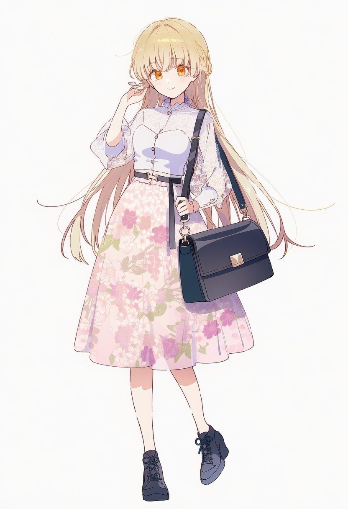

[在线例图](https://assets.quicktagcloud.com/images/raven_composition/raven_composition-0353.jpg?v=93010f3d5a901cda)

<a id="raven_composition-0354"></a>

## 褶边/荷叶边半身裙

ID：`raven_composition-0354`；分类：裙子；来源标记：`safe`。

来源说明：

> 带明显荷叶边/褶边装饰的半身裙。该 tag 强调这一视觉结构/装饰特征，不限定裙长和基本版型。

正向提示词：

```text
frilled_skirt
```

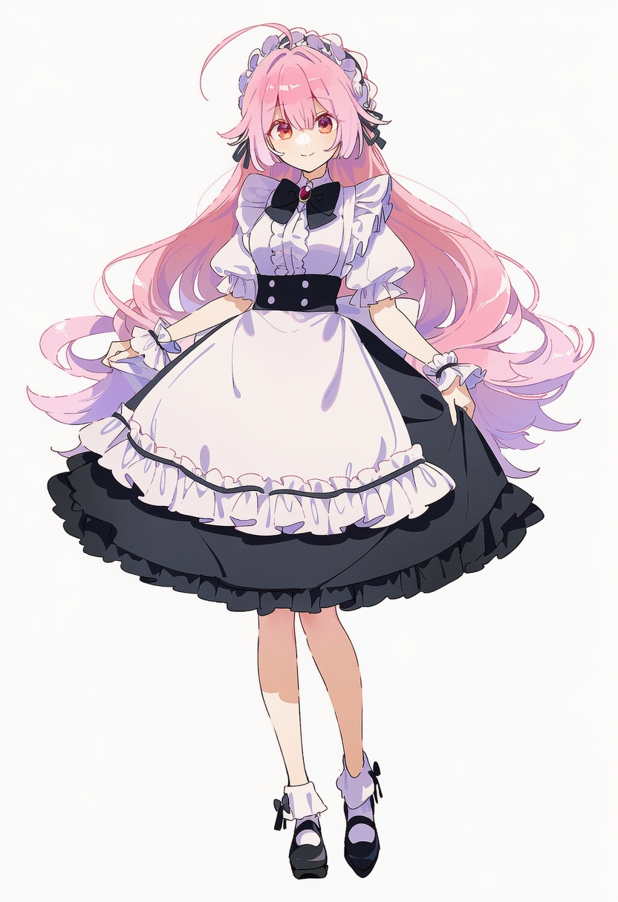

[在线例图](https://assets.quicktagcloud.com/images/raven_composition/raven_composition-0354.jpg?v=121326dab2630356)

<a id="raven_composition-0355"></a>

## 毛皮饰边半身裙

ID：`raven_composition-0355`；分类：裙子；来源标记：`safe`。

来源说明：

> 裙摆或其他边缘带有明显毛皮/绒毛饰边的半身裙。重点是饰边，而不是整条裙子都由该材质制成。

正向提示词：

```text
fur-trimmed_skirt
```

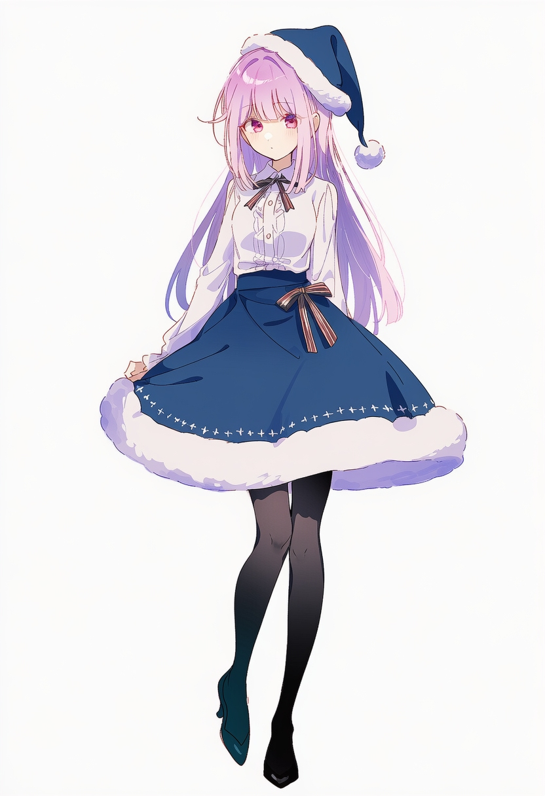

[在线例图](https://assets.quicktagcloud.com/images/raven_composition/raven_composition-0355.jpg?v=b9914a893aeb4497)

<a id="raven_composition-0356"></a>

## 毛皮裙

ID：`raven_composition-0356`；分类：裙子；来源标记：`safe`。

来源说明：

> 以毛皮/绒毛作为主要可见材质或大面积装饰的半身裙。该 tag 强调这一视觉结构/装饰特征，不限定裙长和基本版型。

正向提示词：

```text
fur_skirt
```

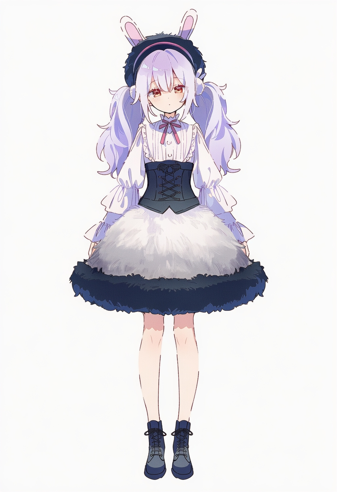

[在线例图](https://assets.quicktagcloud.com/images/raven_composition/raven_composition-0356.jpg?v=fa7d3e9922d44454)

<a id="raven_composition-0357"></a>

## 维希格半身裙

ID：`raven_composition-0357`；分类：裙子；来源标记：`safe`。

来源说明：

> 以维希格/小方格作为主要视觉图案的半身裙。该 tag 只描述图案，可与 miniskirt、pleated_skirt、denim_skirt 等长度/结构/材质标签组合使用。

正向提示词：

```text
gingham_skirt
```

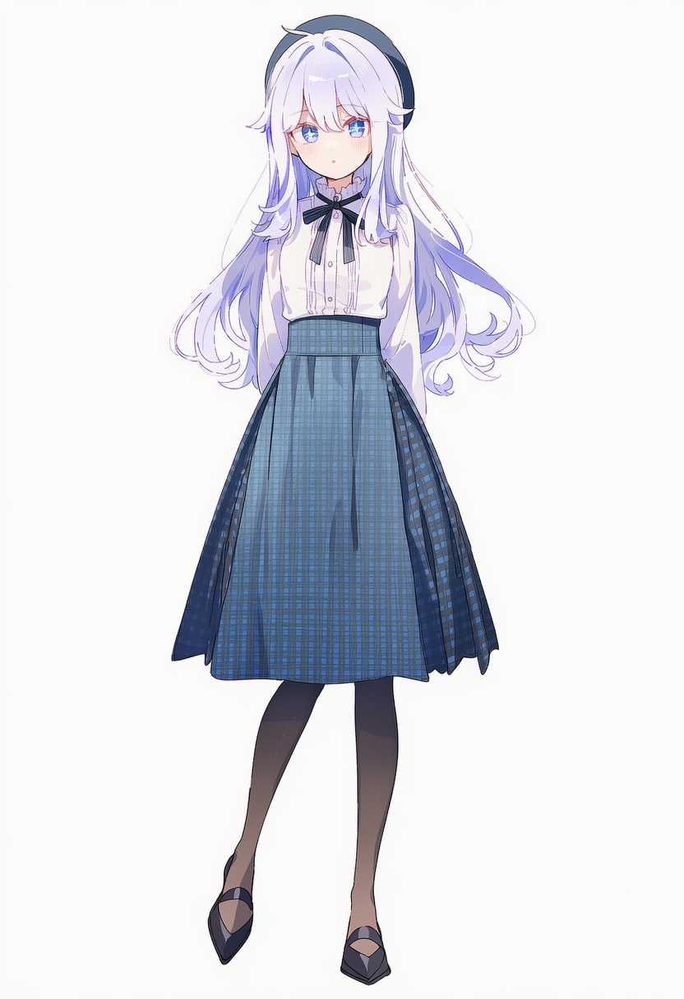

[在线例图](https://assets.quicktagcloud.com/images/raven_composition/raven_composition-0357.jpg?v=91f429e9af310d07)

<a id="raven_composition-0358"></a>

## 蕾丝饰边半身裙

ID：`raven_composition-0358`；分类：裙子；来源标记：`safe`。

来源说明：

> 裙摆或其他边缘带有明显蕾丝饰边的半身裙。重点是饰边，而不是整条裙子都由该材质制成。

正向提示词：

```text
lace-trimmed_skirt
```

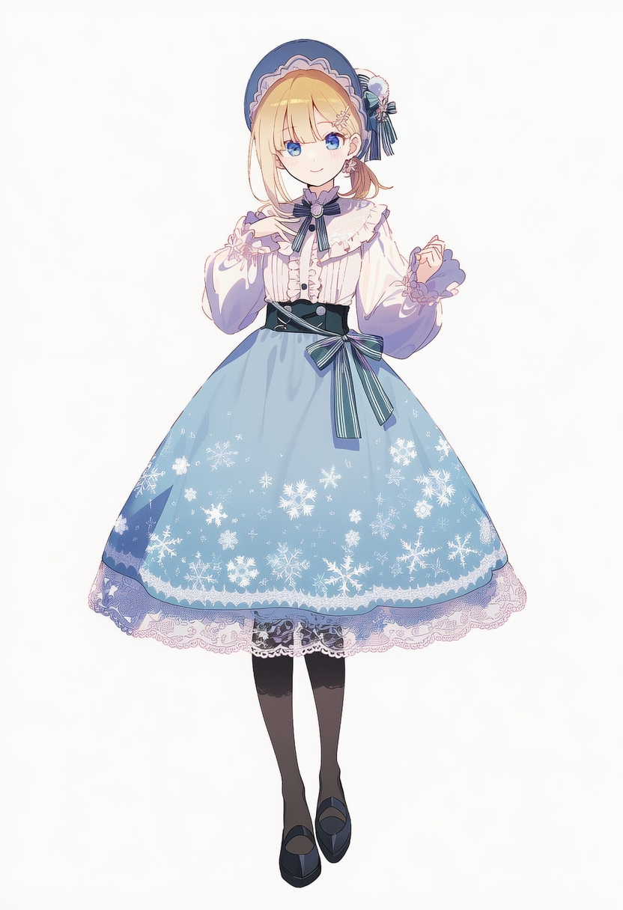

[在线例图](https://assets.quicktagcloud.com/images/raven_composition/raven_composition-0358.jpg?v=4dabc2fe98f74585)

<a id="raven_composition-0359"></a>

## 蕾丝裙

ID：`raven_composition-0359`；分类：裙子；来源标记：`safe`。

来源说明：

> 以蕾丝作为主要可见材质或大面积装饰的半身裙。该 tag 强调这一视觉结构/装饰特征，不限定裙长和基本版型。

正向提示词：

```text
lace_skirt
```

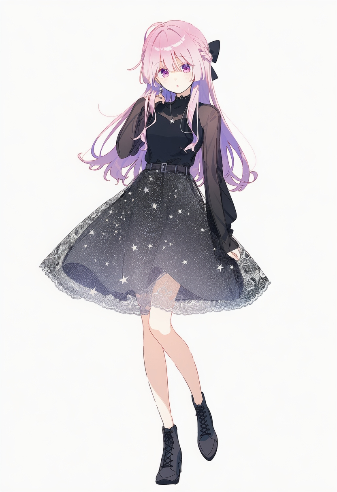

[在线例图](https://assets.quicktagcloud.com/images/raven_composition/raven_composition-0359.jpg?v=b4825be4ce303a19)

<a id="raven_composition-0360"></a>

## 细条纹半身裙

ID：`raven_composition-0360`；分类：裙子；来源标记：`safe`。

来源说明：

> 以细密竖向针条纹作为主要视觉图案的半身裙。该 tag 只描述图案，可与 miniskirt、pleated_skirt、denim_skirt 等长度/结构/材质标签组合使用。

正向提示词：

```text
pinstripe_skirt
```

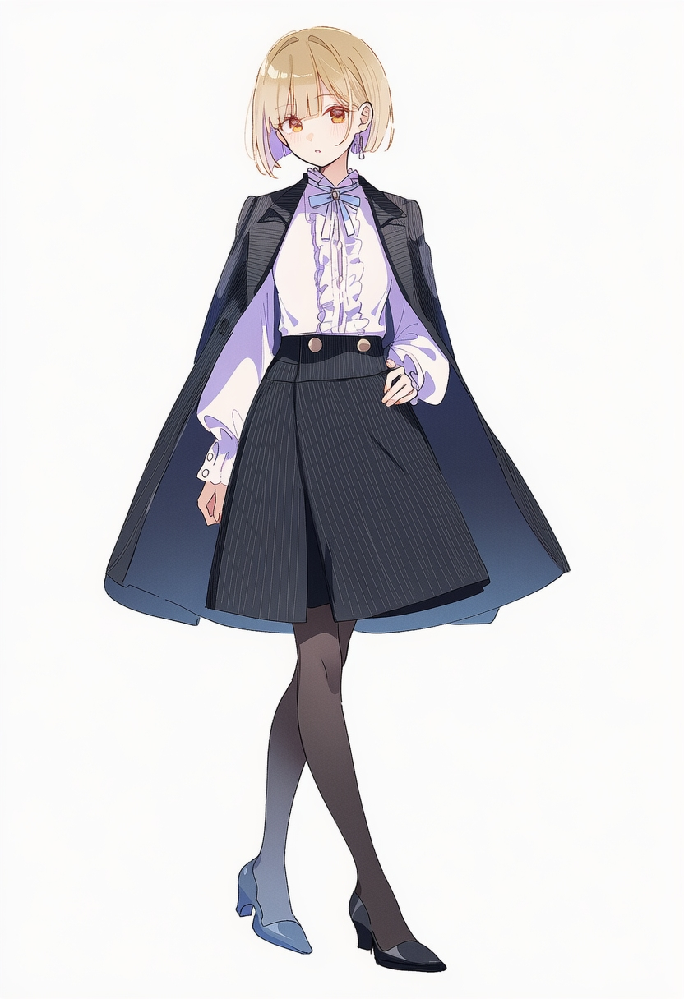

[在线例图](https://assets.quicktagcloud.com/images/raven_composition/raven_composition-0360.jpg?v=8ba80de9594ee923)

<a id="raven_composition-0361"></a>

## 格纹半身裙

ID：`raven_composition-0361`；分类：裙子；来源标记：`safe`。

来源说明：

> 以格纹/苏格兰格作为主要视觉图案的半身裙。该 tag 只描述图案，可与 miniskirt、pleated_skirt、denim_skirt 等长度/结构/材质标签组合使用。

正向提示词：

```text
plaid_skirt
```

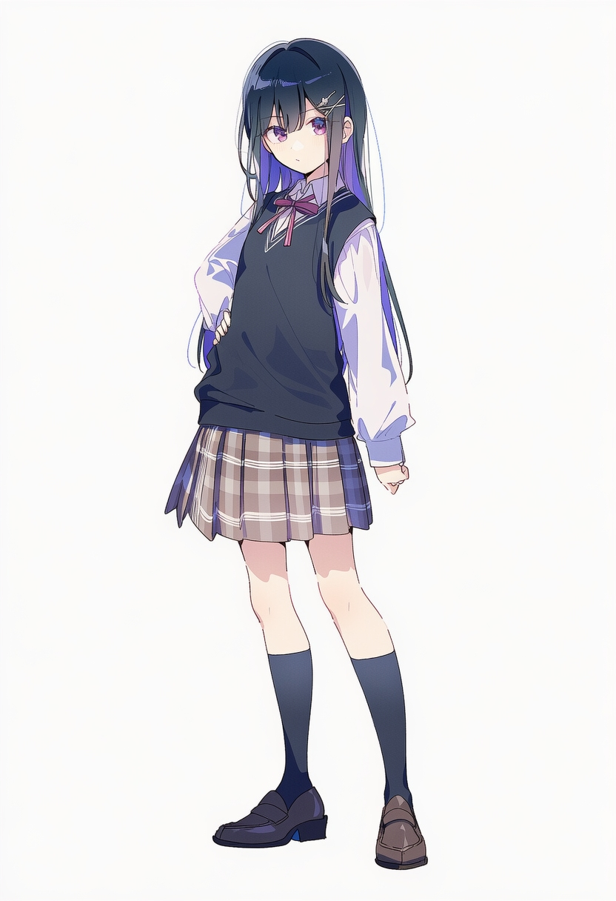

[在线例图](https://assets.quicktagcloud.com/images/raven_composition/raven_composition-0361.jpg?v=1c6480daf8a57fbf)

<a id="raven_composition-0362"></a>

## 百褶裙

ID：`raven_composition-0362`；分类：裙子；来源标记：`safe`。

来源说明：

> 具有规则重复压褶/百褶结构的半身裙。该 tag 强调这一视觉结构/装饰特征，不限定裙长和基本版型。

正向提示词：

```text
pleated_skirt
```

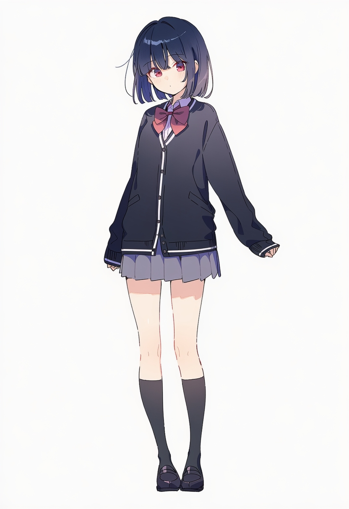

[在线例图](https://assets.quicktagcloud.com/images/raven_composition/raven_composition-0362.jpg?v=f6d8cdb0562137e2)

<a id="raven_composition-0363"></a>

## 印花半身裙

ID：`raven_composition-0363`；分类：裙子；来源标记：`safe`。

来源说明：

> 以明显印花作为主要视觉图案的半身裙。该 tag 只描述图案，可与 miniskirt、pleated_skirt、denim_skirt 等长度/结构/材质标签组合使用。

正向提示词：

```text
print_skirt
```

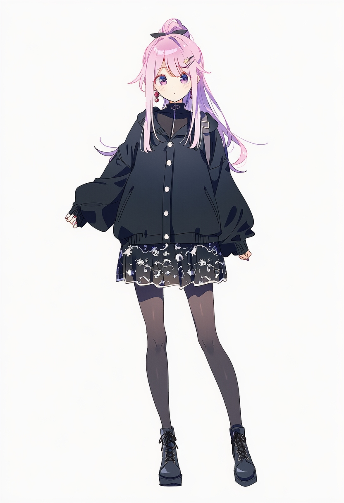

[在线例图](https://assets.quicktagcloud.com/images/raven_composition/raven_composition-0363.jpg?v=ff36951e3aeaae77)

<a id="raven_composition-0364"></a>

## 缎带饰边半身裙

ID：`raven_composition-0364`；分类：裙子；来源标记：`safe`。

来源说明：

> 裙摆或其他边缘带有明显缎带饰边的半身裙。重点是饰边，而不是整条裙子都由该材质制成。

正向提示词：

```text
ribbon-trimmed_skirt
```

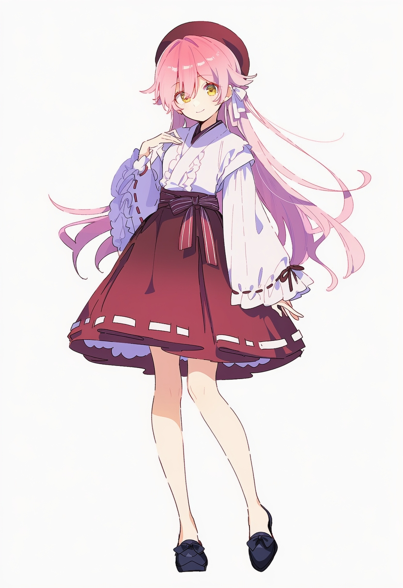

[在线例图](https://assets.quicktagcloud.com/images/raven_composition/raven_composition-0364.jpg?v=fa6bc4b6e8cf2451)

<a id="raven_composition-0365"></a>

## 透视半身裙

ID：`raven_composition-0365`；分类：裙子；来源标记：`safe`。

来源说明：

> 采用明显透明或半透明材质的半身裙。该 tag 强调这一视觉结构/装饰特征，不限定裙长和基本版型。

正向提示词：

```text
see-through_skirt
```

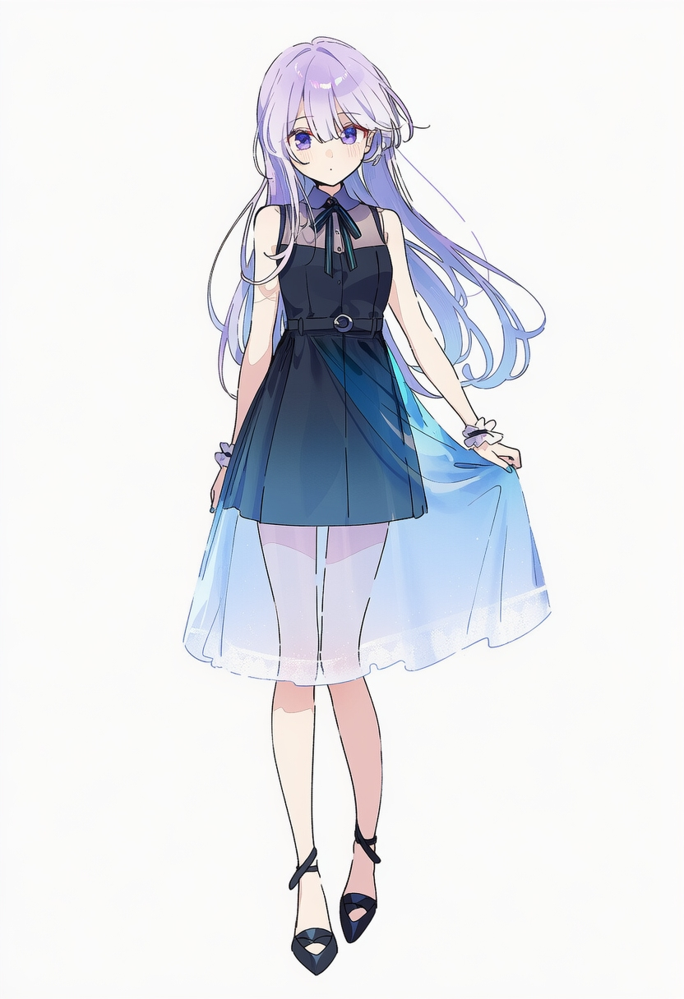

[在线例图](https://assets.quicktagcloud.com/images/raven_composition/raven_composition-0365.jpg?v=e46fde7763df64fe)

<a id="raven_composition-0366"></a>

## 镂空半身裙

ID：`raven_composition-0366`；分类：裙子；来源标记：`safe`。

来源说明：

> 半身裙上有规则设计的镂空区域，露出皮肤或内层服装。与 torn_skirt 不同，这些开口属于有意设计而非破损。

正向提示词：

```text
skirt_cutout
```

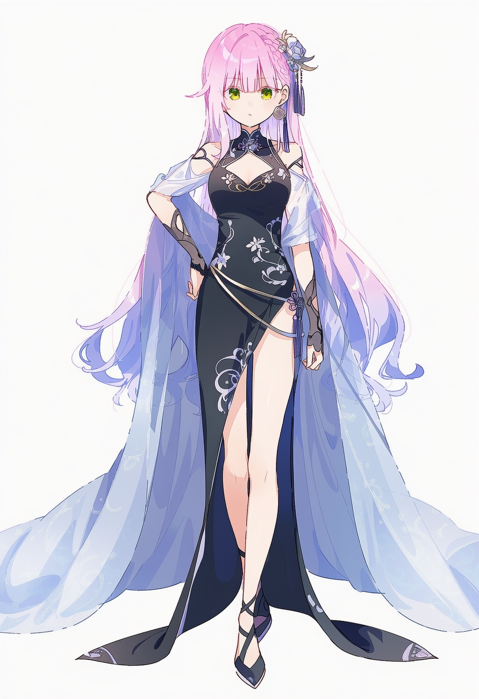

[在线例图](https://assets.quicktagcloud.com/images/raven_composition/raven_composition-0366.jpg?v=09475f1ea1a55e86)

<a id="raven_composition-0367"></a>

## 尖刺装饰裙

ID：`raven_composition-0367`；分类：裙子；来源标记：`safe`。

来源说明：

> 带尖刺状装饰的半身裙。该 tag 强调这一视觉结构/装饰特征，不限定裙长和基本版型。

正向提示词：

```text
spiked_skirt
```

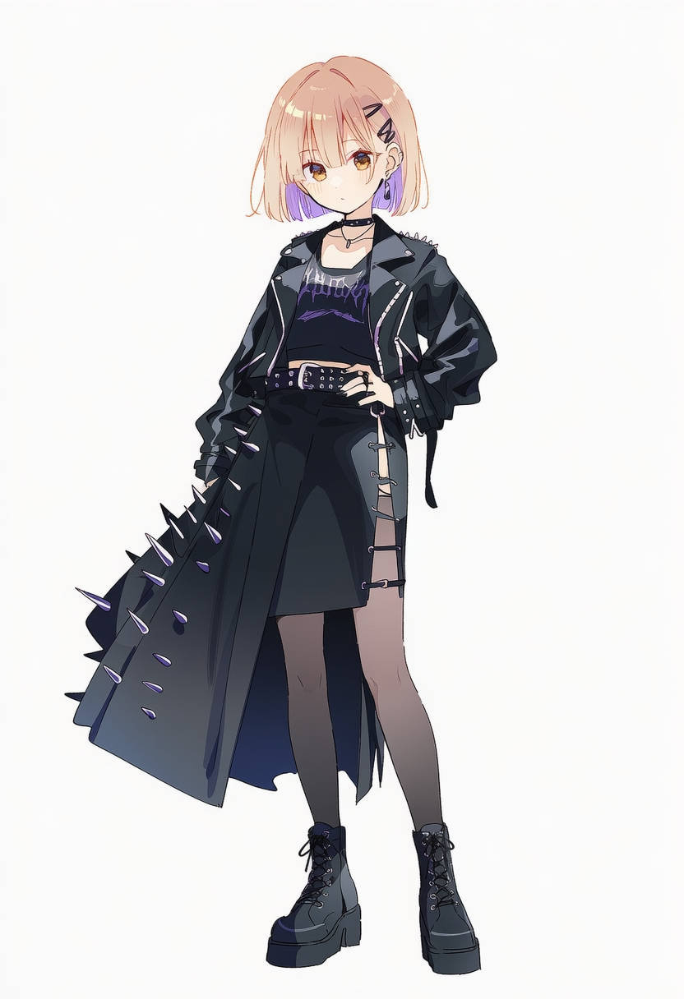

[在线例图](https://assets.quicktagcloud.com/images/raven_composition/raven_composition-0367.jpg?v=0de00b5ea97e368a)

<a id="raven_composition-0368"></a>

## 条纹半身裙

ID：`raven_composition-0368`；分类：裙子；来源标记：`safe`。

来源说明：

> 以条纹作为主要视觉图案的半身裙。该 tag 只描述图案，可与 miniskirt、pleated_skirt、denim_skirt 等长度/结构/材质标签组合使用。

正向提示词：

```text
striped_skirt
```

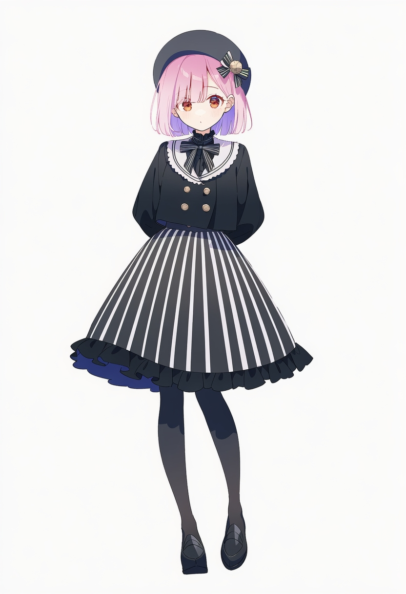

[在线例图](https://assets.quicktagcloud.com/images/raven_composition/raven_composition-0368.jpg?v=60f7081eb877a7bc)

<a id="raven_composition-0369"></a>

## 铆钉装饰裙

ID：`raven_composition-0369`；分类：裙子；来源标记：`safe`。

来源说明：

> 带大量铆钉装饰的半身裙。该 tag 强调这一视觉结构/装饰特征，不限定裙长和基本版型。

正向提示词：

```text
studded_skirt
```

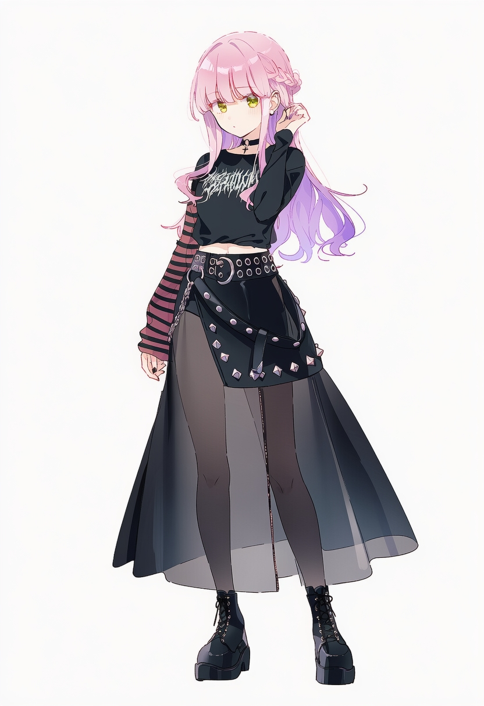

[在线例图](https://assets.quicktagcloud.com/images/raven_composition/raven_composition-0369.jpg?v=7d61eb8793588819)

<a id="raven_composition-0370"></a>

## 双面/两面异色半身裙

ID：`raven_composition-0370`；分类：裙子；来源标记：`safe`。

来源说明：

> 裙子内外两面具有明显不同的颜色、图案或设计，且差异属于真实面料设计而不是光影的半身裙。该 tag 强调这一视觉结构/装饰特征，不限定裙长和基本版型。

正向提示词：

```text
two-sided_skirt
```

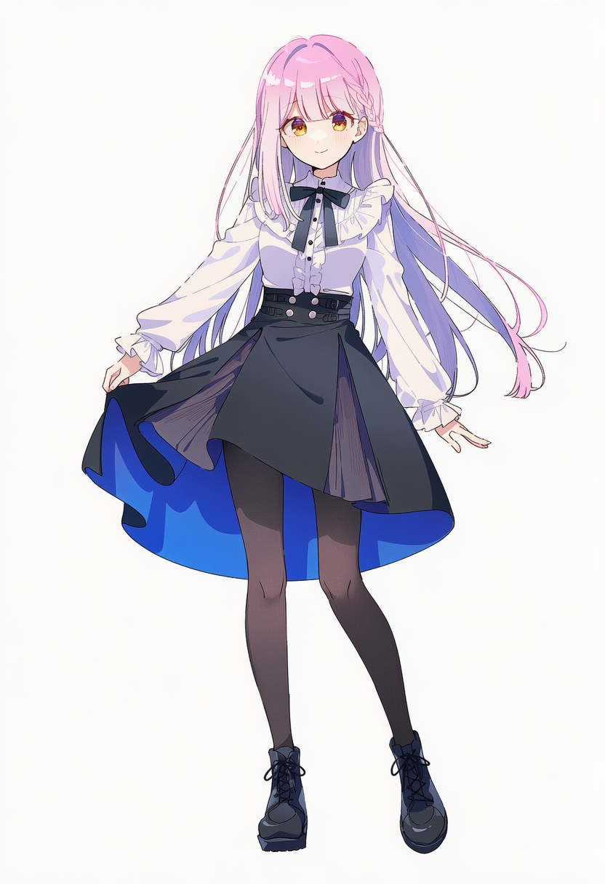

[在线例图](https://assets.quicktagcloud.com/images/raven_composition/raven_composition-0370.jpg?v=0803068da33e8f2c)

<a id="raven_composition-0371"></a>

## 腰带式裙装

ID：`raven_composition-0371`；分类：裙子；来源标记：`safe`。

来源说明：

> 由多条腰带/带状结构组合成裙状覆盖的服装，或裙体本身近似宽腰带结构；通常比普通裙子更强调带状构造。

正向提示词：

```text
belt_skirt
```

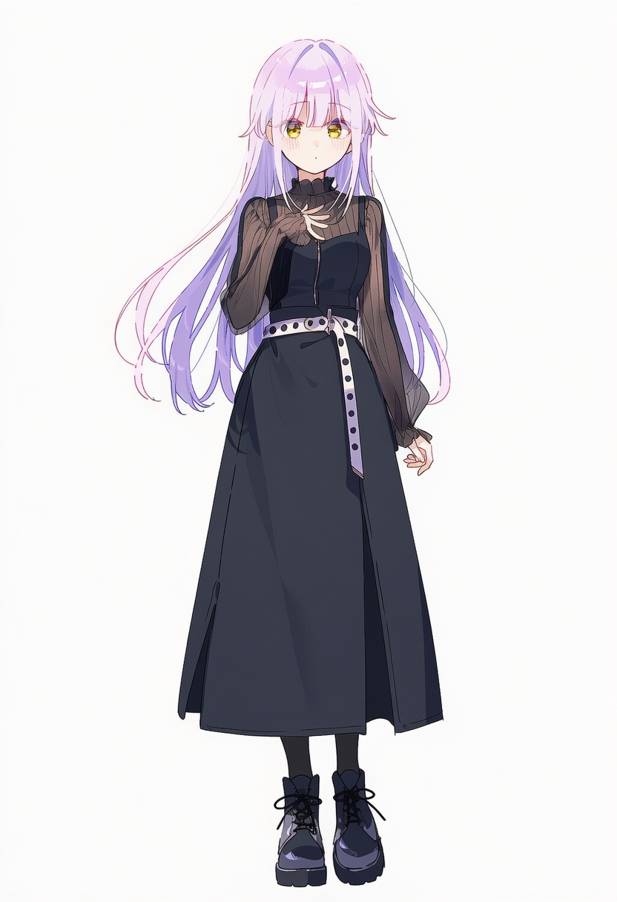

[在线例图](https://assets.quicktagcloud.com/images/raven_composition/raven_composition-0371.jpg?v=2e9a124f46552451)

<a id="raven_composition-0372"></a>

## 裙裤/阔腿裤式下装

ID：`raven_composition-0372`；分类：裙子；来源标记：`safe`。

来源说明：

> 阔腿短裤/裙裤，裤腿宽大到视觉上像半身裙，但本质上是分腿下装。用于区分真正 skirt。

正向提示词：

```text
culottes
```

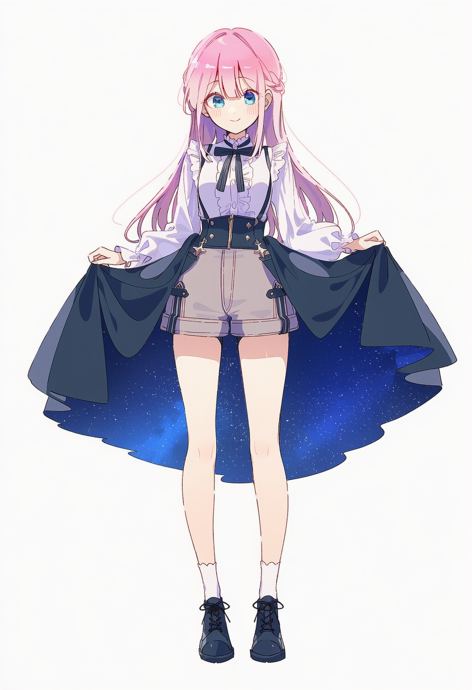

[在线例图](https://assets.quicktagcloud.com/images/raven_composition/raven_composition-0372.jpg?v=a054f0bc7bb7c1c5)

<a id="raven_composition-0373"></a>

## 苏格兰褶裙

ID：`raven_composition-0373`；分类：裙子；来源标记：`safe`。

来源说明：

> 苏格兰及凯尔特传统褶裙式下装，通常为格纹羊毛，环绕腰部固定，传统上常由男性穿着。

正向提示词：

```text
kilt
```

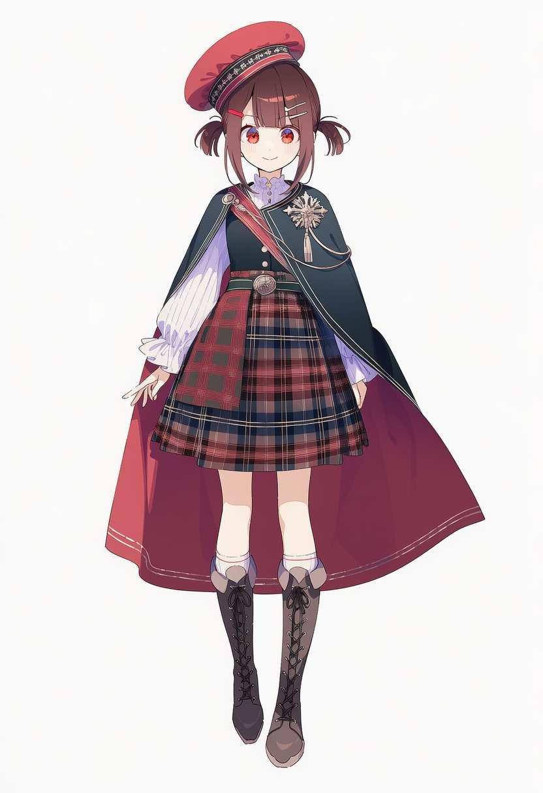

[在线例图](https://assets.quicktagcloud.com/images/raven_composition/raven_composition-0373.jpg?v=946b2ffe42209042)

<a id="raven_composition-0374"></a>

## 纱笼

ID：`raven_composition-0374`；分类：裙子；来源标记：`safe`。

来源说明：

> 东南亚、南亚及太平洋地区常见的长方形布料围裹式下装，可围在腰间形成裙状外观，常见于海滩或传统服饰。

正向提示词：

```text
sarong
```

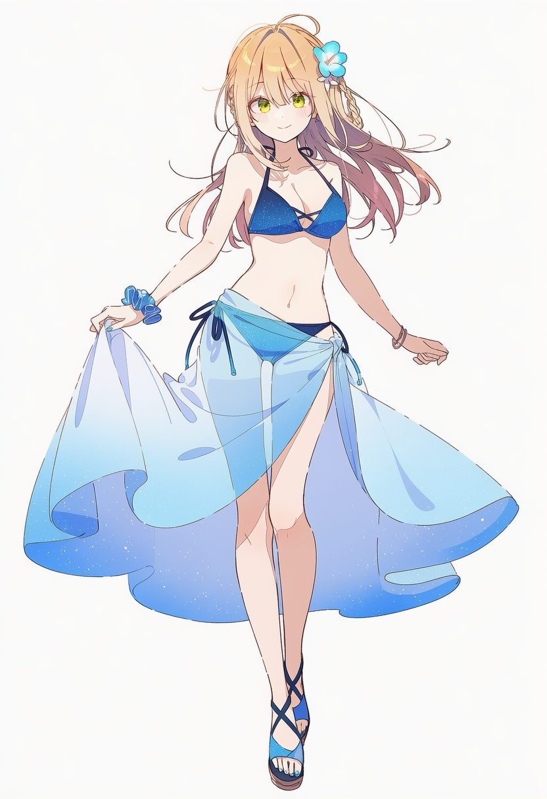

[在线例图](https://assets.quicktagcloud.com/images/raven_composition/raven_composition-0374.jpg?v=169b183afd73d172)

<a id="raven_composition-0375"></a>

## 较规范的洛丽塔整套搭配

ID：`raven_composition-0375`；分类：裙子；来源标记：`safe`。

来源说明：

> 用于较完整、符合 Lolita 穿搭惯例的 coord（整套搭配），通常包括合适轮廓的裙装、衬裙、上衣/JSK、袜子、鞋、头饰等；强调不是“只要有蕾丝和蓬裙就算 Lolita”。

正向提示词：

```text
accurate_lolita_coord
```

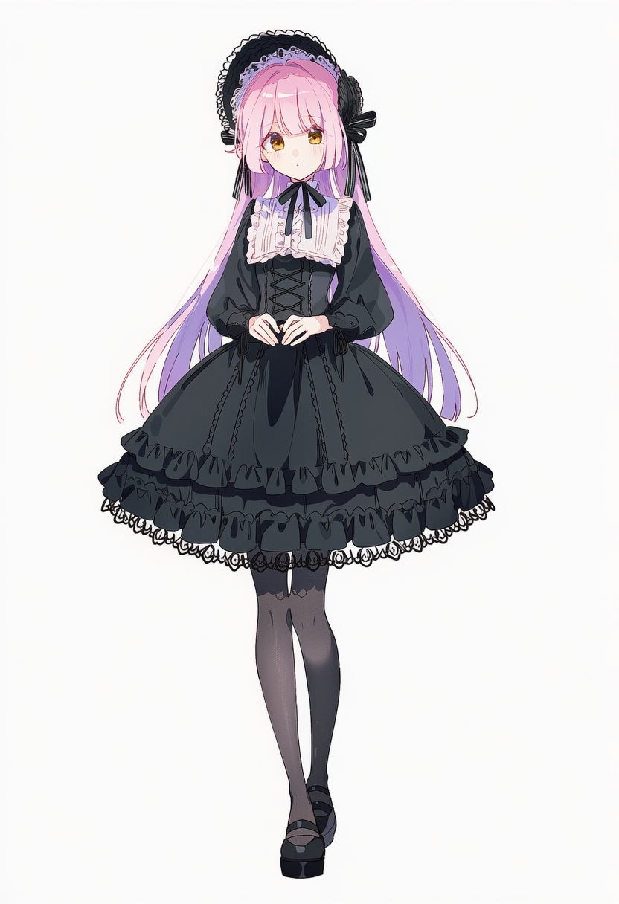

[在线例图](https://assets.quicktagcloud.com/images/raven_composition/raven_composition-0375.jpg?v=73bd6188666279e6)

<a id="raven_composition-0376"></a>

## 古典洛丽塔

ID：`raven_composition-0376`；分类：裙子；来源标记：`safe`。

来源说明：

> 古典 Lolita，整体比甜系更成熟内敛，常用低饱和色、花卉、复古纹样和优雅剪裁，保留标准蓬裙轮廓但装饰较克制。

正向提示词：

```text
classic_lolita
```

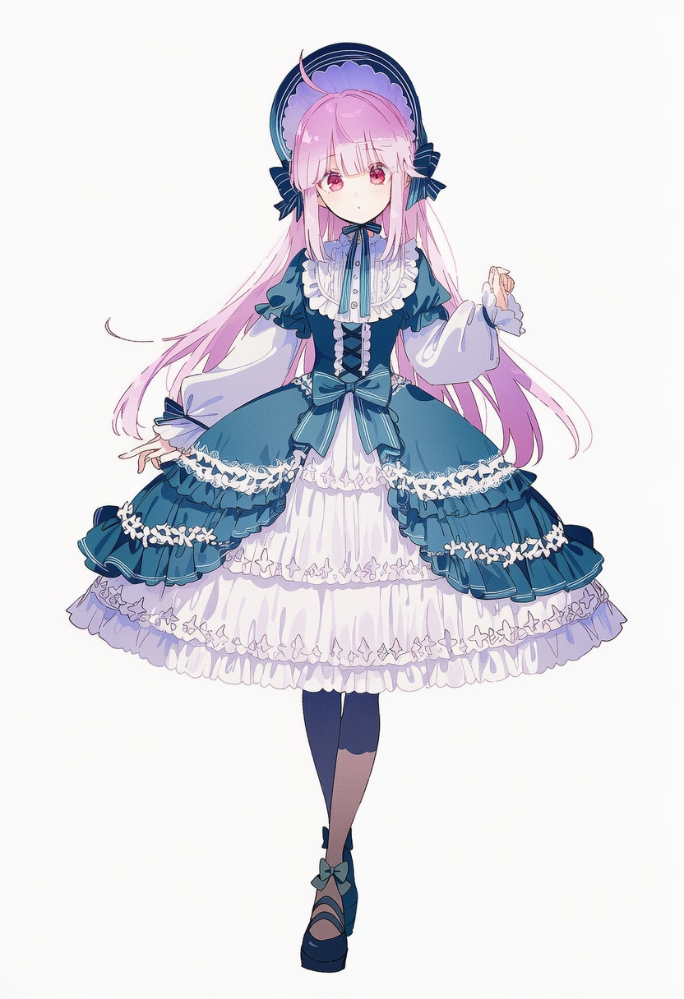

[在线例图](https://assets.quicktagcloud.com/images/raven_composition/raven_composition-0376.jpg?v=bc76525cbedb2846)

<a id="raven_composition-0377"></a>

## 乡村洛丽塔

ID：`raven_composition-0377`；分类：裙子；来源标记：`safe`。

来源说明：

> 乡村 Lolita，以田园、农庄、野餐感为主题，常见格纹、草帽、花卉、水果篮、自然色等元素。

正向提示词：

```text
country_lolita
```

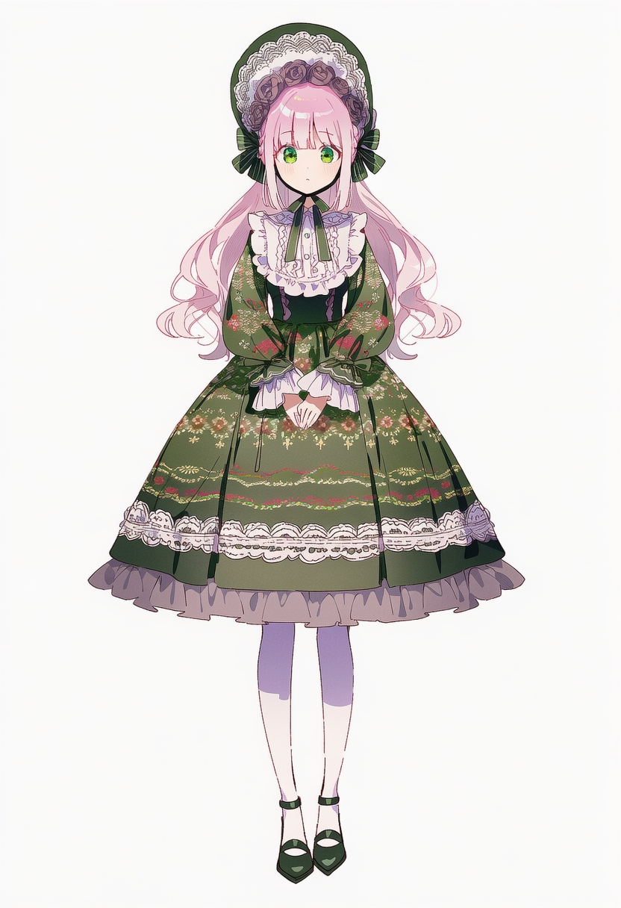

[在线例图](https://assets.quicktagcloud.com/images/raven_composition/raven_composition-0377.jpg?v=11aa5a02f3e1d410)

<a id="raven_composition-0378"></a>

## 哥特洛丽塔

ID：`raven_composition-0378`；分类：裙子；来源标记：`safe`。

来源说明：

> 哥特 Lolita，把 Lolita 的蓬裙、蕾丝和端庄轮廓与哥特元素结合，常见深色、十字架、教堂、玫瑰等视觉主题。

正向提示词：

```text
gothic_lolita
```

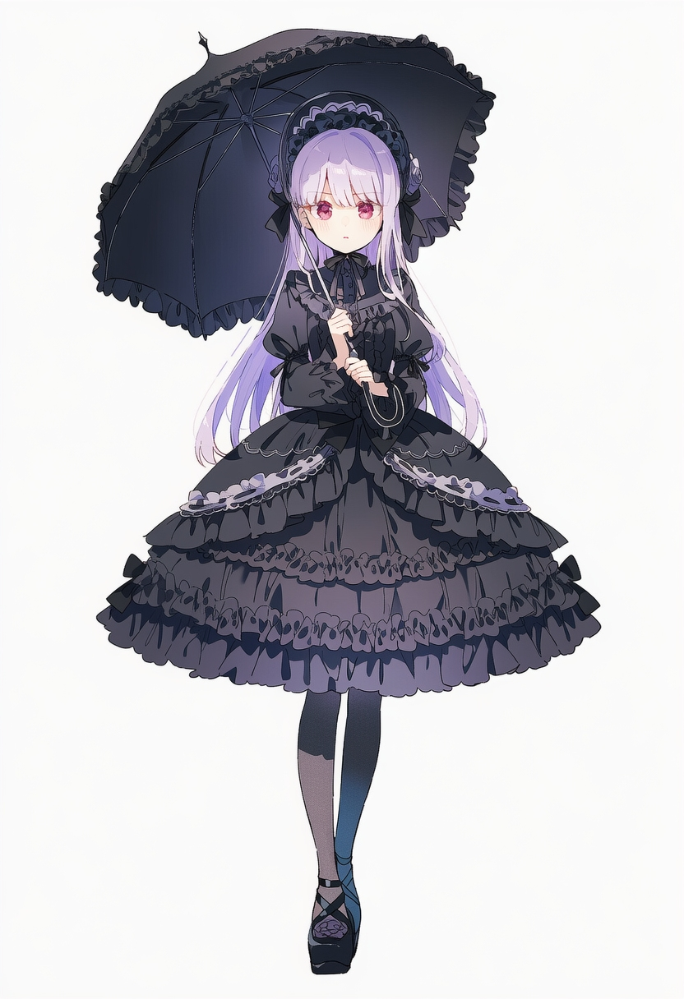

[在线例图](https://assets.quicktagcloud.com/images/raven_composition/raven_composition-0378.jpg?v=9d5f79bd84411876)

<a id="raven_composition-0379"></a>

## 姬系洛丽塔

ID：`raven_composition-0379`；分类：裙子；来源标记：`safe`。

来源说明：

> 姬系 Lolita，强调公主般华丽甜美的装饰，常见皇冠/头花、卷发、大量蕾丝、蝴蝶结和精致珠宝感。

正向提示词：

```text
hime_lolita
```

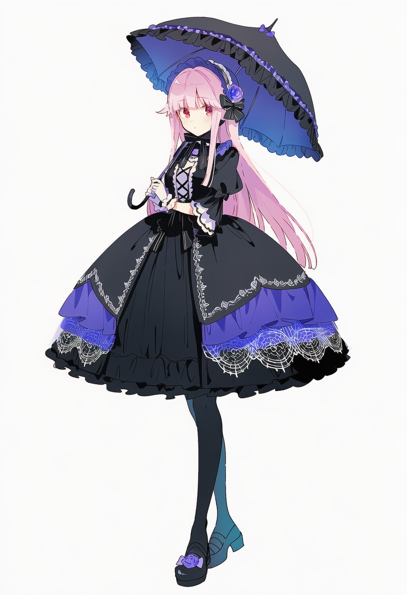

[在线例图](https://assets.quicktagcloud.com/images/raven_composition/raven_composition-0379.jpg?v=1c165c3f642431d8)

<a id="raven_composition-0380"></a>

## 韩风洛丽塔

ID：`raven_composition-0380`；分类：裙子；来源标记：`safe`。

来源说明：

> 带韩国传统服饰或韩国审美元素的 Lolita 分支，在 Lolita 基础轮廓上融入韩服式结构、纹样或配饰。

正向提示词：

```text
jo_lolita
```

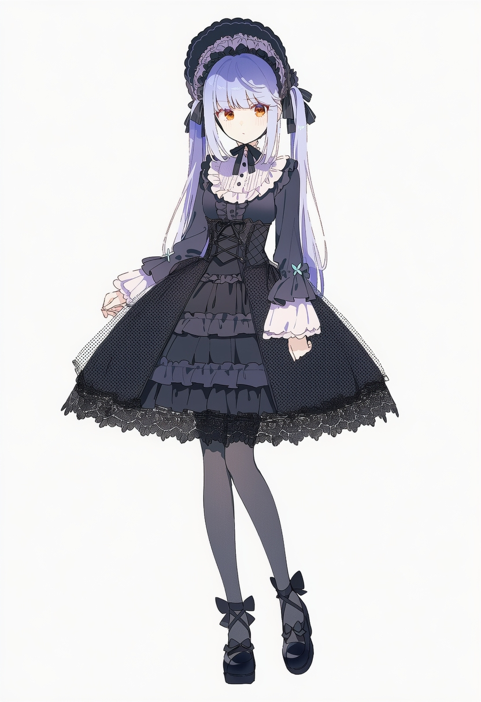

[在线例图](https://assets.quicktagcloud.com/images/raven_composition/raven_composition-0380.jpg?v=f4d86dc029c9a26d)

<a id="raven_composition-0381"></a>

## 洛丽塔时尚

ID：`raven_composition-0381`；分类：裙子；来源标记：`safe`。

来源说明：

> 日本街头时尚中的 Lolita 风格，以维多利亚/洛可可式端庄轮廓为灵感，核心常包括及膝蓬裙、衬裙、蕾丝、头饰、长袜等；它是“整套风格”而不是某一种单独裙子。

正向提示词：

```text
lolita_fashion
```

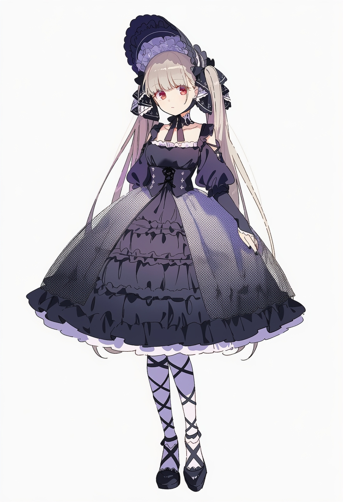

[在线例图](https://assets.quicktagcloud.com/images/raven_composition/raven_composition-0381.jpg?v=d1a4f65b6c2aae60)

<a id="raven_composition-0382"></a>

## 军装洛丽塔

ID：`raven_composition-0382`；分类：裙子；来源标记：`safe`。

来源说明：

> 军装 Lolita，将军服元素（肩章、双排扣、军帽、制服线条等）与 Lolita 蓬裙轮廓结合。

正向提示词：

```text
military_lolita
```

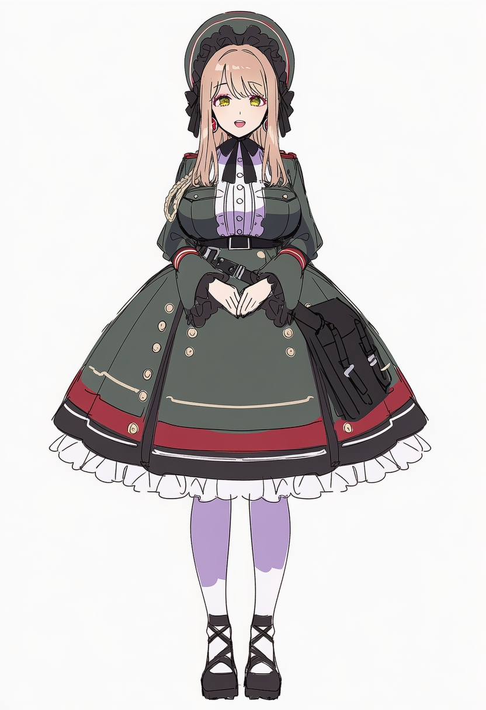

[在线例图](https://assets.quicktagcloud.com/images/raven_composition/raven_composition-0382.jpg?v=48064add4aa6ae81)

<a id="raven_composition-0383"></a>

## 朋克洛丽塔

ID：`raven_composition-0383`；分类：裙子；来源标记：`safe`。

来源说明：

> 朋克 Lolita，把格纹、链条、皮革、破损感、安全别针等朋克元素加入 Lolita 轮廓，整体更反叛、街头化。

正向提示词：

```text
punk_lolita
```

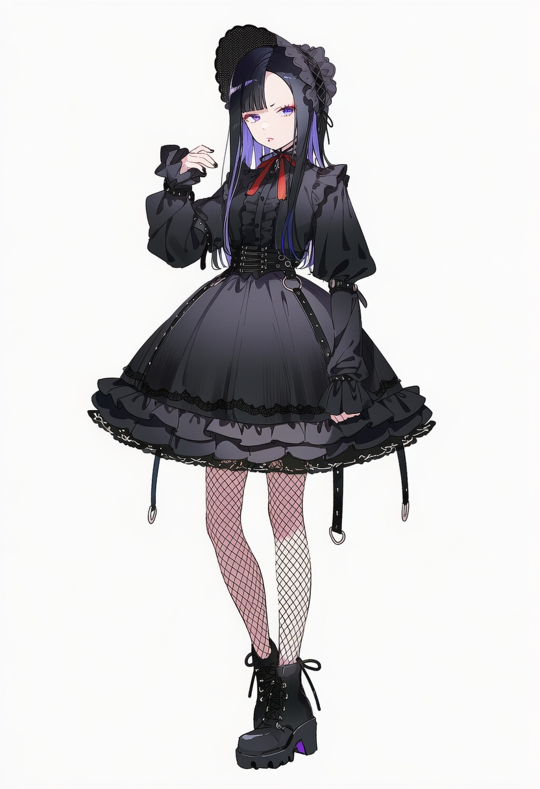

[在线例图](https://assets.quicktagcloud.com/images/raven_composition/raven_composition-0383.jpg?v=ecf8b2ed0de38bd5)

<a id="raven_composition-0384"></a>

## 中华风洛丽塔

ID：`raven_composition-0384`；分类：裙子；来源标记：`safe`。

来源说明：

> 中华风 Lolita，在标准 Lolita 裙装轮廓中融入旗袍领、盘扣、云纹、刺绣等中国传统服饰元素。

正向提示词：

```text
qi_lolita
```

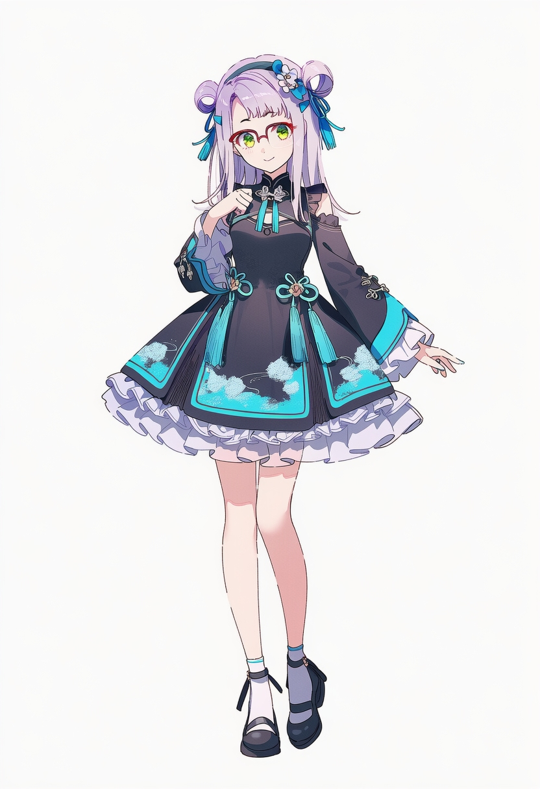

[在线例图](https://assets.quicktagcloud.com/images/raven_composition/raven_composition-0384.jpg?v=75d5b5d03b7ccbe2)

<a id="raven_composition-0385"></a>

## 甜系洛丽塔

ID：`raven_composition-0385`；分类：裙子；来源标记：`safe`。

来源说明：

> 甜系 Lolita，强调可爱、少女和糖果感，常见粉彩色、蝴蝶结、甜点/水果/玩具印花及较丰富的蕾丝装饰。

正向提示词：

```text
sweet_lolita
```

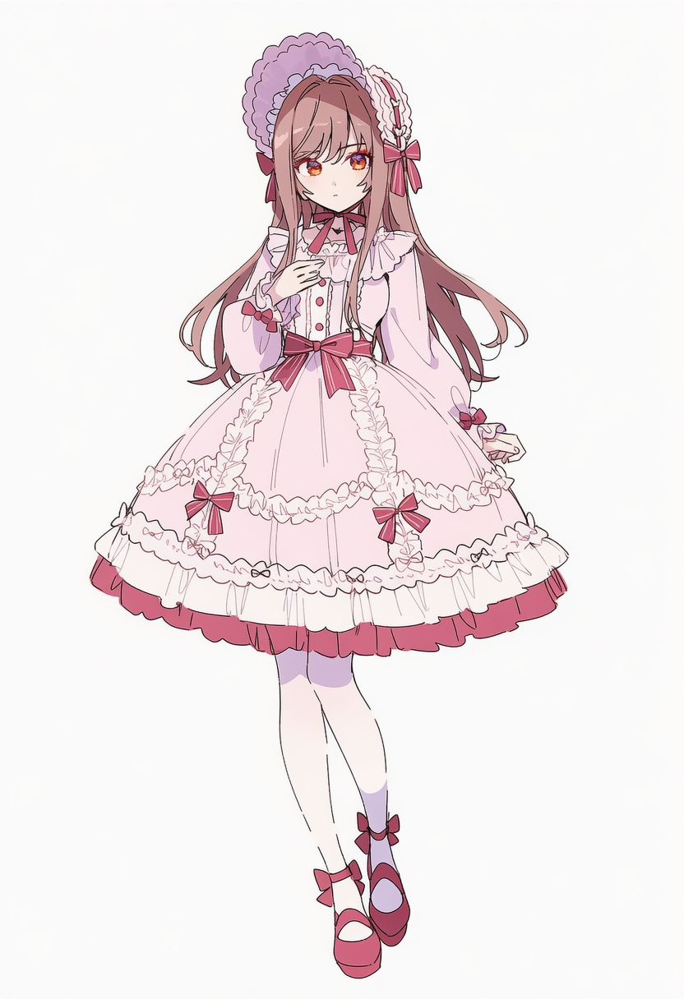

[在线例图](https://assets.quicktagcloud.com/images/raven_composition/raven_composition-0385.jpg?v=ca88f844aaa061e3)

<a id="raven_composition-0386"></a>

## 越南风洛丽塔

ID：`raven_composition-0386`；分类：裙子；来源标记：`safe`。

来源说明：

> 越南风 Lolita，在 Lolita 轮廓中加入越南传统服装、纹样或文化元素，常见对奥黛等服饰语言的再设计。

正向提示词：

```text
viet_lolita
```

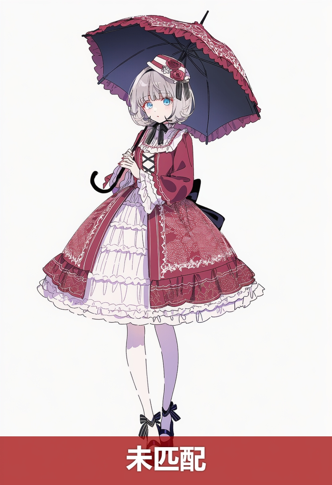

[在线例图](https://assets.quicktagcloud.com/images/raven_composition/raven_composition-0386.jpg?v=7297f96678f60fc9)

<a id="raven_composition-0387"></a>

## 和风洛丽塔

ID：`raven_composition-0387`；分类：裙子；来源标记：`safe`。

来源说明：

> 和风 Lolita，将和服领、振袖、和柄、腰带等日本传统元素与 Lolita 的蓬裙/衬裙轮廓结合。

正向提示词：

```text
wa_lolita
```

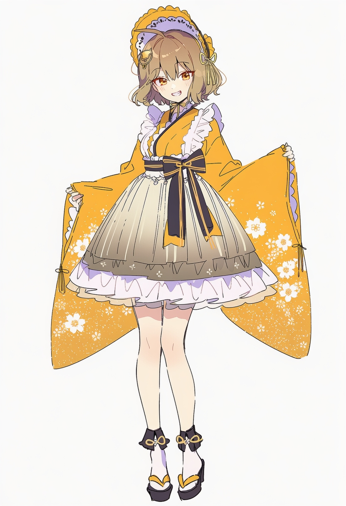

[在线例图](https://assets.quicktagcloud.com/images/raven_composition/raven_composition-0387.jpg?v=525337e78febf8d7)

<a id="raven_composition-0388"></a>

## 芭蕾课服装

ID：`raven_composition-0388`；分类：裙子；来源标记：`safe`。

来源说明：

> 芭蕾课/练功服的整体类别，常见紧身连体衣、连裤袜、软底芭蕾鞋等。它不一定包含裙子，因此属于“芭蕾服装相关”而非纯裙装 tag。

正向提示词：

```text
ballet_class_clothes
```

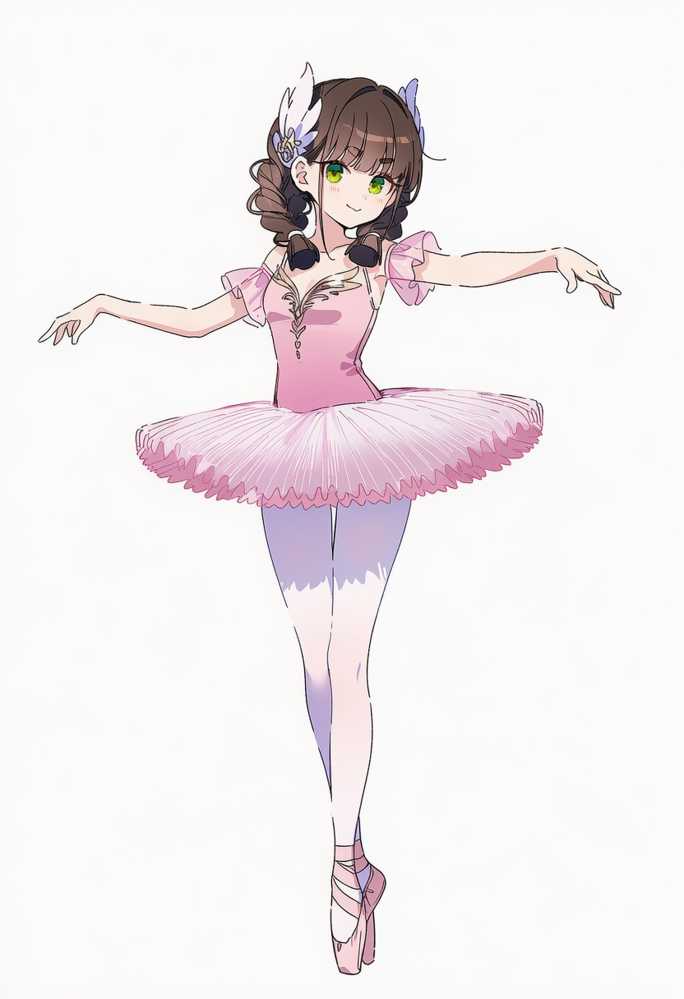

[在线例图](https://assets.quicktagcloud.com/images/raven_composition/raven_composition-0388.jpg?v=9018c98af4b4677f)

<a id="raven_composition-0389"></a>

## 芭蕾练功裙/芭蕾连衣裙

ID：`raven_composition-0389`；分类：裙子；来源标记：`safe`。

来源说明：

> 带有附着裙摆的芭蕾/舞蹈紧身连体服，上身通常像 leotard，下方连接短裙。与独立穿在腰部的 tutu 不同。

正向提示词：

```text
ballet_dress
```

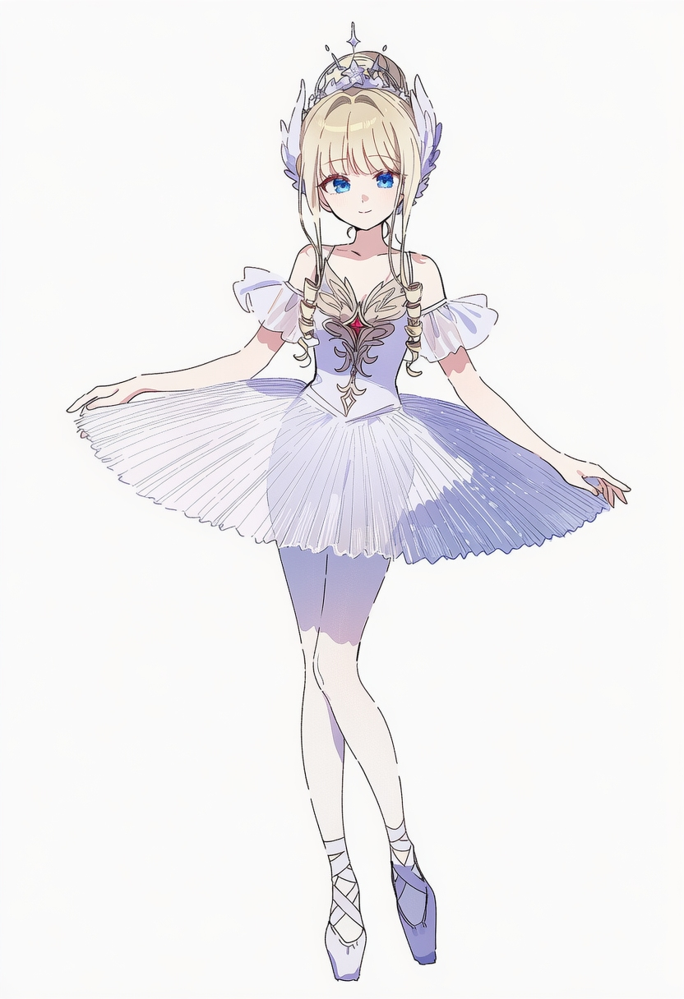

[在线例图](https://assets.quicktagcloud.com/images/raven_composition/raven_composition-0389.jpg?v=fea1284c16c45171)

<a id="raven_composition-0390"></a>

## 芭蕾核/芭蕾风穿搭

ID：`raven_composition-0390`；分类：裙子；来源标记：`safe`。

来源说明：

> 以芭蕾练功服和舞者意象为灵感的现代时尚风格，常见裹身针织、腿套、缎带、芭蕾鞋、柔和色和薄纱裙；它是风格 tag，不等同于单一裙型。

正向提示词：

```text
balletcore
```

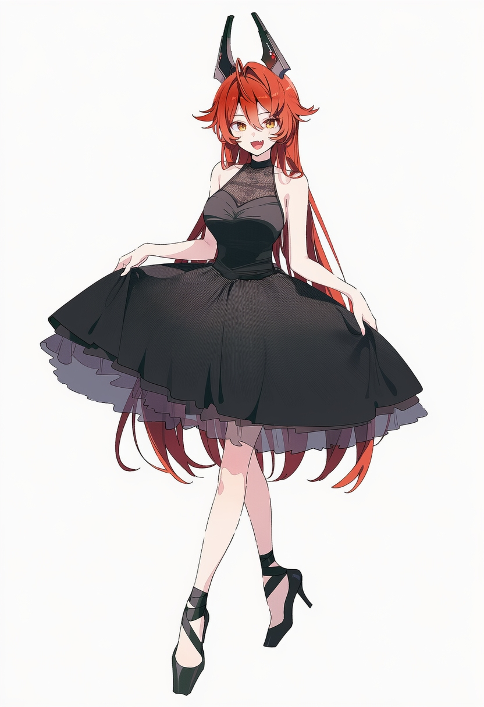

[在线例图](https://assets.quicktagcloud.com/images/raven_composition/raven_composition-0390.jpg?v=bdf4a69b8ea0e2fa)

<a id="raven_composition-0391"></a>

## 女仆装/女仆制服

ID：`raven_composition-0391`；分类：裙子；来源标记：`safe`。

来源说明：

> 女仆制服/女仆造型的总标签，典型西式/French maid 常包含连衣裙、围裙、褶边和头饰。当前 maid_dress 等写法通常归到 maid 概念，而非独立裙型。

正向提示词：

```text
maid
```

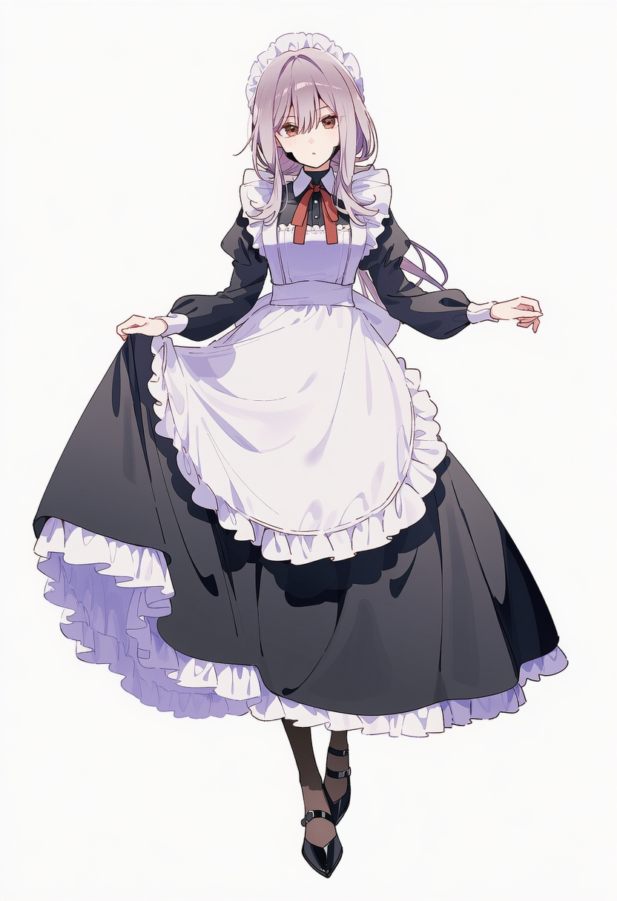

[在线例图](https://assets.quicktagcloud.com/images/raven_composition/raven_composition-0391.jpg?v=1642f74c3bac0eb3)

<a id="raven_composition-0392"></a>

## 中华风女仆装

ID：`raven_composition-0392`；分类：裙子；来源标记：`safe`。

来源说明：

> 将中式服装元素（如旗袍领、盘扣、传统纹样）与女仆制服结构结合的中华风女仆装。

正向提示词：

```text
qi_maid
```

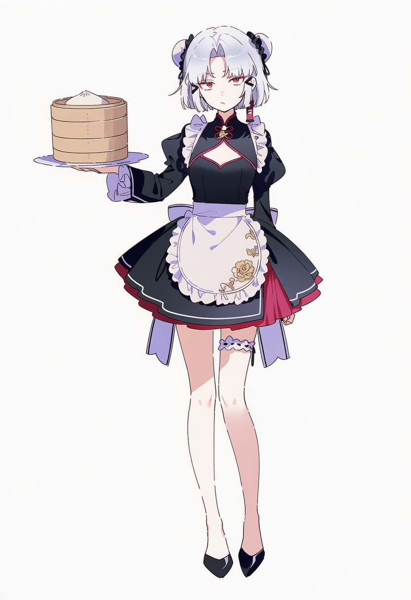

[在线例图](https://assets.quicktagcloud.com/images/raven_composition/raven_composition-0392.jpg?v=a5fce71059e1c744)

<a id="raven_composition-0393"></a>

## 维多利亚女仆装

ID：`raven_composition-0393`；分类：裙子；来源标记：`safe`。

来源说明：

> 以维多利亚时代家务女佣制服为基础的较传统女仆装，常见长裙、高领、长袖、围裙和较保守的剪裁。

正向提示词：

```text
victorian_maid
```

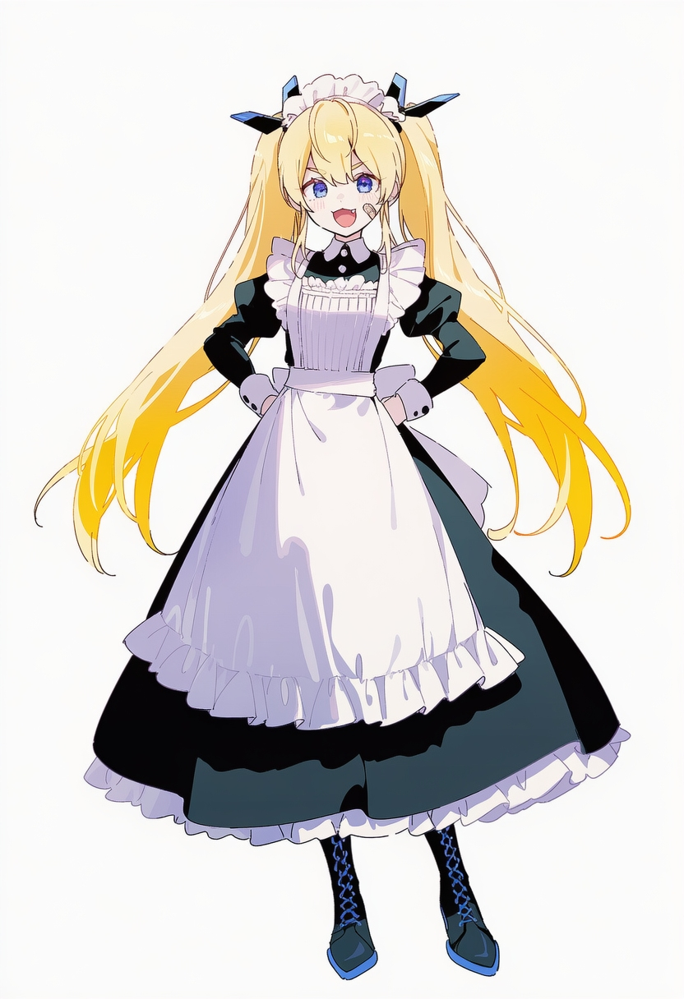

[在线例图](https://assets.quicktagcloud.com/images/raven_composition/raven_composition-0393.jpg?v=e3d69ffde4318fa6)

<a id="raven_composition-0394"></a>

## 和风女仆装

ID：`raven_composition-0394`；分类：裙子；来源标记：`safe`。

来源说明：

> 将和服、和柄、宽袖、腰带等日式传统元素融入女仆制服的和风女仆装。

正向提示词：

```text
wa_maid
```

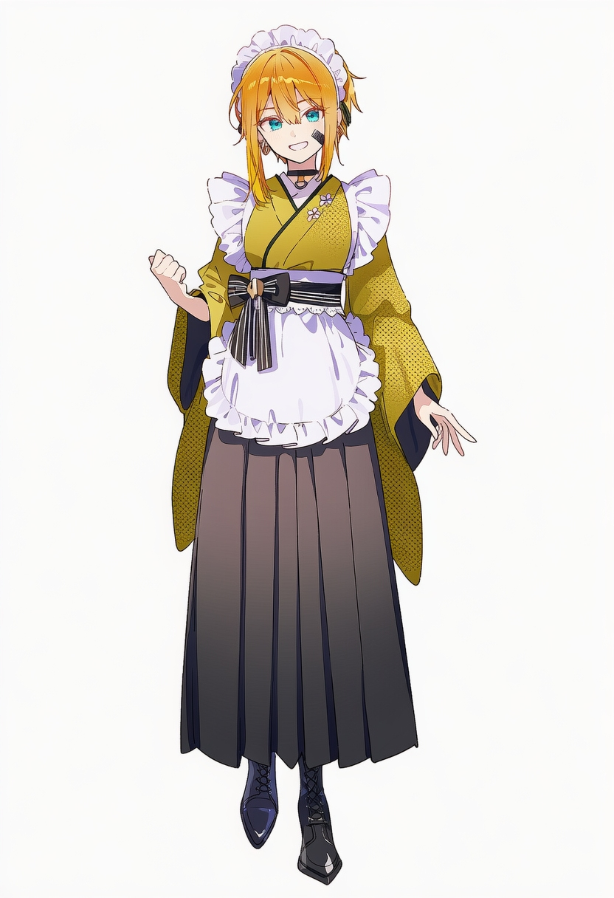

[在线例图](https://assets.quicktagcloud.com/images/raven_composition/raven_composition-0394.jpg?v=c2e9315e5a1c6331)

<a id="raven_composition-0395"></a>

## 娃娃式短睡裙

ID：`raven_composition-0395`；分类：裙子；来源标记：`safe`。

来源说明：

> 娃娃式短睡衣/内衣裙，通常从胸下或高腰处向下宽松散开，长度较短，常用薄纱、蕾丝或轻薄面料，强调轻盈和性感。

正向提示词：

```text
babydoll
```

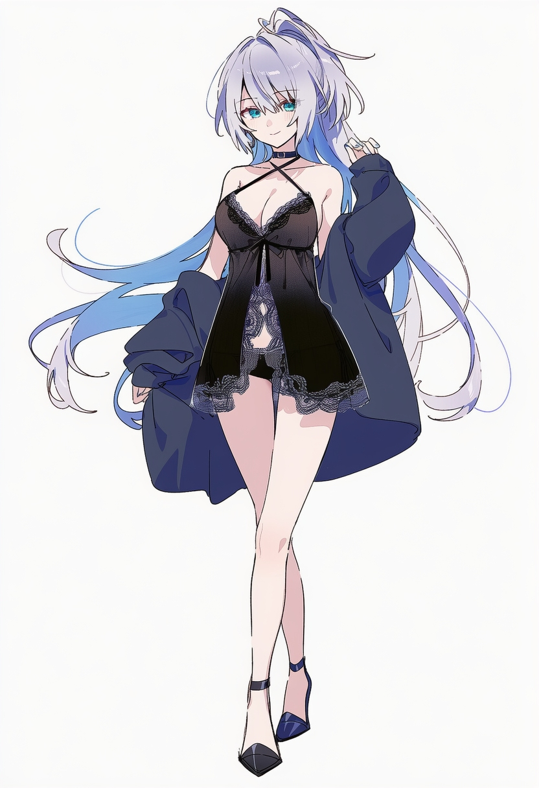

[在线例图](https://assets.quicktagcloud.com/images/raven_composition/raven_composition-0395.jpg?v=8255dc8dabd077b5)

<a id="raven_composition-0396"></a>

## 衬裙式睡衣/贴身裙装

ID：`raven_composition-0396`；分类：裙子；来源标记：`safe`。

来源说明：

> 衬裙式贴身睡衣/内衣，通常为直筒或微收腰的轻薄无袖裙装，长度多在大腿至膝部，结构比 babydoll 更简洁贴身。

正向提示词：

```text
chemise
```

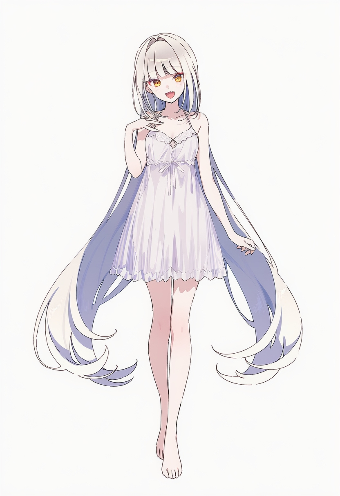

[在线例图](https://assets.quicktagcloud.com/images/raven_composition/raven_composition-0396.jpg?v=733714a950e16ace)

<a id="raven_composition-0397"></a>

## 褶边/荷叶边娃娃式短睡裙

ID：`raven_composition-0397`；分类：裙子；来源标记：`safe`。

来源说明：

> 带明显荷叶边/褶边装饰的 babydoll，褶边常位于胸口、肩带或下摆。

正向提示词：

```text
frilled_babydoll
```


[在线例图](https://assets.quicktagcloud.com/images/raven_composition/raven_composition-0397.jpg?v=93cb489b6eb35786)

<a id="raven_composition-0398"></a>

## 褶边/荷叶边薄睡袍/睡裙

ID：`raven_composition-0398`；分类：裙子；来源标记：`safe`。

来源说明：

> 带大量褶边/荷叶边装饰的 negligee，在轻薄性感睡衣基础上增加更甜美、华丽的边饰。

正向提示词：

```text
frilled_negligee
```


[在线例图](https://assets.quicktagcloud.com/images/raven_composition/raven_composition-0398.jpg?v=e744523beec49b7e)

<a id="raven_composition-0399"></a>

## 褶边/荷叶边睡裙

ID：`raven_composition-0399`；分类：裙子；来源标记：`safe`。

来源说明：

> 带明显荷叶边/褶边的睡裙，通常装饰于领口、袖口、裙摆等位置。

正向提示词：

```text
frilled_nightgown
```


[在线例图](https://assets.quicktagcloud.com/images/raven_composition/raven_composition-0399.jpg?v=5673de3c1851811e)

<a id="raven_composition-0400"></a>

## 缎带饰边娃娃式短睡裙

ID：`raven_composition-0400`；分类：裙子；来源标记：`safe`。

来源说明：

> 以缎带作为明显饰边或边缘装饰的 babydoll，强调 ribbon trim，而不是单个普通蝴蝶结。

正向提示词：

```text
ribbon-trimmed_babydoll
```


[在线例图](https://assets.quicktagcloud.com/images/raven_composition/raven_composition-0400.jpg?v=5279bb53d6fa4950)

<a id="raven_composition-0401"></a>

## 透视娃娃式短睡裙

ID：`raven_composition-0401`；分类：裙子；来源标记：`safe`。

来源说明：

> 由透明/半透明薄纱等材质制成的 babydoll，可明显透见皮肤或内衣。

正向提示词：

```text
see-through_babydoll
```


[在线例图](https://assets.quicktagcloud.com/images/raven_composition/raven_composition-0401.jpg?v=46ec1967d402e2a8)

<a id="raven_composition-0402"></a>

## 透视睡裙

ID：`raven_composition-0402`；分类：裙子；来源标记：`safe`。

来源说明：

> 透明或半透明材质的睡裙，能明显看到身体轮廓或内层衣物。

正向提示词：

```text
see-through_nightgown
```


[在线例图](https://assets.quicktagcloud.com/images/raven_composition/raven_composition-0402.jpg?v=a1f76f9d720fad71)

<a id="raven_composition-0403"></a>

## 振袖和服

ID：`raven_composition-0403`；分类：裙子；来源标记：`safe`。

来源说明：

> 振袖和服，特点是非常长、垂下的袖子，传统上多与未婚女性正式场合相关。它不是裙子本身，但在日式礼服/裙装研究中常作为相关服装。

正向提示词：

```text
furisode
```


[在线例图](https://assets.quicktagcloud.com/images/raven_composition/raven_composition-0403.jpg?v=c1de824efb5df516)

<a id="raven_composition-0404"></a>

## 韩服（整套）

ID：`raven_composition-0404`；分类：裙子；来源标记：`safe`。

来源说明：

> 韩服总称，女装典型由短上衣 jeogori 与高腰长裙 chima 组成。它是完整套装概念，不是单一裙子。

正向提示词：

```text
hanbok
```


[在线例图](https://assets.quicktagcloud.com/images/raven_composition/raven_composition-0404.jpg?v=d55eeff6ac5542be)

<a id="raven_composition-0405"></a>

## 韩国传统婚礼长袍

ID：`raven_composition-0405`；分类：裙子；来源标记：`safe`。

来源说明：

> 韩国传统婚礼礼服之一，通常是刺绣华丽、宽袖的长袍式外衣，穿在其他韩服层之上。属于传统婚服相关，不是普通半身裙。

正向提示词：

```text
hwalot
```


[在线例图](https://assets.quicktagcloud.com/images/raven_composition/raven_composition-0405.jpg?v=9b88dde97149b913)

<a id="raven_composition-0406"></a>

## 和服

ID：`raven_composition-0406`；分类：裙子；来源标记：`safe`。

来源说明：

> 日本传统 T 形长袍，通过腰带（obi）固定，整体是一件式长袍而非西式连衣裙/半身裙，但视觉上具有长裙摆。

正向提示词：

```text
kimono
```


[在线例图](https://assets.quicktagcloud.com/images/raven_composition/raven_composition-0406.jpg?v=057458672268ed94)

<a id="raven_composition-0407"></a>

## 韩式衬裙

ID：`raven_composition-0407`；分类：裙子；来源标记：`safe`。

来源说明：

> 韩服中的内衬裙/衬裙，穿在 chima 之下，用于塑造体积、遮透或支撑外裙轮廓。

正向提示词：

```text
sokchima
```


[在线例图](https://assets.quicktagcloud.com/images/raven_composition/raven_composition-0407.jpg?v=2b05d3f6830c384d)

<a id="raven_composition-0408"></a>

## 打掛/婚礼外褂

ID：`raven_composition-0408`；分类：裙子；来源标记：`safe`。

来源说明：

> 日本传统婚礼/正式场合的华丽外层和服，通常很长并拖地，不用普通腰带束紧，常作为新娘礼服。

正向提示词：

```text
uchikake
```


[在线例图](https://assets.quicktagcloud.com/images/raven_composition/raven_composition-0408.jpg?v=d1b487686353e4ff)

<a id="raven_composition-0409"></a>

## 浴衣

ID：`raven_composition-0409`；分类：裙子；来源标记：`safe`。

来源说明：

> 轻薄棉质的夏季和服，结构类似简化 kimono，常用于祭典、温泉等休闲场合。它是袍式传统服装而非真正 skirt。

正向提示词：

```text
yukata
```


[在线例图](https://assets.quicktagcloud.com/images/raven_composition/raven_composition-0409.jpg?v=fe3be797cc8e9c3e)
