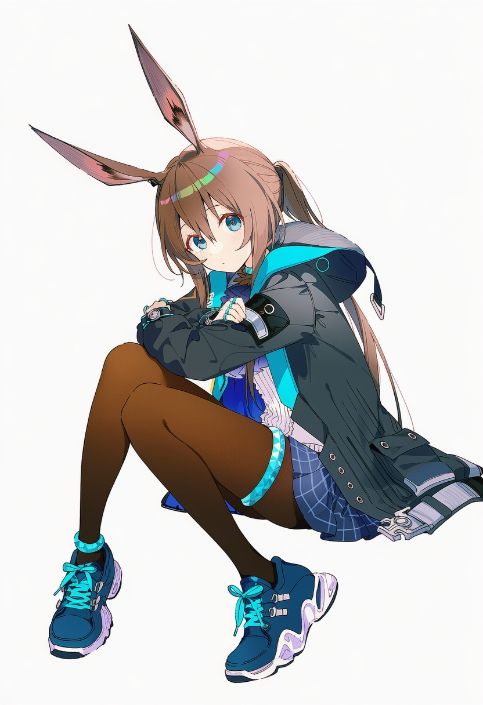
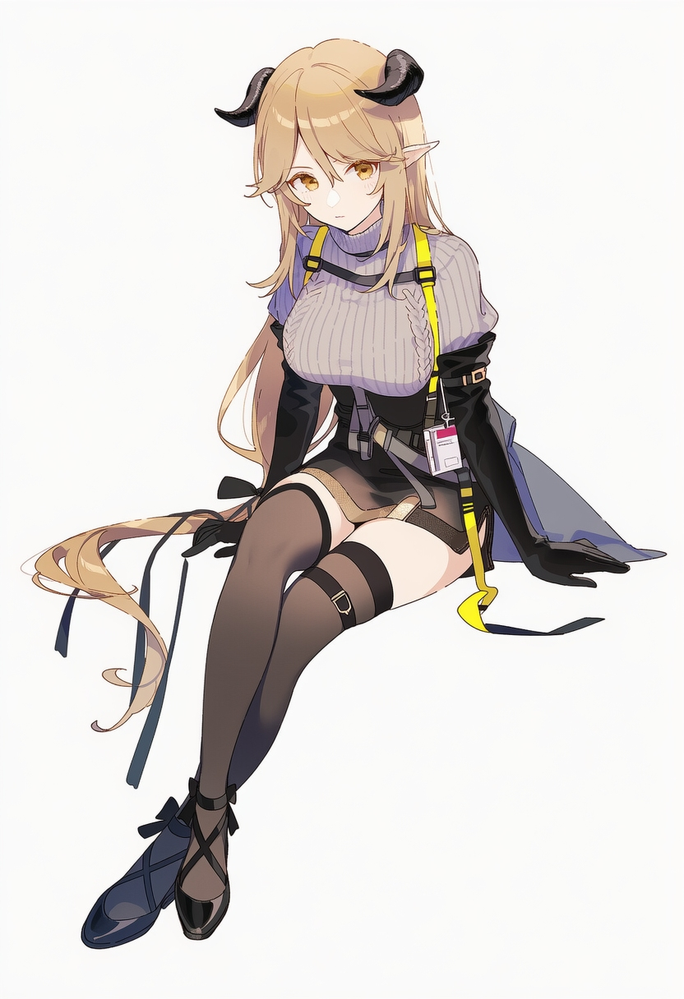
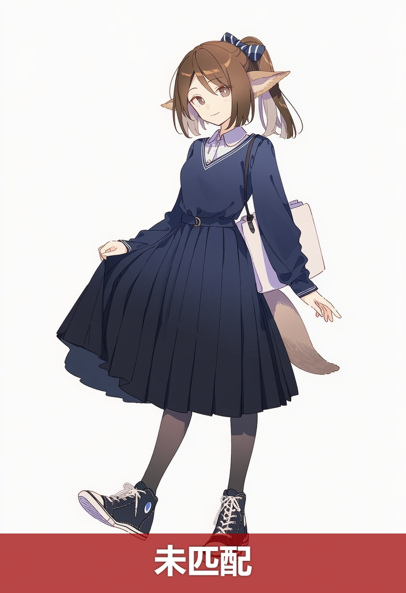
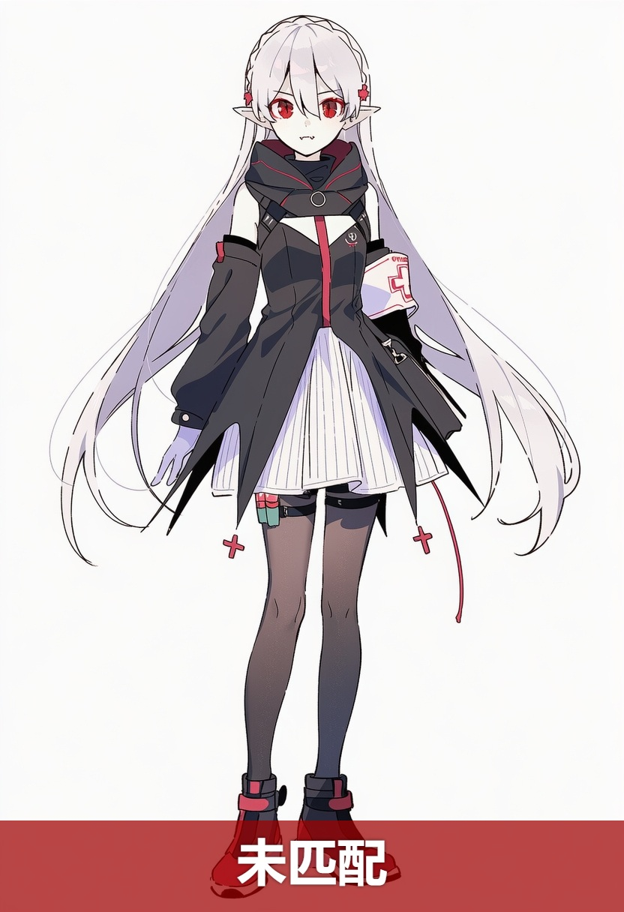
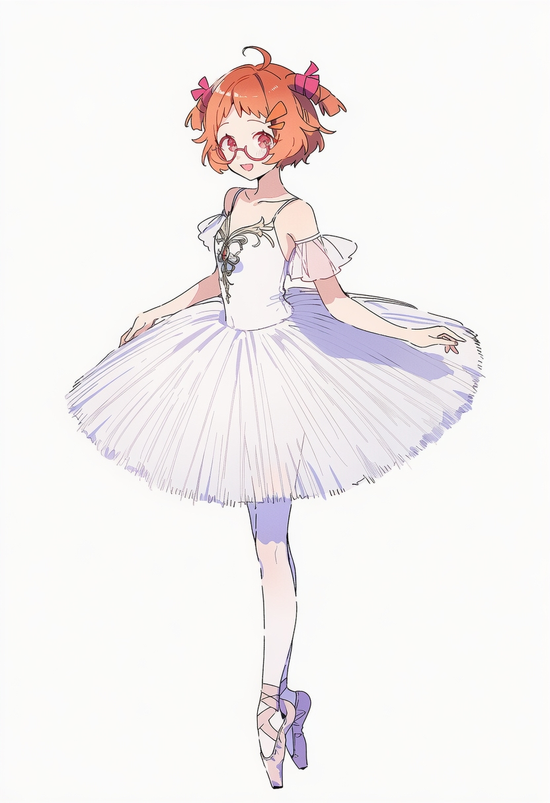
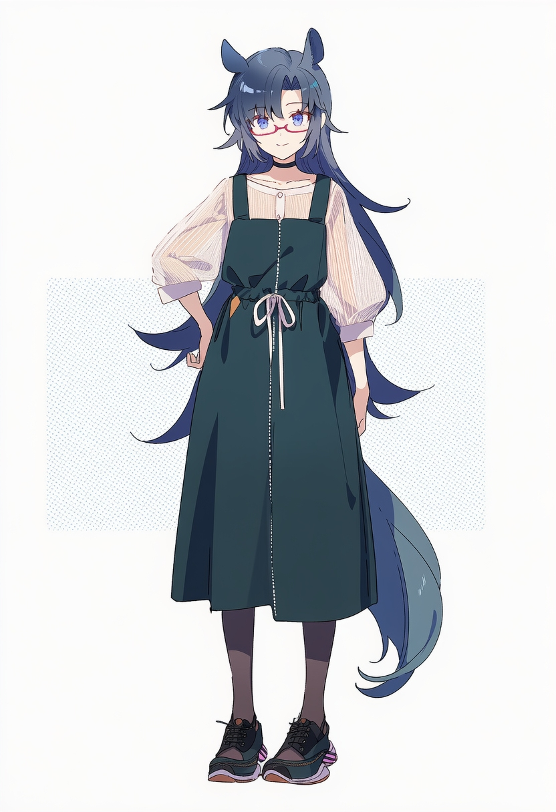
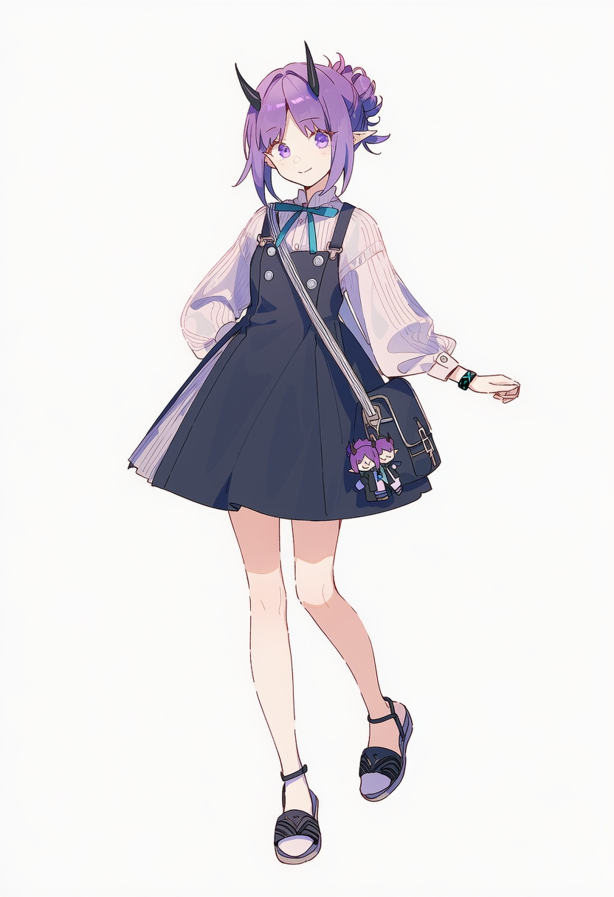
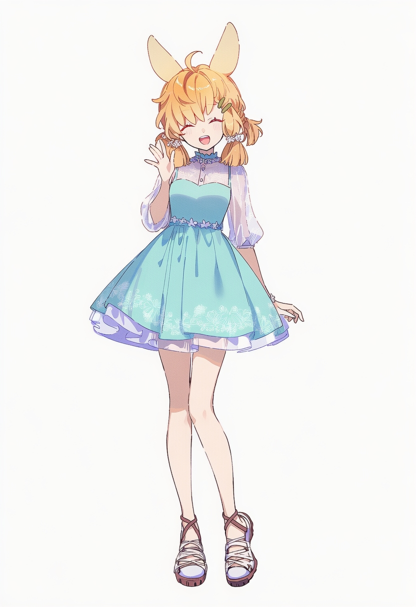
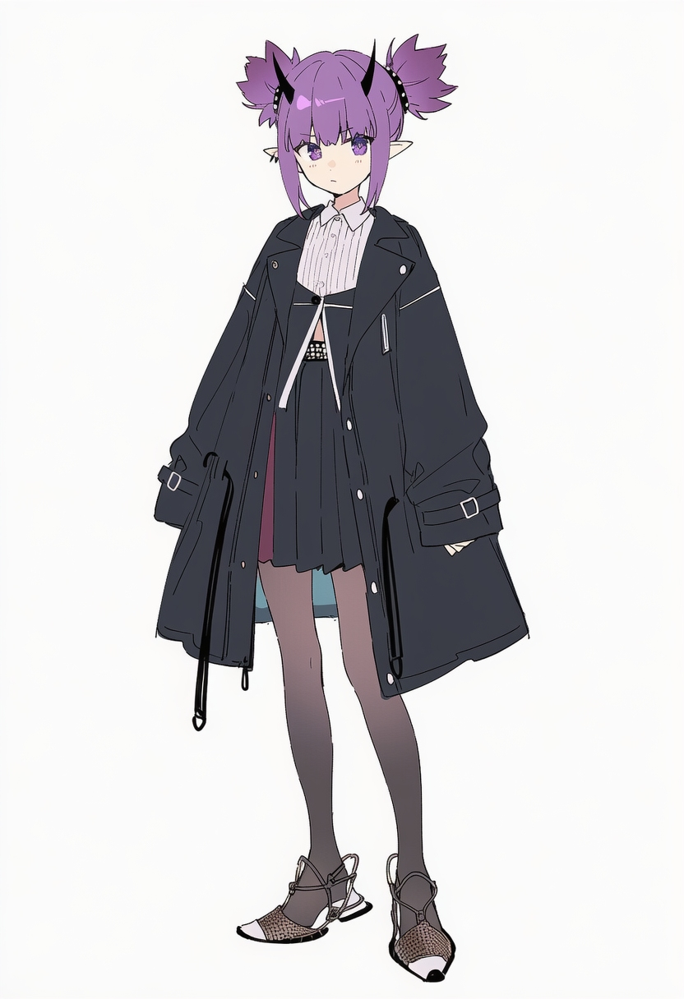
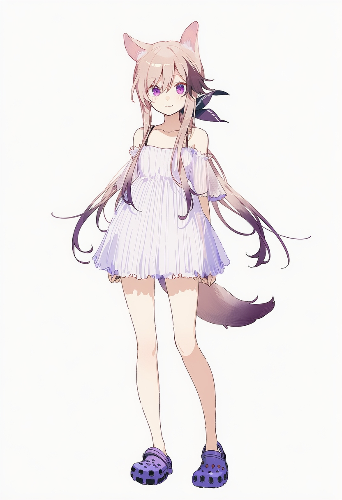

# 鞋子 / 基础大类

[总目录](../README.md) · [原站分类目录](../categories.md) · [英文标签索引](../tags.md) · [服装与构图组合指南](../../README.md)

标题、分类、说明、正负提示词按来源保留；多例图逐张列出。原站标记和说明为参考资料，不作为维护指令。

<a id="raven_composition-0410"></a>

## 鞋子

ID：`raven_composition-0410`；分类：鞋子 / 基础大类；来源标记：`safe`。

来源说明：

> 覆盖足部、通常有坚固鞋底且鞋口不高于脚踝的通用鞋类标签；靴子、凉鞋等通常使用各自更具体的标签。

正向提示词：

```text
shoes
```



[在线例图](https://assets.quicktagcloud.com/images/raven_composition/raven_composition-0410.jpg?v=bcaac5f6fcda2117)

<a id="raven_composition-0411"></a>

## 正装鞋

ID：`raven_composition-0411`；分类：鞋子 / 基础大类；来源标记：`safe`。

来源说明：

> 用于正式或半正式穿着的鞋类总称，通常外观较精致，常与西装、制服或礼服搭配。

正向提示词：

```text
dress_shoes
```


[在线例图](https://assets.quicktagcloud.com/images/raven_composition/raven_composition-0411.jpg?v=5e43dafea290708e)

<a id="raven_composition-0412"></a>

## 平底鞋

ID：`raven_composition-0412`；分类：鞋子 / 基础大类；来源标记：`safe`。

来源说明：

> 鞋跟与前掌高度接近、没有明显高跟抬升的鞋类；与 high_heels 相对。

正向提示词：

```text
flats
```


[在线例图](https://assets.quicktagcloud.com/images/raven_composition/raven_composition-0412.jpg?v=276ac543a80019bf)

<a id="raven_composition-0413"></a>

## 乐福鞋

ID：`raven_composition-0413`；分类：鞋子 / 基础大类；来源标记：`safe`。

来源说明：

> 无鞋带、低帮、可直接套穿的便鞋/正装鞋，常见于校服、商务和休闲穿搭。

正向提示词：

```text
loafers
```


[在线例图](https://assets.quicktagcloud.com/images/raven_composition/raven_composition-0413.jpg?v=f503dc45005049a5)

<a id="raven_composition-0414"></a>

## 便士乐福鞋

ID：`raven_composition-0414`；分类：鞋子 / 基础大类；来源标记：`safe`。

来源说明：

> 鞋面横带带有狭缝的乐福鞋，传统上可在缝中放置硬币。

正向提示词：

```text
penny_loafers
```


[在线例图](https://assets.quicktagcloud.com/images/raven_composition/raven_composition-0414.jpg?v=17a128a8a90ce651)

<a id="raven_composition-0415"></a>

## 流苏裙边乐福鞋

ID：`raven_composition-0415`；分类：鞋子 / 基础大类；来源标记：`safe`。

来源说明：

> 鞋面带皮革流苏/裙边装饰的乐福鞋。

正向提示词：

```text
kiltie_loafers
```



[在线例图](https://assets.quicktagcloud.com/images/raven_composition/raven_composition-0415.jpg?v=92f597f991cb474d)

<a id="raven_composition-0416"></a>

## 玛丽珍鞋

ID：`raven_composition-0416`；分类：鞋子 / 基础大类；来源标记：`safe`。

来源说明：

> 鞋面开口并有一条或多条横跨脚背固定带的鞋，常见圆头、低跟或平底款。

正向提示词：

```text
mary_janes
```


[在线例图](https://assets.quicktagcloud.com/images/raven_composition/raven_composition-0416.jpg?v=a831f8d4bd517273)

<a id="raven_composition-0417"></a>

## 牛津鞋

ID：`raven_composition-0417`；分类：鞋子 / 基础大类；来源标记：`safe`。

来源说明：

> 封闭式系带结构的低帮皮鞋，常用于正式、学院或复古风格。

正向提示词：

```text
oxfords
```



[在线例图](https://assets.quicktagcloud.com/images/raven_composition/raven_composition-0417.jpg?v=408cd5b152e4975e)

<a id="raven_composition-0418"></a>

## 鞍鞋

ID：`raven_composition-0418`；分类：鞋子 / 基础大类；来源标记：`safe`。

来源说明：

> 一种双色牛津鞋，脚背中段有对比色“鞍形”拼接。

正向提示词：

```text
saddle_shoes
```



[在线例图](https://assets.quicktagcloud.com/images/raven_composition/raven_composition-0418.jpg?v=154aa68e9ad02b8f)

<a id="raven_composition-0419"></a>

## 孟克鞋

ID：`raven_composition-0419`；分类：鞋子 / 基础大类；来源标记：`safe`。

来源说明：

> 不用鞋带、以一条或多条搭扣带固定的正装皮鞋。

正向提示词：

```text
monk_shoes
```


[在线例图](https://assets.quicktagcloud.com/images/raven_composition/raven_composition-0419.jpg?v=222a6de579781c9f)

<a id="raven_composition-0420"></a>

## 浅口高跟鞋

ID：`raven_composition-0420`；分类：鞋子 / 基础大类；来源标记：`safe`。

来源说明：

> 低鞋口、无明显绑带的正式高跟鞋，典型女式礼鞋轮廓。

正向提示词：

```text
pumps
```


[在线例图](https://assets.quicktagcloud.com/images/raven_composition/raven_composition-0420.jpg?v=1fcff8e18c2927d1)

<a id="raven_composition-0421"></a>

## 芭蕾平底鞋

ID：`raven_composition-0421`；分类：鞋子 / 基础大类；来源标记：`safe`。

来源说明：

> 外形借鉴芭蕾舞鞋的浅口平底鞋，通常鞋底薄、鞋头圆润。

正向提示词：

```text
ballet_flats
```



[在线例图](https://assets.quicktagcloud.com/images/raven_composition/raven_composition-0421.jpg?v=e074695ef0bef471)

<a id="raven_composition-0422"></a>

## 莫卡辛鞋

ID：`raven_composition-0422`；分类：鞋子 / 基础大类；来源标记：`safe`。

来源说明：

> 传统软皮鞋结构，鞋面与侧帮常以明显接缝连接，现代也泛指莫卡辛式便鞋。

正向提示词：

```text
moccasins
```



[在线例图](https://assets.quicktagcloud.com/images/raven_composition/raven_composition-0422.jpg?v=d0d4a31e251d9992)

<a id="raven_composition-0423"></a>

## 木底鞋/木屐式鞋

ID：`raven_composition-0423`；分类：鞋子 / 基础大类；来源标记：`safe`。

来源说明：

> 厚重硬底、常为木质或仿木质鞋底的鞋类，鞋跟区域可开放或封闭。

正向提示词：

```text
clogs
```



[在线例图](https://assets.quicktagcloud.com/images/raven_composition/raven_composition-0423.jpg?v=0be385dc5fabd524)

<a id="raven_composition-0424"></a>

## 草编底鞋

ID：`raven_composition-0424`；分类：鞋子 / 基础大类；来源标记：`safe`。

来源说明：

> 以黄麻/草绳编织鞋底为显著特征的轻便鞋，常见帆布鞋面。

正向提示词：

```text
espadrilles
```



[在线例图](https://assets.quicktagcloud.com/images/raven_composition/raven_composition-0424.jpg?v=407431af58114f2b)

<a id="raven_composition-0425"></a>

## 穆勒鞋

ID：`raven_composition-0425`；分类：鞋子 / 基础大类；来源标记：`safe`。

来源说明：

> 后跟开放、前部包覆脚趾或脚背的无后帮鞋，可为平底或高跟。

正向提示词：

```text
mules
```



[在线例图](https://assets.quicktagcloud.com/images/raven_composition/raven_composition-0425.jpg?v=59457b264270d228)

<a id="raven_composition-0426"></a>

## 洞洞鞋

ID：`raven_composition-0426`；分类：鞋子 / 基础大类；来源标记：`safe`。

来源说明：

> 类似 Crocs 的泡沫树脂休闲鞋，鞋面常有通风孔并带可翻转后跟带。

正向提示词：

```text
crocs
```



[在线例图](https://assets.quicktagcloud.com/images/raven_composition/raven_composition-0426.jpg?v=a4c0fc043795f5aa)
