# 鞋子 / 运动鞋

[总目录](../README.md) · [原站分类目录](../categories.md) · [英文标签索引](../tags.md) · [服装与构图组合指南](../../README.md)

标题、分类、说明、正负提示词按来源保留；多例图逐张列出。原站标记和说明为参考资料，不作为维护指令。

<a id="raven_composition-0427"></a>

## 运动鞋/休闲球鞋

ID：`raven_composition-0427`；分类：鞋子 / 运动鞋；来源标记：`safe`。

来源说明：

> 橡胶或弹性鞋底的运动休闲鞋总类，常见系带结构。

正向提示词：

```text
sneakers
```

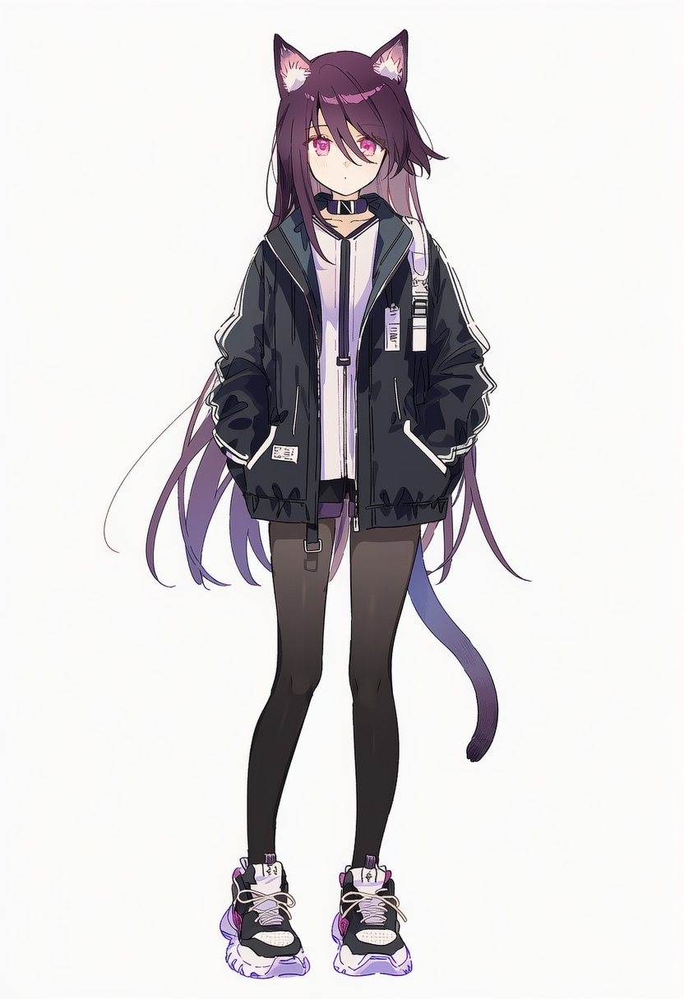

[在线例图](https://assets.quicktagcloud.com/images/raven_composition/raven_composition-0427.jpg?v=5491580a0103d513)

<a id="raven_composition-0428"></a>

## 高帮运动鞋

ID：`raven_composition-0428`；分类：鞋子 / 运动鞋；来源标记：`safe`。

来源说明：

> 鞋帮覆盖并延伸到脚踝附近或以上的运动鞋。

正向提示词：

```text
high_tops
```


[在线例图](https://assets.quicktagcloud.com/images/raven_composition/raven_composition-0428.jpg?v=525bfa0968986ed5)

<a id="raven_composition-0429"></a>

## 跑鞋

ID：`raven_composition-0429`；分类：鞋子 / 运动鞋；来源标记：`safe`。

来源说明：

> 为跑步设计的运动鞋，通常有缓震中底、轻量鞋面和运动化外形。

正向提示词：

```text
running_shoes
```

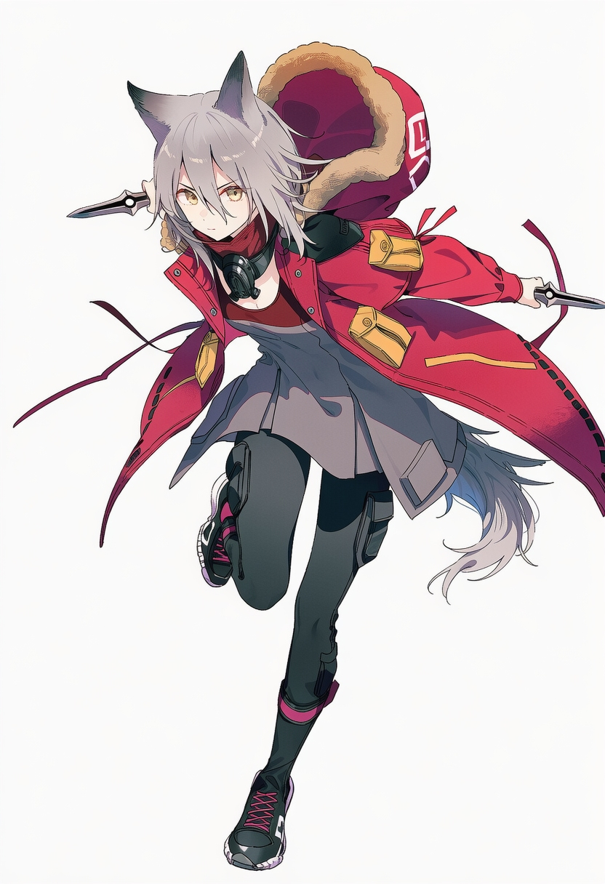

[在线例图](https://assets.quicktagcloud.com/images/raven_composition/raven_composition-0429.jpg?v=ccf6a8c6a5457ce2)

<a id="raven_composition-0430"></a>

## 专业运动鞋

ID：`raven_composition-0430`；分类：鞋子 / 运动鞋；来源标记：`safe`。

来源说明：

> 面向体育活动的鞋类泛称；当鞋型明显对应运动用途时使用。

正向提示词：

```text
athletic_shoes
```

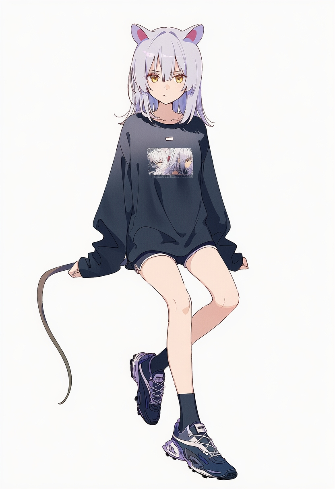

[在线例图](https://assets.quicktagcloud.com/images/raven_composition/raven_composition-0430.jpg?v=0a90f0a73b3a41f3)

<a id="raven_composition-0431"></a>

## 网球鞋

ID：`raven_composition-0431`；分类：鞋子 / 运动鞋；来源标记：`safe`。

来源说明：

> 为网球运动设计的运动鞋，通常强调侧向支撑与抓地。

正向提示词：

```text
tennis_shoes
```

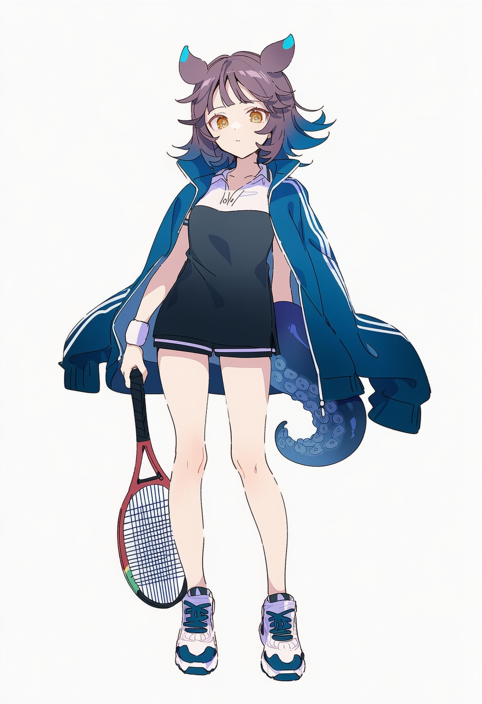

[在线例图](https://assets.quicktagcloud.com/images/raven_composition/raven_composition-0431.jpg?v=1bf86323e7cd9c9a)

<a id="raven_composition-0432"></a>

## 篮球鞋

ID：`raven_composition-0432`；分类：鞋子 / 运动鞋；来源标记：`safe`。

来源说明：

> 为篮球运动设计的运动鞋，常见较强支撑、厚实中底和高/中帮轮廓。

正向提示词：

```text
basketball_shoes
```

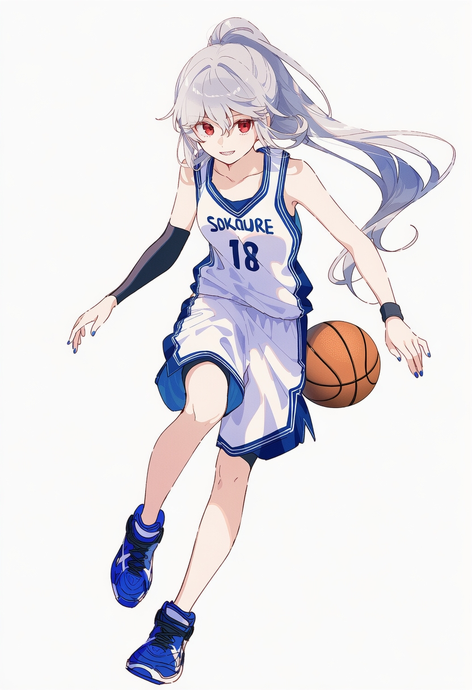

[在线例图](https://assets.quicktagcloud.com/images/raven_composition/raven_composition-0432.jpg?v=74a4e9bbf896c892)

<a id="raven_composition-0433"></a>

## 足球钉鞋

ID：`raven_composition-0433`；分类：鞋子 / 运动鞋；来源标记：`safe`。

来源说明：

> 鞋底带鞋钉、用于足球场地抓地的专业运动鞋。

正向提示词：

```text
soccer_cleats
```

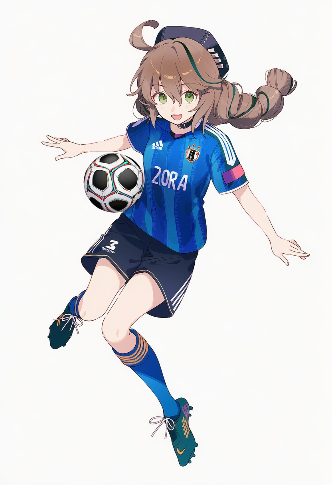

[在线例图](https://assets.quicktagcloud.com/images/raven_composition/raven_composition-0433.jpg?v=aa27d8e8ee272571)

<a id="raven_composition-0434"></a>

## 钉鞋

ID：`raven_composition-0434`；分类：鞋子 / 运动鞋；来源标记：`safe`。

来源说明：

> 鞋底具有突起鞋钉以增强草地或场地抓地力的运动鞋类。

正向提示词：

```text
cleats
```


[在线例图](https://assets.quicktagcloud.com/images/raven_composition/raven_composition-0434.jpg?v=813c17b1a54afc5d)

<a id="raven_composition-0435"></a>

## 冰/轮滑鞋类

ID：`raven_composition-0435`；分类：鞋子 / 运动鞋；来源标记：`safe`。

来源说明：

> 脚下带冰刀或轮子的滑行鞋总类；具体可进一步使用 ice_skates、roller_skates 等。

正向提示词：

```text
skates
```

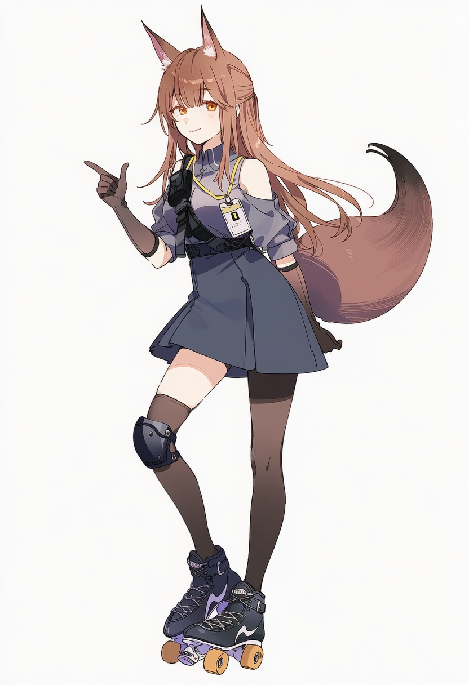

[在线例图](https://assets.quicktagcloud.com/images/raven_composition/raven_composition-0435.jpg?v=3e017872c8e880c0)

<a id="raven_composition-0436"></a>

## 冰鞋

ID：`raven_composition-0436`；分类：鞋子 / 运动鞋；来源标记：`safe`。

来源说明：

> 鞋底安装冰刀、用于冰面滑行的鞋。

正向提示词：

```text
ice_skates
```

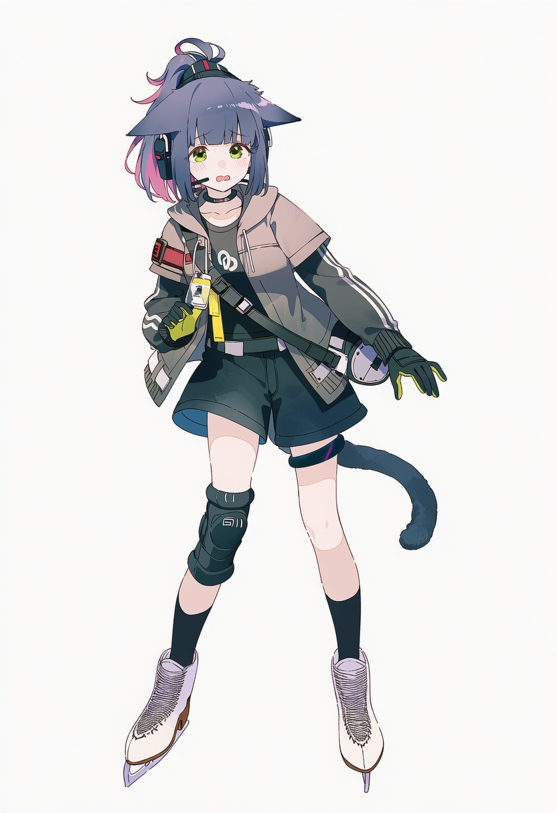

[在线例图](https://assets.quicktagcloud.com/images/raven_composition/raven_composition-0436.jpg?v=84f5576b5de0de11)

<a id="raven_composition-0437"></a>

## 双排轮滑鞋

ID：`raven_composition-0437`；分类：鞋子 / 运动鞋；来源标记：`safe`。

来源说明：

> 鞋底安装轮子的轮滑鞋，典型为前后两组并列轮。

正向提示词：

```text
roller_skates
```

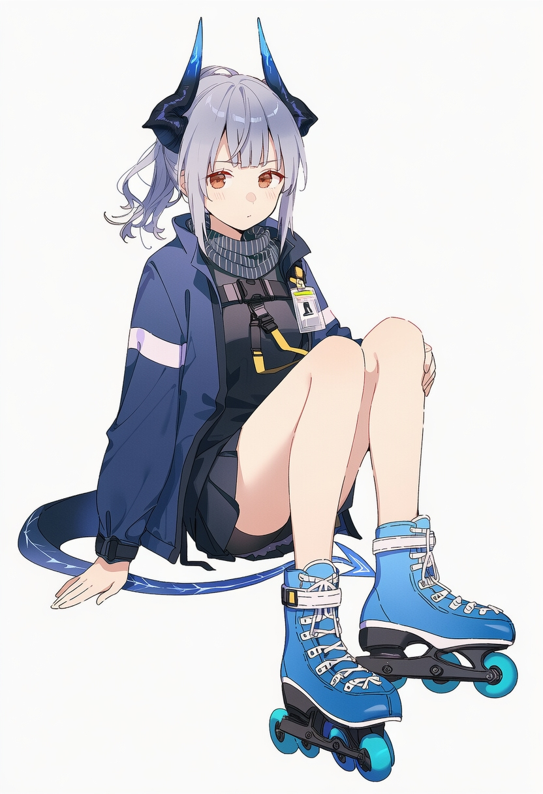

[在线例图](https://assets.quicktagcloud.com/images/raven_composition/raven_composition-0437.jpg?v=82748191818f2aa6)

<a id="raven_composition-0438"></a>

## 直排轮滑鞋

ID：`raven_composition-0438`；分类：鞋子 / 运动鞋；来源标记：`safe`。

来源说明：

> 轮子沿鞋底纵向排成一列的轮滑鞋。

正向提示词：

```text
inline_skates
```

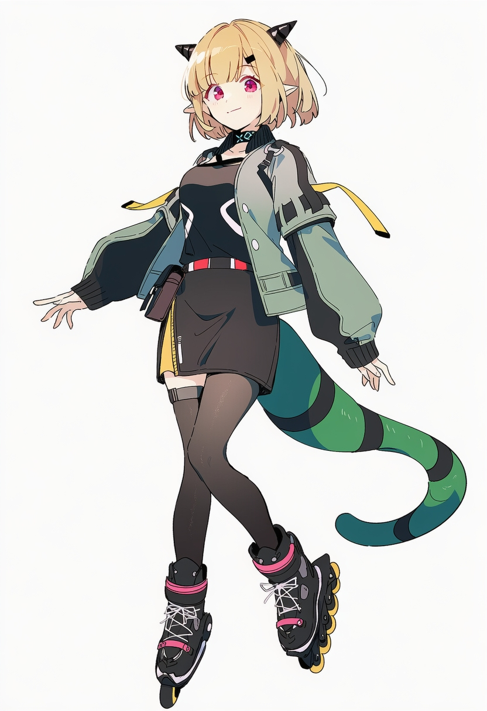

[在线例图](https://assets.quicktagcloud.com/images/raven_composition/raven_composition-0438.jpg?v=02c0aef40b908a51)

<a id="raven_composition-0439"></a>

## 滑雪靴

ID：`raven_composition-0439`；分类：鞋子 / 运动鞋；来源标记：`safe`。

来源说明：

> 用于滑雪板固定系统的硬质、厚重专用靴。

正向提示词：

```text
ski_boots
```

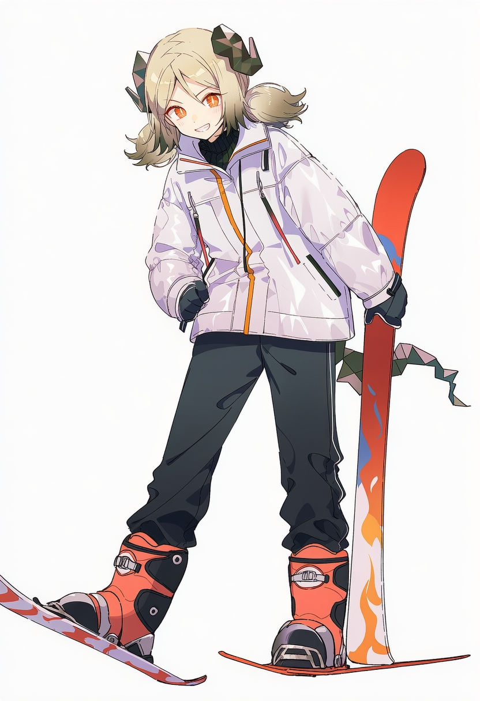

[在线例图](https://assets.quicktagcloud.com/images/raven_composition/raven_composition-0439.jpg?v=11f8ad3a438b5135)

<a id="raven_composition-0440"></a>

## 攀岩鞋

ID：`raven_composition-0440`；分类：鞋子 / 运动鞋；来源标记：`safe`。

来源说明：

> 贴脚、橡胶包边明显、用于攀岩抓点的专用鞋。

正向提示词：

```text
climbing_shoes
```

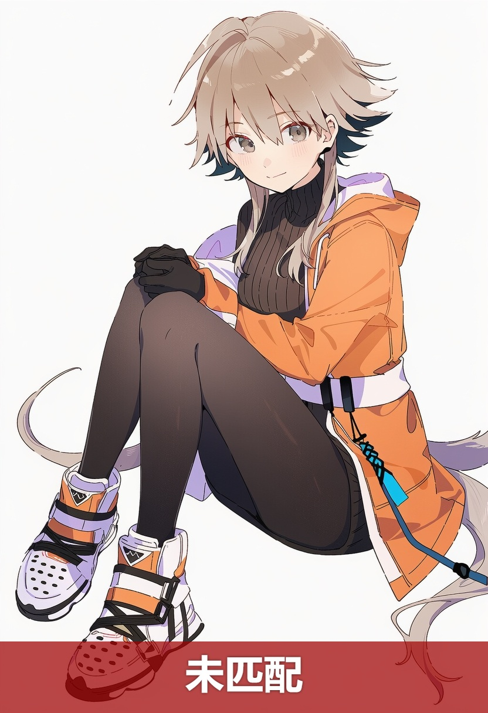

[在线例图](https://assets.quicktagcloud.com/images/raven_composition/raven_composition-0440.jpg?v=080728829bff5ee0)

<a id="raven_composition-0441"></a>

## 保龄球鞋

ID：`raven_composition-0441`；分类：鞋子 / 运动鞋；来源标记：`safe`。

来源说明：

> 用于保龄球运动的专用鞋，外观常为低帮系带鞋并有特殊滑步鞋底。

正向提示词：

```text
bowling_shoes
```

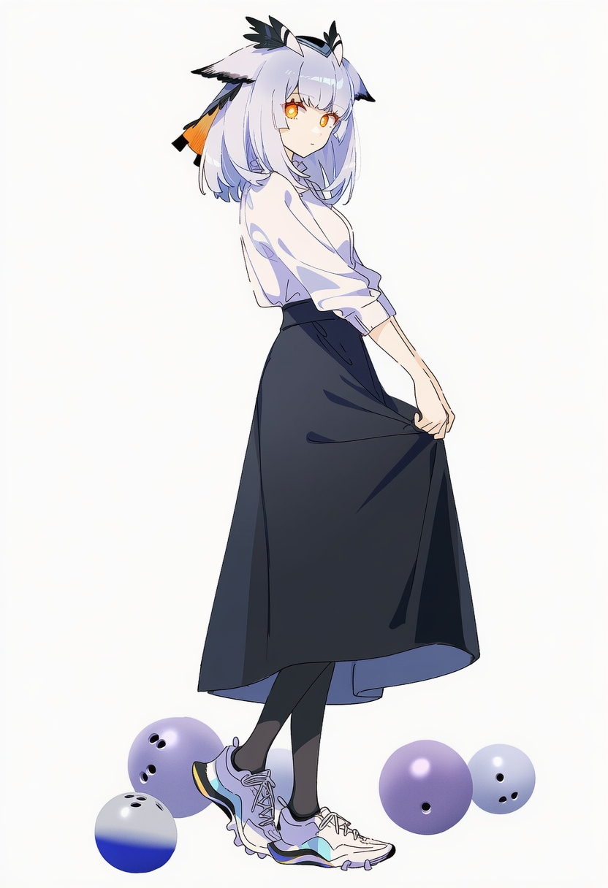

[在线例图](https://assets.quicktagcloud.com/images/raven_composition/raven_composition-0441.jpg?v=0a6ada9f180dbee0)
