# 鞋子 / 靴子

[总目录](../README.md) · [原站分类目录](../categories.md) · [英文标签索引](../tags.md) · [服装与构图组合指南](../../README.md)

标题、分类、说明、正负提示词按来源保留；多例图逐张列出。原站标记和说明为参考资料，不作为维护指令。

<a id="raven_composition-0442"></a>

## 靴子

ID：`raven_composition-0442`；分类：鞋子 / 靴子；来源标记：`safe`。

来源说明：

> 鞋帮明显高于脚踝的鞋类总称，是各类短靴、长靴、功能靴的上位标签。

正向提示词：

```text
boots
```

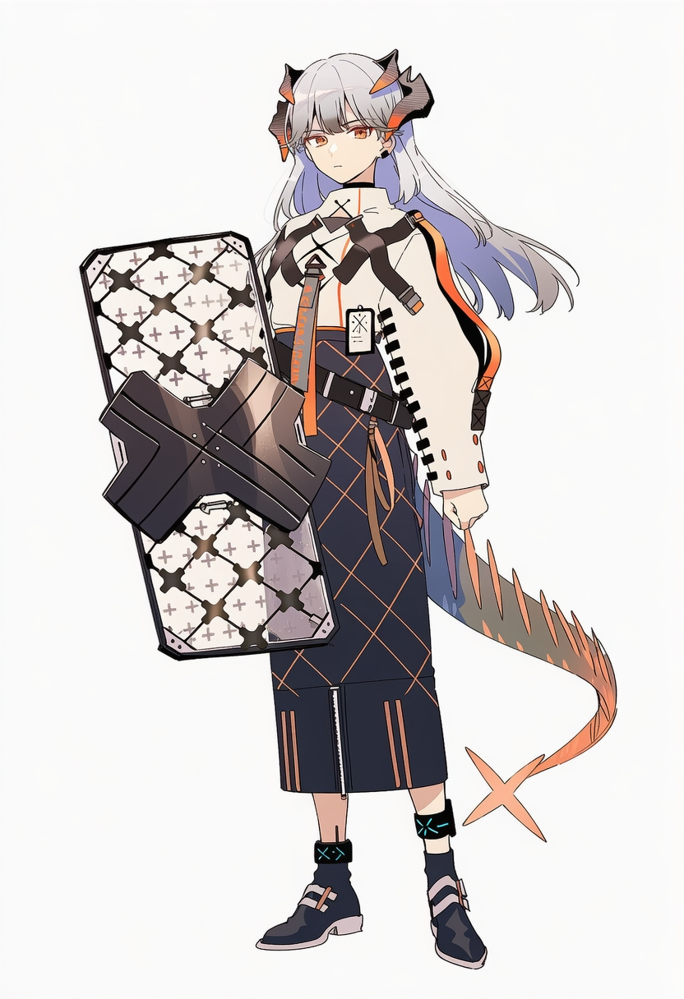

[在线例图](https://assets.quicktagcloud.com/images/raven_composition/raven_composition-0442.jpg?v=123cce629e147ea5)

<a id="raven_composition-0443"></a>

## 踝靴

ID：`raven_composition-0443`；分类：鞋子 / 靴子；来源标记：`safe`。

来源说明：

> 鞋筒高度到脚踝附近的短靴。

正向提示词：

```text
ankle_boots
```

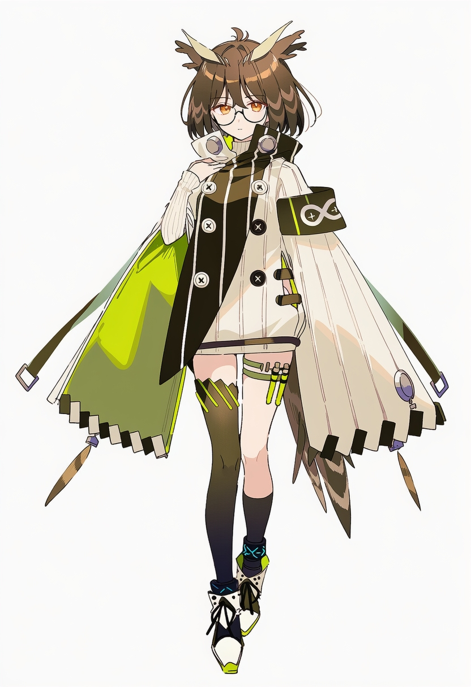

[在线例图](https://assets.quicktagcloud.com/images/raven_composition/raven_composition-0443.jpg?v=bad6689fd0359ac2)

<a id="raven_composition-0444"></a>

## 及膝靴

ID：`raven_composition-0444`；分类：鞋子 / 靴子；来源标记：`safe`。

来源说明：

> 靴筒延伸至膝盖附近的长靴。

正向提示词：

```text
knee_boots
```

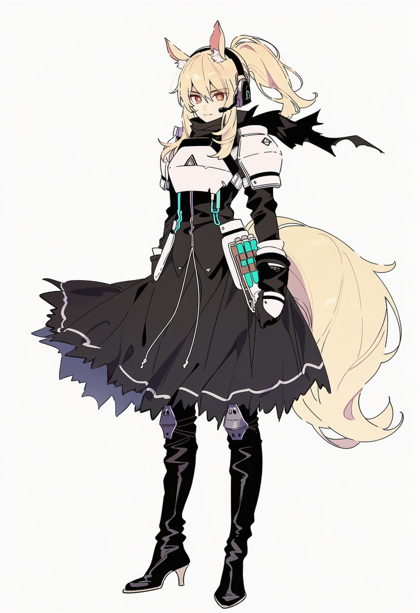

[在线例图](https://assets.quicktagcloud.com/images/raven_composition/raven_composition-0444.jpg?v=1dc1de65f2f9bfb3)

<a id="raven_composition-0445"></a>

## 过膝/大腿靴

ID：`raven_composition-0445`；分类：鞋子 / 靴子；来源标记：`safe`。

来源说明：

> 靴筒越过膝盖并延伸到大腿的长靴。

正向提示词：

```text
thigh_boots
```


[在线例图](https://assets.quicktagcloud.com/images/raven_composition/raven_composition-0445.jpg?v=590b7a65afa01cf5)

<a id="raven_composition-0446"></a>

## 高跟靴

ID：`raven_composition-0446`；分类：鞋子 / 靴子；来源标记：`safe`。

来源说明：

> 带明显高跟结构的靴子，同时具有 boots 与 high_heels 的视觉特征。

正向提示词：

```text
high_heel_boots
```

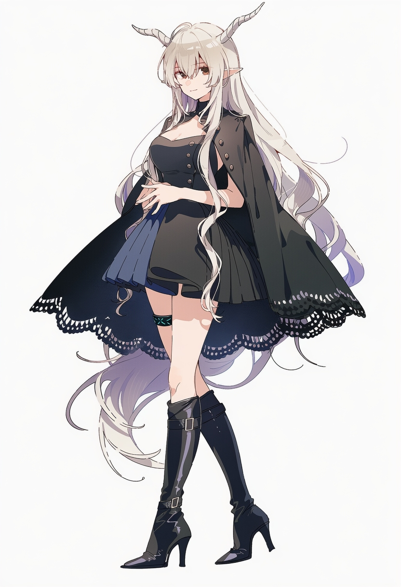

[在线例图](https://assets.quicktagcloud.com/images/raven_composition/raven_composition-0446.jpg?v=eea934ab06b0ae17)

<a id="raven_composition-0447"></a>

## 厚底靴

ID：`raven_composition-0447`；分类：鞋子 / 靴子；来源标记：`safe`。

来源说明：

> 鞋底前掌与后跟整体明显加厚的靴子。

正向提示词：

```text
platform_boots
```

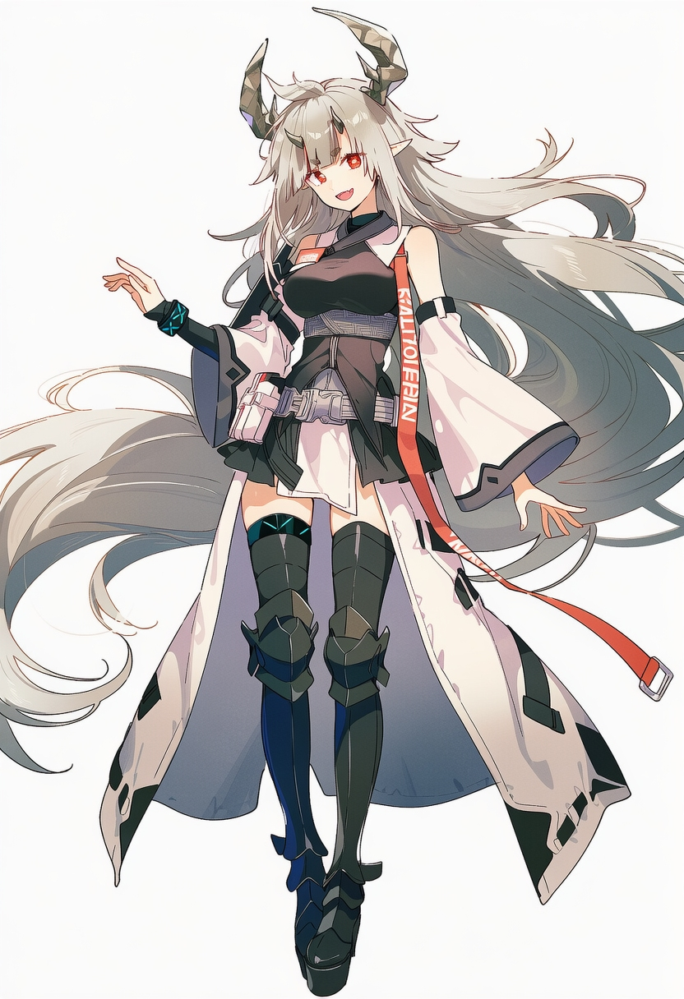

[在线例图](https://assets.quicktagcloud.com/images/raven_composition/raven_composition-0447.jpg?v=401afd8c2df5a21f)

<a id="raven_composition-0448"></a>

## 系带靴

ID：`raven_composition-0448`；分类：鞋子 / 靴子；来源标记：`safe`。

来源说明：

> 以鞋带穿过鞋眼或钩扣固定的靴子。

正向提示词：

```text
lace-up_boots
```

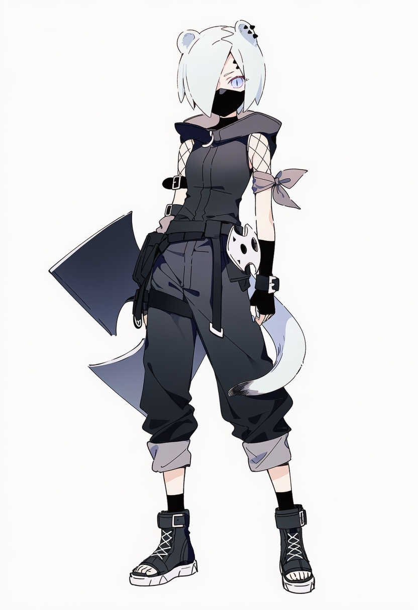

[在线例图](https://assets.quicktagcloud.com/images/raven_composition/raven_composition-0448.jpg?v=5c9dbad97104066d)

<a id="raven_composition-0449"></a>

## 战斗靴/军靴

ID：`raven_composition-0449`；分类：鞋子 / 靴子；来源标记：`safe`。

来源说明：

> 军用或军风的结实系带靴，通常厚底、鞋帮较高。

正向提示词：

```text
combat_boots
```

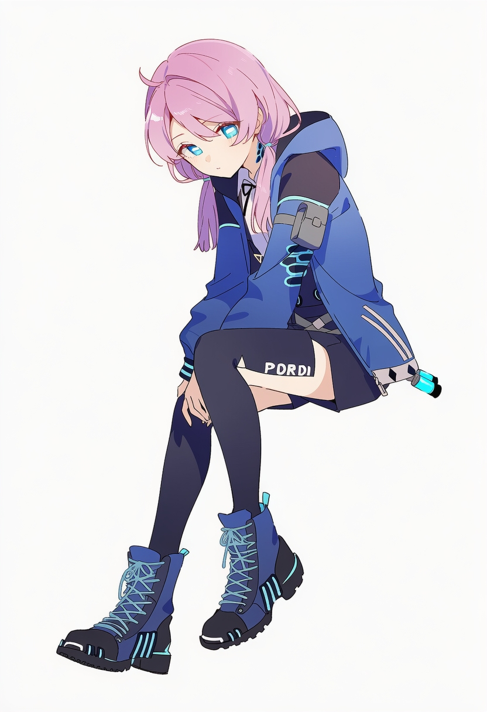

[在线例图](https://assets.quicktagcloud.com/images/raven_composition/raven_composition-0449.jpg?v=6ee1853645e4ad7a)

<a id="raven_composition-0450"></a>

## 牛仔靴

ID：`raven_composition-0450`；分类：鞋子 / 靴子；来源标记：`safe`。

来源说明：

> 西部牛仔风格长靴，常有尖/窄鞋头、斜跟和装饰性靴筒。

正向提示词：

```text
cowboy_boots
```

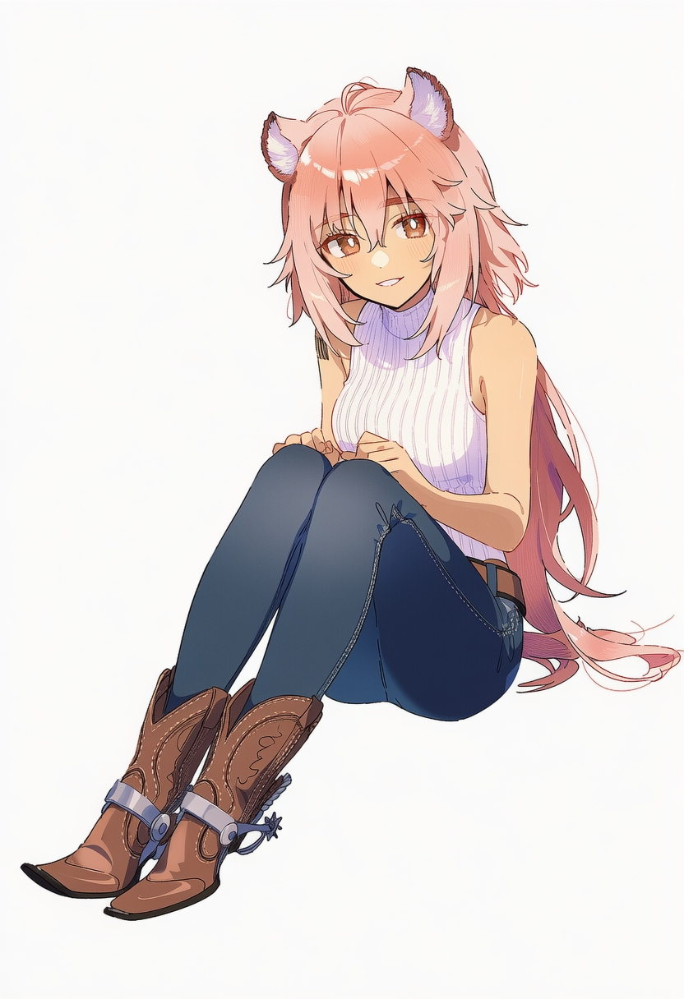

[在线例图](https://assets.quicktagcloud.com/images/raven_composition/raven_composition-0450.jpg?v=e3b9b7d22e763003)

<a id="raven_composition-0451"></a>

## 骑马靴

ID：`raven_composition-0451`；分类：鞋子 / 靴子；来源标记：`safe`。

来源说明：

> 为骑马设计或具有骑马靴外观的高筒靴，通常线条简洁、贴合小腿。

正向提示词：

```text
riding_boots
```

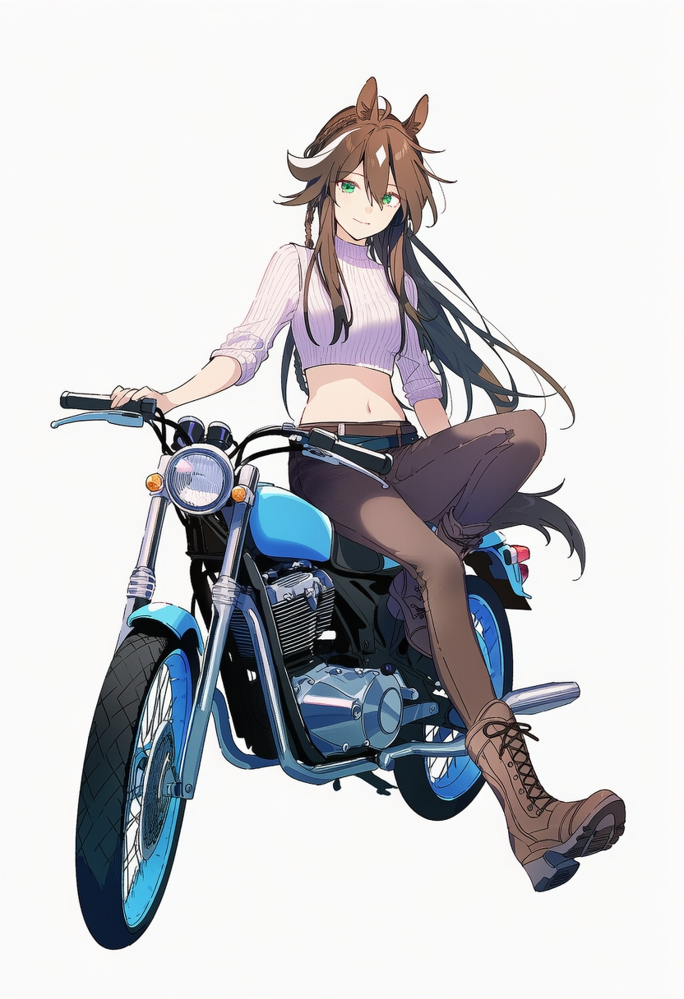

[在线例图](https://assets.quicktagcloud.com/images/raven_composition/raven_composition-0451.jpg?v=3cbbdde723c091ec)

<a id="raven_composition-0452"></a>

## 橡胶靴/雨靴

ID：`raven_composition-0452`；分类：鞋子 / 靴子；来源标记：`safe`。

来源说明：

> 由橡胶或防水材料制成的靴子，常用于雨天、泥地或作业环境。

正向提示词：

```text
rubber_boots
```

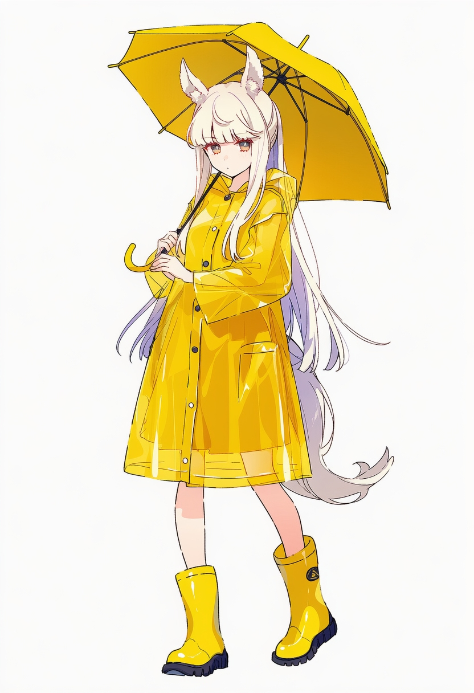

[在线例图](https://assets.quicktagcloud.com/images/raven_composition/raven_composition-0452.jpg?v=01b0aa820d9e1d4e)

<a id="raven_composition-0453"></a>

## 工作靴

ID：`raven_composition-0453`；分类：鞋子 / 靴子；来源标记：`safe`。

来源说明：

> 为劳动和户外作业设计的耐用靴，通常厚底、防滑并强调保护性。

正向提示词：

```text
work_boots
```

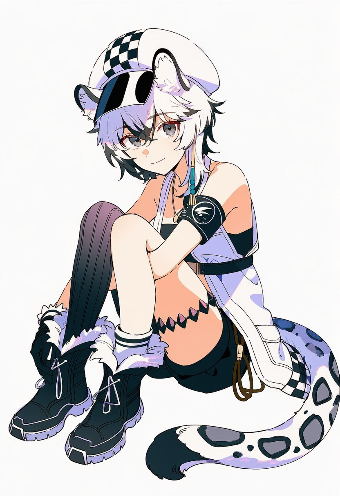

[在线例图](https://assets.quicktagcloud.com/images/raven_composition/raven_composition-0453.jpg?v=54e4003072fbbeab)

<a id="raven_composition-0454"></a>

## 装甲靴

ID：`raven_composition-0454`；分类：鞋子 / 靴子；来源标记：`safe`。

来源说明：

> 带金属或硬质护甲结构的靴子，常见于铠甲、战斗或幻想服装。

正向提示词：

```text
armored_boots
```

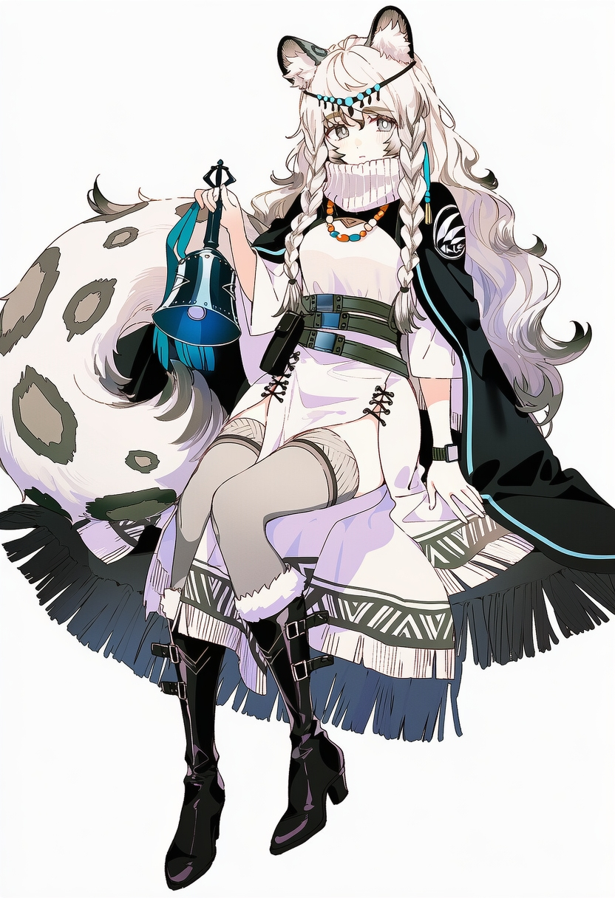

[在线例图](https://assets.quicktagcloud.com/images/raven_composition/raven_composition-0454.jpg?v=4e124a7d8fe0bd17)

<a id="raven_composition-0455"></a>

## 皮靴

ID：`raven_composition-0455`；分类：鞋子 / 靴子；来源标记：`safe`。

来源说明：

> 主要由皮革材质构成的靴子；属于材质型但不是颜色差异。

正向提示词：

```text
leather_boots
```

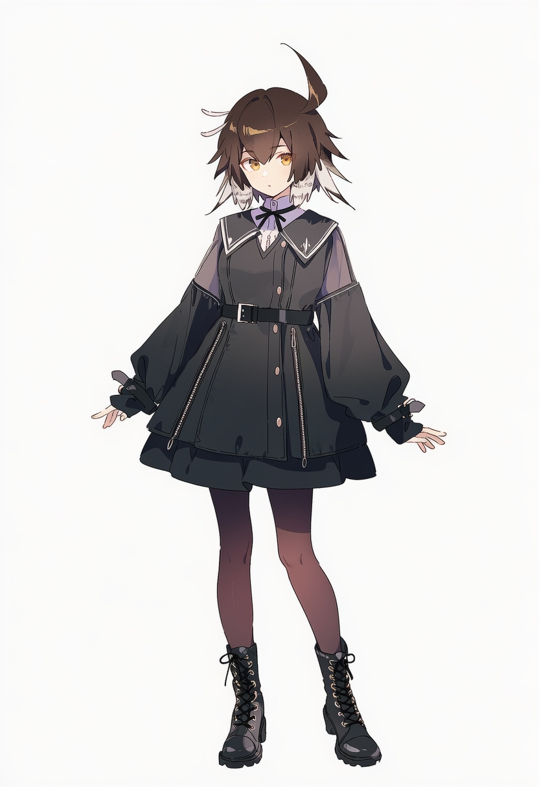

[在线例图](https://assets.quicktagcloud.com/images/raven_composition/raven_composition-0455.jpg?v=5a7568a3a4938fbb)

<a id="raven_composition-0456"></a>

## 乳胶靴

ID：`raven_composition-0456`；分类：鞋子 / 靴子；来源标记：`safe`。

来源说明：

> 由乳胶/高光弹性材质表现的靴子，表面通常紧身且强反光。

正向提示词：

```text
latex_boots
```

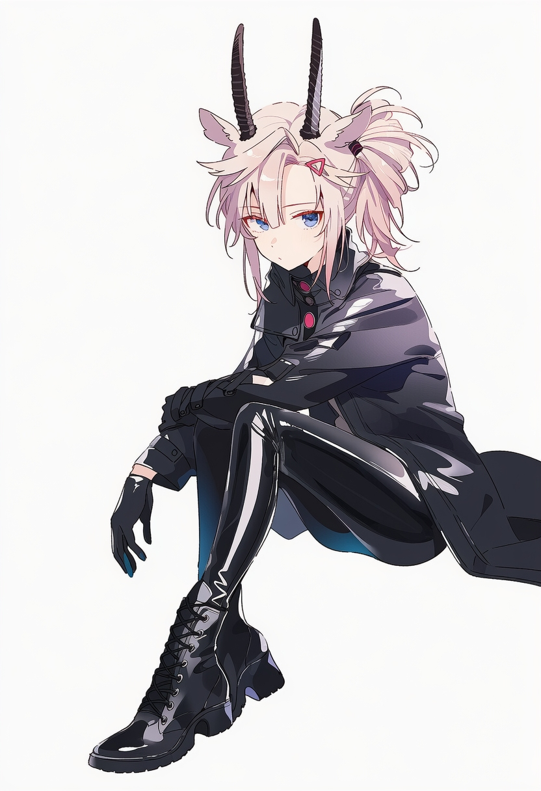

[在线例图](https://assets.quicktagcloud.com/images/raven_composition/raven_composition-0456.jpg?v=3c67e55e46bc540b)

<a id="raven_composition-0457"></a>

## 毛绒靴

ID：`raven_composition-0457`；分类：鞋子 / 靴子；来源标记：`safe`。

来源说明：

> 主体具有明显毛皮/绒毛材质的靴子。

正向提示词：

```text
fur_boots
```

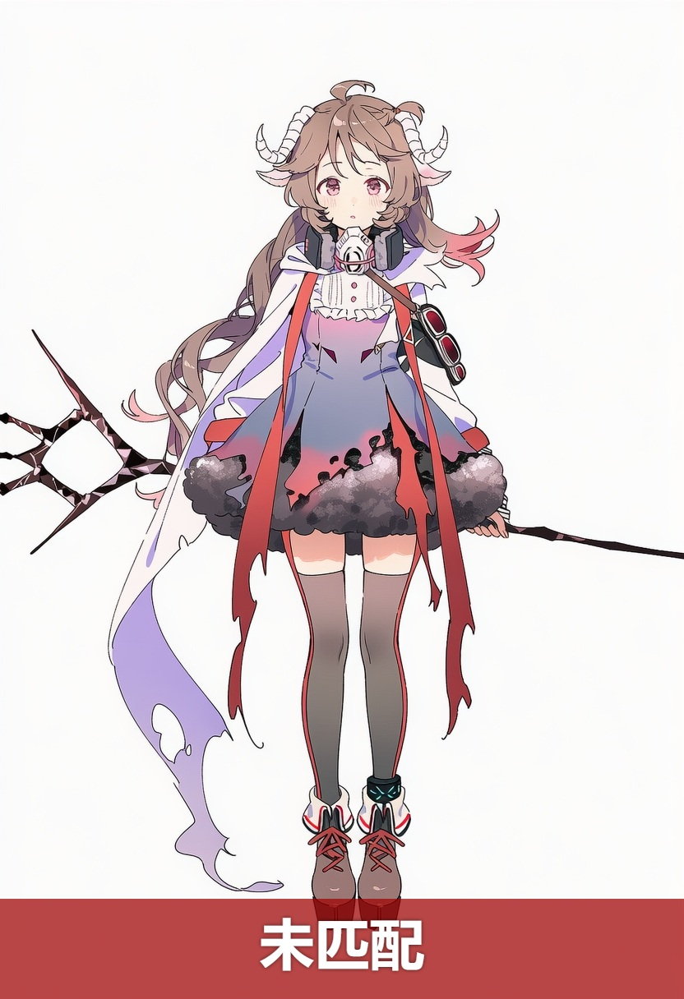

[在线例图](https://assets.quicktagcloud.com/images/raven_composition/raven_composition-0457.jpg?v=7ec9c0e0be410ca5)

<a id="raven_composition-0458"></a>

## 毛边靴

ID：`raven_composition-0458`；分类：鞋子 / 靴子；来源标记：`safe`。

来源说明：

> 靴口或边缘以毛皮/绒毛作饰边的靴子。

正向提示词：

```text
fur-trimmed_boots
```

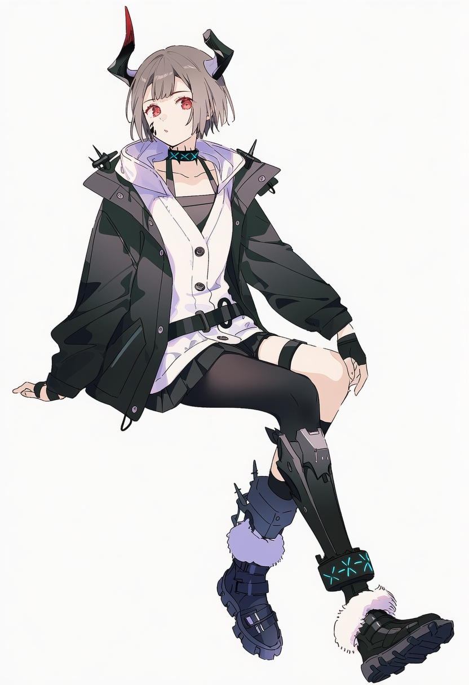

[在线例图](https://assets.quicktagcloud.com/images/raven_composition/raven_composition-0458.jpg?v=a0e3cdd63f1a0018)

<a id="raven_composition-0459"></a>

## 翻折靴

ID：`raven_composition-0459`；分类：鞋子 / 靴子；来源标记：`safe`。

来源说明：

> 靴筒上缘向外翻折，形成明显翻领式结构的靴子。

正向提示词：

```text
fold-over_boots
```

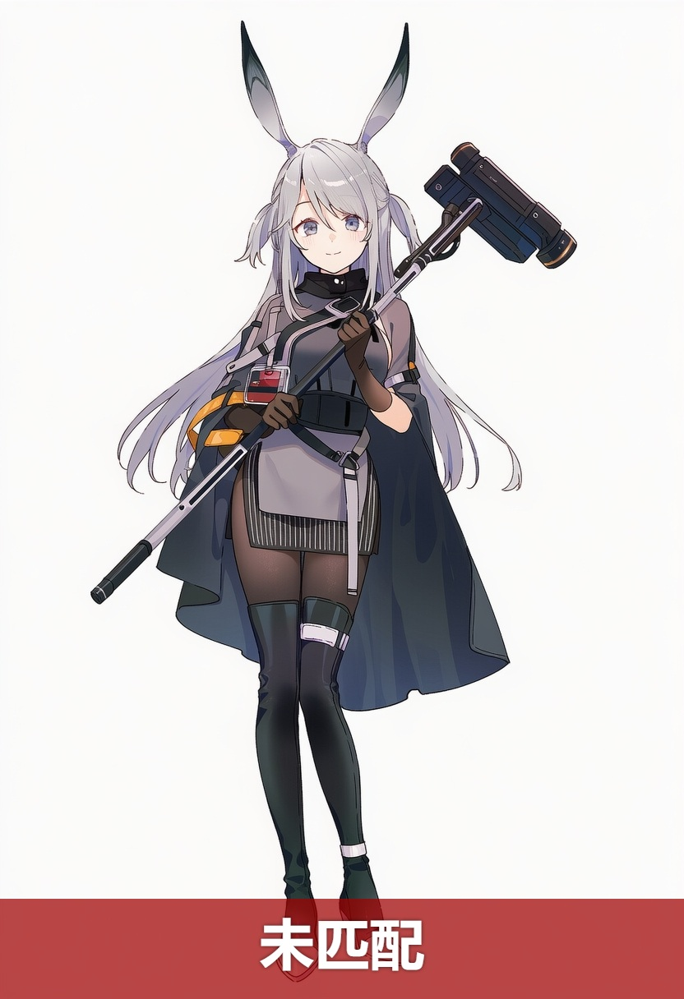

[在线例图](https://assets.quicktagcloud.com/images/raven_composition/raven_composition-0459.jpg?v=d3c52e8f7b721428)

<a id="raven_composition-0460"></a>

## 带扣装饰靴

ID：`raven_composition-0460`；分类：鞋子 / 靴子；来源标记：`safe`。

来源说明：

> 靴身带有皮带、扣带或环绕式带状结构的靴子。

正向提示词：

```text
belt_boots
```

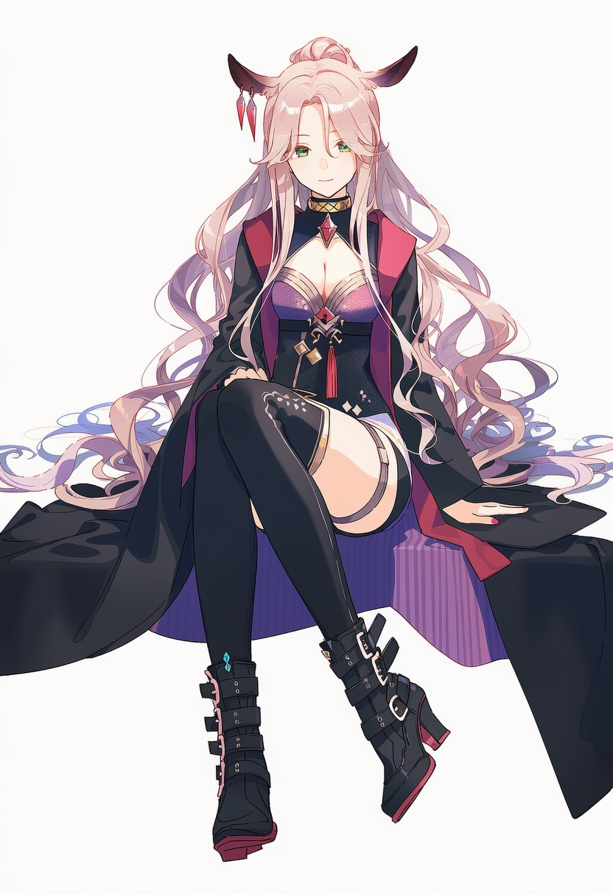

[在线例图](https://assets.quicktagcloud.com/images/raven_composition/raven_composition-0460.jpg?v=c370fb956191b1f5)

<a id="raven_composition-0461"></a>

## 褶边靴

ID：`raven_composition-0461`；分类：鞋子 / 靴子；来源标记：`safe`。

来源说明：

> 带荷叶边/褶边装饰的靴子。

正向提示词：

```text
frilled_boots
```

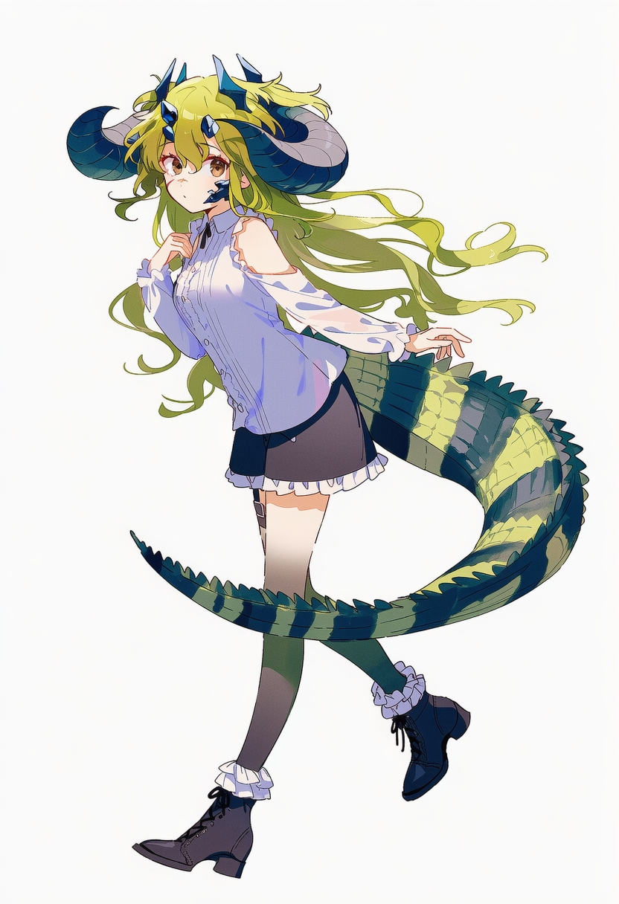

[在线例图](https://assets.quicktagcloud.com/images/raven_composition/raven_composition-0461.jpg?v=473b2e74976405ec)

<a id="raven_composition-0462"></a>

## 铆钉尖刺靴

ID：`raven_composition-0462`；分类：鞋子 / 靴子；来源标记：`safe`。

来源说明：

> 靴身带明显尖刺或锥形铆钉装饰的靴子。

正向提示词：

```text
spiked_boots
```

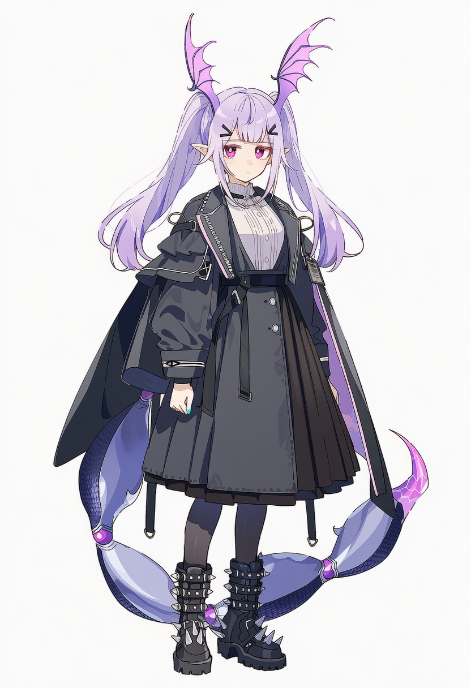

[在线例图](https://assets.quicktagcloud.com/images/raven_composition/raven_composition-0462.jpg?v=f532d47dddbc7b60)

<a id="raven_composition-0463"></a>

## 雪地靴/Ugg式靴

ID：`raven_composition-0463`；分类：鞋子 / 靴子；来源标记：`safe`。

来源说明：

> 厚实柔软、常带羊毛/绒里并具有圆钝鞋头的 Ugg 风格短靴。

正向提示词：

```text
ugg_boots
```

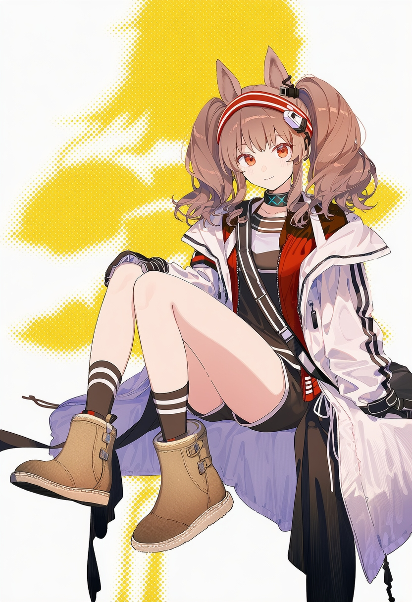

[在线例图](https://assets.quicktagcloud.com/images/raven_composition/raven_composition-0463.jpg?v=599ac9cb99a78c99)

<a id="raven_composition-0464"></a>

## 长筒军靴

ID：`raven_composition-0464`；分类：鞋子 / 靴子；来源标记：`safe`。

来源说明：

> 传统军用高筒皮靴，通常无明显鞋带、靴筒挺直。

正向提示词：

```text
jackboots
```

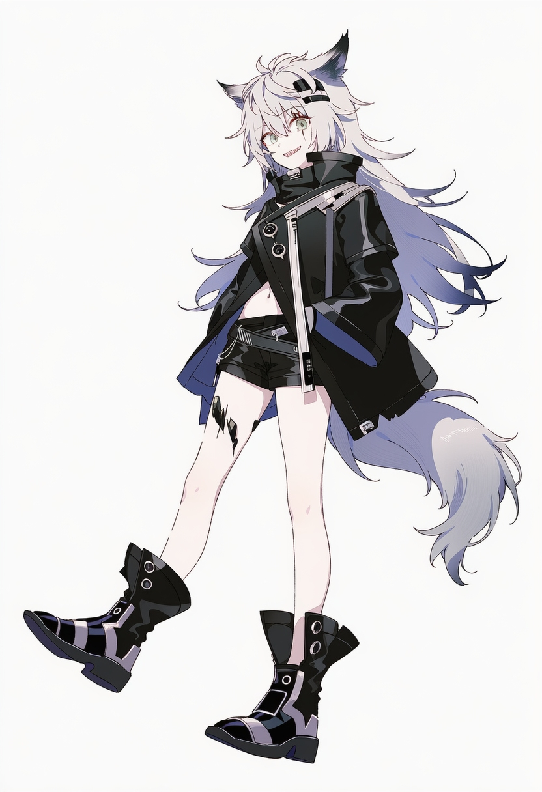

[在线例图](https://assets.quicktagcloud.com/images/raven_composition/raven_composition-0464.jpg?v=f0d4eda607da3a0e)

<a id="raven_composition-0465"></a>

## 芭蕾高跟靴

ID：`raven_composition-0465`；分类：鞋子 / 靴子；来源标记：`safe`。

来源说明：

> 极端高跟、迫使脚部接近足尖姿态的靴型，外形借鉴芭蕾足尖。

正向提示词：

```text
ballet_boots
```

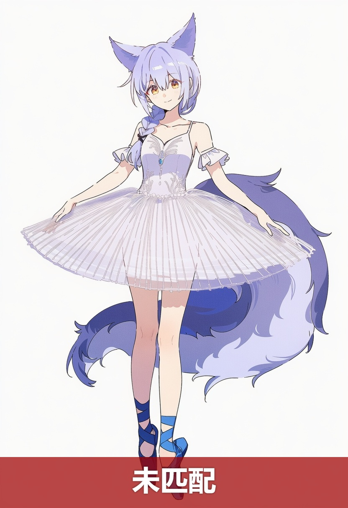

[在线例图](https://assets.quicktagcloud.com/images/raven_composition/raven_composition-0465.jpg?v=fad6778b2c093c5c)
