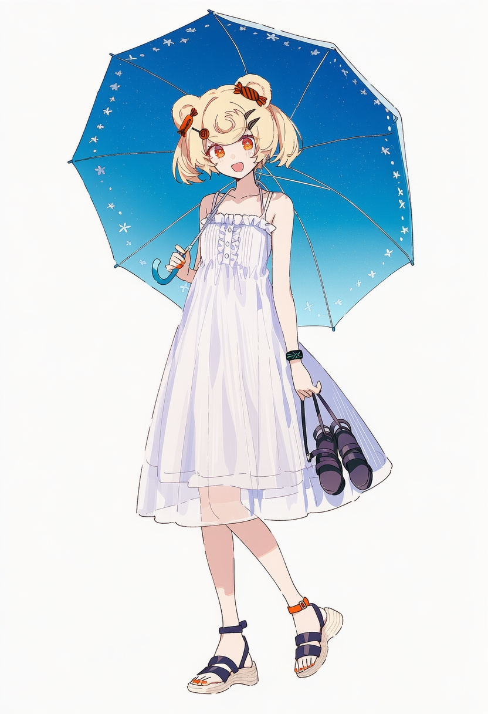
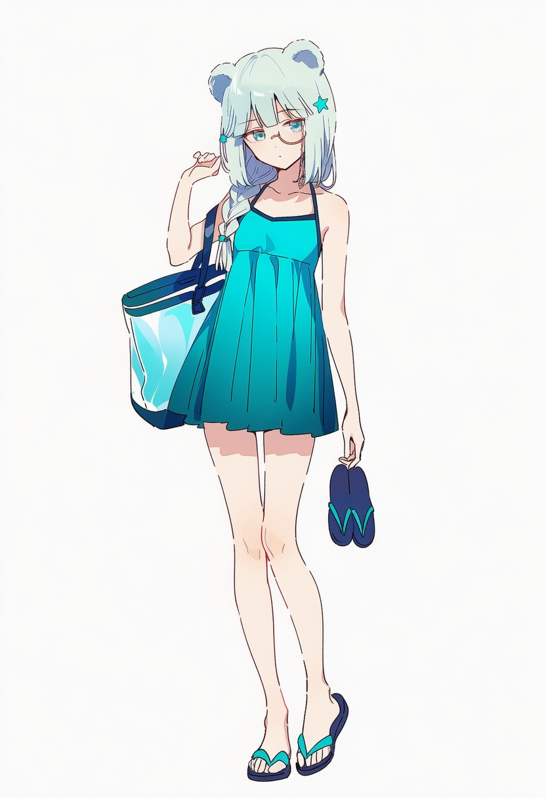
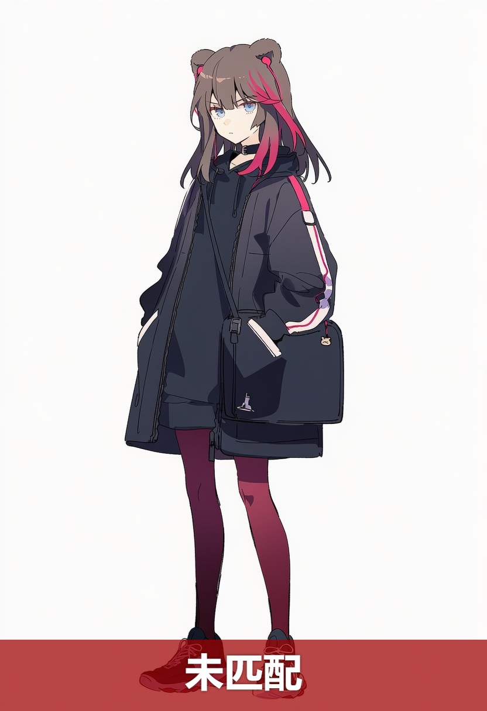
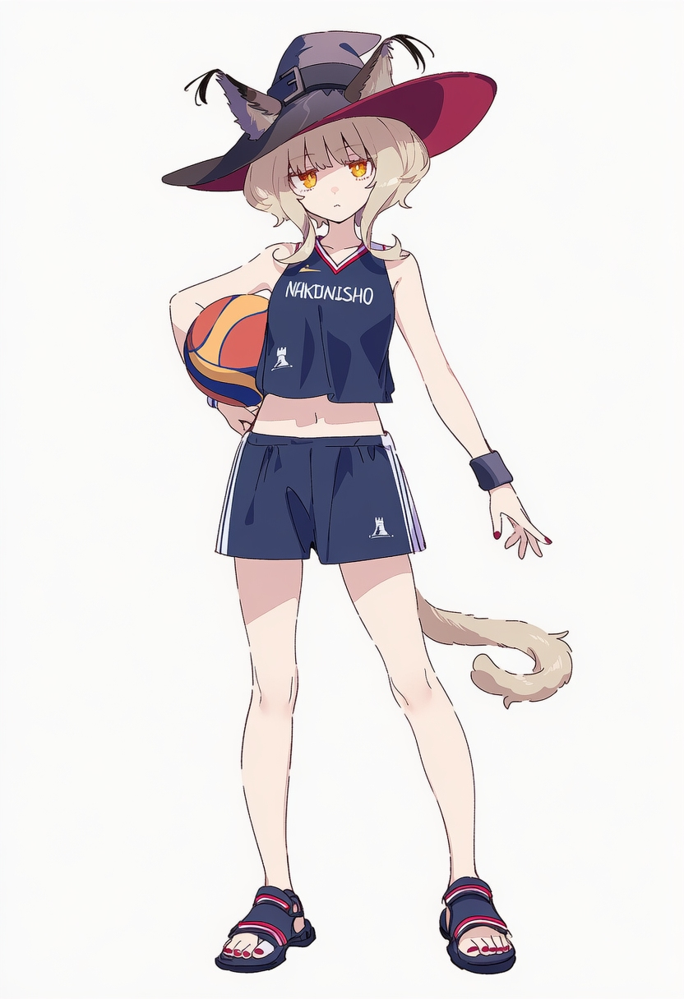
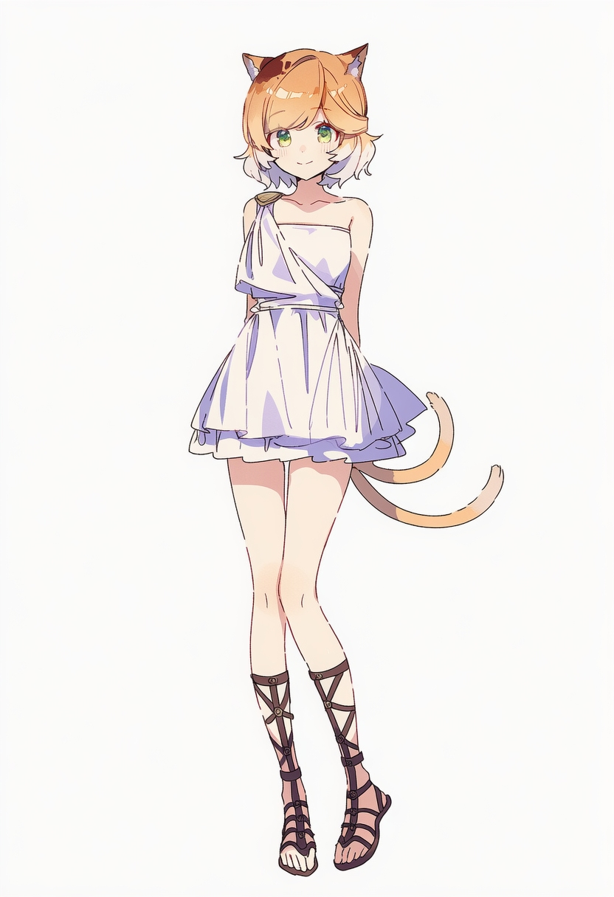
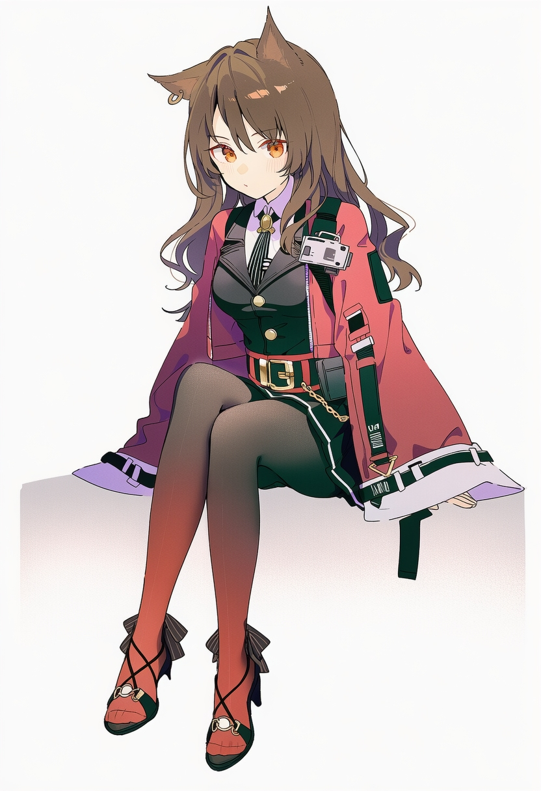
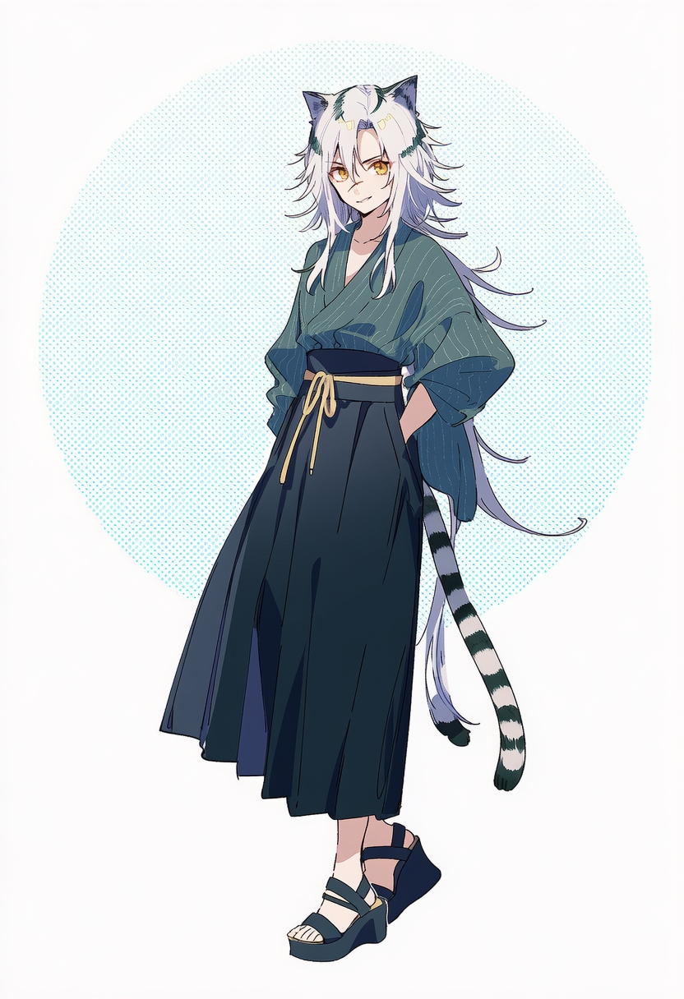
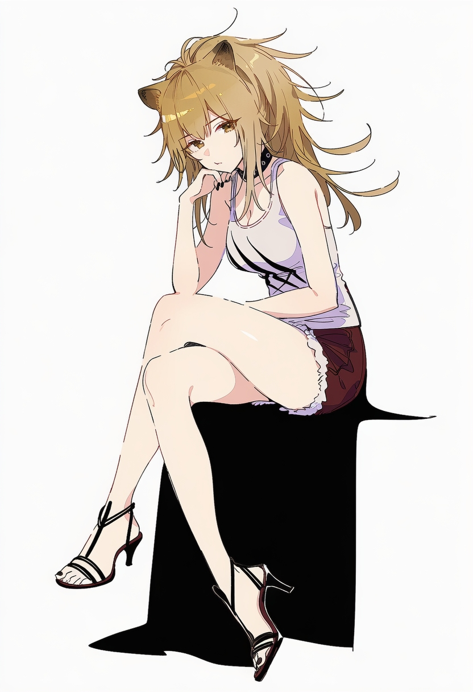

# 鞋子 / 凉鞋与开放鞋

[总目录](../README.md) · [原站分类目录](../categories.md) · [英文标签索引](../tags.md) · [服装与构图组合指南](../../README.md)

标题、分类、说明、正负提示词按来源保留；多例图逐张列出。原站标记和说明为参考资料，不作为维护指令。

<a id="raven_composition-0466"></a>

## 凉鞋

ID：`raven_composition-0466`；分类：鞋子 / 凉鞋与开放鞋；来源标记：`safe`。

来源说明：

> 开放式鞋类，以鞋底配合带子固定足部，脚趾或脚背通常大面积外露。

正向提示词：

```text
sandals
```



[在线例图](https://assets.quicktagcloud.com/images/raven_composition/raven_composition-0466.jpg?v=b0a35e40be694bb9)

<a id="raven_composition-0467"></a>

## 人字拖

ID：`raven_composition-0467`；分类：鞋子 / 凉鞋与开放鞋；来源标记：`safe`。

来源说明：

> 脚趾间有 Y 形夹带的开放式拖鞋/凉鞋。

正向提示词：

```text
flip-flops
```



[在线例图](https://assets.quicktagcloud.com/images/raven_composition/raven_composition-0467.jpg?v=51cbb786ae518ee4)

<a id="raven_composition-0468"></a>

## 一字拖/拖鞋式凉鞋

ID：`raven_composition-0468`；分类：鞋子 / 凉鞋与开放鞋；来源标记：`safe`。

来源说明：

> 后跟完全开放，脚背由一条或多条横带固定、无需夹趾的开放鞋。

正向提示词：

```text
slides
```



[在线例图](https://assets.quicktagcloud.com/images/raven_composition/raven_composition-0468.jpg?v=e00f8d87321980e5)

<a id="raven_composition-0469"></a>

## 运动凉鞋

ID：`raven_composition-0469`；分类：鞋子 / 凉鞋与开放鞋；来源标记：`safe`。

来源说明：

> 具有较厚运动鞋底和多条可调固定带的功能型凉鞋。

正向提示词：

```text
sports_sandals
```



[在线例图](https://assets.quicktagcloud.com/images/raven_composition/raven_composition-0469.jpg?v=8c4659d1a4186bf0)

<a id="raven_composition-0470"></a>

## 角斗士凉鞋

ID：`raven_composition-0470`；分类：鞋子 / 凉鞋与开放鞋；来源标记：`safe`。

来源说明：

> 多条细带沿脚背、脚踝甚至小腿向上延伸的古罗马风格凉鞋。

正向提示词：

```text
gladiator_sandals
```



[在线例图](https://assets.quicktagcloud.com/images/raven_composition/raven_composition-0470.jpg?v=3eaaac8bd558ff99)

<a id="raven_composition-0471"></a>

## 交叉绑带凉鞋

ID：`raven_composition-0471`；分类：鞋子 / 凉鞋与开放鞋；来源标记：`safe`。

来源说明：

> 鞋带或细带在脚背/脚踝处多次交叉缠绕的凉鞋。

正向提示词：

```text
cross-laced_sandals
```



[在线例图](https://assets.quicktagcloud.com/images/raven_composition/raven_composition-0471.jpg?v=b235c91398b73ca8)

<a id="raven_composition-0472"></a>

## 厚底凉鞋

ID：`raven_composition-0472`；分类：鞋子 / 凉鞋与开放鞋；来源标记：`safe`。

来源说明：

> 具有明显整体增高厚底的凉鞋。

正向提示词：

```text
platform_sandals
```



[在线例图](https://assets.quicktagcloud.com/images/raven_composition/raven_composition-0472.jpg?v=603d02cd04fee8ee)

<a id="raven_composition-0473"></a>

## 高跟凉鞋

ID：`raven_composition-0473`；分类：鞋子 / 凉鞋与开放鞋；来源标记：`safe`。

来源说明：

> 开放式凉鞋结构并带明显高跟。

正向提示词：

```text
high_heel_sandals
```



[在线例图](https://assets.quicktagcloud.com/images/raven_composition/raven_composition-0473.jpg?v=831b22fad2e6c807)

<a id="raven_composition-0474"></a>

## 高跟一字拖

ID：`raven_composition-0474`；分类：鞋子 / 凉鞋与开放鞋；来源标记：`safe`。

来源说明：

> 后跟开放的 slides 结构与明显高跟结合的鞋型。

正向提示词：

```text
high_heel_slides
```


[在线例图](https://assets.quicktagcloud.com/images/raven_composition/raven_composition-0474.jpg?v=6506cbe0c82240b6)
