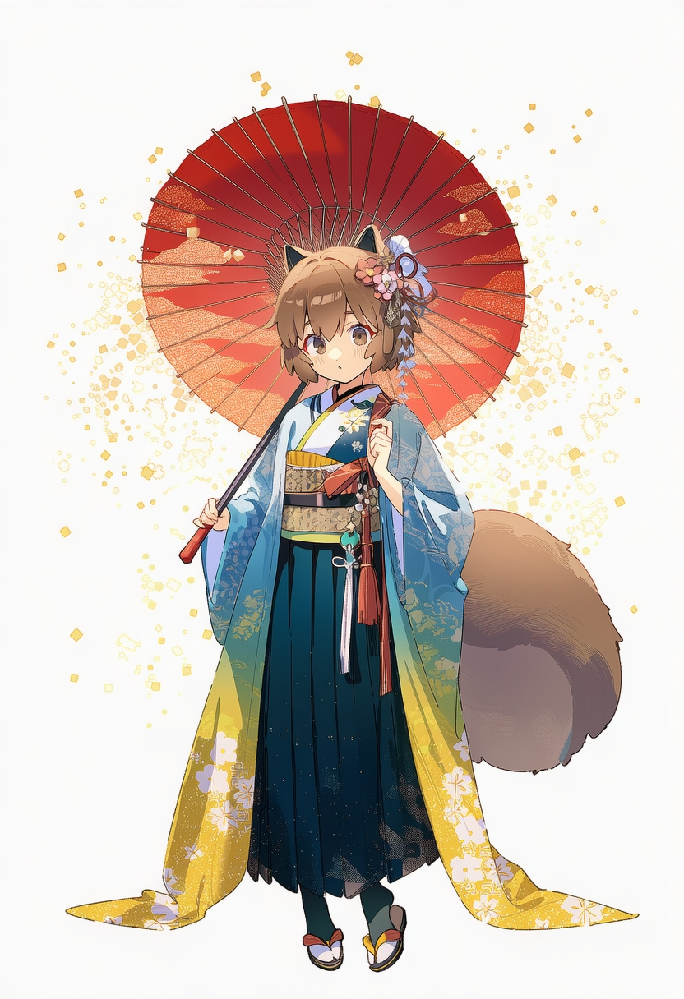
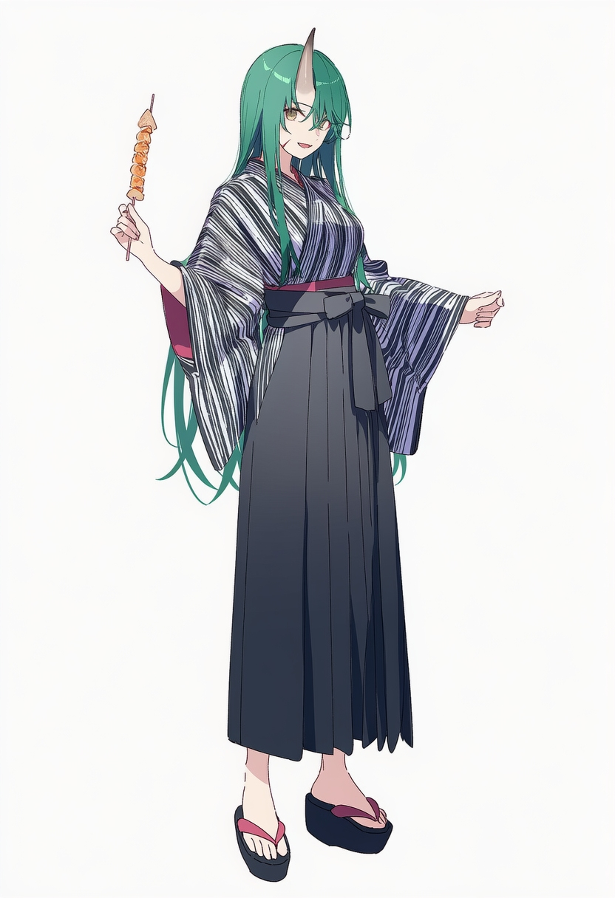
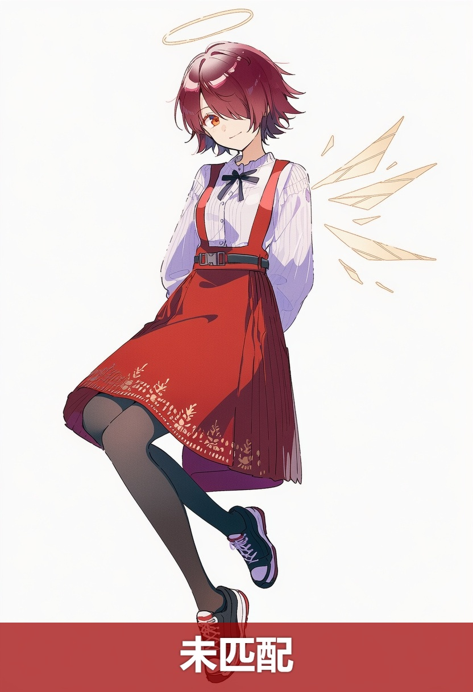
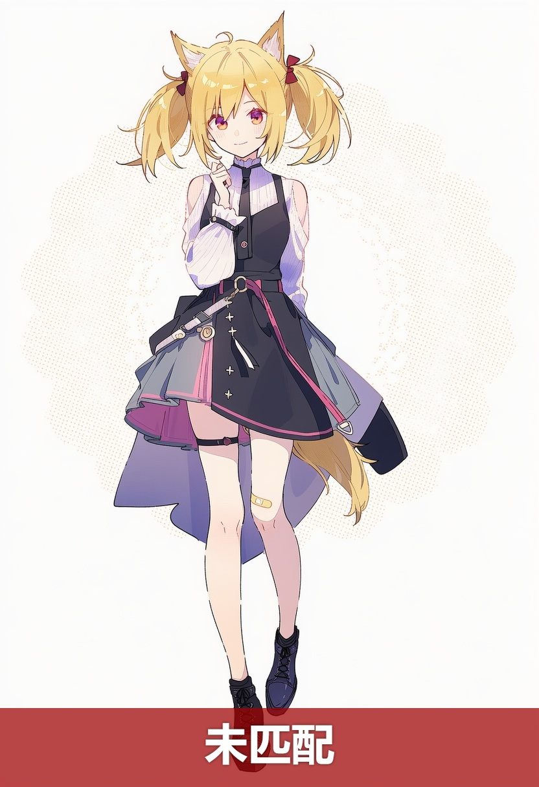

# 鞋子 / 传统鞋履

[总目录](../README.md) · [原站分类目录](../categories.md) · [英文标签索引](../tags.md) · [服装与构图组合指南](../../README.md)

标题、分类、说明、正负提示词按来源保留；多例图逐张列出。原站标记和说明为参考资料，不作为维护指令。

<a id="raven_composition-0475"></a>

## 下駄/日式木屐

ID：`raven_composition-0475`；分类：鞋子 / 传统鞋履；来源标记：`safe`。

来源说明：

> 日本传统木屐，木制台面下通常有一到两块齿状支撑，以鼻绪固定脚部。

正向提示词：

```text
geta
```


[在线例图](https://assets.quicktagcloud.com/images/raven_composition/raven_composition-0475.jpg?v=639230fedcf8070a)

<a id="raven_composition-0476"></a>

## 草履

ID：`raven_composition-0476`；分类：鞋子 / 传统鞋履；来源标记：`safe`。

来源说明：

> 日本传统平底夹趾鞋，外形类似较正式的人字拖，常与和服搭配。

正向提示词：

```text
zouri
```



[在线例图](https://assets.quicktagcloud.com/images/raven_composition/raven_composition-0476.jpg?v=80bfae3a51126188)

<a id="raven_composition-0477"></a>

## 高底木屐

ID：`raven_composition-0477`；分类：鞋子 / 传统鞋履；来源标记：`safe`。

来源说明：

> 日本舞妓等常穿的高台木屐，整体鞋底像厚木块般显著增高。

正向提示词：

```text
okobo
```



[在线例图](https://assets.quicktagcloud.com/images/raven_composition/raven_composition-0477.jpg?v=c77e9cdfd1080287)

<a id="raven_composition-0478"></a>

## 草鞋

ID：`raven_composition-0478`；分类：鞋子 / 传统鞋履；来源标记：`safe`。

来源说明：

> 日本传统草编凉鞋，以草绳编织并用绳带绑在脚上。

正向提示词：

```text
waraji
```


[在线例图](https://assets.quicktagcloud.com/images/raven_composition/raven_composition-0478.jpg?v=4c48187928b4a35d)

<a id="raven_composition-0479"></a>

## 印度趾钮凉鞋

ID：`raven_composition-0479`；分类：鞋子 / 传统鞋履；来源标记：`safe`。

来源说明：

> 印度传统开放鞋，通常只有鞋底和位于大脚趾附近的趾钮固定结构。

正向提示词：

```text
paduka
```



[在线例图](https://assets.quicktagcloud.com/images/raven_composition/raven_composition-0479.jpg?v=11b73138c54e29ae)

<a id="raven_composition-0480"></a>

## 韩式橡胶鞋

ID：`raven_composition-0480`；分类：鞋子 / 传统鞋履；来源标记：`safe`。

来源说明：

> 韩国传统低跟橡胶鞋，鞋型较宽，常与韩服搭配。

正向提示词：

```text
gomusin
```



[在线例图](https://assets.quicktagcloud.com/images/raven_composition/raven_composition-0480.jpg?v=b603ed98bde6c1e0)

<a id="raven_composition-0481"></a>

## 莫贾里鞋

ID：`raven_composition-0481`；分类：鞋子 / 传统鞋履；来源标记：`safe`。

来源说明：

> 南亚传统皮鞋，常有刺绣装饰与上翘或尖形鞋头。

正向提示词：

```text
mojari
```


[在线例图](https://assets.quicktagcloud.com/images/raven_composition/raven_composition-0481.jpg?v=1b41898b76543465)
