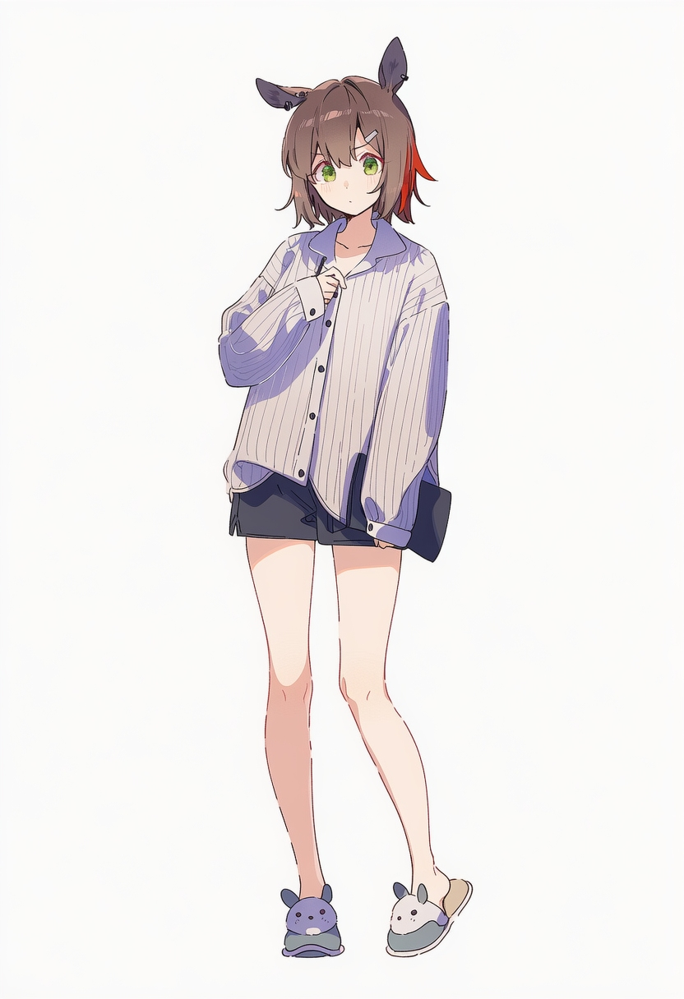
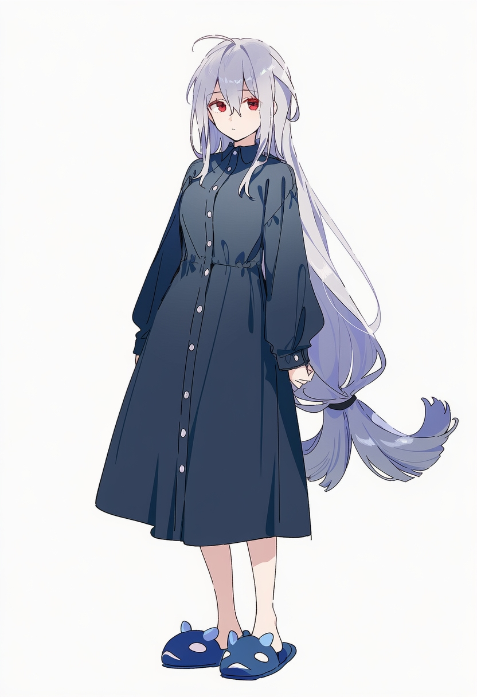
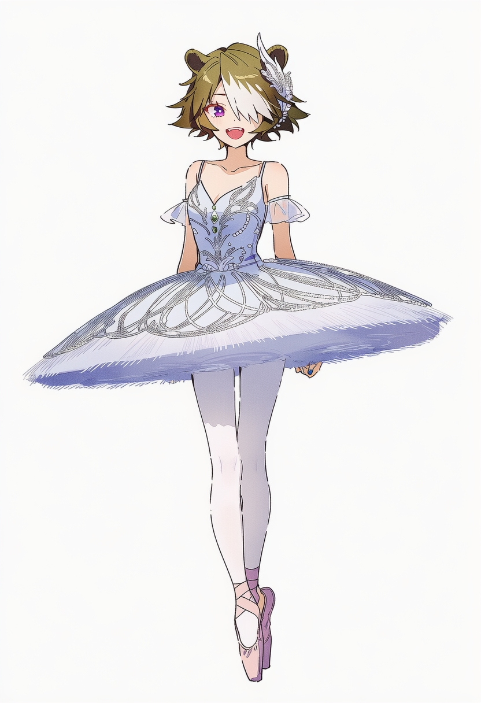
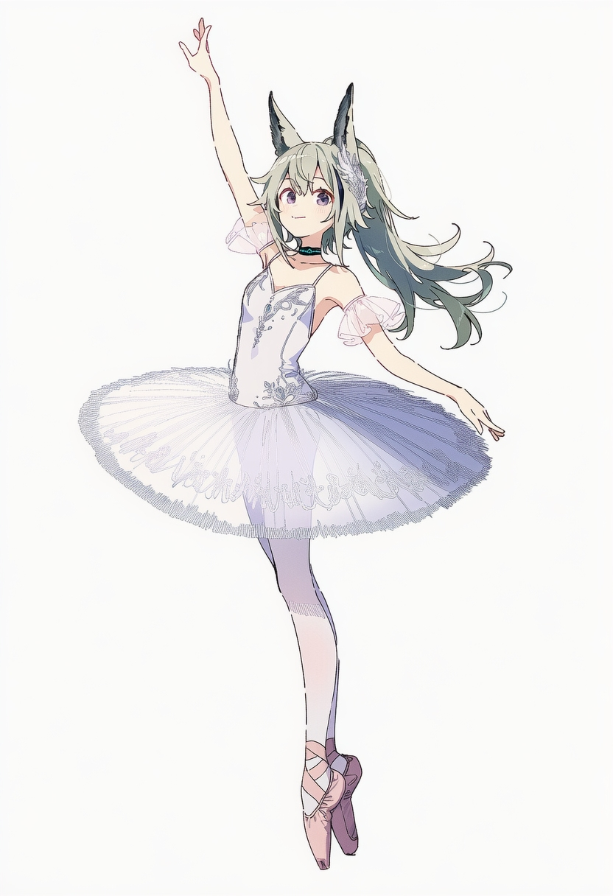

# 鞋子 / 拖鞋与舞鞋

[总目录](../README.md) · [原站分类目录](../categories.md) · [英文标签索引](../tags.md) · [服装与构图组合指南](../../README.md)

标题、分类、说明、正负提示词按来源保留；多例图逐张列出。原站标记和说明为参考资料，不作为维护指令。

<a id="raven_composition-0482"></a>

## 室内拖鞋

ID：`raven_composition-0482`；分类：鞋子 / 拖鞋与舞鞋；来源标记：`safe`。

来源说明：

> 主要用于室内的轻便鞋，通常柔软、易穿脱，可为开放或包头结构。

正向提示词：

```text
slippers
```



[在线例图](https://assets.quicktagcloud.com/images/raven_composition/raven_composition-0482.jpg?v=e5f5733dd7a4b0c5)

<a id="raven_composition-0483"></a>

## 动物造型拖鞋

ID：`raven_composition-0483`；分类：鞋子 / 拖鞋与舞鞋；来源标记：`safe`。

来源说明：

> 做成动物头、动物脚掌或带动物特征的室内拖鞋。

正向提示词：

```text
animal_slippers
```



[在线例图](https://assets.quicktagcloud.com/images/raven_composition/raven_composition-0483.jpg?v=eb28f164acc8315b)

<a id="raven_composition-0484"></a>

## 芭蕾舞鞋

ID：`raven_composition-0484`；分类：鞋子 / 拖鞋与舞鞋；来源标记：`safe`。

来源说明：

> 柔软轻薄、贴脚的芭蕾训练鞋，通常没有硬质足尖盒。

正向提示词：

```text
ballet_slippers
```



[在线例图](https://assets.quicktagcloud.com/images/raven_composition/raven_composition-0484.jpg?v=3e348938bb411d84)

<a id="raven_composition-0485"></a>

## 芭蕾足尖鞋

ID：`raven_composition-0485`；分类：鞋子 / 拖鞋与舞鞋；来源标记：`safe`。

来源说明：

> 前端具有硬质足尖盒，可让芭蕾舞者以足尖站立的专业舞鞋。

正向提示词：

```text
pointe_shoes
```



[在线例图](https://assets.quicktagcloud.com/images/raven_composition/raven_composition-0485.jpg?v=80ad52206b5ea5e1)

<a id="raven_composition-0486"></a>

## 上履/日式室内鞋

ID：`raven_composition-0486`；分类：鞋子 / 拖鞋与舞鞋；来源标记：`safe`。

来源说明：

> 日本学校常见的室内鞋，通常为浅口帆布/布鞋配橡胶底。

正向提示词：

```text
uwabaki
```


[在线例图](https://assets.quicktagcloud.com/images/raven_composition/raven_composition-0486.jpg?v=e207fac84f1f54e2)

<a id="raven_composition-0487"></a>

## 踢踏舞鞋

ID：`raven_composition-0487`；分类：鞋子 / 拖鞋与舞鞋；来源标记：`safe`。

来源说明：

> 鞋底前掌和后跟装有金属片、用于发出清脆敲击声的舞鞋。

正向提示词：

```text
tap_shoes
```


[在线例图](https://assets.quicktagcloud.com/images/raven_composition/raven_composition-0487.jpg?v=84f89c8344c9dd57)
