# 鞋子 / 高跟结构

[总目录](../README.md) · [原站分类目录](../categories.md) · [英文标签索引](../tags.md) · [服装与构图组合指南](../../README.md)

标题、分类、说明、正负提示词按来源保留；多例图逐张列出。原站标记和说明为参考资料，不作为维护指令。

<a id="raven_composition-0488"></a>

## 高跟鞋

ID：`raven_composition-0488`；分类：鞋子 / 高跟结构；来源标记：`safe`。

来源说明：

> 让脚后跟明显高于脚趾的鞋类特征标签，可用于鞋、靴、凉鞋等多种鞋型。

正向提示词：

```text
high_heels
```


[在线例图](https://assets.quicktagcloud.com/images/raven_composition/raven_composition-0488.jpg?v=e500c7b63a73453e)

<a id="raven_composition-0489"></a>

## 细高跟鞋

ID：`raven_composition-0489`；分类：鞋子 / 高跟结构；来源标记：`safe`。

来源说明：

> 鞋跟细长、近似针状的高跟鞋。

正向提示词：

```text
stiletto_heels
```

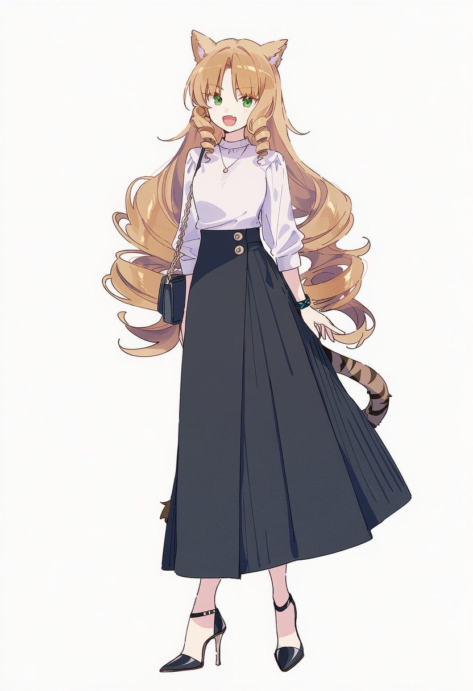

[在线例图](https://assets.quicktagcloud.com/images/raven_composition/raven_composition-0489.jpg?v=264cb928acd27a77)

<a id="raven_composition-0490"></a>

## 厚底高跟鞋

ID：`raven_composition-0490`；分类：鞋子 / 高跟结构；来源标记：`safe`。

来源说明：

> 前掌有明显厚底平台，同时后跟进一步抬高的高跟鞋。

正向提示词：

```text
platform_heels
```

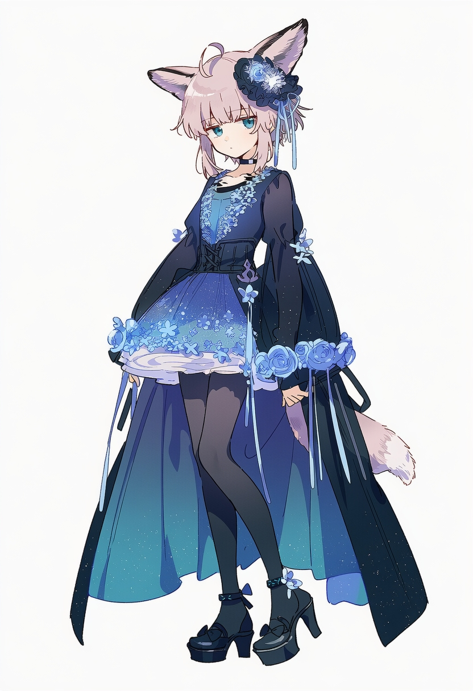

[在线例图](https://assets.quicktagcloud.com/images/raven_composition/raven_composition-0490.jpg?v=49d2f54fb9a59b59)

<a id="raven_composition-0491"></a>

## 坡跟鞋

ID：`raven_composition-0491`；分类：鞋子 / 高跟结构；来源标记：`safe`。

来源说明：

> 后跟与前掌之间由连续楔形鞋底连接，而非独立鞋跟的高跟结构。

正向提示词：

```text
wedge_heels
```

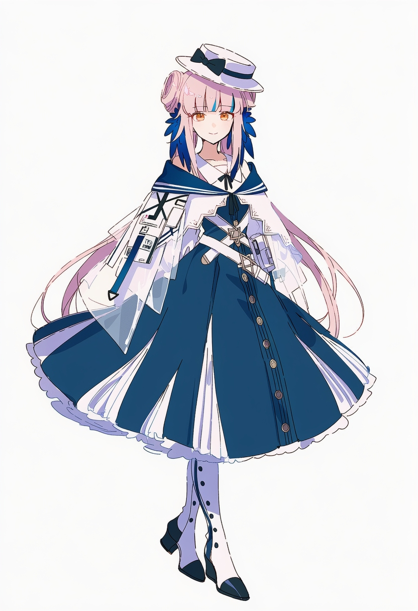

[在线例图](https://assets.quicktagcloud.com/images/raven_composition/raven_composition-0491.jpg?v=b28bb49babd5729d)

<a id="raven_composition-0492"></a>

## 猫跟鞋

ID：`raven_composition-0492`；分类：鞋子 / 高跟结构；来源标记：`safe`。

来源说明：

> 鞋跟较低且纤细、通常略向内收的小高跟鞋。

正向提示词：

```text
kitten_heels
```

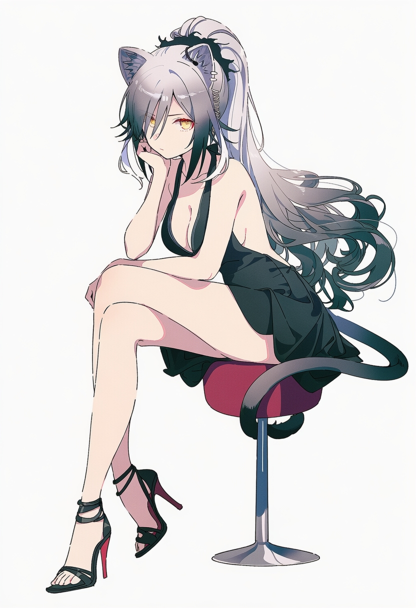

[在线例图](https://assets.quicktagcloud.com/images/raven_composition/raven_composition-0492.jpg?v=9a7fb209c14d533d)

<a id="raven_composition-0493"></a>

## 粗跟鞋

ID：`raven_composition-0493`；分类：鞋子 / 高跟结构；来源标记：`safe`。

来源说明：

> 鞋跟宽厚、横截面较大的高跟鞋结构。

正向提示词：

```text
block_heels
```

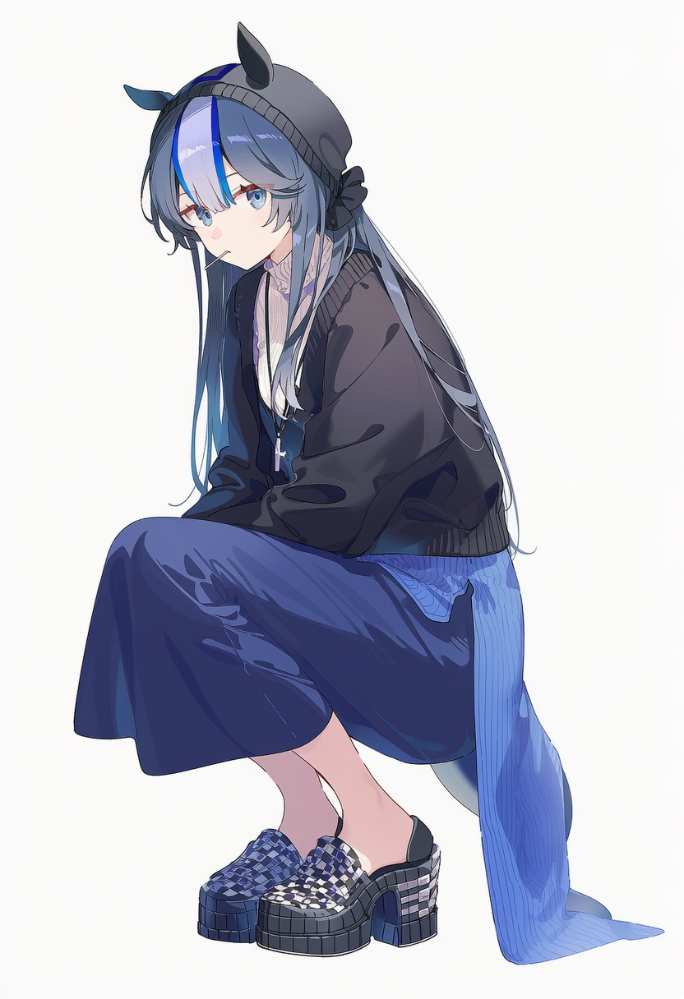

[在线例图](https://assets.quicktagcloud.com/images/raven_composition/raven_composition-0493.jpg?v=77dee87b5e297407)

<a id="raven_composition-0494"></a>

## 低粗跟鞋

ID：`raven_composition-0494`；分类：鞋子 / 高跟结构；来源标记：`safe`。

来源说明：

> 较低高度的宽粗鞋跟，兼具稳定性和轻度增高。

正向提示词：

```text
low_block_heels
```

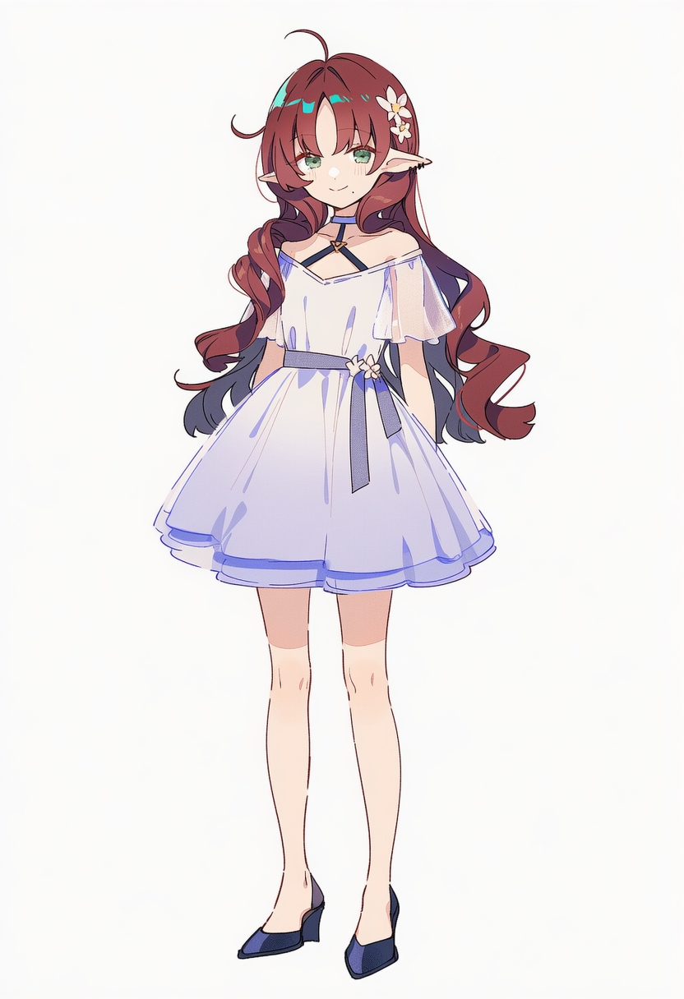

[在线例图](https://assets.quicktagcloud.com/images/raven_composition/raven_composition-0494.jpg?v=69cc420e853fac09)

<a id="raven_composition-0495"></a>

## 后空带高跟鞋

ID：`raven_composition-0495`；分类：鞋子 / 高跟结构；来源标记：`safe`。

来源说明：

> 后跟开放，以细带绕过脚后跟固定的高跟鞋。

正向提示词：

```text
slingback_heels
```

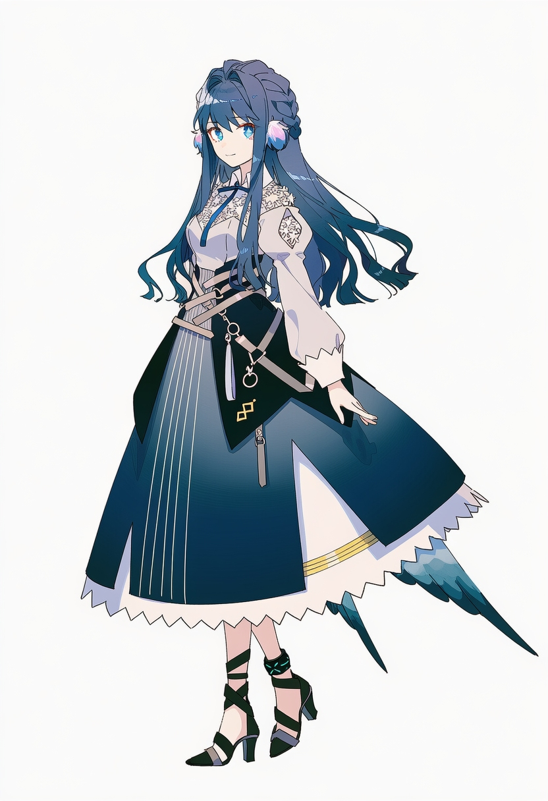

[在线例图](https://assets.quicktagcloud.com/images/raven_composition/raven_composition-0495.jpg?v=60c24e79b437e25f)

<a id="raven_composition-0496"></a>

## 奥赛高跟鞋

ID：`raven_composition-0496`；分类：鞋子 / 高跟结构；来源标记：`safe`。

来源说明：

> 鞋身侧面有明显镂空/开放区域、脚弓侧边暴露的高跟鞋款。

正向提示词：

```text
d'orsay_heels
```

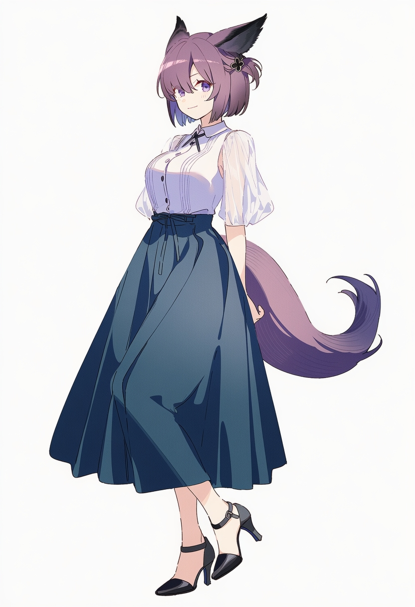

[在线例图](https://assets.quicktagcloud.com/images/raven_composition/raven_composition-0496.jpg?v=7a05067581a3af59)

<a id="raven_composition-0497"></a>

## 绑带高跟鞋

ID：`raven_composition-0497`；分类：鞋子 / 高跟结构；来源标记：`safe`。

来源说明：

> 以多条细带固定脚背或脚踝的高跟鞋，常见于礼服鞋。

正向提示词：

```text
strappy_heels
```

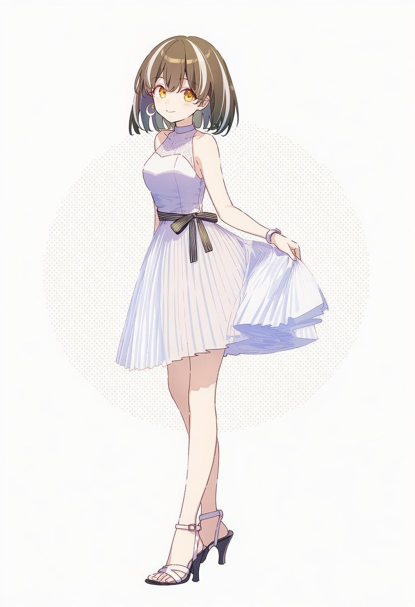

[在线例图](https://assets.quicktagcloud.com/images/raven_composition/raven_composition-0497.jpg?v=60a6ef98ce19bd9d)

<a id="raven_composition-0498"></a>

## 梯形跟鞋

ID：`raven_composition-0498`；分类：鞋子 / 高跟结构；来源标记：`safe`。

来源说明：

> 鞋跟从上到下呈外扩或梯形轮廓的高跟结构。

正向提示词：

```text
trapeze_heels
```

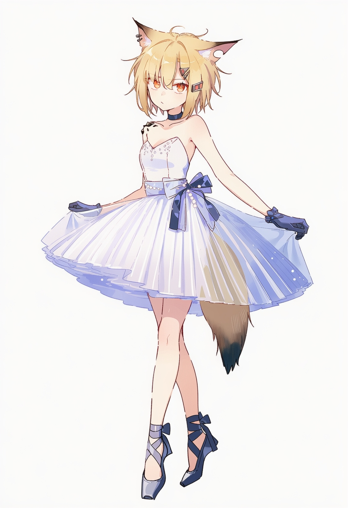

[在线例图](https://assets.quicktagcloud.com/images/raven_composition/raven_composition-0498.jpg?v=a91fbeed68fae750)

<a id="raven_composition-0499"></a>

## 无跟高跟鞋

ID：`raven_composition-0499`；分类：鞋子 / 高跟结构；来源标记：`safe`。

来源说明：

> 没有传统后跟支柱，却通过前掌平台和鞋底结构让脚跟悬空抬高的高跟鞋。

正向提示词：

```text
heel-less_heels
```

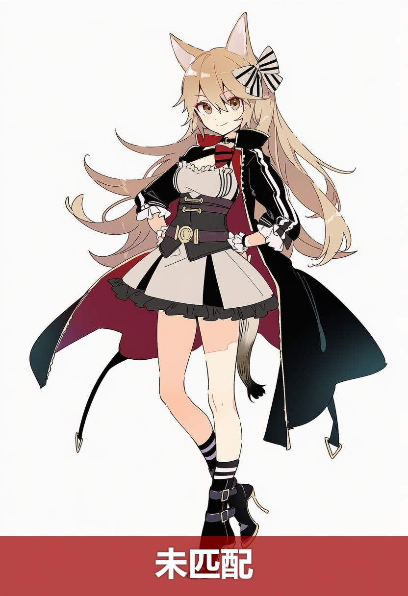

[在线例图](https://assets.quicktagcloud.com/images/raven_composition/raven_composition-0499.jpg?v=afcf22c57847ad41)

<a id="raven_composition-0500"></a>

## 高跟运动鞋

ID：`raven_composition-0500`；分类：鞋子 / 高跟结构；来源标记：`safe`。

来源说明：

> 运动鞋鞋面与明显高跟结构结合的混合鞋型。

正向提示词：

```text
high_heel_sneakers
```

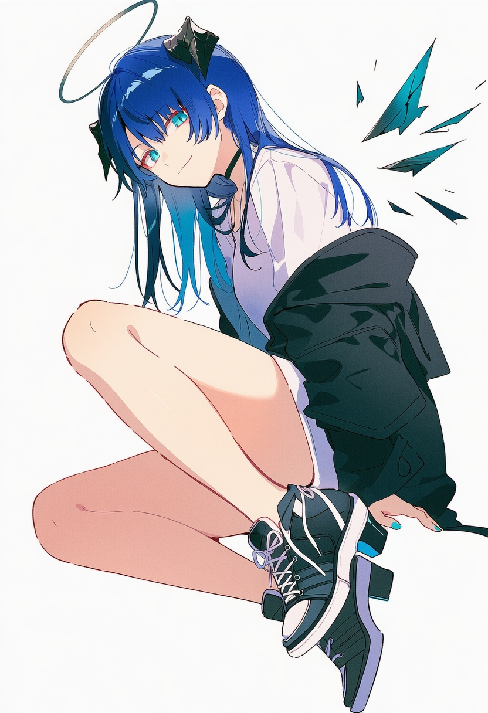

[在线例图](https://assets.quicktagcloud.com/images/raven_composition/raven_composition-0500.jpg?v=c47e523b21b8a018)
