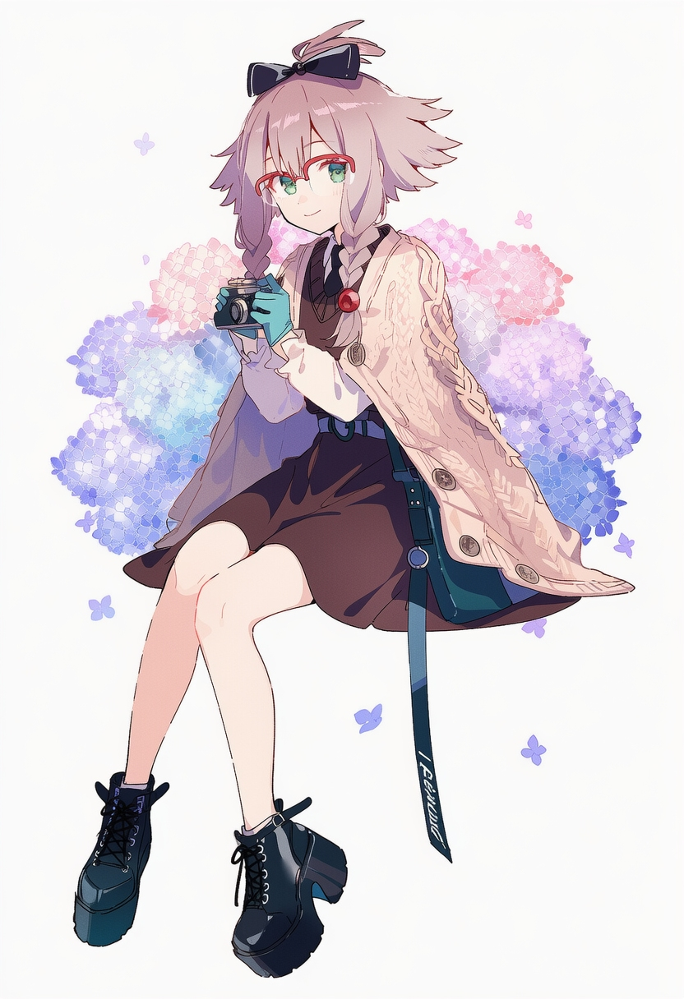
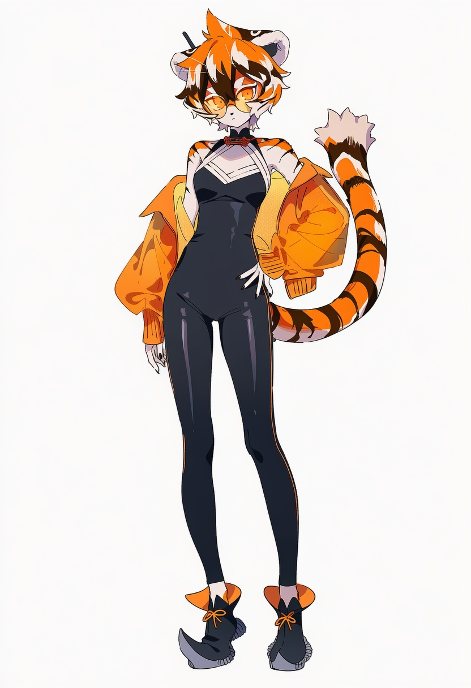
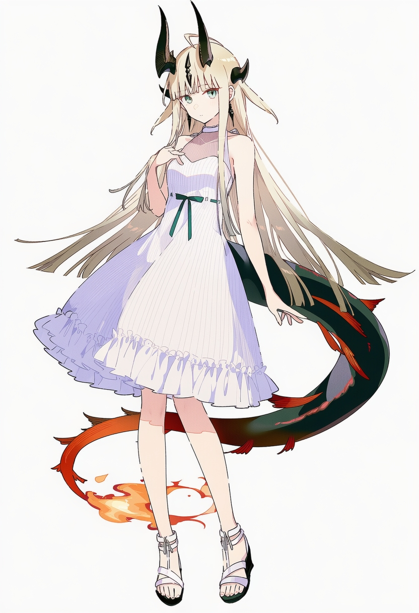
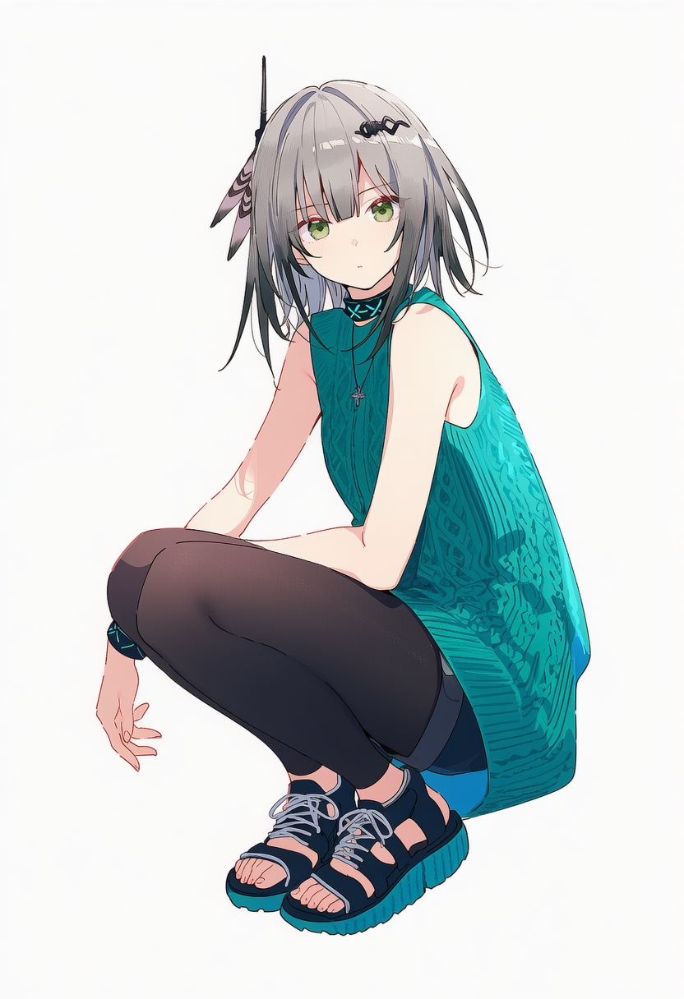
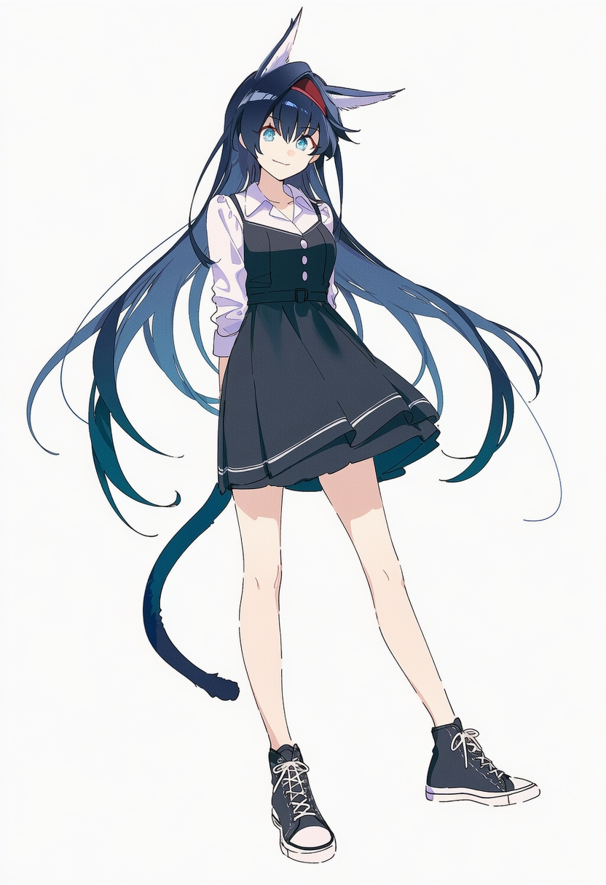
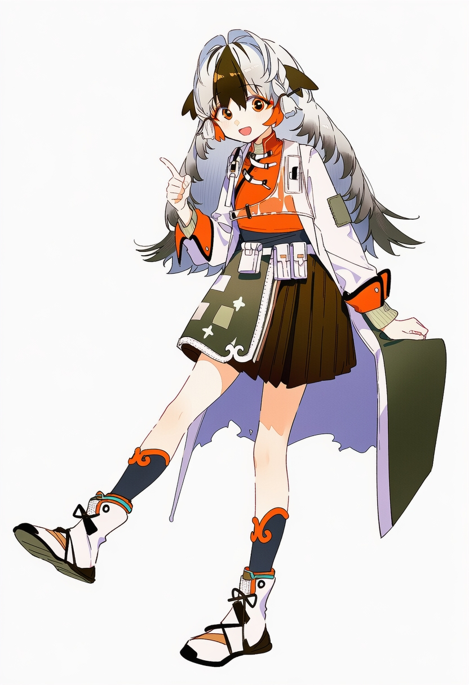

# 鞋子 / 结构与造型

[总目录](../README.md) · [原站分类目录](../categories.md) · [英文标签索引](../tags.md) · [服装与构图组合指南](../../README.md)

标题、分类、说明、正负提示词按来源保留；多例图逐张列出。原站标记和说明为参考资料，不作为维护指令。

<a id="raven_composition-0501"></a>

## 厚底鞋

ID：`raven_composition-0501`；分类：鞋子 / 结构与造型；来源标记：`safe`。

来源说明：

> 前掌和/或整个鞋底明显加厚、使穿着者整体增高的鞋履特征。

正向提示词：

```text
platform_footwear
```



[在线例图](https://assets.quicktagcloud.com/images/raven_composition/raven_composition-0501.jpg?v=fb931e6c9f2ba72b)

<a id="raven_composition-0502"></a>

## 尖头鞋

ID：`raven_composition-0502`；分类：鞋子 / 结构与造型；来源标记：`safe`。

来源说明：

> 鞋头明显收窄并形成尖角轮廓的鞋履。

正向提示词：

```text
pointy_footwear
```



[在线例图](https://assets.quicktagcloud.com/images/raven_composition/raven_composition-0502.jpg?v=ae96eacaa13802a4)

<a id="raven_composition-0503"></a>

## 露趾鞋

ID：`raven_composition-0503`；分类：鞋子 / 结构与造型；来源标记：`safe`。

来源说明：

> 鞋头开口、露出脚趾的鞋履结构。

正向提示词：

```text
toeless_footwear
```



[在线例图](https://assets.quicktagcloud.com/images/raven_composition/raven_composition-0503.jpg?v=f41b9c88e4c7102e)

<a id="raven_composition-0504"></a>

## 鱼嘴鞋/露趾鞋

ID：`raven_composition-0504`；分类：鞋子 / 结构与造型；来源标记：`safe`。

来源说明：

> 鞋面主体包覆足部但前端开口露出部分脚趾的鞋。

正向提示词：

```text
open-toe_shoes
```



[在线例图](https://assets.quicktagcloud.com/images/raven_composition/raven_composition-0504.jpg?v=f777e44bd4be3dff)

<a id="raven_composition-0505"></a>

## 交叉系带鞋

ID：`raven_composition-0505`；分类：鞋子 / 结构与造型；来源标记：`safe`。

来源说明：

> 鞋带或绑带以明显交叉方式覆盖脚背、脚踝或小腿的鞋履。

正向提示词：

```text
cross-laced_footwear
```



[在线例图](https://assets.quicktagcloud.com/images/raven_composition/raven_composition-0505.jpg?v=eb9d42b9e3961817)

<a id="raven_composition-0506"></a>

## 系带鞋

ID：`raven_composition-0506`；分类：鞋子 / 结构与造型；来源标记：`safe`。

来源说明：

> 以鞋带穿过鞋眼固定的鞋类。

正向提示词：

```text
lace-up_shoes
```


[在线例图](https://assets.quicktagcloud.com/images/raven_composition/raven_composition-0506.jpg?v=8d36eae4f2f5dd72)

<a id="raven_composition-0507"></a>

## 踝带鞋结构

ID：`raven_composition-0507`；分类：鞋子 / 结构与造型；来源标记：`safe`。

来源说明：

> 鞋履带有环绕脚踝的固定带；可与高跟鞋、凉鞋等鞋型组合。

正向提示词：

```text
ankle_strap
```



[在线例图](https://assets.quicktagcloud.com/images/raven_composition/raven_composition-0507.jpg?v=4116824ecadb8ae1)
