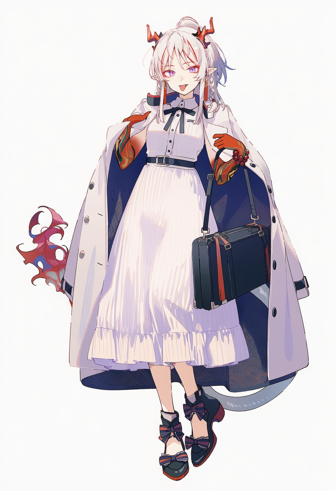
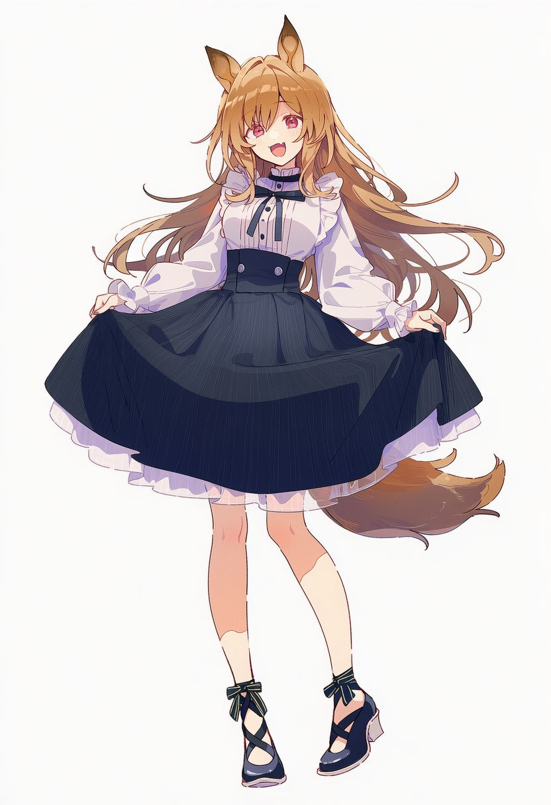
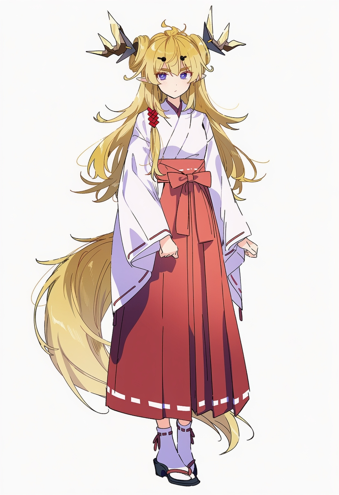
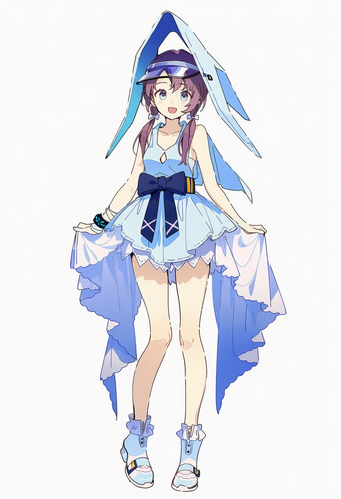
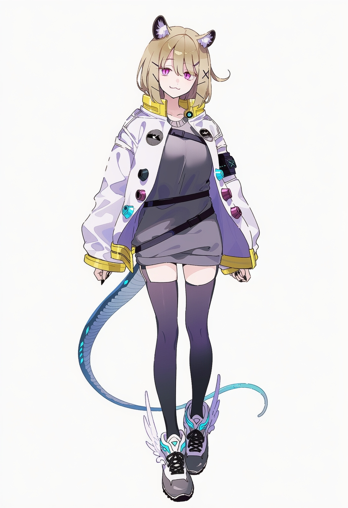
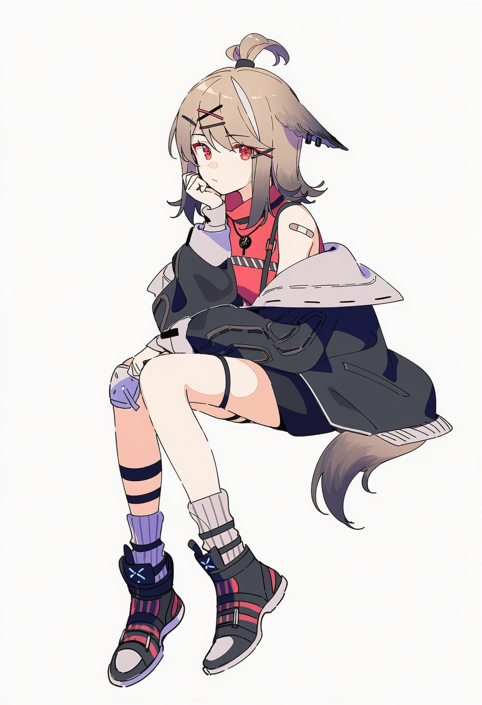
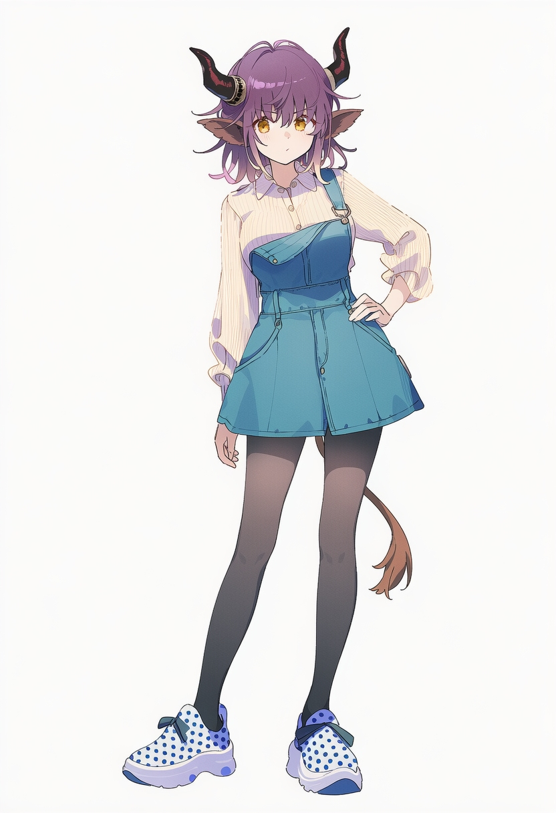
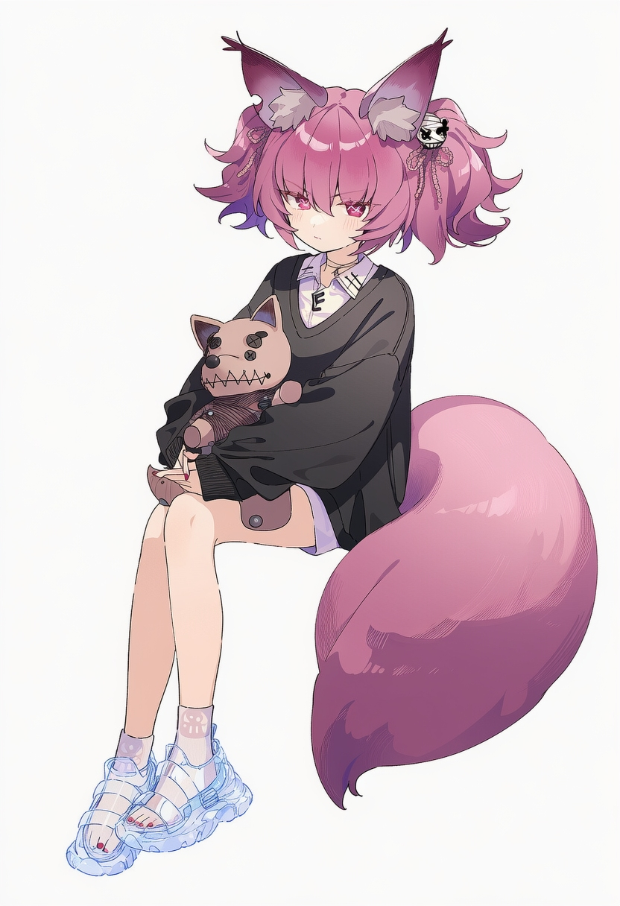

# 鞋子 / 装饰与材质

[总目录](../README.md) · [原站分类目录](../categories.md) · [英文标签索引](../tags.md) · [服装与构图组合指南](../../README.md)

标题、分类、说明、正负提示词按来源保留；多例图逐张列出。原站标记和说明为参考资料，不作为维护指令。

<a id="raven_composition-0508"></a>

## 鞋上蝴蝶结

ID：`raven_composition-0508`；分类：鞋子 / 装饰与材质；来源标记：`safe`。

来源说明：

> 鞋、靴、凉鞋等鞋履上带有明显蝴蝶结装饰。

正向提示词：

```text
footwear_bow
```



[在线例图](https://assets.quicktagcloud.com/images/raven_composition/raven_composition-0508.jpg?v=03645dd667b21cd2)

<a id="raven_composition-0509"></a>

## 鞋上缎带

ID：`raven_composition-0509`；分类：鞋子 / 装饰与材质；来源标记：`safe`。

来源说明：

> 鞋履上带有缎带/丝带装饰或用于系结的带状元素。

正向提示词：

```text
footwear_ribbon
```



[在线例图](https://assets.quicktagcloud.com/images/raven_composition/raven_composition-0509.jpg?v=a8e225feccde8862)

<a id="raven_composition-0510"></a>

## 缎带滚边鞋

ID：`raven_composition-0510`；分类：鞋子 / 装饰与材质；来源标记：`safe`。

来源说明：

> 鞋履边缘带有连续的缎带式饰边，常表现为沿鞋口的一圈装饰线。

正向提示词：

```text
ribbon-trimmed_footwear
```



[在线例图](https://assets.quicktagcloud.com/images/raven_composition/raven_composition-0510.jpg?v=cceb74394c3edebe)

<a id="raven_composition-0511"></a>

## 褶边鞋

ID：`raven_composition-0511`；分类：鞋子 / 装饰与材质；来源标记：`safe`。

来源说明：

> 鞋履带有荷叶边、褶边装饰。

正向提示词：

```text
frilled_footwear
```



[在线例图](https://assets.quicktagcloud.com/images/raven_composition/raven_composition-0511.jpg?v=053cdfcc83a37332)

<a id="raven_composition-0512"></a>

## 带翼鞋

ID：`raven_composition-0512`；分类：鞋子 / 装饰与材质；来源标记：`safe`。

来源说明：

> 鞋履上具有翅膀造型装饰或幻想性的翼状结构。

正向提示词：

```text
winged_footwear
```



[在线例图](https://assets.quicktagcloud.com/images/raven_composition/raven_composition-0512.jpg?v=bab33afd62b541e1)

<a id="raven_composition-0513"></a>

## 毛边鞋

ID：`raven_composition-0513`；分类：鞋子 / 装饰与材质；来源标记：`safe`。

来源说明：

> 鞋口或边缘带明显毛皮/绒毛饰边。

正向提示词：

```text
fur-trimmed_footwear
```


[在线例图](https://assets.quicktagcloud.com/images/raven_composition/raven_composition-0513.jpg?v=c8838c7f1d681e32)

<a id="raven_composition-0514"></a>

## 格纹鞋

ID：`raven_composition-0514`；分类：鞋子 / 装饰与材质；来源标记：`safe`。

来源说明：

> 鞋履主体具有格纹/苏格兰格纹图案；属于图案差异而非单纯颜色差异。

正向提示词：

```text
plaid_footwear
```


[在线例图](https://assets.quicktagcloud.com/images/raven_composition/raven_composition-0514.jpg?v=164a4095b5409bdf)

<a id="raven_composition-0515"></a>

## 条纹鞋

ID：`raven_composition-0515`；分类：鞋子 / 装饰与材质；来源标记：`safe`。

来源说明：

> 鞋履上具有明显条纹图案。

正向提示词：

```text
striped_footwear
```



[在线例图](https://assets.quicktagcloud.com/images/raven_composition/raven_composition-0515.jpg?v=89a29338f0b1b604)

<a id="raven_composition-0516"></a>

## 波点鞋

ID：`raven_composition-0516`；分类：鞋子 / 装饰与材质；来源标记：`safe`。

来源说明：

> 鞋履上具有明显圆点/波点图案。

正向提示词：

```text
polka_dot_footwear
```



[在线例图](https://assets.quicktagcloud.com/images/raven_composition/raven_composition-0516.jpg?v=2a91e73c0465be8d)

<a id="raven_composition-0517"></a>

## 透明鞋

ID：`raven_composition-0517`；分类：鞋子 / 装饰与材质；来源标记：`safe`。

来源说明：

> 鞋面或鞋体主要部分由透明/半透明材质表现。

正向提示词：

```text
transparent_footwear
```



[在线例图](https://assets.quicktagcloud.com/images/raven_composition/raven_composition-0517.jpg?v=63f970ac57e0ed93)
