# 鞋子 / 状态类

[总目录](../README.md) · [原站分类目录](../categories.md) · [英文标签索引](../tags.md) · [服装与构图组合指南](../../README.md)

标题、分类、说明、正负提示词按来源保留；多例图逐张列出。原站标记和说明为参考资料，不作为维护指令。

<a id="raven_composition-0518"></a>

## 未穿着的鞋

ID：`raven_composition-0518`；分类：鞋子 / 状态类；来源标记：`safe`。

来源说明：

> 鞋子出现在画面中但没有穿在脚上。

正向提示词：

```text
unworn_shoes
```

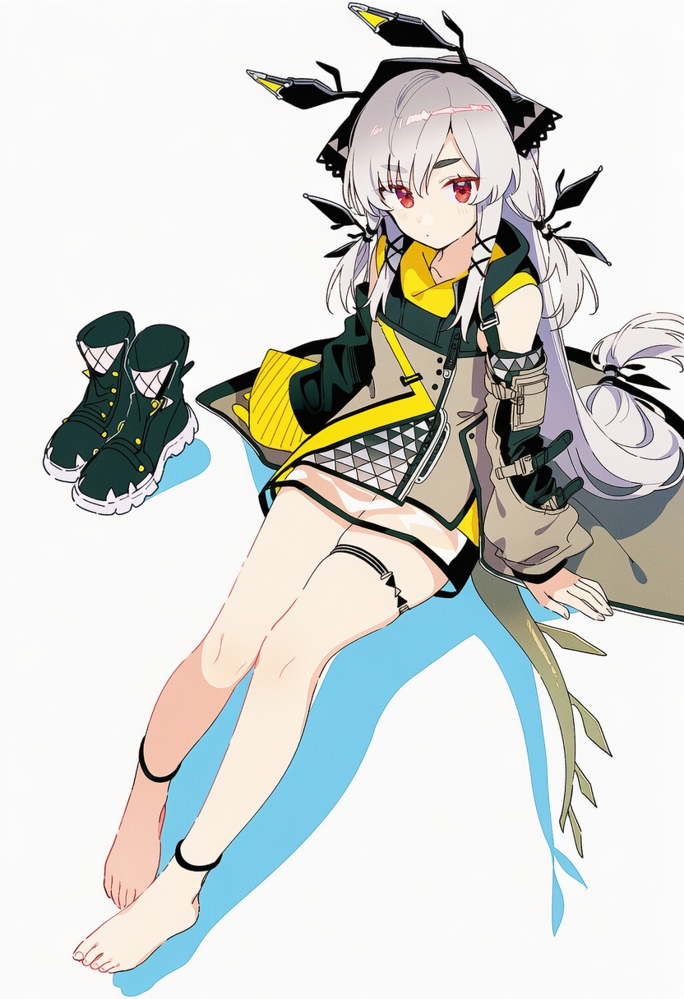

[在线例图](https://assets.quicktagcloud.com/images/raven_composition/raven_composition-0518.jpg?v=19067153f8f0365a)

<a id="raven_composition-0519"></a>

## 未穿着的靴子

ID：`raven_composition-0519`；分类：鞋子 / 状态类；来源标记：`safe`。

来源说明：

> 靴子出现在画面中但没有穿在脚上。

正向提示词：

```text
unworn_boots
```

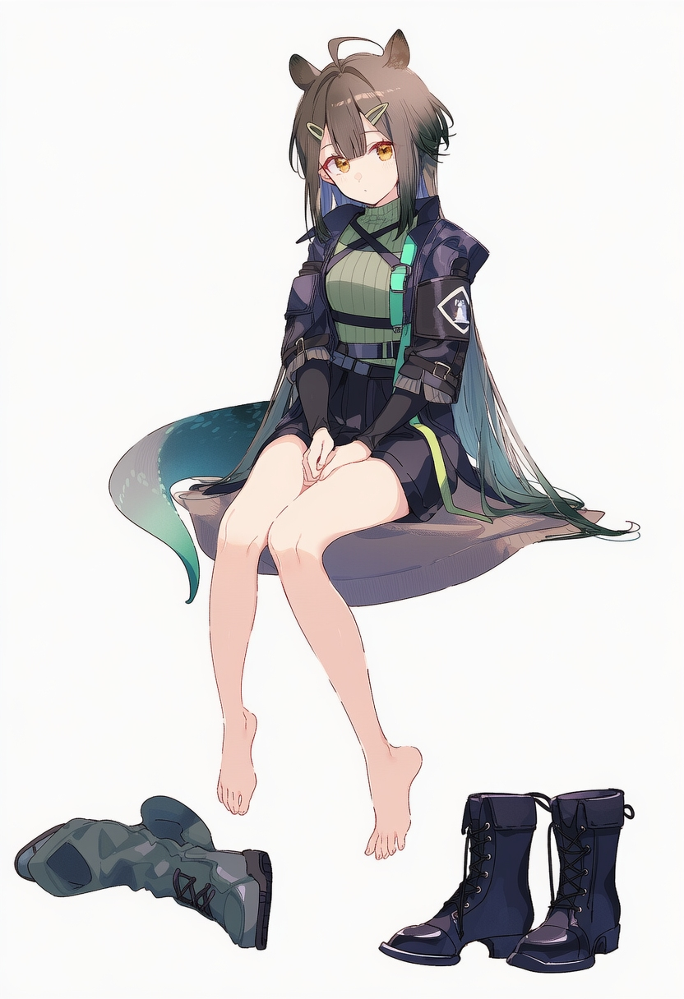

[在线例图](https://assets.quicktagcloud.com/images/raven_composition/raven_composition-0519.jpg?v=95586944b506886a)

<a id="raven_composition-0520"></a>

## 未穿着的凉鞋

ID：`raven_composition-0520`；分类：鞋子 / 状态类；来源标记：`safe`。

来源说明：

> 凉鞋出现在画面中但没有穿在脚上。

正向提示词：

```text
unworn_sandals
```

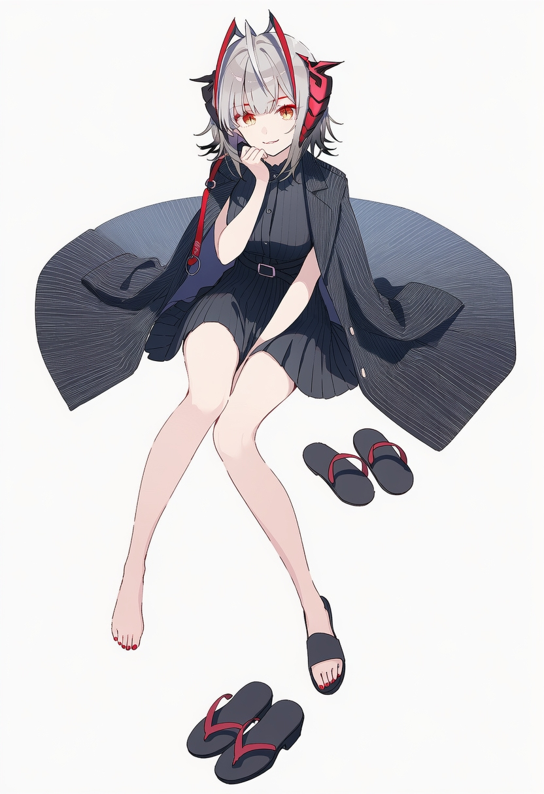

[在线例图](https://assets.quicktagcloud.com/images/raven_composition/raven_composition-0520.jpg?v=1933e87ca12c0c4c)

<a id="raven_composition-0521"></a>

## 单只鞋

ID：`raven_composition-0521`；分类：鞋子 / 状态类；来源标记：`safe`。

来源说明：

> 角色只穿着一只鞋，另一只脚没有对应鞋子。

正向提示词：

```text
single_shoe
```

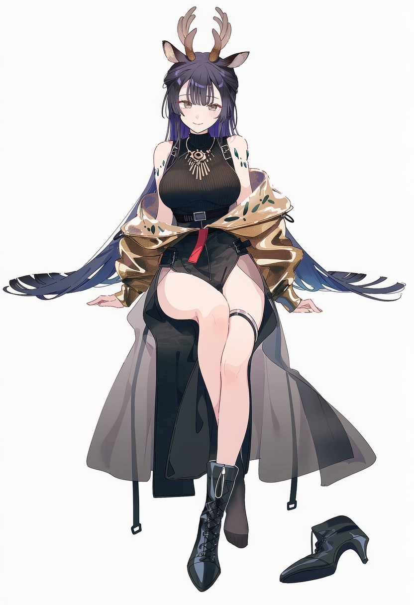

[在线例图](https://assets.quicktagcloud.com/images/raven_composition/raven_composition-0521.jpg?v=7b6664fb4fdac26e)

<a id="raven_composition-0522"></a>

## 单只靴

ID：`raven_composition-0522`；分类：鞋子 / 状态类；来源标记：`safe`。

来源说明：

> 角色只穿着一只靴子。

正向提示词：

```text
single_boot
```

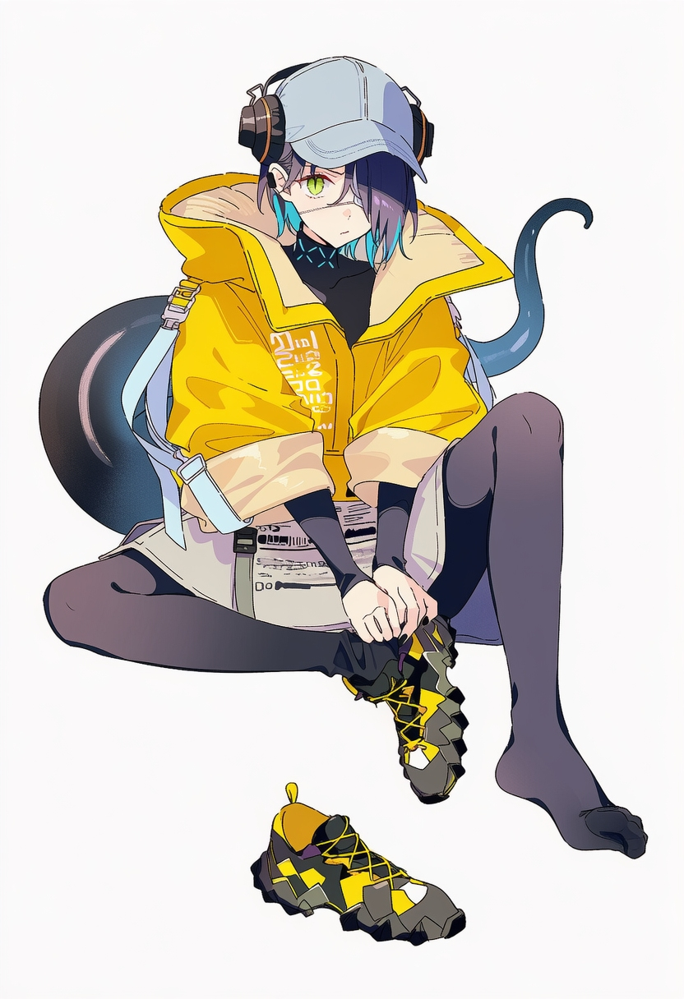

[在线例图](https://assets.quicktagcloud.com/images/raven_composition/raven_composition-0522.jpg?v=5781d6308a0adf53)

<a id="raven_composition-0523"></a>

## 单只凉鞋

ID：`raven_composition-0523`；分类：鞋子 / 状态类；来源标记：`safe`。

来源说明：

> 角色只穿着一只凉鞋。

正向提示词：

```text
single_sandal
```

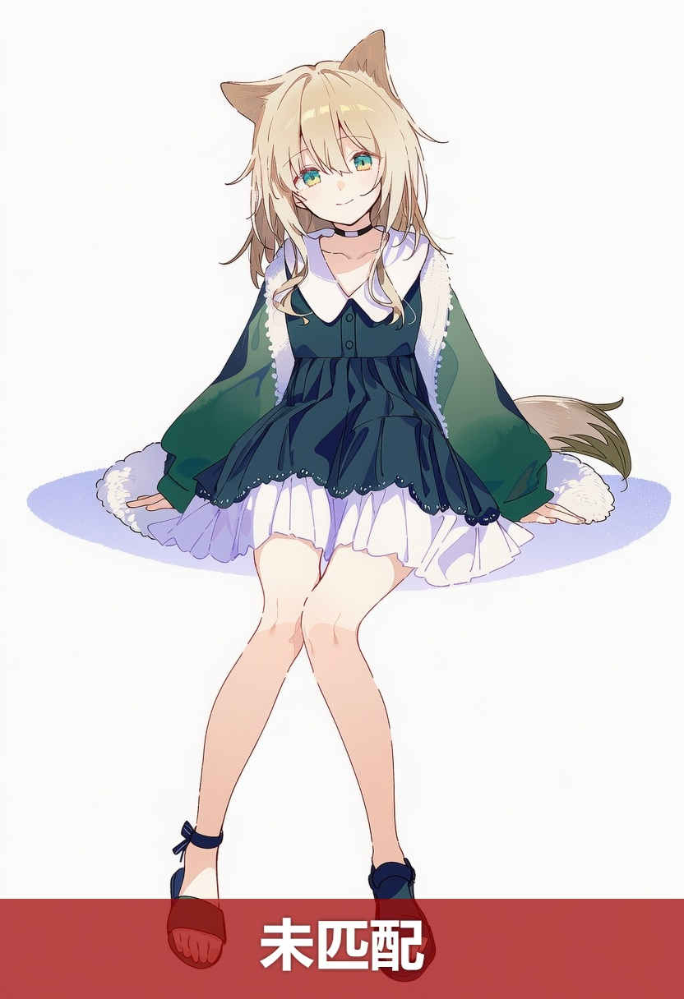

[在线例图](https://assets.quicktagcloud.com/images/raven_composition/raven_composition-0523.jpg?v=e41c7b94db1912e3)

<a id="raven_composition-0524"></a>

## 左右不同鞋

ID：`raven_composition-0524`；分类：鞋子 / 状态类；来源标记：`safe`。

来源说明：

> 左右脚穿着明显不成对、款式或类型不同的鞋履。

正向提示词：

```text
mismatched_footwear
```

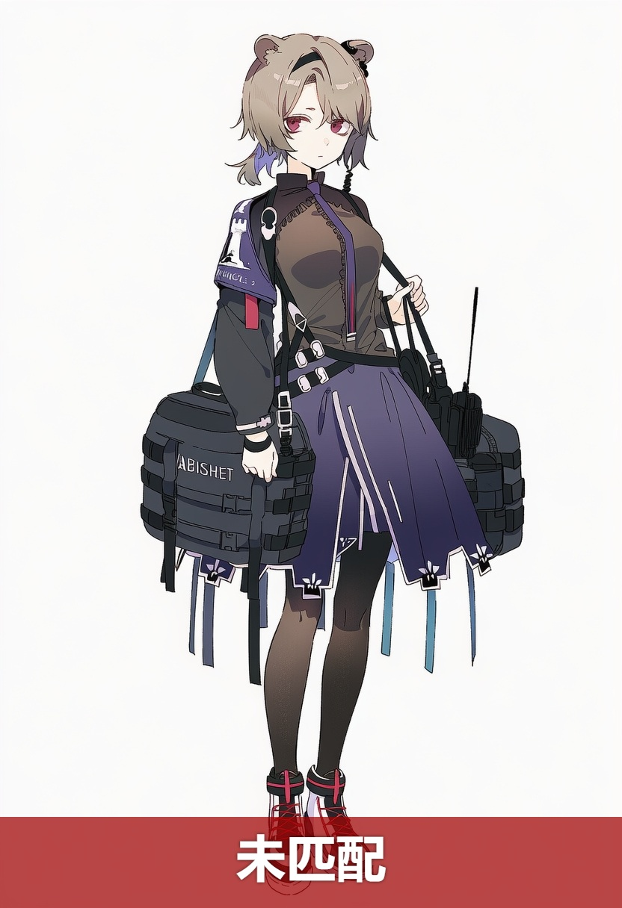

[在线例图](https://assets.quicktagcloud.com/images/raven_composition/raven_composition-0524.jpg?v=13110a5a7d91586d)

<a id="raven_composition-0525"></a>

## 鞋带松开

ID：`raven_composition-0525`；分类：鞋子 / 状态类；来源标记：`safe`。

来源说明：

> 系带鞋的鞋带处于未系好、散开的状态。

正向提示词：

```text
untied_shoelaces
```


[在线例图](https://assets.quicktagcloud.com/images/raven_composition/raven_composition-0525.jpg?v=5f87aa811129a26a)

<a id="raven_composition-0526"></a>

## 破损鞋履

ID：`raven_composition-0526`；分类：鞋子 / 状态类；来源标记：`safe`。

来源说明：

> 鞋履有明显撕裂、破洞或严重损坏。

正向提示词：

```text
torn_footwear
```

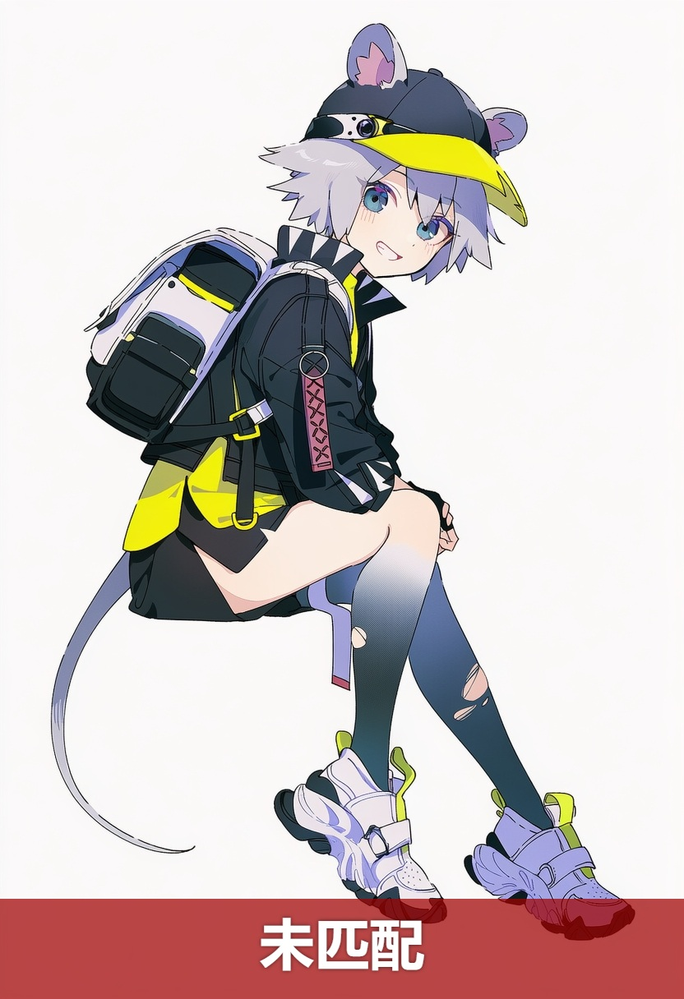

[在线例图](https://assets.quicktagcloud.com/images/raven_composition/raven_composition-0526.jpg?v=e8d491e3233ebb76)

<a id="raven_composition-0527"></a>

## 正在穿鞋

ID：`raven_composition-0527`；分类：鞋子 / 状态类；来源标记：`safe`。

来源说明：

> 角色正在把鞋、靴、凉鞋等穿到脚上的动作。

正向提示词：

```text
putting_on_footwear
```


[在线例图](https://assets.quicktagcloud.com/images/raven_composition/raven_composition-0527.jpg?v=d56670e79dfea52c)

<a id="raven_composition-0528"></a>

## 正在脱鞋

ID：`raven_composition-0528`；分类：鞋子 / 状态类；来源标记：`safe`。

来源说明：

> 角色正在脱下鞋、靴、凉鞋等鞋履。

正向提示词：

```text
taking_off_footwear
```

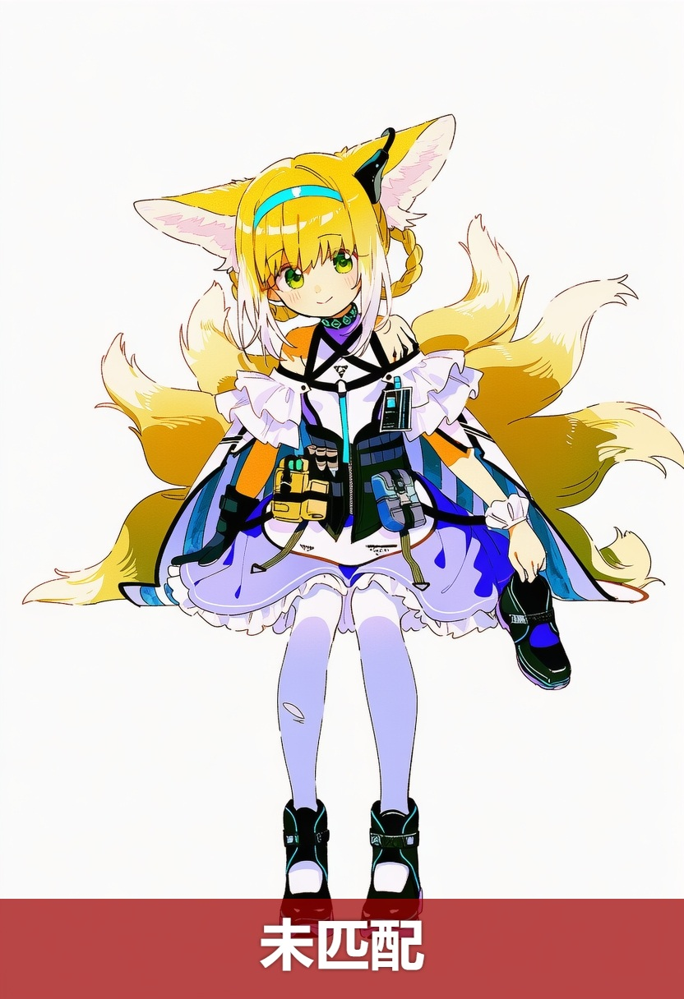

[在线例图](https://assets.quicktagcloud.com/images/raven_composition/raven_composition-0528.jpg?v=f243f1425bff4126)

<a id="raven_composition-0529"></a>

## 整理鞋履

ID：`raven_composition-0529`；分类：鞋子 / 状态类；来源标记：`safe`。

来源说明：

> 角色正在调整已经穿着的鞋履，例如拉正、扣紧或整理位置。

正向提示词：

```text
adjusting_footwear
```

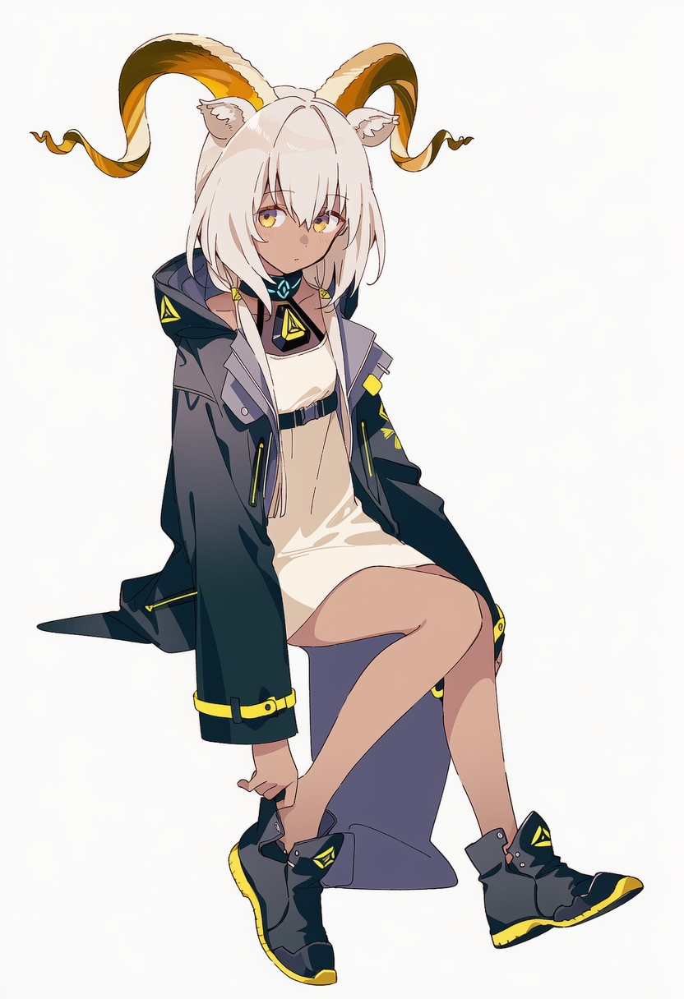

[在线例图](https://assets.quicktagcloud.com/images/raven_composition/raven_composition-0529.jpg?v=f92667188fe76e9f)

<a id="raven_composition-0530"></a>

## 手持鞋子

ID：`raven_composition-0530`；分类：鞋子 / 状态类；来源标记：`safe`。

来源说明：

> 角色手中拿着鞋子而不是穿在脚上。

正向提示词：

```text
holding_shoes
```

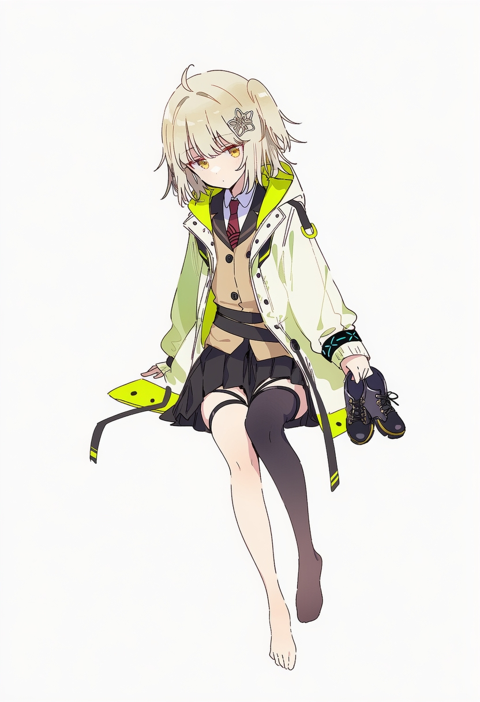

[在线例图](https://assets.quicktagcloud.com/images/raven_composition/raven_composition-0530.jpg?v=093bf325231a315e)
