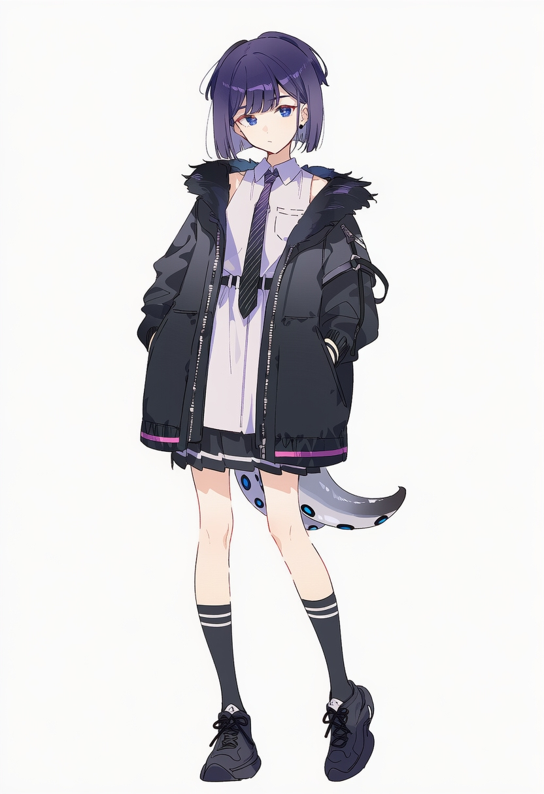
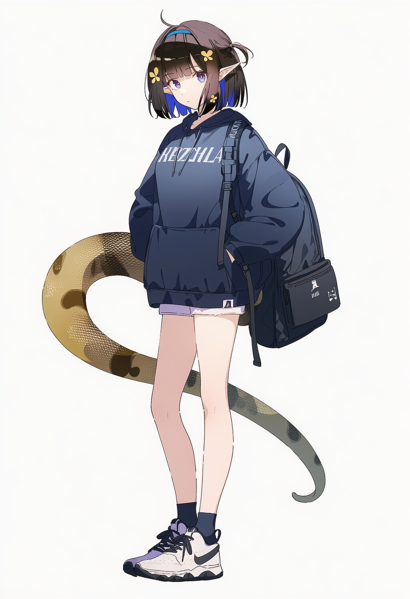
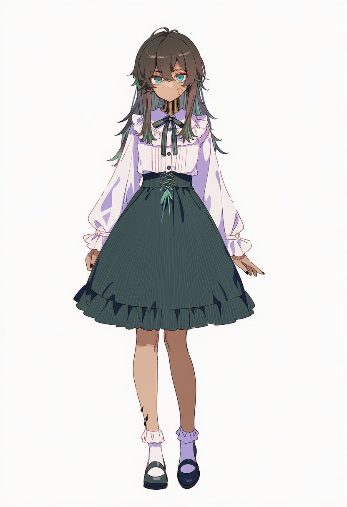
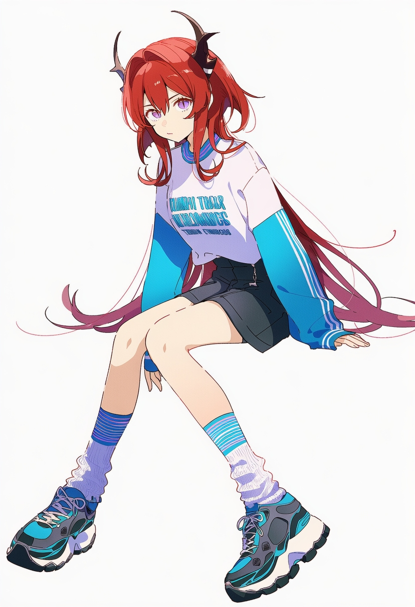
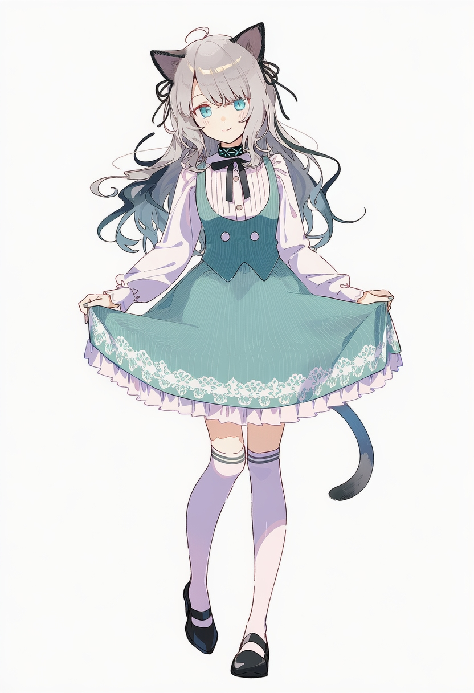
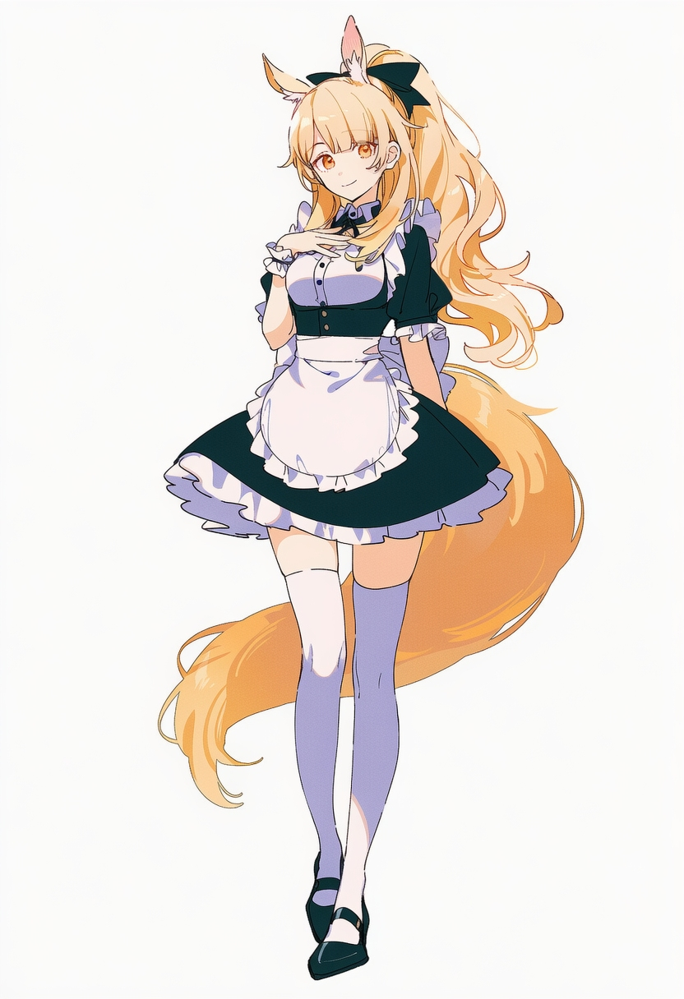
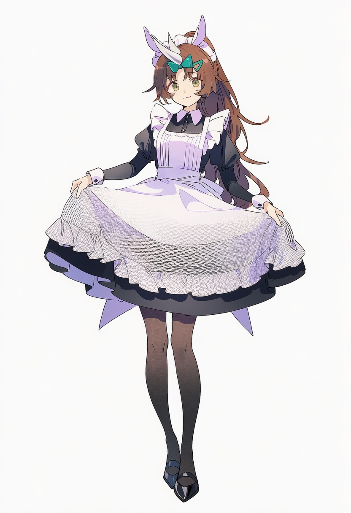
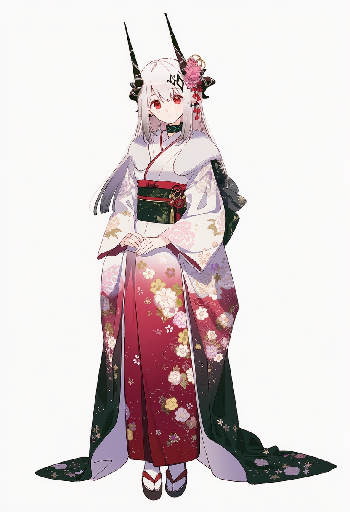
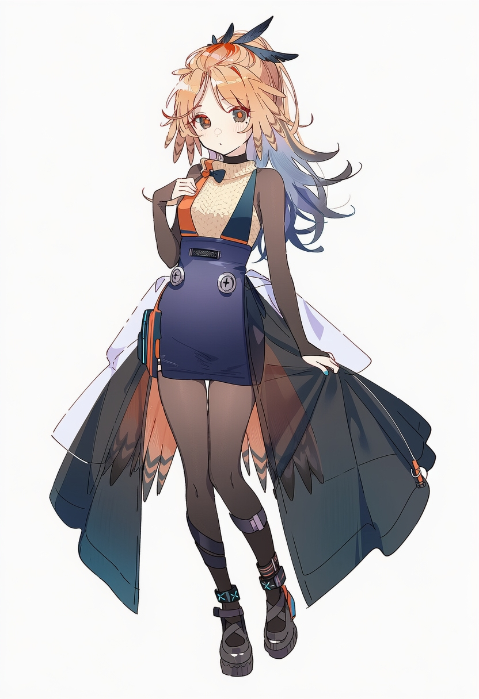

# 袜子 / 袜子种类

[总目录](../README.md) · [原站分类目录](../categories.md) · [英文标签索引](../tags.md) · [服装与构图组合指南](../../README.md)

标题、分类、说明、正负提示词按来源保留；多例图逐张列出。原站标记和说明为参考资料，不作为维护指令。

<a id="raven_composition-0531"></a>

## 袜子

ID：`raven_composition-0531`；分类：袜子 / 袜子种类；来源标记：`safe`。

来源说明：

> Danbooru 的基础袜子 tag：覆盖脚部，通常从踝部到膝部；更高的袜类进一步使用 kneehighs、over-kneehighs、thighhighs、hiphighs 等细分。

正向提示词：

```text
socks
```



[在线例图](https://assets.quicktagcloud.com/images/raven_composition/raven_composition-0531.jpg?v=ba4d52f79f8a0436)

<a id="raven_composition-0532"></a>

## 隐形袜/船袜

ID：`raven_composition-0532`；分类：袜子 / 袜子种类；来源标记：`safe`。

来源说明：

> 鞋口以下的低帮袜，穿鞋后通常几乎看不到袜口；比 ankle_socks 更低。

正向提示词：

```text
no-show_socks
```


[在线例图](https://assets.quicktagcloud.com/images/raven_composition/raven_composition-0532.jpg?v=06d060bb400696c2)

<a id="raven_composition-0533"></a>

## 踝袜/短袜

ID：`raven_composition-0533`；分类：袜子 / 袜子种类；来源标记：`safe`。

来源说明：

> 袜口位于脚踝附近的短袜。

正向提示词：

```text
ankle_socks
```



[在线例图](https://assets.quicktagcloud.com/images/raven_composition/raven_composition-0533.jpg?v=a89197b2ca44d05d)

<a id="raven_composition-0534"></a>

## Bobby 袜/翻口短袜

ID：`raven_composition-0534`；分类：袜子 / 袜子种类；来源标记：`safe`。

来源说明：

> 常见为踝部附近并带翻折袜口的短袜款式，常见于复古学生装语境。

正向提示词：

```text
bobby_socks
```



[在线例图](https://assets.quicktagcloud.com/images/raven_composition/raven_composition-0534.jpg?v=6e64a534a407c539)

<a id="raven_composition-0535"></a>

## 泡泡袜/宽松袜

ID：`raven_composition-0535`；分类：袜子 / 袜子种类；来源标记：`safe`。

来源说明：

> 袜筒宽松并在小腿或脚踝处堆叠形成褶皱；不要与无足的 leg_warmers 混淆。

正向提示词：

```text
loose_socks
```


[在线例图](https://assets.quicktagcloud.com/images/raven_composition/raven_composition-0535.jpg?v=564a3f958d212d4e)

<a id="raven_composition-0536"></a>

## 筒袜

ID：`raven_composition-0536`；分类：袜子 / 袜子种类；来源标记：`safe`。

来源说明：

> 无明显独立脚跟造型、近似直筒的一码袜，常到小腿或膝部，常见运动袜式袜口条纹。

正向提示词：

```text
tube_socks
```



[在线例图](https://assets.quicktagcloud.com/images/raven_composition/raven_composition-0536.jpg?v=c9791e53483c73f1)

<a id="raven_composition-0537"></a>

## 及膝袜

ID：`raven_composition-0537`；分类：袜子 / 袜子种类；来源标记：`safe`。

来源说明：

> 长度到膝盖附近、通常略低于膝盖的长袜；更高一些用 over-kneehighs。

正向提示词：

```text
kneehighs
```


[在线例图](https://assets.quicktagcloud.com/images/raven_composition/raven_composition-0537.jpg?v=85577a9f903851b3)

<a id="raven_composition-0538"></a>

## 过膝袜

ID：`raven_composition-0538`；分类：袜子 / 袜子种类；来源标记：`safe`。

来源说明：

> 袜口刚越过膝盖、但通常短于 thighhighs 的长袜。

正向提示词：

```text
over-kneehighs
```



[在线例图](https://assets.quicktagcloud.com/images/raven_composition/raven_composition-0538.jpg?v=b0e37d23e22d1ced)

<a id="raven_composition-0539"></a>

## 大腿袜/长筒袜

ID：`raven_composition-0539`；分类：袜子 / 袜子种类；来源标记：`safe`。

来源说明：

> 从脚部一直覆盖到大腿的长袜；不覆盖腰部和裆部，因此与 pantyhose 区分。

正向提示词：

```text
thighhighs
```



[在线例图](https://assets.quicktagcloud.com/images/raven_composition/raven_composition-0539.jpg?v=d1864f82b6c52568)

<a id="raven_composition-0540"></a>

## 胯高袜/髋高袜

ID：`raven_composition-0540`；分类：袜子 / 袜子种类；来源标记：`safe`。

来源说明：

> 袜筒一直延伸到腹股沟或髋部，比 thighhighs 更高，但不连接覆盖裆部。

正向提示词：

```text
hiphighs
```


[在线例图](https://assets.quicktagcloud.com/images/raven_composition/raven_composition-0540.jpg?v=071a380af2de4e62)

<a id="raven_composition-0541"></a>

## 连裤袜

ID：`raven_composition-0541`；分类：袜子 / 袜子种类；来源标记：`safe`。

来源说明：

> 从腰/髋部连续覆盖双腿直到脚趾的紧身袜类；Danbooru 将 tights 作为其别名。

正向提示词：

```text
pantyhose
```



[在线例图](https://assets.quicktagcloud.com/images/raven_composition/raven_composition-0541.jpg?v=0b821e30c582b941)

<a id="raven_composition-0542"></a>

## 足袋/分趾袜

ID：`raven_composition-0542`；分类：袜子 / 袜子种类；来源标记：`safe`。

来源说明：

> 日本传统分趾袜，大拇趾与其余脚趾分开；不同于每根脚趾独立的 toe_socks。

正向提示词：

```text
tabi
```



[在线例图](https://assets.quicktagcloud.com/images/raven_composition/raven_composition-0542.jpg?v=08c75198b69dc252)

<a id="raven_composition-0543"></a>

## 五趾袜

ID：`raven_composition-0543`；分类：袜子 / 袜子种类；来源标记：`safe`。

来源说明：

> 每根脚趾都有独立袜套的袜子；不要与只分“大拇趾/其余四趾”的 tabi 混用。

正向提示词：

```text
toe_socks
```


[在线例图](https://assets.quicktagcloud.com/images/raven_composition/raven_composition-0543.jpg?v=d3ba4c455eb959ca)

<a id="raven_composition-0544"></a>

## 半掌袜/前掌套

ID：`raven_composition-0544`；分类：袜子 / 袜子种类；来源标记：`safe`。

来源说明：

> 只覆盖脚掌前部的一类足部穿戴物；官方 Socks Wiki 将其列在袜类相关款式中，严格说不是完整袜子。

正向提示词：

```text
half_soles
```


[在线例图](https://assets.quicktagcloud.com/images/raven_composition/raven_composition-0544.jpg?v=0ef651af9d387a17)

<a id="raven_composition-0545"></a>

## 韩式传统袜（버선）

ID：`raven_composition-0545`；分类：袜子 / 袜子种类；来源标记：`safe`。

来源说明：

> 韩国传统袜，常与 hanbok（韩服）搭配。

正向提示词：

```text
beoseon
```


[在线例图](https://assets.quicktagcloud.com/images/raven_composition/raven_composition-0545.jpg?v=49d93c5db5bdcbff)

<a id="raven_composition-0546"></a>

## 连体丝袜/全身袜

ID：`raven_composition-0546`；分类：袜子 / 袜子种类；来源标记：`safe`。

来源说明：

> 从躯干延伸到腿部的连体紧身袜装；与 pantyhose 相邻但覆盖范围更大。

正向提示词：

```text
bodystocking
```



[在线例图](https://assets.quicktagcloud.com/images/raven_composition/raven_composition-0546.jpg?v=d5dc07d2e46bdb1f)
