# 袜子 / 颜色图案

[总目录](../README.md) · [原站分类目录](../categories.md) · [英文标签索引](../tags.md) · [服装与构图组合指南](../../README.md)

标题、分类、说明、正负提示词按来源保留；多例图逐张列出。原站标记和说明为参考资料，不作为维护指令。

<a id="raven_composition-0547"></a>

## 黑色袜子

ID：`raven_composition-0547`；分类：袜子 / 颜色图案；来源标记：`safe`。

来源说明：

> 表示袜子的主体颜色为黑色；可与长度、材质、图案、穿法等 tag 组合。

正向提示词：

```text
black_socks
```

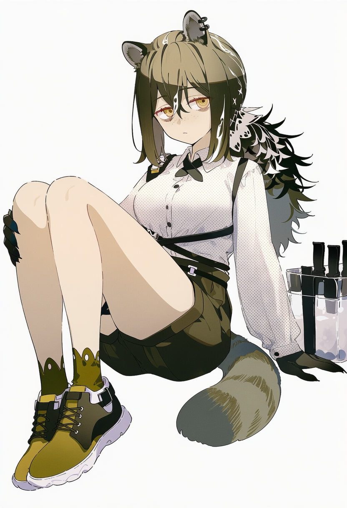

[在线例图](https://assets.quicktagcloud.com/images/raven_composition/raven_composition-0547.jpg?v=a154de061dbfd1b4)

<a id="raven_composition-0548"></a>

## 白色大腿袜

ID：`raven_composition-0548`；分类：袜子 / 颜色图案；来源标记：`safe`。

来源说明：

> 表示大腿袜的主体颜色为白色；可与长度、材质、图案、穿法等 tag 组合。

正向提示词：

```text
white_thighhighs
```

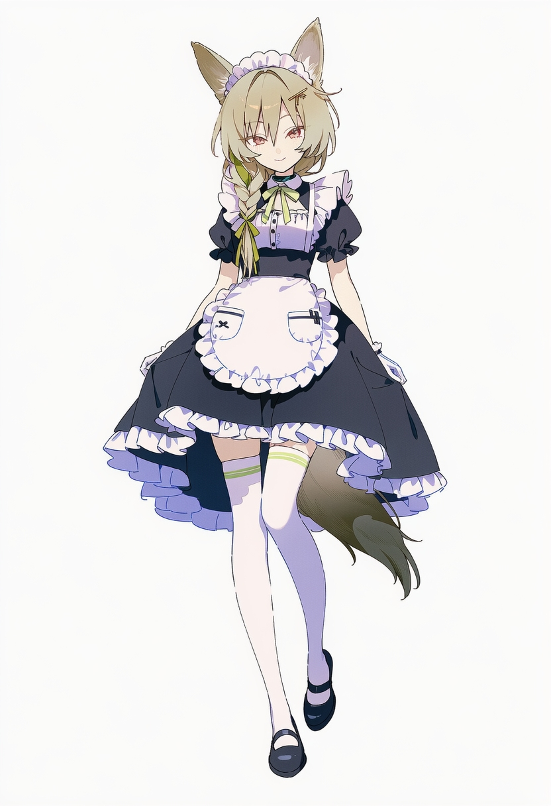

[在线例图](https://assets.quicktagcloud.com/images/raven_composition/raven_composition-0548.jpg?v=431b5da742e7154c)

<a id="raven_composition-0549"></a>

## 菱格/阿盖尔纹袜子

ID：`raven_composition-0549`；分类：袜子 / 颜色图案；来源标记：`safe`。

来源说明：

> 袜子表面具有菱格/阿盖尔纹；可与颜色、材质和长度类 tag 并用。

正向提示词：

```text
argyle_socks
```

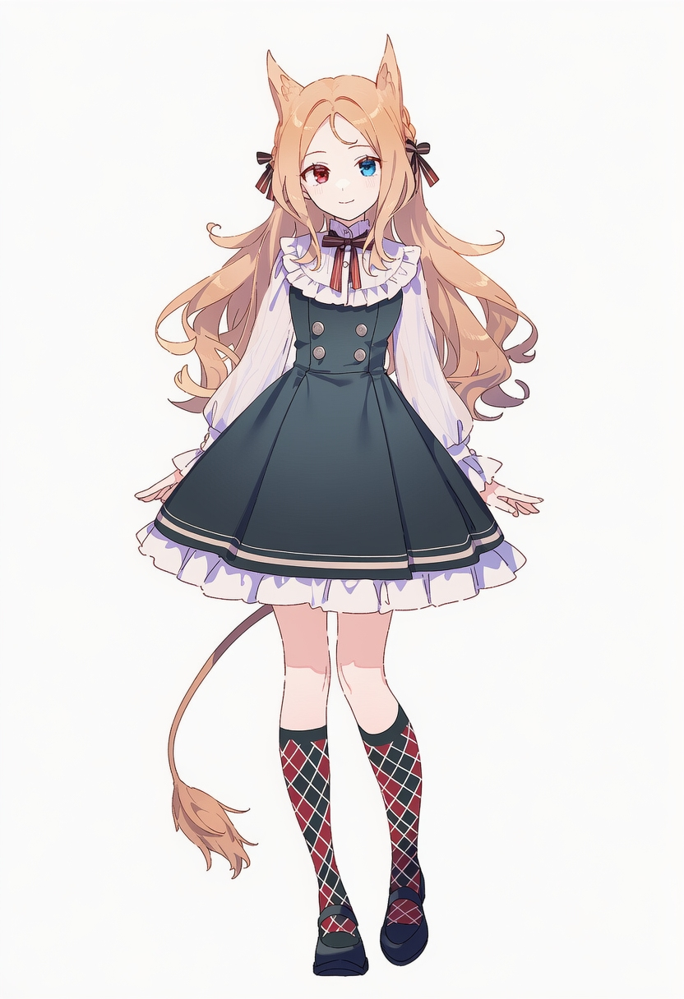

[在线例图](https://assets.quicktagcloud.com/images/raven_composition/raven_composition-0549.jpg?v=f76c88918d0a6aa0)

<a id="raven_composition-0550"></a>

## 印花袜子

ID：`raven_composition-0550`；分类：袜子 / 颜色图案；来源标记：`safe`。

来源说明：

> 袜子表面具有印花；可与颜色、材质和长度类 tag 并用。

正向提示词：

```text
print_socks
```

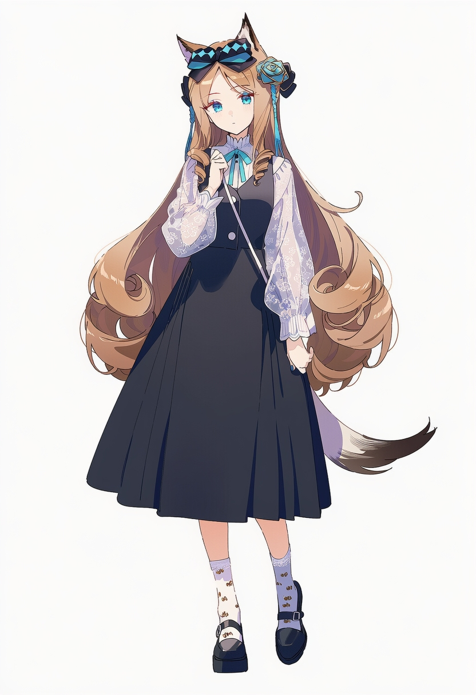

[在线例图](https://assets.quicktagcloud.com/images/raven_composition/raven_composition-0550.jpg?v=ed912738097003d5)

<a id="raven_composition-0551"></a>

## 格纹袜子

ID：`raven_composition-0551`；分类：袜子 / 颜色图案；来源标记：`safe`。

来源说明：

> 袜子表面具有格纹；可与颜色、材质和长度类 tag 并用。

正向提示词：

```text
plaid_socks
```

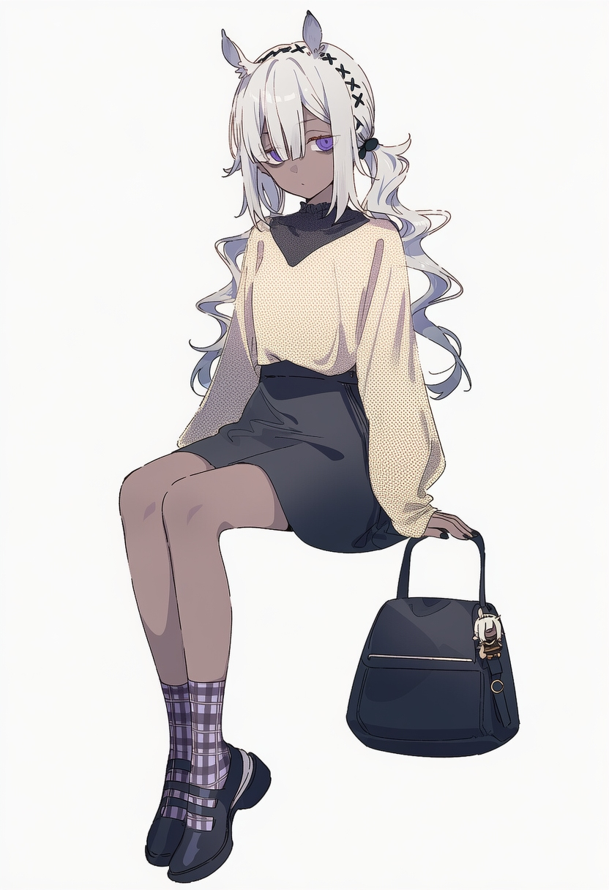

[在线例图](https://assets.quicktagcloud.com/images/raven_composition/raven_composition-0551.jpg?v=62c7967ed97c7f19)

<a id="raven_composition-0552"></a>

## 波点袜子

ID：`raven_composition-0552`；分类：袜子 / 颜色图案；来源标记：`safe`。

来源说明：

> 袜子表面具有波点；可与颜色、材质和长度类 tag 并用。

正向提示词：

```text
polka_dot_socks
```

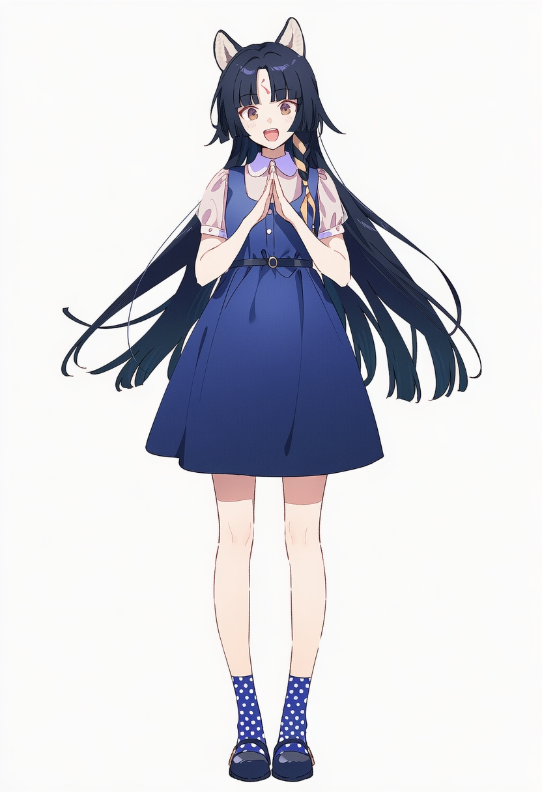

[在线例图](https://assets.quicktagcloud.com/images/raven_composition/raven_composition-0552.jpg?v=2bbf60fb2ca8f42e)

<a id="raven_composition-0553"></a>

## 条纹袜子

ID：`raven_composition-0553`；分类：袜子 / 颜色图案；来源标记：`safe`。

来源说明：

> 袜子表面具有条纹；可与颜色、材质和长度类 tag 并用。

正向提示词：

```text
striped_socks
```

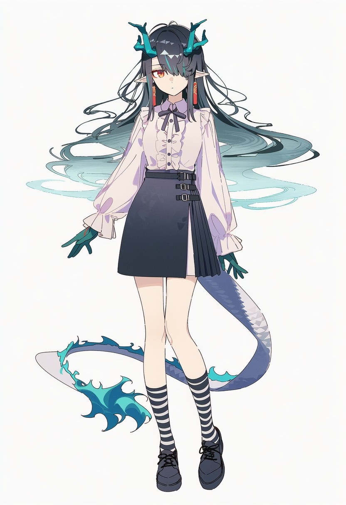

[在线例图](https://assets.quicktagcloud.com/images/raven_composition/raven_composition-0553.jpg?v=3a57799aaee07c2b)

<a id="raven_composition-0554"></a>

## 细条纹袜子

ID：`raven_composition-0554`；分类：袜子 / 颜色图案；来源标记：`safe`。

来源说明：

> 袜子表面具有细条纹；可与颜色、材质和长度类 tag 并用。

正向提示词：

```text
pinstripe_socks
```

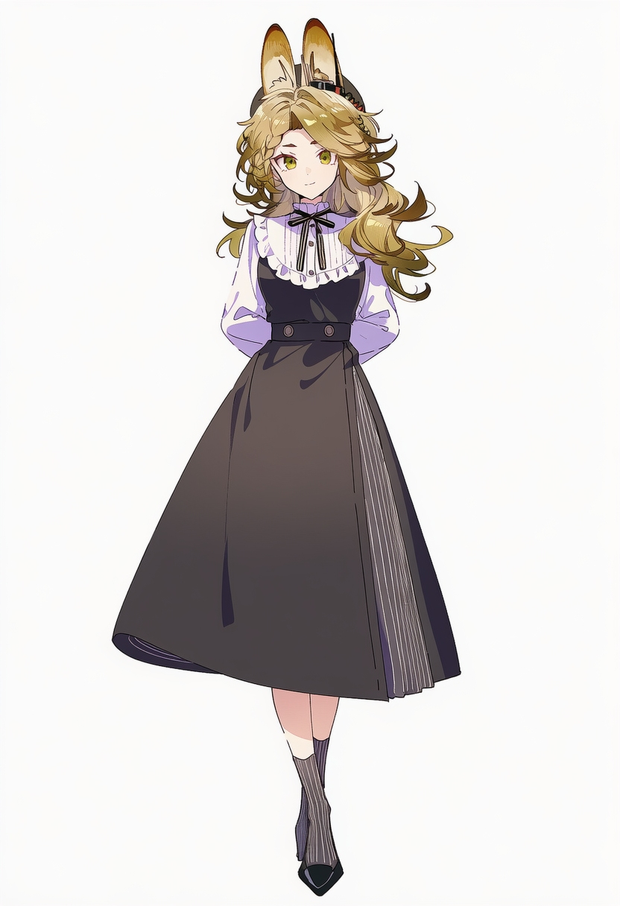

[在线例图](https://assets.quicktagcloud.com/images/raven_composition/raven_composition-0554.jpg?v=8ccd9342041079cc)

<a id="raven_composition-0555"></a>

## 竖条纹袜子

ID：`raven_composition-0555`；分类：袜子 / 颜色图案；来源标记：`safe`。

来源说明：

> 袜子表面具有竖条纹；可与颜色、材质和长度类 tag 并用。

正向提示词：

```text
vertical-striped_socks
```


[在线例图](https://assets.quicktagcloud.com/images/raven_composition/raven_composition-0555.jpg?v=64bbbf61b011abd1)

<a id="raven_composition-0556"></a>

## 奶牛纹大腿袜

ID：`raven_composition-0556`；分类：袜子 / 颜色图案；来源标记：`safe`。

来源说明：

> 大腿袜表面具有奶牛纹；可与颜色、材质和长度类 tag 并用。

正向提示词：

```text
cow_print_thighhighs
```

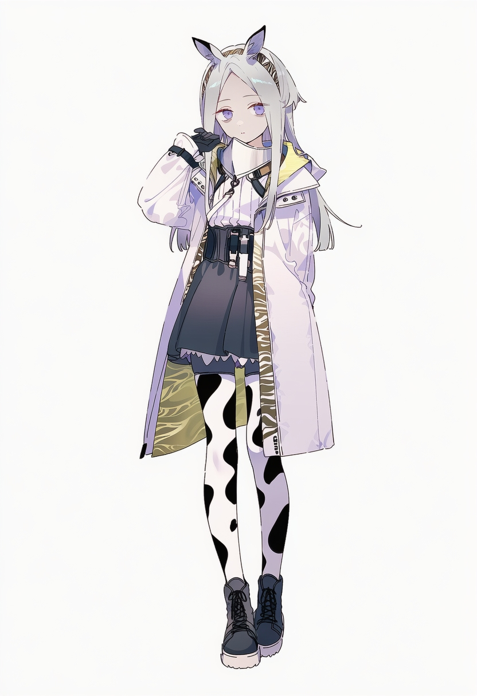

[在线例图](https://assets.quicktagcloud.com/images/raven_composition/raven_composition-0556.jpg?v=dfd1b1bdb65c9753)

<a id="raven_composition-0557"></a>

## 美国国旗图案腿部穿戴物

ID：`raven_composition-0557`；分类：袜子 / 颜色图案；来源标记：`safe`。

来源说明：

> 腿部穿戴物表面具有美国国旗图案；可与颜色、材质和长度类 tag 并用。

正向提示词：

```text
american_flag_legwear
```

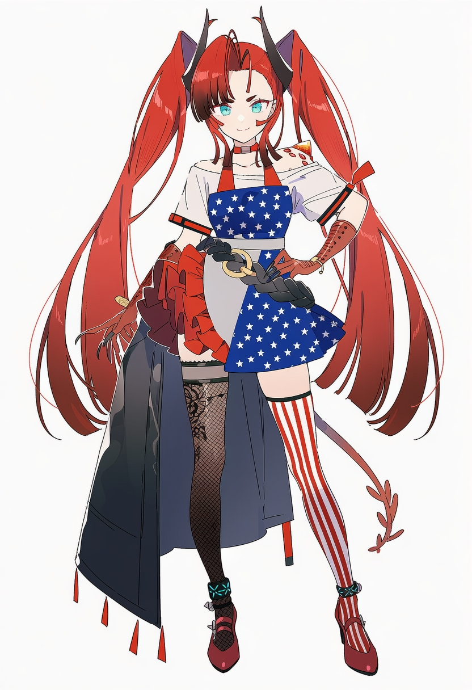

[在线例图](https://assets.quicktagcloud.com/images/raven_composition/raven_composition-0557.jpg?v=f73a8690d86855b3)

<a id="raven_composition-0558"></a>

## 迷彩腿部穿戴物

ID：`raven_composition-0558`；分类：袜子 / 颜色图案；来源标记：`safe`。

来源说明：

> 腿部穿戴物表面具有迷彩；可与颜色、材质和长度类 tag 并用。

正向提示词：

```text
camouflage_legwear
```

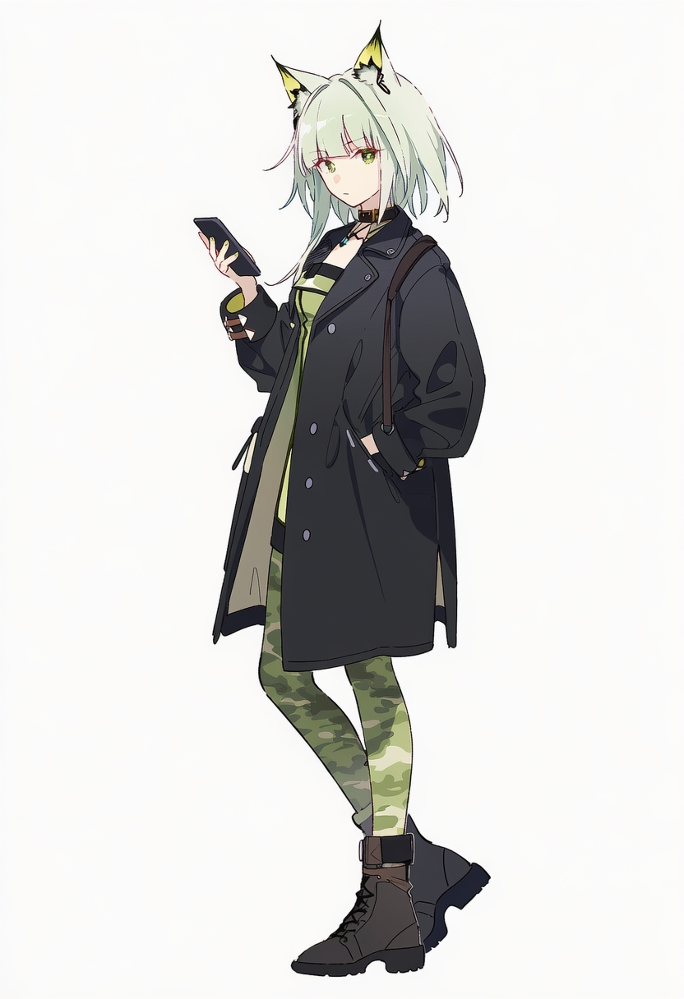

[在线例图](https://assets.quicktagcloud.com/images/raven_composition/raven_composition-0558.jpg?v=1ca15a752d7a2a9c)

<a id="raven_composition-0559"></a>

## 棋盘格腿部穿戴物

ID：`raven_composition-0559`；分类：袜子 / 颜色图案；来源标记：`safe`。

来源说明：

> 腿部穿戴物表面具有棋盘格；可与颜色、材质和长度类 tag 并用。

正向提示词：

```text
checkered_legwear
```

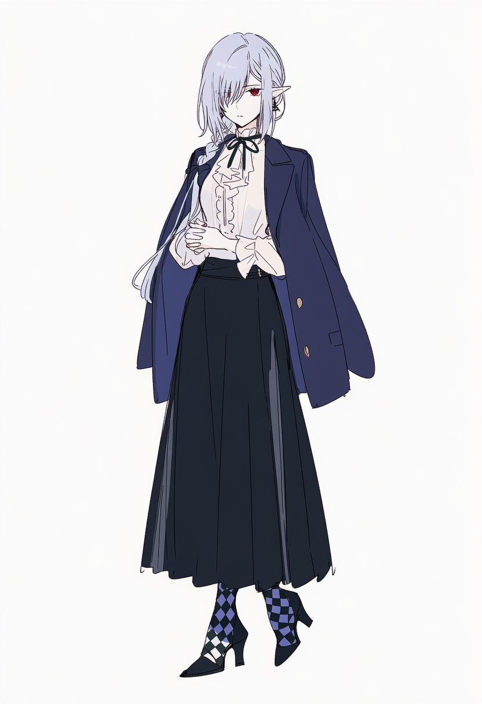

[在线例图](https://assets.quicktagcloud.com/images/raven_composition/raven_composition-0559.jpg?v=946797da751ff585)

<a id="raven_composition-0560"></a>

## 斜条纹腿部穿戴物

ID：`raven_composition-0560`；分类：袜子 / 颜色图案；来源标记：`safe`。

来源说明：

> 腿部穿戴物表面具有斜条纹；可与颜色、材质和长度类 tag 并用。

正向提示词：

```text
diagonal-striped_legwear
```

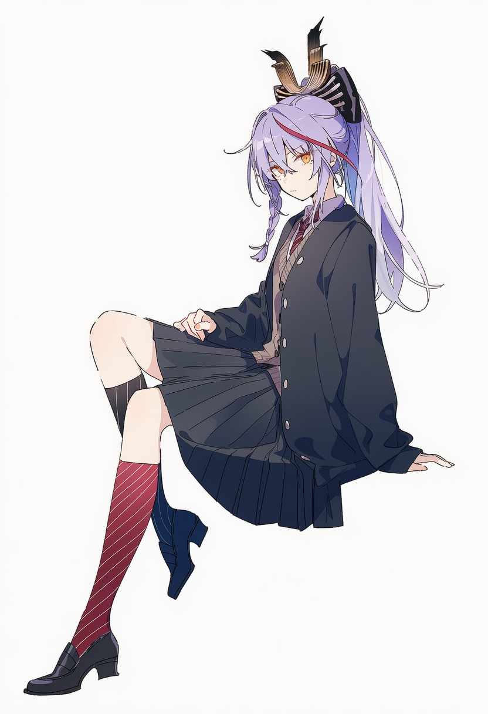

[在线例图](https://assets.quicktagcloud.com/images/raven_composition/raven_composition-0560.jpg?v=8e085a71b209f376)

<a id="raven_composition-0561"></a>

## 维希格纹/小方格腿部穿戴物

ID：`raven_composition-0561`；分类：袜子 / 颜色图案；来源标记：`safe`。

来源说明：

> 腿部穿戴物表面具有维希格纹/小方格；可与颜色、材质和长度类 tag 并用。

正向提示词：

```text
gingham_legwear
```

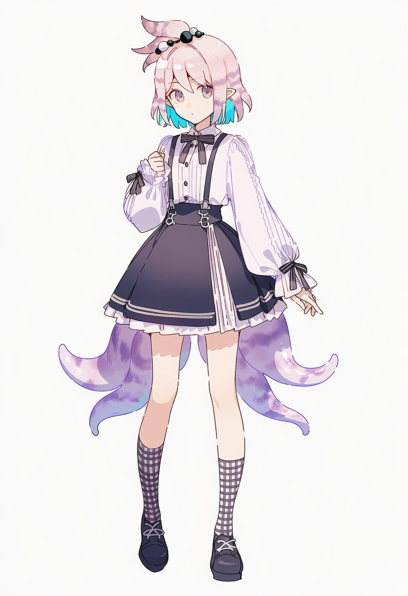

[在线例图](https://assets.quicktagcloud.com/images/raven_composition/raven_composition-0561.jpg?v=a4d778261c4092d1)

<a id="raven_composition-0562"></a>

## 彩虹图案腿部穿戴物

ID：`raven_composition-0562`；分类：袜子 / 颜色图案；来源标记：`safe`。

来源说明：

> 腿部穿戴物表面具有彩虹图案；可与颜色、材质和长度类 tag 并用。

正向提示词：

```text
rainbow_legwear
```

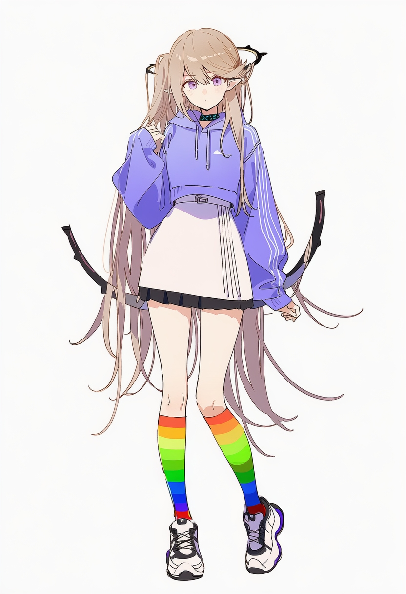

[在线例图](https://assets.quicktagcloud.com/images/raven_composition/raven_composition-0562.jpg?v=94536fdb0688ada3)

<a id="raven_composition-0563"></a>

## 图案化腿部穿戴物

ID：`raven_composition-0563`；分类：袜子 / 颜色图案；来源标记：`safe`。

来源说明：

> 腿部穿戴物表面具有图案化；可与颜色、材质和长度类 tag 并用。

正向提示词：

```text
patterned_legwear
```

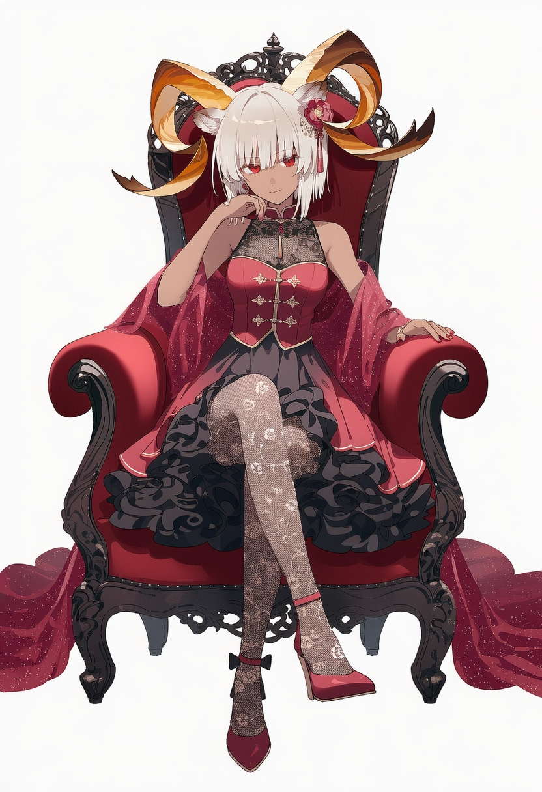

[在线例图](https://assets.quicktagcloud.com/images/raven_composition/raven_composition-0563.jpg?v=6116ec26d092e1a0)

<a id="raven_composition-0564"></a>

## 渐变色腿部穿戴物

ID：`raven_composition-0564`；分类：袜子 / 颜色图案；来源标记：`safe`。

来源说明：

> 腿部穿戴物颜色沿袜体逐渐过渡形成渐变；用于颜色结构而不是材质。

正向提示词：

```text
gradient_legwear
```

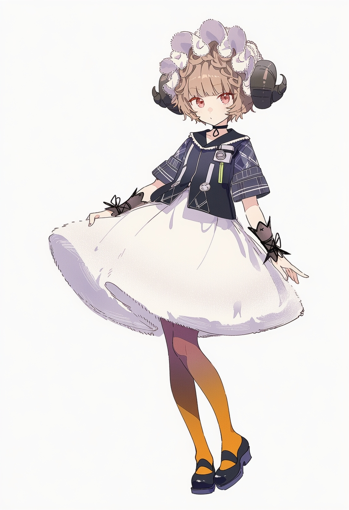

[在线例图](https://assets.quicktagcloud.com/images/raven_composition/raven_composition-0564.jpg?v=798a946d2840b3a9)

<a id="raven_composition-0565"></a>

## 双色腿部穿戴物

ID：`raven_composition-0565`；分类：袜子 / 颜色图案；来源标记：`safe`。

来源说明：

> 腿部穿戴物以两种主要颜色构成；用于颜色结构而不是材质。

正向提示词：

```text
two-tone_legwear
```

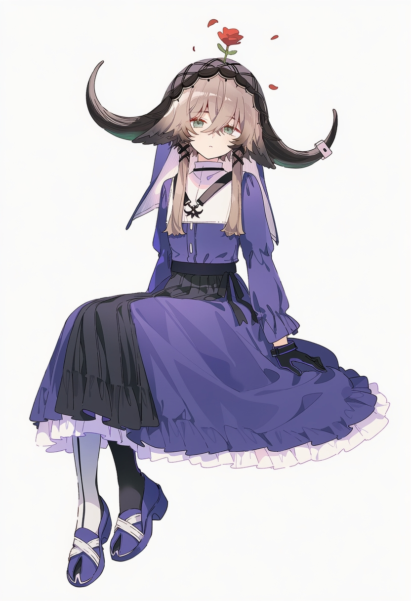

[在线例图](https://assets.quicktagcloud.com/images/raven_composition/raven_composition-0565.jpg?v=09807944795bc2dc)

<a id="raven_composition-0566"></a>

## 多色腿部穿戴物

ID：`raven_composition-0566`；分类：袜子 / 颜色图案；来源标记：`safe`。

来源说明：

> 腿部穿戴物包含多种明显颜色；用于颜色结构而不是材质。

正向提示词：

```text
multicolored_legwear
```

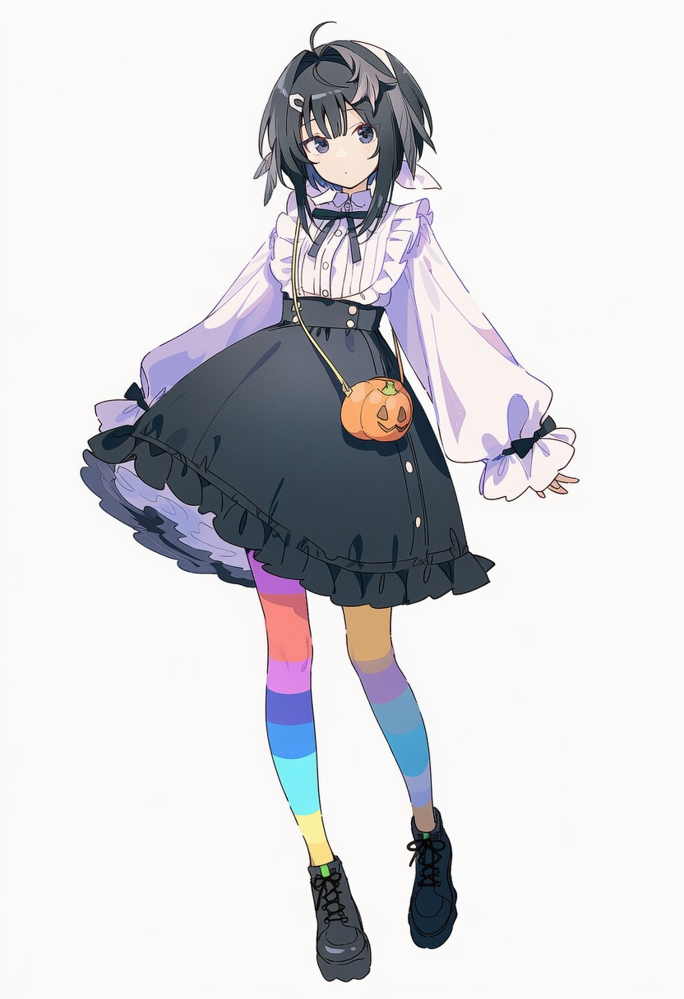

[在线例图](https://assets.quicktagcloud.com/images/raven_composition/raven_composition-0566.jpg?v=40c8165764e75c7a)
