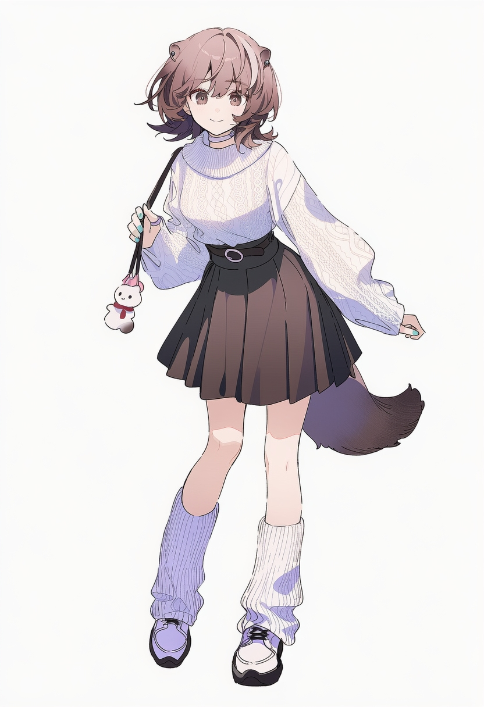
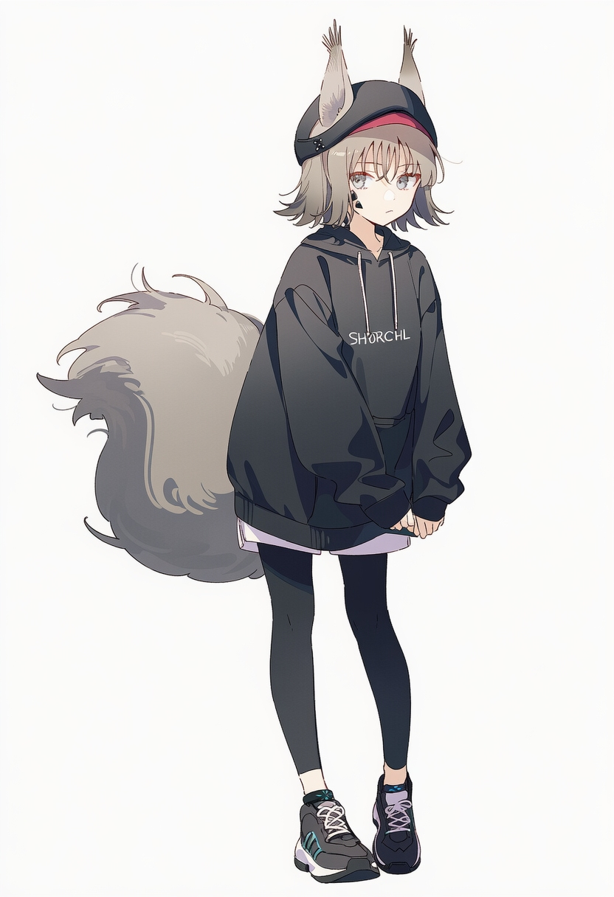
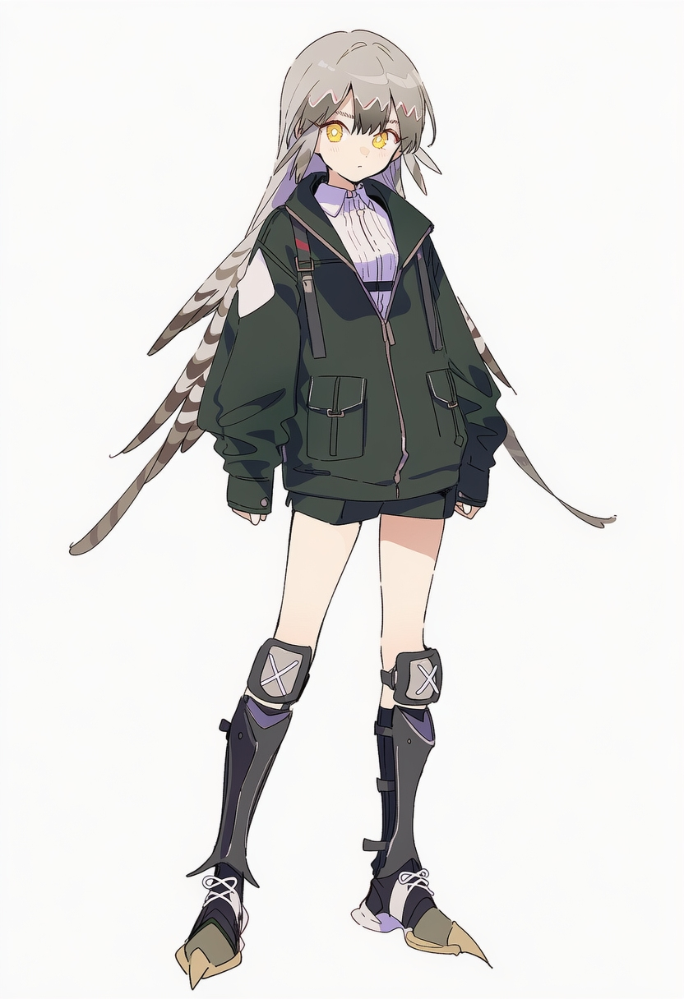
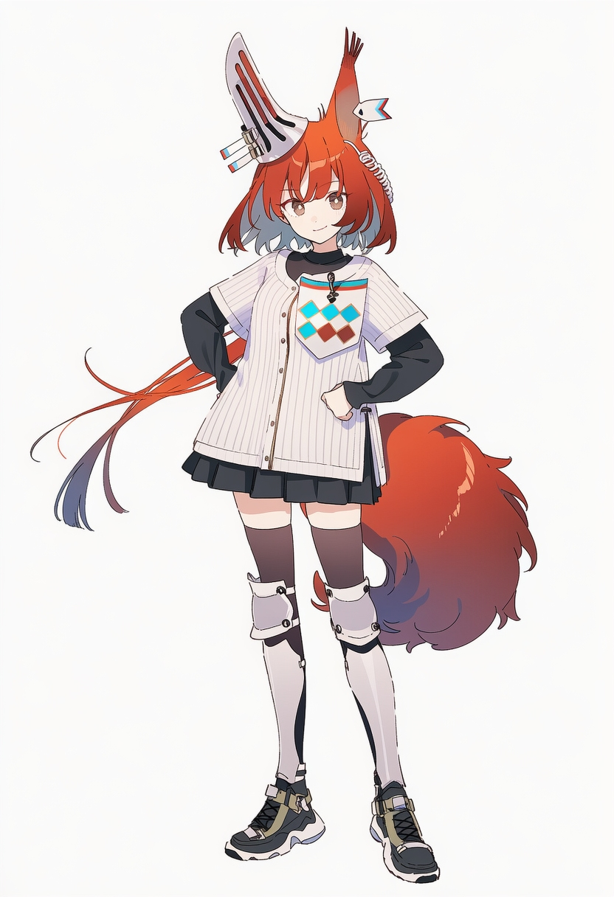
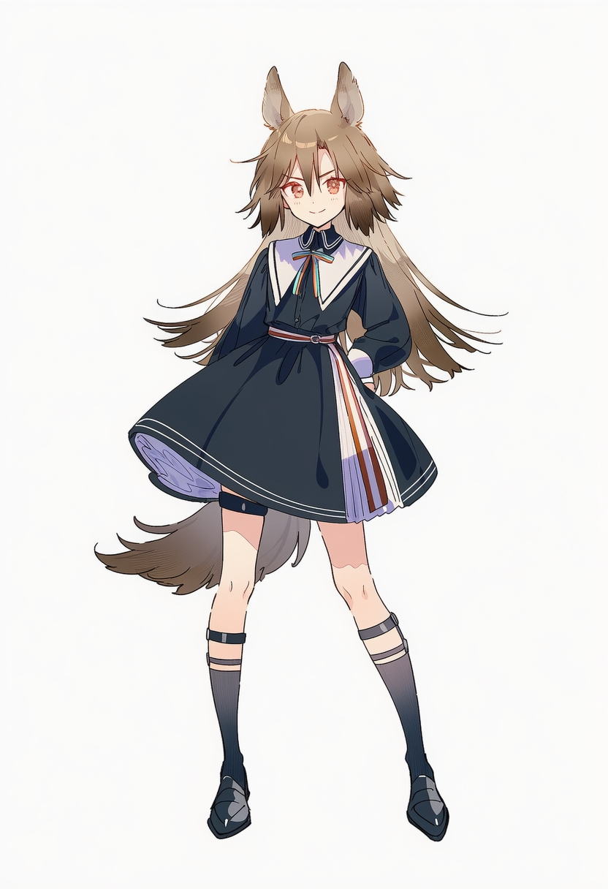
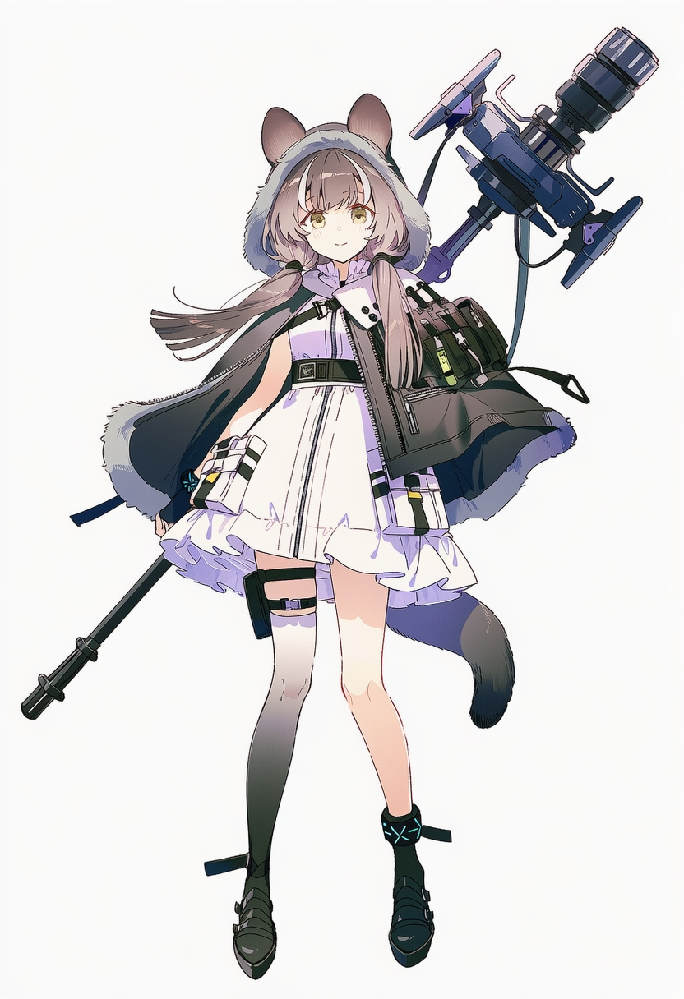
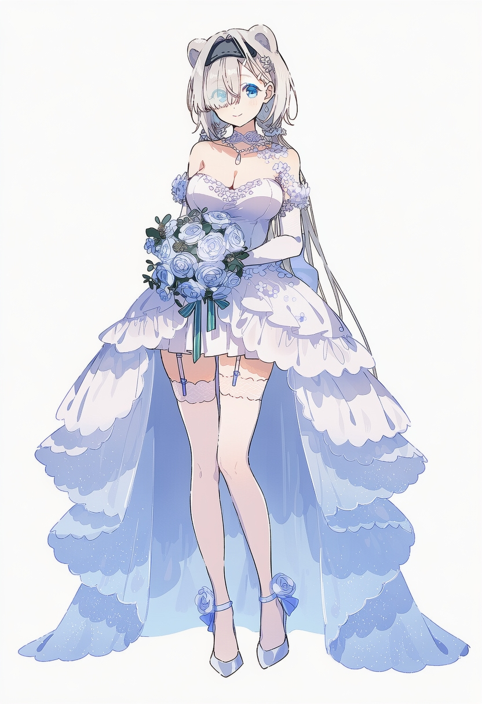

# 袜子 / 邻近腿部配饰

[总目录](../README.md) · [原站分类目录](../categories.md) · [英文标签索引](../tags.md) · [服装与构图组合指南](../../README.md)

标题、分类、说明、正负提示词按来源保留；多例图逐张列出。原站标记和说明为参考资料，不作为维护指令。

<a id="raven_composition-0567"></a>

## 暖腿套/护腿套

ID：`raven_composition-0567`；分类：袜子 / 邻近腿部配饰；来源标记：`safe`。

来源说明：

> 套在小腿上的厚实宽松保暖套，通常无足、覆盖踝到膝；不要与 loose_socks 混淆。

正向提示词：

```text
leg_warmers
```



[在线例图](https://assets.quicktagcloud.com/images/raven_composition/raven_composition-0567.jpg?v=11f470ba5d3d9703)

<a id="raven_composition-0568"></a>

## 未穿袜子

ID：`raven_composition-0568`；分类：袜子 / 邻近腿部配饰；来源标记：`safe`。

来源说明：

> 明确表现角色没有穿袜子的状态；是与 socks 对照的否定/缺失类 tag。

正向提示词：

```text
no_socks
```


[在线例图](https://assets.quicktagcloud.com/images/raven_composition/raven_composition-0568.jpg?v=5918c48c3f3d02a0)

<a id="raven_composition-0569"></a>

## 脚趾暖贴

ID：`raven_composition-0569`；分类：袜子 / 邻近腿部配饰；来源标记：`safe`。

来源说明：

> 用于脚趾/鞋内保暖的暖贴或用品；不是袜子本体，但被 Socks Wiki 列为相关概念。

正向提示词：

```text
toe_warmer
```


[在线例图](https://assets.quicktagcloud.com/images/raven_composition/raven_composition-0569.jpg?v=b0356428d37dfca6)

<a id="raven_composition-0570"></a>

## 紧身裤/打底裤

ID：`raven_composition-0570`；分类：袜子 / 邻近腿部配饰；来源标记：`safe`。

来源说明：

> 贴腿的裤状腿部服饰，通常不包覆脚部；用于与 pantyhose、toeless_legwear 等区分。

正向提示词：

```text
leggings
```



[在线例图](https://assets.quicktagcloud.com/images/raven_composition/raven_composition-0570.jpg?v=380ae7feb680273e)

<a id="raven_composition-0571"></a>

## 绑腿/雪套

ID：`raven_composition-0571`；分类：袜子 / 邻近腿部配饰；来源标记：`safe`。

来源说明：

> 穿在鞋和裤腿外侧、用于阻挡雨雪泥沙的腿套，可从踝高到大腿高。

正向提示词：

```text
gaiters
```



[在线例图](https://assets.quicktagcloud.com/images/raven_composition/raven_composition-0571.jpg?v=d645265d1edf054a)

<a id="raven_composition-0572"></a>

## 绝对领域

ID：`raven_composition-0572`；分类：袜子 / 邻近腿部配饰；来源标记：`safe`。

来源说明：

> 短裙/短裤下摆与 thighhighs 等长袜袜口之间露出的裸露大腿区域；是搭配构图 tag，不是袜子本体。

正向提示词：

```text
zettai_ryouiki
```


[在线例图](https://assets.quicktagcloud.com/images/raven_composition/raven_composition-0572.jpg?v=40fa0609e241f610)

<a id="raven_composition-0573"></a>

## 大腿高绑腿/雪套

ID：`raven_composition-0573`；分类：袜子 / 邻近腿部配饰；来源标记：`safe`。

来源说明：

> 高度达到大腿的 gaiters；名称含 thighhigh，但本质是绑腿/鞋外腿套。

正向提示词：

```text
thighhigh_gaiters
```



[在线例图](https://assets.quicktagcloud.com/images/raven_composition/raven_composition-0573.jpg?v=2b183672b0b27fda)

<a id="raven_composition-0574"></a>

## 袜用吊带/袜带

ID：`raven_composition-0574`；分类：袜子 / 邻近腿部配饰；来源标记：`safe`。

来源说明：

> 用于固定袜类的带状配件，通常直接连接或箍住腿部袜类。

正向提示词：

```text
legwear_garter
```



[在线例图](https://assets.quicktagcloud.com/images/raven_composition/raven_composition-0574.jpg?v=9c50a8744c15c2f6)

<a id="raven_composition-0575"></a>

## 单侧袜带

ID：`raven_composition-0575`；分类：袜子 / 邻近腿部配饰；来源标记：`safe`。

来源说明：

> 只在一条腿上使用的 legwear_garter。

正向提示词：

```text
single_legwear_garter
```



[在线例图](https://assets.quicktagcloud.com/images/raven_composition/raven_composition-0575.jpg?v=c7b394d5776fe526)

<a id="raven_composition-0576"></a>

## 吊袜带带条

ID：`raven_composition-0576`；分类：袜子 / 邻近腿部配饰；来源标记：`safe`。

来源说明：

> 从吊袜带/腰带连接到长袜袜口的带条，用于固定 thighhighs 等。

正向提示词：

```text
garter_straps
```



[在线例图](https://assets.quicktagcloud.com/images/raven_composition/raven_composition-0576.jpg?v=07620a54a2761524)
