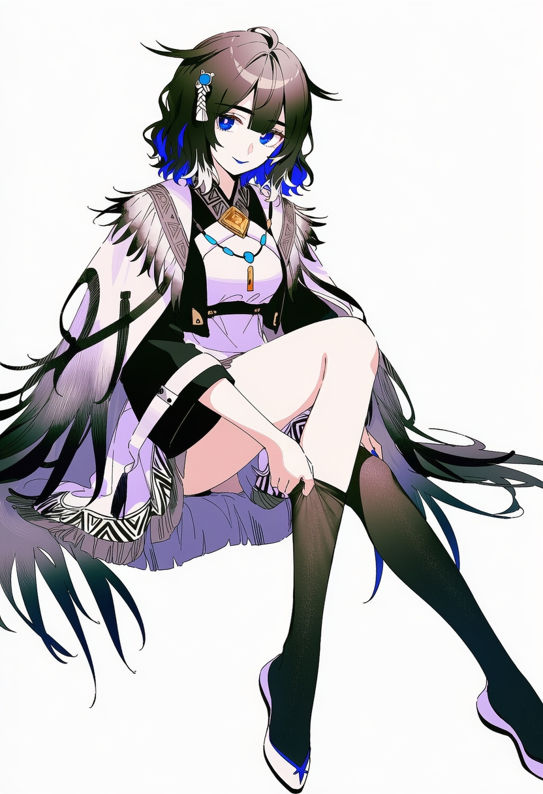
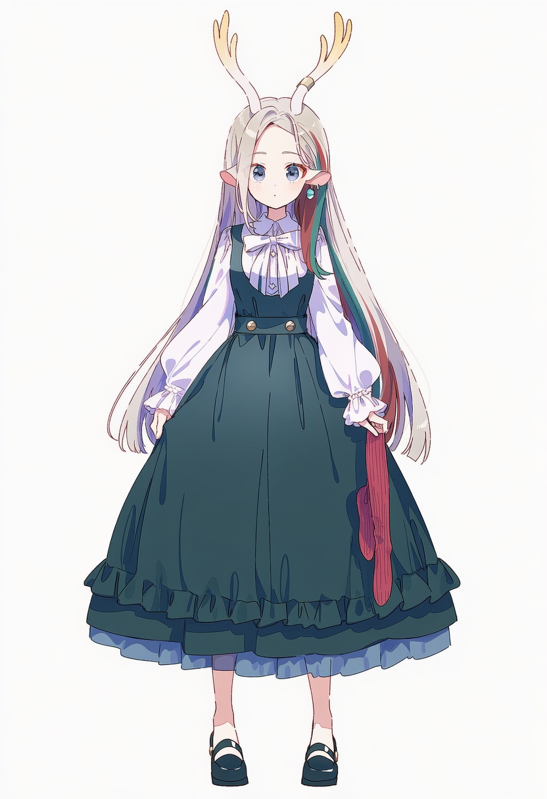
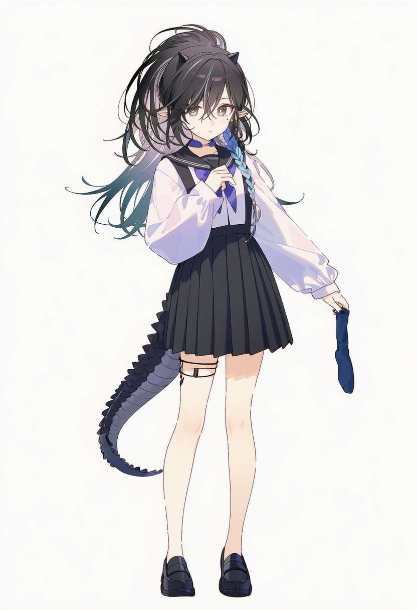
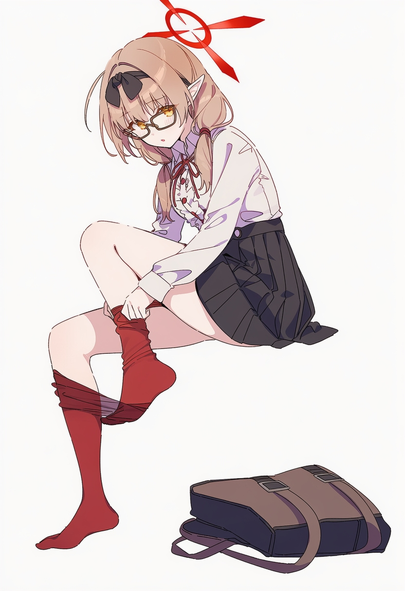
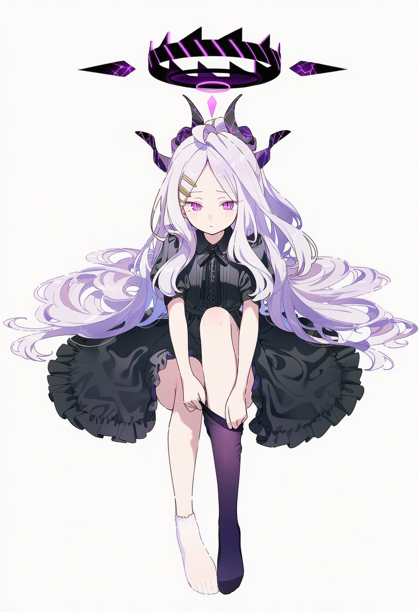
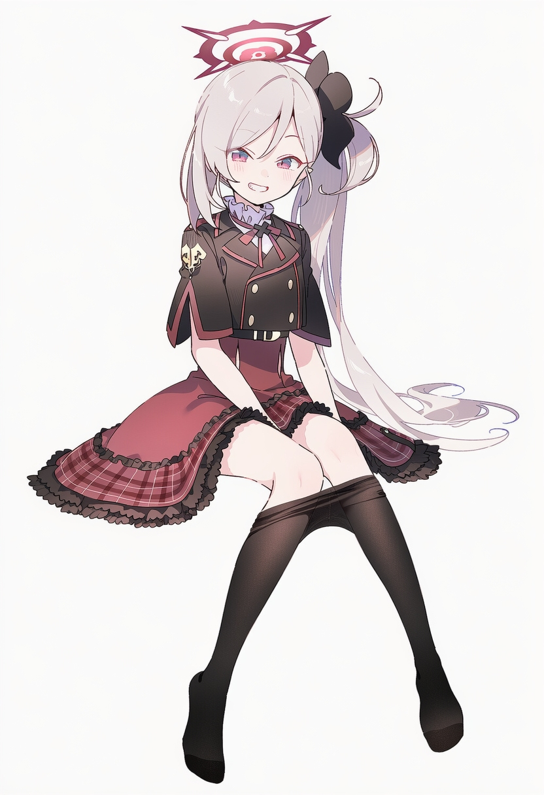
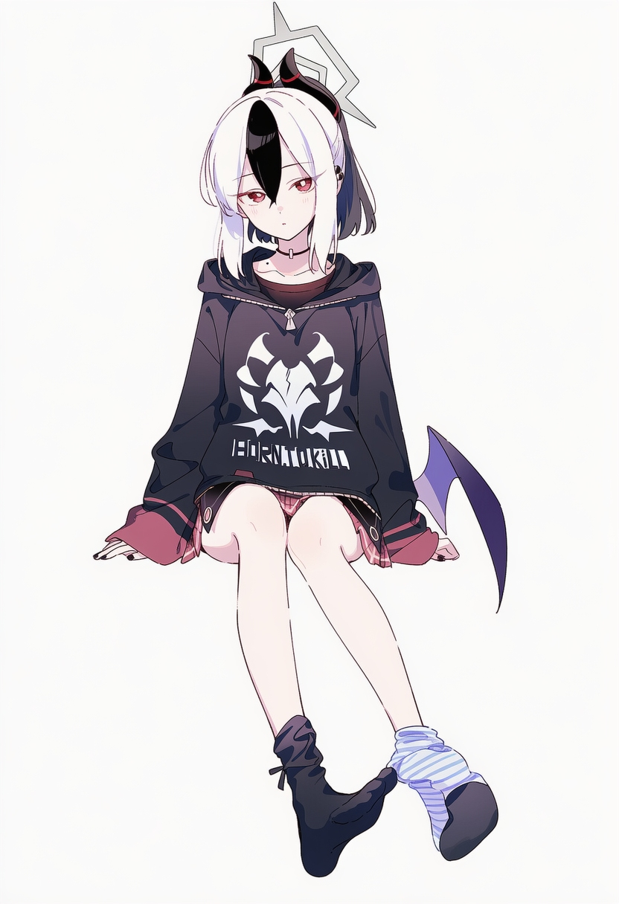
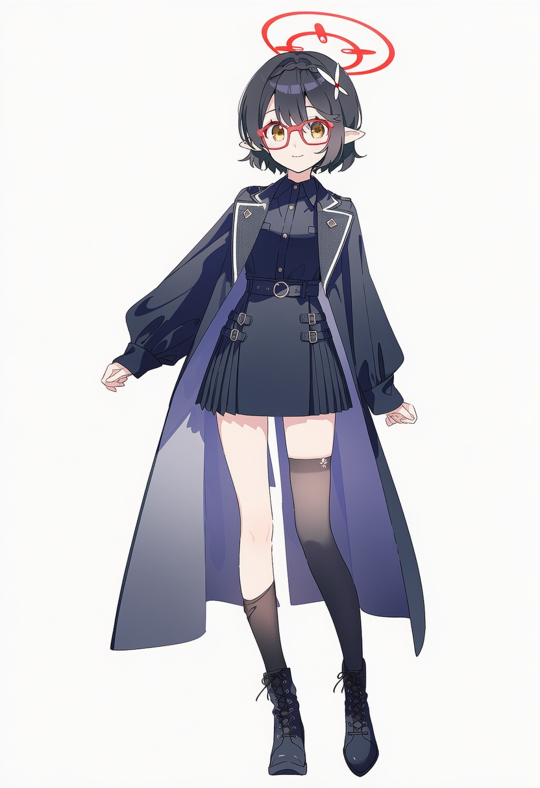
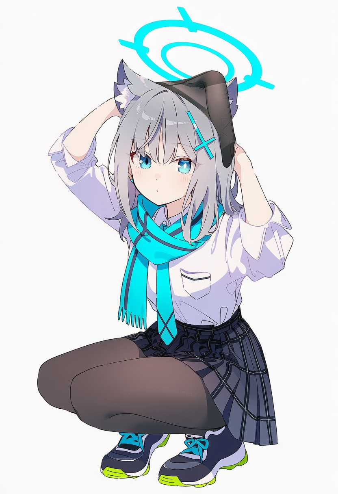
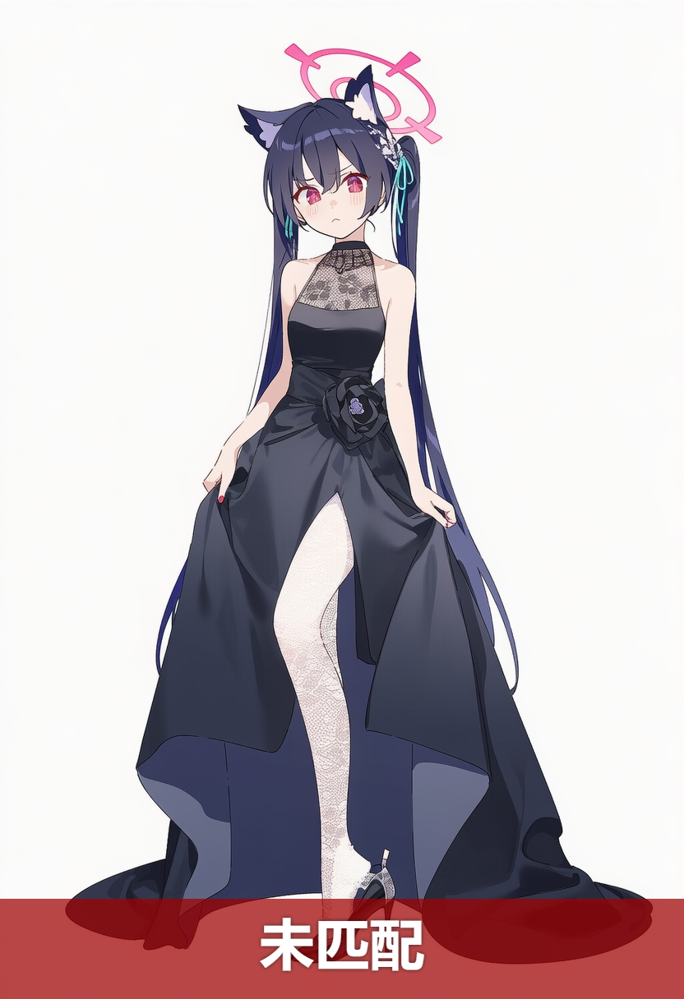

# 袜子 / 动作互动

[总目录](../README.md) · [原站分类目录](../categories.md) · [英文标签索引](../tags.md) · [服装与构图组合指南](../../README.md)

标题、分类、说明、正负提示词按来源保留；多例图逐张列出。原站标记和说明为参考资料，不作为维护指令。

<a id="raven_composition-0577"></a>

## 整理腿部穿戴物

ID：`raven_composition-0577`；分类：袜子 / 动作互动；来源标记：`safe`。

来源说明：

> 用手调整袜口、袜筒、连裤袜或其他腿部穿戴物的位置。

正向提示词：

```text
adjusting_legwear
```



[在线例图](https://assets.quicktagcloud.com/images/raven_composition/raven_composition-0577.jpg?v=a504b9e8d9a56036)

<a id="raven_composition-0578"></a>

## 手持腿部穿戴物

ID：`raven_composition-0578`；分类：袜子 / 动作互动；来源标记：`safe`。

来源说明：

> 手里拿着已脱下或尚未穿上的袜类/腿部穿戴物。

正向提示词：

```text
holding_legwear
```



[在线例图](https://assets.quicktagcloud.com/images/raven_composition/raven_composition-0578.jpg?v=b66da238e85004e9)

<a id="raven_composition-0579"></a>

## 手持袜子

ID：`raven_composition-0579`；分类：袜子 / 动作互动；来源标记：`safe`。

来源说明：

> 手中拿着一只或多只袜子。

正向提示词：

```text
holding_sock
```



[在线例图](https://assets.quicktagcloud.com/images/raven_composition/raven_composition-0579.jpg?v=b8048d9f52b38d32)

<a id="raven_composition-0580"></a>

## 正在穿腿部穿戴物

ID：`raven_composition-0580`；分类：袜子 / 动作互动；来源标记：`safe`。

来源说明：

> 正在把袜子、长袜、连裤袜等穿到腿上。

正向提示词：

```text
putting_on_legwear
```


[在线例图](https://assets.quicktagcloud.com/images/raven_composition/raven_composition-0580.jpg?v=2de43cd0f17d1c2f)

<a id="raven_composition-0581"></a>

## 向下拉脱腿部穿戴物

ID：`raven_composition-0581`；分类：袜子 / 动作互动；来源标记：`safe`。

来源说明：

> 正在把袜类向下拉以脱下。

正向提示词：

```text
pulling_off_legwear
```



[在线例图](https://assets.quicktagcloud.com/images/raven_composition/raven_composition-0581.jpg?v=4bc32bee101f11e4)

<a id="raven_composition-0582"></a>

## 脱腿部穿戴物

ID：`raven_composition-0582`；分类：袜子 / 动作互动；来源标记：`safe`。

来源说明：

> 泛指正在脱袜子、长袜、连裤袜等。

正向提示词：

```text
removing_legwear
```



[在线例图](https://assets.quicktagcloud.com/images/raven_composition/raven_composition-0582.jpg?v=556d327b72484972)

<a id="raven_composition-0583"></a>

## 脱袜子

ID：`raven_composition-0583`；分类：袜子 / 动作互动；来源标记：`safe`。

来源说明：

> 正在从脚上脱下一只袜子。

正向提示词：

```text
removing_sock
```


[在线例图](https://assets.quicktagcloud.com/images/raven_composition/raven_composition-0583.jpg?v=eb4da11a9b05dd31)

<a id="raven_composition-0584"></a>

## 脱大腿袜

ID：`raven_composition-0584`；分类：袜子 / 动作互动；来源标记：`safe`。

来源说明：

> 正在从腿上脱下一只 thighhigh。

正向提示词：

```text
removing_thighhigh
```


[在线例图](https://assets.quicktagcloud.com/images/raven_composition/raven_composition-0584.jpg?v=cc294c562ce7d558)

<a id="raven_composition-0585"></a>

## 脱连裤袜

ID：`raven_composition-0585`；分类：袜子 / 动作互动；来源标记：`safe`。

来源说明：

> 正在脱下 pantyhose。

正向提示词：

```text
removing_pantyhose
```



[在线例图](https://assets.quicktagcloud.com/images/raven_composition/raven_composition-0585.jpg?v=423e65096c7e54e2)

<a id="raven_composition-0586"></a>

## 拉袜子

ID：`raven_composition-0586`；分类：袜子 / 动作互动；来源标记：`safe`。

来源说明：

> 用手拉扯袜口/袜筒，常见于往上提、往下拉或调整。

正向提示词：

```text
sock_pull
```


[在线例图](https://assets.quicktagcloud.com/images/raven_composition/raven_composition-0586.jpg?v=f0af34a3e634f850)

<a id="raven_composition-0587"></a>

## 袜子半脱悬挂

ID：`raven_composition-0587`；分类：袜子 / 动作互动；来源标记：`safe`。

来源说明：

> 袜子部分脱离脚部、松松挂在脚或脚趾附近，可能露出脚底/脚趾。

正向提示词：

```text
sock_dangle
```



[在线例图](https://assets.quicktagcloud.com/images/raven_composition/raven_composition-0587.jpg?v=a12718be3a9d266a)

<a id="raven_composition-0588"></a>

## 拉大腿袜

ID：`raven_composition-0588`；分类：袜子 / 动作互动；来源标记：`safe`。

来源说明：

> 用手拉扯或调整 thighhighs 的袜筒/袜口。

正向提示词：

```text
thighhighs_pull
```


[在线例图](https://assets.quicktagcloud.com/images/raven_composition/raven_composition-0588.jpg?v=1943abccbf8e262c)

<a id="raven_composition-0589"></a>

## 大腿袜半脱悬挂

ID：`raven_composition-0589`；分类：袜子 / 动作互动；来源标记：`safe`。

来源说明：

> 一只或两只 thighhighs 大幅滑落，仍悬挂在腿/脚上。

正向提示词：

```text
thighhigh_dangle
```



[在线例图](https://assets.quicktagcloud.com/images/raven_composition/raven_composition-0589.jpg?v=aebb475bba7a14cc)

<a id="raven_composition-0590"></a>

## 拉连裤袜

ID：`raven_composition-0590`；分类：袜子 / 动作互动；来源标记：`safe`。

来源说明：

> 用手拉扯、提起或下拉 pantyhose。

正向提示词：

```text
pantyhose_pull
```


[在线例图](https://assets.quicktagcloud.com/images/raven_composition/raven_composition-0590.jpg?v=486a1dde15129683)

<a id="raven_composition-0591"></a>

## 连裤袜套头

ID：`raven_composition-0591`；分类：袜子 / 动作互动；来源标记：`safe`。

来源说明：

> 将 pantyhose 套在头部而非正常穿在腿上。

正向提示词：

```text
pantyhose_on_head
```



[在线例图](https://assets.quicktagcloud.com/images/raven_composition/raven_composition-0591.jpg?v=1646e84d55fe1498)

<a id="raven_composition-0592"></a>

## 蕾丝连裤袜勾高跟鞋梗

ID：`raven_composition-0592`；分类：袜子 / 动作互动；来源标记：`safe`。

来源说明：

> 2025 年出现的图片重绘梗：高跟鞋鞋跟勾住蕾丝连裤袜；属于 meme tag，不是袜型属性。

正向提示词：

```text
lace_pantyhose_hooked_on_heel_(meme)
```



[在线例图](https://assets.quicktagcloud.com/images/raven_composition/raven_composition-0592.jpg?v=9a2e8c9aee691f23)
