# 袜子 / 穿戴状态

[总目录](../README.md) · [原站分类目录](../categories.md) · [英文标签索引](../tags.md) · [服装与构图组合指南](../../README.md)

标题、分类、说明、正负提示词按来源保留；多例图逐张列出。原站标记和说明为参考资料，不作为维护指令。

<a id="raven_composition-0593"></a>

## 不配对袜子

ID：`raven_composition-0593`；分类：袜子 / 穿戴状态；来源标记：`safe`。

来源说明：

> 左右脚袜子的颜色、图案或设计不同；如果主要差异是长度，更适合 uneven_legwear。

正向提示词：

```text
mismatched_socks
```

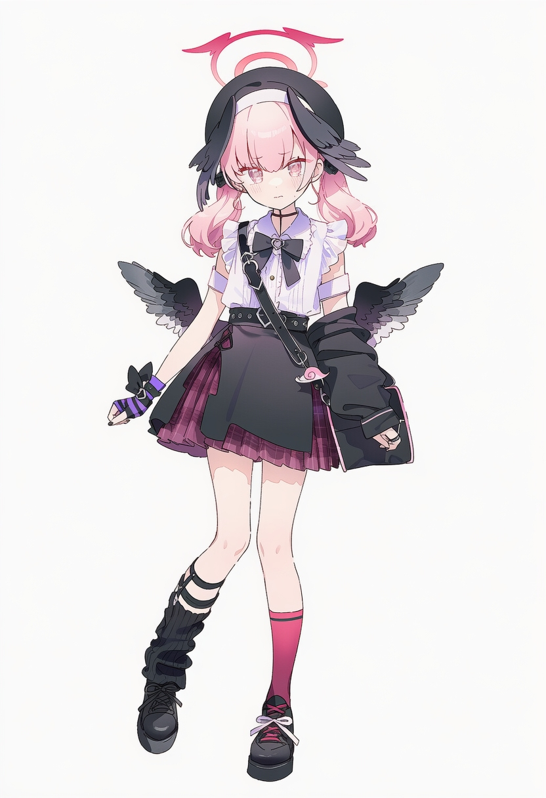

[在线例图](https://assets.quicktagcloud.com/images/raven_composition/raven_composition-0593.jpg?v=9008036c6ebfba83)

<a id="raven_composition-0594"></a>

## 不配对大腿袜

ID：`raven_composition-0594`；分类：袜子 / 穿戴状态；来源标记：`safe`。

来源说明：

> 左右两只 thighhighs 在颜色、图案或设计上不同。

正向提示词：

```text
mismatched_thighhighs
```


[在线例图](https://assets.quicktagcloud.com/images/raven_composition/raven_composition-0594.jpg?v=e7b1200fb7bcb18e)

<a id="raven_composition-0595"></a>

## 不配对腿部穿戴物

ID：`raven_composition-0595`；分类：袜子 / 穿戴状态；来源标记：`safe`。

来源说明：

> 左右腿的袜类/腿部穿戴物在颜色、图案或设计上不同。

正向提示词：

```text
mismatched_legwear
```

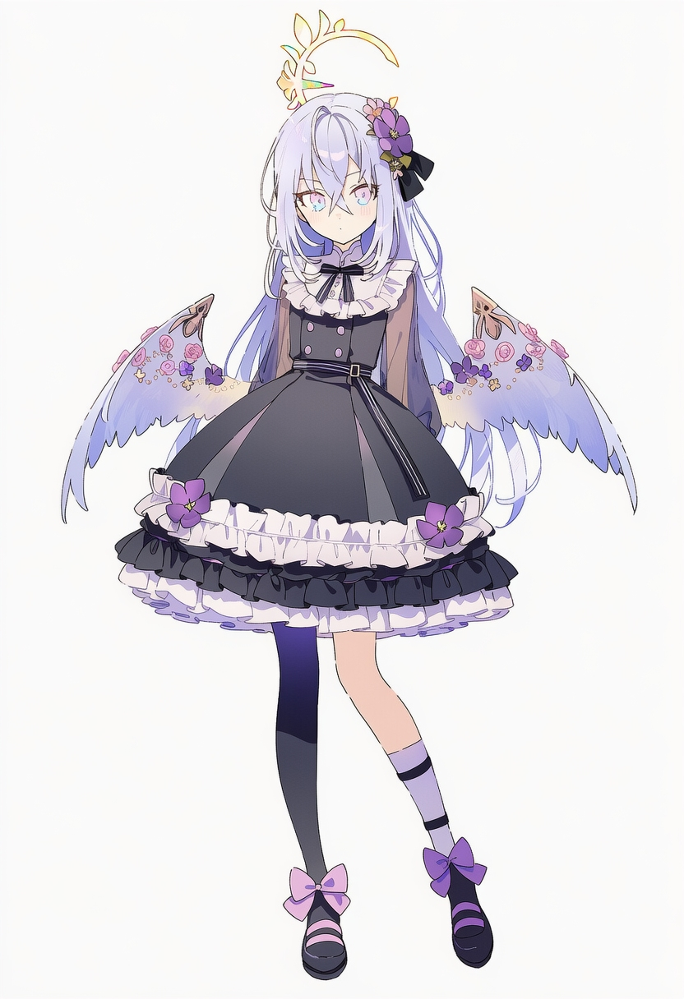

[在线例图](https://assets.quicktagcloud.com/images/raven_composition/raven_composition-0595.jpg?v=87f884909fbe82b1)

<a id="raven_composition-0596"></a>

## 不对称腿部穿戴

ID：`raven_composition-0596`；分类：袜子 / 穿戴状态；来源标记：`safe`。

来源说明：

> 左右腿袜类在长度、颜色或设计上不对称的总括 tag；可再配合 uneven_legwear / mismatched_legwear 细分。

正向提示词：

```text
asymmetrical_legwear
```


[在线例图](https://assets.quicktagcloud.com/images/raven_composition/raven_composition-0596.jpg?v=e9eee5ef1fde16e9)

<a id="raven_composition-0597"></a>

## 长短不一的腿部穿戴

ID：`raven_composition-0597`；分类：袜子 / 穿戴状态；来源标记：`safe`。

来源说明：

> 左右腿所穿袜类主要在长度上不同，例如一边短袜、一边长袜。

正向提示词：

```text
uneven_legwear
```

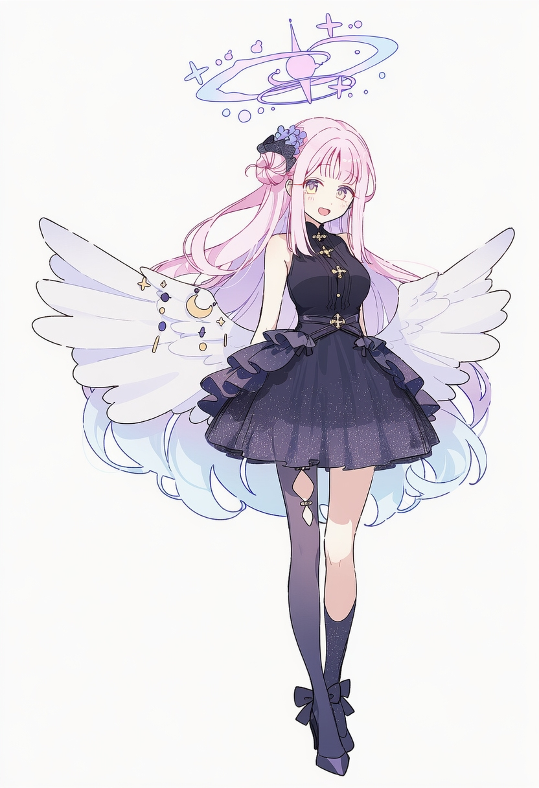

[在线例图](https://assets.quicktagcloud.com/images/raven_composition/raven_composition-0597.jpg?v=3799ece72539dbac)

<a id="raven_composition-0598"></a>

## 单只袜

ID：`raven_composition-0598`；分类：袜子 / 穿戴状态；来源标记：`safe`。

来源说明：

> 只在一只脚/腿上穿 socks，另一侧没有对应袜子。

正向提示词：

```text
single_sock
```

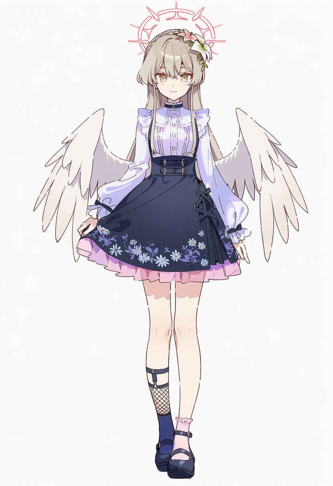

[在线例图](https://assets.quicktagcloud.com/images/raven_composition/raven_composition-0598.jpg?v=6d506942f69a0842)

<a id="raven_composition-0599"></a>

## 单只及膝袜

ID：`raven_composition-0599`；分类：袜子 / 穿戴状态；来源标记：`safe`。

来源说明：

> 只穿一只 kneehigh，另一腿没有配对及膝袜。

正向提示词：

```text
single_kneehigh
```

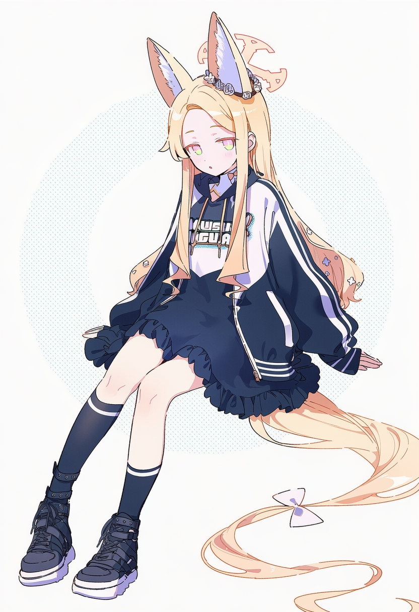

[在线例图](https://assets.quicktagcloud.com/images/raven_composition/raven_composition-0599.jpg?v=2deb7b048252b1f9)

<a id="raven_composition-0600"></a>

## 单只过膝袜

ID：`raven_composition-0600`；分类：袜子 / 穿戴状态；来源标记：`safe`。

来源说明：

> 只穿一只 over-kneehigh。

正向提示词：

```text
single_over-kneehigh
```

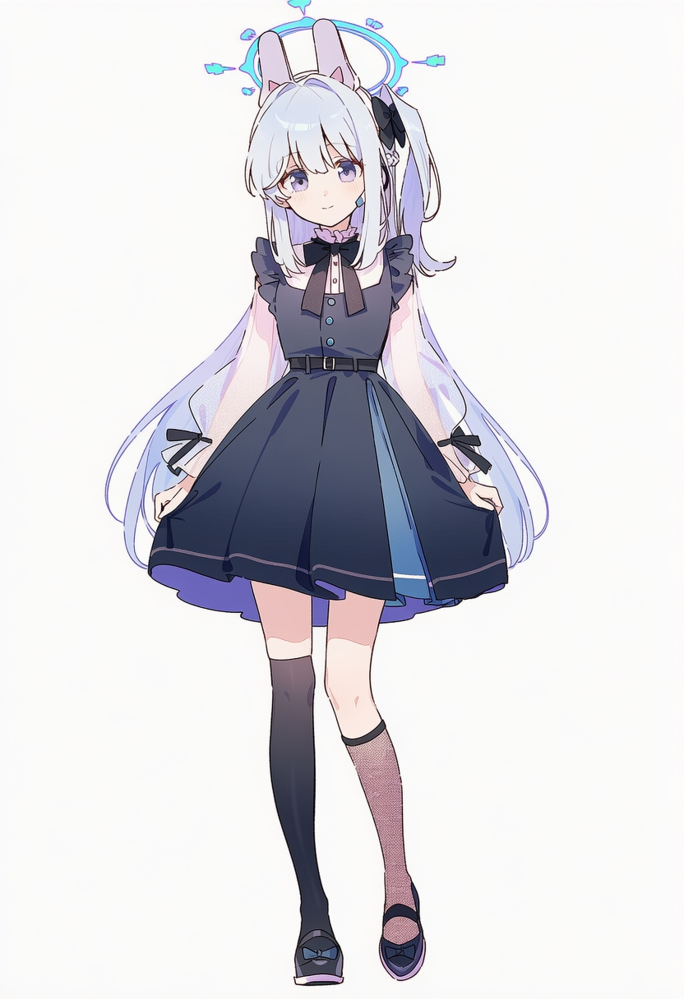

[在线例图](https://assets.quicktagcloud.com/images/raven_composition/raven_composition-0600.jpg?v=9348b1582de0f9ff)

<a id="raven_composition-0601"></a>

## 单只大腿袜

ID：`raven_composition-0601`；分类：袜子 / 穿戴状态；来源标记：`safe`。

来源说明：

> 只穿一只 thighhigh，另一腿裸露或穿其他腿部服饰。

正向提示词：

```text
single_thighhigh
```

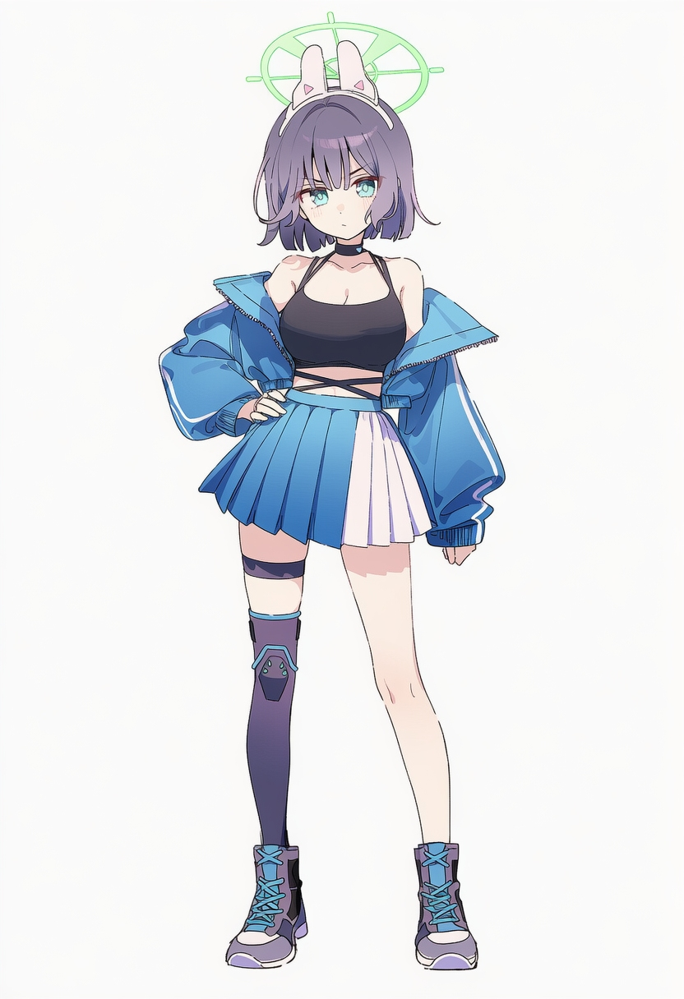

[在线例图](https://assets.quicktagcloud.com/images/raven_composition/raven_composition-0601.jpg?v=8254c1890c140360)

<a id="raven_composition-0602"></a>

## 单只胯高袜

ID：`raven_composition-0602`；分类：袜子 / 穿戴状态；来源标记：`safe`。

来源说明：

> 只穿一只 hiphigh；覆盖范围与 single_leg_pantyhose 不同。

正向提示词：

```text
single_hiphigh
```

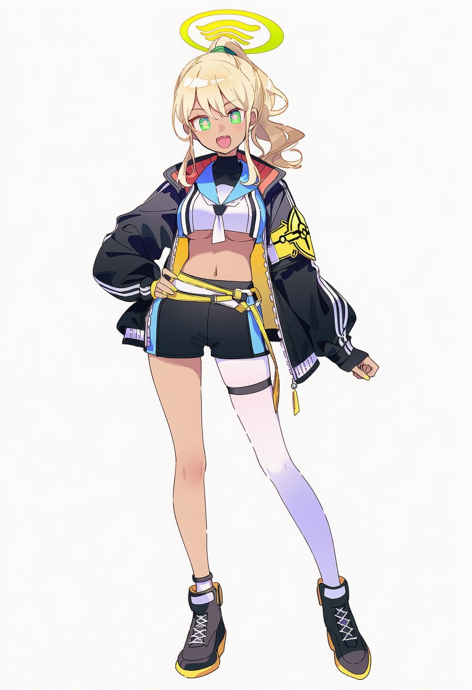

[在线例图](https://assets.quicktagcloud.com/images/raven_composition/raven_composition-0602.jpg?v=7375e0c8c57cd277)

<a id="raven_composition-0603"></a>

## 单腿连裤袜

ID：`raven_composition-0603`；分类：袜子 / 穿戴状态；来源标记：`safe`。

来源说明：

> 只覆盖一条腿的连裤袜式设计，另一腿裸露或穿其他腿部服饰。

正向提示词：

```text
single_leg_pantyhose
```

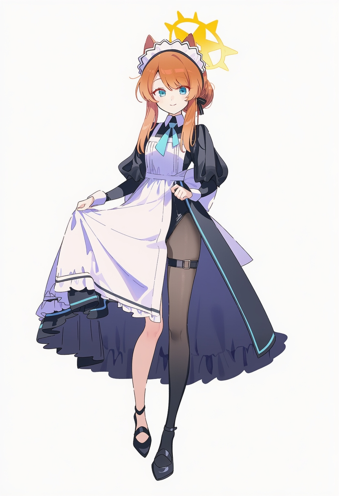

[在线例图](https://assets.quicktagcloud.com/images/raven_composition/raven_composition-0603.jpg?v=d29771ccd5b5e76d)

<a id="raven_composition-0604"></a>

## 单腿渔网袜类

ID：`raven_composition-0604`；分类：袜子 / 穿戴状态；来源标记：`safe`。

来源说明：

> 只在一条腿上穿 fishnet 类型腿部服饰，可是渔网袜或渔网大腿袜。

正向提示词：

```text
single_fishnet_legwear
```

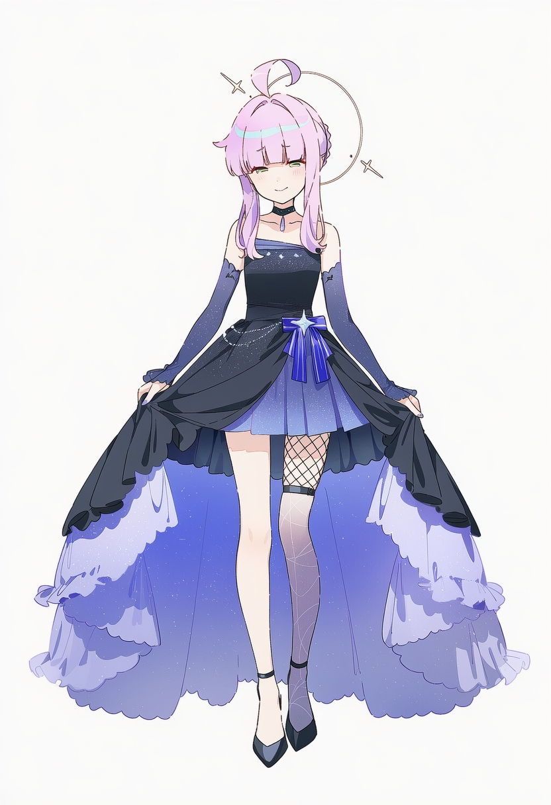

[在线例图](https://assets.quicktagcloud.com/images/raven_composition/raven_composition-0604.jpg?v=59ac4c507e96e573)

<a id="raven_composition-0605"></a>

## 脱下/未穿的袜子

ID：`raven_composition-0605`；分类：袜子 / 穿戴状态；来源标记：`safe`。

来源说明：

> 袜子出现在画面中但没有穿在脚上。

正向提示词：

```text
unworn_socks
```

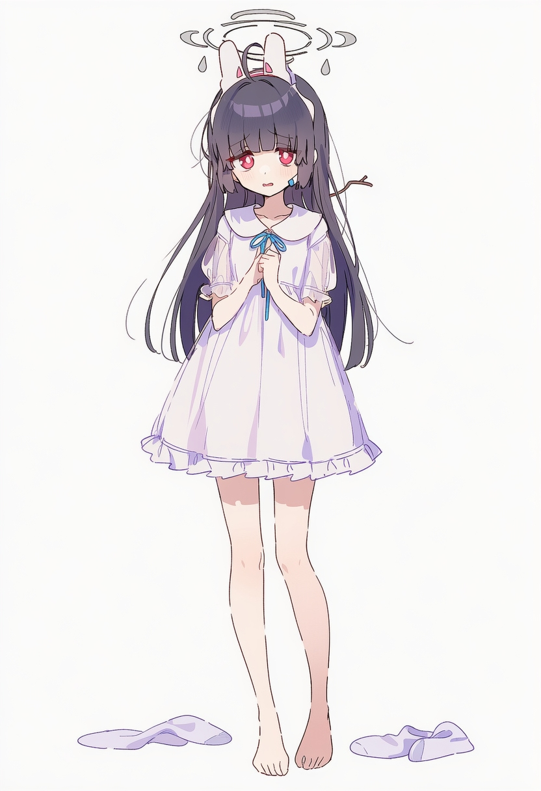

[在线例图](https://assets.quicktagcloud.com/images/raven_composition/raven_composition-0605.jpg?v=54dd1634b4ece69a)

<a id="raven_composition-0606"></a>

## 脱下/未穿的及膝袜

ID：`raven_composition-0606`；分类：袜子 / 穿戴状态；来源标记：`safe`。

来源说明：

> kneehighs 出现在画面中但未穿着。

正向提示词：

```text
unworn_kneehighs
```


[在线例图](https://assets.quicktagcloud.com/images/raven_composition/raven_composition-0606.jpg?v=292061708d55ec63)

<a id="raven_composition-0607"></a>

## 脱下/未穿的大腿袜

ID：`raven_composition-0607`；分类：袜子 / 穿戴状态；来源标记：`safe`。

来源说明：

> thighhighs 出现在画面中但未穿着。

正向提示词：

```text
unworn_thighhighs
```

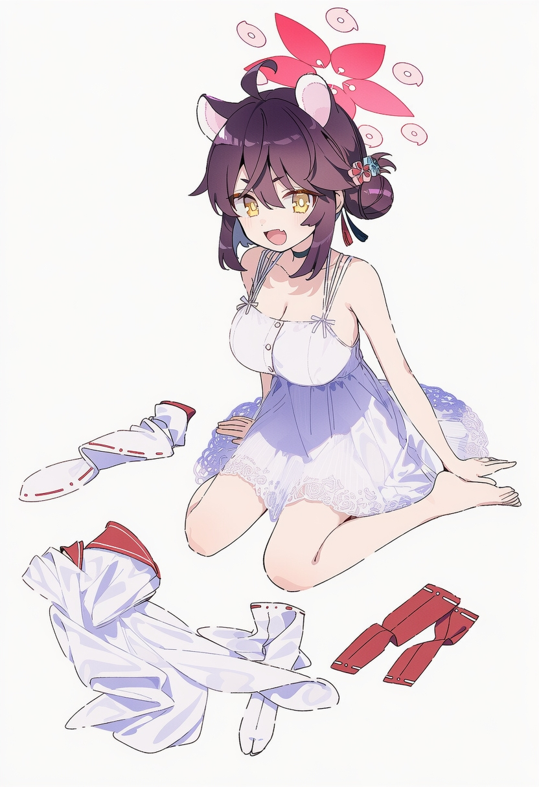

[在线例图](https://assets.quicktagcloud.com/images/raven_composition/raven_composition-0607.jpg?v=0c7ed7c80e24a78d)

<a id="raven_composition-0608"></a>

## 脱下/未穿的胯高袜

ID：`raven_composition-0608`；分类：袜子 / 穿戴状态；来源标记：`safe`。

来源说明：

> hiphighs 出现在画面中但未穿着。

正向提示词：

```text
unworn_hiphighs
```

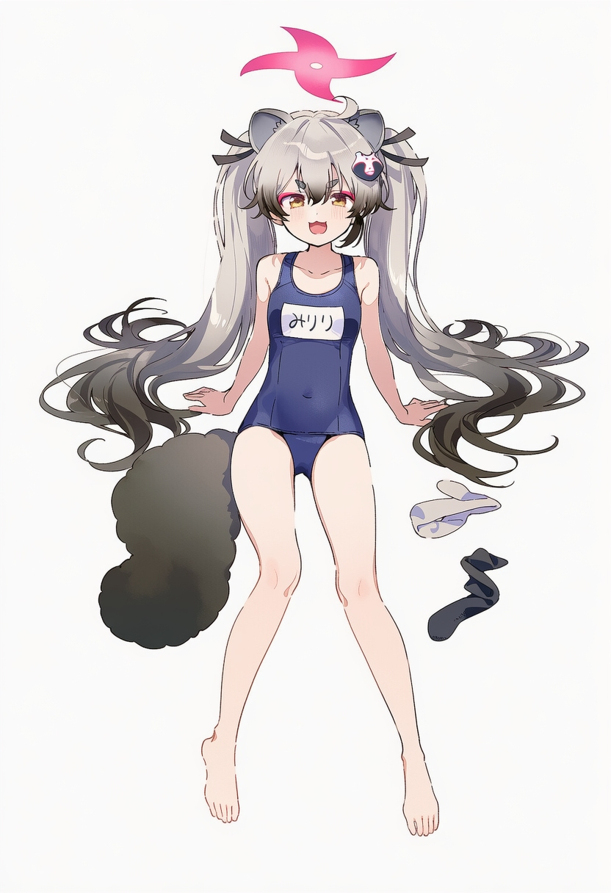

[在线例图](https://assets.quicktagcloud.com/images/raven_composition/raven_composition-0608.jpg?v=3d89a067b389d3fc)

<a id="raven_composition-0609"></a>

## 脱下/未穿的连裤袜

ID：`raven_composition-0609`；分类：袜子 / 穿戴状态；来源标记：`safe`。

来源说明：

> pantyhose 出现在画面中但未穿着。

正向提示词：

```text
unworn_pantyhose
```


[在线例图](https://assets.quicktagcloud.com/images/raven_composition/raven_composition-0609.jpg?v=4a4b712289a62b16)

<a id="raven_composition-0610"></a>

## 湿袜子

ID：`raven_composition-0610`；分类：袜子 / 穿戴状态；来源标记：`safe`。

来源说明：

> 被水或其他液体浸湿、明显呈湿润状态的袜子。

正向提示词：

```text
wet_socks
```

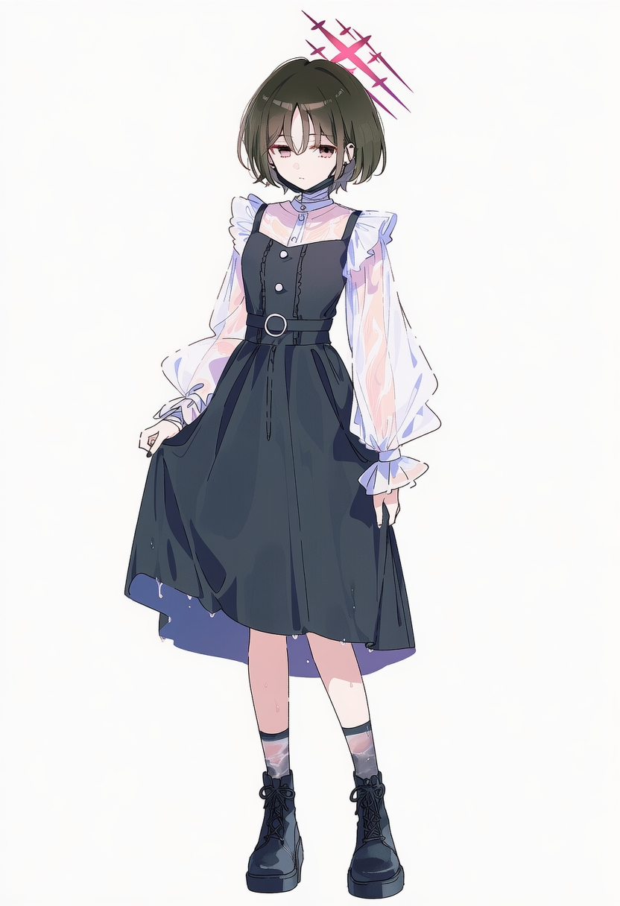

[在线例图](https://assets.quicktagcloud.com/images/raven_composition/raven_composition-0610.jpg?v=06d58fe1a571b655)

<a id="raven_composition-0611"></a>

## 湿大腿袜

ID：`raven_composition-0611`；分类：袜子 / 穿戴状态；来源标记：`safe`。

来源说明：

> 明显被水或其他液体打湿的 thighhighs。

正向提示词：

```text
wet_thighhighs
```

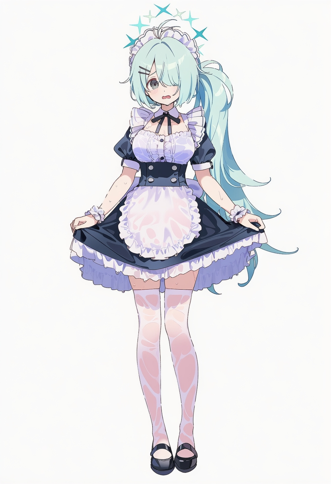

[在线例图](https://assets.quicktagcloud.com/images/raven_composition/raven_composition-0611.jpg?v=380d15e95ff9e493)

<a id="raven_composition-0612"></a>

## 湿连裤袜

ID：`raven_composition-0612`；分类：袜子 / 穿戴状态；来源标记：`safe`。

来源说明：

> 明显被水或其他液体打湿的 pantyhose。

正向提示词：

```text
wet_pantyhose
```

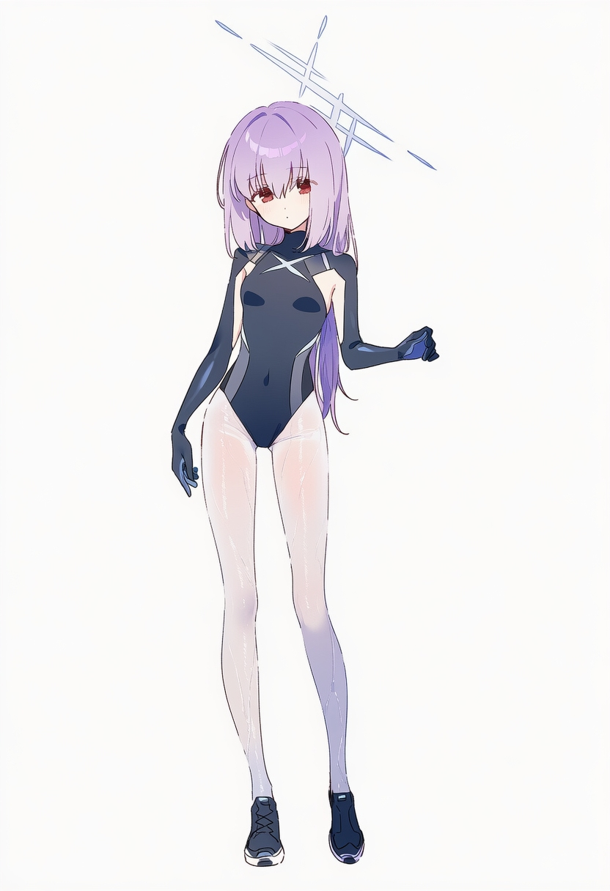

[在线例图](https://assets.quicktagcloud.com/images/raven_composition/raven_composition-0612.jpg?v=acf2a38681f30636)

<a id="raven_composition-0613"></a>

## 替换版腿部穿戴

ID：`raven_composition-0613`；分类：袜子 / 穿戴状态；来源标记：`safe`。

来源说明：

> 角色在替换服装/设计中使用了不同于通常设定的袜类或腿部服饰。

正向提示词：

```text
alternate_legwear
```

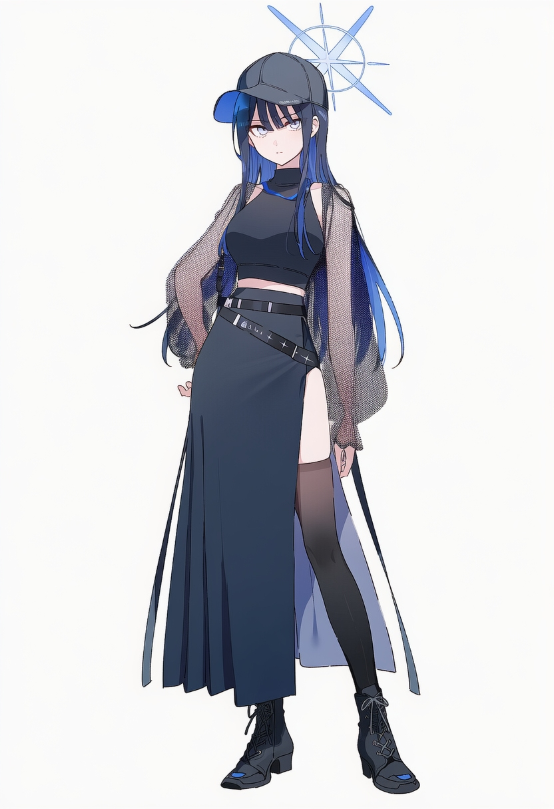

[在线例图](https://assets.quicktagcloud.com/images/raven_composition/raven_composition-0613.jpg?v=2c6ff9c3ce1fe086)

<a id="raven_composition-0614"></a>

## 缺失腿部穿戴

ID：`raven_composition-0614`；分类：袜子 / 穿戴状态；来源标记：`safe`。

来源说明：

> 角色通常应穿某种袜类/腿部服饰，但当前画面中缺失。

正向提示词：

```text
missing_legwear
```

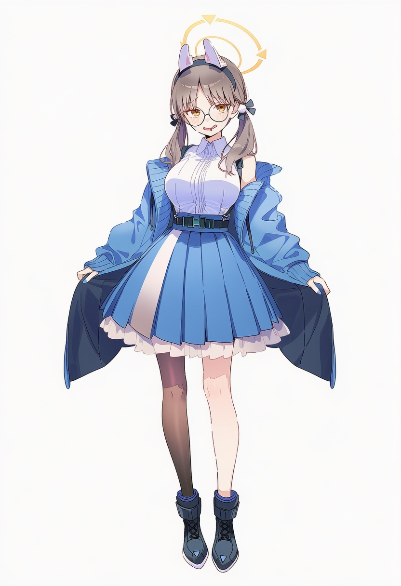

[在线例图](https://assets.quicktagcloud.com/images/raven_composition/raven_composition-0614.jpg?v=5063be5f71e2439e)

<a id="raven_composition-0615"></a>

## 叠穿腿部服饰

ID：`raven_composition-0615`；分类：袜子 / 穿戴状态；来源标记：`safe`。

来源说明：

> 同一条腿上叠穿两层或更多袜类/腿部穿戴物。

正向提示词：

```text
layered_legwear
```


[在线例图](https://assets.quicktagcloud.com/images/raven_composition/raven_composition-0615.jpg?v=378d022fd4292c95)

<a id="raven_composition-0616"></a>

## 脏污腿部穿戴

ID：`raven_composition-0616`；分类：袜子 / 穿戴状态；来源标记：`safe`。

来源说明：

> 袜类/腿部穿戴物明显沾有泥土、灰尘等污渍。

正向提示词：

```text
dirty_legwear
```

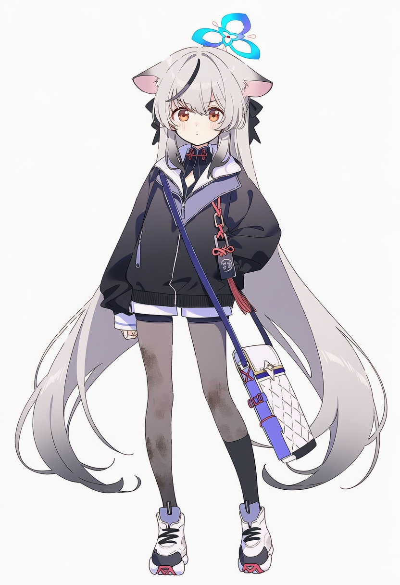

[在线例图](https://assets.quicktagcloud.com/images/raven_composition/raven_composition-0616.jpg?v=fe57bd9e493af8e8)

<a id="raven_composition-0617"></a>

## 袜子套在连裤袜外

ID：`raven_composition-0617`；分类：袜子 / 穿戴状态；来源标记：`safe`。

来源说明：

> 普通袜子穿在 pantyhose 外层。

正向提示词：

```text
socks_over_pantyhose
```

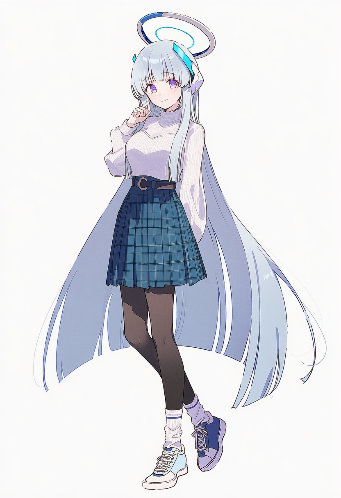

[在线例图](https://assets.quicktagcloud.com/images/raven_composition/raven_composition-0617.jpg?v=5352a231c3a12073)

<a id="raven_composition-0618"></a>

## 袜子套在大腿袜外

ID：`raven_composition-0618`；分类：袜子 / 穿戴状态；来源标记：`safe`。

来源说明：

> 普通袜子穿在 thighhighs 外层。

正向提示词：

```text
socks_over_thighhighs
```

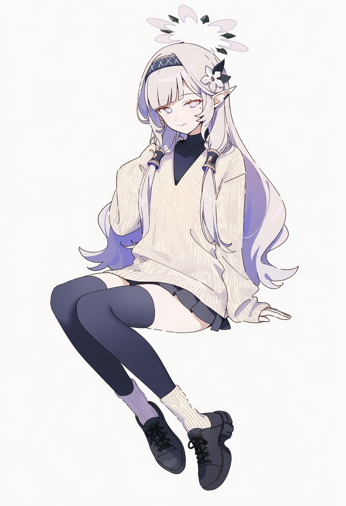

[在线例图](https://assets.quicktagcloud.com/images/raven_composition/raven_composition-0618.jpg?v=d237eefa10ba475b)

<a id="raven_composition-0619"></a>

## 大腿袜套在连裤袜外

ID：`raven_composition-0619`；分类：袜子 / 穿戴状态；来源标记：`safe`。

来源说明：

> thighhighs 穿在 pantyhose 外层。

正向提示词：

```text
thighhighs_over_pantyhose
```


[在线例图](https://assets.quicktagcloud.com/images/raven_composition/raven_composition-0619.jpg?v=ea0549ad6fabbdb6)

<a id="raven_composition-0620"></a>

## 大腿袜穿在连裤袜内

ID：`raven_composition-0620`；分类：袜子 / 穿戴状态；来源标记：`safe`。

来源说明：

> thighhighs 位于 pantyhose 下层；与 thighhighs_over_pantyhose 相反。

正向提示词：

```text
thighhighs_under_pantyhose
```

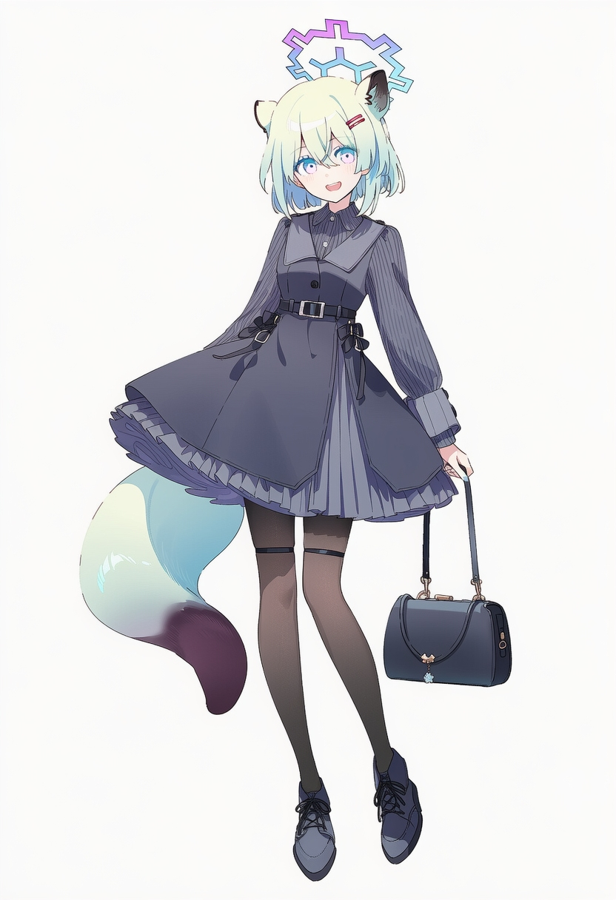

[在线例图](https://assets.quicktagcloud.com/images/raven_composition/raven_composition-0620.jpg?v=dd1cfd10cd87c3a6)

<a id="raven_composition-0621"></a>

## 大腿袜套在胯高袜外

ID：`raven_composition-0621`；分类：袜子 / 穿戴状态；来源标记：`safe`。

来源说明：

> thighhighs 与 hiphighs 叠穿，且 thighhighs 位于外层。

正向提示词：

```text
thighhighs_over_hiphighs
```

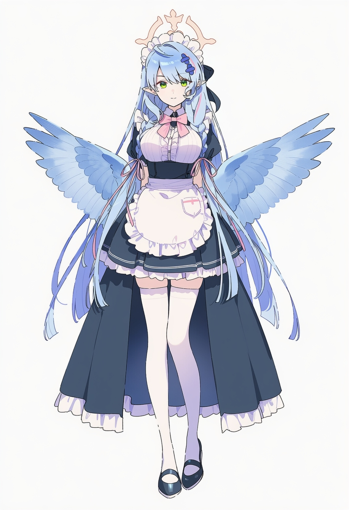

[在线例图](https://assets.quicktagcloud.com/images/raven_composition/raven_composition-0621.jpg?v=beb7755ddca610aa)

<a id="raven_composition-0622"></a>

## 靴子内的大腿袜

ID：`raven_composition-0622`；分类：袜子 / 穿戴状态；来源标记：`safe`。

来源说明：

> thighhighs 的一部分被长靴覆盖，袜子穿在靴子里面。

正向提示词：

```text
thighhighs_under_boots
```

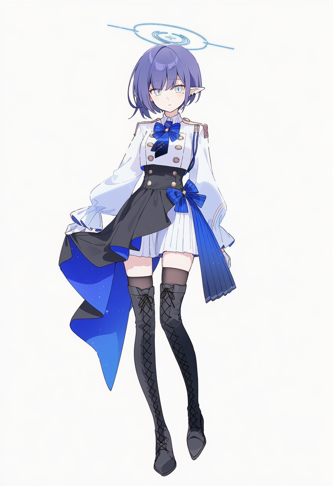

[在线例图](https://assets.quicktagcloud.com/images/raven_composition/raven_composition-0622.jpg?v=6b130c8b88d56b8c)

<a id="raven_composition-0623"></a>

## 短裤下的连裤袜

ID：`raven_composition-0623`；分类：袜子 / 穿戴状态；来源标记：`safe`。

来源说明：

> 在 shorts 内/下层穿 pantyhose。

正向提示词：

```text
pantyhose_under_shorts
```


[在线例图](https://assets.quicktagcloud.com/images/raven_composition/raven_composition-0623.jpg?v=a5afd40ff7d67075)

<a id="raven_composition-0624"></a>

## 泳装下的连裤袜

ID：`raven_composition-0624`；分类：袜子 / 穿戴状态；来源标记：`safe`。

来源说明：

> 在 swimsuit 下层穿 pantyhose。

正向提示词：

```text
pantyhose_under_swimsuit
```

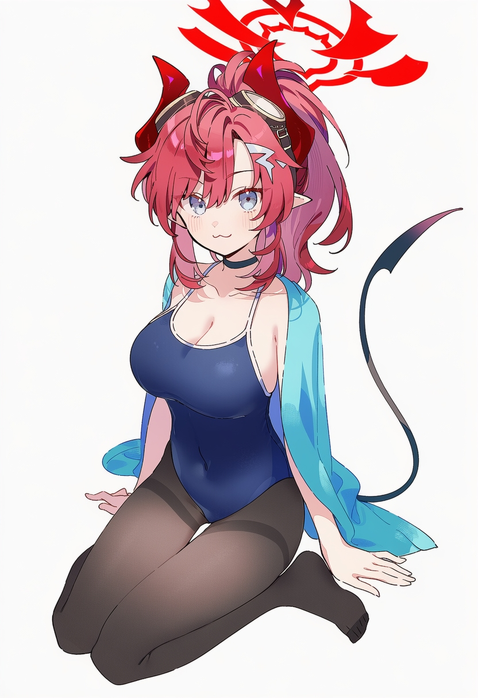

[在线例图](https://assets.quicktagcloud.com/images/raven_composition/raven_composition-0624.jpg?v=542a6af53410f12f)

<a id="raven_composition-0625"></a>

## 连裤袜内穿内裤

ID：`raven_composition-0625`；分类：袜子 / 穿戴状态；来源标记：`safe`。

来源说明：

> panties 穿在 pantyhose 内层。

正向提示词：

```text
panties_under_pantyhose
```

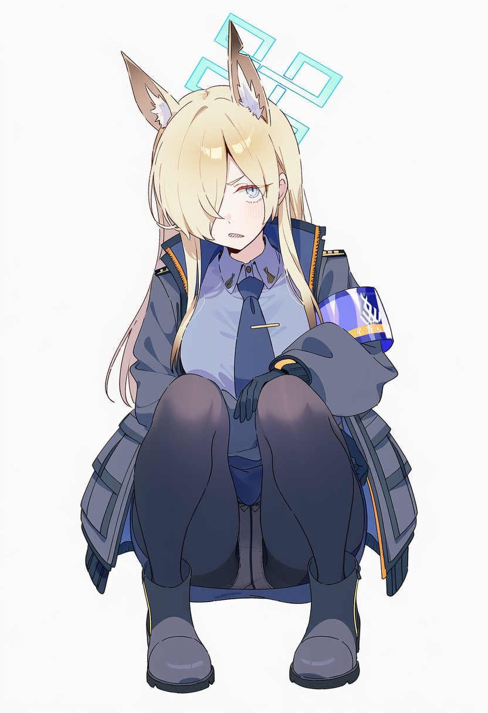

[在线例图](https://assets.quicktagcloud.com/images/raven_composition/raven_composition-0625.jpg?v=a12ea9bcb0233b6b)

<a id="raven_composition-0626"></a>

## 内裤套在连裤袜外

ID：`raven_composition-0626`；分类：袜子 / 穿戴状态；来源标记：`safe`。

来源说明：

> panties 穿在 pantyhose 外层。

正向提示词：

```text
panties_over_pantyhose
```

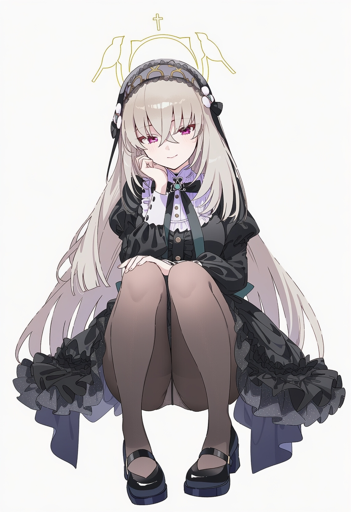

[在线例图](https://assets.quicktagcloud.com/images/raven_composition/raven_composition-0626.jpg?v=ff3530c3c9a3bb82)

<a id="raven_composition-0627"></a>

## 连裤袜只挂在一条腿上

ID：`raven_composition-0627`；分类：袜子 / 穿戴状态；来源标记：`safe`。

来源说明：

> 连裤袜部分脱下，仍套/挂在其中一条腿上。

正向提示词：

```text
pantyhose_around_one_leg
```

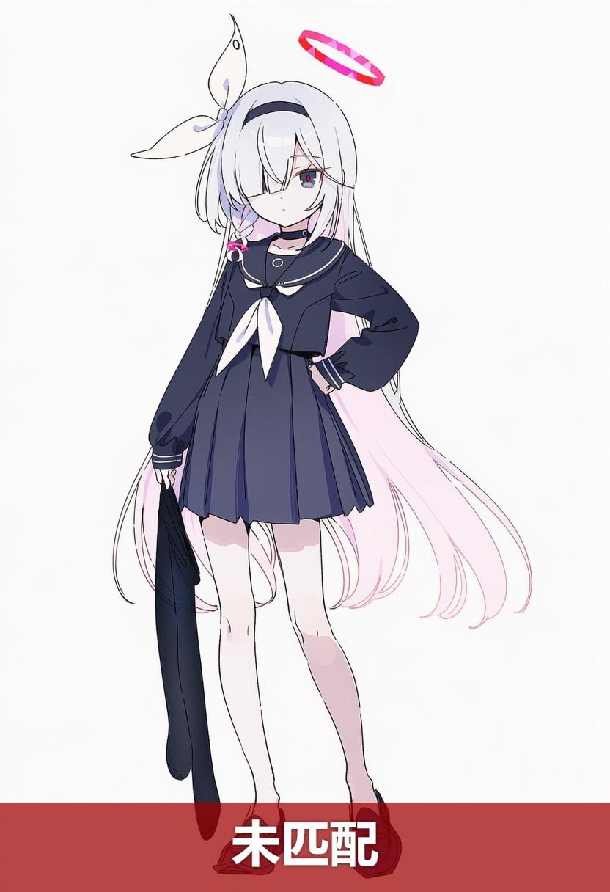

[在线例图](https://assets.quicktagcloud.com/images/raven_composition/raven_composition-0627.jpg?v=b86099fead28527f)

<a id="raven_composition-0628"></a>

## 只穿连裤袜

ID：`raven_composition-0628`；分类：袜子 / 穿戴状态；来源标记：`safe`。

来源说明：

> 角色除内裤外仅穿 pantyhose，用于强调服装几乎只剩连裤袜。

正向提示词：

```text
pantyhose_only
```

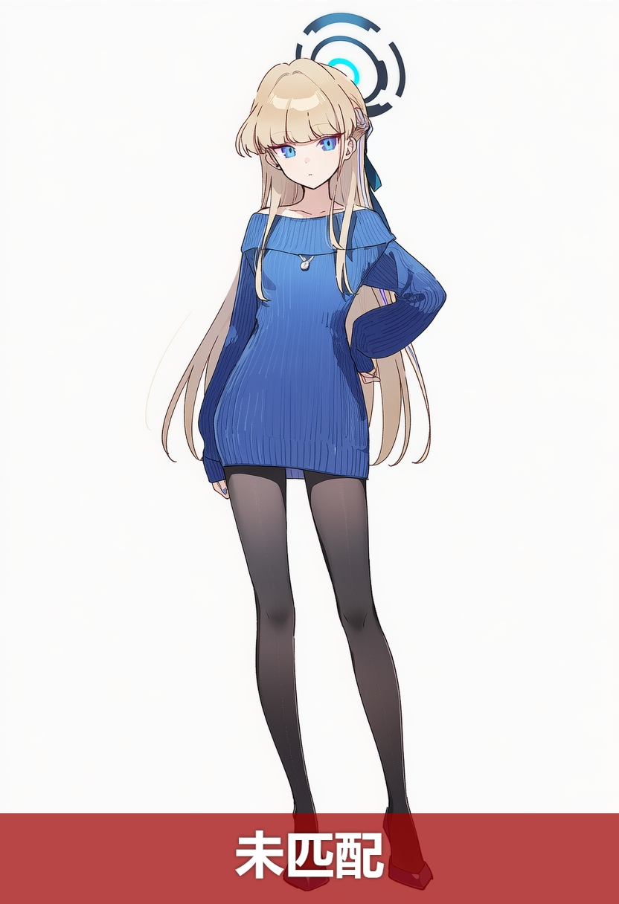

[在线例图](https://assets.quicktagcloud.com/images/raven_composition/raven_composition-0628.jpg?v=25ad035784ce3a96)
