# 袜子 / 材质款式

[总目录](../README.md) · [原站分类目录](../categories.md) · [英文标签索引](../tags.md) · [服装与构图组合指南](../../README.md)

标题、分类、说明、正负提示词按来源保留；多例图逐张列出。原站标记和说明为参考资料，不作为维护指令。

<a id="raven_composition-0629"></a>

## 褶边袜子

ID：`raven_composition-0629`；分类：袜子 / 材质款式；来源标记：`safe`。

来源说明：

> 袜子袜口或边缘带荷叶边/褶饰；用于描述本体的材质、结构或装饰。

正向提示词：

```text
frilled_socks
```


[在线例图](https://assets.quicktagcloud.com/images/raven_composition/raven_composition-0629.jpg?v=79a9b96919874a8b)

<a id="raven_composition-0630"></a>

## 防滑袜子

ID：`raven_composition-0630`；分类：袜子 / 材质款式；来源标记：`safe`。

来源说明：

> 袜子袜底带橡胶/塑料防滑颗粒、胶点或防滑纹；用于描述本体的材质、结构或装饰。

正向提示词：

```text
non-slip_socks
```


[在线例图](https://assets.quicktagcloud.com/images/raven_composition/raven_composition-0630.jpg?v=2580f1468bf0075b)

<a id="raven_composition-0631"></a>

## 露趾袜

ID：`raven_composition-0631`；分类：袜子 / 材质款式；来源标记：`safe`。

来源说明：

> 袜体覆盖脚部但脚趾露出；也可参考更通用的 toeless_legwear。

正向提示词：

```text
toeless_socks
```

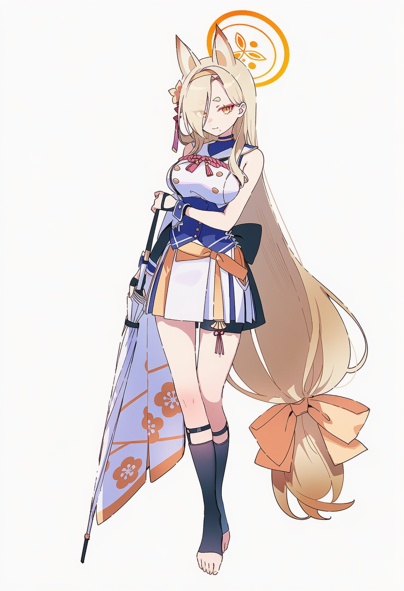

[在线例图](https://assets.quicktagcloud.com/images/raven_composition/raven_composition-0631.jpg?v=78249e12713f502a)

<a id="raven_composition-0632"></a>

## 破损袜子

ID：`raven_composition-0632`；分类：袜子 / 材质款式；来源标记：`safe`。

来源说明：

> 袜子出现破洞、撕裂或明显损坏；用于描述本体的材质、结构或装饰。

正向提示词：

```text
torn_socks
```

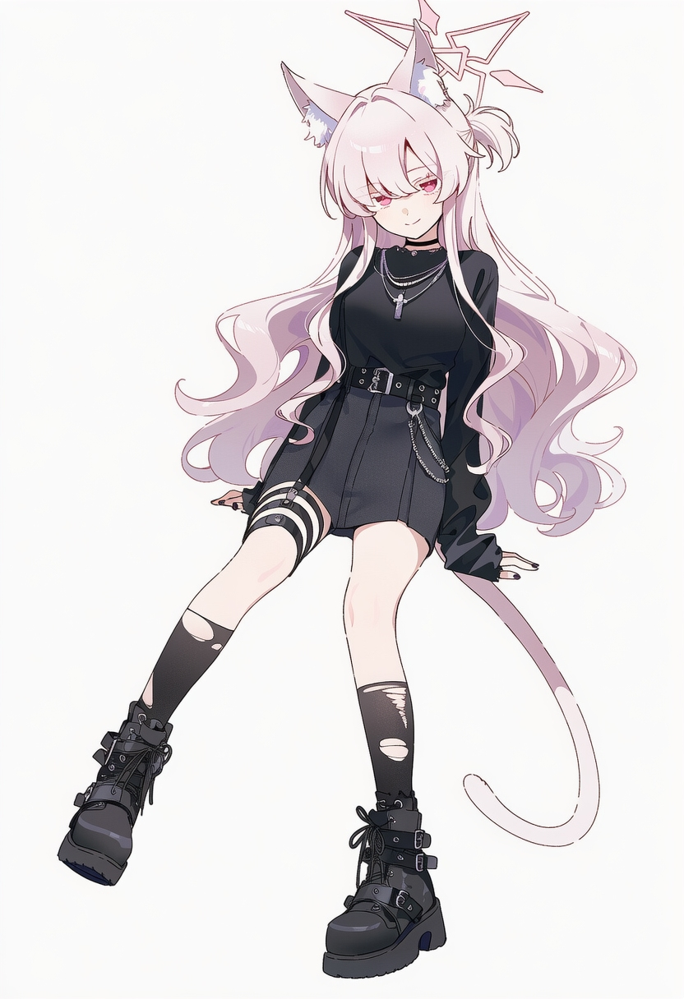

[在线例图](https://assets.quicktagcloud.com/images/raven_composition/raven_composition-0632.jpg?v=eaebcac25323bb52)

<a id="raven_composition-0633"></a>

## 宽松大腿袜

ID：`raven_composition-0633`；分类：袜子 / 材质款式；来源标记：`safe`。

来源说明：

> 袜筒明显宽松、不贴腿的单只/款式化 thighhigh；与 loose_socks 的短袜体系区分。

正向提示词：

```text
loose_thighhigh
```


[在线例图](https://assets.quicktagcloud.com/images/raven_composition/raven_composition-0633.jpg?v=2bd6209162396238)

<a id="raven_composition-0634"></a>

## 后部开口连裤袜

ID：`raven_composition-0634`；分类：袜子 / 材质款式；来源标记：`safe`。

来源说明：

> pantyhose 后侧/臀部区域具有明显开口的款式。

正向提示词：

```text
backless_pantyhose
```

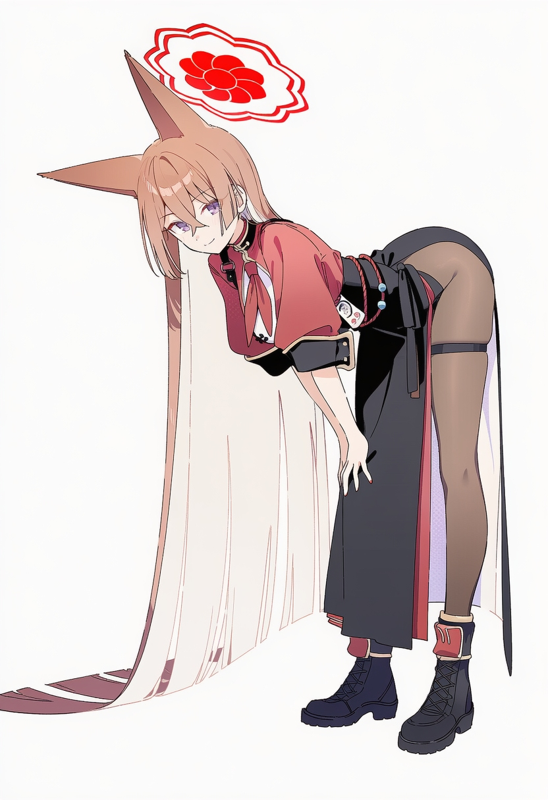

[在线例图](https://assets.quicktagcloud.com/images/raven_composition/raven_composition-0634.jpg?v=4554d9823aa97fa6)

<a id="raven_composition-0635"></a>

## 开裆连裤袜

ID：`raven_composition-0635`；分类：袜子 / 材质款式；来源标记：`safe`。

来源说明：

> 裆部留有开口的 pantyhose。

正向提示词：

```text
crotchless_pantyhose
```

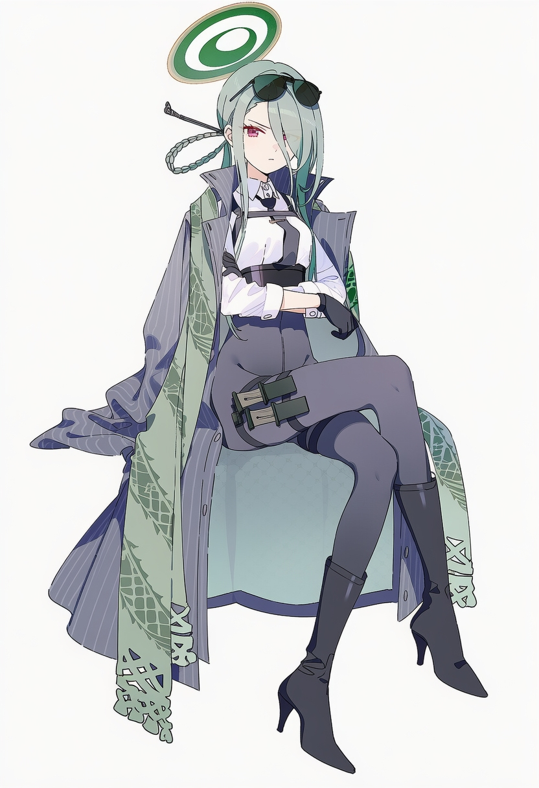

[在线例图](https://assets.quicktagcloud.com/images/raven_composition/raven_composition-0635.jpg?v=b2a322222f6965c2)

<a id="raven_composition-0636"></a>

## 大腿加深带连裤袜

ID：`raven_composition-0636`；分类：袜子 / 材质款式；来源标记：`safe`。

来源说明：

> 连裤袜大腿处有明显较深色带状区域（run guard），视觉上像大腿袜袜口。

正向提示词：

```text
thighband_pantyhose
```

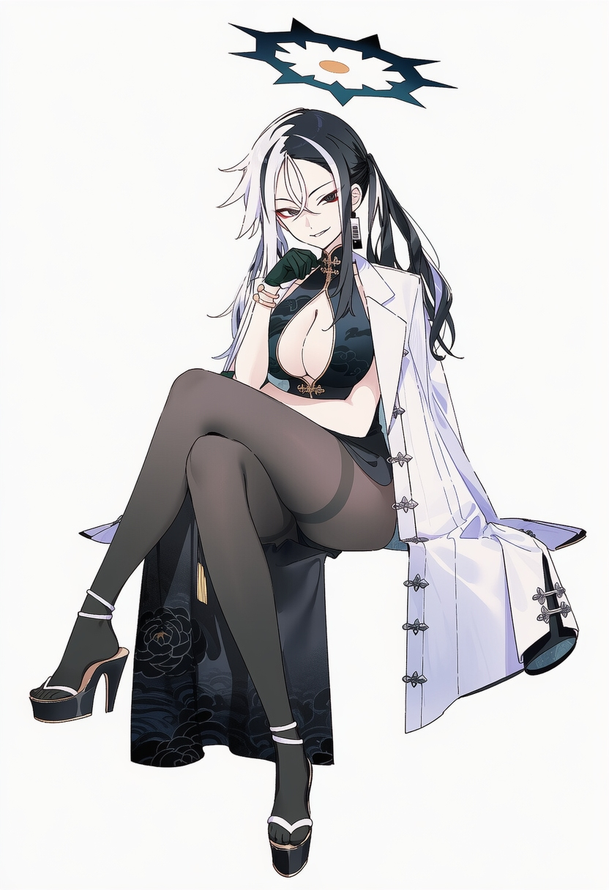

[在线例图](https://assets.quicktagcloud.com/images/raven_composition/raven_composition-0636.jpg?v=da8a8cfd4bc813b3)

<a id="raven_composition-0637"></a>

## 高腰连裤袜

ID：`raven_composition-0637`；分类：袜子 / 材质款式；来源标记：`safe`。

来源说明：

> 腰线上提、覆盖腹部较高位置的 pantyhose。

正向提示词：

```text
high-waist_pantyhose
```

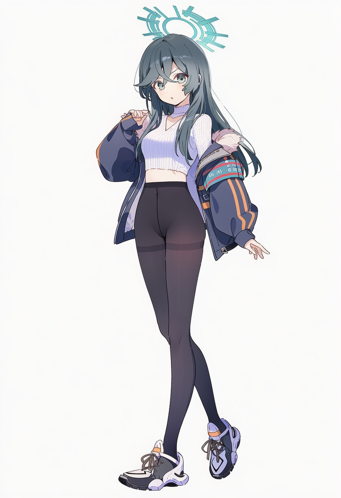

[在线例图](https://assets.quicktagcloud.com/images/raven_composition/raven_composition-0637.jpg?v=bd2902c78b79aadc)

<a id="raven_composition-0638"></a>

## 抽丝/跑线连裤袜

ID：`raven_composition-0638`；分类：袜子 / 材质款式；来源标记：`safe`。

来源说明：

> 连裤袜出现梯状延伸的破洞或跑线（fabric run），是特定类型的破损状态。

正向提示词：

```text
laddered_pantyhose
```

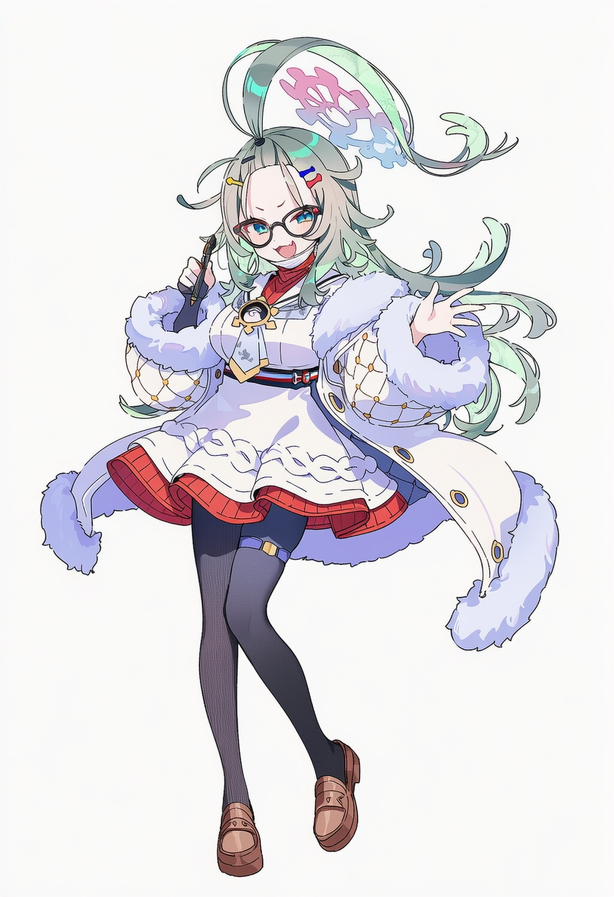

[在线例图](https://assets.quicktagcloud.com/images/raven_composition/raven_composition-0638.jpg?v=fb74d61b061a188b)

<a id="raven_composition-0639"></a>

## 低臀覆盖连裤袜

ID：`raven_composition-0639`；分类：袜子 / 材质款式；来源标记：`safe`。

来源说明：

> 连裤袜上部没有完全覆盖臀部的款式；Danbooru 的特定设计 tag。

正向提示词：

```text
lowleg_pantyhose
```


[在线例图](https://assets.quicktagcloud.com/images/raven_composition/raven_composition-0639.jpg?v=46ae9c8aaa83fe82)

<a id="raven_composition-0640"></a>

## 大腿带胯高袜

ID：`raven_composition-0640`；分类：袜子 / 材质款式；来源标记：`safe`。

来源说明：

> hiphighs 在大腿位置带有明显带状、束带式或加深色区域的款式。

正向提示词：

```text
thighband_hiphighs
```


[在线例图](https://assets.quicktagcloud.com/images/raven_composition/raven_composition-0640.jpg?v=b2efd7d8e4939ec2)

<a id="raven_composition-0641"></a>

## 毛绒暖腿套

ID：`raven_composition-0641`；分类：袜子 / 材质款式；来源标记：`safe`。

来源说明：

> 整体以毛绒/毛皮质感为主要特征的 leg_warmers。

正向提示词：

```text
fur_leg_warmers
```

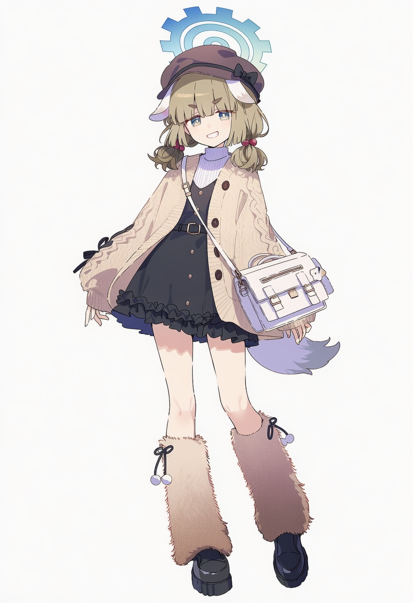

[在线例图](https://assets.quicktagcloud.com/images/raven_composition/raven_composition-0641.jpg?v=310f95e4d6dc78a3)

<a id="raven_composition-0642"></a>

## 渔网腿部穿戴物

ID：`raven_composition-0642`；分类：袜子 / 材质款式；来源标记：`safe`。

来源说明：

> 通用渔网袜类 tag；无法或无需细分为 socks / thighhighs / pantyhose 时可使用。

正向提示词：

```text
fishnet_legwear
```

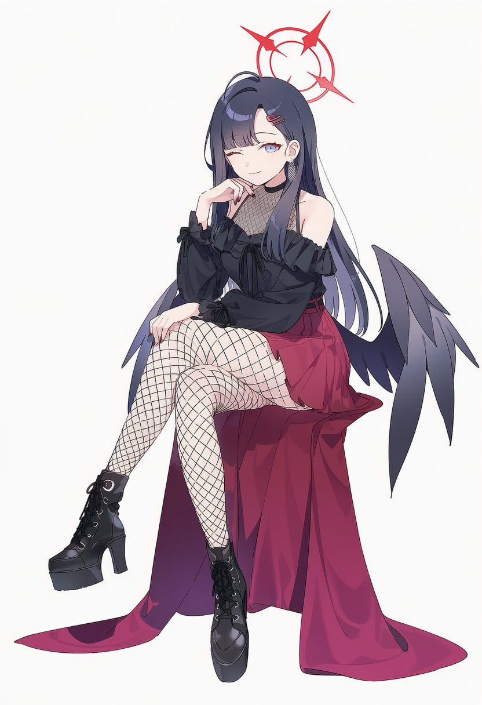

[在线例图](https://assets.quicktagcloud.com/images/raven_composition/raven_composition-0642.jpg?v=26677c1bb03a1d57)

<a id="raven_composition-0643"></a>

## 蕾丝腿部穿戴物

ID：`raven_composition-0643`；分类：袜子 / 材质款式；来源标记：`safe`。

来源说明：

> 腿部穿戴物主体由蕾丝材质或明显蕾丝纹理构成；用于描述本体的材质、结构或装饰。

正向提示词：

```text
lace_legwear
```

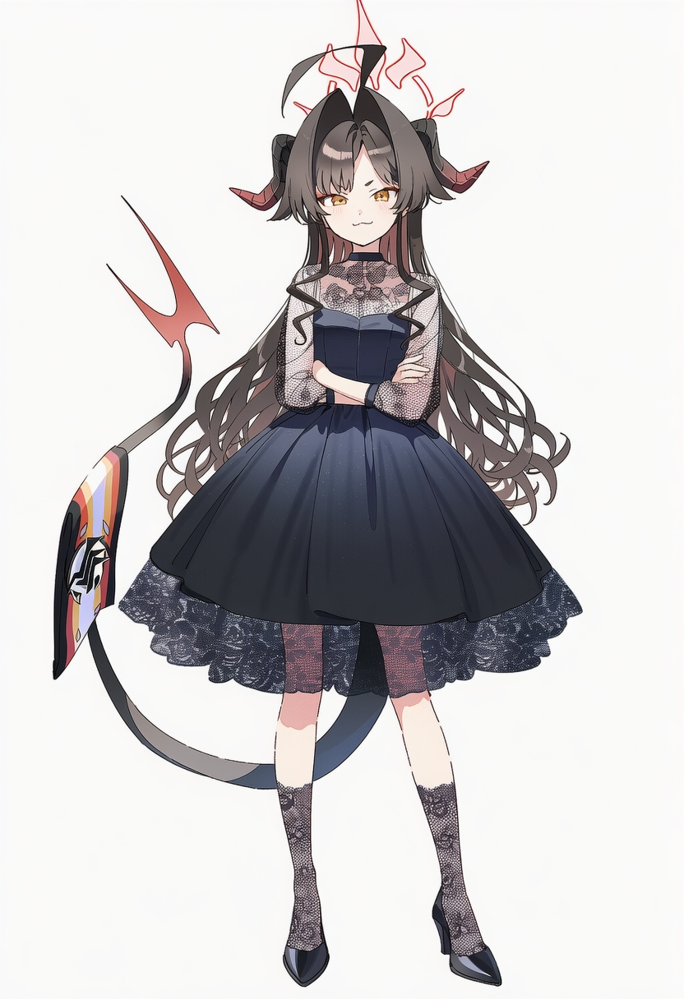

[在线例图](https://assets.quicktagcloud.com/images/raven_composition/raven_composition-0643.jpg?v=77fdafde53f22391)

<a id="raven_composition-0644"></a>

## 蕾丝边腿部穿戴物

ID：`raven_composition-0644`；分类：袜子 / 材质款式；来源标记：`safe`。

来源说明：

> 腿部穿戴物边缘或袜口带蕾丝装饰；用于描述本体的材质、结构或装饰。

正向提示词：

```text
lace-trimmed_legwear
```

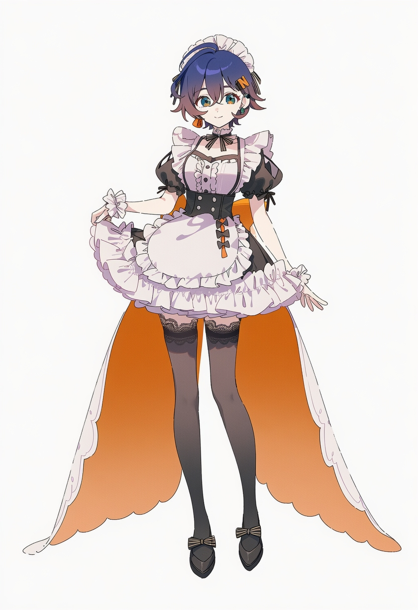

[在线例图](https://assets.quicktagcloud.com/images/raven_composition/raven_composition-0644.jpg?v=87a7c32114889996)

<a id="raven_composition-0645"></a>

## 系带腿部穿戴物

ID：`raven_composition-0645`；分类：袜子 / 材质款式；来源标记：`safe`。

来源说明：

> 腿部穿戴物带可见的穿孔、绑带或交叉系带结构；用于描述本体的材质、结构或装饰。

正向提示词：

```text
lace-up_legwear
```

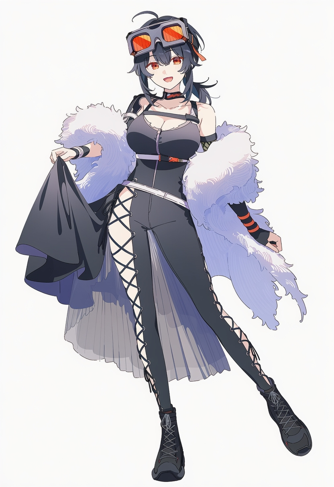

[在线例图](https://assets.quicktagcloud.com/images/raven_composition/raven_composition-0645.jpg?v=ff90744c6396f2d9)

<a id="raven_composition-0646"></a>

## 乳胶腿部穿戴物

ID：`raven_composition-0646`；分类：袜子 / 材质款式；来源标记：`safe`。

来源说明：

> 腿部穿戴物由乳胶或具有明显乳胶质感的材料构成；用于描述本体的材质、结构或装饰。

正向提示词：

```text
latex_legwear
```

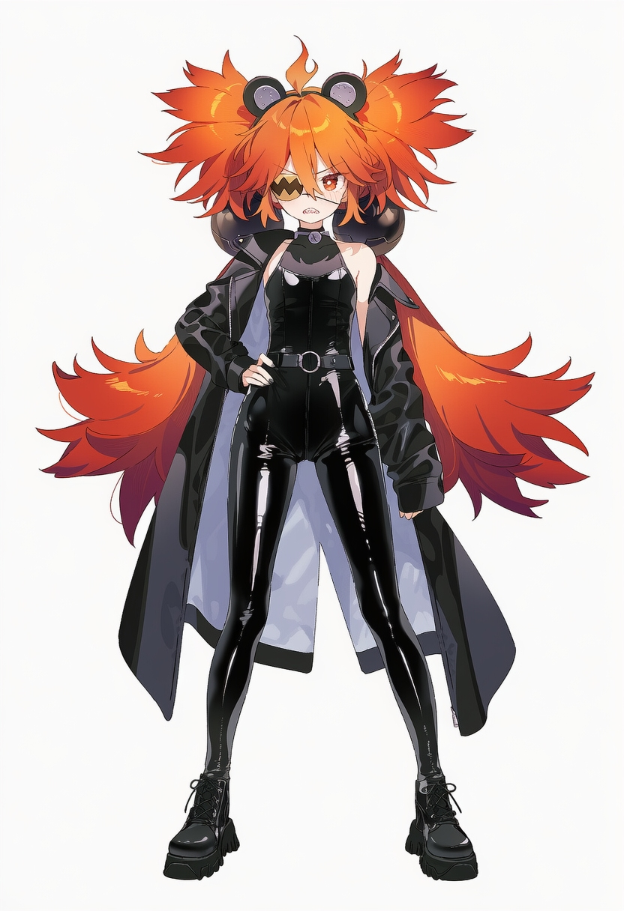

[在线例图](https://assets.quicktagcloud.com/images/raven_composition/raven_composition-0646.jpg?v=b679915460b66aed)

<a id="raven_composition-0647"></a>

## 罗纹腿部穿戴物

ID：`raven_composition-0647`；分类：袜子 / 材质款式；来源标记：`safe`。

来源说明：

> 腿部穿戴物织物表面有明显纵向罗纹；不要仅凭纵线外观与 vertical-striped 混淆；用于描述本体的材质、结构或装饰。

正向提示词：

```text
ribbed_legwear
```

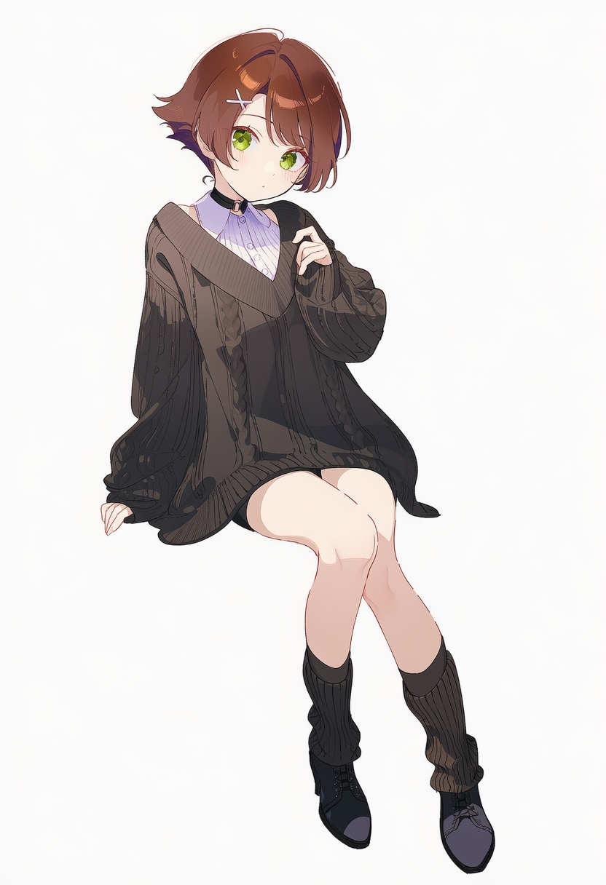

[在线例图](https://assets.quicktagcloud.com/images/raven_composition/raven_composition-0647.jpg?v=35f613bd3b2f00ee)

<a id="raven_composition-0648"></a>

## 针织腿部穿戴物

ID：`raven_composition-0648`；分类：袜子 / 材质款式；来源标记：`safe`。

来源说明：

> 腿部穿戴物具有明显针织材质或织法；用于描述本体的材质、结构或装饰。

正向提示词：

```text
knit_legwear
```


[在线例图](https://assets.quicktagcloud.com/images/raven_composition/raven_composition-0648.jpg?v=9fbeeb933d965186)

<a id="raven_composition-0649"></a>

## 阿兰针织纹腿部穿戴物

ID：`raven_composition-0649`；分类：袜子 / 材质款式；来源标记：`safe`。

来源说明：

> 腿部穿戴物具有阿兰毛衣式绞花针织纹理；用于描述本体的材质、结构或装饰。

正向提示词：

```text
aran_legwear
```

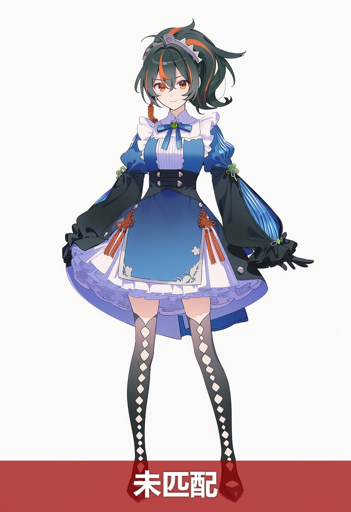

[在线例图](https://assets.quicktagcloud.com/images/raven_composition/raven_composition-0649.jpg?v=d8e9d03adcb7997a)

<a id="raven_composition-0650"></a>

## 装甲腿部穿戴物

ID：`raven_composition-0650`；分类：袜子 / 材质款式；来源标记：`safe`。

来源说明：

> 腿部穿戴物呈硬质护甲/装甲式设计；用于描述本体的材质、结构或装饰。

正向提示词：

```text
armored_legwear
```

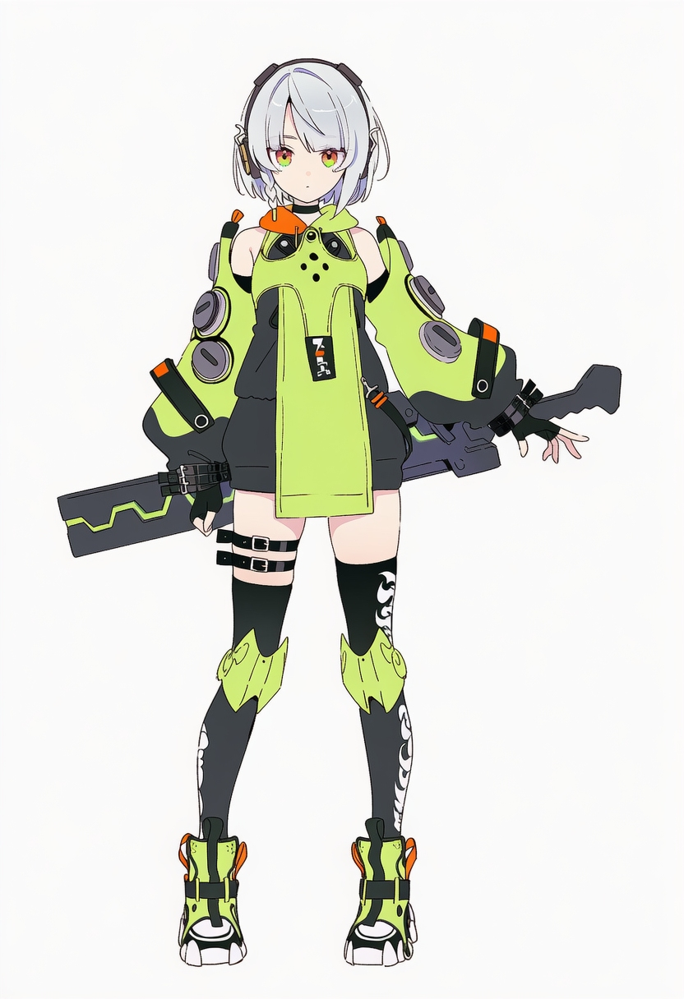

[在线例图](https://assets.quicktagcloud.com/images/raven_composition/raven_composition-0650.jpg?v=e7a05c0c6595fade)

<a id="raven_composition-0651"></a>

## 蝴蝶结袜类

ID：`raven_composition-0651`；分类：袜子 / 材质款式；来源标记：`safe`。

来源说明：

> 腿部袜类上带蝴蝶结装饰；多个旧的 bow_socks / bow_thighhighs 等名称归并到这里。

正向提示词：

```text
bow_legwear
```

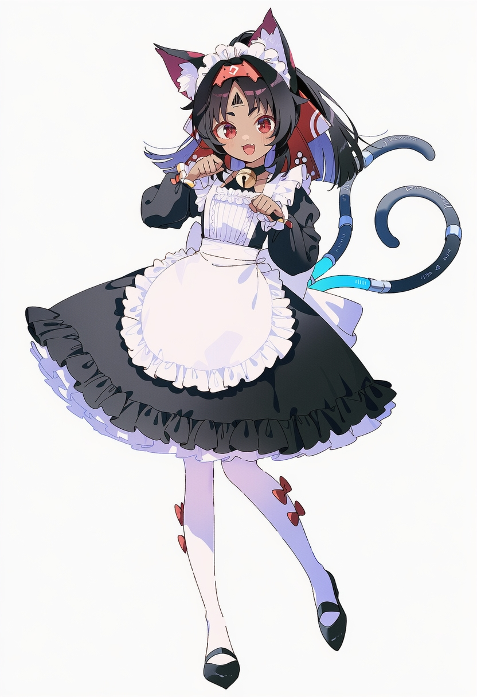

[在线例图](https://assets.quicktagcloud.com/images/raven_composition/raven_composition-0651.jpg?v=0d4e88b9e6959075)

<a id="raven_composition-0652"></a>

## 交叉系带腿部穿戴物

ID：`raven_composition-0652`；分类：袜子 / 材质款式；来源标记：`safe`。

来源说明：

> 腿部穿戴物表面有交叉穿绳/绑带结构；用于描述本体的材质、结构或装饰。

正向提示词：

```text
cross-laced_legwear
```


[在线例图](https://assets.quicktagcloud.com/images/raven_composition/raven_composition-0652.jpg?v=046e2865d41301dd)

<a id="raven_composition-0653"></a>

## 毛绒腿部穿戴物

ID：`raven_composition-0653`；分类：袜子 / 材质款式；来源标记：`safe`。

来源说明：

> 腿部穿戴物材质蓬松、毛绒感明显；用于描述本体的材质、结构或装饰。

正向提示词：

```text
fluffy_legwear
```

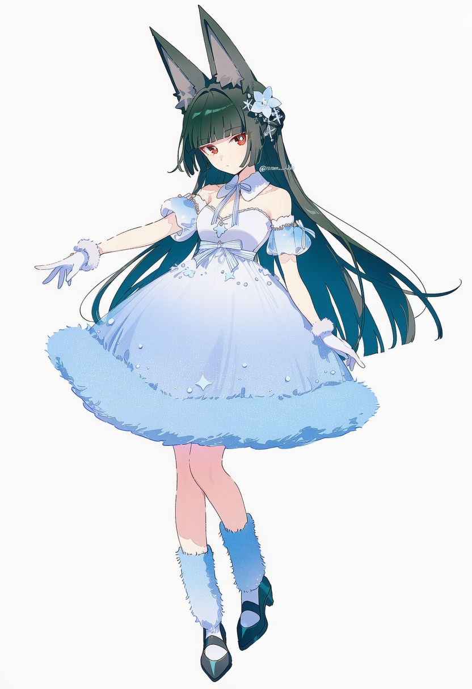

[在线例图](https://assets.quicktagcloud.com/images/raven_composition/raven_composition-0653.jpg?v=c5761375ead05e7d)

<a id="raven_composition-0654"></a>

## 铃铛袜类

ID：`raven_composition-0654`；分类：袜子 / 材质款式；来源标记：`safe`。

来源说明：

> 袜类或腿部穿戴物上装有铃铛。

正向提示词：

```text
legwear_bell
```

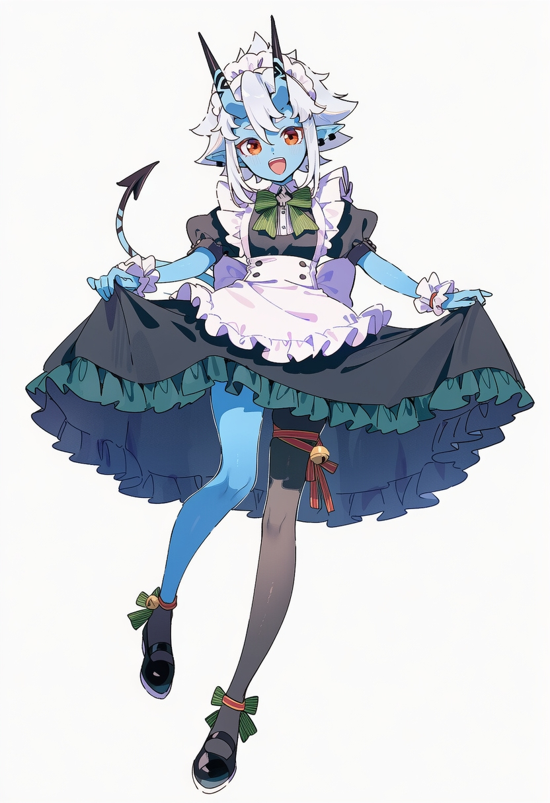

[在线例图](https://assets.quicktagcloud.com/images/raven_composition/raven_composition-0654.jpg?v=919b6e9a05e0085a)

<a id="raven_composition-0655"></a>

## O形环腿部穿戴物

ID：`raven_composition-0655`；分类：袜子 / 材质款式；来源标记：`safe`。

来源说明：

> 腿部穿戴物带金属或装饰性 O 形环；用于描述本体的材质、结构或装饰。

正向提示词：

```text
o-ring_legwear
```

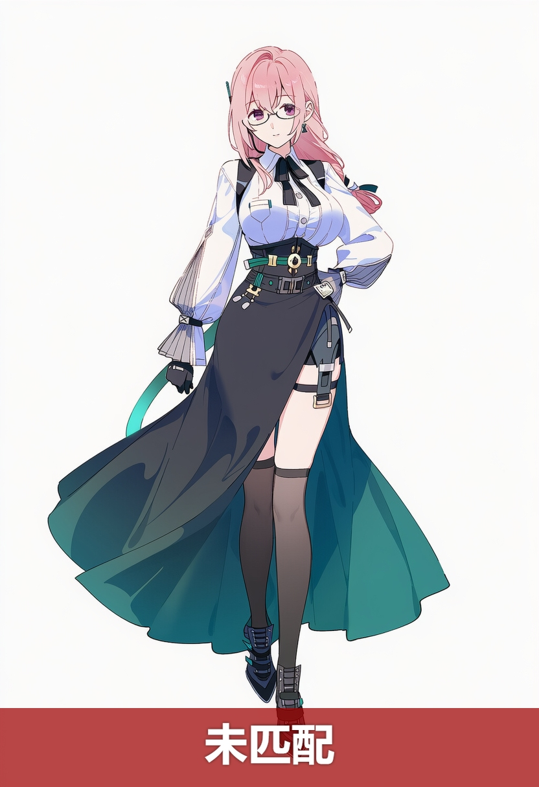

[在线例图](https://assets.quicktagcloud.com/images/raven_composition/raven_composition-0655.jpg?v=5ae39342cef626ca)

<a id="raven_composition-0656"></a>

## 有缝线袜类

ID：`raven_composition-0656`；分类：袜子 / 材质款式；来源标记：`safe`。

来源说明：

> 袜类上有明显接缝；可进一步细分 back-seamed、front-seamed、side-seamed。

正向提示词：

```text
seamed_legwear
```


[在线例图](https://assets.quicktagcloud.com/images/raven_composition/raven_composition-0656.jpg?v=b14863acfbed0d13)

<a id="raven_composition-0657"></a>

## 后缝腿部穿戴物

ID：`raven_composition-0657`；分类：袜子 / 材质款式；来源标记：`safe`。

来源说明：

> 腿部穿戴物腿后侧有纵向接缝；用于描述本体的材质、结构或装饰。

正向提示词：

```text
back-seamed_legwear
```


[在线例图](https://assets.quicktagcloud.com/images/raven_composition/raven_composition-0657.jpg?v=b64246f13caf079e)

<a id="raven_composition-0658"></a>

## 前缝腿部穿戴物

ID：`raven_composition-0658`；分类：袜子 / 材质款式；来源标记：`safe`。

来源说明：

> 腿部穿戴物腿前侧有纵向接缝；用于描述本体的材质、结构或装饰。

正向提示词：

```text
front-seamed_legwear
```

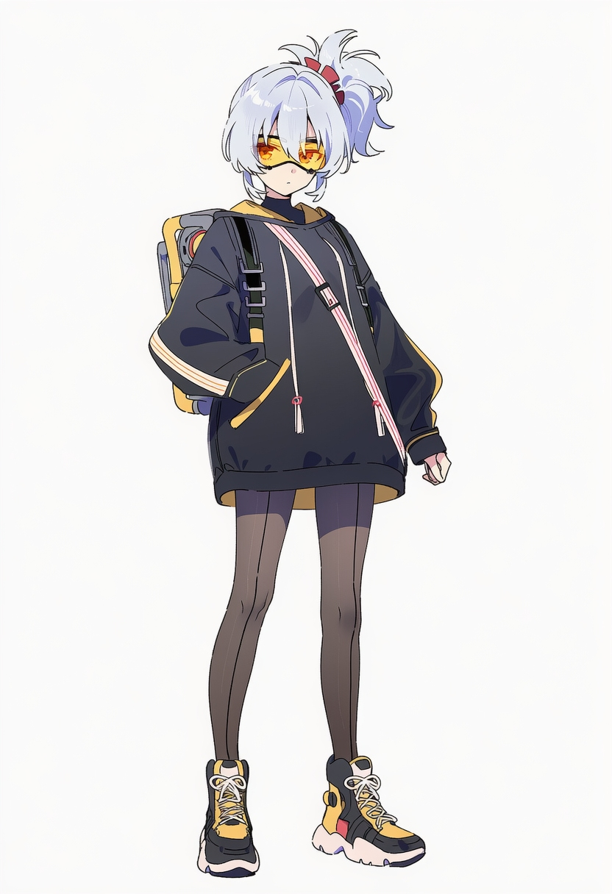

[在线例图](https://assets.quicktagcloud.com/images/raven_composition/raven_composition-0658.jpg?v=c42203cbbe31036c)

<a id="raven_composition-0659"></a>

## 侧缝腿部穿戴物

ID：`raven_composition-0659`；分类：袜子 / 材质款式；来源标记：`safe`。

来源说明：

> 腿部穿戴物腿侧有纵向接缝；用于描述本体的材质、结构或装饰。

正向提示词：

```text
side-seamed_legwear
```

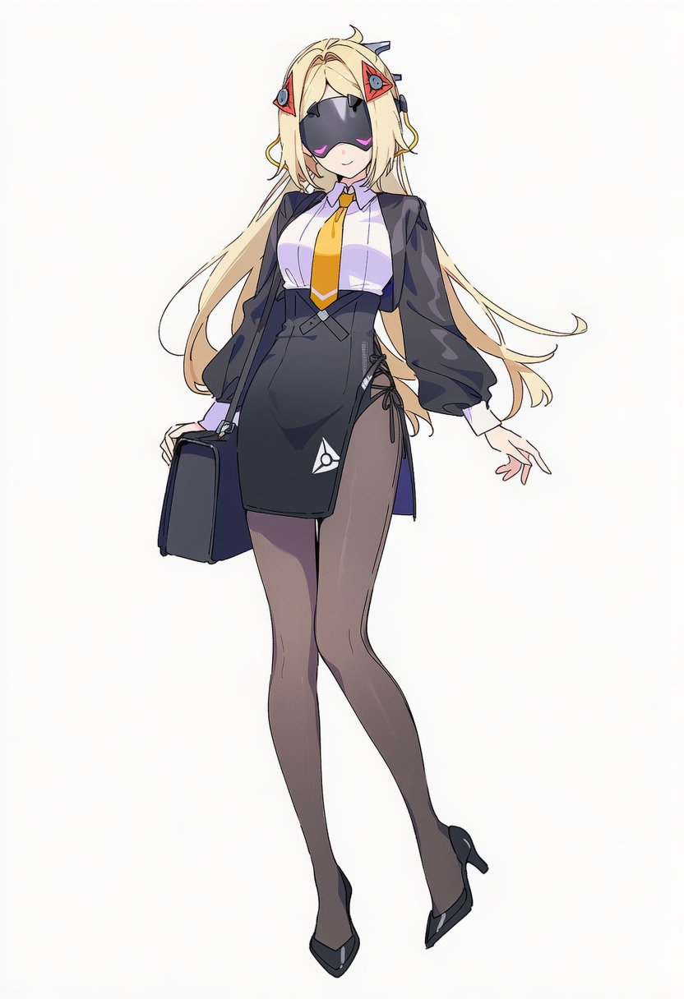

[在线例图](https://assets.quicktagcloud.com/images/raven_composition/raven_composition-0659.jpg?v=0fe1eefe3d26cfdb)

<a id="raven_composition-0660"></a>

## 透视腿部穿戴物

ID：`raven_composition-0660`；分类：袜子 / 材质款式；来源标记：`safe`。

来源说明：

> 腿部穿戴物材质半透明或透明，可以明显透出下方皮肤/衣物；用于描述本体的材质、结构或装饰。

正向提示词：

```text
see-through_legwear
```

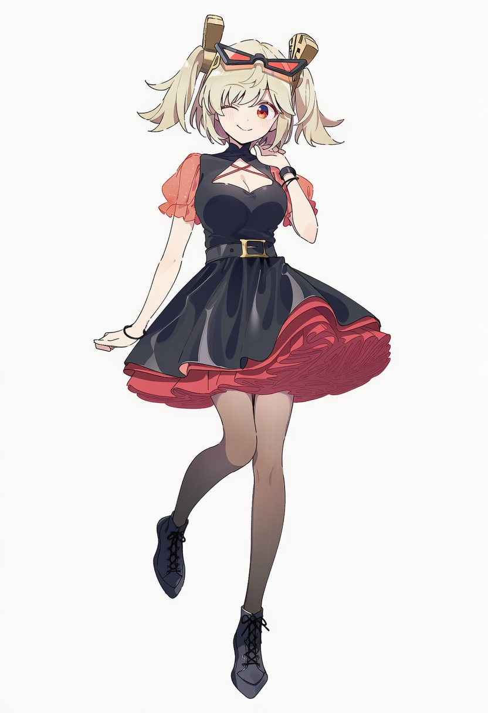

[在线例图](https://assets.quicktagcloud.com/images/raven_composition/raven_composition-0660.jpg?v=6a7890fe2eae165c)

<a id="raven_composition-0661"></a>

## 光泽腿部穿戴物

ID：`raven_composition-0661`；分类：袜子 / 材质款式；来源标记：`safe`。

来源说明：

> 腿部穿戴物材质表面有明显高光/光泽感；用于描述本体的材质、结构或装饰。

正向提示词：

```text
shiny_legwear
```

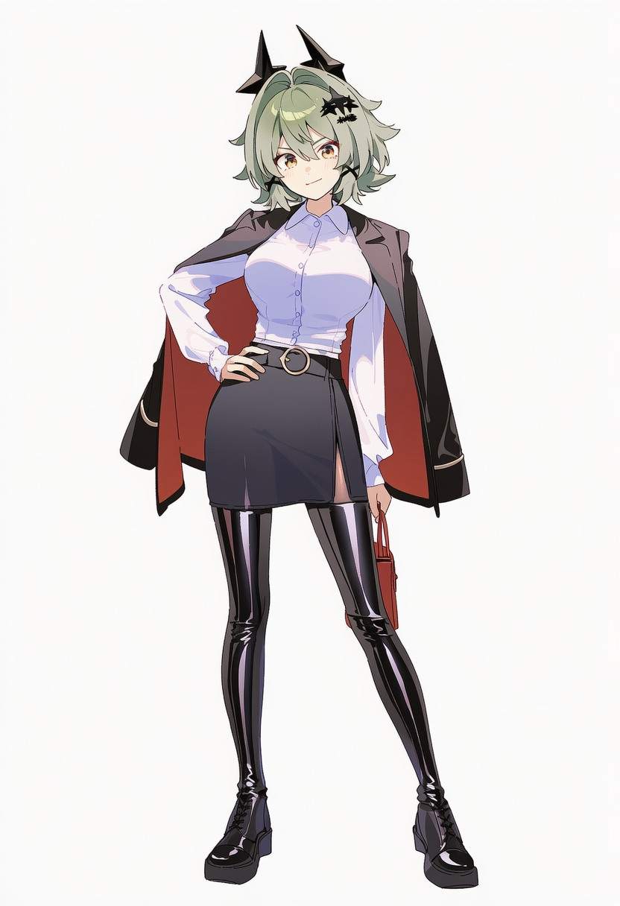

[在线例图](https://assets.quicktagcloud.com/images/raven_composition/raven_composition-0661.jpg?v=ce695d61be26d5ba)

<a id="raven_composition-0662"></a>

## 侧系带腿部穿戴物

ID：`raven_composition-0662`；分类：袜子 / 材质款式；来源标记：`safe`。

来源说明：

> 腿部穿戴物侧面带绑带、蝴蝶结或系结结构；用于描述本体的材质、结构或装饰。

正向提示词：

```text
side-tie_legwear
```

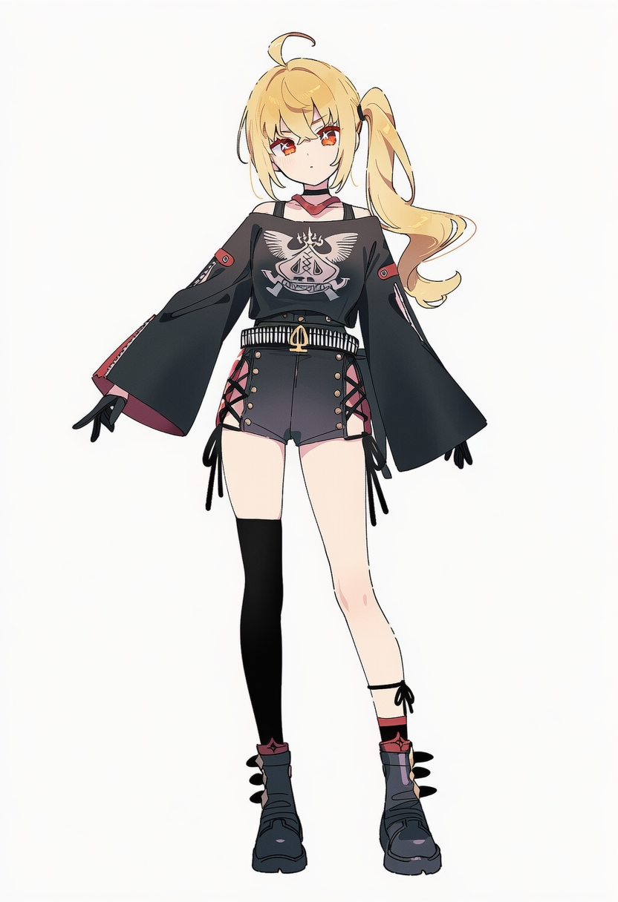

[在线例图](https://assets.quicktagcloud.com/images/raven_composition/raven_composition-0662.jpg?v=9f1926167f9d485c)

<a id="raven_composition-0663"></a>

## 尖刺腿部穿戴物

ID：`raven_composition-0663`；分类：袜子 / 材质款式；来源标记：`safe`。

来源说明：

> 腿部穿戴物带尖刺/刺状装饰；用于描述本体的材质、结构或装饰。

正向提示词：

```text
spiked_legwear
```

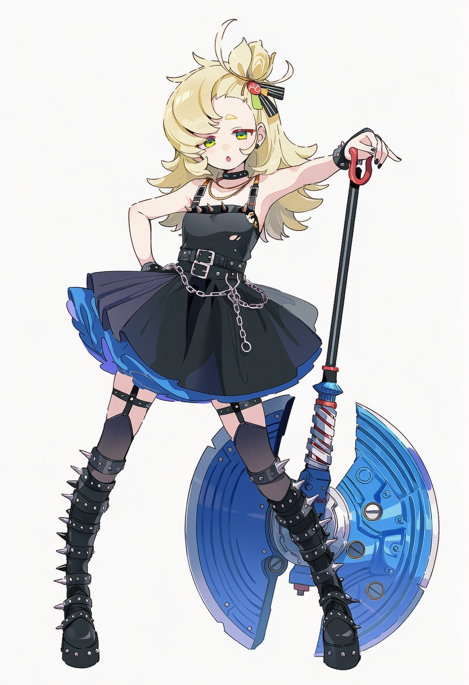

[在线例图](https://assets.quicktagcloud.com/images/raven_composition/raven_composition-0663.jpg?v=dc0a47f747897c5e)

<a id="raven_composition-0664"></a>

## 铆钉腿部穿戴物

ID：`raven_composition-0664`；分类：袜子 / 材质款式；来源标记：`safe`。

来源说明：

> 腿部穿戴物带铆钉装饰；用于描述本体的材质、结构或装饰。

正向提示词：

```text
studded_legwear
```

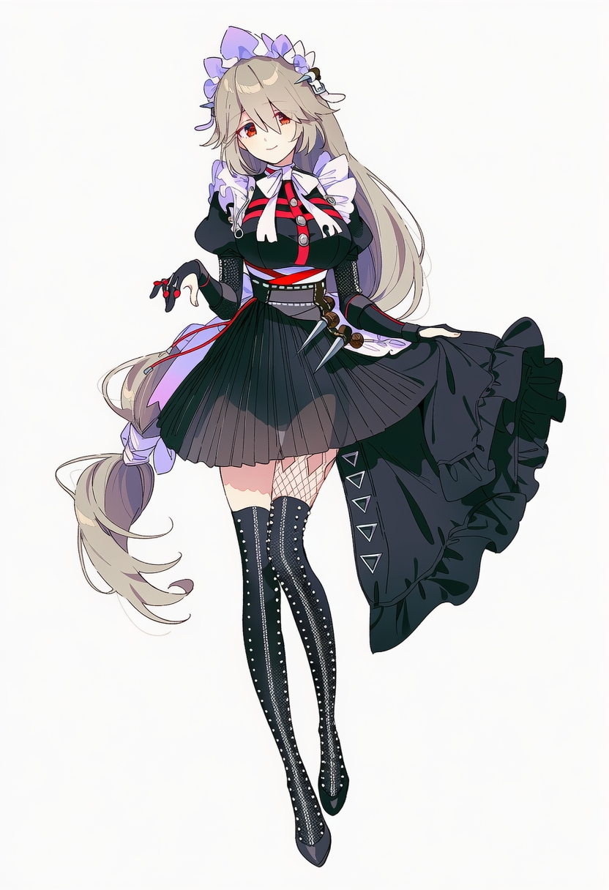

[在线例图](https://assets.quicktagcloud.com/images/raven_composition/raven_composition-0664.jpg?v=1fa3995e504a5b0c)

<a id="raven_composition-0665"></a>

## 露趾腿部穿戴物

ID：`raven_composition-0665`；分类：袜子 / 材质款式；来源标记：`safe`。

来源说明：

> 覆盖脚部但露出脚趾；若整个脚都不覆盖，应考虑 leggings。

正向提示词：

```text
toeless_legwear
```

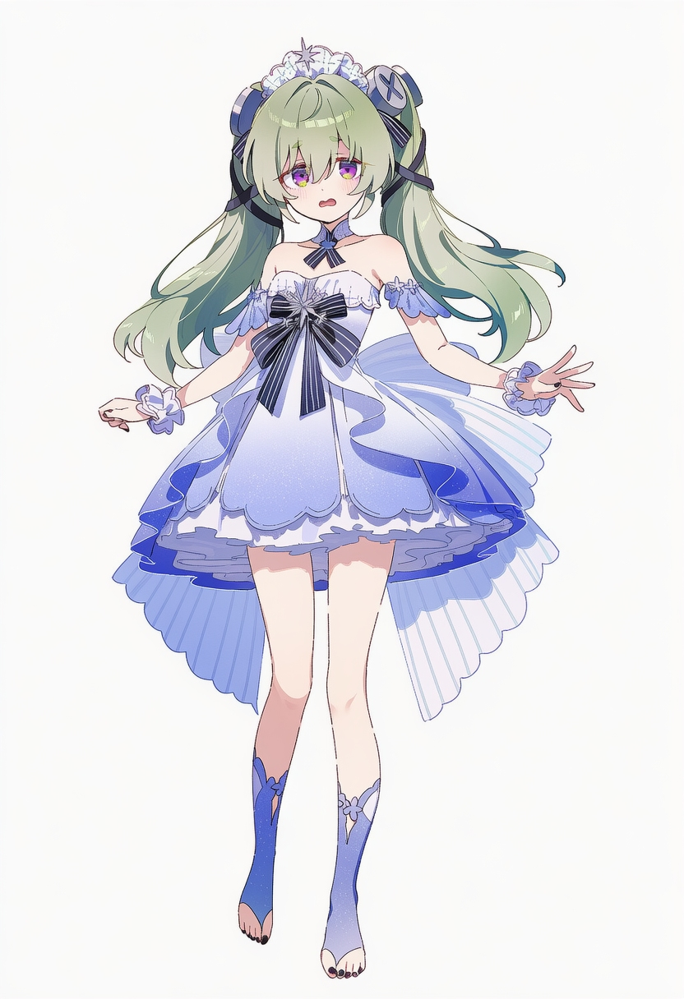

[在线例图](https://assets.quicktagcloud.com/images/raven_composition/raven_composition-0665.jpg?v=556ea807321ce8c5)

<a id="raven_composition-0666"></a>

## 新娘式腿部穿戴物

ID：`raven_composition-0666`；分类：袜子 / 材质款式；来源标记：`safe`。

来源说明：

> 腿部穿戴物带婚礼/新娘袜常见装饰风格；用于描述本体的材质、结构或装饰。

正向提示词：

```text
bridal_legwear
```


[在线例图](https://assets.quicktagcloud.com/images/raven_composition/raven_composition-0666.jpg?v=88b9f9eb5677012f)

<a id="raven_composition-0667"></a>

## 踩脚/马镫式腿部穿戴

ID：`raven_composition-0667`；分类：袜子 / 材质款式；来源标记：`safe`。

来源说明：

> 脚底有一条带子跨过足弓来固定，脚趾和脚跟多半露出。

正向提示词：

```text
stirrup_legwear
```

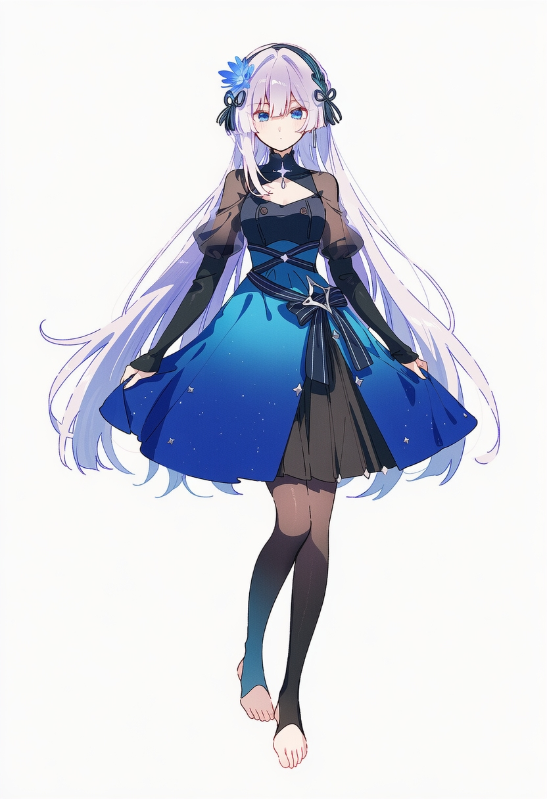

[在线例图](https://assets.quicktagcloud.com/images/raven_composition/raven_composition-0667.jpg?v=4ebfcf9a3f1931c4)

<a id="raven_composition-0668"></a>

## 拉链腿部穿戴物

ID：`raven_composition-0668`；分类：袜子 / 材质款式；来源标记：`safe`。

来源说明：

> 腿部穿戴物带可见拉链结构；用于描述本体的材质、结构或装饰。

正向提示词：

```text
zipper_legwear
```

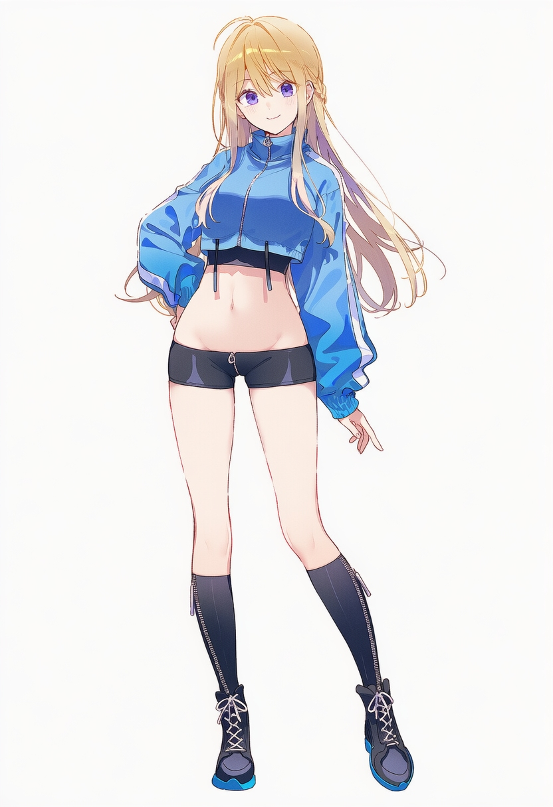

[在线例图](https://assets.quicktagcloud.com/images/raven_composition/raven_composition-0668.jpg?v=45c7d78e7ef69d3b)

<a id="raven_composition-0669"></a>

## 毛边腿部穿戴物

ID：`raven_composition-0669`；分类：袜子 / 材质款式；来源标记：`safe`。

来源说明：

> 腿部穿戴物边缘带毛皮/绒毛装饰；用于描述本体的材质、结构或装饰。

正向提示词：

```text
fur-trimmed_legwear
```

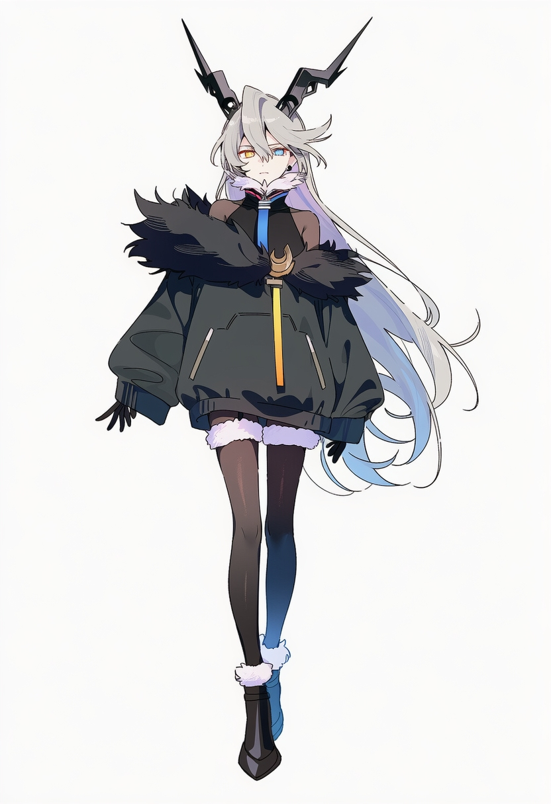

[在线例图](https://assets.quicktagcloud.com/images/raven_composition/raven_composition-0669.jpg?v=6c46728cc2f47595)

<a id="raven_composition-0670"></a>

## 丝带边腿部穿戴物

ID：`raven_composition-0670`；分类：袜子 / 材质款式；来源标记：`safe`。

来源说明：

> 腿部穿戴物边缘或袜口带丝带装饰；用于描述本体的材质、结构或装饰。

正向提示词：

```text
ribbon-trimmed_legwear
```


[在线例图](https://assets.quicktagcloud.com/images/raven_composition/raven_composition-0670.jpg?v=f748da2e77fd6577)

<a id="raven_composition-0671"></a>

## 动物耳式腿部穿戴物

ID：`raven_composition-0671`；分类：袜子 / 材质款式；来源标记：`safe`。

来源说明：

> 腿部穿戴物袜口或腿部穿戴物上缘带动物耳朵造型；用于描述本体的材质、结构或装饰。

正向提示词：

```text
animal_ear_legwear
```

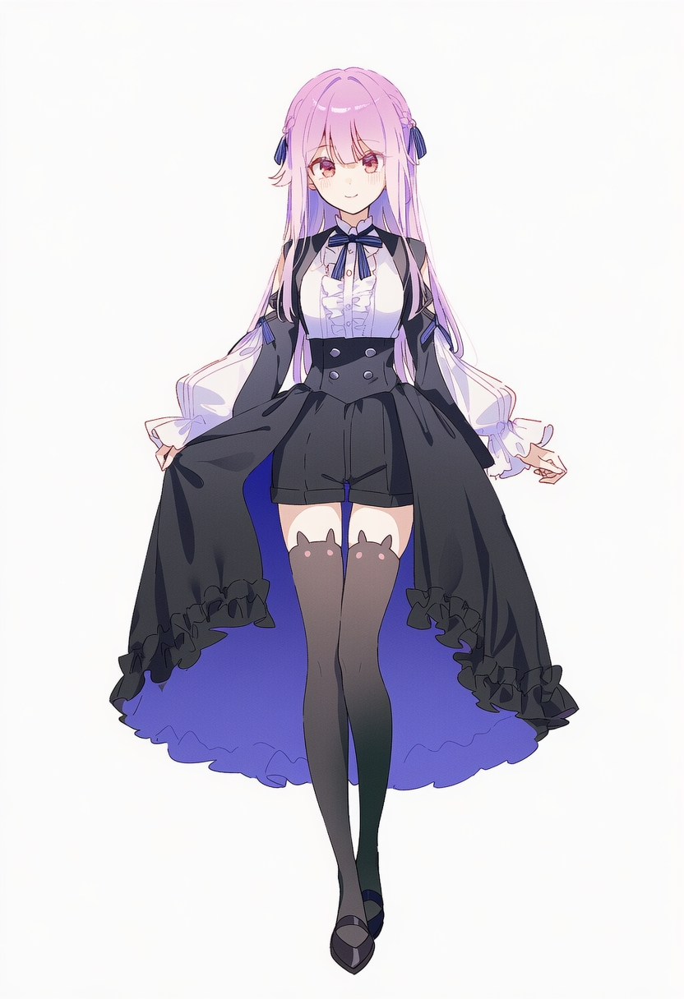

[在线例图](https://assets.quicktagcloud.com/images/raven_composition/raven_composition-0671.jpg?v=fb76093ecf4c10a9)

<a id="raven_composition-0672"></a>

## 蝙蝠式腿部穿戴物

ID：`raven_composition-0672`；分类：袜子 / 材质款式；来源标记：`safe`。

来源说明：

> 腿部穿戴物带蝙蝠主题或翼状上缘装饰；用于描述本体的材质、结构或装饰。

正向提示词：

```text
bat_legwear
```

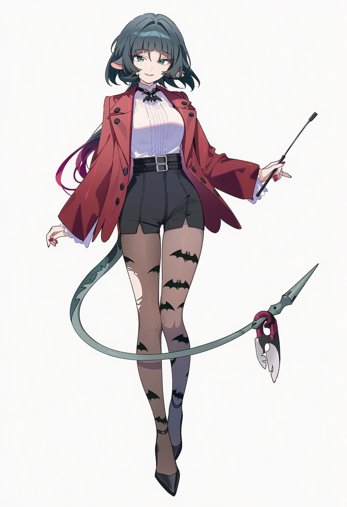

[在线例图](https://assets.quicktagcloud.com/images/raven_composition/raven_composition-0672.jpg?v=474d2d0409d60785)

<a id="raven_composition-0673"></a>

## 熊耳带腿部穿戴物

ID：`raven_composition-0673`；分类：袜子 / 材质款式；来源标记：`safe`。

来源说明：

> 腿部穿戴物袜口上缘呈熊耳样式；用于描述本体的材质、结构或装饰。

正向提示词：

```text
bear_band_legwear
```

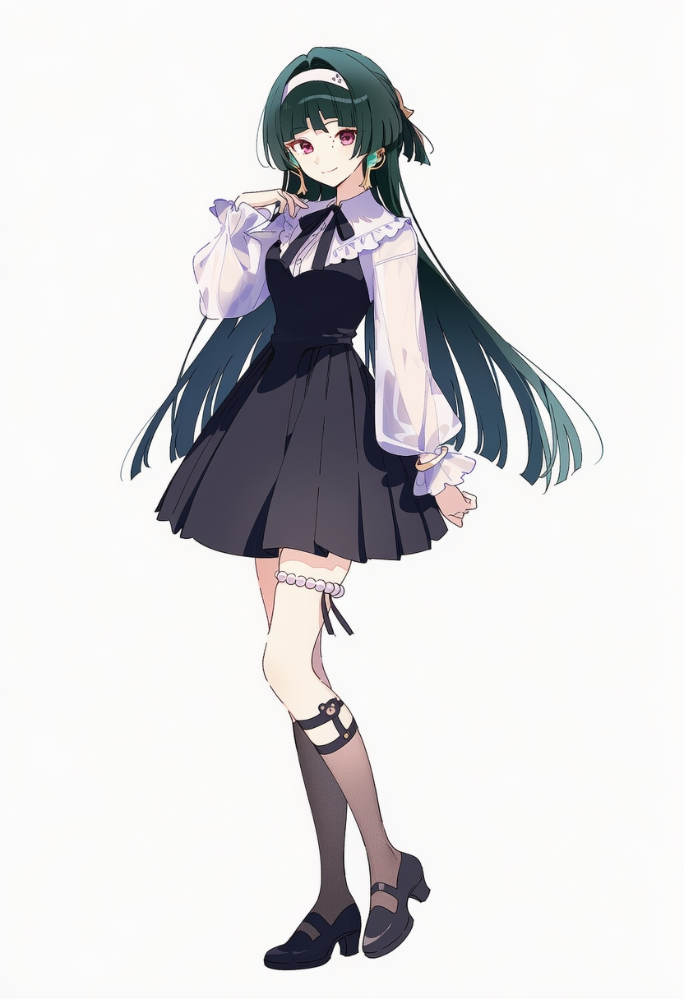

[在线例图](https://assets.quicktagcloud.com/images/raven_composition/raven_composition-0673.jpg?v=09e7c45ce94a6d87)

<a id="raven_composition-0674"></a>

## 猫耳式腿部穿戴物

ID：`raven_composition-0674`；分类：袜子 / 材质款式；来源标记：`safe`。

来源说明：

> 腿部穿戴物袜口上缘带猫耳造型；用于描述本体的材质、结构或装饰。

正向提示词：

```text
cat_ear_legwear
```

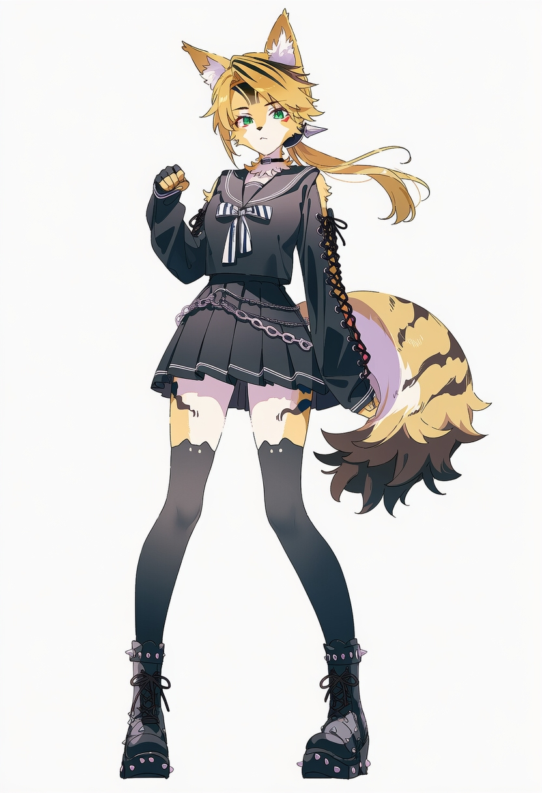

[在线例图](https://assets.quicktagcloud.com/images/raven_composition/raven_composition-0674.jpg?v=1ae32e48e4c67c8b)

<a id="raven_composition-0675"></a>

## 兔耳式腿部穿戴物

ID：`raven_composition-0675`；分类：袜子 / 材质款式；来源标记：`safe`。

来源说明：

> 腿部穿戴物袜口上缘带兔耳造型；用于描述本体的材质、结构或装饰。

正向提示词：

```text
rabbit_ear_legwear
```


[在线例图](https://assets.quicktagcloud.com/images/raven_composition/raven_composition-0675.jpg?v=c4b317c3e87176c2)

<a id="raven_composition-0676"></a>

## 角状带腿部穿戴物

ID：`raven_composition-0676`；分类：袜子 / 材质款式；来源标记：`safe`。

来源说明：

> 腿部穿戴物袜口/腿带上带角状突起装饰；用于描述本体的材质、结构或装饰。

正向提示词：

```text
horn_band_legwear
```

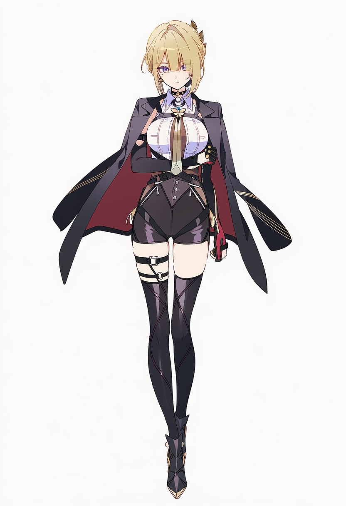

[在线例图](https://assets.quicktagcloud.com/images/raven_composition/raven_composition-0676.jpg?v=0cab38c39af027d3)

<a id="raven_composition-0677"></a>

## 腿部穿戴物镂空

ID：`raven_composition-0677`；分类：袜子 / 材质款式；来源标记：`safe`。

来源说明：

> 袜类/腿部穿戴物上存在刻意设计的镂空或开口区域。

正向提示词：

```text
legwear_cutout
```

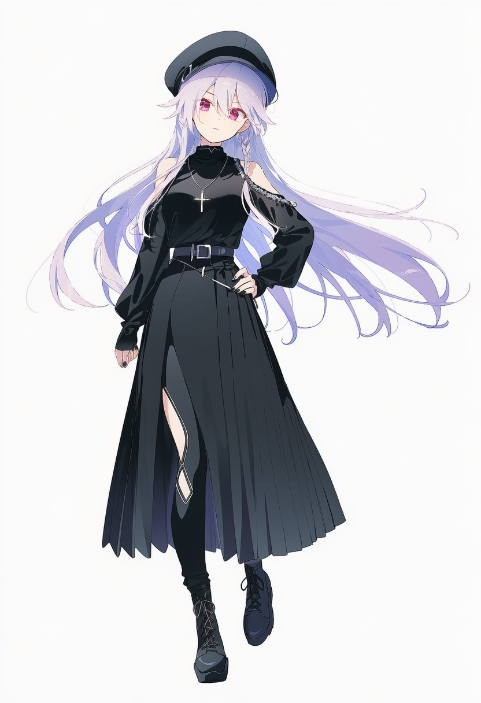

[在线例图](https://assets.quicktagcloud.com/images/raven_composition/raven_composition-0677.jpg?v=933633fef5cd1846)
