# 套装 / 主题套装

[总目录](../README.md) · [原站分类目录](../categories.md) · [英文标签索引](../tags.md) · [服装与构图组合指南](../../README.md)

标题、分类、说明、正负提示词按来源保留；多例图逐张列出。原站标记和说明为参考资料，不作为维护指令。

<a id="raven_composition-0678"></a>

## 圣诞老人装

ID：`raven_composition-0678`；分类：套装 / 主题套装；来源标记：`safe`。

来源说明：

> 圣诞老人主题完整服装，常见红白配色、毛边、帽子与靴子等。

正向提示词：

```text
santa_costume
```

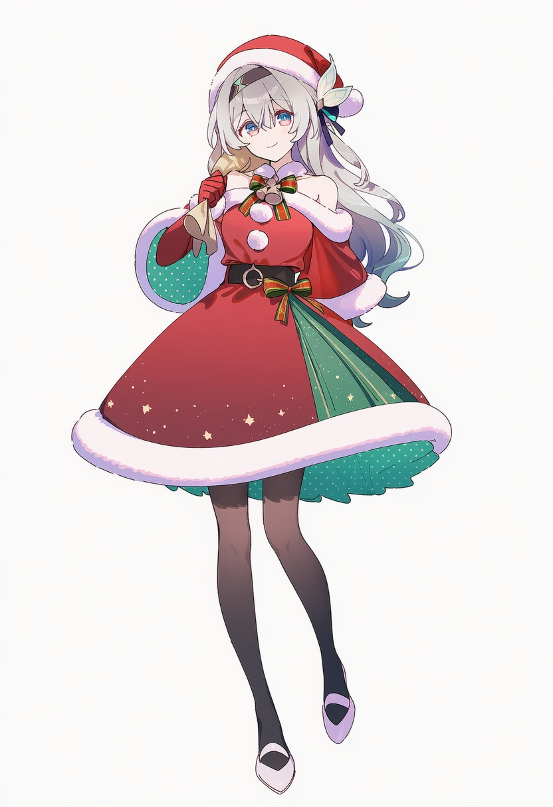

[在线例图](https://assets.quicktagcloud.com/images/raven_composition/raven_composition-0678.jpg?v=f29c1cc10982bcef)

<a id="raven_composition-0679"></a>

## 海盗装

ID：`raven_composition-0679`；分类：套装 / 主题套装；来源标记：`safe`。

来源说明：

> 以经典海盗形象为主题的完整装扮。

正向提示词：

```text
pirate_costume
```

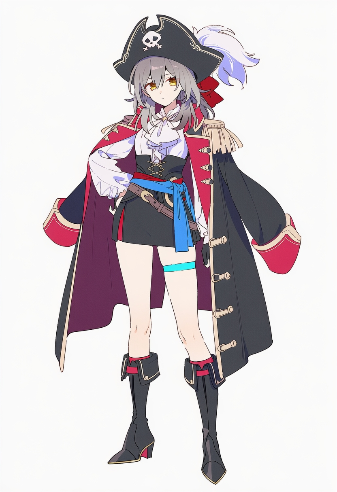

[在线例图](https://assets.quicktagcloud.com/images/raven_composition/raven_composition-0679.jpg?v=d6d971ab2fd1c10d)

<a id="raven_composition-0680"></a>

## 木乃伊装

ID：`raven_composition-0680`；分类：套装 / 主题套装；来源标记：`safe`。

来源说明：

> 以绷带缠绕的木乃伊形象为主题的装扮。

正向提示词：

```text
mummy_costume
```

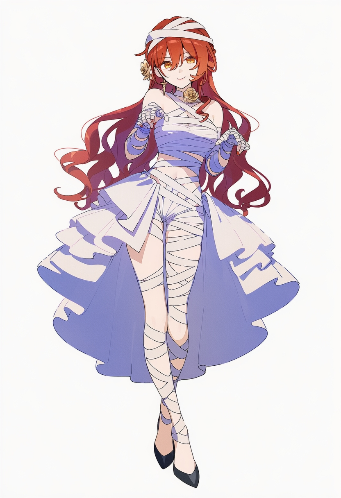

[在线例图](https://assets.quicktagcloud.com/images/raven_composition/raven_composition-0680.jpg?v=5d6ccafd80b94ebe)

<a id="raven_composition-0681"></a>

## 幽灵装

ID：`raven_composition-0681`；分类：套装 / 主题套装；来源标记：`safe`。

来源说明：

> 以幽灵形象为主题的完整装扮。

正向提示词：

```text
ghost_costume
```

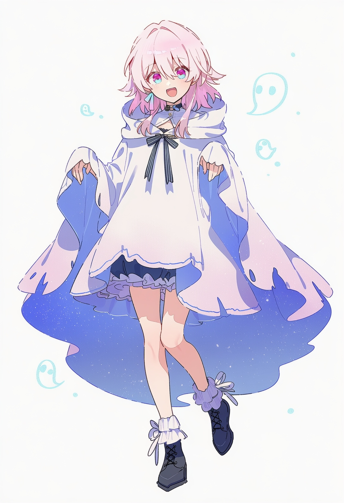

[在线例图](https://assets.quicktagcloud.com/images/raven_composition/raven_composition-0681.jpg?v=a71fe5889afd46f8)

<a id="raven_composition-0682"></a>

## 连体角色服

ID：`raven_composition-0682`；分类：套装 / 主题套装；来源标记：`safe`。

来源说明：

> 包覆全身或大部分身体的动物、角色布偶式服装。

正向提示词：

```text
kigurumi
```

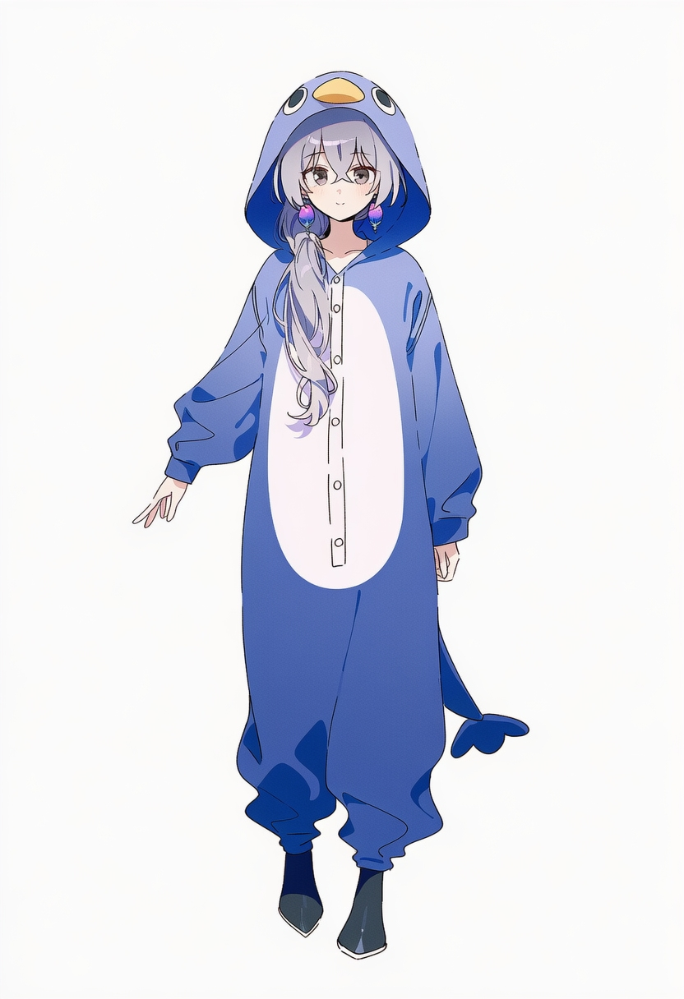

[在线例图](https://assets.quicktagcloud.com/images/raven_composition/raven_composition-0682.jpg?v=96f7d2f8ed1815a5)

<a id="raven_composition-0683"></a>

## 驯鹿装

ID：`raven_composition-0683`；分类：套装 / 主题套装；来源标记：`safe`。

来源说明：

> 以驯鹿形象为主题的完整装扮。

正向提示词：

```text
reindeer_costume
```

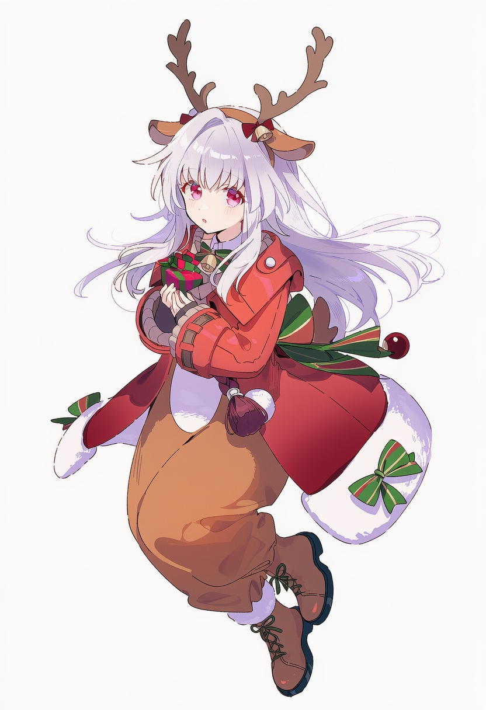

[在线例图](https://assets.quicktagcloud.com/images/raven_composition/raven_composition-0683.jpg?v=5f35611b139f5b66)

<a id="raven_composition-0684"></a>

## 吸血鬼装

ID：`raven_composition-0684`；分类：套装 / 主题套装；来源标记：`safe`。

来源说明：

> 以经典吸血鬼形象为主题的完整装扮。

正向提示词：

```text
vampire_costume
```

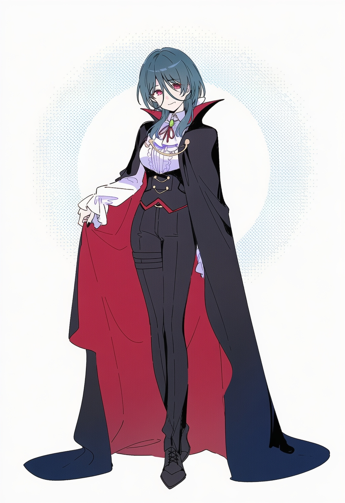

[在线例图](https://assets.quicktagcloud.com/images/raven_composition/raven_composition-0684.jpg?v=fdf81a498a346790)

<a id="raven_composition-0685"></a>

## 鲨鱼套装

ID：`raven_composition-0685`；分类：套装 / 主题套装；来源标记：`safe`。

来源说明：

> 以鲨鱼外形为主题的完整角色服装。

正向提示词：

```text
shark_costume
```

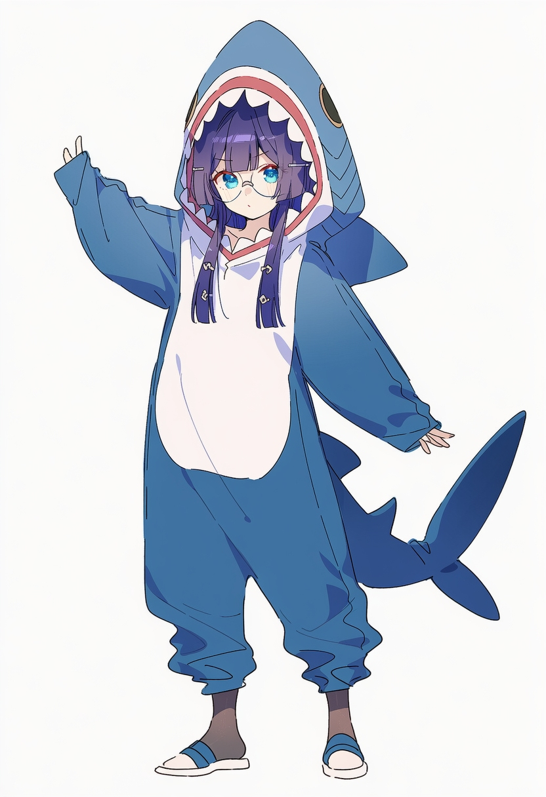

[在线例图](https://assets.quicktagcloud.com/images/raven_composition/raven_composition-0685.jpg?v=26ba66b4edaede4f)

<a id="raven_composition-0686"></a>

## 熊套装

ID：`raven_composition-0686`；分类：套装 / 主题套装；来源标记：`safe`。

来源说明：

> 以熊外形为主题的完整角色服装。

正向提示词：

```text
bear_costume
```

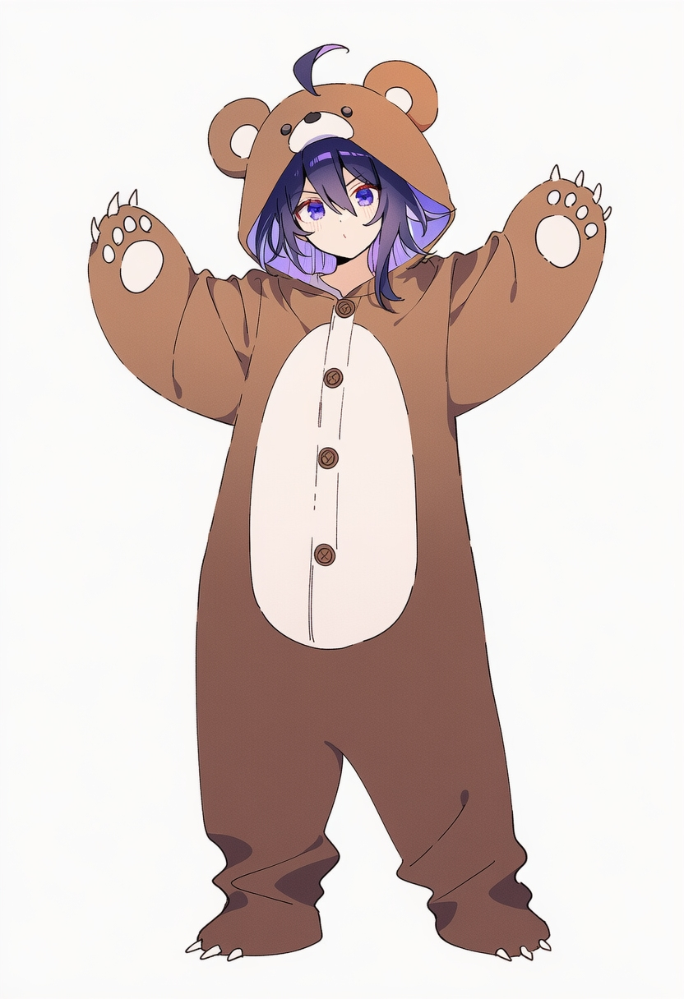

[在线例图](https://assets.quicktagcloud.com/images/raven_composition/raven_composition-0686.jpg?v=4f8f485756d5fdfb)

<a id="raven_composition-0687"></a>

## 猫套装

ID：`raven_composition-0687`；分类：套装 / 主题套装；来源标记：`safe`。

来源说明：

> 以猫外形为主题的完整角色服装。

正向提示词：

```text
cat_costume
```

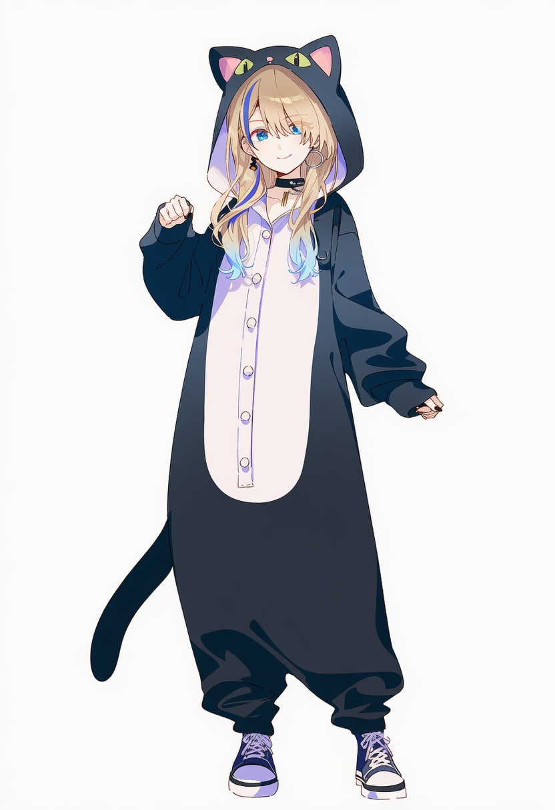

[在线例图](https://assets.quicktagcloud.com/images/raven_composition/raven_composition-0687.jpg?v=87d8f7c3f17775fe)

<a id="raven_composition-0688"></a>

## 狼套装

ID：`raven_composition-0688`；分类：套装 / 主题套装；来源标记：`safe`。

来源说明：

> 以狼外形为主题的完整角色服装。

正向提示词：

```text
wolf_costume
```

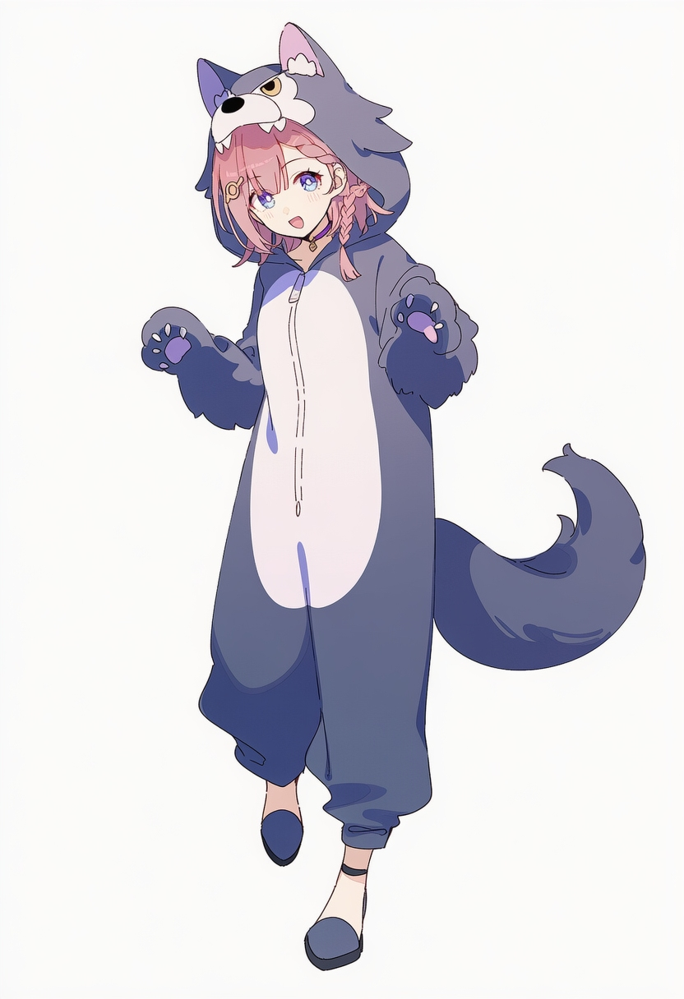

[在线例图](https://assets.quicktagcloud.com/images/raven_composition/raven_composition-0688.jpg?v=396aca2b3acfe388)

<a id="raven_composition-0689"></a>

## 企鹅套装

ID：`raven_composition-0689`；分类：套装 / 主题套装；来源标记：`safe`。

来源说明：

> 以企鹅外形为主题的完整角色服装。

正向提示词：

```text
penguin_costume
```

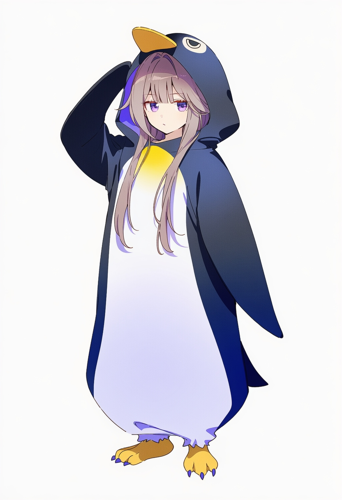

[在线例图](https://assets.quicktagcloud.com/images/raven_composition/raven_composition-0689.jpg?v=4787e97e69f5012c)

<a id="raven_composition-0690"></a>

## 兔子套装

ID：`raven_composition-0690`；分类：套装 / 主题套装；来源标记：`safe`。

来源说明：

> 以兔子外形为主题的完整角色服装。

正向提示词：

```text
rabbit_costume
```

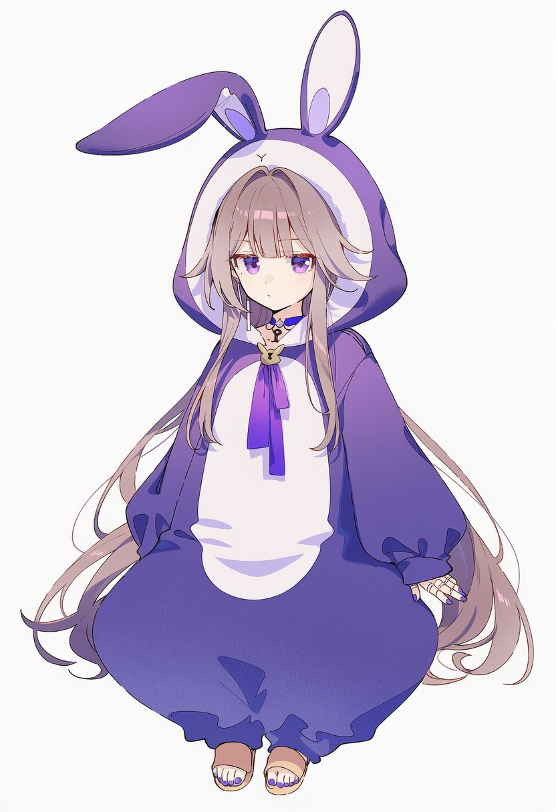

[在线例图](https://assets.quicktagcloud.com/images/raven_composition/raven_composition-0690.jpg?v=bf8b7fd74d3fbf6f)

<a id="raven_composition-0691"></a>

## 奶牛套装

ID：`raven_composition-0691`；分类：套装 / 主题套装；来源标记：`safe`。

来源说明：

> 以奶牛外形为主题的完整角色服装。

正向提示词：

```text
cow_costume
```

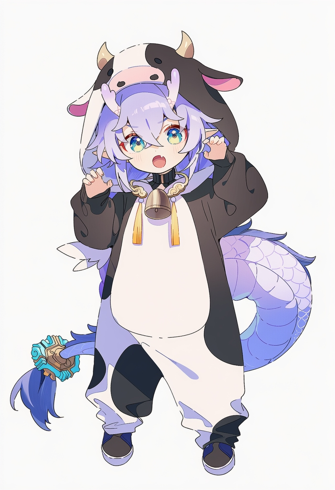

[在线例图](https://assets.quicktagcloud.com/images/raven_composition/raven_composition-0691.jpg?v=4fc3204b28c29654)

<a id="raven_composition-0692"></a>

## 绵羊套装

ID：`raven_composition-0692`；分类：套装 / 主题套装；来源标记：`safe`。

来源说明：

> 以绵羊外形为主题的完整角色服装。

正向提示词：

```text
sheep_costume
```

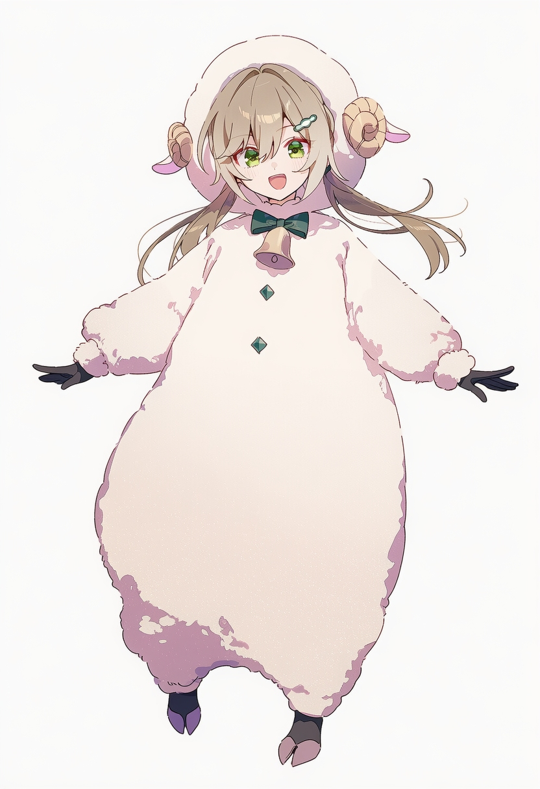

[在线例图](https://assets.quicktagcloud.com/images/raven_composition/raven_composition-0692.jpg?v=3a432094088a96e0)

<a id="raven_composition-0693"></a>

## 老虎套装

ID：`raven_composition-0693`；分类：套装 / 主题套装；来源标记：`safe`。

来源说明：

> 以老虎外形为主题的完整角色服装。

正向提示词：

```text
tiger_costume
```

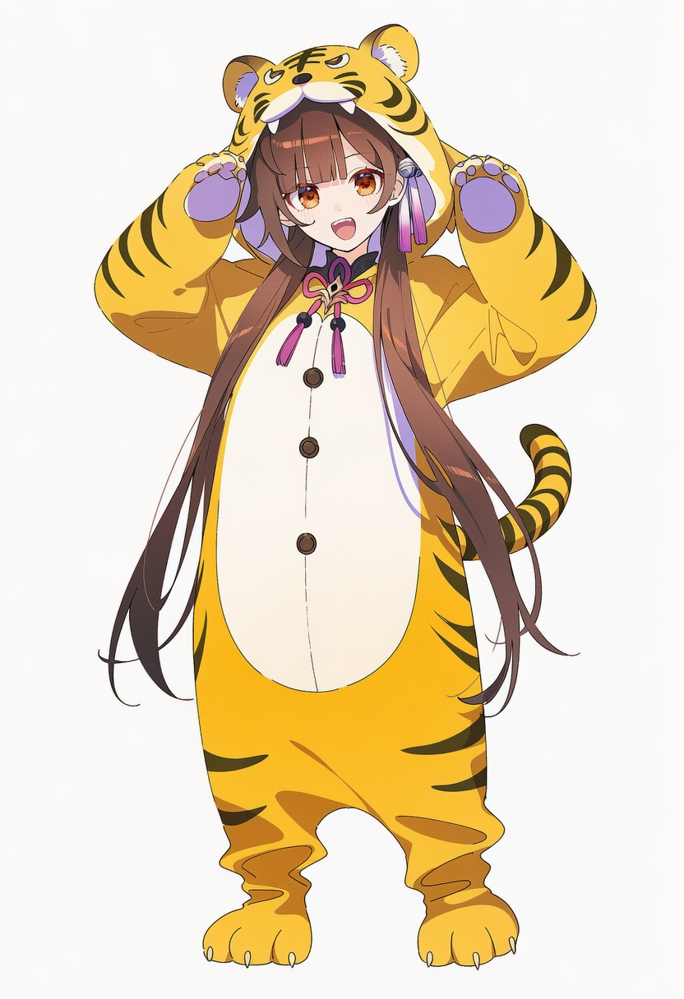

[在线例图](https://assets.quicktagcloud.com/images/raven_composition/raven_composition-0693.jpg?v=e7280294be3a4ca5)

<a id="raven_composition-0694"></a>

## 狗狗套装

ID：`raven_composition-0694`；分类：套装 / 主题套装；来源标记：`safe`。

来源说明：

> 以狗狗外形为主题的完整角色服装。

正向提示词：

```text
dog_costume
```

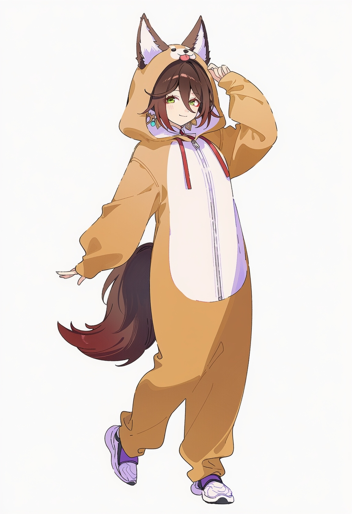

[在线例图](https://assets.quicktagcloud.com/images/raven_composition/raven_composition-0694.jpg?v=e72cf21954799f8e)

<a id="raven_composition-0695"></a>

## 熊猫套装

ID：`raven_composition-0695`；分类：套装 / 主题套装；来源标记：`safe`。

来源说明：

> 以熊猫外形为主题的完整角色服装。

正向提示词：

```text
panda_costume
```

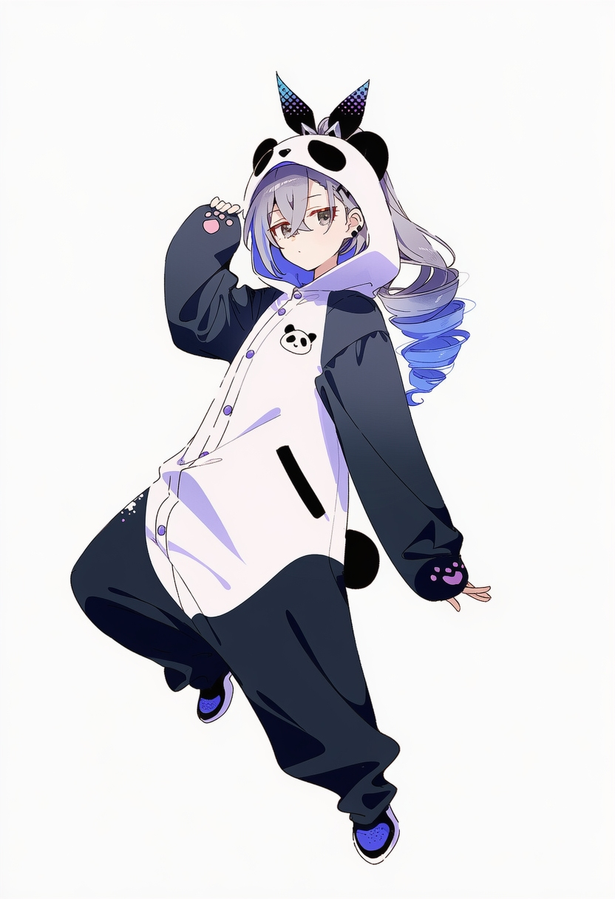

[在线例图](https://assets.quicktagcloud.com/images/raven_composition/raven_composition-0695.jpg?v=efbfcee89e43829a)
