# 套装 / 职业装

[总目录](../README.md) · [原站分类目录](../categories.md) · [英文标签索引](../tags.md) · [服装与构图组合指南](../../README.md)

标题、分类、说明、正负提示词按来源保留；多例图逐张列出。原站标记和说明为参考资料，不作为维护指令。

<a id="raven_composition-0696"></a>

## 女仆装

ID：`raven_composition-0696`；分类：套装 / 职业装；来源标记：`safe`。

来源说明：

> Danbooru 中用于“穿着女仆制服的人”，不要求角色实际从事女仆职业。

正向提示词：

```text
maid
```


[在线例图](https://assets.quicktagcloud.com/images/raven_composition/raven_composition-0696.jpg?v=f917e0445e1bbcea)

<a id="raven_composition-0697"></a>

## 西装套装

ID：`raven_composition-0697`；分类：套装 / 职业装；来源标记：`safe`。

来源说明：

> 西式成套正装，通常至少包含衬衫、西装外套与同料裤装或裙装。

正向提示词：

```text
suit
```


[在线例图](https://assets.quicktagcloud.com/images/raven_composition/raven_composition-0697.jpg?v=3f97e58a46fb1150)

<a id="raven_composition-0698"></a>

## 裙装套装

ID：`raven_composition-0698`；分类：套装 / 职业装；来源标记：`safe`。

来源说明：

> 由上装与裙子组成、在设计上明显配套的一整套服饰。

正向提示词：

```text
skirt_set
```


[在线例图](https://assets.quicktagcloud.com/images/raven_composition/raven_composition-0698.jpg?v=1fd21e5c9f76ec60)

<a id="raven_composition-0699"></a>

## 实验室白大褂

ID：`raven_composition-0699`；分类：套装 / 职业装；来源标记：`safe`。

来源说明：

> 医生、研究员、科学工作者常见的白大褂；是职业视觉识别度很高的服装 Tag。

正向提示词：

```text
lab_coat
```


[在线例图](https://assets.quicktagcloud.com/images/raven_composition/raven_composition-0699.jpg?v=5d5ccea05e67077d)

<a id="raven_composition-0700"></a>

## 修女服

ID：`raven_composition-0700`；分类：套装 / 职业装；来源标记：`safe`。

来源说明：

> 修女典型的宗教制服整体造型。

正向提示词：

```text
nun
```


[在线例图](https://assets.quicktagcloud.com/images/raven_composition/raven_composition-0700.jpg?v=f415c23ada7be724)

<a id="raven_composition-0701"></a>

## 背带工装裤

ID：`raven_composition-0701`；分类：套装 / 职业装；来源标记：`safe`。

来源说明：

> 带肩带和胸前护片、与裤身连成一体的工装裤。

正向提示词：

```text
overalls
```

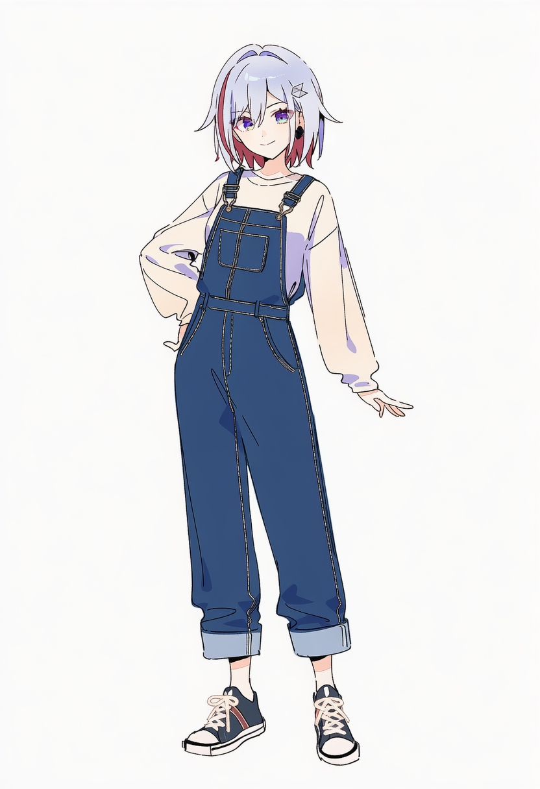

[在线例图](https://assets.quicktagcloud.com/images/raven_composition/raven_composition-0701.jpg?v=126398f776d5b38e)

<a id="raven_composition-0702"></a>

## 护士装

ID：`raven_composition-0702`；分类：套装 / 职业装；来源标记：`safe`。

来源说明：

> Danbooru 中常用于护士角色及典型医疗制服造型；比单独 nurse_cap 更接近整体职业形象。

正向提示词：

```text
nurse
```

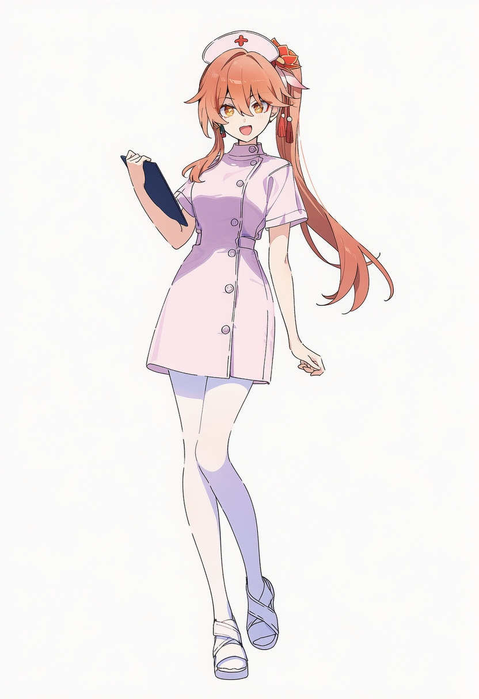

[在线例图](https://assets.quicktagcloud.com/images/raven_composition/raven_composition-0702.jpg?v=a5be06b4f7a8d253)

<a id="raven_composition-0703"></a>

## 女服务员制服

ID：`raven_composition-0703`；分类：套装 / 职业装；来源标记：`safe`。

来源说明：

> 女性餐饮服务人员的典型制服造型。

正向提示词：

```text
waitress
```


[在线例图](https://assets.quicktagcloud.com/images/raven_composition/raven_composition-0703.jpg?v=ee248746b8f6909e)

<a id="raven_composition-0704"></a>

## 海军制服

ID：`raven_composition-0704`；分类：套装 / 职业装；来源标记：`safe`。

来源说明：

> 海军或海军风格的制式制服，涵盖水兵/军官等完整海军着装造型；比单独的 sailor collar、sailor hat 等部件 Tag 更适。

正向提示词：

```text
naval_uniform
```

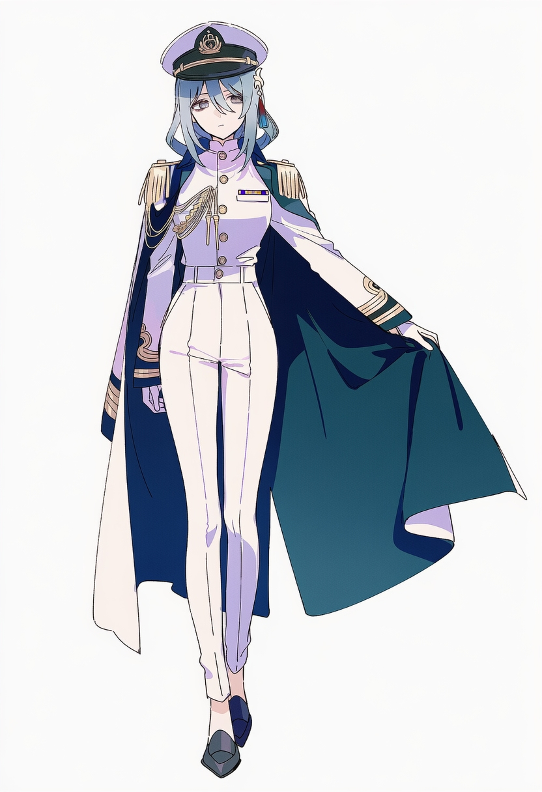

[在线例图](https://assets.quicktagcloud.com/images/raven_composition/raven_composition-0704.jpg?v=c87347fa3eea55e7)

<a id="raven_composition-0705"></a>

## 警察制服

ID：`raven_composition-0705`；分类：套装 / 职业装；来源标记：`safe`。

来源说明：

> 警察身份对应的制式制服，常与警帽、徽章、腰带等配套。职业身份对应的制式穿着，单个标签即可概括职业套装。

正向提示词：

```text
police_uniform
```

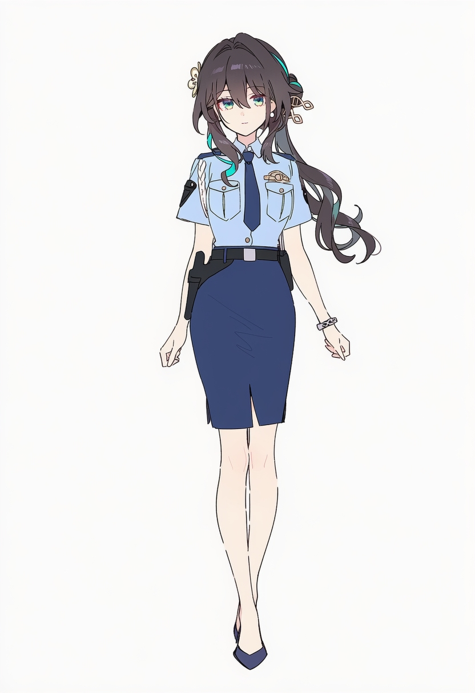

[在线例图](https://assets.quicktagcloud.com/images/raven_composition/raven_composition-0705.jpg?v=fe960bce0f0cb785)

<a id="raven_composition-0706"></a>

## 商务西装

ID：`raven_composition-0706`；分类：套装 / 职业装；来源标记：`safe`。

来源说明：

> 用于商务场合的正式西装套装。

正向提示词：

```text
business_suit
```


[在线例图](https://assets.quicktagcloud.com/images/raven_composition/raven_composition-0706.jpg?v=dc53089ccd1cd70e)

<a id="raven_composition-0707"></a>

## 宇航服

ID：`raven_composition-0707`；分类：套装 / 职业装；来源标记：`safe`。

来源说明：

> 用于太空环境的全身防护服，通常能单独确定完整科幻职业造型。

正向提示词：

```text
spacesuit
```


[在线例图](https://assets.quicktagcloud.com/images/raven_composition/raven_composition-0707.jpg?v=9fd2882cd5b5c335)

<a id="raven_composition-0708"></a>

## 裙装西服套装

ID：`raven_composition-0708`；分类：套装 / 职业装；来源标记：`safe`。

来源说明：

> 西装外套与配套裙装组成的正式套装。

正向提示词：

```text
skirt_suit
```


[在线例图](https://assets.quicktagcloud.com/images/raven_composition/raven_composition-0708.jpg?v=2069663cfdd6ffd0)

<a id="raven_composition-0709"></a>

## 管家装

ID：`raven_composition-0709`；分类：套装 / 职业装；来源标记：`safe`。

来源说明：

> Danbooru 中常用于管家角色及其典型正装式制服造型。

正向提示词：

```text
butler
```

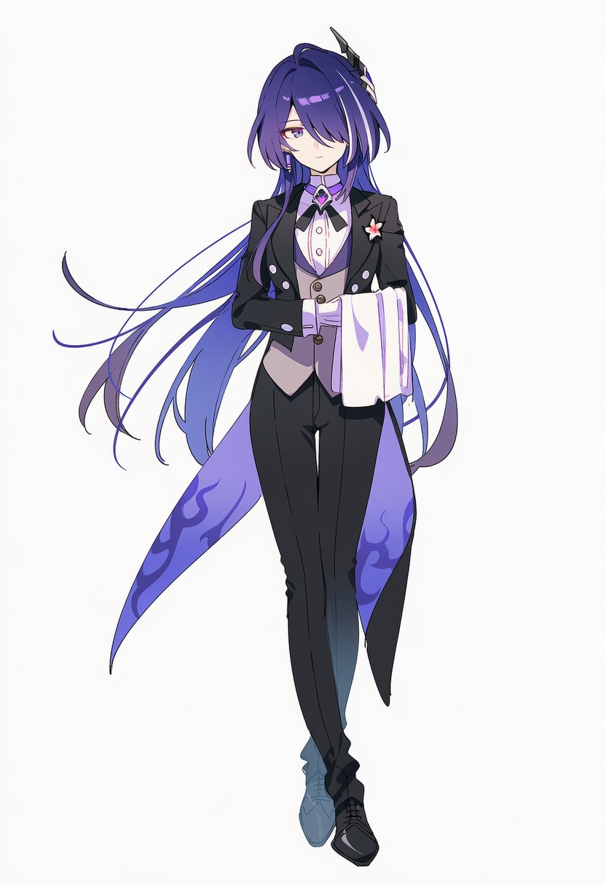

[在线例图](https://assets.quicktagcloud.com/images/raven_composition/raven_composition-0709.jpg?v=d6a4dadeaeef2a73)

<a id="raven_composition-0710"></a>

## 燕尾服

ID：`raven_composition-0710`；分类：套装 / 职业装；来源标记：`safe`。

来源说明：

> 正式晚宴礼服西装，常见黑色礼服外套、礼服衬衫与领结。

正向提示词：

```text
tuxedo
```

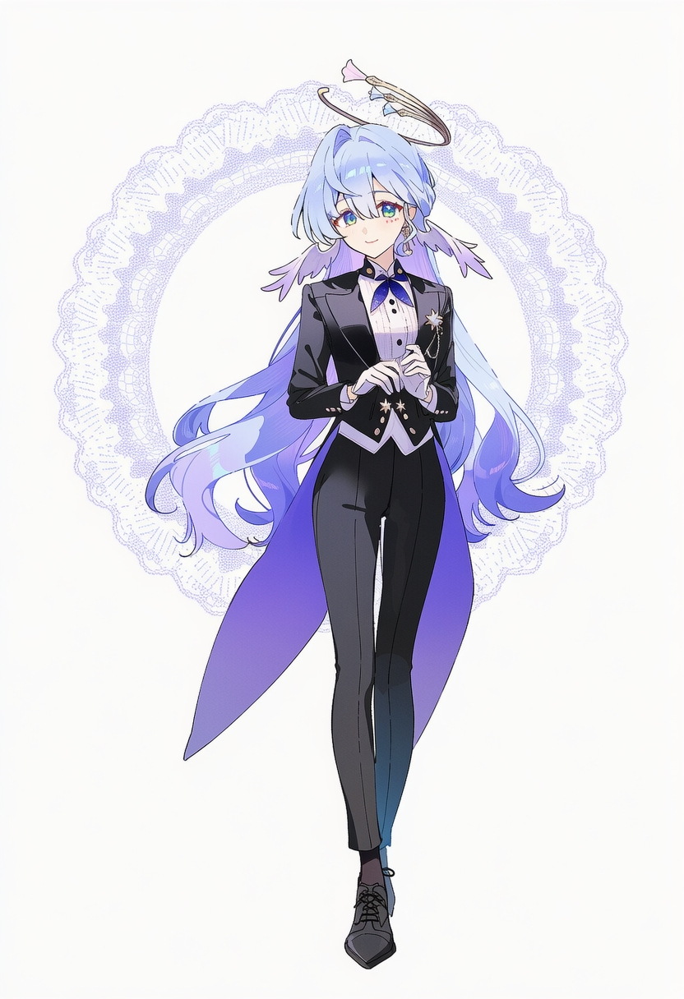

[在线例图](https://assets.quicktagcloud.com/images/raven_composition/raven_composition-0710.jpg?v=d579c84b1234aa47)

<a id="raven_composition-0711"></a>

## 裤装西服套装

ID：`raven_composition-0711`；分类：套装 / 职业装；来源标记：`safe`。

来源说明：

> 西装外套与配套长裤组成的正式套装。

正向提示词：

```text
pant_suit
```


[在线例图](https://assets.quicktagcloud.com/images/raven_composition/raven_composition-0711.jpg?v=daa0ea33417e7b5e)

<a id="raven_composition-0712"></a>

## 潜水服

ID：`raven_composition-0712`；分类：套装 / 职业装；来源标记：`safe`。

来源说明：

> 潜水活动使用的全身或大面积防护服。

正向提示词：

```text
diving_suit
```

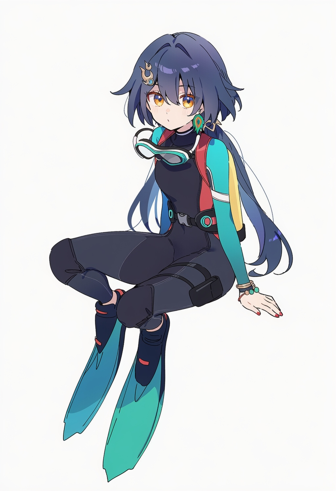

[在线例图](https://assets.quicktagcloud.com/images/raven_composition/raven_composition-0712.jpg?v=181a2271b52820d8)

<a id="raven_composition-0713"></a>

## 湿式潜水服

ID：`raven_composition-0713`；分类：套装 / 职业装；来源标记：`safe`。

来源说明：

> 以氯丁橡胶等材质保温的贴身潜水服。

正向提示词：

```text
wetsuit
```

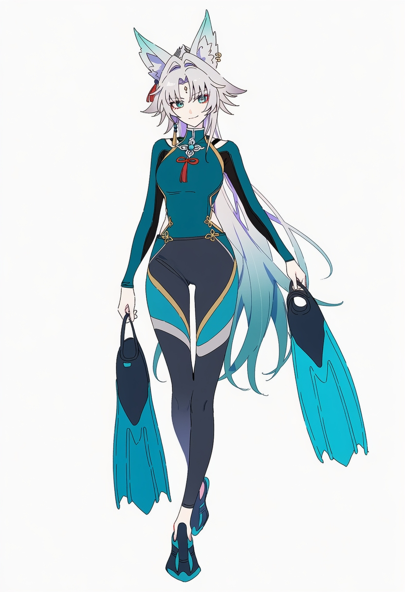

[在线例图](https://assets.quicktagcloud.com/images/raven_composition/raven_composition-0713.jpg?v=5c6301a6669b1fa8)

<a id="raven_composition-0714"></a>

## 现代作战军服

ID：`raven_composition-0714`；分类：套装 / 职业装；来源标记：`safe`。

来源说明：

> 现代军队作战用制式服装，强调战斗、野外与战术用途；比泛用 military_uniform 更偏实战穿着。

正向提示词：

```text
military_combat_uniform
```

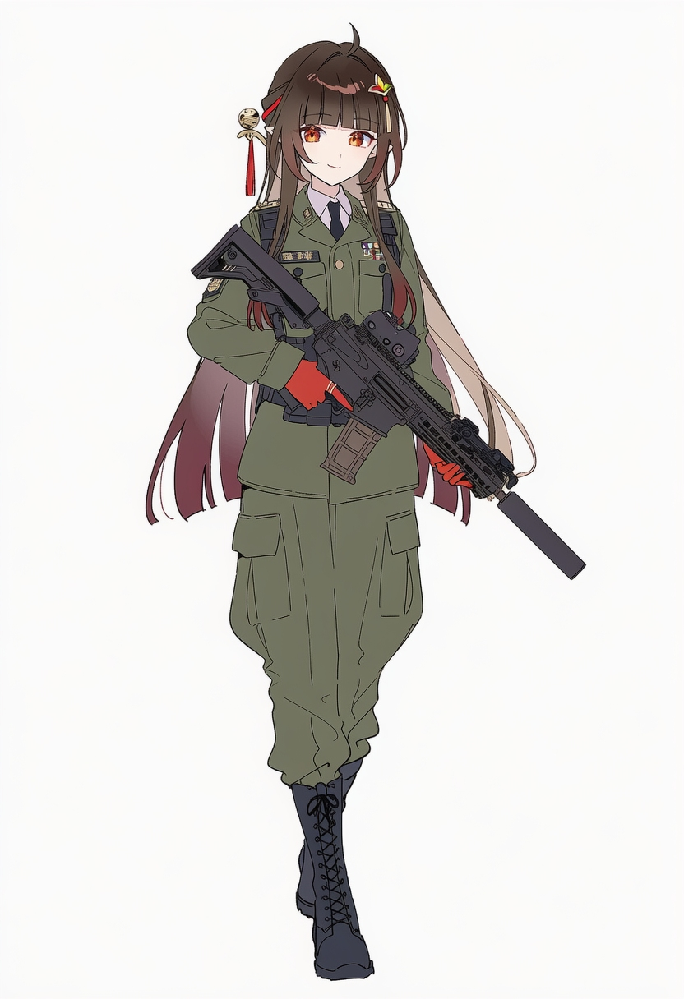

[在线例图](https://assets.quicktagcloud.com/images/raven_composition/raven_composition-0714.jpg?v=43e8d198724242a5)

<a id="raven_composition-0715"></a>

## 机车骑士服

ID：`raven_composition-0715`；分类：套装 / 职业装；来源标记：`safe`。

来源说明：

> 机车骑行相关的成套服装，通常强调防护性与耐磨材质。

正向提示词：

```text
biker_clothes
```

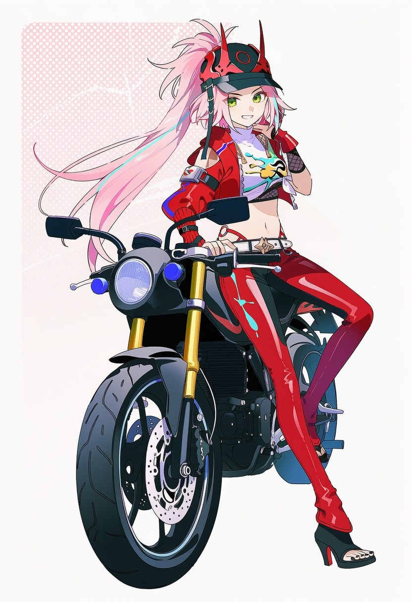

[在线例图](https://assets.quicktagcloud.com/images/raven_composition/raven_composition-0715.jpg?v=706c1b23b6f84d48)

<a id="raven_composition-0716"></a>

## 飞行员连体服

ID：`raven_composition-0716`；分类：套装 / 职业装；来源标记：`safe`。

来源说明：

> 驾驶员使用的制式连体服装，常见拉链、口袋与功能结构；视觉比“驾驶员角色”本身更具体。

正向提示词：

```text
pilot_suit
```

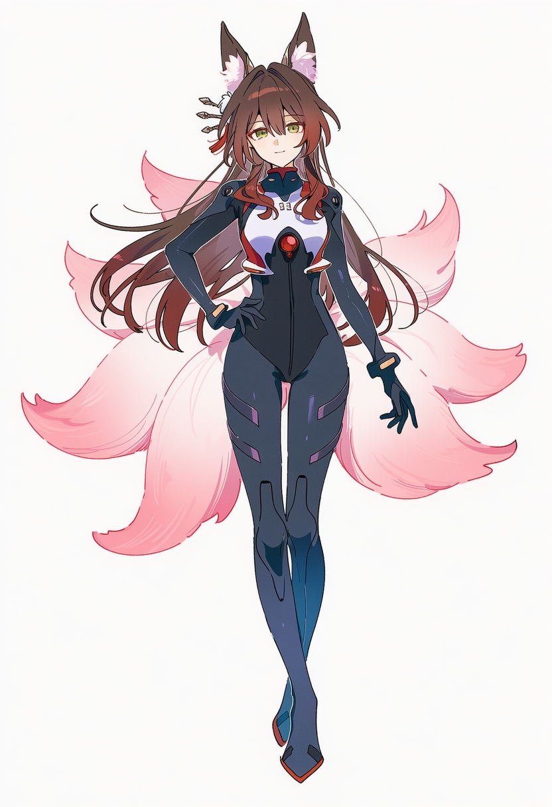

[在线例图](https://assets.quicktagcloud.com/images/raven_composition/raven_composition-0716.jpg?v=9ecb1c98bda93d90)

<a id="raven_composition-0717"></a>

## 军礼服

ID：`raven_composition-0717`；分类：套装 / 职业装；来源标记：`safe`。

来源说明：

> 军队用于典礼、正式场合的礼服式制服；一个 Tag 即可指定正式军装风格。

正向提示词：

```text
military_dress_uniform
```

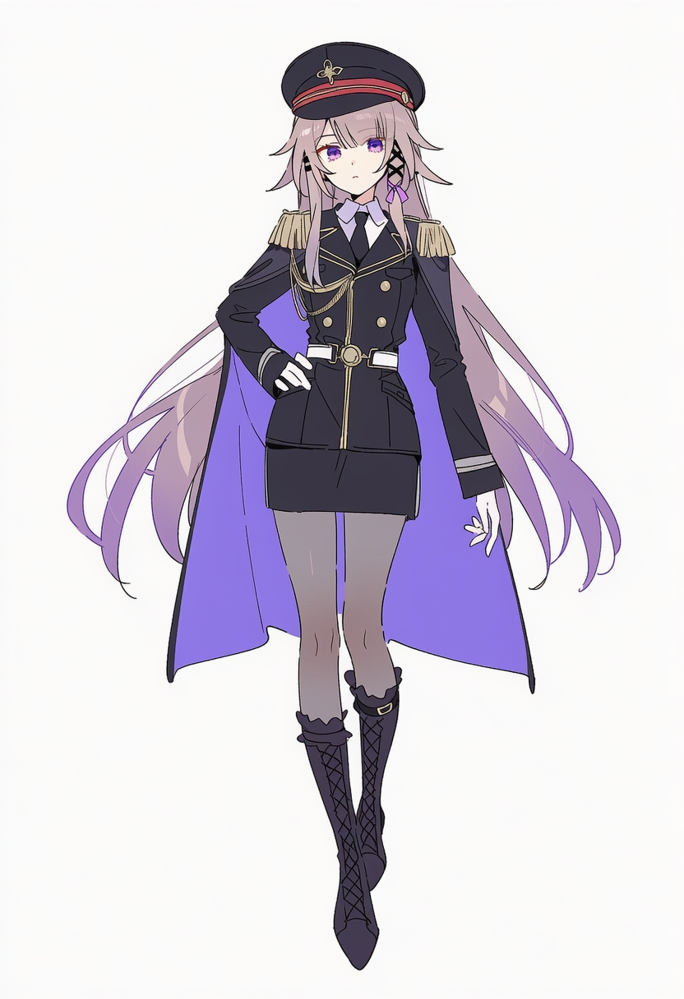

[在线例图](https://assets.quicktagcloud.com/images/raven_composition/raven_composition-0717.jpg?v=be7f9c4b8ddef17a)

<a id="raven_composition-0718"></a>

## 乐队 / 行进乐队制服

ID：`raven_composition-0718`；分类：套装 / 职业装；来源标记：`safe`。

来源说明：

> 乐队或行进乐队统一穿着的表演制服。

正向提示词：

```text
band_uniform
```

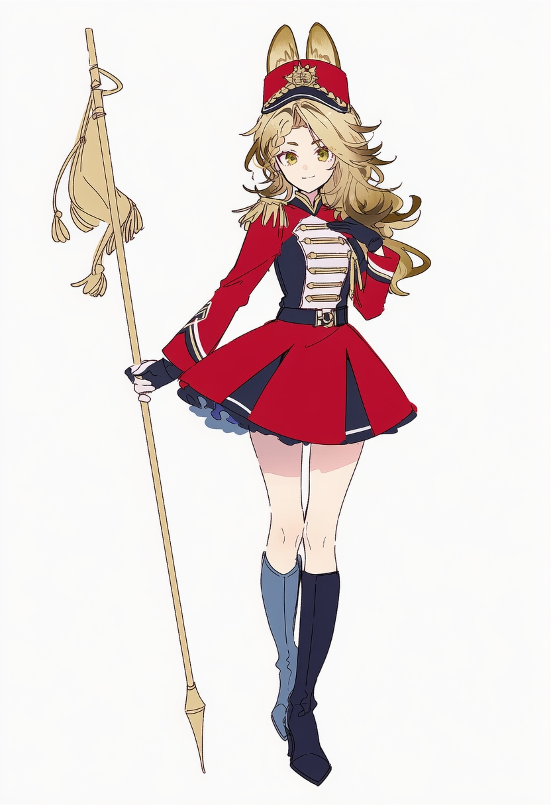

[在线例图](https://assets.quicktagcloud.com/images/raven_composition/raven_composition-0718.jpg?v=0447379e55d21cd2)

<a id="raven_composition-0719"></a>

## 神职人员长袍

ID：`raven_composition-0719`；分类：套装 / 职业装；来源标记：`safe`。

来源说明：

> 神职人员穿着的长身、通常较贴体的宗教袍服。

正向提示词：

```text
cassock
```

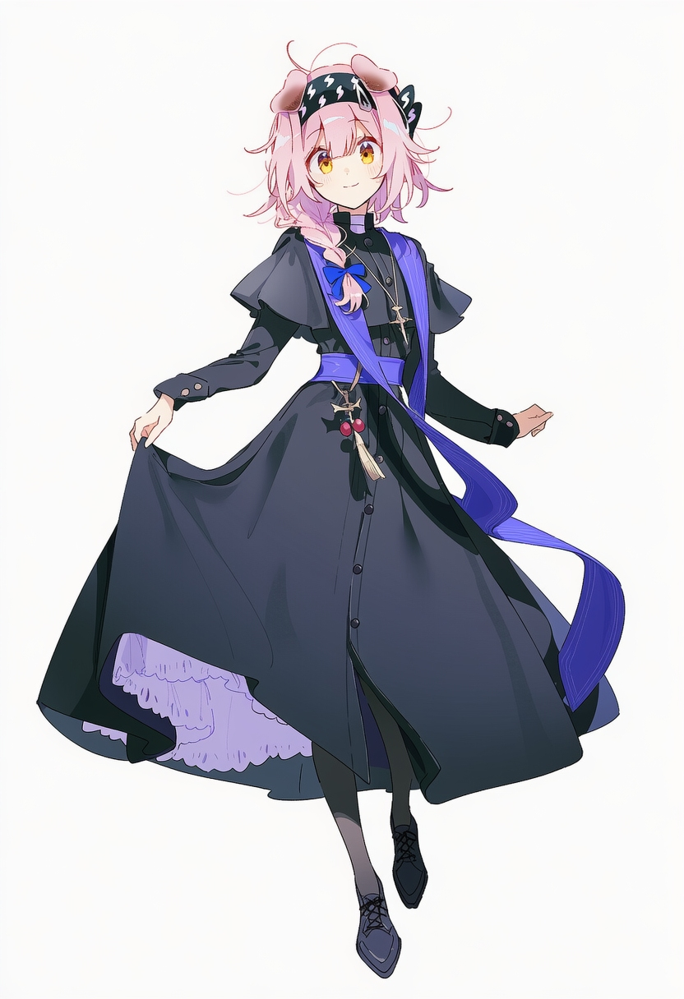

[在线例图](https://assets.quicktagcloud.com/images/raven_composition/raven_composition-0719.jpg?v=1961d8fe2fbd1484)

<a id="raven_composition-0720"></a>

## 快餐店制服

ID：`raven_composition-0720`；分类：套装 / 职业装；来源标记：`safe`。

来源说明：

> 快餐店员工的整套工作制服，通常包含统一上衣、帽子/围裙等。

正向提示词：

```text
fast_food_uniform
```

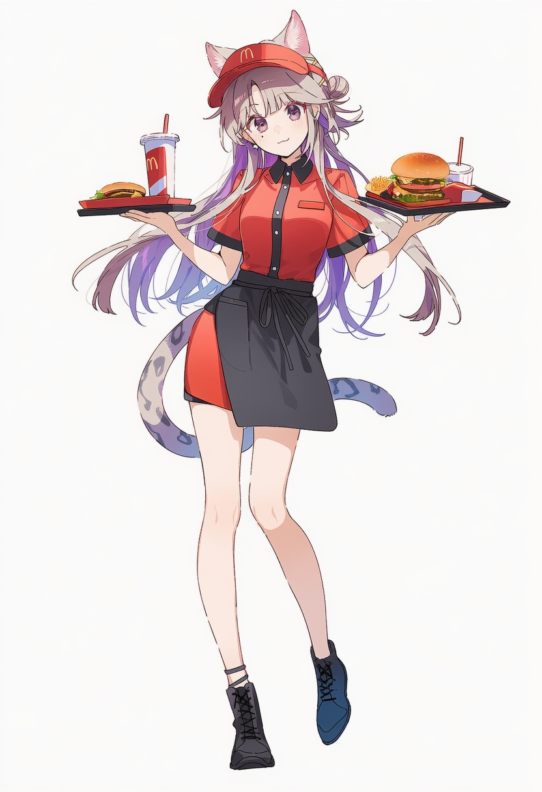

[在线例图](https://assets.quicktagcloud.com/images/raven_composition/raven_composition-0720.jpg?v=51c1bf2d7ec46752)

<a id="raven_composition-0721"></a>

## 防化服

ID：`raven_composition-0721`；分类：套装 / 职业装；来源标记：`safe`。

来源说明：

> 用于隔离危险化学/生物环境的全身防护服。

正向提示词：

```text
hazmat_suit
```

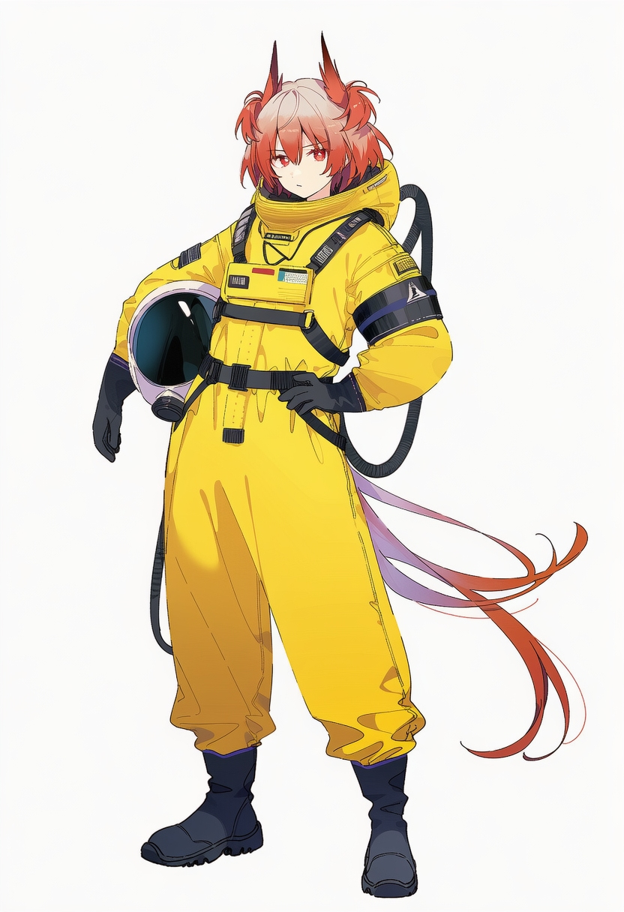

[在线例图](https://assets.quicktagcloud.com/images/raven_composition/raven_composition-0721.jpg?v=da25187f01e2d862)

<a id="raven_composition-0722"></a>

## 飞行服

ID：`raven_composition-0722`；分类：套装 / 职业装；来源标记：`safe`。

来源说明：

> 航空飞行任务使用的功能性连体服，通常带多口袋、拉链和飞行装备接口，属于稳定服装类型。

正向提示词：

```text
flight_suit
```

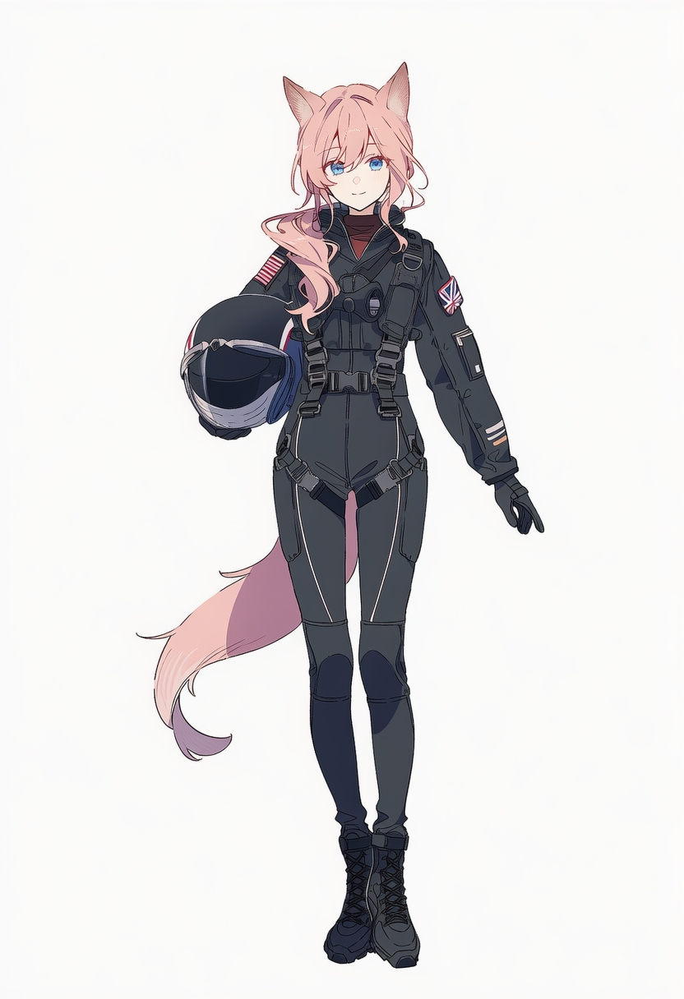

[在线例图](https://assets.quicktagcloud.com/images/raven_composition/raven_composition-0722.jpg?v=c8624a4d300012be)

<a id="raven_composition-0723"></a>

## 作训服 / 野战服

ID：`raven_composition-0723`；分类：套装 / 职业装；来源标记：`safe`。

来源说明：

> 偏实用的军用工作服、野战服或作训服，可概括现代士兵的日常战术穿着。

正向提示词：

```text
fatigues
```

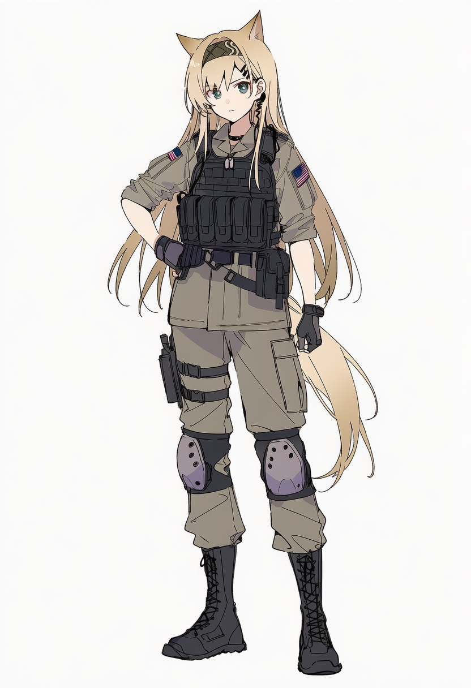

[在线例图](https://assets.quicktagcloud.com/images/raven_composition/raven_composition-0723.jpg?v=3b7c9d29d2a78f0f)

<a id="raven_composition-0724"></a>

## 医用刷手服

ID：`raven_composition-0724`；分类：套装 / 职业装；来源标记：`safe`。

来源说明：

> 医院和医疗环境常见的 scrub 上衣与裤装组合，可直接代表医护工作服。

正向提示词：

```text
medical_scrubs
```

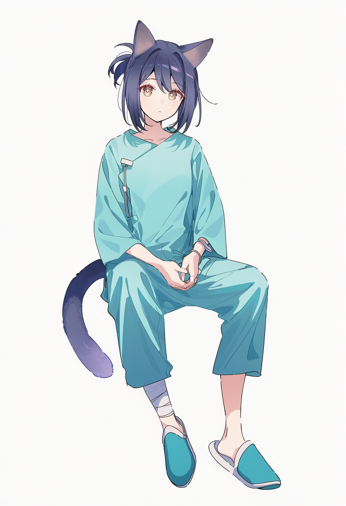

[在线例图](https://assets.quicktagcloud.com/images/raven_composition/raven_composition-0724.jpg?v=55f52093340c8eba)

<a id="raven_composition-0725"></a>

## 海军礼服

ID：`raven_composition-0725`；分类：套装 / 职业装；来源标记：`safe`。

来源说明：

> 海军正式礼服/典礼制服，属于 naval_uniform 的正式场合版本。

正向提示词：

```text
naval_dress_uniform
```

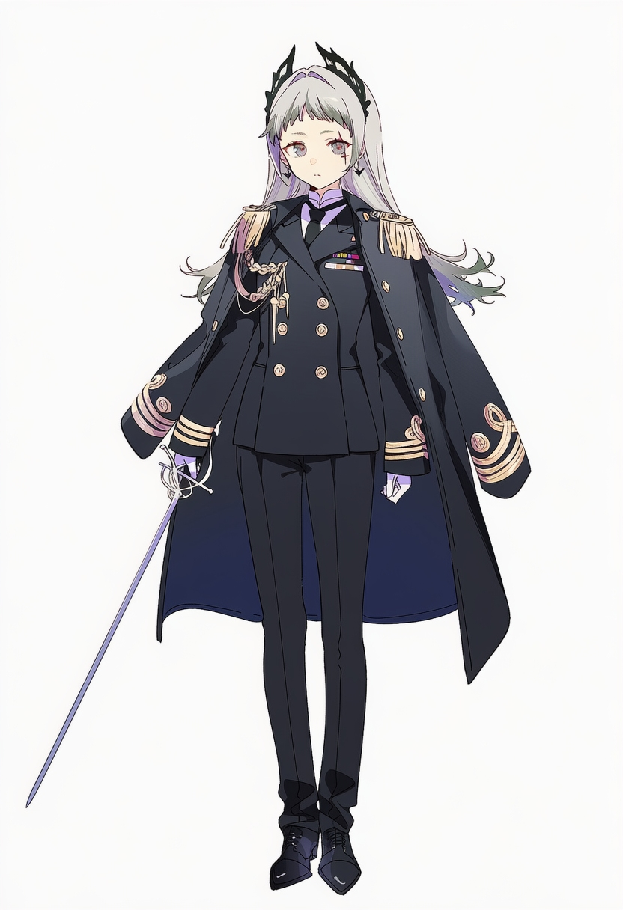

[在线例图](https://assets.quicktagcloud.com/images/raven_composition/raven_composition-0725.jpg?v=b6c07e26a1b86c2a)

<a id="raven_composition-0726"></a>

## 军用作训服

ID：`raven_composition-0726`；分类：套装 / 职业装；来源标记：`safe`。

来源说明：

> 明确指军队使用的 fatigues，适合现代/近现代野战军装。

正向提示词：

```text
military_fatigues
```

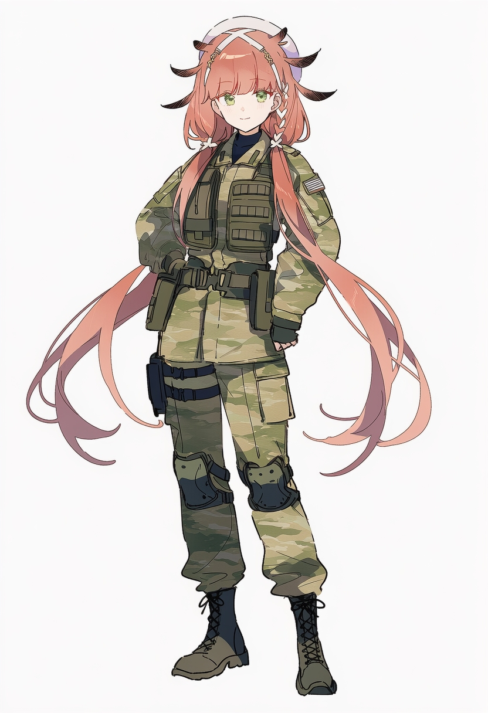

[在线例图](https://assets.quicktagcloud.com/images/raven_composition/raven_composition-0726.jpg?v=1676c6bbda9cc036)
