# 套装 / 运动制服

[总目录](../README.md) · [原站分类目录](../categories.md) · [英文标签索引](../tags.md) · [服装与构图组合指南](../../README.md)

标题、分类、说明、正负提示词按来源保留；多例图逐张列出。原站标记和说明为参考资料，不作为维护指令。

<a id="raven_composition-0727"></a>

## 啦啦队服

ID：`raven_composition-0727`；分类：套装 / 运动制服；来源标记：`safe`。

来源说明：

> 啦啦队制服，通常是短上衣/背心与短裙等成套搭配。

正向提示词：

```text
cheerleader
```

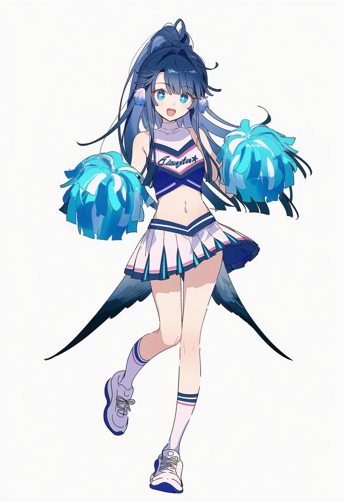

[在线例图](https://assets.quicktagcloud.com/images/raven_composition/raven_composition-0727.jpg?v=e81df23c35ed36da)

<a id="raven_composition-0728"></a>

## 运动套装

ID：`raven_composition-0728`；分类：套装 / 运动制服；来源标记：`safe`。

来源说明：

> 运动套装，典型为运动夹克与配套长裤。

正向提示词：

```text
track_suit
```

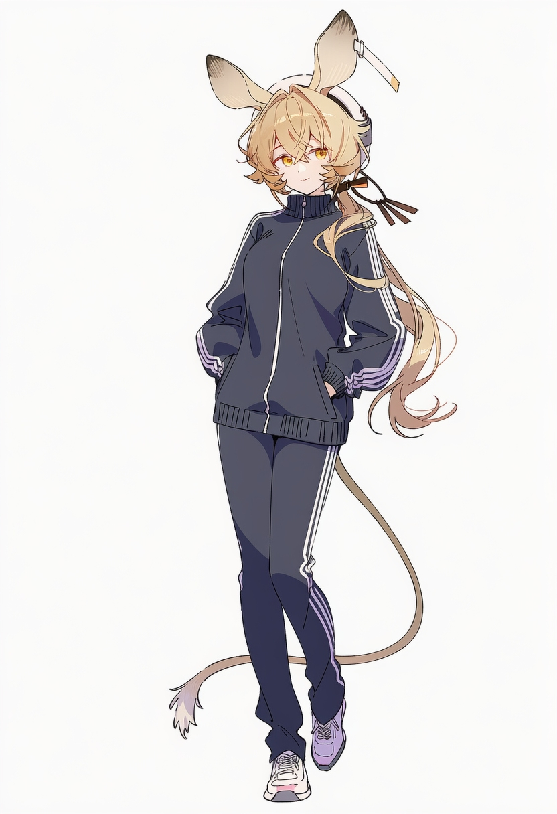

[在线例图](https://assets.quicktagcloud.com/images/raven_composition/raven_composition-0728.jpg?v=9b76c1928d20ab2a)

<a id="raven_composition-0729"></a>

## 足球制服

ID：`raven_composition-0729`；分类：套装 / 运动制服；来源标记：`safe`。

来源说明：

> 足球比赛服，通常包含球衣、短裤与长袜的统一搭配。

正向提示词：

```text
soccer_uniform
```

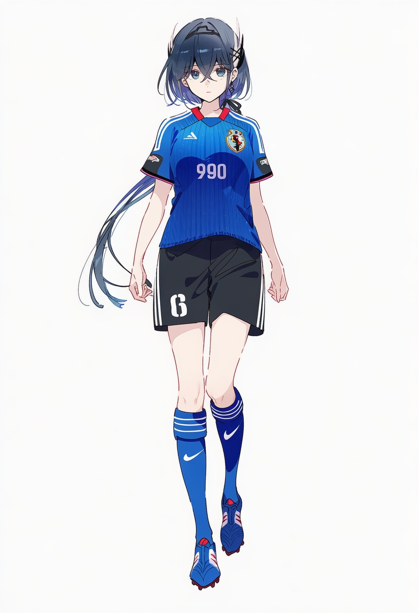

[在线例图](https://assets.quicktagcloud.com/images/raven_composition/raven_composition-0729.jpg?v=1efd2743d8aad395)

<a id="raven_composition-0730"></a>

## 棒球制服

ID：`raven_composition-0730`；分类：套装 / 运动制服；来源标记：`safe`。

来源说明：

> 棒球比赛的制式球衣与下装组合。

正向提示词：

```text
baseball_uniform
```

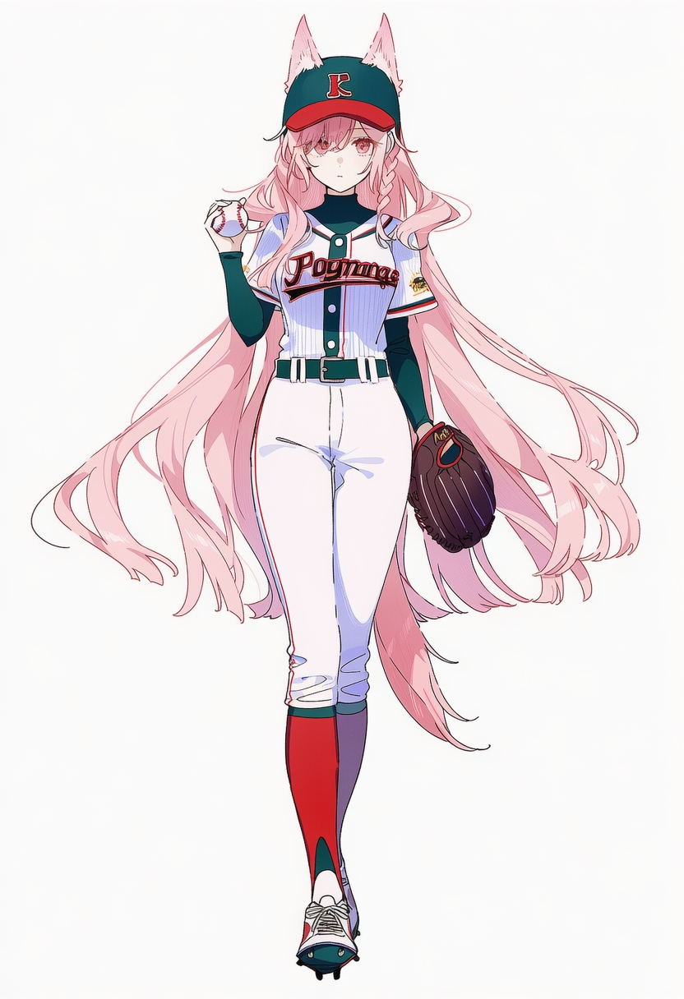

[在线例图](https://assets.quicktagcloud.com/images/raven_composition/raven_composition-0730.jpg?v=4e0bac80f87b0d6a)

<a id="raven_composition-0731"></a>

## 摔角服

ID：`raven_composition-0731`；分类：套装 / 运动制服；来源标记：`safe`。

来源说明：

> 职业摔角或竞技摔角的完整比赛服装类型。

正向提示词：

```text
wrestling_outfit
```

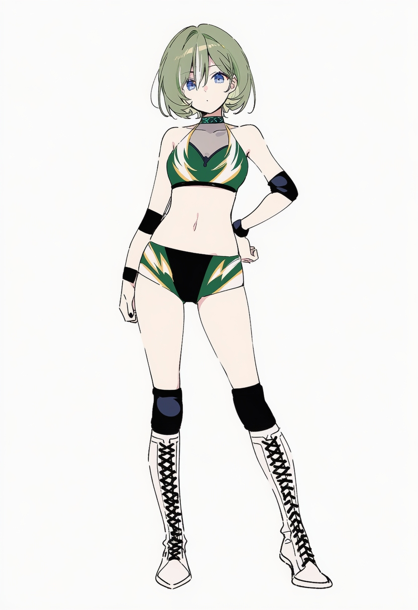

[在线例图](https://assets.quicktagcloud.com/images/raven_composition/raven_composition-0731.jpg?v=7ad1dad655c337d4)

<a id="raven_composition-0732"></a>

## 网球服

ID：`raven_composition-0732`；分类：套装 / 运动制服；来源标记：`safe`。

来源说明：

> 用于网球运动员的整套比赛/训练服造型，通常由运动上衣配短裙、短裤或网球连衣裙等组成；可直接表达网球运动穿搭。

正向提示词：

```text
tennis_uniform
```

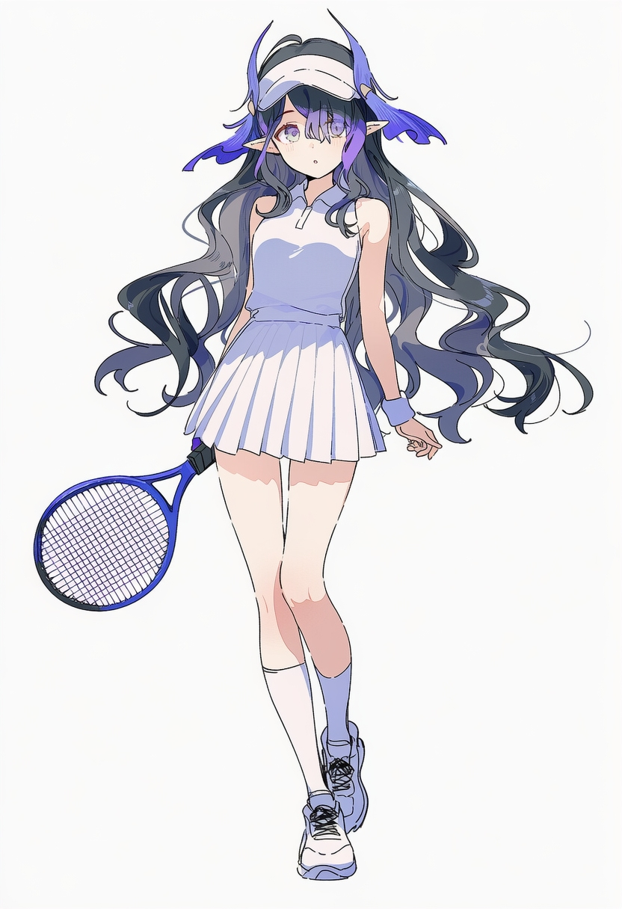

[在线例图](https://assets.quicktagcloud.com/images/raven_composition/raven_composition-0732.jpg?v=de01b727456e1a5b)

<a id="raven_composition-0733"></a>

## 排球制服

ID：`raven_composition-0733`；分类：套装 / 运动制服；来源标记：`safe`。

来源说明：

> 排球比赛使用的制式运动上装与下装。

正向提示词：

```text
volleyball_uniform
```

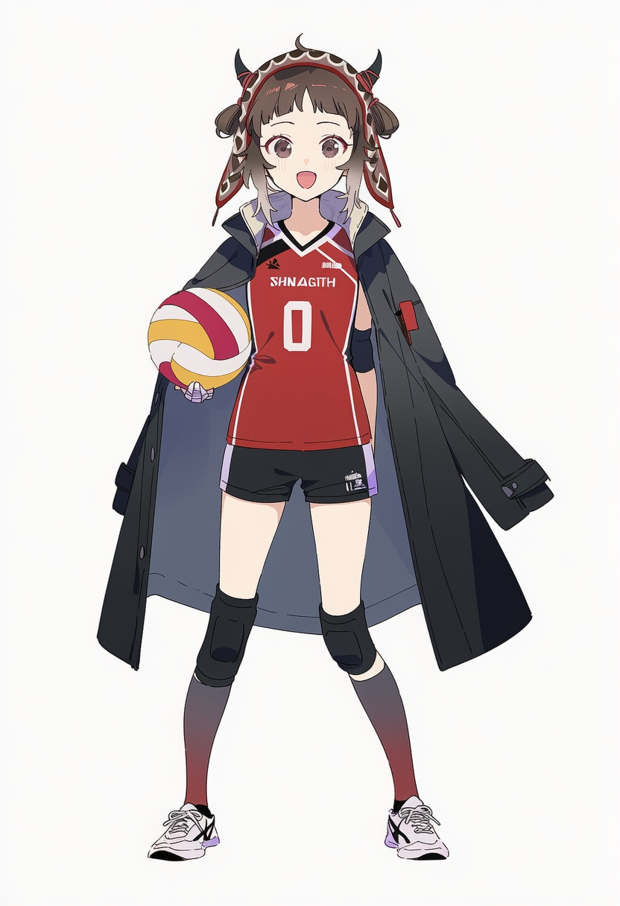

[在线例图](https://assets.quicktagcloud.com/images/raven_composition/raven_composition-0733.jpg?v=660bad8ec33afcd8)

<a id="raven_composition-0734"></a>

## 骑行紧身服

ID：`raven_composition-0734`；分类：套装 / 运动制服；来源标记：`safe`。

来源说明：

> 自行车运动使用的一体式或高度贴身骑行服。

正向提示词：

```text
bikesuit
```

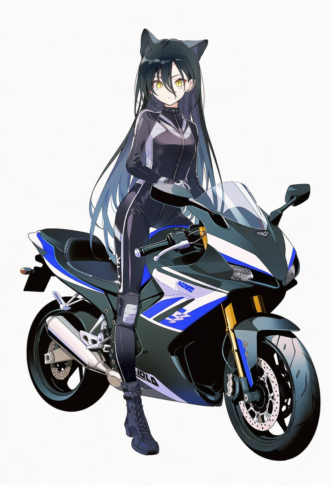

[在线例图](https://assets.quicktagcloud.com/images/raven_composition/raven_composition-0734.jpg?v=2c325a5975ae9653)

<a id="raven_composition-0735"></a>

## 篮球制服

ID：`raven_composition-0735`；分类：套装 / 运动制服；来源标记：`safe`。

来源说明：

> 篮球比赛服，典型为无袖球衣与运动短裤组合。

正向提示词：

```text
basketball_uniform
```

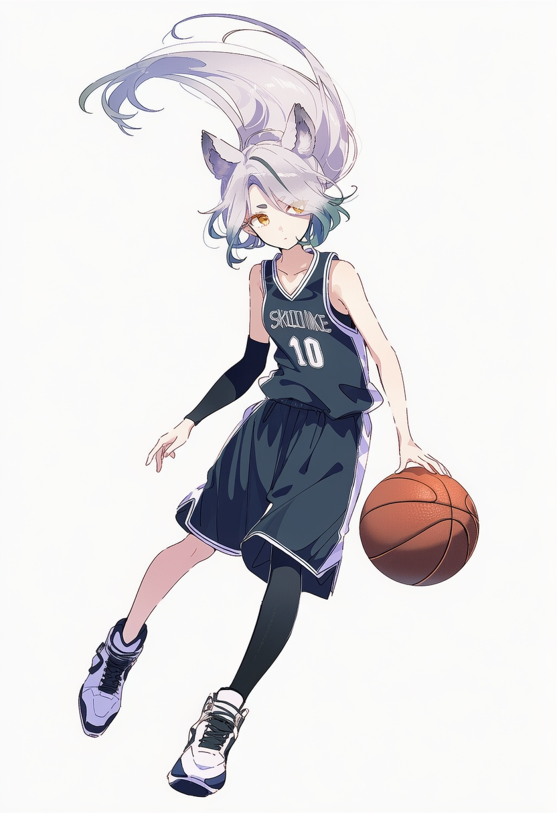

[在线例图](https://assets.quicktagcloud.com/images/raven_composition/raven_composition-0735.jpg?v=7766390ccf4249a8)

<a id="raven_composition-0736"></a>

## 竞技体操紧身衣

ID：`raven_composition-0736`；分类：套装 / 运动制服；来源标记：`safe`。

来源说明：

> 体操等竞技运动使用的贴身连体服。

正向提示词：

```text
athletic_leotard
```

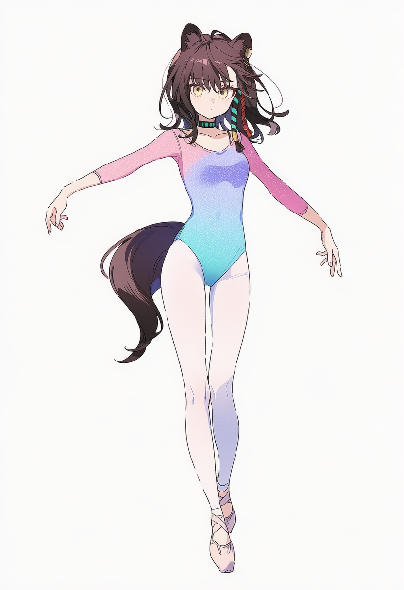

[在线例图](https://assets.quicktagcloud.com/images/raven_composition/raven_composition-0736.jpg?v=f04fa05ee659b5e0)

<a id="raven_composition-0737"></a>

## 田径制服

ID：`raven_composition-0737`；分类：套装 / 运动制服；来源标记：`safe`。

来源说明：

> 田径项目比赛/训练制服，可作为整套竞技穿着标签。

正向提示词：

```text
track_uniform
```

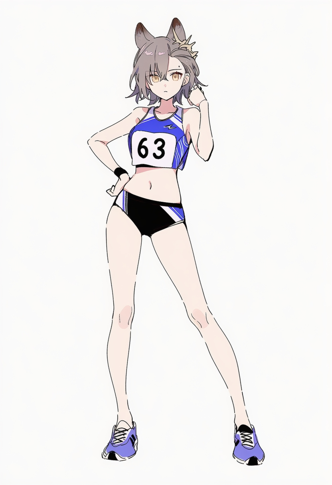

[在线例图](https://assets.quicktagcloud.com/images/raven_composition/raven_composition-0737.jpg?v=fabc2f4ac7e8a8f9)

<a id="raven_composition-0738"></a>

## 赛车服

ID：`raven_composition-0738`；分类：套装 / 运动制服；来源标记：`safe`。

来源说明：

> 赛车运动使用的全身防护连体服。

正向提示词：

```text
racing_suit
```

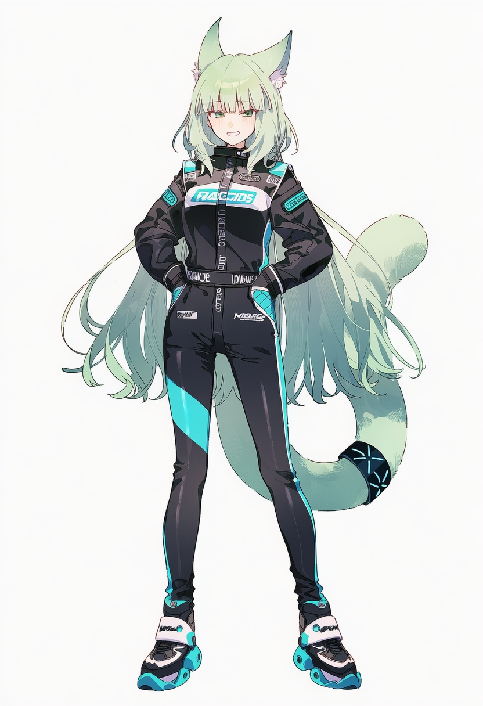

[在线例图](https://assets.quicktagcloud.com/images/raven_composition/raven_composition-0738.jpg?v=b1b5c89c2a17d206)

<a id="raven_composition-0739"></a>

## 骑行衫

ID：`raven_composition-0739`；分类：套装 / 运动制服；来源标记：`safe`。

来源说明：

> 自行车运动专用骑行衫；通常与骑行裤共同构成骑行造型。

正向提示词：

```text
bike_jersey
```

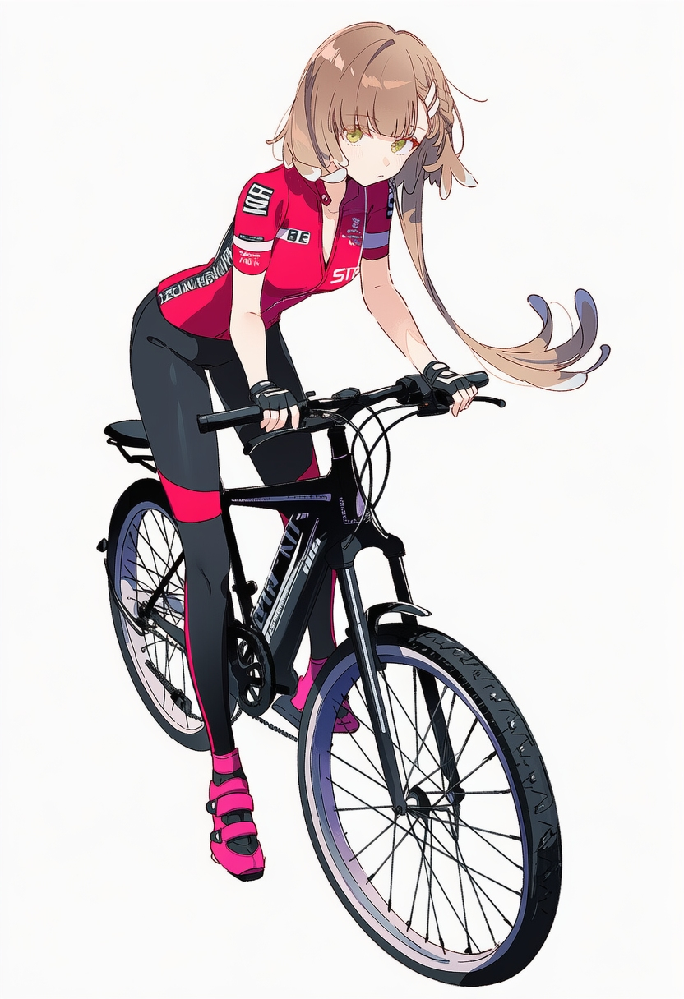

[在线例图](https://assets.quicktagcloud.com/images/raven_composition/raven_composition-0739.jpg?v=43d09bc2b0cbda96)

<a id="raven_composition-0740"></a>

## 自行车比赛服

ID：`raven_composition-0740`；分类：套装 / 运动制服；来源标记：`safe`。

来源说明：

> 公路/竞技自行车运动的紧身比赛服套装。

正向提示词：

```text
cycling_uniform
```

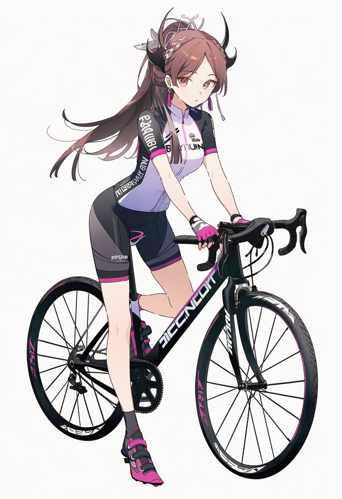

[在线例图](https://assets.quicktagcloud.com/images/raven_composition/raven_composition-0740.jpg?v=1c67fa1bba17c4a8)

<a id="raven_composition-0741"></a>

## 美式橄榄球制服

ID：`raven_composition-0741`；分类：套装 / 运动制服；来源标记：`safe`。

来源说明：

> 美式橄榄球的比赛制服，通常与护具共同形成完整运动造型。

正向提示词：

```text
american_football_uniform
```

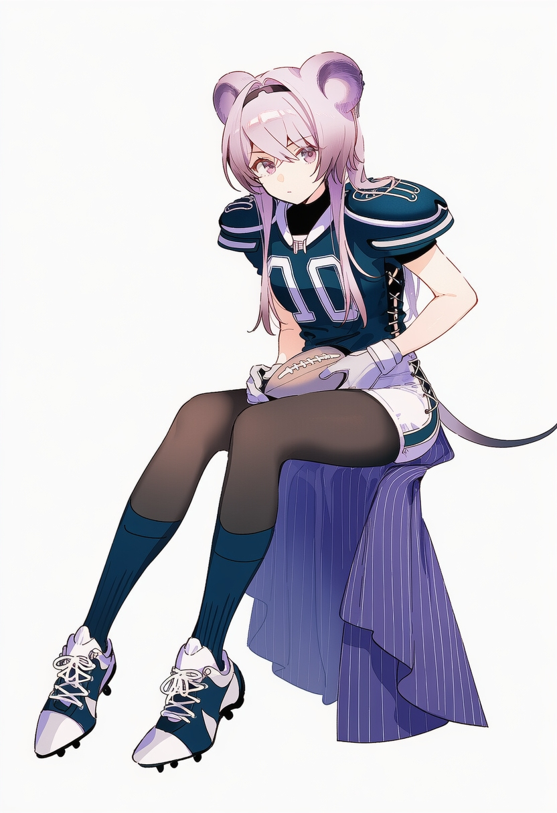

[在线例图](https://assets.quicktagcloud.com/images/raven_composition/raven_composition-0741.jpg?v=0a1ac426c5729e21)

<a id="raven_composition-0742"></a>

## 英式橄榄球制服

ID：`raven_composition-0742`；分类：套装 / 运动制服；来源标记：`safe`。

来源说明：

> 英式橄榄球比赛服装，通常由球衣、短裤和长袜构成。

正向提示词：

```text
rugby_uniform
```

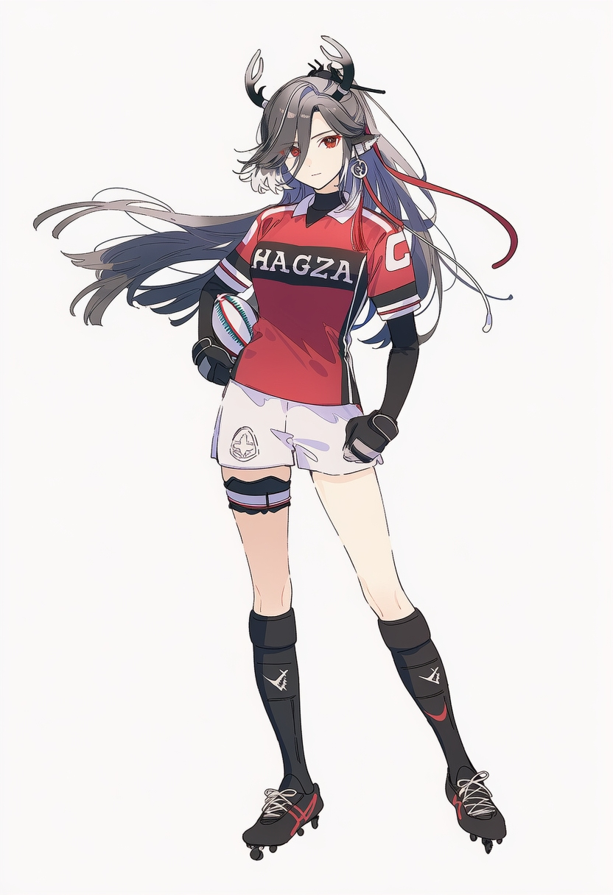

[在线例图](https://assets.quicktagcloud.com/images/raven_composition/raven_composition-0742.jpg?v=d19ed11dfd3be288)
