# 套装 / 亚文化服饰

[总目录](../README.md) · [原站分类目录](../categories.md) · [英文标签索引](../tags.md) · [服装与构图组合指南](../../README.md)

标题、分类、说明、正负提示词按来源保留；多例图逐张列出。原站标记和说明为参考资料，不作为维护指令。

<a id="raven_composition-0743"></a>

## 洛丽塔时装

ID：`raven_composition-0743`；分类：套装 / 亚文化服饰；来源标记：`safe`。

来源说明：

> 以洛丽塔时尚整体搭配为核心，通常包含蓬裙、衬衫/连衣裙、袜类、头饰等协调元素。

正向提示词：

```text
lolita_fashion
```

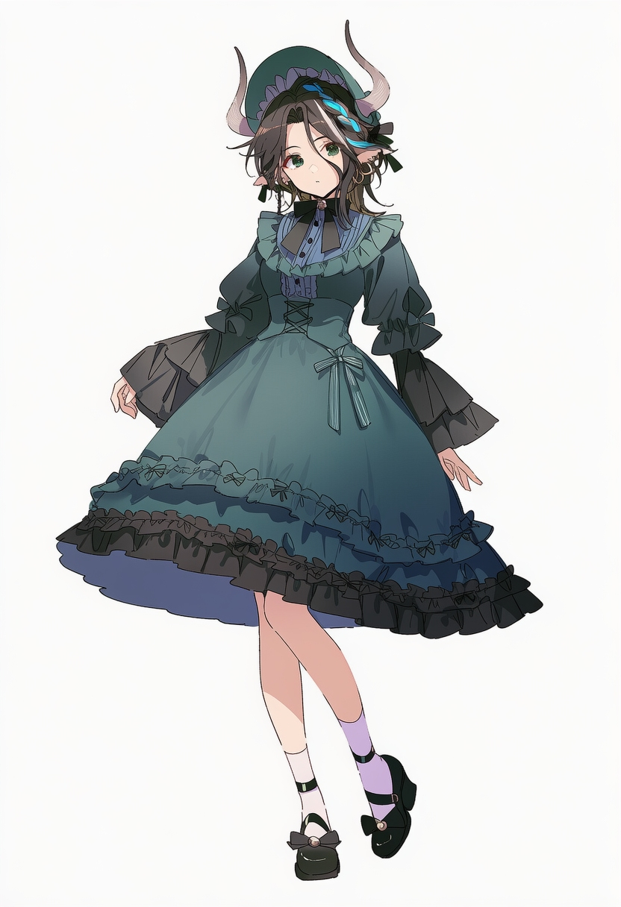

[在线例图](https://assets.quicktagcloud.com/images/raven_composition/raven_composition-0743.jpg?v=6534bbced4d7bb14)

<a id="raven_composition-0744"></a>

## 哥特洛丽塔

ID：`raven_composition-0744`；分类：套装 / 亚文化服饰；来源标记：`safe`。

来源说明：

> 洛丽塔时尚的哥特分支，常用黑白、十字、蕾丝等较暗色和宗教/哥特元素。

正向提示词：

```text
gothic_lolita
```

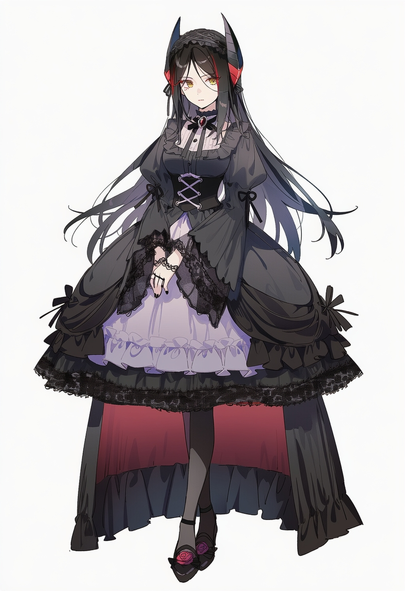

[在线例图](https://assets.quicktagcloud.com/images/raven_composition/raven_composition-0744.jpg?v=5d7f30692e135074)

<a id="raven_composition-0745"></a>

## 哥特时装

ID：`raven_composition-0745`；分类：套装 / 亚文化服饰；来源标记：`safe`。

来源说明：

> 现代哥特系穿搭风格，常见黑色、蕾丝、皮革、十字等视觉元素。

正向提示词：

```text
goth_fashion
```

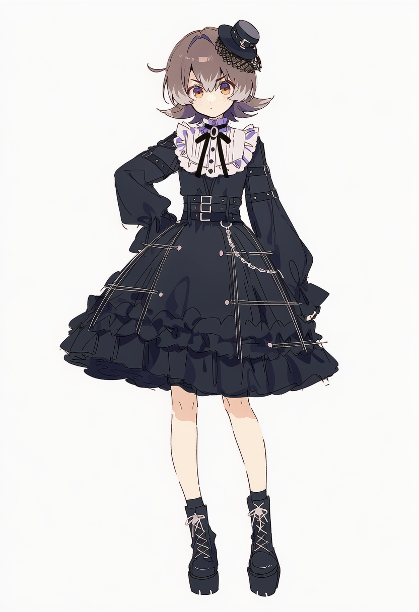

[在线例图](https://assets.quicktagcloud.com/images/raven_composition/raven_composition-0745.jpg?v=cf45931c41a65f86)

<a id="raven_composition-0746"></a>

## 女高中生辣妹风

ID：`raven_composition-0746`；分类：套装 / 亚文化服饰；来源标记：`safe`。

来源说明：

> 以日本女高中生制服改造与辣妹审美结合为特征的现代穿搭类型。

正向提示词：

```text
kogal
```

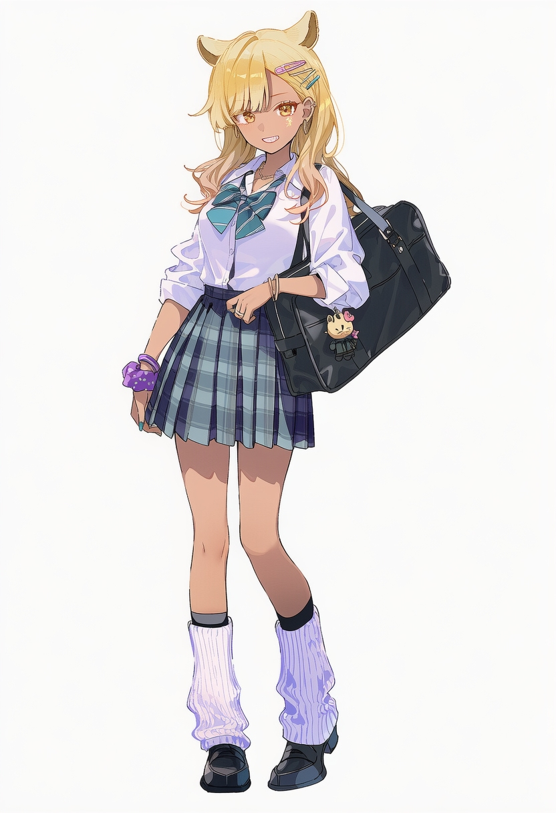

[在线例图](https://assets.quicktagcloud.com/images/raven_composition/raven_composition-0746.jpg?v=3f4154201d291eff)

<a id="raven_composition-0747"></a>

## 地雷系

ID：`raven_composition-0747`；分类：套装 / 亚文化服饰；来源标记：`safe`。

来源说明：

> 日本当代“地雷系”时装风格，常见黑/粉、蝴蝶结、蕾丝、短裙与厚底鞋等搭配。

正向提示词：

```text
jirai_kei
```

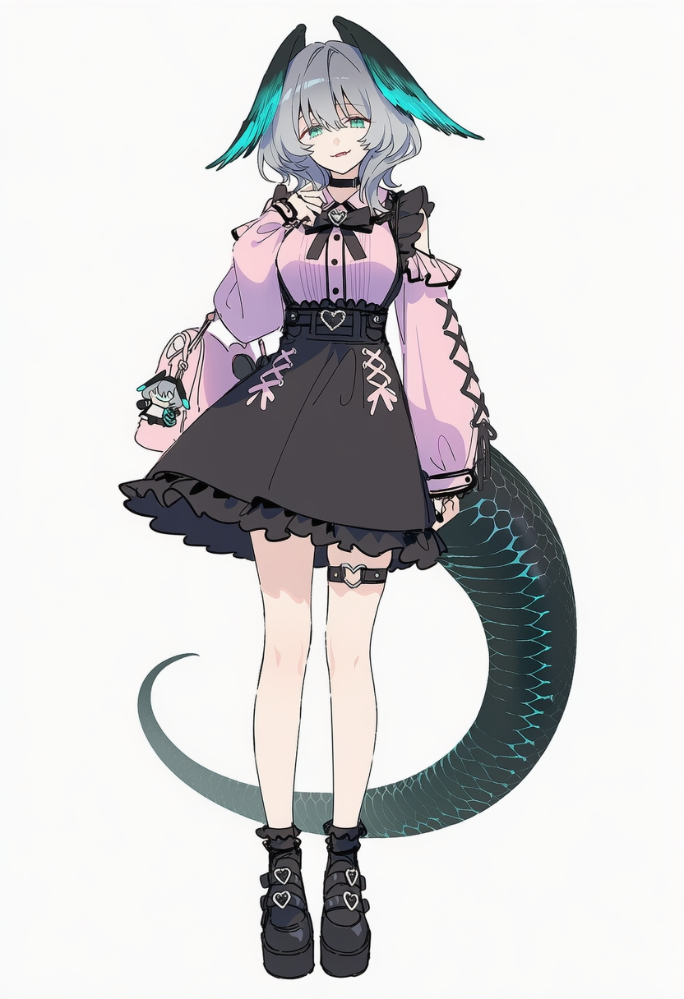

[在线例图](https://assets.quicktagcloud.com/images/raven_composition/raven_composition-0747.jpg?v=afec9f17acb7109d)

<a id="raven_composition-0748"></a>

## 甜系洛丽塔

ID：`raven_composition-0748`；分类：套装 / 亚文化服饰；来源标记：`safe`。

来源说明：

> Lolita fashion 的甜系分支，常见浅色、蝴蝶结、甜点/童话图案和蓬裙。

正向提示词：

```text
sweet_lolita
```

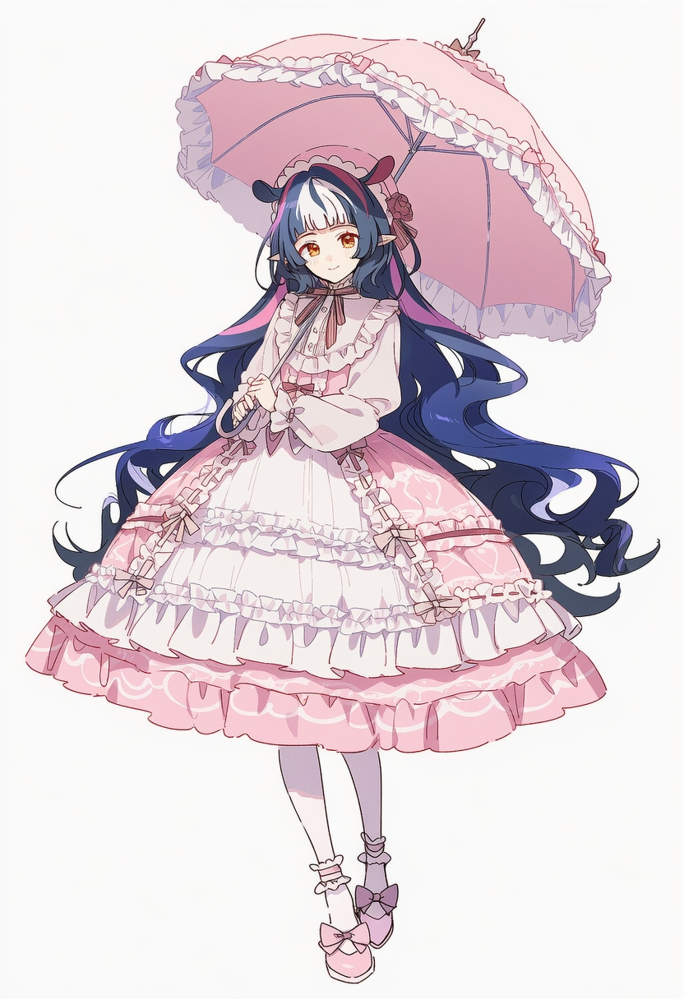

[在线例图](https://assets.quicktagcloud.com/images/raven_composition/raven_composition-0748.jpg?v=cbea7024fec177c3)

<a id="raven_composition-0749"></a>

## Y2K 时装

ID：`raven_composition-0749`；分类：套装 / 亚文化服饰；来源标记：`safe`。

来源说明：

> 2000 年代初审美复兴的现代时装风格，如低腰、短上衣、金属/亮面和复古数码感。

正向提示词：

```text
y2k_fashion
```

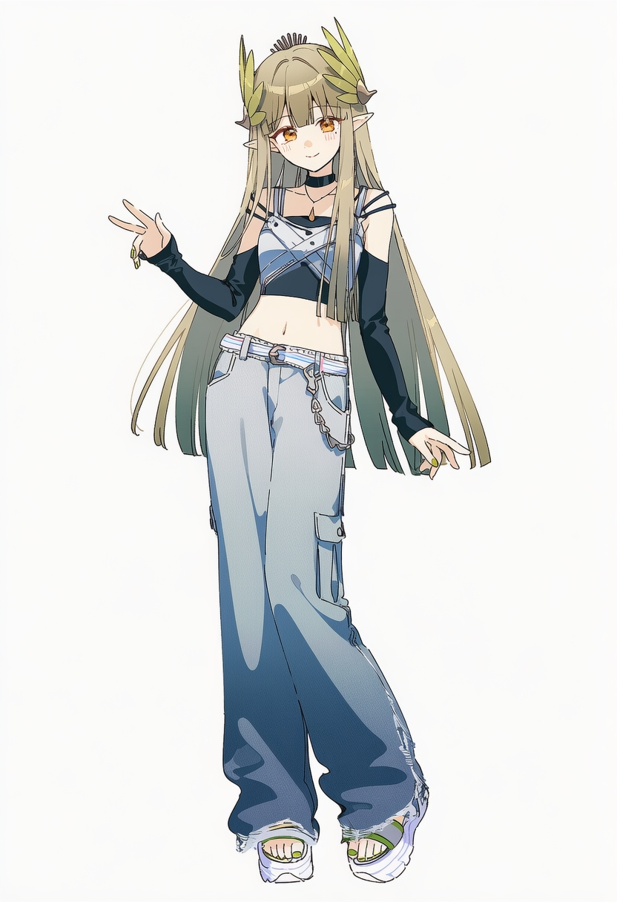

[在线例图](https://assets.quicktagcloud.com/images/raven_composition/raven_composition-0749.jpg?v=f026ac1f8bb4b643)

<a id="raven_composition-0750"></a>

## 街头服饰

ID：`raven_composition-0750`；分类：套装 / 亚文化服饰；来源标记：`safe`。

来源说明：

> 现代街头穿搭总类，常包含宽松上衣、夹克、运动鞋、工装元素等。

正向提示词：

```text
streetwear
```


[在线例图](https://assets.quicktagcloud.com/images/raven_composition/raven_composition-0750.jpg?v=dd66d08dc777e894)

<a id="raven_composition-0751"></a>

## 梦幻可爱系

ID：`raven_composition-0751`；分类：套装 / 亚文化服饰；来源标记：`safe`。

来源说明：

> 以柔和梦幻色、可爱图案和轻幻想元素为核心的日系亚文化穿搭。

正向提示词：

```text
yume_kawaii
```

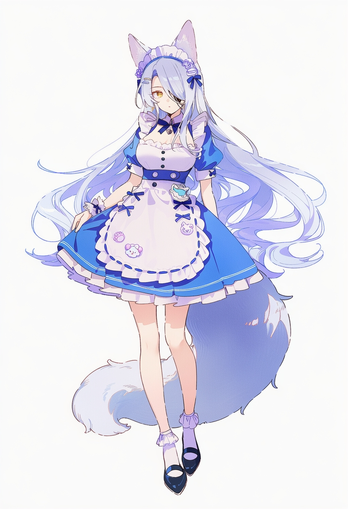

[在线例图](https://assets.quicktagcloud.com/images/raven_composition/raven_composition-0751.jpg?v=87c001db920a8e6a)

<a id="raven_composition-0752"></a>

## 美式校园辣妹风

ID：`raven_composition-0752`；分类：套装 / 亚文化服饰；来源标记：`safe`。

来源说明：

> 受美式校园/制服元素影响的 gyaru 穿搭类型，属于现代日系亚文化服饰。

正向提示词：

```text
amesuku_gyaru
```


[在线例图](https://assets.quicktagcloud.com/images/raven_composition/raven_composition-0752.jpg?v=3c8739228c8109e7)

<a id="raven_composition-0753"></a>

## Ganguro 辣妹风

ID：`raven_composition-0753`；分类：套装 / 亚文化服饰；来源标记：`safe`。

来源说明：

> 1990s-2000s 日本辣妹亚文化风格，常与深色晒肤、浅色头发和醒目服饰搭配关联。

正向提示词：

```text
ganguro
```

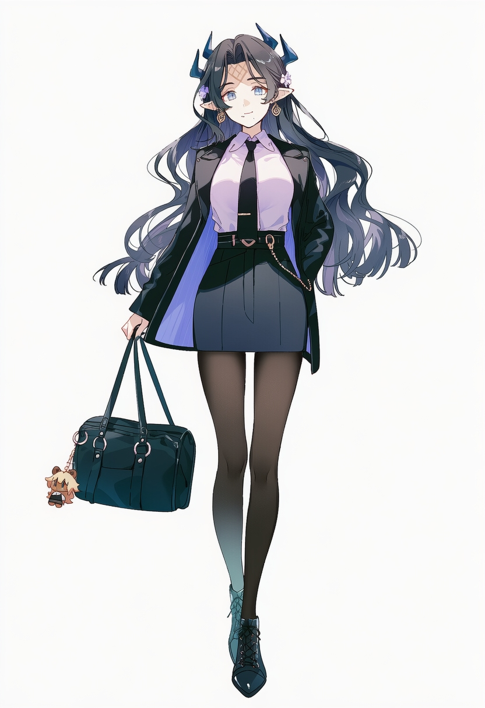

[在线例图](https://assets.quicktagcloud.com/images/raven_composition/raven_composition-0753.jpg?v=d9b11c3f4b4be03c)

<a id="raven_composition-0754"></a>

## 赛博时装

ID：`raven_composition-0754`；分类：套装 / 亚文化服饰；来源标记：`safe`。

来源说明：

> 以未来感、机能感、霓虹或电子元素为核心的现代/科幻时装风格。

正向提示词：

```text
cyber_fashion
```

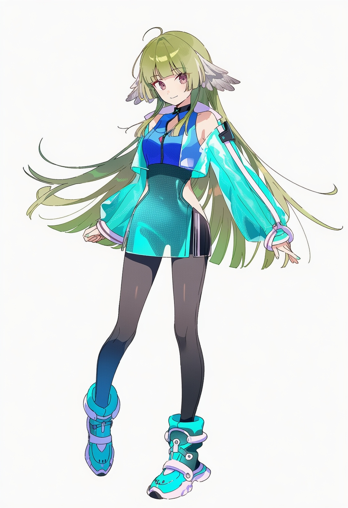

[在线例图](https://assets.quicktagcloud.com/images/raven_composition/raven_composition-0754.jpg?v=b9968fbf638430a1)

<a id="raven_composition-0755"></a>

## Decora 原宿装

ID：`raven_composition-0755`；分类：套装 / 亚文化服饰；来源标记：`safe`。

来源说明：

> 日本原宿 Decora 风格，强调大量彩色配饰、层叠服装与高密度装饰。

正向提示词：

```text
decora
```

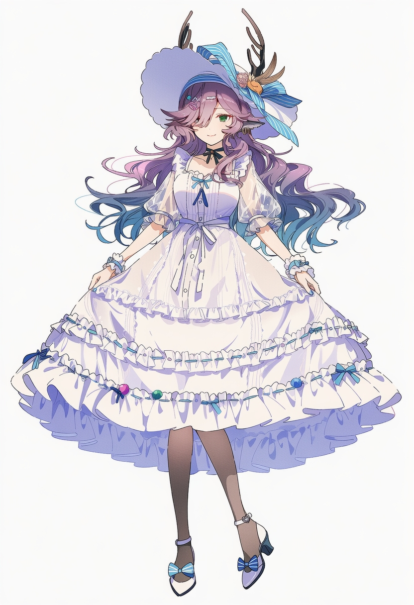

[在线例图](https://assets.quicktagcloud.com/images/raven_composition/raven_composition-0755.jpg?v=2a06117d0c4ea28a)

<a id="raven_composition-0756"></a>

## 机能风

ID：`raven_composition-0756`；分类：套装 / 亚文化服饰；来源标记：`safe`。

来源说明：

> 现代机能风服装，强调功能面料、口袋、绑带、模块化与都市战术感。

正向提示词：

```text
techwear
```

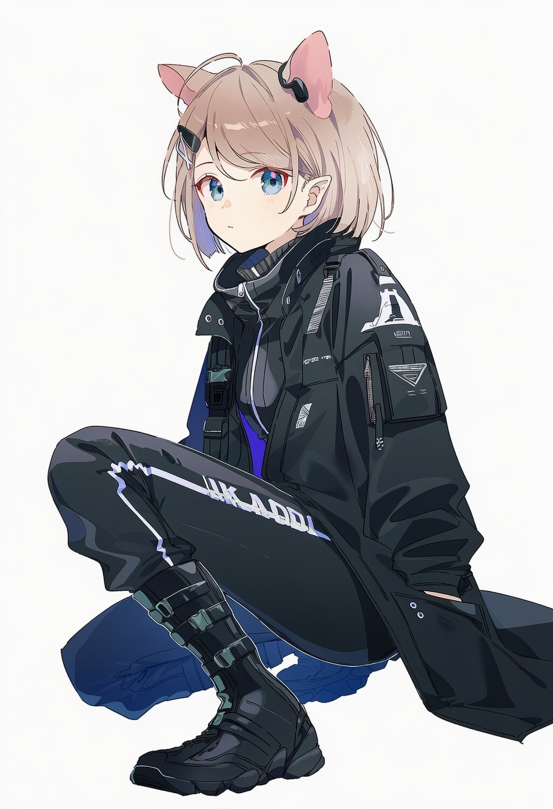

[在线例图](https://assets.quicktagcloud.com/images/raven_composition/raven_composition-0756.jpg?v=51ecd2e463dca5ce)
