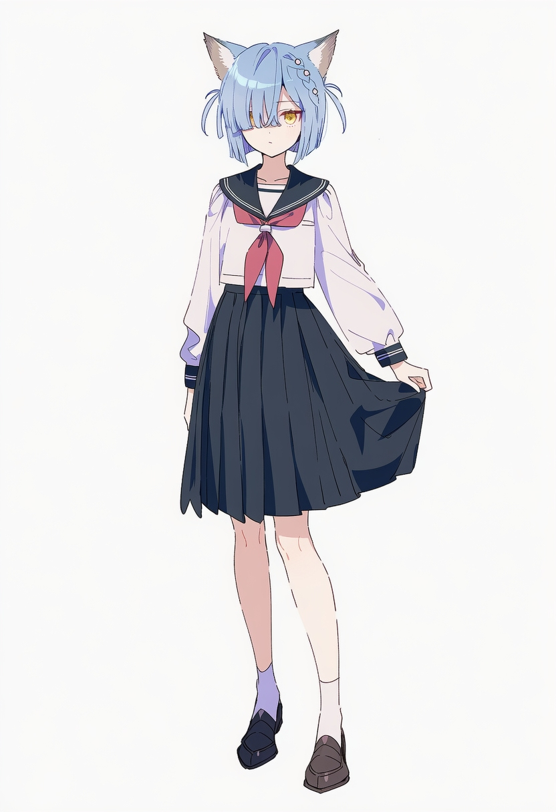
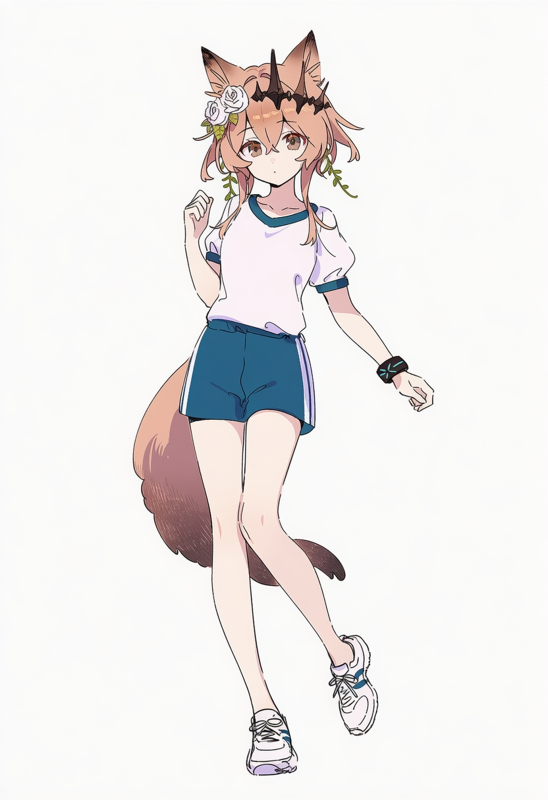
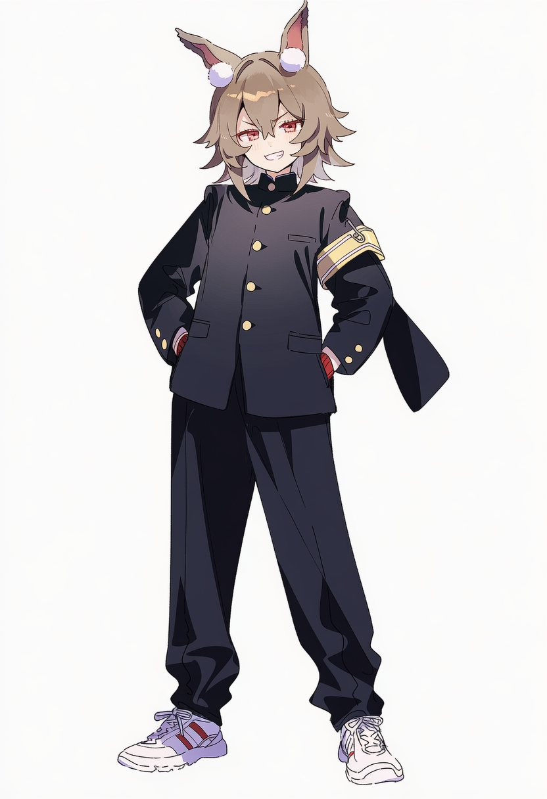
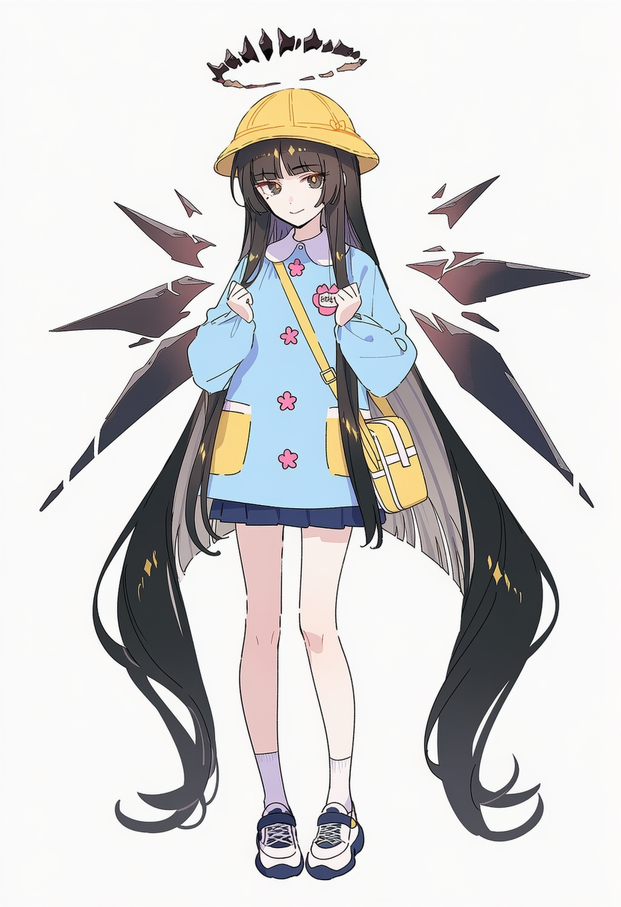

# 套装 / 校服

[总目录](../README.md) · [原站分类目录](../categories.md) · [英文标签索引](../tags.md) · [服装与构图组合指南](../../README.md)

标题、分类、说明、正负提示词按来源保留；多例图逐张列出。原站标记和说明为参考资料，不作为维护指令。

<a id="raven_composition-0757"></a>

## 水手服校服

ID：`raven_composition-0757`；分类：套装 / 校服；来源标记：`safe`。

来源说明：

> 日本女学生水手领校服，常见水手领上衣、百褶裙与领巾。

正向提示词：

```text
serafuku
```



[在线例图](https://assets.quicktagcloud.com/images/raven_composition/raven_composition-0757.jpg?v=adb48c24c7a46bd0)

<a id="raven_composition-0758"></a>

## 体操服 / 体育服

ID：`raven_composition-0758`；分类：套装 / 校服；来源标记：`safe`。

来源说明：

> 日本学校体育课常见体操服/体育服，通常由运动上衣与短裤/灯笼裤等组成。

正向提示词：

```text
gym_uniform
```



[在线例图](https://assets.quicktagcloud.com/images/raven_composition/raven_composition-0758.jpg?v=a2b1354913ef07cb)

<a id="raven_composition-0759"></a>

## 诘襟男生校服

ID：`raven_composition-0759`；分类：套装 / 校服；来源标记：`safe`。

来源说明：

> 日本男学生传统诘襟制服，常见立领深色上衣与长裤。

正向提示词：

```text
gakuran
```



[在线例图](https://assets.quicktagcloud.com/images/raven_composition/raven_composition-0759.jpg?v=fc2450b833af3e7d)

<a id="raven_composition-0760"></a>

## 幼儿园制服

ID：`raven_composition-0760`；分类：套装 / 校服；来源标记：`safe`。

来源说明：

> 幼儿园儿童统一穿着的制式服装。

正向提示词：

```text
kindergarten_uniform
```



[在线例图](https://assets.quicktagcloud.com/images/raven_composition/raven_composition-0760.jpg?v=6f6333e5e1f2d1a6)
