# 套装 / 网络梗服饰

[总目录](../README.md) · [原站分类目录](../categories.md) · [英文标签索引](../tags.md) · [服装与构图组合指南](../../README.md)

标题、分类、说明、正负提示词按来源保留；多例图逐张列出。原站标记和说明为参考资料，不作为维护指令。

<a id="raven_composition-0761"></a>

## 兔女郎装

ID：`raven_composition-0761`；分类：套装 / 网络梗服饰；来源标记：`safe`。

来源说明：

> 典型兔女郎制服，核心通常为无肩带紧身衣，并搭配兔耳、领结、袖口等。

正向提示词：

```text
playboy_bunny
```

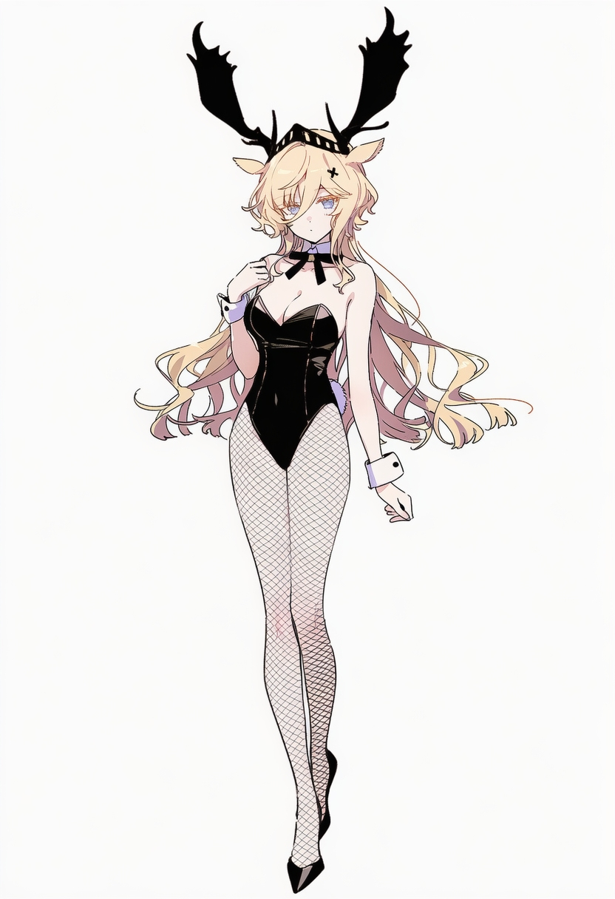

[在线例图](https://assets.quicktagcloud.com/images/raven_composition/raven_composition-0761.jpg?v=c4e9a323521e5c83)

<a id="raven_composition-0762"></a>

## 裸体围裙

ID：`raven_composition-0762`；分类：套装 / 网络梗服饰；来源标记：`safe`。

来源说明：

> 裸体状态下仅穿围裙的造型。

正向提示词：

```text
naked_apron
```

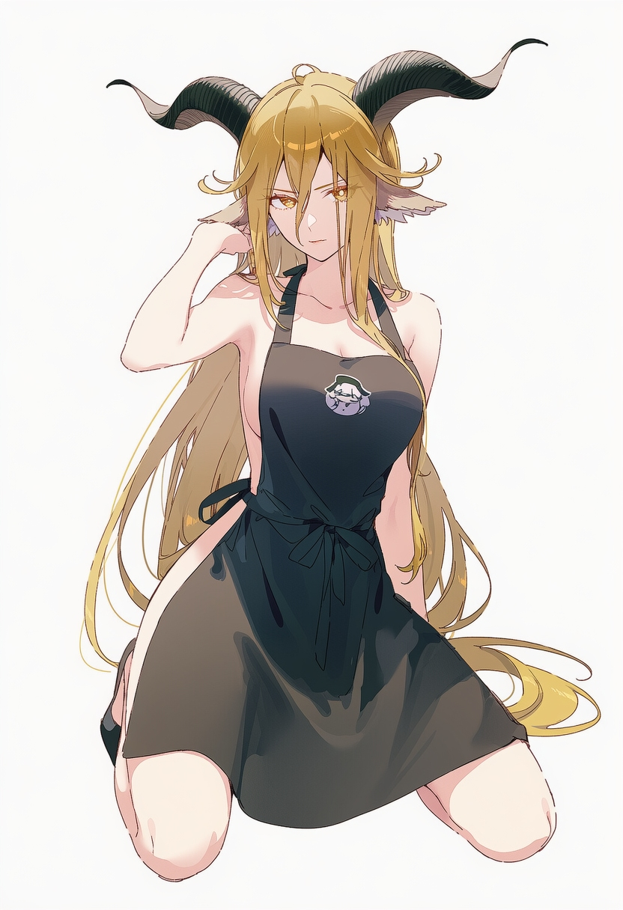

[在线例图](https://assets.quicktagcloud.com/images/raven_composition/raven_composition-0762.jpg?v=e9d72b1087177ab1)

<a id="raven_composition-0763"></a>

## 猫咪主题内衣套装

ID：`raven_composition-0763`；分类：套装 / 网络梗服饰；来源标记：`safe`。

来源说明：

> 具有稳定猫主题设计语言的成套内衣造型。与泛称 lingerie 不同，该 Tag 在视觉上指向更明确的一套主题服饰。

正向提示词：

```text
cat_lingerie
```

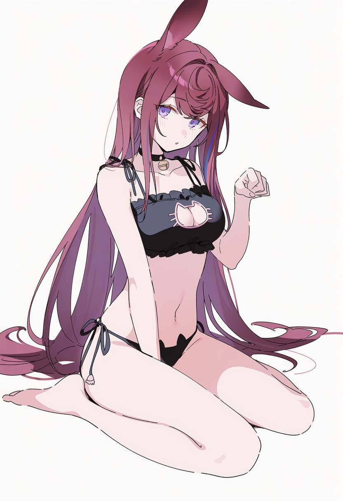

[在线例图](https://assets.quicktagcloud.com/images/raven_composition/raven_composition-0763.jpg?v=fbcf9ab7850b65e0)

<a id="raven_composition-0764"></a>

## 童贞杀手毛衣

ID：`raven_composition-0764`；分类：套装 / 网络梗服饰；来源标记：`safe`。

来源说明：

> 一种背部大面积裸露、挂脖高领、常带罗纹/阿兰针织结构的毛衣裙式服装。

正向提示词：

```text
virgin_killer_sweater
```

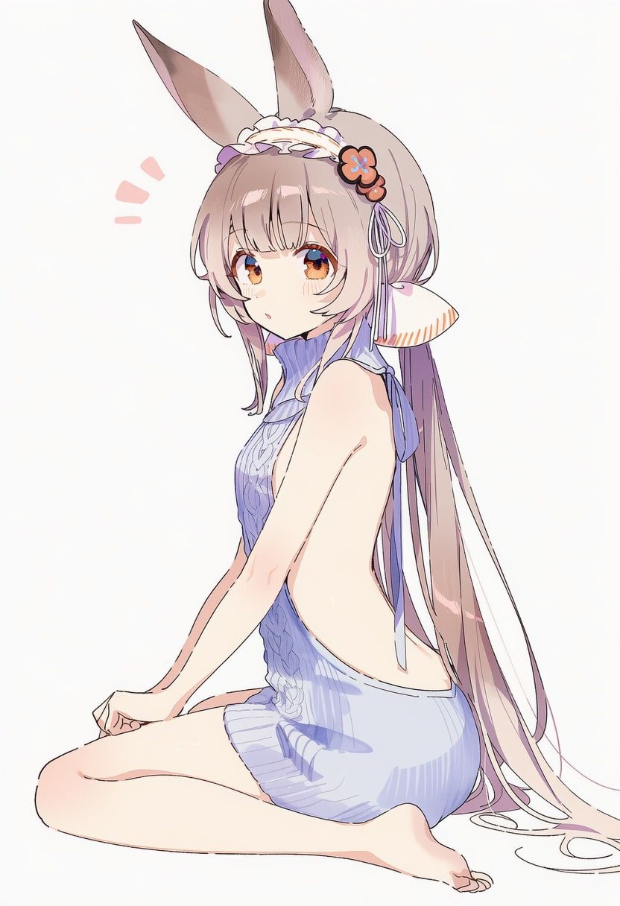

[在线例图](https://assets.quicktagcloud.com/images/raven_composition/raven_composition-0764.jpg?v=e0e15d767c96d76c)

<a id="raven_composition-0765"></a>

## 近裸体围裙

ID：`raven_composition-0765`；分类：套装 / 网络梗服饰；来源标记：`safe`。

来源说明：

> 除围裙外仅保留极少其他衣物的造型。

正向提示词：

```text
nearly_naked_apron
```

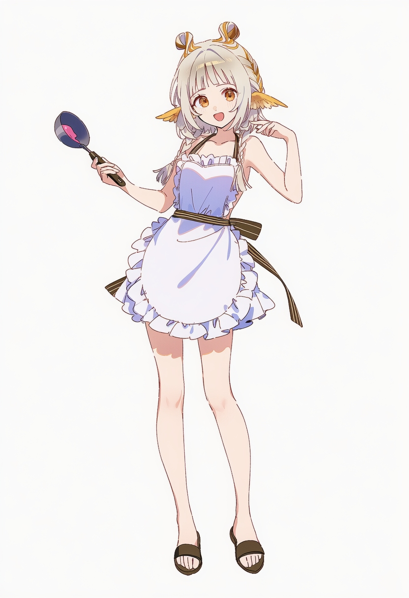

[在线例图](https://assets.quicktagcloud.com/images/raven_composition/raven_composition-0765.jpg?v=c0a39365d78ba5f5)

<a id="raven_composition-0766"></a>

## 束缚风套装

ID：`raven_composition-0766`；分类：套装 / 网络梗服饰；来源标记：`safe`。

来源说明：

> 以束带、绑缚结构或束缚审美为核心的成套服装。

正向提示词：

```text
bondage_outfit
```

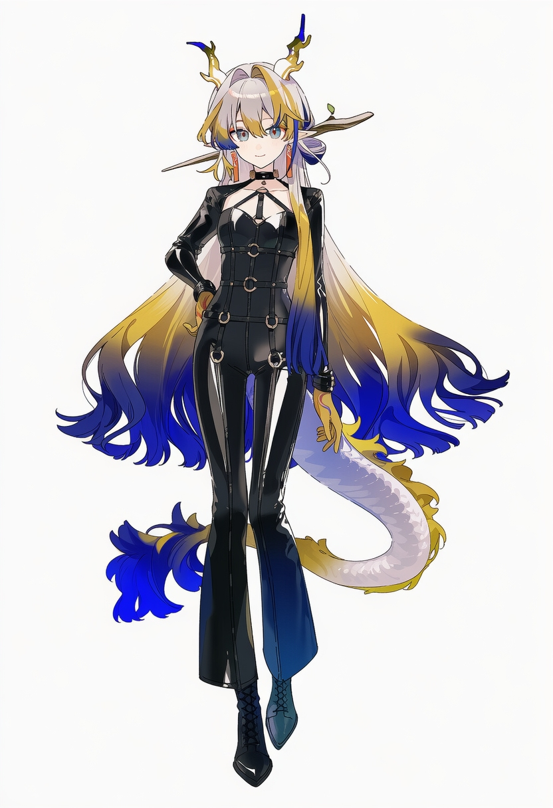

[在线例图](https://assets.quicktagcloud.com/images/raven_composition/raven_composition-0766.jpg?v=26d04e0bdd30f82a)

<a id="raven_composition-0767"></a>

## 童贞毁灭者毛衣

ID：`raven_composition-0767`；分类：套装 / 网络梗服饰；来源标记：`safe`。

来源说明：

> 与经典童贞杀手毛衣相关、但结构更开放的独立针织设计。其前后开口和连接方式形成不同轮廓，不应只用 virgin_killer_sweater。

正向提示词：

```text
virgin_destroyer_sweater
```

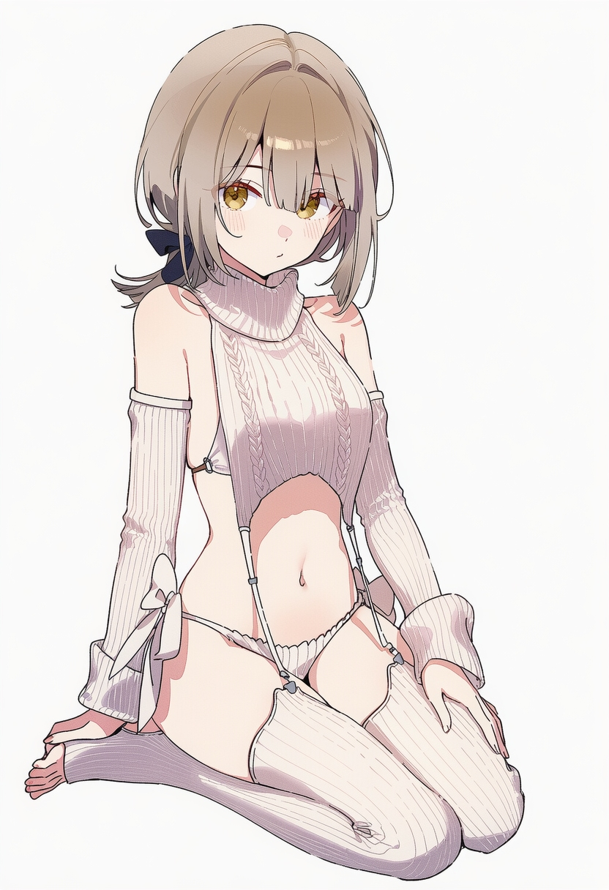

[在线例图](https://assets.quicktagcloud.com/images/raven_composition/raven_composition-0767.jpg?v=cc1725b5f63303b3)

<a id="raven_composition-0768"></a>

## “童贞杀手”风套装

ID：`raven_composition-0768`；分类：套装 / 网络梗服饰；来源标记：`safe`。

来源说明：

> 以高腰下装搭配露肤上装为代表的“童贞杀手”主题穿搭。

正向提示词：

```text
virgin_killer_outfit
```

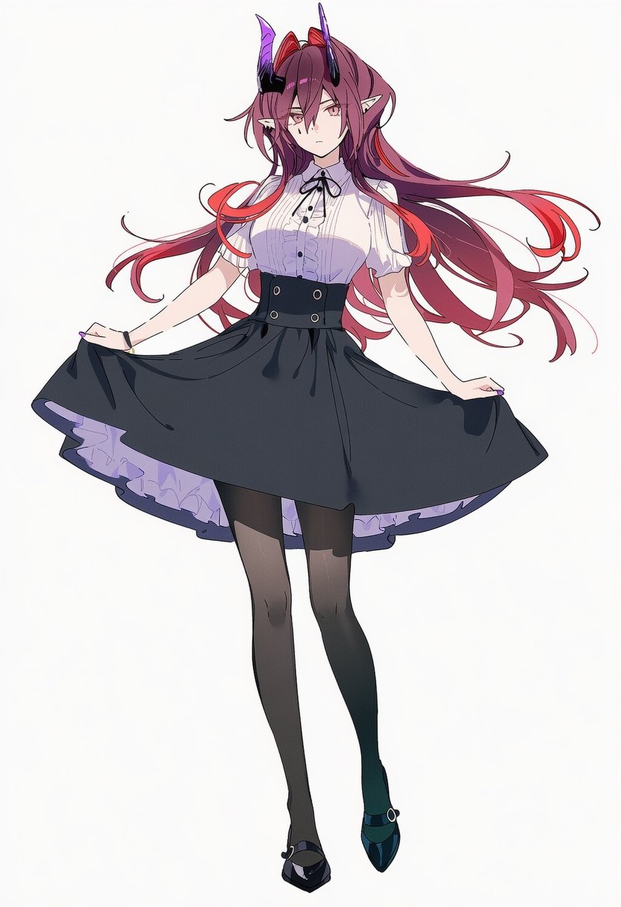

[在线例图](https://assets.quicktagcloud.com/images/raven_composition/raven_composition-0768.jpg?v=33a32334458f7f19)

<a id="raven_composition-0769"></a>

## 半透明兔女郎装

ID：`raven_composition-0769`；分类：套装 / 网络梗服饰；来源标记：`safe`。

来源说明：

> 以经典兔女郎装为基础、主体材质呈半透明效果的稳定变体；视觉效果与普通 playboy_bunny 有明显差异。

正向提示词：

```text
translucent_bunnysuit
```

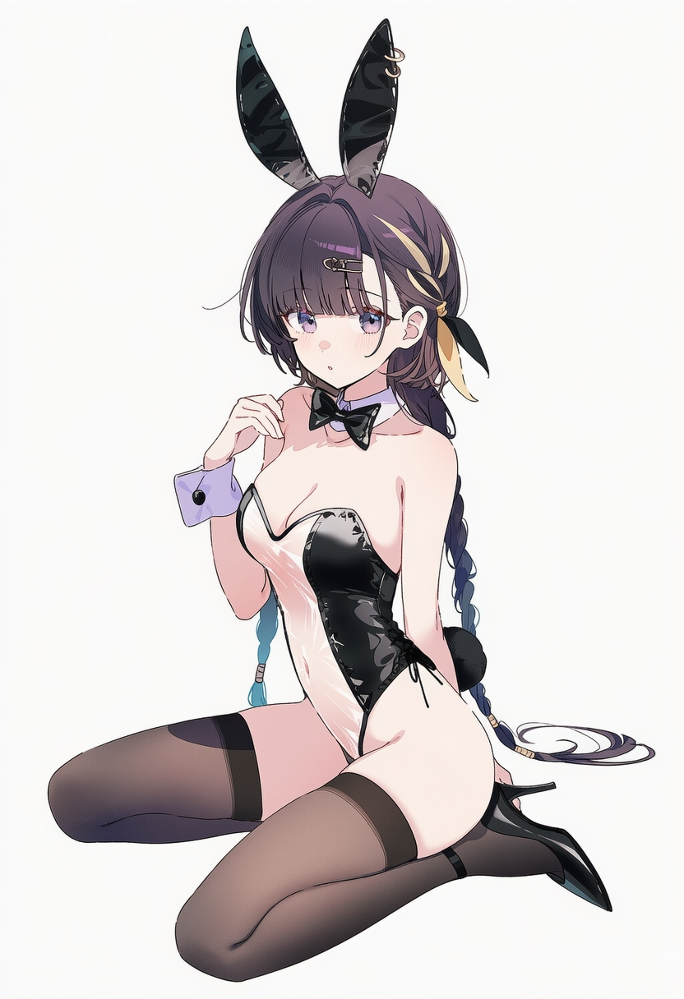

[在线例图](https://assets.quicktagcloud.com/images/raven_composition/raven_composition-0769.jpg?v=08aac3837678d1aa)

<a id="raven_composition-0770"></a>

## 燕尾服兔女郎装

ID：`raven_composition-0770`；分类：套装 / 网络梗服饰；来源标记：`safe`。

来源说明：

> 在经典兔女郎装基础上加入明显燕尾服结构的变体，形成独立轮廓，因此作为具体视觉子类单列。

正向提示词：

```text
tailcoat_playboy_bunny
```

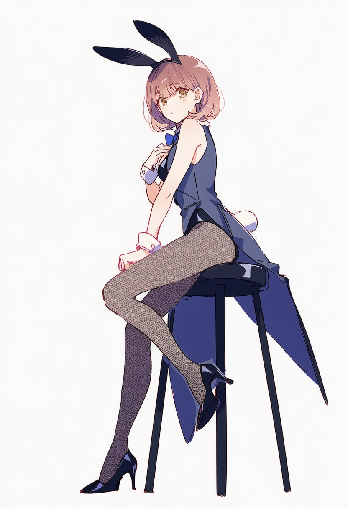

[在线例图](https://assets.quicktagcloud.com/images/raven_composition/raven_composition-0770.jpg?v=88f0d3ab630e3157)

<a id="raven_composition-0771"></a>

## Heattech 紧身连体衣

ID：`raven_composition-0771`；分类：套装 / 网络梗服饰；来源标记：`safe`。

来源说明：

> 网络二创中形成固定识别度的高叉、贴身长袖连体衣造型。它指向具体服装结构，而不是“迷因服饰”这一文化大类。

正向提示词：

```text
heattech_leotard
```

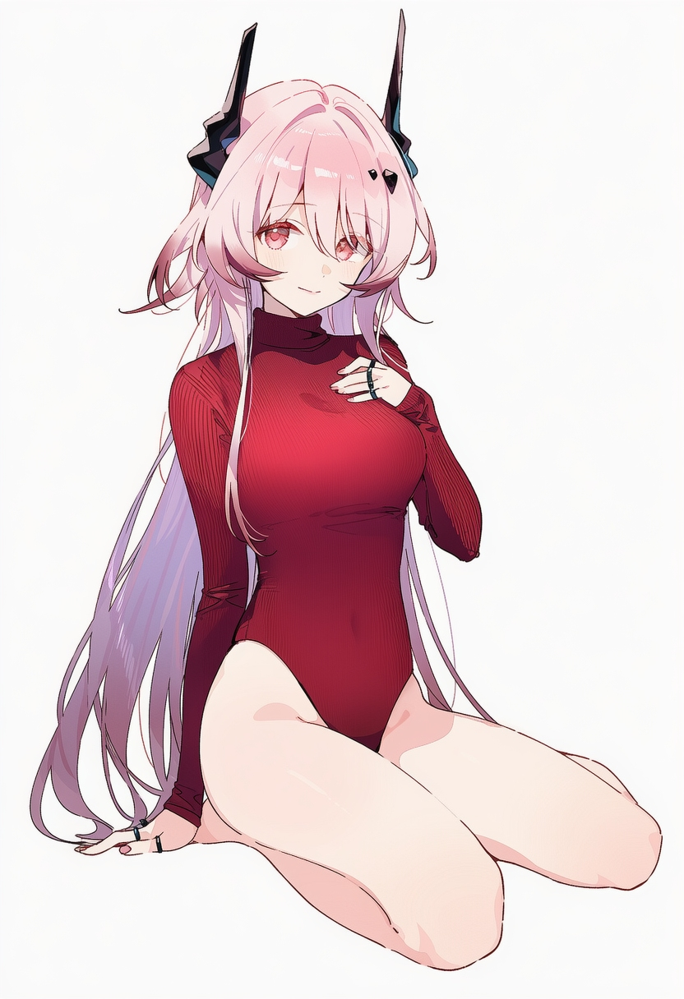

[在线例图](https://assets.quicktagcloud.com/images/raven_composition/raven_composition-0771.jpg?v=dd93fee2482b48e8)

<a id="raven_composition-0772"></a>

## HOT LIMIT 服装

ID：`raven_composition-0772`；分类：套装 / 网络梗服饰；来源标记：`safe`。

来源说明：

> 以大量黑色带状、镂空结构为核心的固定舞台服装造型，在二创中形成稳定的 meme 服饰视觉。

正向提示词：

```text
hot_limit
```

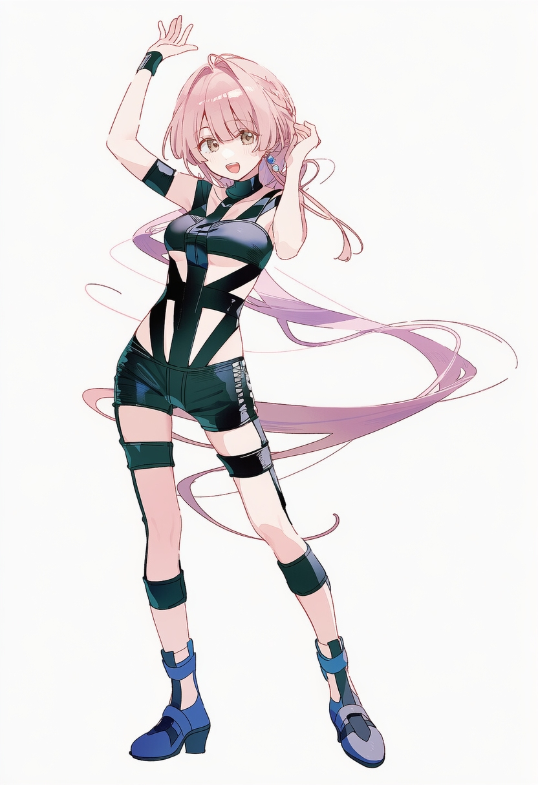

[在线例图](https://assets.quicktagcloud.com/images/raven_composition/raven_composition-0772.jpg?v=bcf5649491fa4a91)
