# 套装 / 日常套装

[总目录](../README.md) · [原站分类目录](../categories.md) · [英文标签索引](../tags.md) · [服装与构图组合指南](../../README.md)

标题、分类、说明、正负提示词按来源保留；多例图逐张列出。原站标记和说明为参考资料，不作为维护指令。

<a id="raven_composition-0773"></a>

## 围裙

ID：`raven_composition-0773`；分类：套装 / 日常套装；来源标记：`safe`。

来源说明：

> 穿在衣物外、用于防污或作装饰的围裙。

正向提示词：

```text
apron
```

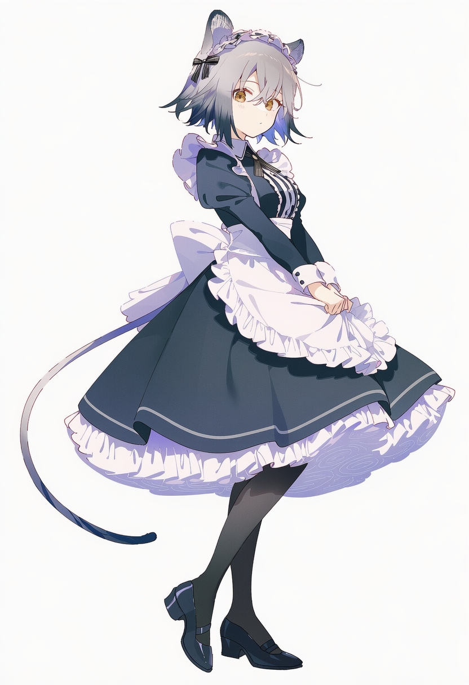

[在线例图](https://assets.quicktagcloud.com/images/raven_composition/raven_composition-0773.jpg?v=502155ddc343dab2)

<a id="raven_composition-0774"></a>

## 毛衣

ID：`raven_composition-0774`；分类：套装 / 日常套装；来源标记：`safe`。

来源说明：

> 针织制成的上身保暖服装统称。

正向提示词：

```text
sweater
```

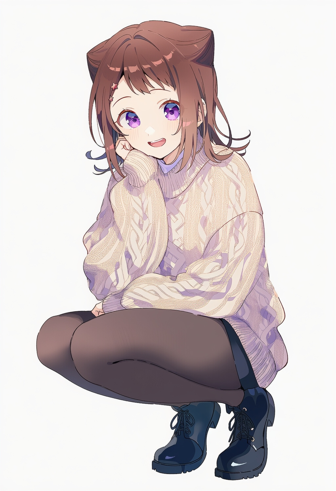

[在线例图](https://assets.quicktagcloud.com/images/raven_composition/raven_composition-0774.jpg?v=109b5161e2f132d5)

<a id="raven_composition-0775"></a>

## 高领毛衣

ID：`raven_composition-0775`；分类：套装 / 日常套装；来源标记：`safe`。

来源说明：

> 领口向上包覆颈部的高领针织毛衣。

正向提示词：

```text
turtleneck_sweater
```

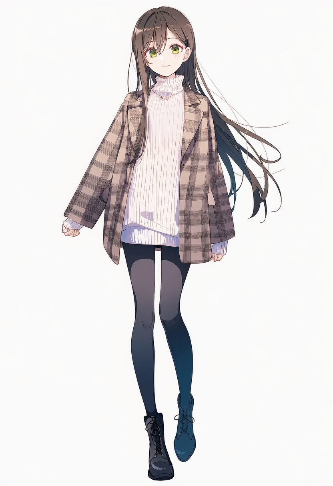

[在线例图](https://assets.quicktagcloud.com/images/raven_composition/raven_composition-0775.jpg?v=824dc27f2ade90f9)

<a id="raven_composition-0776"></a>

## 罗纹毛衣

ID：`raven_composition-0776`；分类：套装 / 日常套装；来源标记：`safe`。

来源说明：

> 以纵向或横向罗纹针织纹理为主要特征的毛衣。

正向提示词：

```text
ribbed_sweater
```

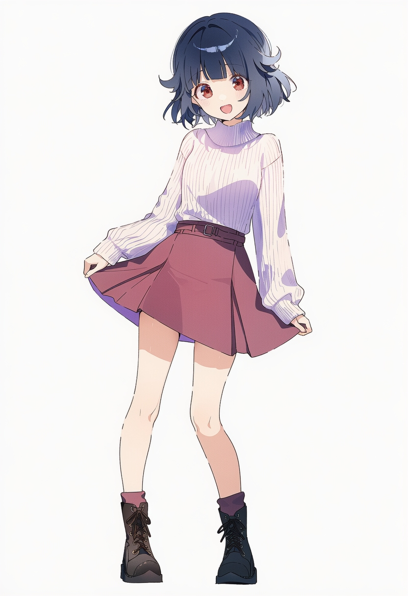

[在线例图](https://assets.quicktagcloud.com/images/raven_composition/raven_composition-0776.jpg?v=94b1c48a6c1acd94)

<a id="raven_composition-0777"></a>

## 睡衣

ID：`raven_composition-0777`；分类：套装 / 日常套装；来源标记：`safe`。

来源说明：

> 睡眠用成套服装，可为上下分体或一体式睡衣。

正向提示词：

```text
pajamas
```


[在线例图](https://assets.quicktagcloud.com/images/raven_composition/raven_composition-0777.jpg?v=bcf57812c8458aa1)

<a id="raven_composition-0778"></a>

## 皮夹克

ID：`raven_composition-0778`；分类：套装 / 日常套装；来源标记：`safe`。

来源说明：

> 以皮革材质和夹克剪裁为核心的现代外套类型，视觉稳定，常见于机车或摇滚穿搭。

正向提示词：

```text
leather_jacket
```

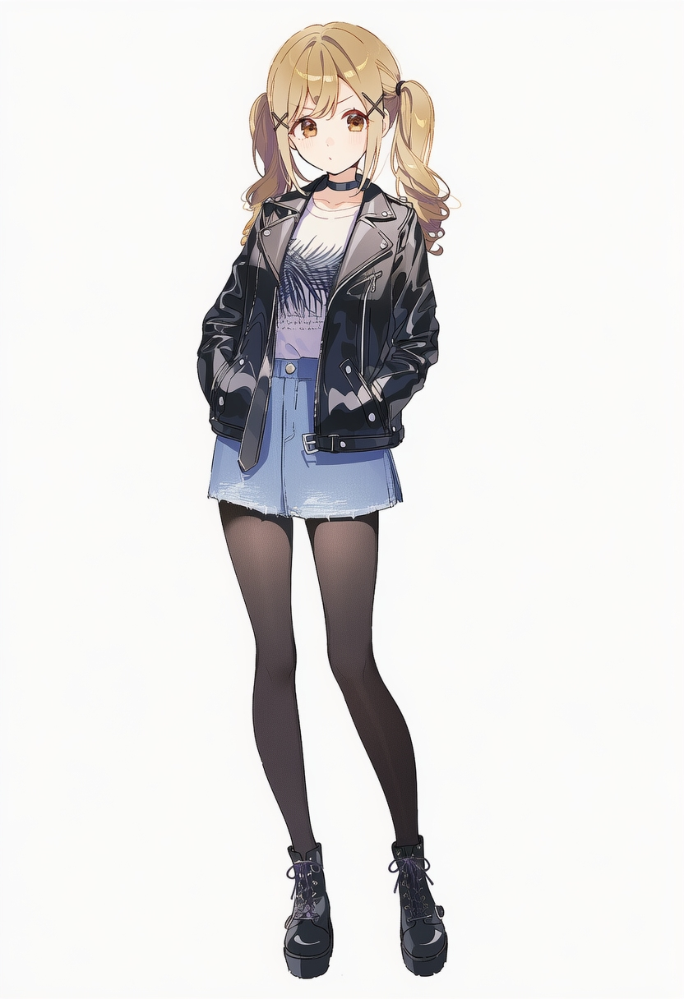

[在线例图](https://assets.quicktagcloud.com/images/raven_composition/raven_composition-0778.jpg?v=0c5b882cf2439154)

<a id="raven_composition-0779"></a>

## 冬季大衣

ID：`raven_composition-0779`；分类：套装 / 日常套装；来源标记：`safe`。

来源说明：

> 面向寒冷天气的厚重大衣。用具体外套替代 winter_clothes 这种可能混入毛衣、围巾、靴子等多种视觉的大类。

正向提示词：

```text
winter_coat
```

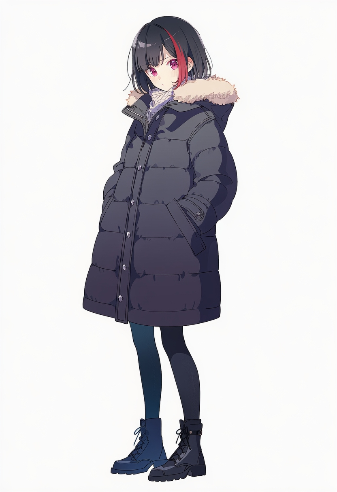

[在线例图](https://assets.quicktagcloud.com/images/raven_composition/raven_composition-0779.jpg?v=24fccbf797323460)

<a id="raven_composition-0780"></a>

## 风衣

ID：`raven_composition-0780`；分类：套装 / 日常套装；来源标记：`safe`。

来源说明：

> 典型双排扣、腰带、中长版型的风衣类外套，属于稳定且可直接复现的服装视觉。

正向提示词：

```text
trench_coat
```

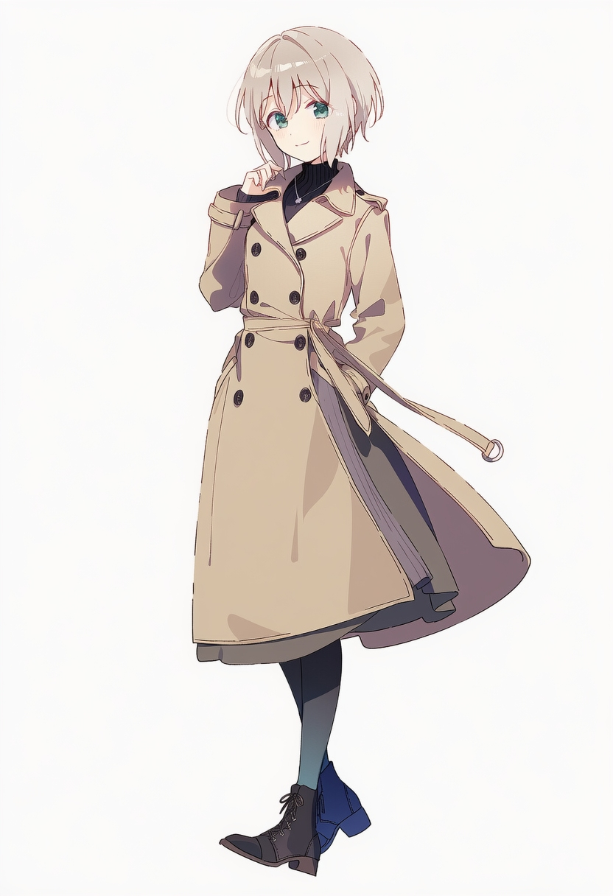

[在线例图](https://assets.quicktagcloud.com/images/raven_composition/raven_composition-0780.jpg?v=74825b34bc1d1228)

<a id="raven_composition-0781"></a>

## 校队夹克

ID：`raven_composition-0781`；分类：套装 / 日常套装；来源标记：`safe`。

来源说明：

> 带对比袖、罗纹收口和校队/字母元素的经典 varsity 夹克。这里按服装版型收录，而不是按具体学校或作品细分。

正向提示词：

```text
letterman_jacket
```

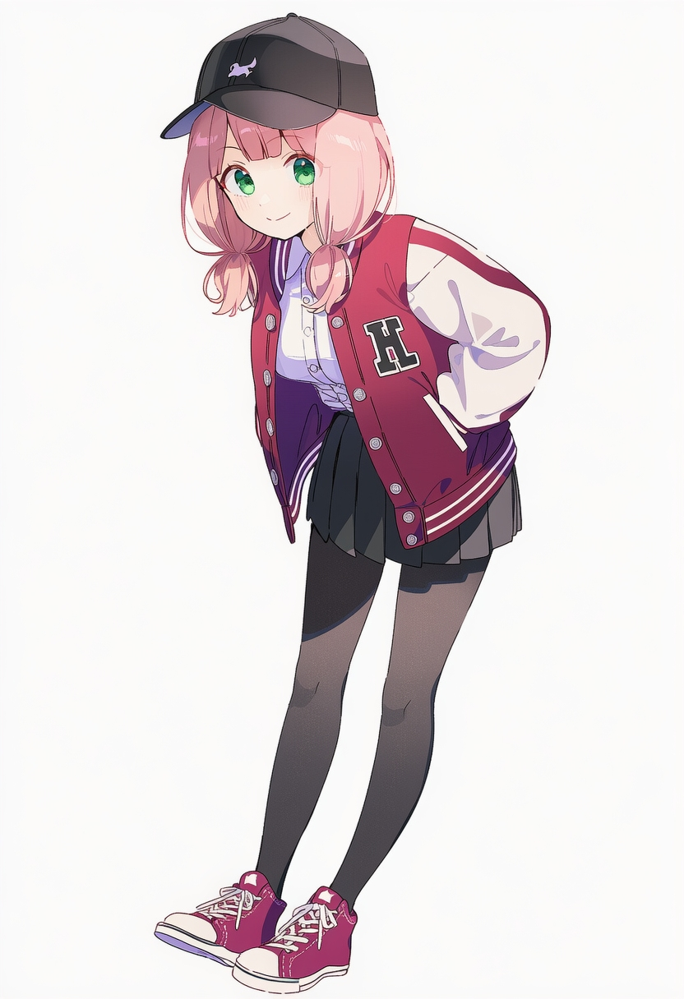

[在线例图](https://assets.quicktagcloud.com/images/raven_composition/raven_composition-0781.jpg?v=eaa8e75d2c93e1f3)

<a id="raven_composition-0782"></a>

## 阿兰花纹毛衣

ID：`raven_composition-0782`；分类：套装 / 日常套装；来源标记：`safe`。

来源说明：

> 以立体绞花、麻花等阿兰针织纹样为特征的毛衣。

正向提示词：

```text
aran_sweater
```


[在线例图](https://assets.quicktagcloud.com/images/raven_composition/raven_composition-0782.jpg?v=92c2ddb455c999cf)

<a id="raven_composition-0783"></a>

## 雨衣

ID：`raven_composition-0783`；分类：套装 / 日常套装；来源标记：`safe`。

来源说明：

> 用于防雨的外套型服装，整体轮廓和功能稳定，不属于抽象天气穿搭大类。

正向提示词：

```text
raincoat
```

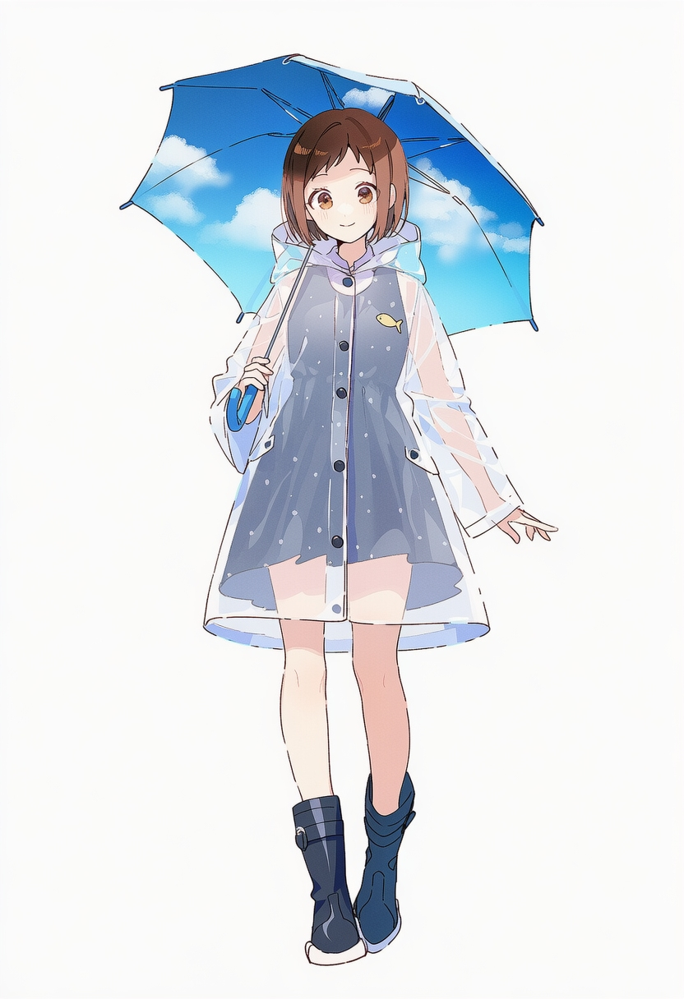

[在线例图](https://assets.quicktagcloud.com/images/raven_composition/raven_composition-0783.jpg?v=e3144830cc1f5762)

<a id="raven_composition-0784"></a>

## 飞行员夹克

ID：`raven_composition-0784`；分类：套装 / 日常套装；来源标记：`safe`。

来源说明：

> 短款、收口下摆与袖口的飞行员夹克轮廓，视觉指向明确。

正向提示词：

```text
bomber_jacket
```

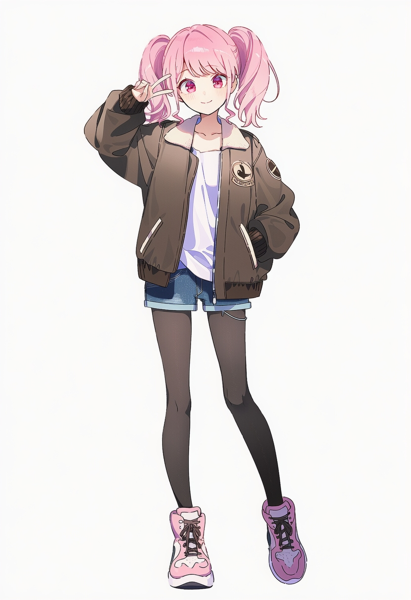

[在线例图](https://assets.quicktagcloud.com/images/raven_composition/raven_composition-0784.jpg?v=629a0b6606e766ef)

<a id="raven_composition-0785"></a>

## 胸前大开口毛衣

ID：`raven_composition-0785`；分类：套装 / 日常套装；来源标记：`safe`。

来源说明：

> 胸前具有大面积开口或镂空结构的毛衣。

正向提示词：

```text
open-chest_sweater
```


[在线例图](https://assets.quicktagcloud.com/images/raven_composition/raven_composition-0785.jpg?v=0eeed8b5e558778e)

<a id="raven_composition-0786"></a>

## 牛仔夹克

ID：`raven_composition-0786`；分类：套装 / 日常套装；来源标记：`safe`。

来源说明：

> 牛仔布制作的夹克型外套，材质和轮廓共同形成稳定视觉。

正向提示词：

```text
denim_jacket
```

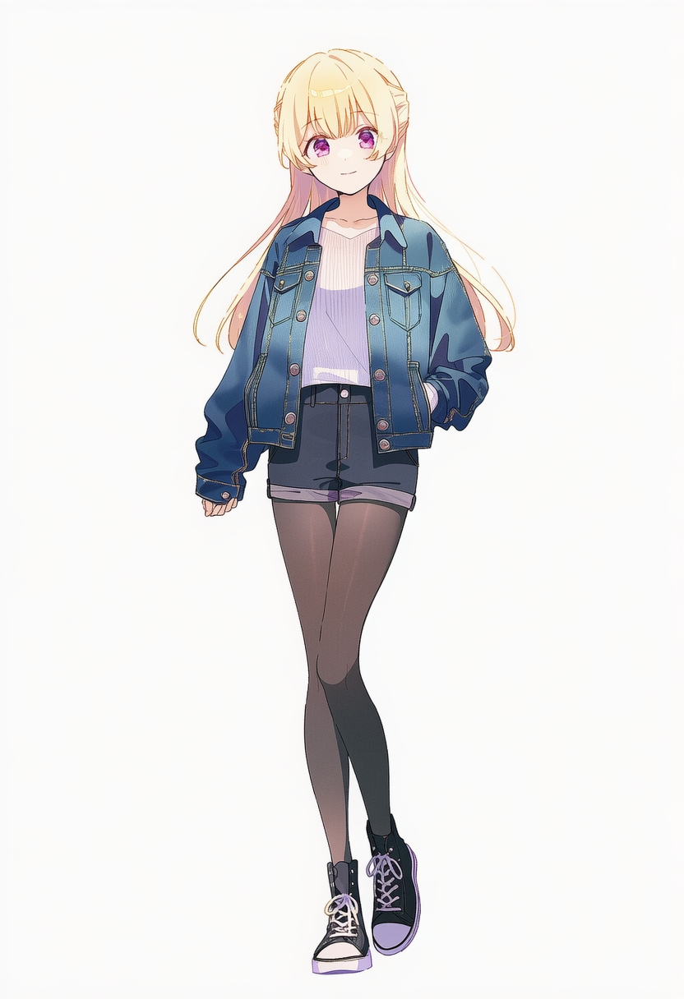

[在线例图](https://assets.quicktagcloud.com/images/raven_composition/raven_composition-0786.jpg?v=c4bbb597b4208b53)

<a id="raven_composition-0787"></a>

## 浴袍

ID：`raven_composition-0787`；分类：套装 / 日常套装；来源标记：`safe`。

来源说明：

> 洗浴后或居家时穿着的宽松系带长袍。

正向提示词：

```text
bathrobe
```


[在线例图](https://assets.quicktagcloud.com/images/raven_composition/raven_composition-0787.jpg?v=3b77eeba915febc7)

<a id="raven_composition-0788"></a>

## 派克大衣

ID：`raven_composition-0788`；分类：套装 / 日常套装；来源标记：`safe`。

来源说明：

> 通常带连帽、偏防风保暖用途的中长外套，轮廓和用途都较稳定。

正向提示词：

```text
parka
```

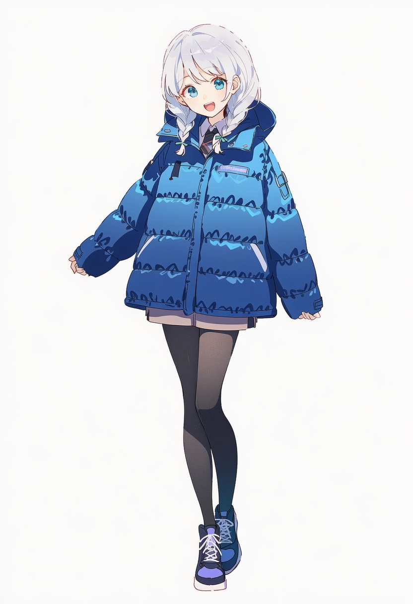

[在线例图](https://assets.quicktagcloud.com/images/raven_composition/raven_composition-0788.jpg?v=c624f2780b652c27)
