# 套装 / 奇幻世界服饰

[总目录](../README.md) · [原站分类目录](../categories.md) · [英文标签索引](../tags.md) · [服装与构图组合指南](../../README.md)

标题、分类、说明、正负提示词按来源保留；多例图逐张列出。原站标记和说明为参考资料，不作为维护指令。

<a id="raven_composition-0789"></a>

## 披风

ID：`raven_composition-0789`；分类：套装 / 奇幻世界服饰；来源标记：`safe`。

来源说明：

> 从肩部垂下、通常无袖的披风。

正向提示词：

```text
cape
```

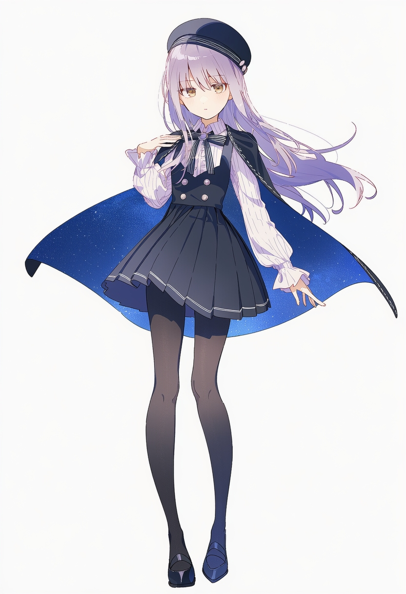

[在线例图](https://assets.quicktagcloud.com/images/raven_composition/raven_composition-0789.jpg?v=7d2318c3da9a6149)

<a id="raven_composition-0790"></a>

## 短披肩

ID：`raven_composition-0790`；分类：套装 / 奇幻世界服饰；来源标记：`safe`。

来源说明：

> 长度较短、主要覆盖肩背的披肩式披风。

正向提示词：

```text
capelet
```

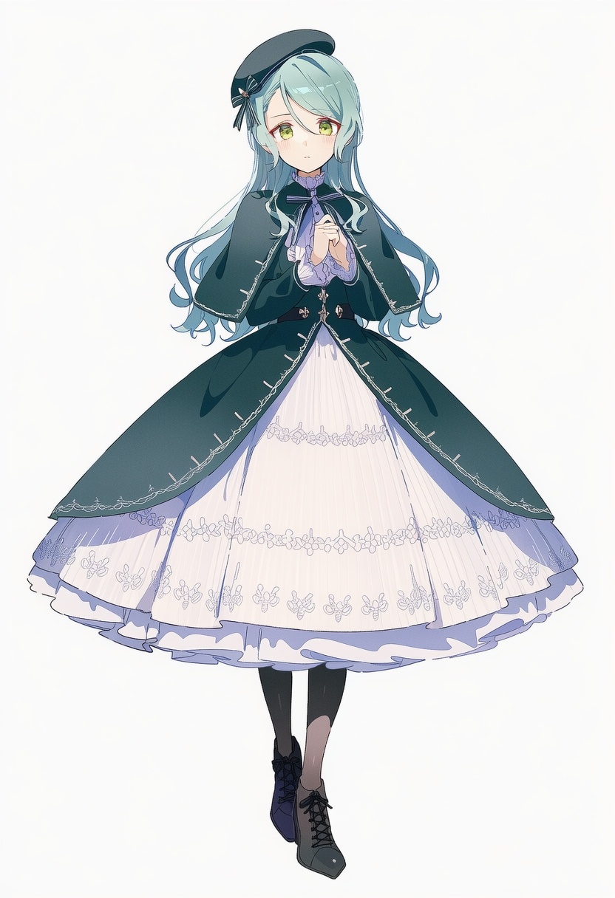

[在线例图](https://assets.quicktagcloud.com/images/raven_composition/raven_composition-0790.jpg?v=61137b190be6f442)

<a id="raven_composition-0791"></a>

## 斗篷

ID：`raven_composition-0791`；分类：套装 / 奇幻世界服饰；来源标记：`safe`。

来源说明：

> 大面积覆盖式斗篷，是法师、游侠、旅行者、冒险者造型中非常通用的单 Tag 服装描述。

正向提示词：

```text
cloak
```

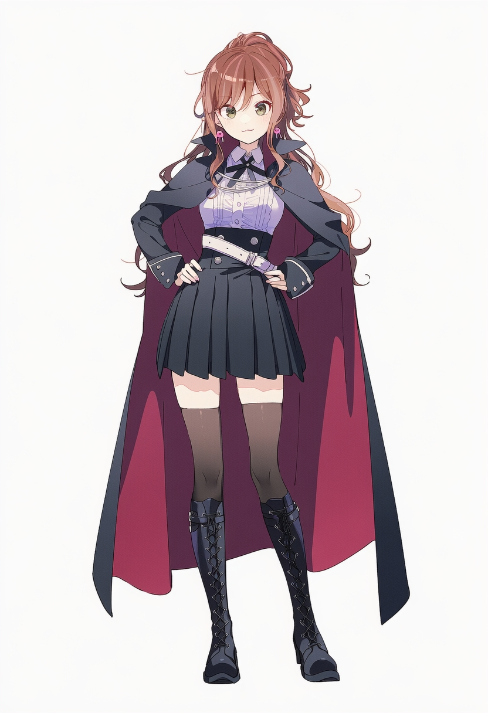

[在线例图](https://assets.quicktagcloud.com/images/raven_composition/raven_composition-0791.jpg?v=4d9cef4667ec4c7f)

<a id="raven_composition-0792"></a>

## 长袍

ID：`raven_composition-0792`；分类：套装 / 奇幻世界服饰；来源标记：`safe`。

来源说明：

> 宽松、长身的袍式服装。

正向提示词：

```text
robe
```

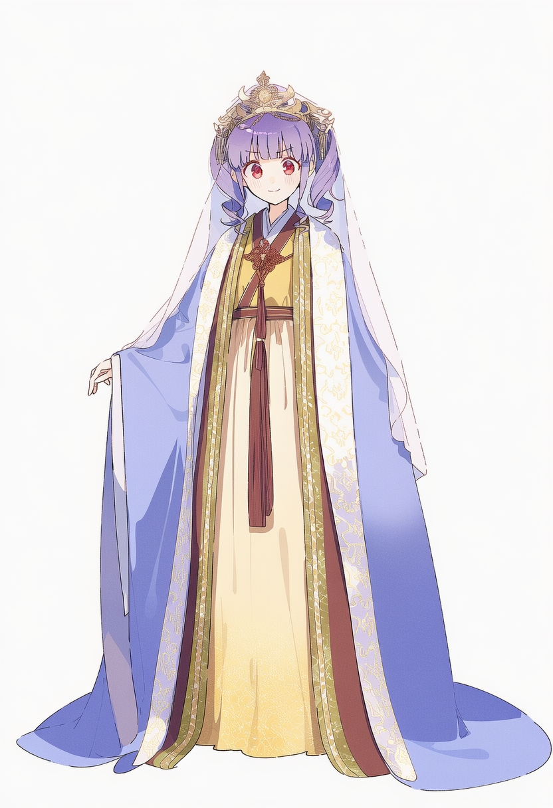

[在线例图](https://assets.quicktagcloud.com/images/raven_composition/raven_composition-0792.jpg?v=9970cb29909e18ba)

<a id="raven_composition-0793"></a>

## 战袍

ID：`raven_composition-0793`；分类：套装 / 奇幻世界服饰；来源标记：`safe`。

来源说明：

> 穿在盔甲或衣物外的无袖罩袍/战袍，是骑士团、圣骑士、冒险者常见的 RPG 服装元素。

正向提示词：

```text
tabard
```

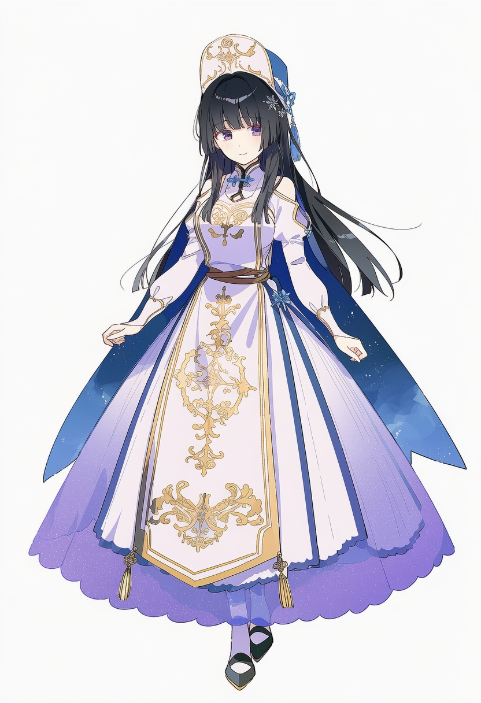

[在线例图](https://assets.quicktagcloud.com/images/raven_composition/raven_composition-0793.jpg?v=7875ebb2622b3ba3)

<a id="raven_composition-0794"></a>

## 铠甲连衣裙

ID：`raven_composition-0794`；分类：套装 / 奇幻世界服饰；来源标记：`safe`。

来源说明：

> 将连衣裙轮廓与铠甲结构结合的服装。

正向提示词：

```text
armored_dress
```

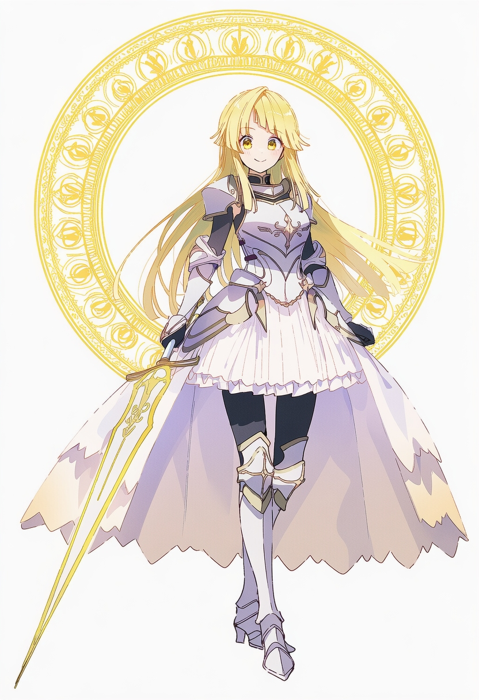

[在线例图](https://assets.quicktagcloud.com/images/raven_composition/raven_composition-0794.jpg?v=403a2fec1495b6c1)

<a id="raven_composition-0795"></a>

## 束腰外衣

ID：`raven_composition-0795`；分类：套装 / 奇幻世界服饰；来源标记：`safe`。

来源说明：

> 长度通常过臀的宽松上衣或束腰外衣。

正向提示词：

```text
tunic
```

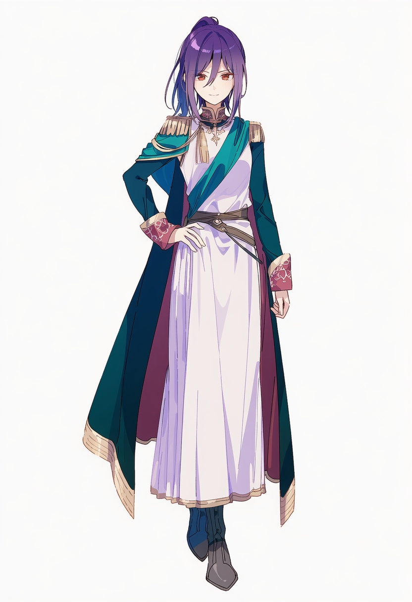

[在线例图](https://assets.quicktagcloud.com/images/raven_composition/raven_composition-0795.jpg?v=f6da3a0529312cbc)

<a id="raven_composition-0796"></a>

## 全身铠甲

ID：`raven_composition-0796`；分类：套装 / 奇幻世界服饰；来源标记：`safe`。

来源说明：

> 覆盖身体大部分区域的完整铠甲套装。

正向提示词：

```text
full_armor
```

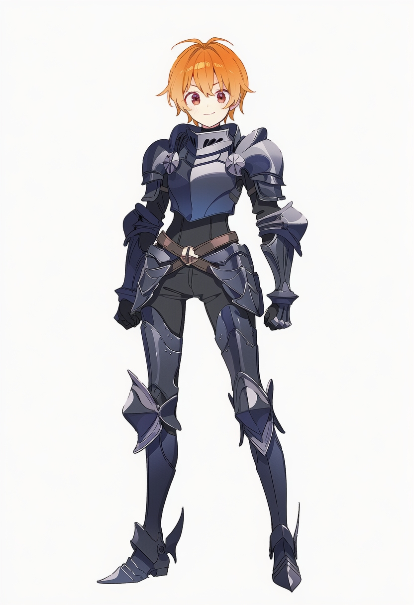

[在线例图](https://assets.quicktagcloud.com/images/raven_composition/raven_composition-0796.jpg?v=868d83f0abaf5e82)

<a id="raven_composition-0797"></a>

## 敞开长袍

ID：`raven_composition-0797`；分类：套装 / 奇幻世界服饰；来源标记：`safe`。

来源说明：

> 前襟敞开穿着的长袍。

正向提示词：

```text
open_robe
```

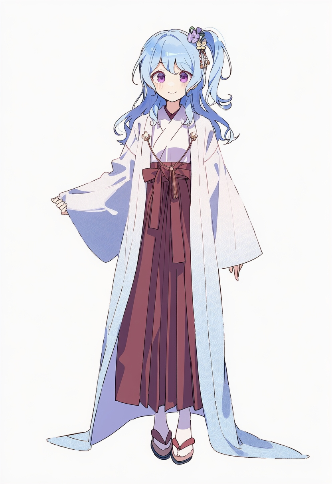

[在线例图](https://assets.quicktagcloud.com/images/raven_composition/raven_composition-0797.jpg?v=ce35c4382d6181ad)

<a id="raven_composition-0798"></a>

## 连帽长袍

ID：`raven_composition-0798`；分类：套装 / 奇幻世界服饰；来源标记：`safe`。

来源说明：

> 带固定连帽结构的长袍，常用于法师、教团、神秘职业等 RPG 造型；比泛用 robe 更具体。

正向提示词：

```text
hooded_robe
```

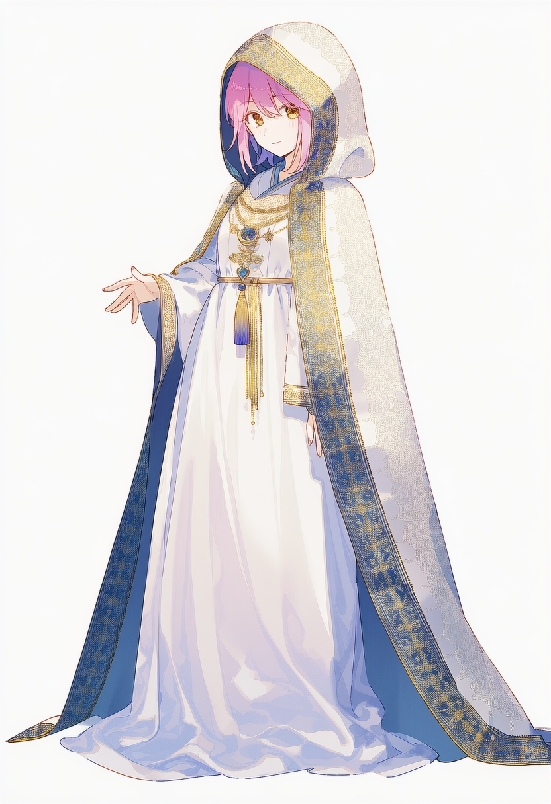

[在线例图](https://assets.quicktagcloud.com/images/raven_composition/raven_composition-0798.jpg?v=1807c9ccde9bec5f)

<a id="raven_composition-0799"></a>

## 锁子甲

ID：`raven_composition-0799`；分类：套装 / 奇幻世界服饰；来源标记：`safe`。

来源说明：

> 由金属环连接形成的护甲服装，是骑士、战士类 RPG 造型常见的单 Tag 描述。

正向提示词：

```text
chainmail
```

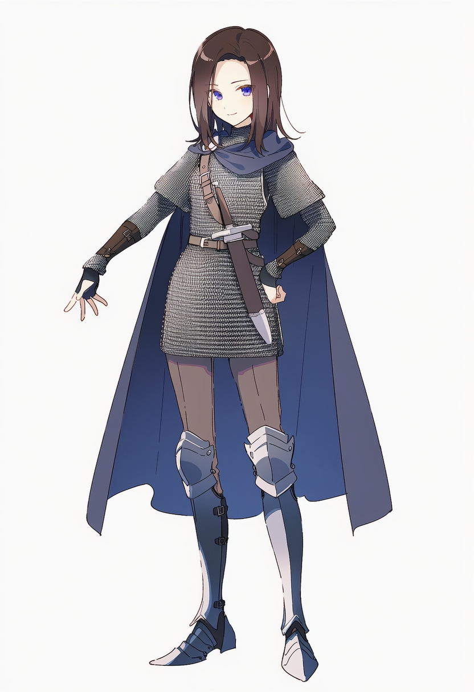

[在线例图](https://assets.quicktagcloud.com/images/raven_composition/raven_composition-0799.jpg?v=028114a97fb24c65)

<a id="raven_composition-0800"></a>

## 板甲套装

ID：`raven_composition-0800`；分类：套装 / 奇幻世界服饰；来源标记：`safe`。

来源说明：

> 以金属板甲为核心的铠甲穿着。通常用于覆盖躯干并搭配其他板甲护具的战斗造型；

正向提示词：

```text
plate_armor
```

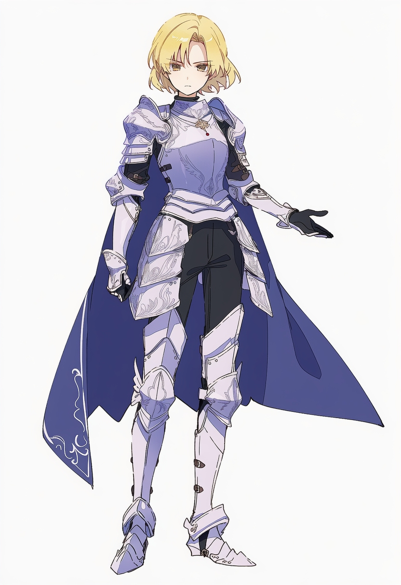

[在线例图](https://assets.quicktagcloud.com/images/raven_composition/raven_composition-0800.jpg?v=500348fba6e3af78)

<a id="raven_composition-0801"></a>

## 皮甲

ID：`raven_composition-0801`；分类：套装 / 奇幻世界服饰；来源标记：`safe`。

来源说明：

> 以皮革为主要防护材料的轻甲，常用于游侠、盗贼、冒险者等 RPG 职业造型。

正向提示词：

```text
leather_armor
```

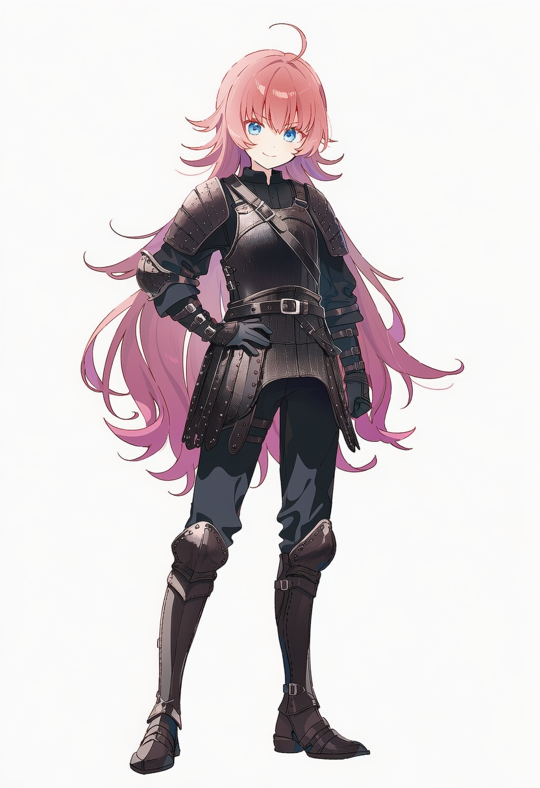

[在线例图](https://assets.quicktagcloud.com/images/raven_composition/raven_composition-0801.jpg?v=2d6d944e56e692fb)

<a id="raven_composition-0802"></a>

## 鳞甲

ID：`raven_composition-0802`；分类：套装 / 奇幻世界服饰；来源标记：`safe`。

来源说明：

> 由鳞片状甲片构成的护甲类型，可直接指定幻想战士/骑士的护甲风格。

正向提示词：

```text
scale_armor
```

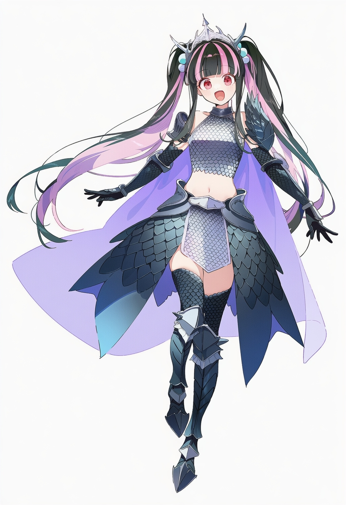

[在线例图](https://assets.quicktagcloud.com/images/raven_composition/raven_composition-0802.jpg?v=683c7c2c1eda365e)

<a id="raven_composition-0803"></a>

## 绗缝甲

ID：`raven_composition-0803`；分类：套装 / 奇幻世界服饰；来源标记：`safe`。

来源说明：

> 绗缝填充式防护服，可单独作为轻中型护甲，也常穿在板甲/锁子甲内。

正向提示词：

```text
gambeson
```

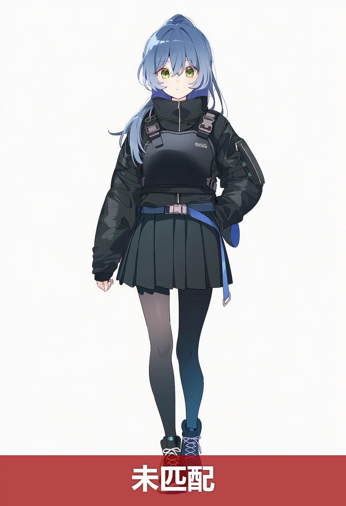

[在线例图](https://assets.quicktagcloud.com/images/raven_composition/raven_composition-0803.jpg?v=aab595fb48cce165)

<a id="raven_composition-0804"></a>

## 华丽铠甲

ID：`raven_composition-0804`；分类：套装 / 奇幻世界服饰；来源标记：`safe`。

来源说明：

> 装饰性强、纹样复杂的铠甲，常用于贵族骑士、圣骑士、王室护卫等幻想造型。

正向提示词：

```text
ornate_armor
```

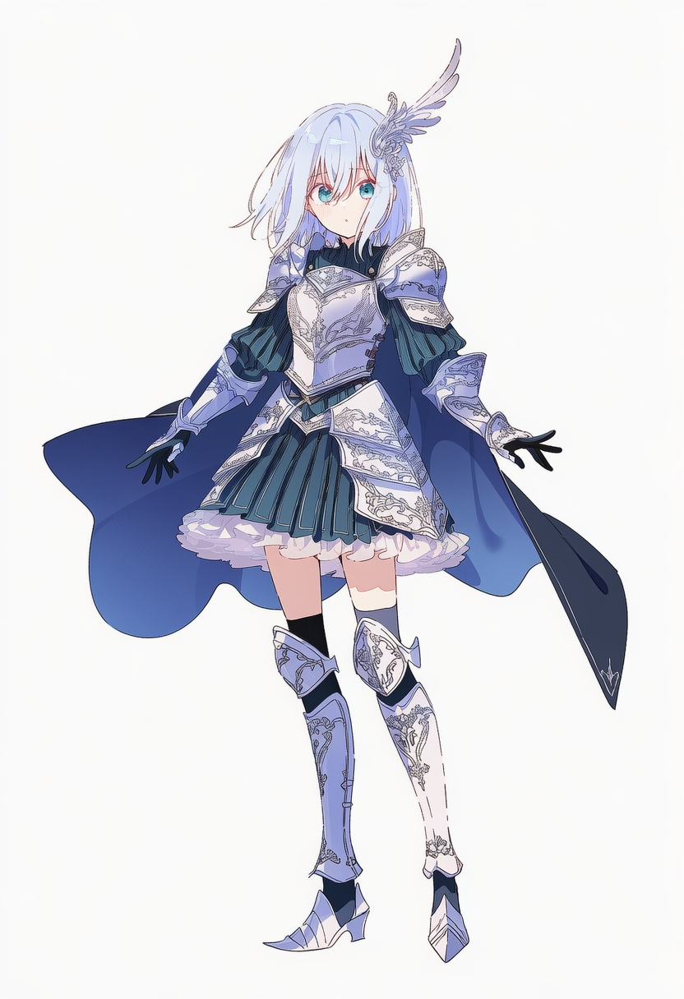

[在线例图](https://assets.quicktagcloud.com/images/raven_composition/raven_composition-0804.jpg?v=5264380aace4213d)

<a id="raven_composition-0805"></a>

## 王室礼袍

ID：`raven_composition-0805`；分类：套装 / 奇幻世界服饰；来源标记：`safe`。

来源说明：

> 王族或高阶贵族使用的华丽长袍型服装。

正向提示词：

```text
royal_robe
```

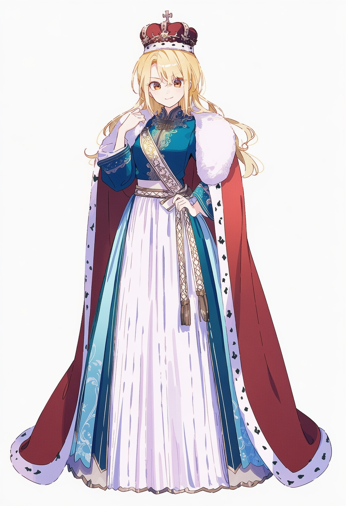

[在线例图](https://assets.quicktagcloud.com/images/raven_composition/raven_composition-0805.jpg?v=6982887118448c1f)

<a id="raven_composition-0806"></a>

## 狂战士铠甲

ID：`raven_composition-0806`；分类：套装 / 奇幻世界服饰；来源标记：`safe`。

来源说明：

> 偏狂战士/重装战士风格的铠甲 Tag，适合高攻击性、厚重幻想战斗造型。

正向提示词：

```text
berserker_armor
```

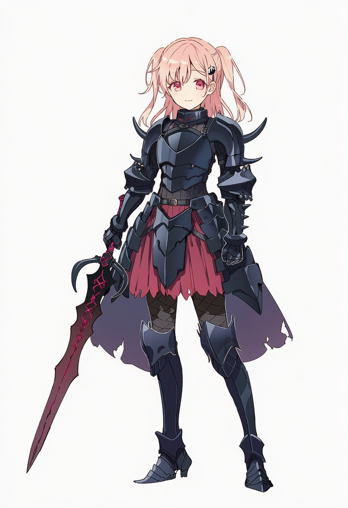

[在线例图](https://assets.quicktagcloud.com/images/raven_composition/raven_composition-0806.jpg?v=9013ea5f785a4284)
