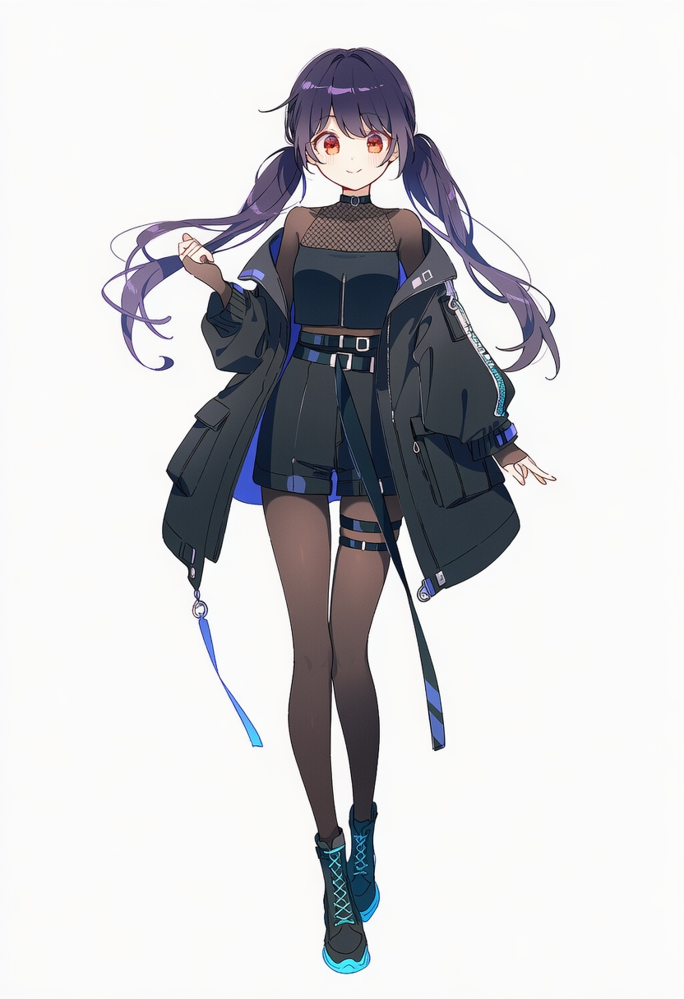
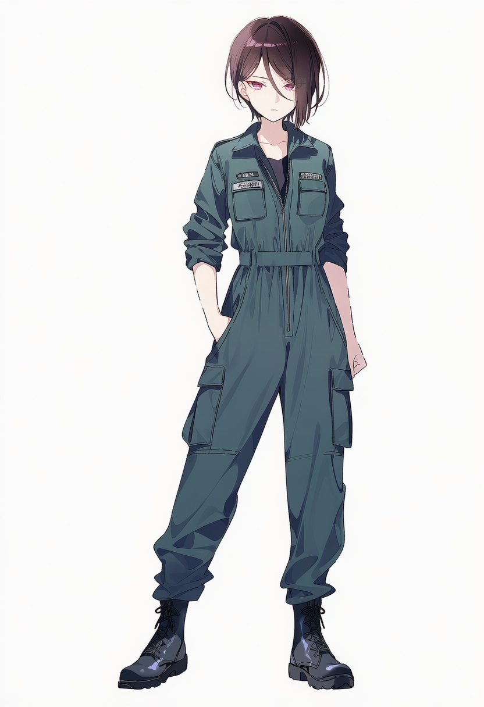
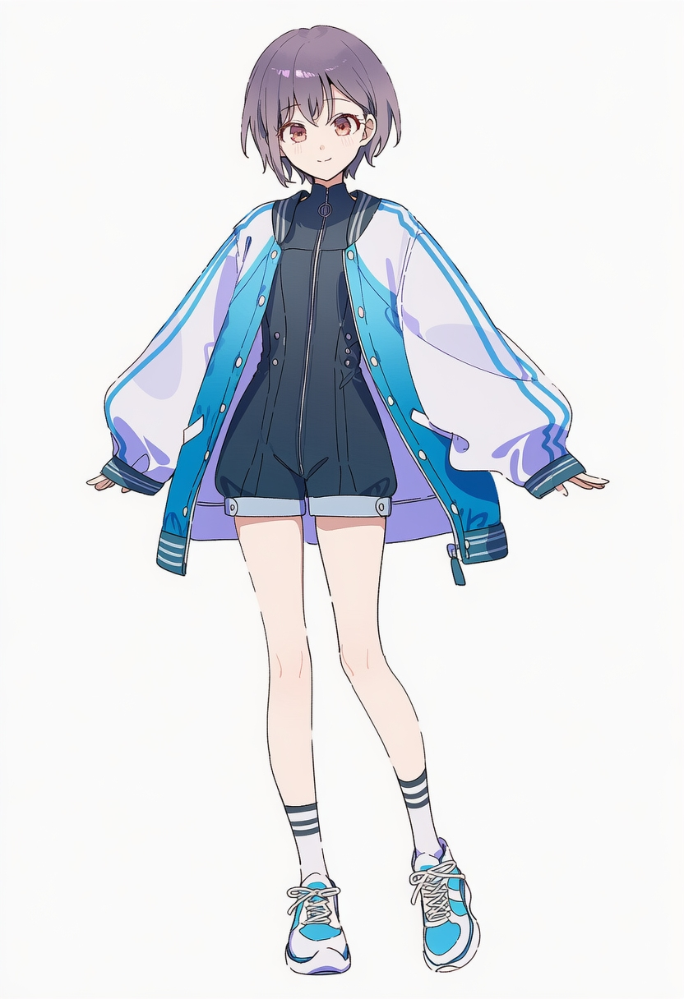
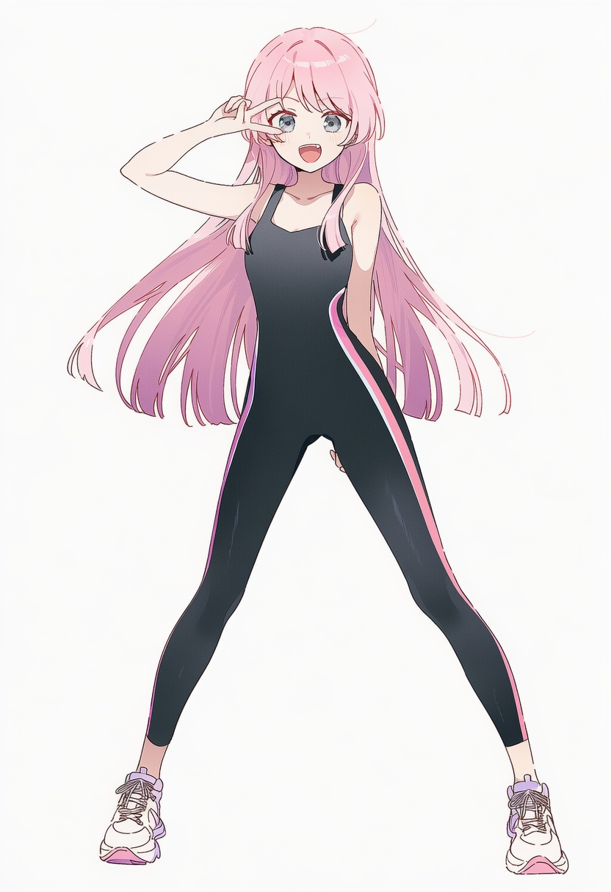
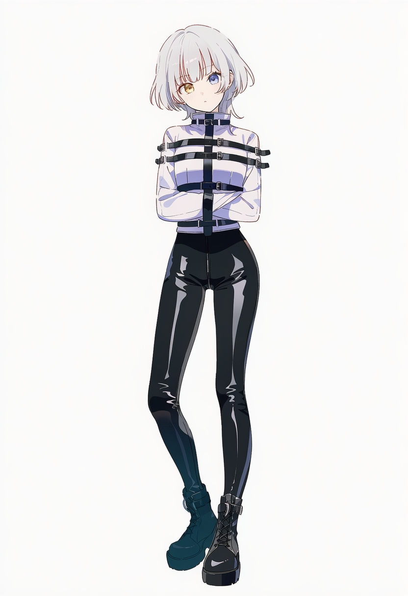

# 套装 / 连体/功能服

[总目录](../README.md) · [原站分类目录](../categories.md) · [英文标签索引](../tags.md) · [服装与构图组合指南](../../README.md)

标题、分类、说明、正负提示词按来源保留；多例图逐张列出。原站标记和说明为参考资料，不作为维护指令。

<a id="raven_composition-0807"></a>

## 全身袜衣

ID：`raven_composition-0807`；分类：套装 / 连体/功能服；来源标记：`safe`。

来源说明：

> 由袜类弹性材质制成、连续包覆躯干与四肢的贴身衣物。

正向提示词：

```text
bodystocking
```



[在线例图](https://assets.quicktagcloud.com/images/raven_composition/raven_composition-0807.jpg?v=217f739ce0f1d406)

<a id="raven_composition-0808"></a>

## 连体工作服

ID：`raven_composition-0808`；分类：套装 / 连体/功能服；来源标记：`safe`。

来源说明：

> 上衣与长裤连为一体的连体服。

正向提示词：

```text
jumpsuit
```



[在线例图](https://assets.quicktagcloud.com/images/raven_composition/raven_composition-0808.jpg?v=4a14dd74493b7a45)

<a id="raven_composition-0809"></a>

## 连体短裤

ID：`raven_composition-0809`；分类：套装 / 连体/功能服；来源标记：`safe`。

来源说明：

> 上衣与短裤连为一体的短款连体服。

正向提示词：

```text
romper
```



[在线例图](https://assets.quicktagcloud.com/images/raven_composition/raven_composition-0809.jpg?v=2a518a49ef63f7f5)

<a id="raven_composition-0810"></a>

## 全身体操紧身衣

ID：`raven_composition-0810`；分类：套装 / 连体/功能服；来源标记：`safe`。

来源说明：

> 覆盖躯干并延伸至腿部的贴身一体式服装。

正向提示词：

```text
unitard
```



[在线例图](https://assets.quicktagcloud.com/images/raven_composition/raven_composition-0810.jpg?v=a4eb1be038856989)

<a id="raven_composition-0811"></a>

## 拘束衣

ID：`raven_composition-0811`；分类：套装 / 连体/功能服；来源标记：`safe`。

来源说明：

> 限制手臂活动、用于拘束人体的特殊服装。

正向提示词：

```text
straitjacket
```



[在线例图](https://assets.quicktagcloud.com/images/raven_composition/raven_composition-0811.jpg?v=af18d8ac1ae71ec2)
