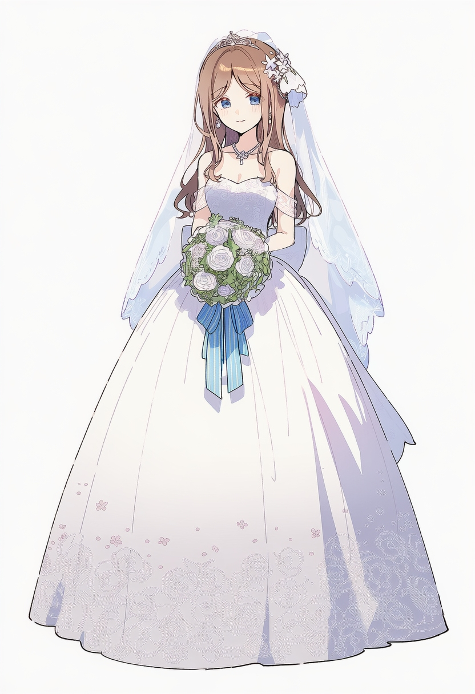
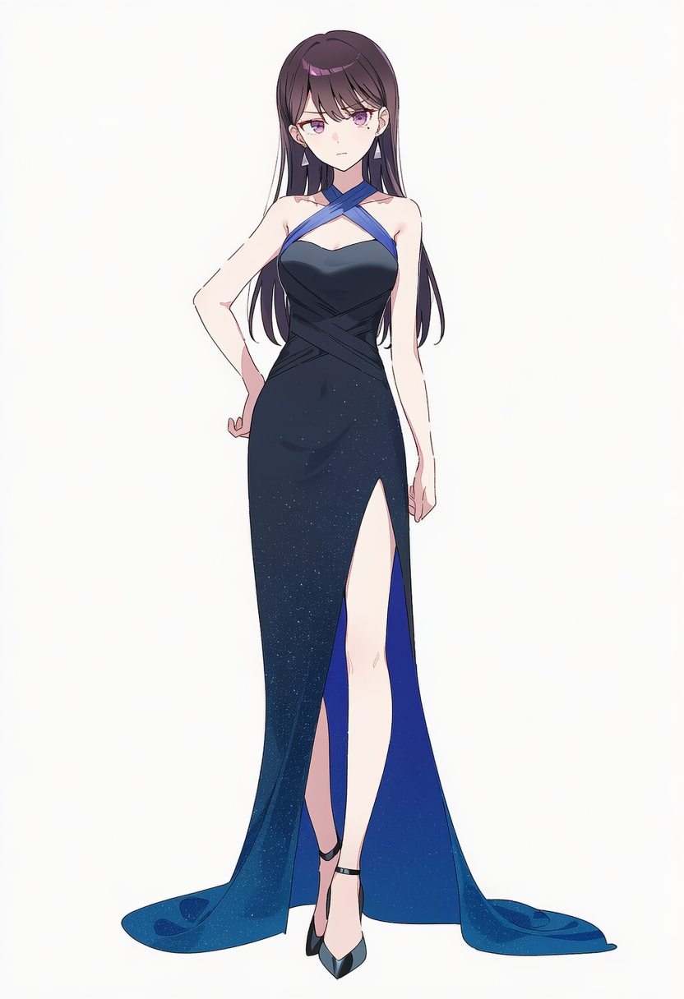
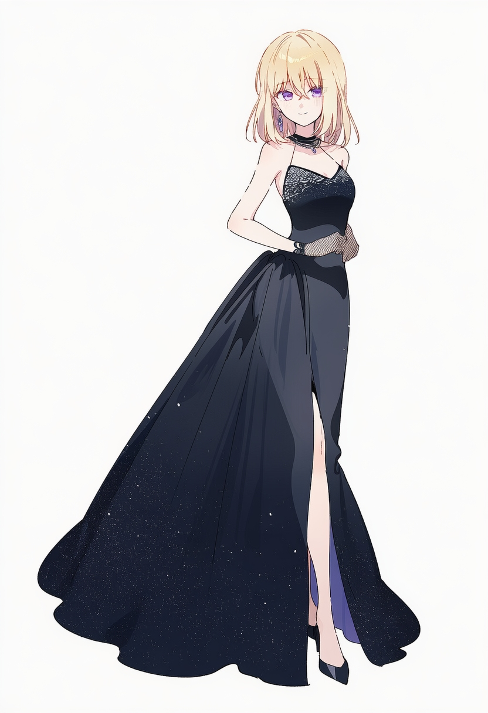
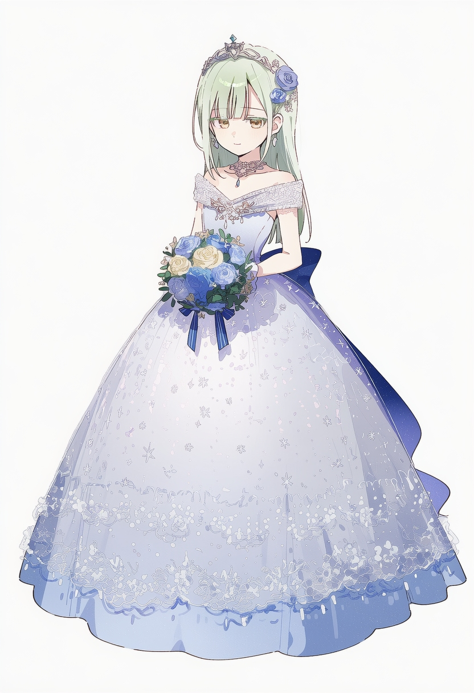
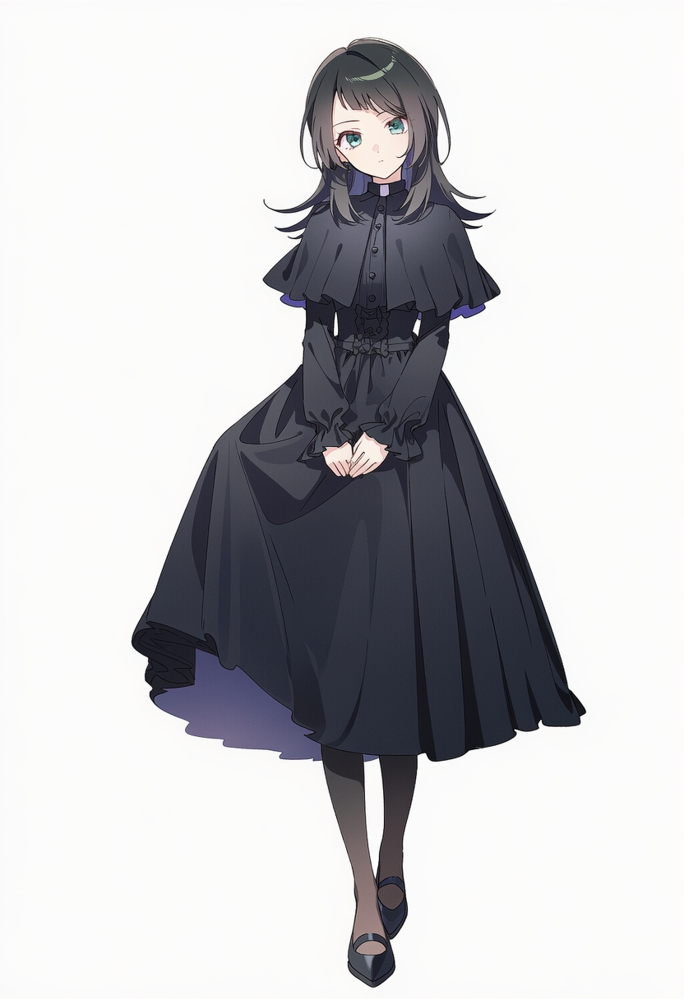

# 套装 / 礼服/仪式

[总目录](../README.md) · [原站分类目录](../categories.md) · [英文标签索引](../tags.md) · [服装与构图组合指南](../../README.md)

标题、分类、说明、正负提示词按来源保留；多例图逐张列出。原站标记和说明为参考资料，不作为维护指令。

<a id="raven_composition-0812"></a>

## 婚纱

ID：`raven_composition-0812`；分类：套装 / 礼服/仪式；来源标记：`safe`。

来源说明：

> 婚礼场合的主要礼服，通常为白色或浅色长裙，也可有非传统设计。

正向提示词：

```text
wedding_dress
```



[在线例图](https://assets.quicktagcloud.com/images/raven_composition/raven_composition-0812.jpg?v=6711de920b960448)

<a id="raven_composition-0813"></a>

## 鸡尾酒礼服

ID：`raven_composition-0813`；分类：套装 / 礼服/仪式；来源标记：`safe`。

来源说明：

> 适合半正式社交场合、通常较晚礼服简短的礼服裙。

正向提示词：

```text
cocktail_dress
```



[在线例图](https://assets.quicktagcloud.com/images/raven_composition/raven_composition-0813.jpg?v=2fcb6fa6b7dd7f37)

<a id="raven_composition-0814"></a>

## 晚礼服

ID：`raven_composition-0814`；分类：套装 / 礼服/仪式；来源标记：`safe`。

来源说明：

> 正式晚间场合穿着的长款礼服。

正向提示词：

```text
evening_gown
```



[在线例图](https://assets.quicktagcloud.com/images/raven_composition/raven_composition-0814.jpg?v=437524a85894283c)

<a id="raven_composition-0815"></a>

## 长礼服

ID：`raven_composition-0815`；分类：套装 / 礼服/仪式；来源标记：`safe`。

来源说明：

> 正式场合穿着的长款礼服或礼袍。

正向提示词：

```text
gown
```



[在线例图](https://assets.quicktagcloud.com/images/raven_composition/raven_composition-0815.jpg?v=9d3532f9231058dd)

<a id="raven_composition-0816"></a>

## 丧服连衣裙

ID：`raven_composition-0816`；分类：套装 / 礼服/仪式；来源标记：`safe`。

来源说明：

> 用于葬礼或哀悼场合的庄重连衣裙。

正向提示词：

```text
funeral_dress
```



[在线例图](https://assets.quicktagcloud.com/images/raven_composition/raven_composition-0816.jpg?v=68b7a2706026b85d)
