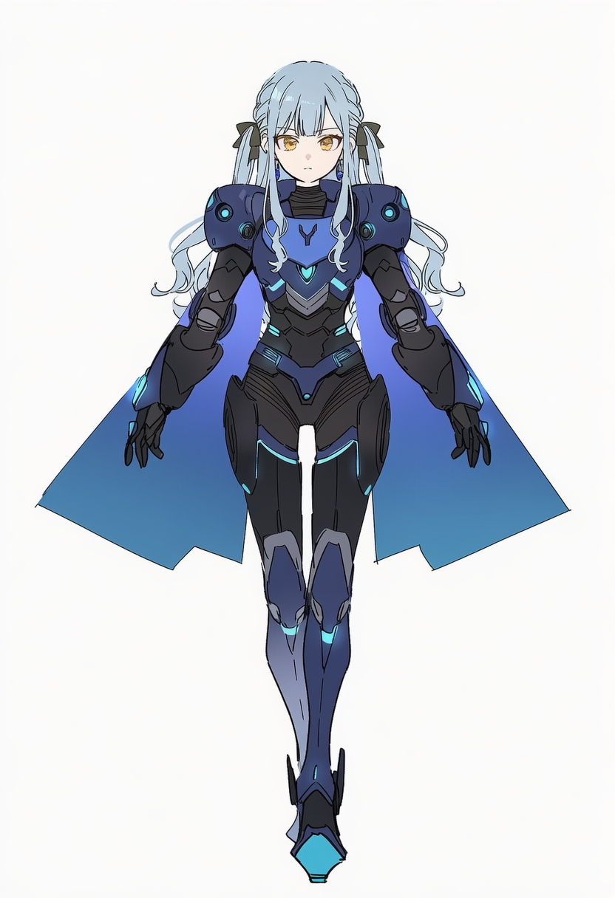
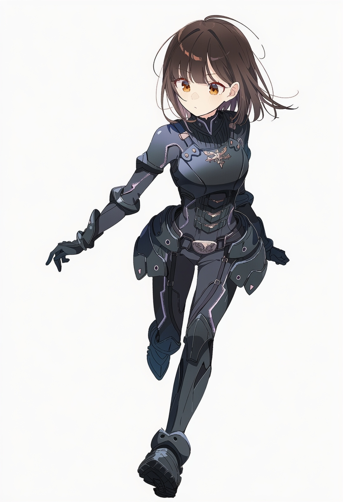

# 套装 / 科幻世界服饰

[总目录](../README.md) · [原站分类目录](../categories.md) · [英文标签索引](../tags.md) · [服装与构图组合指南](../../README.md)

标题、分类、说明、正负提示词按来源保留；多例图逐张列出。原站标记和说明为参考资料，不作为维护指令。

<a id="raven_composition-0817"></a>

## 机甲驾驶服

ID：`raven_composition-0817`；分类：套装 / 科幻世界服饰；来源标记：`safe`。

来源说明：

> 机甲/科幻驾驶员的制式全身服装，通常为贴身连体结构。军事、机甲或驾驶场景的制式服装，整体识别度强。

正向提示词：

```text
mecha_pilot_suit
```


[在线例图](https://assets.quicktagcloud.com/images/raven_composition/raven_composition-0817.jpg?v=0fcda1059012df5c)

<a id="raven_composition-0818"></a>

## 动力装甲

ID：`raven_composition-0818`；分类：套装 / 科幻世界服饰；来源标记：`safe`。

来源说明：

> 带机械助力或高科技结构的全身战斗装甲，适合科幻 RPG/重装职业。

正向提示词：

```text
power_armor
```



[在线例图](https://assets.quicktagcloud.com/images/raven_composition/raven_composition-0818.jpg?v=6fd5c53f1d60540d)

<a id="raven_composition-0819"></a>

## 强化战斗服

ID：`raven_composition-0819`；分类：套装 / 科幻世界服饰；来源标记：`safe`。

来源说明：

> 具有强化、防护或装甲化特征的战斗服，偏科幻/战术 RPG 视觉。

正向提示词：

```text
fortified_suit
```



[在线例图](https://assets.quicktagcloud.com/images/raven_composition/raven_composition-0819.jpg?v=4c4d6cfcfca2dceb)
