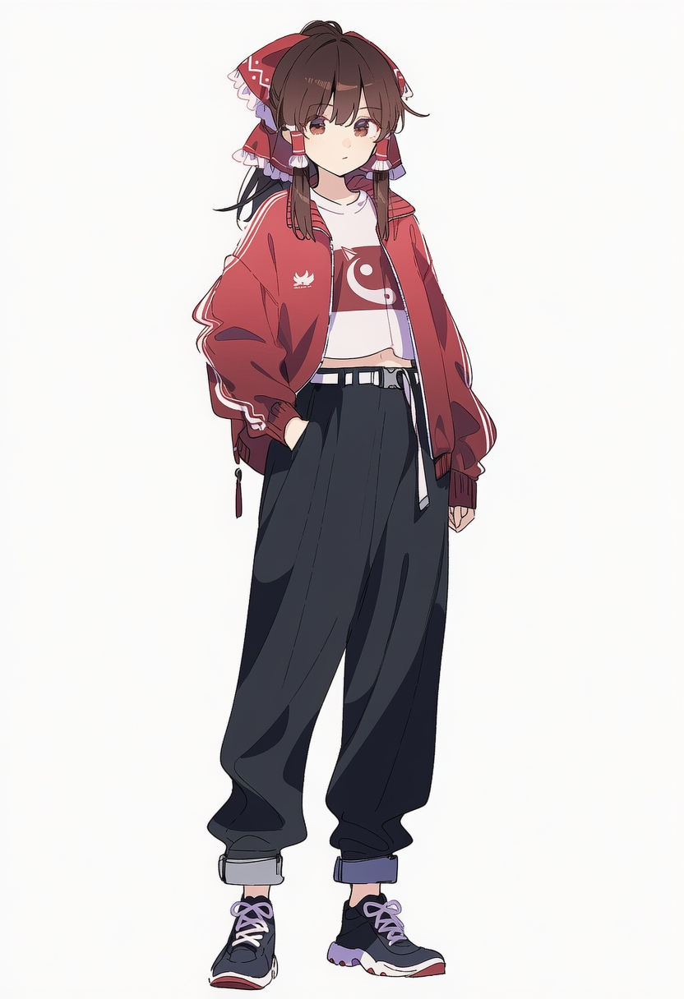

# 裤子 / 基础大类

[总目录](../README.md) · [原站分类目录](../categories.md) · [英文标签索引](../tags.md) · [服装与构图组合指南](../../README.md)

标题、分类、说明、正负提示词按来源保留；多例图逐张列出。原站标记和说明为参考资料，不作为维护指令。

<a id="raven_composition-0820"></a>

## 长裤 / 裤子

ID：`raven_composition-0820`；分类：裤子 / 基础大类；来源标记：`safe`。

来源说明：

> 覆盖双腿、通常从腰部延伸到脚踝附近的下装总称。

正向提示词：

```text
pants
```



[在线例图](https://assets.quicktagcloud.com/images/raven_composition/raven_composition-0820.jpg?v=864c985e4c64cfa7)

<a id="raven_composition-0821"></a>

## 短裤

ID：`raven_composition-0821`；分类：裤子 / 基础大类；来源标记：`safe`。

来源说明：

> 从腰部穿着、但不会完整覆盖双腿的裤装总称。

正向提示词：

```text
shorts
```


[在线例图](https://assets.quicktagcloud.com/images/raven_composition/raven_composition-0821.jpg?v=61b42f08d8d2110c)
