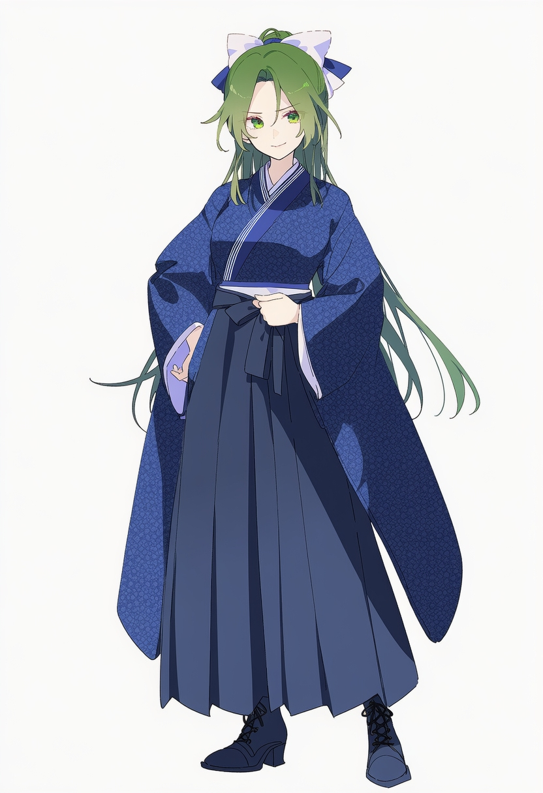
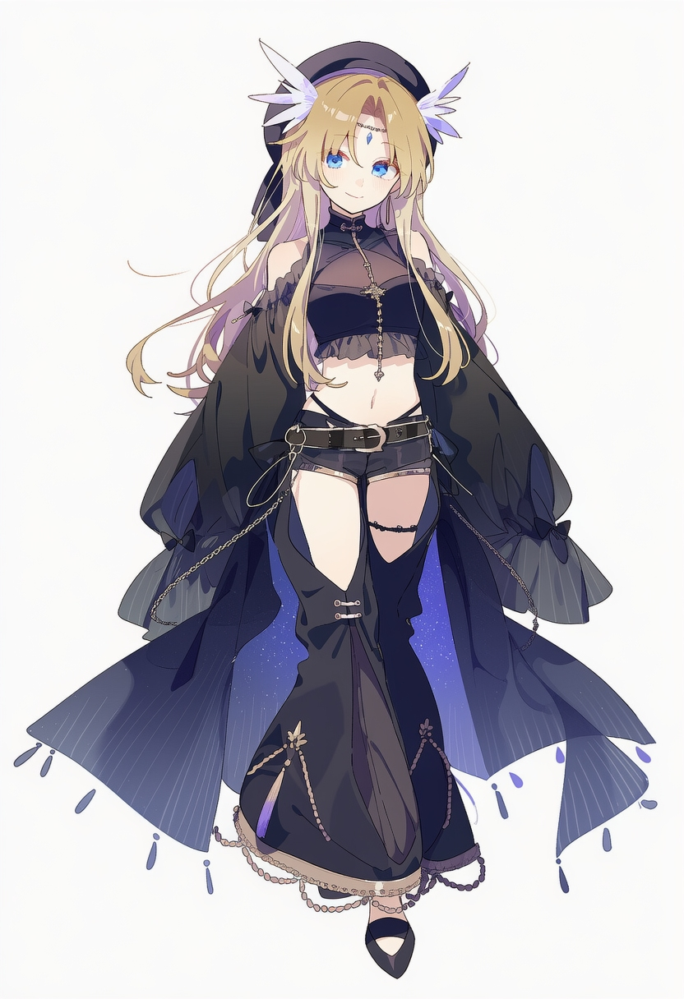
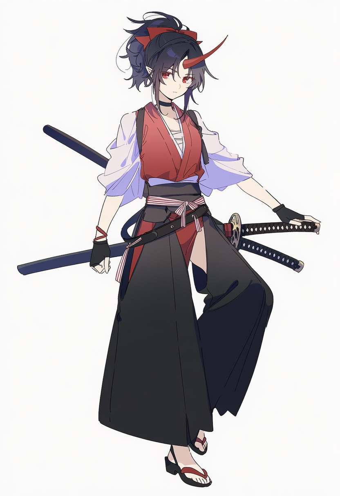
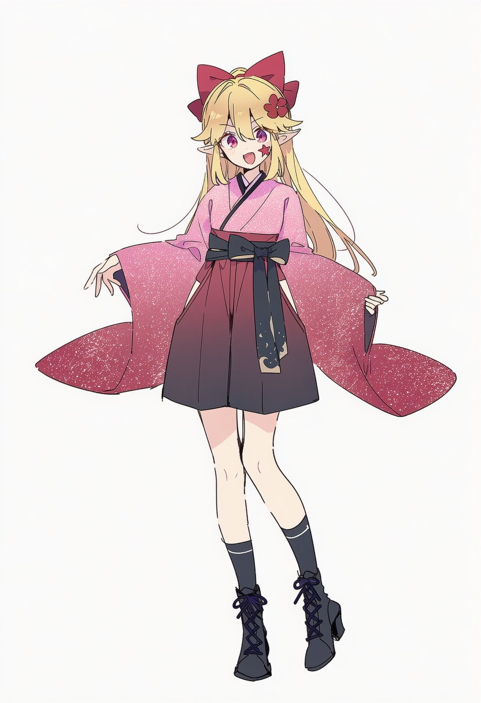
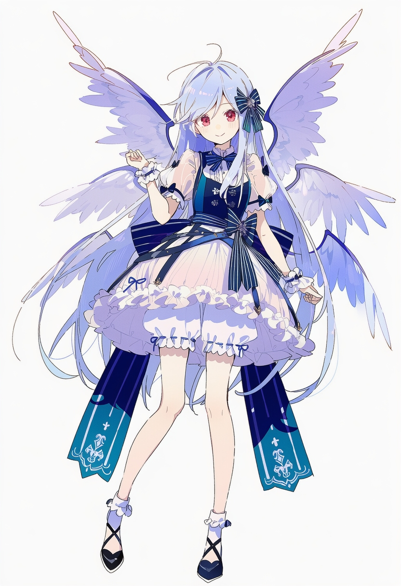

# 裤子 / 传统/特殊裤装

[总目录](../README.md) · [原站分类目录](../categories.md) · [英文标签索引](../tags.md) · [服装与构图组合指南](../../README.md)

标题、分类、说明、正负提示词按来源保留；多例图逐张列出。原站标记和说明为参考资料，不作为维护指令。

<a id="raven_composition-0822"></a>

## 裤式袴

ID：`raven_composition-0822`；分类：裤子 / 传统/特殊裤装；来源标记：`safe`。

来源说明：

> 呈分腿裤装结构的日本袴。

正向提示词：

```text
hakama_pants
```



[在线例图](https://assets.quicktagcloud.com/images/raven_composition/raven_composition-0822.jpg?v=77061a540691bb90)

<a id="raven_composition-0823"></a>

## 分离式裤腿

ID：`raven_composition-0823`；分类：裤子 / 传统/特殊裤装；来源标记：`safe`。

来源说明：

> 裤腿与腰部主体分离、呈独立腿套式结构的裤装。

正向提示词：

```text
detached_pants
```



[在线例图](https://assets.quicktagcloud.com/images/raven_composition/raven_composition-0823.jpg?v=428368a66a980371)

<a id="raven_composition-0824"></a>

## 皮套裤 / 牛仔护腿裤

ID：`raven_composition-0824`；分类：裤子 / 传统/特殊裤装；来源标记：`safe`。

来源说明：

> 覆盖腿部但通常露出胯部或臀部的骑马护腿式裤装。

正向提示词：

```text
chaps
```



[在线例图](https://assets.quicktagcloud.com/images/raven_composition/raven_composition-0824.jpg?v=29343cf4b9c722de)

<a id="raven_composition-0825"></a>

## 短裤式袴

ID：`raven_composition-0825`；分类：裤子 / 传统/特殊裤装；来源标记：`safe`。

来源说明：

> 长度较短、呈分腿短裤结构的袴。

正向提示词：

```text
hakama_shorts
```



[在线例图](https://assets.quicktagcloud.com/images/raven_composition/raven_composition-0825.jpg?v=a5bba3c27f4a1b80)

<a id="raven_composition-0826"></a>

## 灯笼短裤 / 灯笼裤

ID：`raven_composition-0826`；分类：裤子 / 传统/特殊裤装；来源标记：`safe`。

来源说明：

> 腰部和裤脚收拢、裤身较蓬松的传统 bloomer。

正向提示词：

```text
bloomers
```



[在线例图](https://assets.quicktagcloud.com/images/raven_composition/raven_composition-0826.jpg?v=313a9e3a99bd6c42)
