# 裤子 / 款式/结构

[总目录](../README.md) · [原站分类目录](../categories.md) · [英文标签索引](../tags.md) · [服装与构图组合指南](../../README.md)

标题、分类、说明、正负提示词按来源保留；多例图逐张列出。原站标记和说明为参考资料，不作为维护指令。

<a id="raven_composition-0827"></a>

## 宽松短裤

ID：`raven_composition-0827`；分类：裤子 / 款式/结构；来源标记：`safe`。

来源说明：

> 裤腿和臀部整体较宽松的短裤。

正向提示词：

```text
baggy_shorts
```


[在线例图](https://assets.quicktagcloud.com/images/raven_composition/raven_composition-0827.jpg?v=b675ea7418aa96b0)

<a id="raven_composition-0828"></a>

## 绷紧短裤

ID：`raven_composition-0828`；分类：裤子 / 款式/结构；来源标记：`safe`。

来源说明：

> 短裤被身体撑得很紧、布料呈明显拉伸状态。

正向提示词：

```text
taut_shorts
```

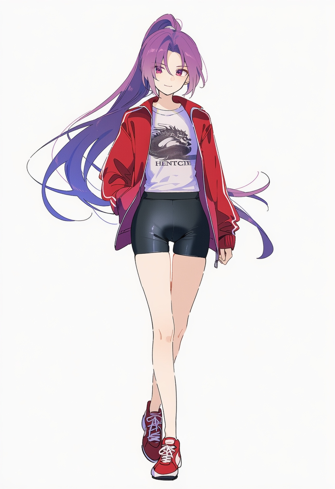

[在线例图](https://assets.quicktagcloud.com/images/raven_composition/raven_composition-0828.jpg?v=89df603428e95ad9)

<a id="raven_composition-0841"></a>

## 百褶短裤

ID：`raven_composition-0841`；分类：裤子 / 款式/结构；来源标记：`safe`。

来源说明：

> 带有明显纵向褶裥结构的短裤。

正向提示词：

```text
pleated_shorts
```


[在线例图](https://assets.quicktagcloud.com/images/raven_composition/raven_composition-0841.jpg?v=97328ddd2723965b)

<a id="raven_composition-0842"></a>

## 侧开衩短裤

ID：`raven_composition-0842`；分类：裤子 / 款式/结构；来源标记：`safe`。

来源说明：

> 裤腿侧面带有明显开衩结构的短裤。

正向提示词：

```text
side_slit_shorts
```

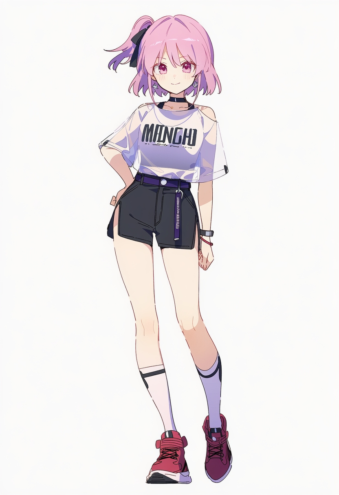

[在线例图](https://assets.quicktagcloud.com/images/raven_composition/raven_composition-0842.jpg?v=0a3a34a922d50042)

<a id="raven_composition-0843"></a>

## 工装短裤

ID：`raven_composition-0843`；分类：裤子 / 款式/结构；来源标记：`safe`。

来源说明：

> 带有明显外置大口袋的宽松工装风短裤。

正向提示词：

```text
cargo_shorts
```

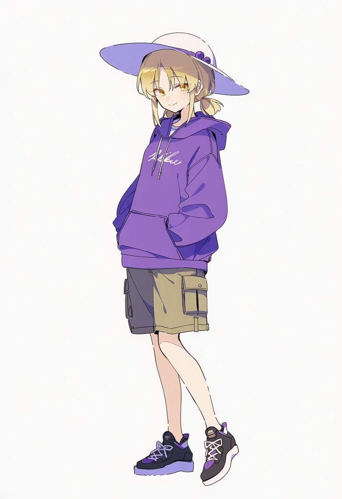

[在线例图](https://assets.quicktagcloud.com/images/raven_composition/raven_composition-0843.jpg?v=cbfbd8936fa68ff5)

<a id="raven_composition-0844"></a>

## 蓬蓬短裤

ID：`raven_composition-0844`；分类：裤子 / 款式/结构；来源标记：`safe`。

来源说明：

> 裤腿具有明显蓬松体积感的短裤。

正向提示词：

```text
puffy_shorts
```

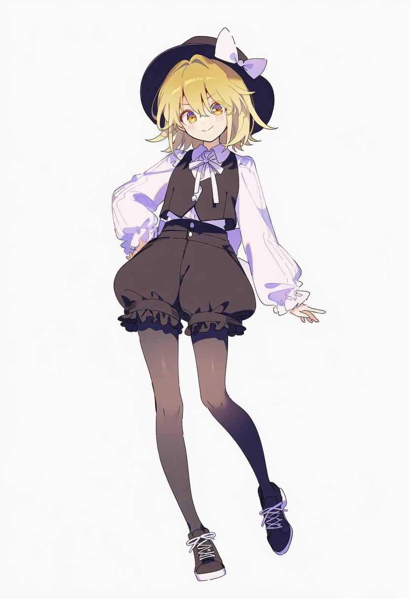

[在线例图](https://assets.quicktagcloud.com/images/raven_composition/raven_composition-0844.jpg?v=9800a77ca6f9e184)

<a id="raven_composition-0845"></a>

## 比基尼式短裤

ID：`raven_composition-0845`；分类：裤子 / 款式/结构；来源标记：`safe`。

来源说明：

> 外观或用途接近比基尼下装的短裤。

正向提示词：

```text
bikini_shorts
```

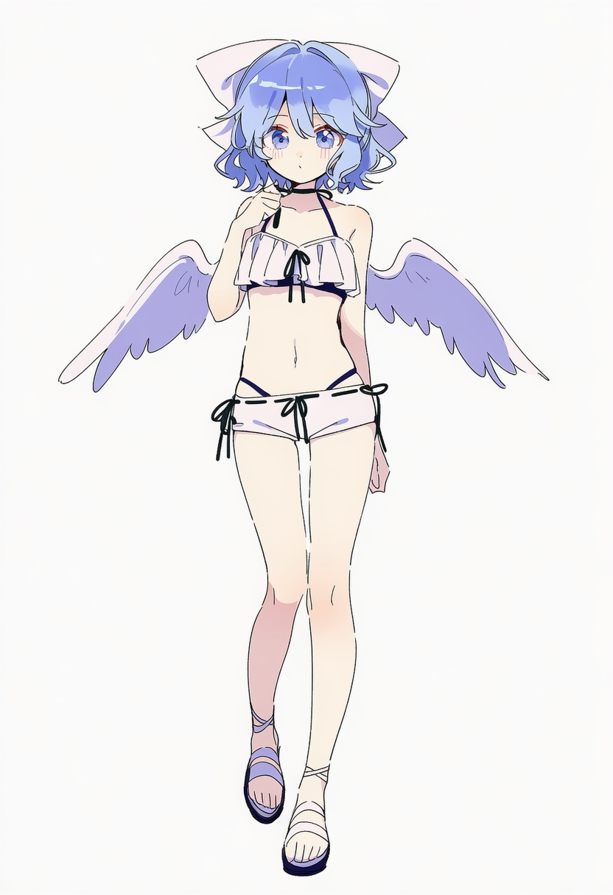

[在线例图](https://assets.quicktagcloud.com/images/raven_composition/raven_composition-0845.jpg?v=f8ea0d45d02a46c3)

<a id="raven_composition-0854"></a>

## 高腰短裤

ID：`raven_composition-0854`；分类：裤子 / 款式/结构；来源标记：`safe`。

来源说明：

> 裤腰位置明显高于常规腰线的短裤。

正向提示词：

```text
high-waist_shorts
```

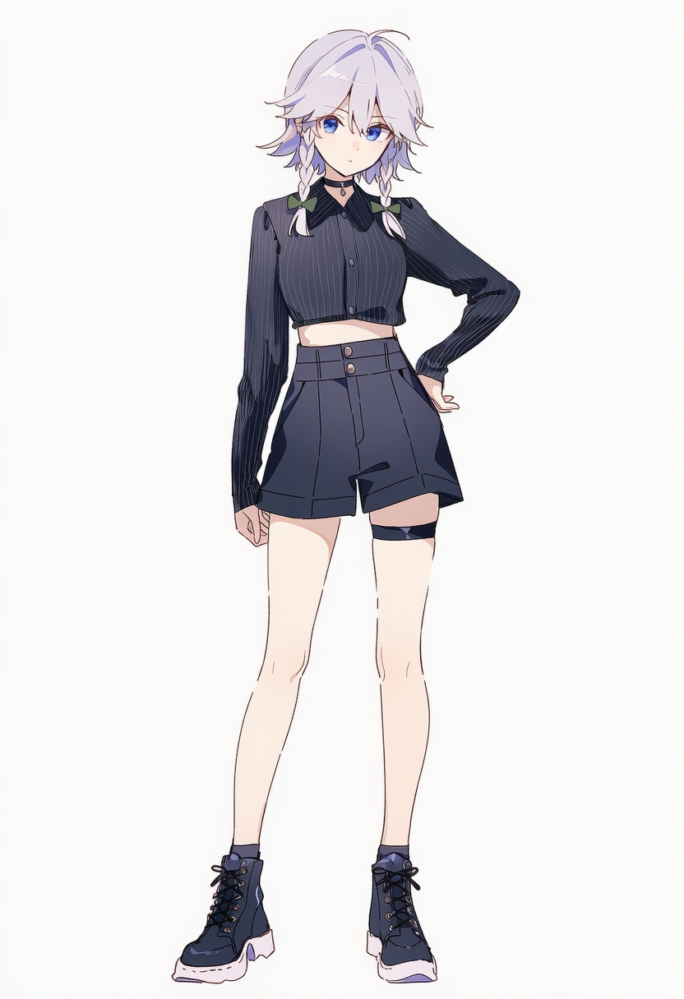

[在线例图](https://assets.quicktagcloud.com/images/raven_composition/raven_composition-0854.jpg?v=d6f24ccbd8f3de80)

<a id="raven_composition-0855"></a>

## 低腰短裤

ID：`raven_composition-0855`；分类：裤子 / 款式/结构；来源标记：`safe`。

来源说明：

> 腰线明显下移的短裤。

正向提示词：

```text
lowleg_shorts
```

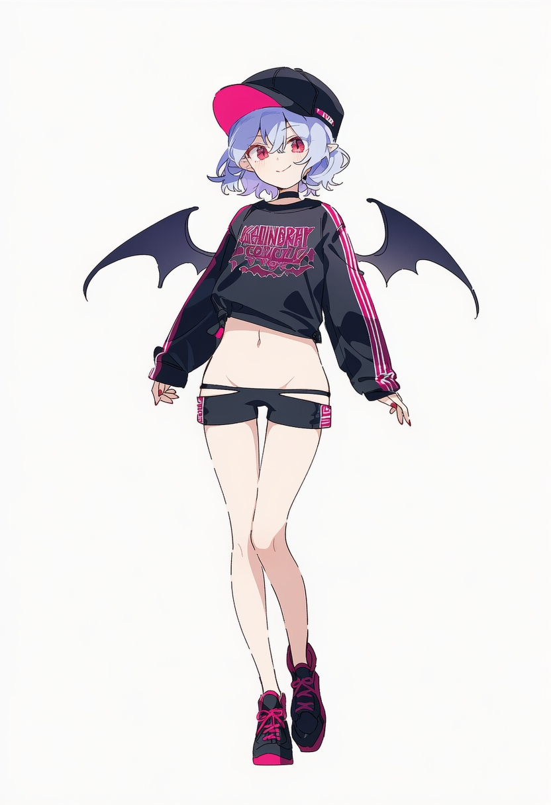

[在线例图](https://assets.quicktagcloud.com/images/raven_composition/raven_composition-0855.jpg?v=7f19b72478f582d6)

<a id="raven_composition-0856"></a>

## 超短裤

ID：`raven_composition-0856`；分类：裤子 / 款式/结构；来源标记：`safe`。

来源说明：

> 裤腿非常短、通常露出大部分大腿的短裤。

正向提示词：

```text
short_shorts
```


[在线例图](https://assets.quicktagcloud.com/images/raven_composition/raven_composition-0856.jpg?v=a91620c061d6adb5)

<a id="raven_composition-0857"></a>

## 微型短裤

ID：`raven_composition-0857`；分类：裤子 / 款式/结构；来源标记：`safe`。

来源说明：

> 短到接近内裤尺寸、覆盖范围极小的短裤。

正向提示词：

```text
micro_shorts
```

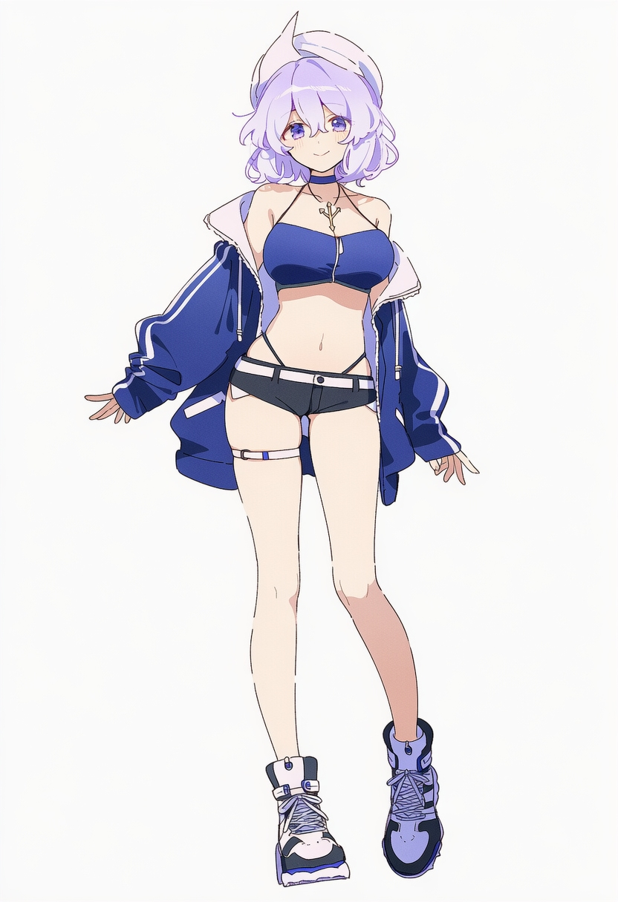

[在线例图](https://assets.quicktagcloud.com/images/raven_composition/raven_composition-0857.jpg?v=16534cf699705003)

<a id="raven_composition-0858"></a>

## 荷叶边短裤

ID：`raven_composition-0858`；分类：裤子 / 款式/结构；来源标记：`safe`。

来源说明：

> 带有荷叶边、褶边装饰的短裤。

正向提示词：

```text
frilled_shorts
```

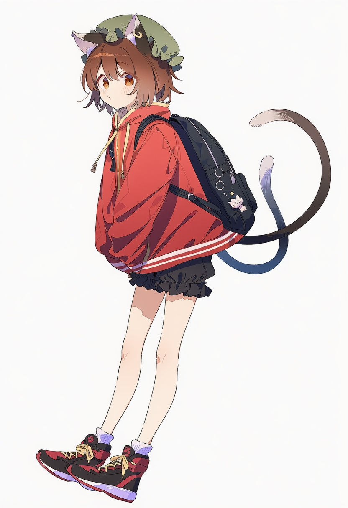

[在线例图](https://assets.quicktagcloud.com/images/raven_composition/raven_composition-0858.jpg?v=ebc90b30c5e8c48b)

<a id="raven_composition-0859"></a>

## 破损短裤

ID：`raven_composition-0859`；分类：裤子 / 款式/结构；来源标记：`safe`。

来源说明：

> 带有撕裂、破洞或磨损开口的短裤。

正向提示词：

```text
torn_shorts
```

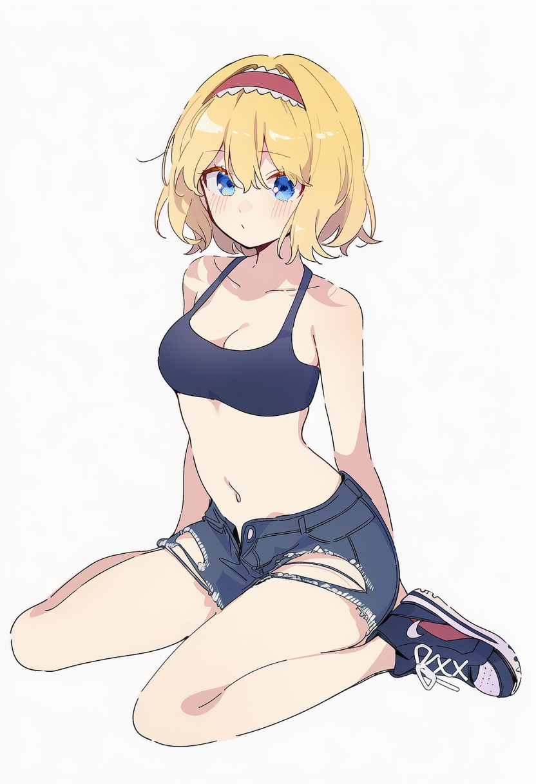

[在线例图](https://assets.quicktagcloud.com/images/raven_composition/raven_composition-0859.jpg?v=2e88fd0954391fd7)

<a id="raven_composition-0875"></a>

## 宽松长裤

ID：`raven_composition-0875`；分类：裤子 / 款式/结构；来源标记：`safe`。

来源说明：

> 整体裤腿明显宽大松垮的长裤。

正向提示词：

```text
baggy_pants
```

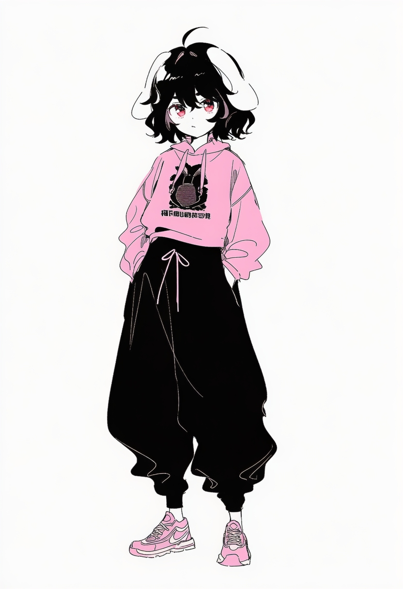

[在线例图](https://assets.quicktagcloud.com/images/raven_composition/raven_composition-0875.jpg?v=262ca6259ae01cc6)

<a id="raven_composition-0876"></a>

## 紧身长裤

ID：`raven_composition-0876`；分类：裤子 / 款式/结构；来源标记：`safe`。

来源说明：

> 明显贴合腿部，但未必达到完全贴肤程度的长裤。

正向提示词：

```text
tight_pants
```

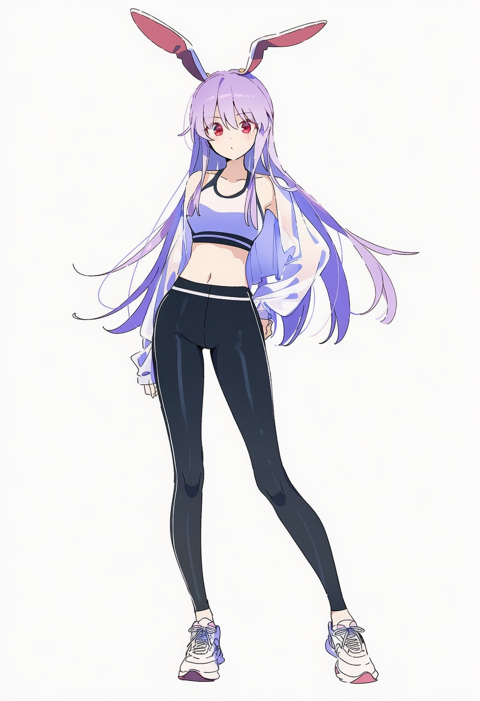

[在线例图](https://assets.quicktagcloud.com/images/raven_composition/raven_composition-0876.jpg?v=04ab66ffa7d38b9d)

<a id="raven_composition-0877"></a>

## 绷紧的裤子

ID：`raven_composition-0877`；分类：裤子 / 款式/结构；来源标记：`safe`。

来源说明：

> 裤子被身体撑得非常紧，布料呈明显拉伸状态。

正向提示词：

```text
taut_pants
```

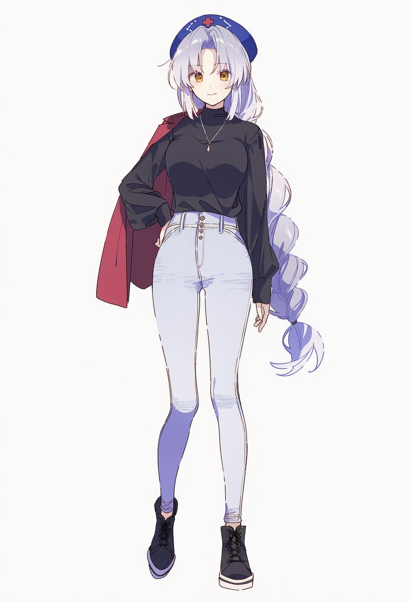

[在线例图](https://assets.quicktagcloud.com/images/raven_composition/raven_composition-0877.jpg?v=dcffc3915db876da)

<a id="raven_composition-0888"></a>

## 工装裤

ID：`raven_composition-0888`；分类：裤子 / 款式/结构；来源标记：`safe`。

来源说明：

> 带有明显外置大口袋或工装结构的长裤。

正向提示词：

```text
cargo_pants
```

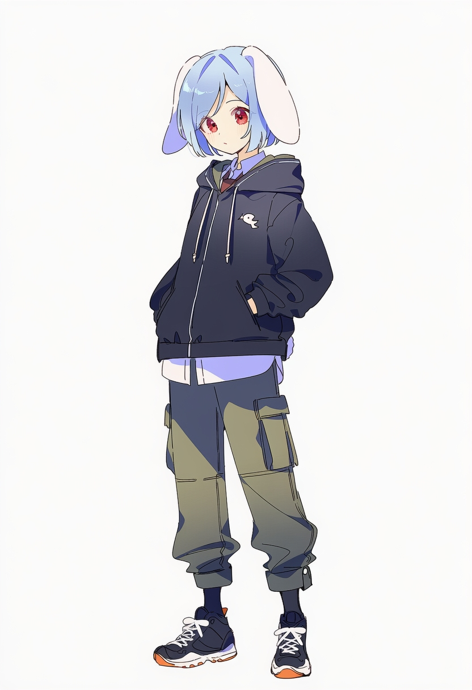

[在线例图](https://assets.quicktagcloud.com/images/raven_composition/raven_composition-0888.jpg?v=b2dfa993c1df6e74)

<a id="raven_composition-0889"></a>

## 西装裤

ID：`raven_composition-0889`；分类：裤子 / 款式/结构；来源标记：`safe`。

来源说明：

> 与西装、正装搭配的正式长裤。

正向提示词：

```text
suit_pants
```


[在线例图](https://assets.quicktagcloud.com/images/raven_composition/raven_composition-0889.jpg?v=7d9cf24d192fece7)

<a id="raven_composition-0890"></a>

## 哈伦裤

ID：`raven_composition-0890`；分类：裤子 / 款式/结构；来源标记：`safe`。

来源说明：

> 裆部和大腿较宽松、裤脚收窄的灯笼式长裤。

正向提示词：

```text
harem_pants
```


[在线例图](https://assets.quicktagcloud.com/images/raven_composition/raven_composition-0890.jpg?v=d60111dc7f1b4614)

<a id="raven_composition-0891"></a>

## 马裤

ID：`raven_composition-0891`；分类：裤子 / 款式/结构；来源标记：`safe`。

来源说明：

> 骑马用裤型，通常大腿较宽、膝下明显收紧。

正向提示词：

```text
jodhpurs
```


[在线例图](https://assets.quicktagcloud.com/images/raven_composition/raven_composition-0891.jpg?v=64b2b0efe0ab841f)

<a id="raven_composition-0892"></a>

## 喇叭裤

ID：`raven_composition-0892`；分类：裤子 / 款式/结构；来源标记：`safe`。

来源说明：

> 裤腿从膝部向下逐渐外扩形成喇叭形。

正向提示词：

```text
bell-bottoms
```

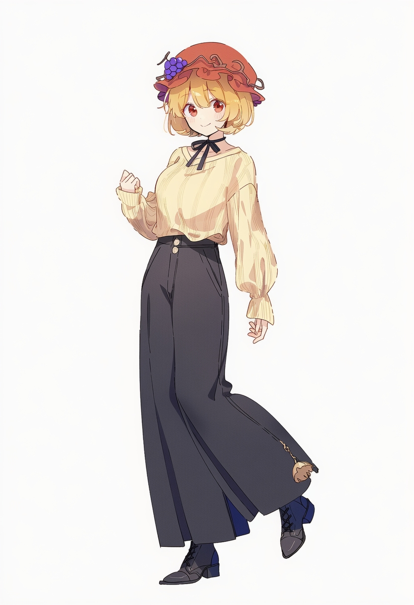

[在线例图](https://assets.quicktagcloud.com/images/raven_composition/raven_composition-0892.jpg?v=d9262b3c769a2efc)

<a id="raven_composition-0893"></a>

## 蓬蓬裤

ID：`raven_composition-0893`；分类：裤子 / 款式/结构；来源标记：`safe`。

来源说明：

> 裤腿明显蓬松，但脚踝附近收紧的裤型。

正向提示词：

```text
puffy_pants
```


[在线例图](https://assets.quicktagcloud.com/images/raven_composition/raven_composition-0893.jpg?v=9b5e537a38c6540a)

<a id="raven_composition-0894"></a>

## 降落伞裤

ID：`raven_composition-0894`；分类：裤子 / 款式/结构；来源标记：`safe`。

来源说明：

> 宽松、轻薄、带机能或束口感的长裤。

正向提示词：

```text
parachute_pants
```

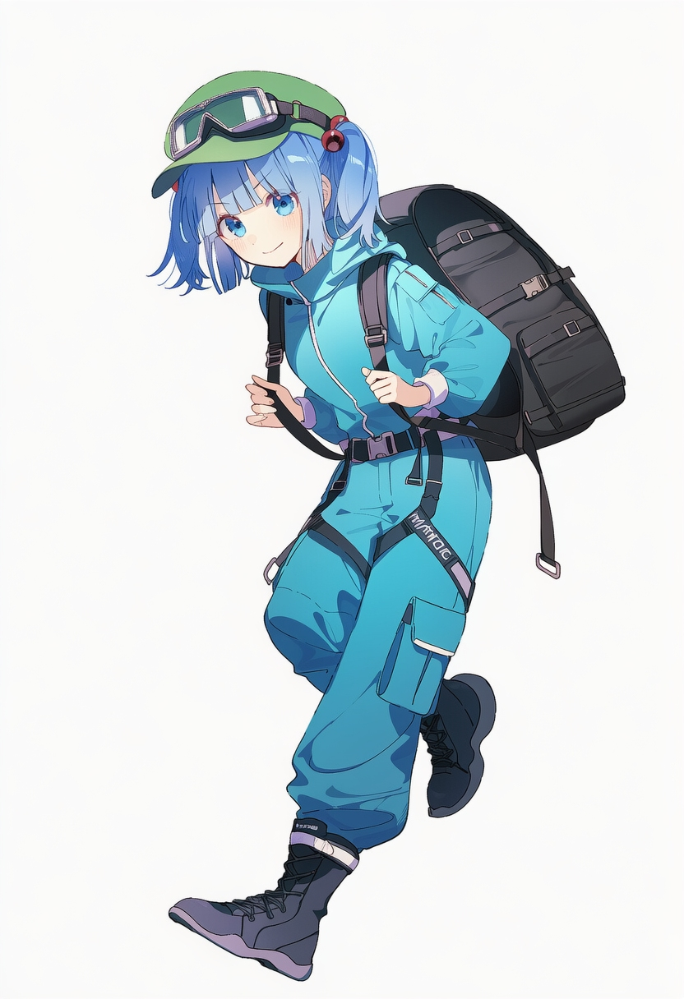

[在线例图](https://assets.quicktagcloud.com/images/raven_composition/raven_composition-0894.jpg?v=e5ed9ba0104d2c84)

<a id="raven_composition-0905"></a>

## 高腰裤

ID：`raven_composition-0905`；分类：裤子 / 款式/结构；来源标记：`safe`。

来源说明：

> 裤腰位置明显高于常规腰线的长裤。

正向提示词：

```text
high-waist_pants
```

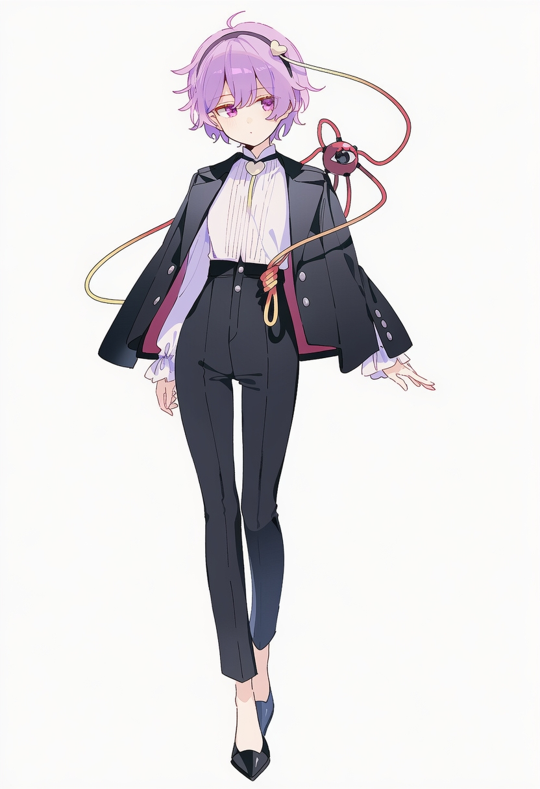

[在线例图](https://assets.quicktagcloud.com/images/raven_composition/raven_composition-0905.jpg?v=7f0db66938a59335)

<a id="raven_composition-0906"></a>

## 低腰裤

ID：`raven_composition-0906`；分类：裤子 / 款式/结构；来源标记：`safe`。

来源说明：

> 裤腰下移、胯部和下腹暴露更多的长裤。

正向提示词：

```text
lowleg_pants
```

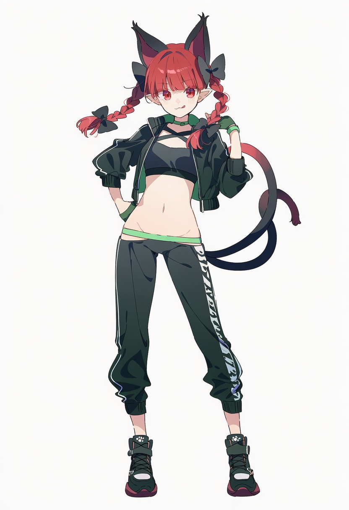

[在线例图](https://assets.quicktagcloud.com/images/raven_composition/raven_composition-0906.jpg?v=890fbd68662760f7)

<a id="raven_composition-0907"></a>

## 七分裤 / 卡普里裤

ID：`raven_composition-0907`；分类：裤子 / 款式/结构；来源标记：`safe`。

来源说明：

> 长度短于普通长裤、通常露出脚踝或小腿下部。

正向提示词：

```text
capri_pants
```


[在线例图](https://assets.quicktagcloud.com/images/raven_composition/raven_composition-0907.jpg?v=cc5856c4c9cad7af)

<a id="raven_composition-0908"></a>

## 荷叶边裤

ID：`raven_composition-0908`；分类：裤子 / 款式/结构；来源标记：`safe`。

来源说明：

> 裤装带有荷叶边、褶边等装饰。

正向提示词：

```text
frilled_pants
```

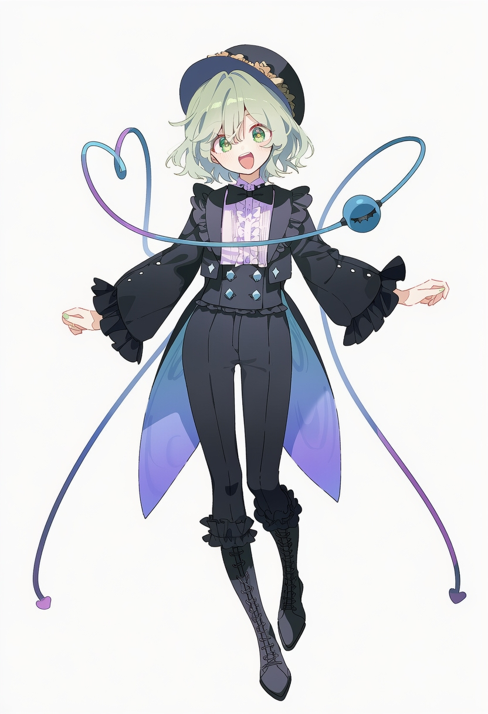

[在线例图](https://assets.quicktagcloud.com/images/raven_composition/raven_composition-0908.jpg?v=73a240981066ecb5)

<a id="raven_composition-0909"></a>

## 毛边装饰裤

ID：`raven_composition-0909`；分类：裤子 / 款式/结构；来源标记：`safe`。

来源说明：

> 裤装边缘带有毛皮或绒毛饰边。

正向提示词：

```text
fur-trimmed_pants
```

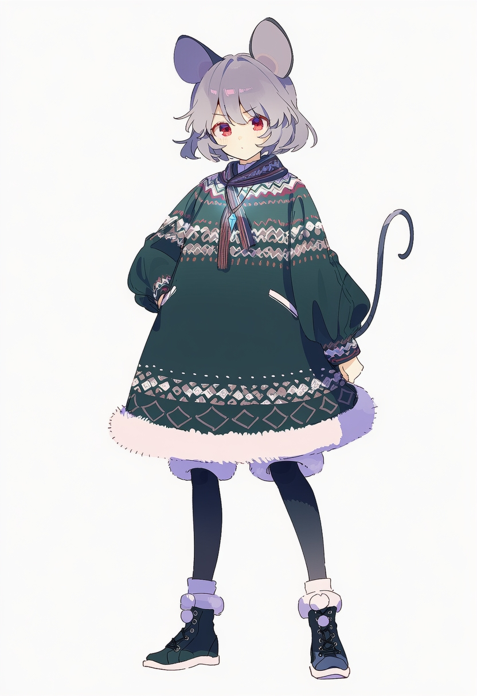

[在线例图](https://assets.quicktagcloud.com/images/raven_composition/raven_composition-0909.jpg?v=ecbe71a357ce887d)

<a id="raven_composition-0910"></a>

## 破损长裤

ID：`raven_composition-0910`；分类：裤子 / 款式/结构；来源标记：`safe`。

来源说明：

> 裤面有明显撕裂、破洞或破损结构的长裤。

正向提示词：

```text
torn_pants
```

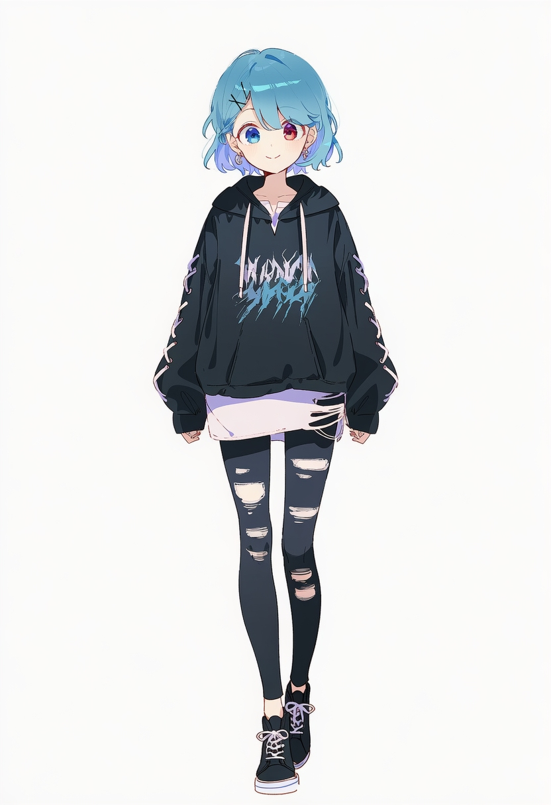

[在线例图](https://assets.quicktagcloud.com/images/raven_composition/raven_composition-0910.jpg?v=00bd821cd4469b9e)
