# 裤子 / 穿着状态/搭配

[总目录](../README.md) · [原站分类目录](../categories.md) · [英文标签索引](../tags.md) · [服装与构图组合指南](../../README.md)

标题、分类、说明、正负提示词按来源保留；多例图逐张列出。原站标记和说明为参考资料，不作为维护指令。

<a id="raven_composition-0832"></a>

## 敞开的短裤

ID：`raven_composition-0832`；分类：裤子 / 穿着状态/搭配；来源标记：`safe`。

来源说明：

> 短裤的腰头、裤门或开合处处于打开状态。

正向提示词：

```text
open_shorts
```

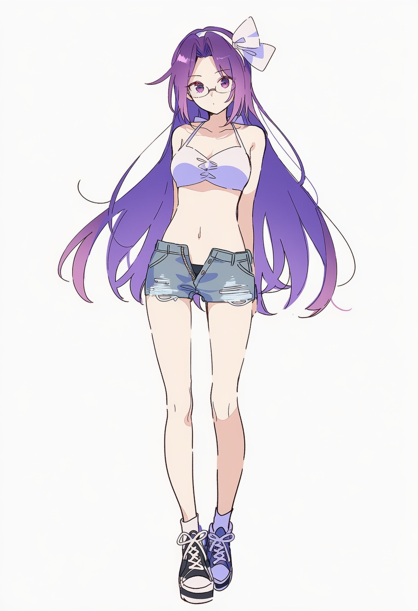

[在线例图](https://assets.quicktagcloud.com/images/raven_composition/raven_composition-0832.jpg?v=1ecd32d2cfbab26a)

<a id="raven_composition-0833"></a>

## 拉短裤

ID：`raven_composition-0833`；分类：裤子 / 穿着状态/搭配；来源标记：`safe`。

来源说明：

> 人物正在拉动、下拉或调整短裤。

正向提示词：

```text
shorts_pull
```

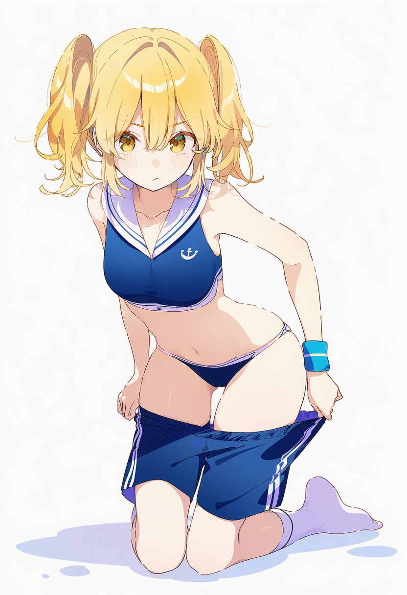

[在线例图](https://assets.quicktagcloud.com/images/raven_composition/raven_composition-0833.jpg?v=6def1dacef06b2e5)

<a id="raven_composition-0834"></a>

## 短裤拨到一侧

ID：`raven_composition-0834`；分类：裤子 / 穿着状态/搭配；来源标记：`safe`。

来源说明：

> 短裤被拨向一边、偏离正常穿着位置。

正向提示词：

```text
shorts_aside
```

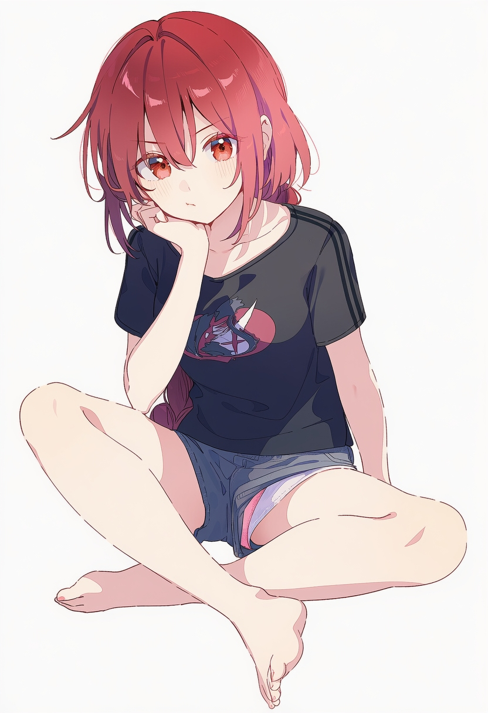

[在线例图](https://assets.quicktagcloud.com/images/raven_composition/raven_composition-0834.jpg?v=1bdf91eda16ea3b7)

<a id="raven_composition-0835"></a>

## 短裤挂在单腿

ID：`raven_composition-0835`；分类：裤子 / 穿着状态/搭配；来源标记：`safe`。

来源说明：

> 短裤已脱下大部分，仅挂在一条腿上。

正向提示词：

```text
shorts_around_one_leg
```

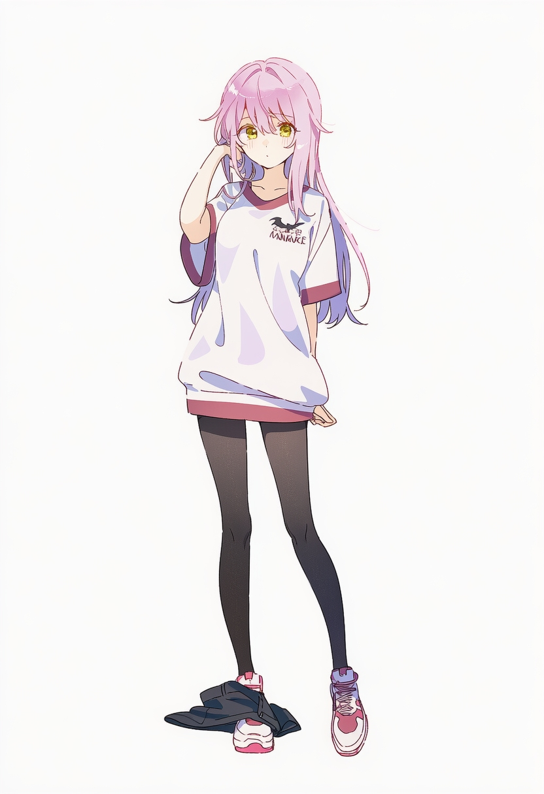

[在线例图](https://assets.quicktagcloud.com/images/raven_composition/raven_composition-0835.jpg?v=5ab746222eac04ea)

<a id="raven_composition-0836"></a>

## 未穿着的短裤

ID：`raven_composition-0836`；分类：裤子 / 穿着状态/搭配；来源标记：`safe`。

来源说明：

> 短裤作为物件出现，但没有穿在人物身上。

正向提示词：

```text
unworn_shorts
```

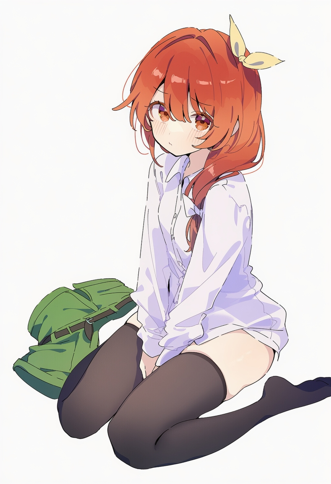

[在线例图](https://assets.quicktagcloud.com/images/raven_composition/raven_composition-0836.jpg?v=99859164252df0e1)

<a id="raven_composition-0837"></a>

## 湿短裤

ID：`raven_composition-0837`；分类：裤子 / 穿着状态/搭配；来源标记：`safe`。

来源说明：

> 短裤被水浸湿、呈明显湿润状态。

正向提示词：

```text
wet_shorts
```

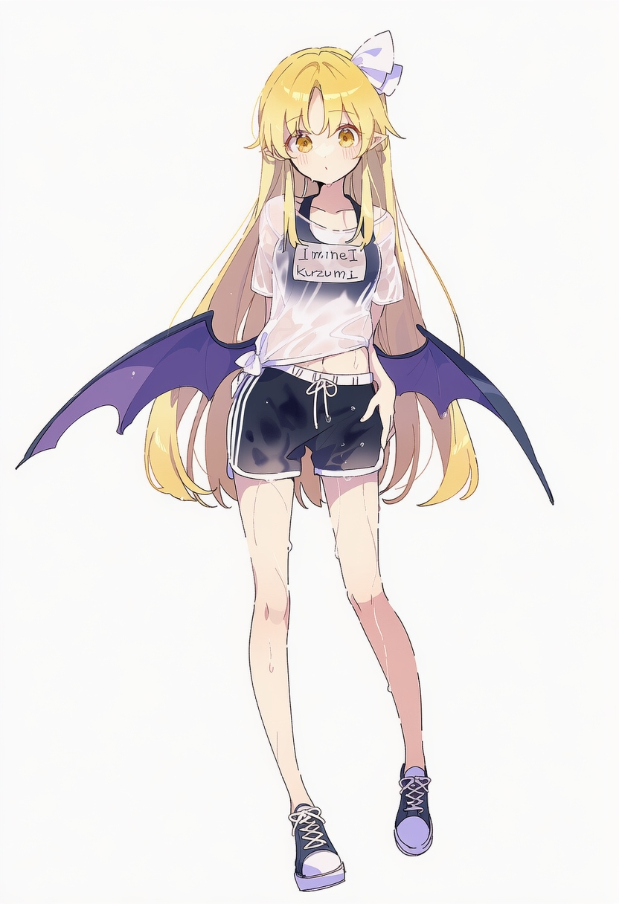

[在线例图](https://assets.quicktagcloud.com/images/raven_composition/raven_composition-0837.jpg?v=1262a46277729752)

<a id="raven_composition-0838"></a>

## 裙下穿短裤

ID：`raven_composition-0838`；分类：裤子 / 穿着状态/搭配；来源标记：`safe`。

来源说明：

> 裙子下面额外穿着短裤。

正向提示词：

```text
shorts_under_skirt
```

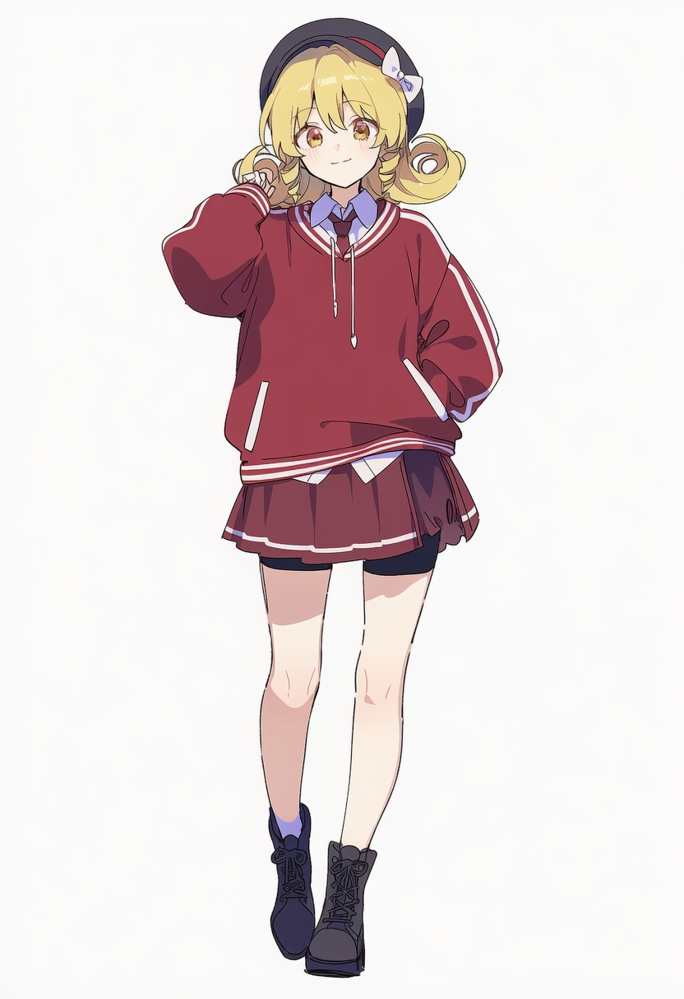

[在线例图](https://assets.quicktagcloud.com/images/raven_composition/raven_composition-0838.jpg?v=8d0405e165a3670e)

<a id="raven_composition-0839"></a>

## 短裤下穿连裤袜

ID：`raven_composition-0839`；分类：裤子 / 穿着状态/搭配；来源标记：`safe`。

来源说明：

> 短裤外层之下穿着 pantyhose。

正向提示词：

```text
pantyhose_under_shorts
```

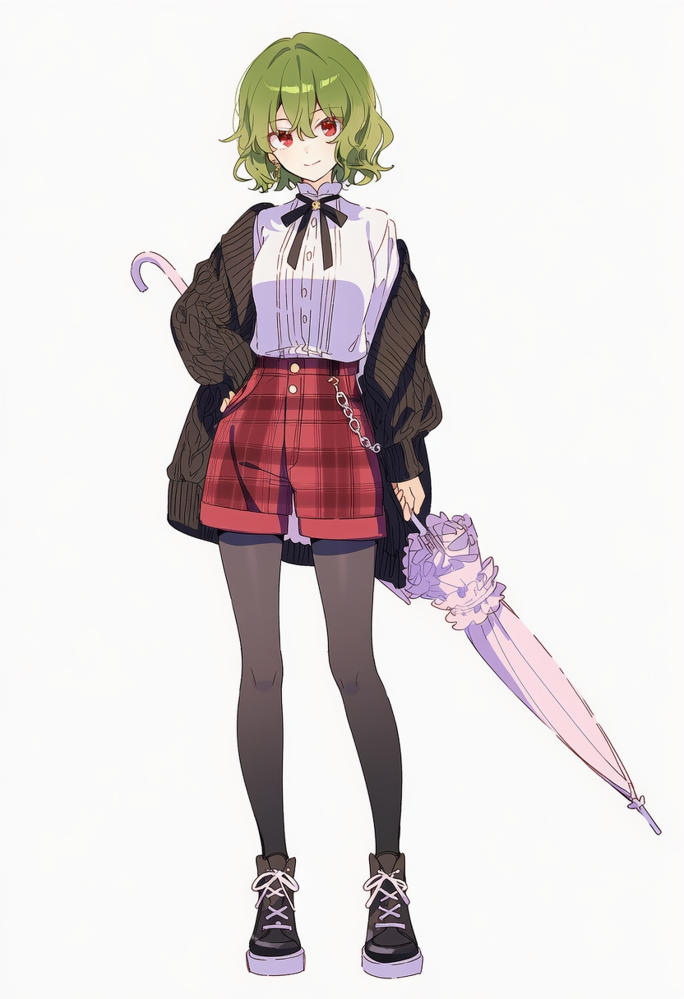

[在线例图](https://assets.quicktagcloud.com/images/raven_composition/raven_composition-0839.jpg?v=409c22f935fe32b2)

<a id="raven_composition-0840"></a>

## 短裤下穿比基尼下装

ID：`raven_composition-0840`；分类：裤子 / 穿着状态/搭配；来源标记：`safe`。

来源说明：

> 短裤里面同时穿着比基尼下装。

正向提示词：

```text
bikini_bottom_under_shorts
```

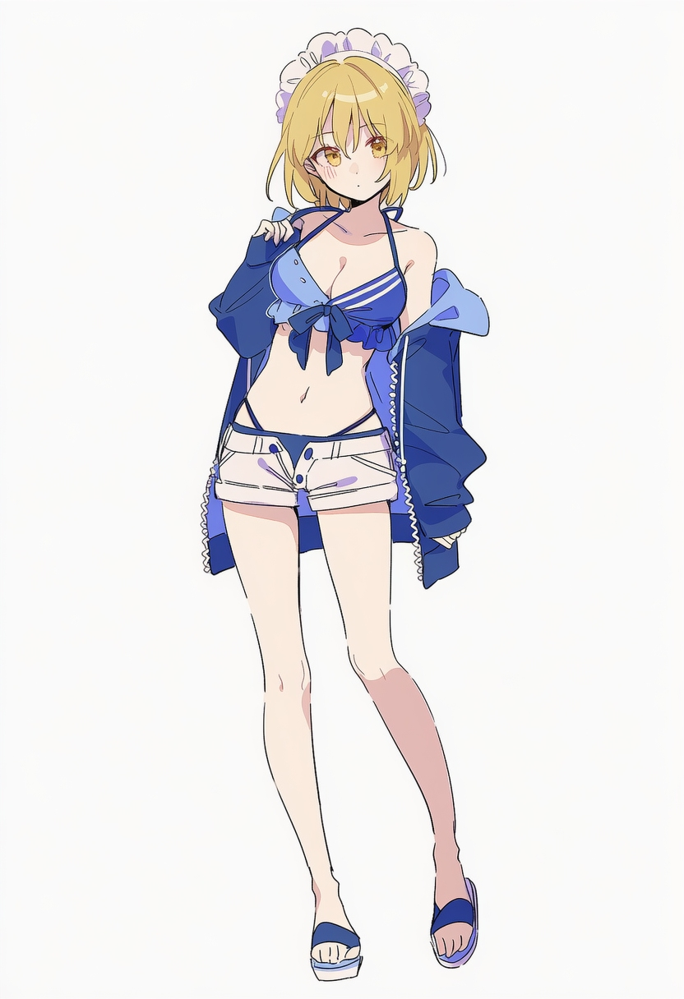

[在线例图](https://assets.quicktagcloud.com/images/raven_composition/raven_composition-0840.jpg?v=d5edf462526b84d9)

<a id="raven_composition-0881"></a>

## 卷起裤脚

ID：`raven_composition-0881`；分类：裤子 / 穿着状态/搭配；来源标记：`safe`。

来源说明：

> 长裤裤脚被向上卷起，露出更多小腿或脚踝。

正向提示词：

```text
pants_rolled_up
```

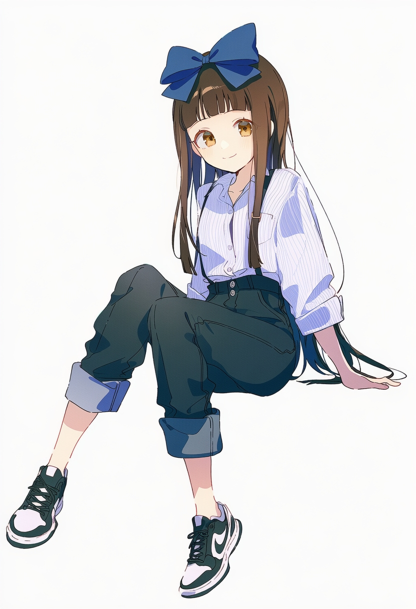

[在线例图](https://assets.quicktagcloud.com/images/raven_composition/raven_composition-0881.jpg?v=78286722ab2685a9)

<a id="raven_composition-0882"></a>

## 裤脚塞入鞋靴

ID：`raven_composition-0882`；分类：裤子 / 穿着状态/搭配；来源标记：`safe`。

来源说明：

> 长裤裤脚被塞进靴子、鞋或其他腿部穿戴物内。

正向提示词：

```text
pants_tucked_in
```

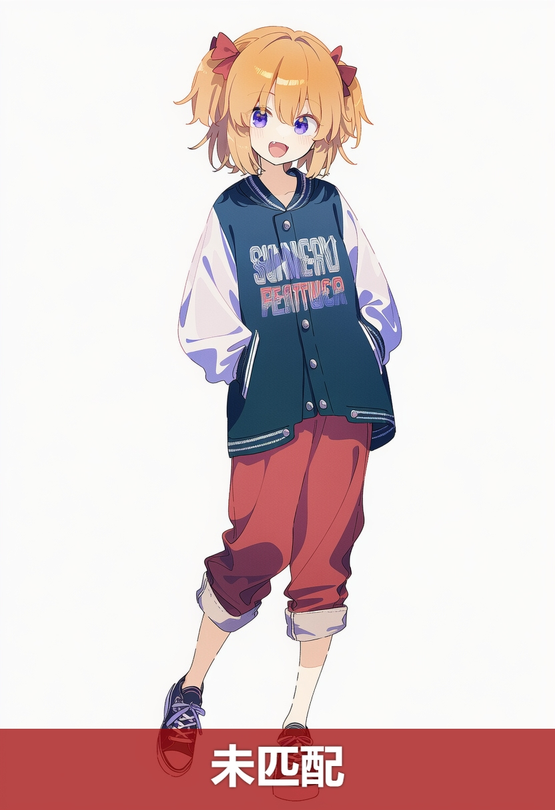

[在线例图](https://assets.quicktagcloud.com/images/raven_composition/raven_composition-0882.jpg?v=24387347a261c8fb)

<a id="raven_composition-0883"></a>

## 敞开的裤子

ID：`raven_composition-0883`；分类：裤子 / 穿着状态/搭配；来源标记：`safe`。

来源说明：

> 裤门、腰头或裤装开合部位处于打开状态。

正向提示词：

```text
open_pants
```

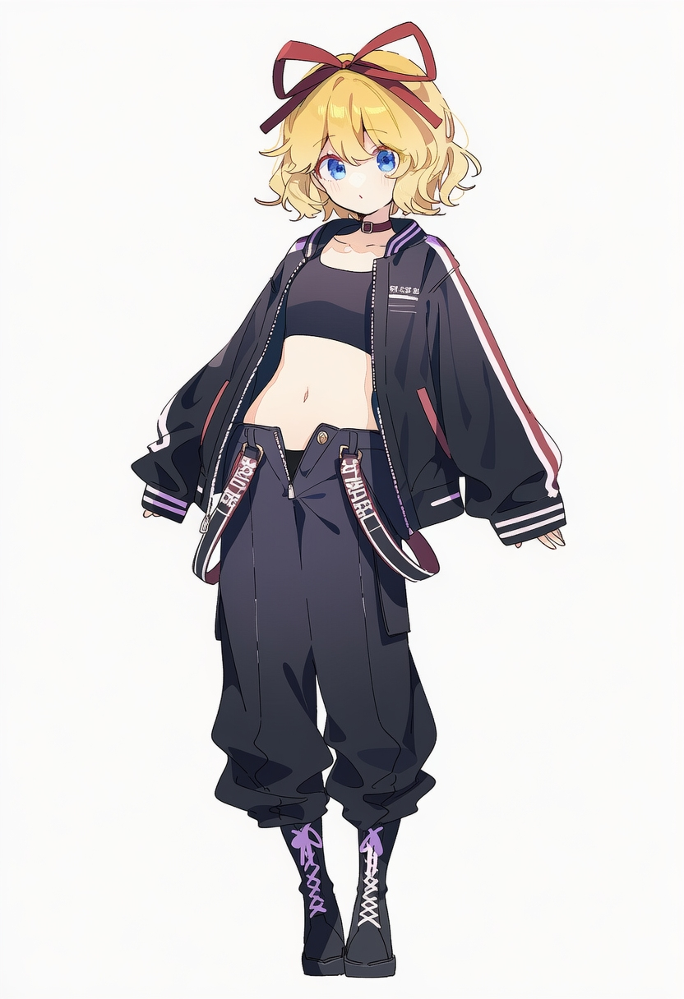

[在线例图](https://assets.quicktagcloud.com/images/raven_composition/raven_composition-0883.jpg?v=5273456471b3dca1)

<a id="raven_composition-0884"></a>

## 拉裤子

ID：`raven_composition-0884`；分类：裤子 / 穿着状态/搭配；来源标记：`safe`。

来源说明：

> 人物正在拉动、下拉或调整裤子。

正向提示词：

```text
pants_pull
```

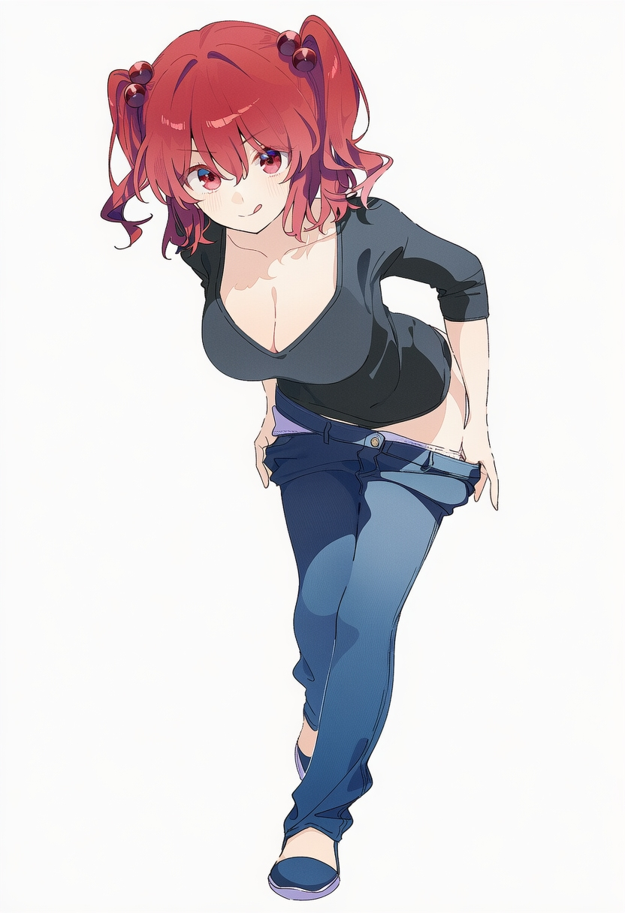

[在线例图](https://assets.quicktagcloud.com/images/raven_composition/raven_composition-0884.jpg?v=2b3740aa2b174274)

<a id="raven_composition-0885"></a>

## 未穿着的裤子

ID：`raven_composition-0885`；分类：裤子 / 穿着状态/搭配；来源标记：`safe`。

来源说明：

> 裤子作为物件出现，但当前没有穿在人物身上。

正向提示词：

```text
unworn_pants
```

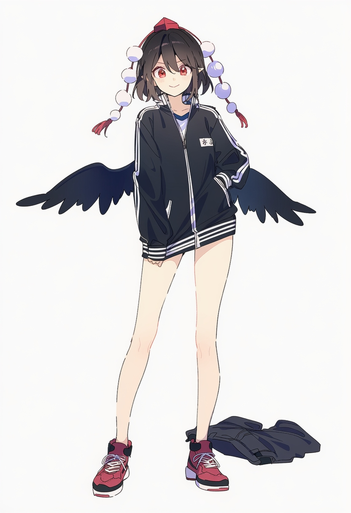

[在线例图](https://assets.quicktagcloud.com/images/raven_composition/raven_composition-0885.jpg?v=8dbee9eb5d2befa1)

<a id="raven_composition-0886"></a>

## 裙下穿长裤

ID：`raven_composition-0886`；分类：裤子 / 穿着状态/搭配；来源标记：`safe`。

来源说明：

> 裙子下面同时穿着长裤。

正向提示词：

```text
pants_under_skirt
```

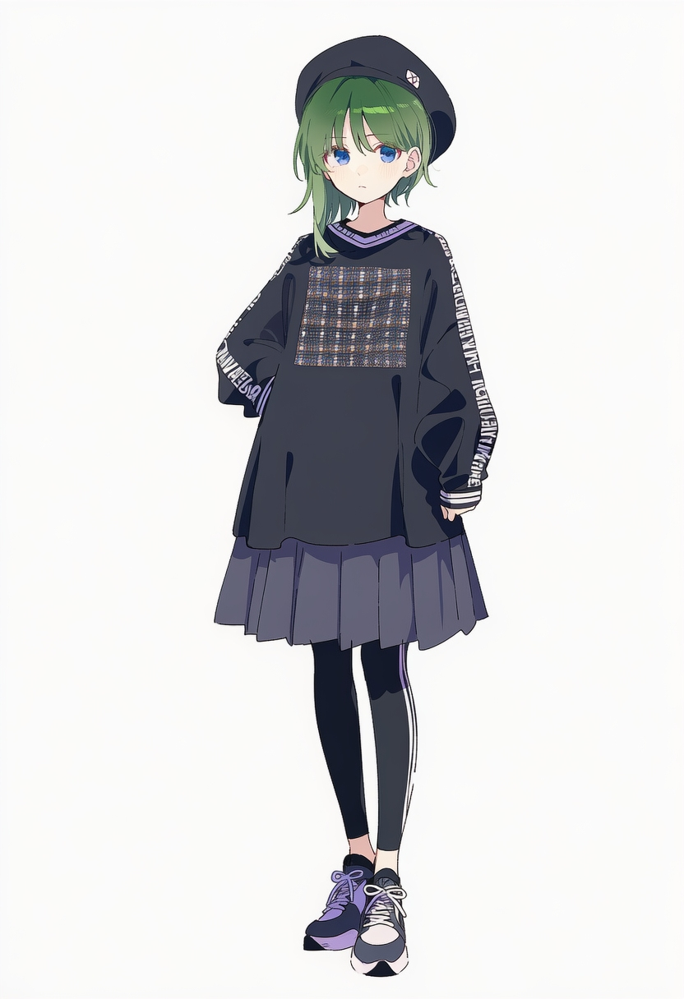

[在线例图](https://assets.quicktagcloud.com/images/raven_composition/raven_composition-0886.jpg?v=001e29306d58952e)

<a id="raven_composition-0887"></a>

## 连衣裙下穿长裤

ID：`raven_composition-0887`；分类：裤子 / 穿着状态/搭配；来源标记：`safe`。

来源说明：

> 连衣裙下面同时穿着长裤。

正向提示词：

```text
pants_under_dress
```

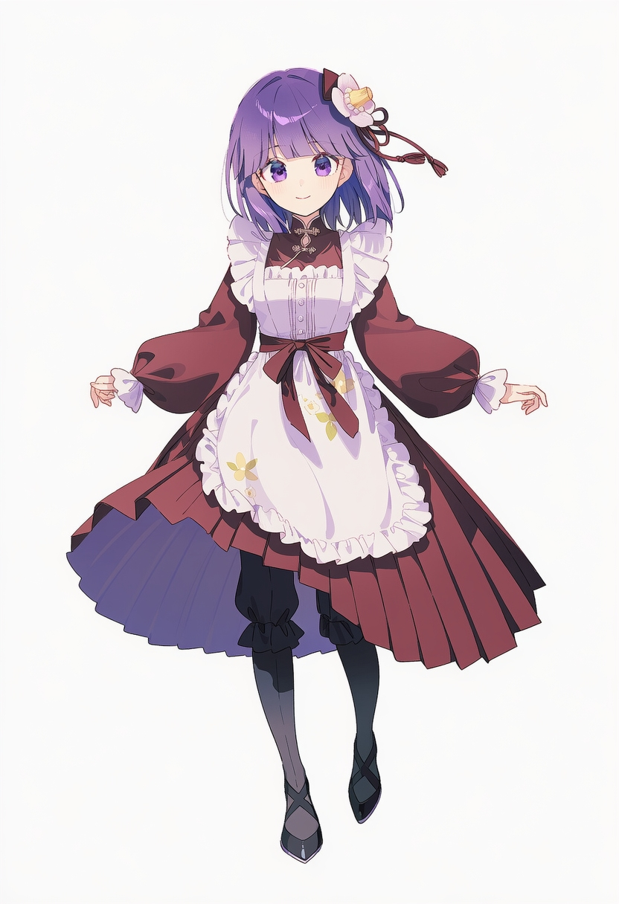

[在线例图](https://assets.quicktagcloud.com/images/raven_composition/raven_composition-0887.jpg?v=734c4902b74a16f8)
