# 裤子 / 图案/配色

[总目录](../README.md) · [原站分类目录](../categories.md) · [英文标签索引](../tags.md) · [服装与构图组合指南](../../README.md)

标题、分类、说明、正负提示词按来源保留；多例图逐张列出。原站标记和说明为参考资料，不作为维护指令。

<a id="raven_composition-0846"></a>

## 格纹短裤

ID：`raven_composition-0846`；分类：裤子 / 图案/配色；来源标记：`safe`。

来源说明：

> 带有 plaid / tartan 交叉格纹的短裤。

正向提示词：

```text
plaid_shorts
```

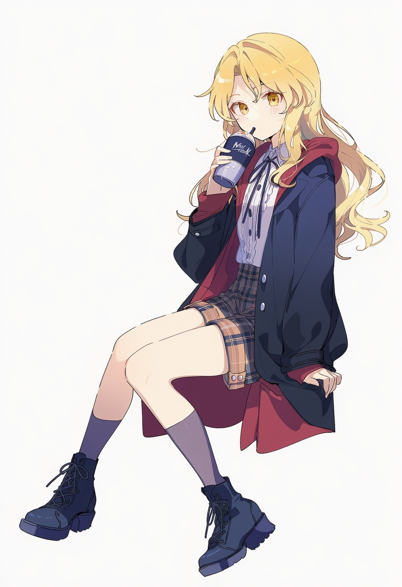

[在线例图](https://assets.quicktagcloud.com/images/raven_composition/raven_composition-0846.jpg?v=d75dc99c51467fc8)

<a id="raven_composition-0847"></a>

## 棋盘格短裤

ID：`raven_composition-0847`；分类：裤子 / 图案/配色；来源标记：`safe`。

来源说明：

> 带有规则方格或棋盘格图案的短裤。

正向提示词：

```text
checkered_shorts
```

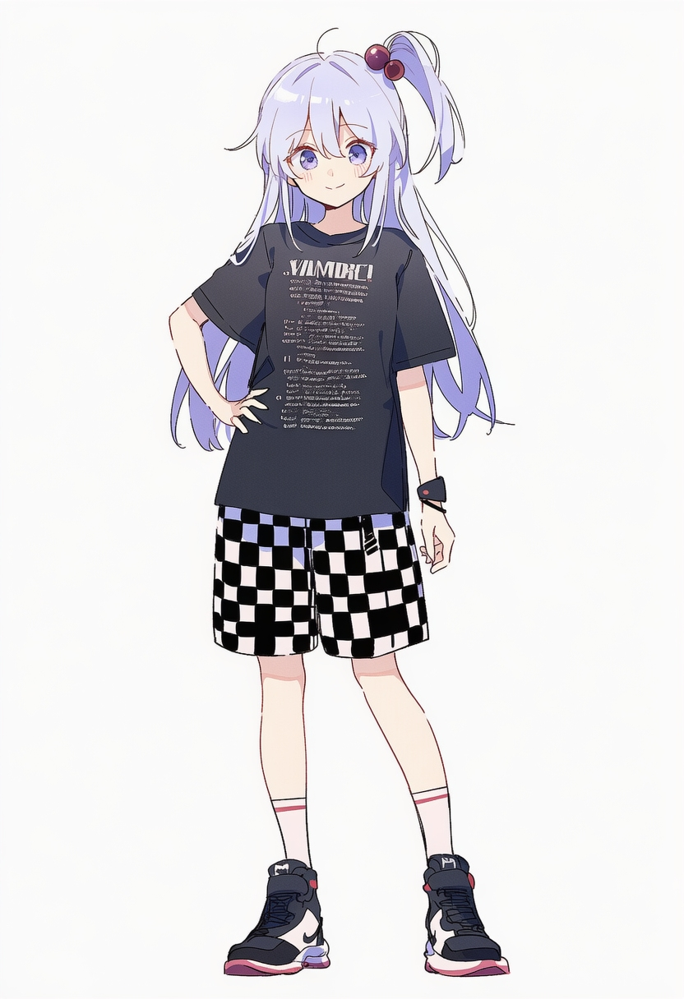

[在线例图](https://assets.quicktagcloud.com/images/raven_composition/raven_composition-0847.jpg?v=e45a2c4f9720fc60)

<a id="raven_composition-0848"></a>

## 条纹短裤

ID：`raven_composition-0848`；分类：裤子 / 图案/配色；来源标记：`safe`。

来源说明：

> 带有条纹图案的短裤。

正向提示词：

```text
striped_shorts
```

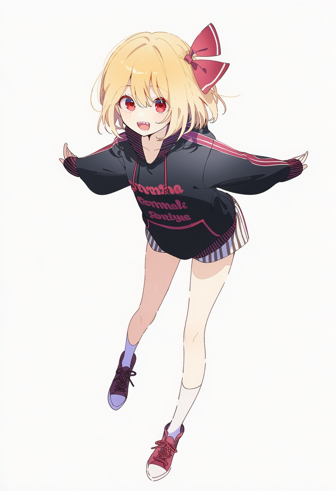

[在线例图](https://assets.quicktagcloud.com/images/raven_composition/raven_composition-0848.jpg?v=857a35d0b47b05a6)

<a id="raven_composition-0849"></a>

## 迷彩短裤

ID：`raven_composition-0849`；分类：裤子 / 图案/配色；来源标记：`safe`。

来源说明：

> 带有军事迷彩图案的短裤。

正向提示词：

```text
camouflage_shorts
```

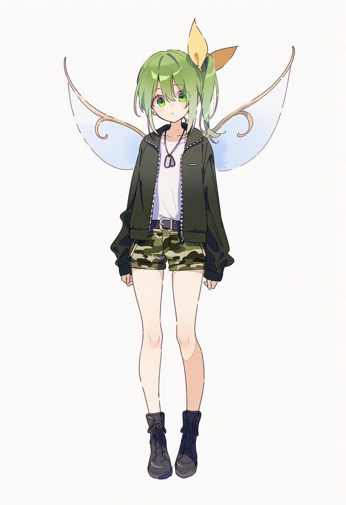

[在线例图](https://assets.quicktagcloud.com/images/raven_composition/raven_composition-0849.jpg?v=cab8ea6fa72e4640)

<a id="raven_composition-0850"></a>

## 波点短裤

ID：`raven_composition-0850`；分类：裤子 / 图案/配色；来源标记：`safe`。

来源说明：

> 带有规则圆点 / 波点图案的短裤。

正向提示词：

```text
polka_dot_shorts
```

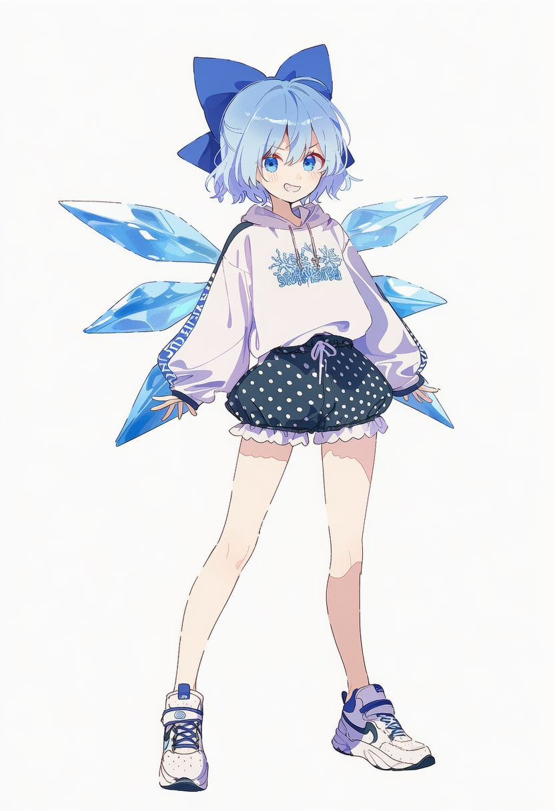

[在线例图](https://assets.quicktagcloud.com/images/raven_composition/raven_composition-0850.jpg?v=fddbc390454faf9f)

<a id="raven_composition-0851"></a>

## 印花短裤

ID：`raven_composition-0851`；分类：裤子 / 图案/配色；来源标记：`safe`。

来源说明：

> 表面带有明确印花、图形或重复图案的短裤。

正向提示词：

```text
print_shorts
```

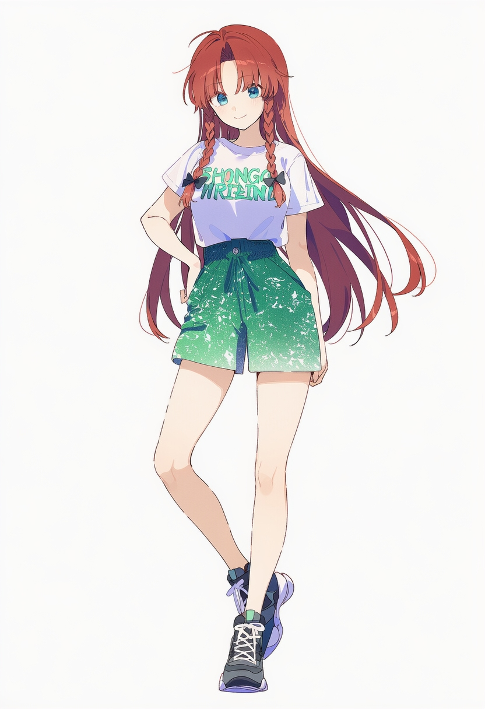

[在线例图](https://assets.quicktagcloud.com/images/raven_composition/raven_composition-0851.jpg?v=e2a5cd9cab2316c2)

<a id="raven_composition-0852"></a>

## 黑色短裤

ID：`raven_composition-0852`；分类：裤子 / 图案/配色；来源标记：`safe`。

来源说明：

> 主要颜色为黑色的短裤。

正向提示词：

```text
black_shorts
```

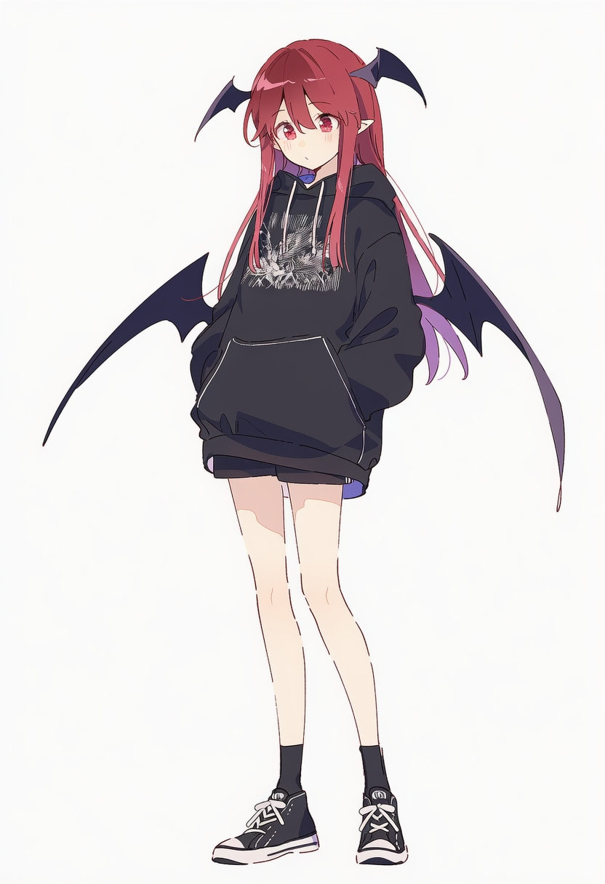

[在线例图](https://assets.quicktagcloud.com/images/raven_composition/raven_composition-0852.jpg?v=2f6655b7fc860467)

<a id="raven_composition-0853"></a>

## 多色短裤

ID：`raven_composition-0853`；分类：裤子 / 图案/配色；来源标记：`safe`。

来源说明：

> 短裤同时具有三种或更多明显颜色。

正向提示词：

```text
multicolored_shorts
```

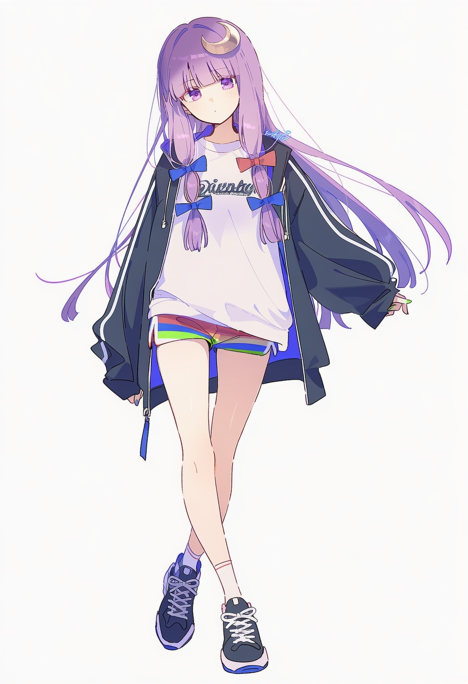

[在线例图](https://assets.quicktagcloud.com/images/raven_composition/raven_composition-0853.jpg?v=a16a214ddbe736f5)

<a id="raven_composition-0895"></a>

## 格纹长裤

ID：`raven_composition-0895`；分类：裤子 / 图案/配色；来源标记：`safe`。

来源说明：

> 带有 plaid / tartan 风格交叉格纹的长裤。

正向提示词：

```text
plaid_pants
```

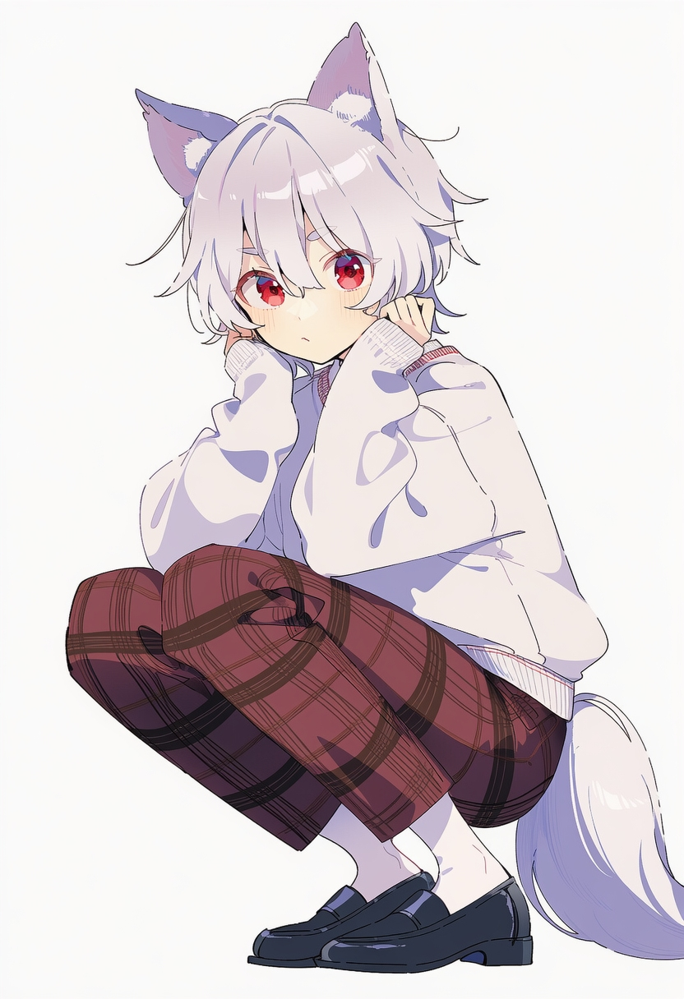

[在线例图](https://assets.quicktagcloud.com/images/raven_composition/raven_composition-0895.jpg?v=861e3a437151720e)

<a id="raven_composition-0896"></a>

## 棋盘格长裤

ID：`raven_composition-0896`；分类：裤子 / 图案/配色；来源标记：`safe`。

来源说明：

> 带有规则方格或棋盘格图案的长裤。

正向提示词：

```text
checkered_pants
```

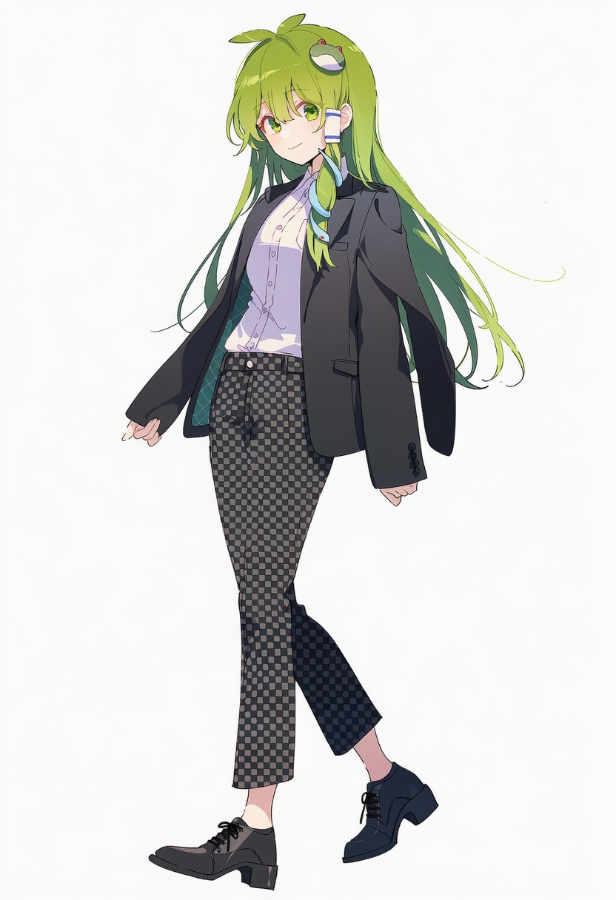

[在线例图](https://assets.quicktagcloud.com/images/raven_composition/raven_composition-0896.jpg?v=668b0ed6bee610db)

<a id="raven_composition-0897"></a>

## 条纹长裤

ID：`raven_composition-0897`；分类：裤子 / 图案/配色；来源标记：`safe`。

来源说明：

> 带有条纹图案的长裤。

正向提示词：

```text
striped_pants
```

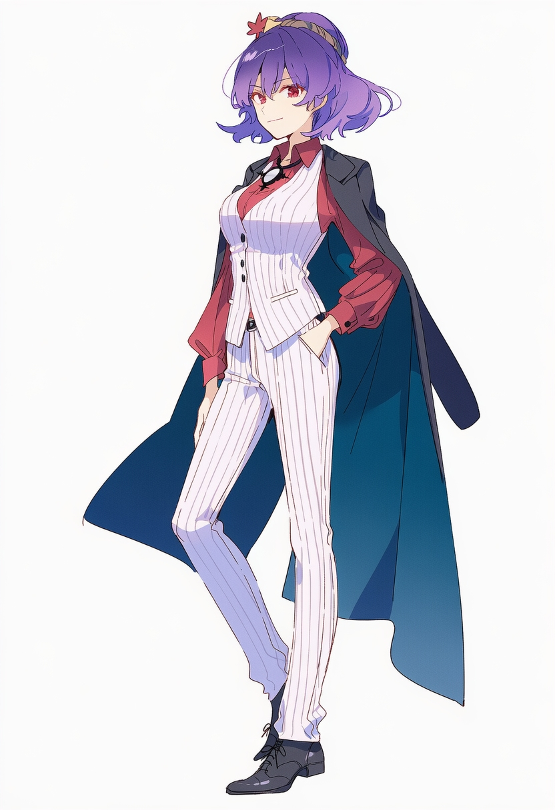

[在线例图](https://assets.quicktagcloud.com/images/raven_composition/raven_composition-0897.jpg?v=92466dd0e7f15783)

<a id="raven_composition-0898"></a>

## 迷彩长裤

ID：`raven_composition-0898`；分类：裤子 / 图案/配色；来源标记：`safe`。

来源说明：

> 带有军事迷彩图案的长裤。

正向提示词：

```text
camouflage_pants
```

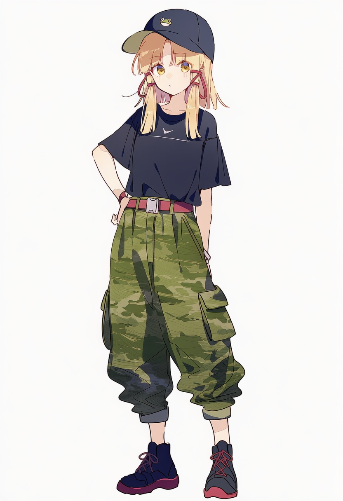

[在线例图](https://assets.quicktagcloud.com/images/raven_composition/raven_composition-0898.jpg?v=3ef73aeec77bab99)

<a id="raven_composition-0899"></a>

## 细条纹长裤

ID：`raven_composition-0899`；分类：裤子 / 图案/配色；来源标记：`safe`。

来源说明：

> 带有细而密集的正装式条纹图案。

正向提示词：

```text
pinstripe_pants
```

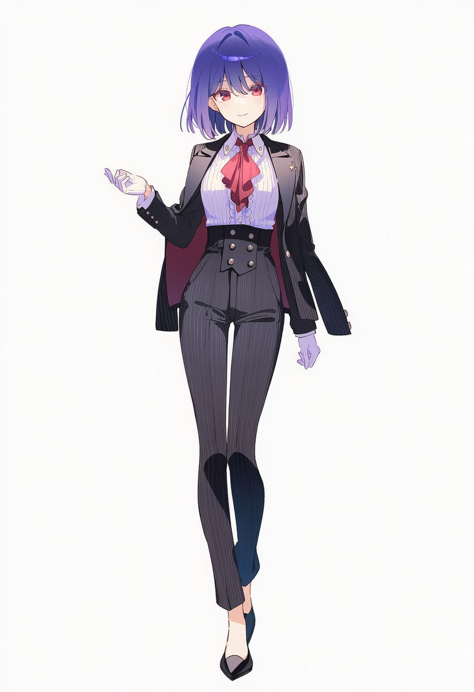

[在线例图](https://assets.quicktagcloud.com/images/raven_composition/raven_composition-0899.jpg?v=4753aa757d5a3a26)

<a id="raven_composition-0900"></a>

## 印花长裤

ID：`raven_composition-0900`；分类：裤子 / 图案/配色；来源标记：`safe`。

来源说明：

> 表面带有明确印花、图形或重复图案的长裤。

正向提示词：

```text
print_pants
```

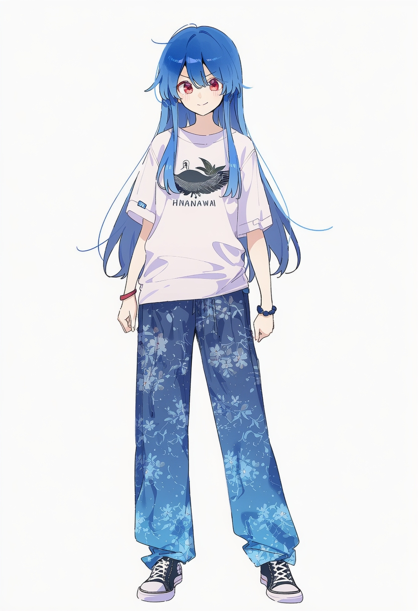

[在线例图](https://assets.quicktagcloud.com/images/raven_composition/raven_composition-0900.jpg?v=eff2d8f6673cb54c)

<a id="raven_composition-0901"></a>

## 黑色长裤

ID：`raven_composition-0901`；分类：裤子 / 图案/配色；来源标记：`safe`。

来源说明：

> 主要颜色为黑色的长裤。

正向提示词：

```text
black_pants
```

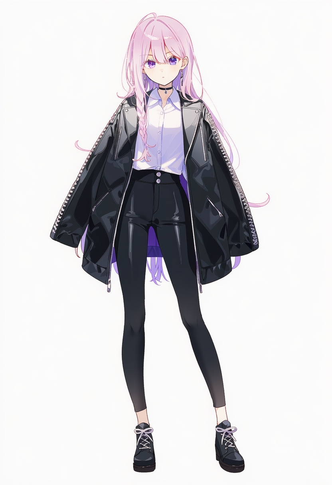

[在线例图](https://assets.quicktagcloud.com/images/raven_composition/raven_composition-0901.jpg?v=74d10c311a75765e)

<a id="raven_composition-0902"></a>

## 多色长裤

ID：`raven_composition-0902`；分类：裤子 / 图案/配色；来源标记：`safe`。

来源说明：

> 裤子同时具有三种或更多明显颜色。

正向提示词：

```text
multicolored_pants
```

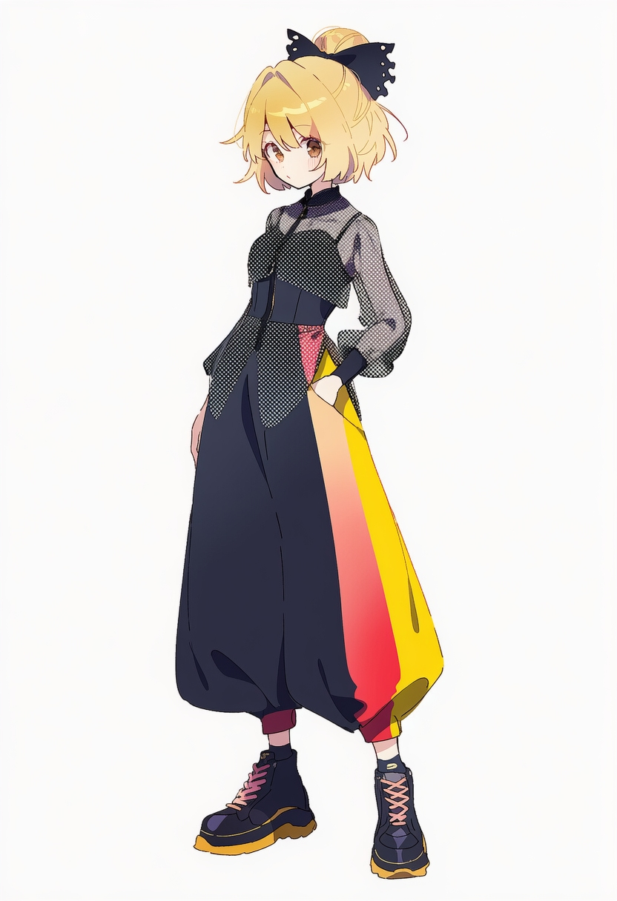

[在线例图](https://assets.quicktagcloud.com/images/raven_composition/raven_composition-0902.jpg?v=4e6917c5b281c78c)

<a id="raven_composition-0903"></a>

## 双色长裤

ID：`raven_composition-0903`；分类：裤子 / 图案/配色；来源标记：`safe`。

来源说明：

> 裤子由两种主要颜色构成。

正向提示词：

```text
two-tone_pants
```

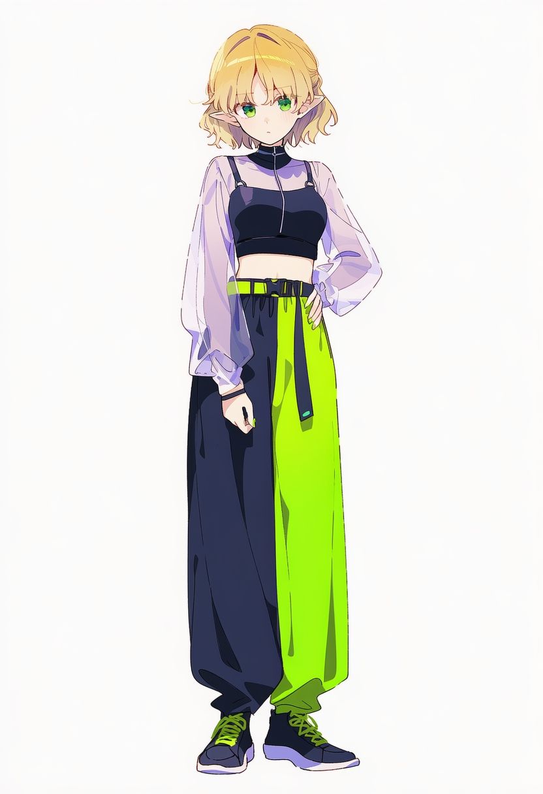

[在线例图](https://assets.quicktagcloud.com/images/raven_composition/raven_composition-0903.jpg?v=079496be3c02e754)

<a id="raven_composition-0904"></a>

## 渐变色长裤

ID：`raven_composition-0904`；分类：裤子 / 图案/配色；来源标记：`safe`。

来源说明：

> 裤子颜色呈连续渐变过渡。

正向提示词：

```text
gradient_pants
```

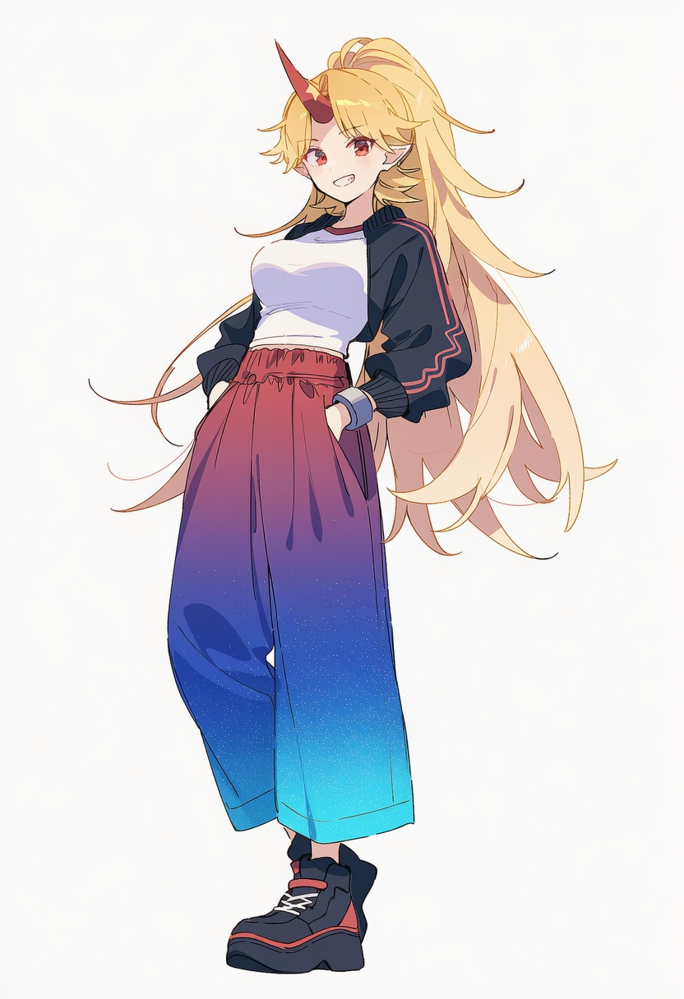

[在线例图](https://assets.quicktagcloud.com/images/raven_composition/raven_composition-0904.jpg?v=c1e2918a5850893e)
