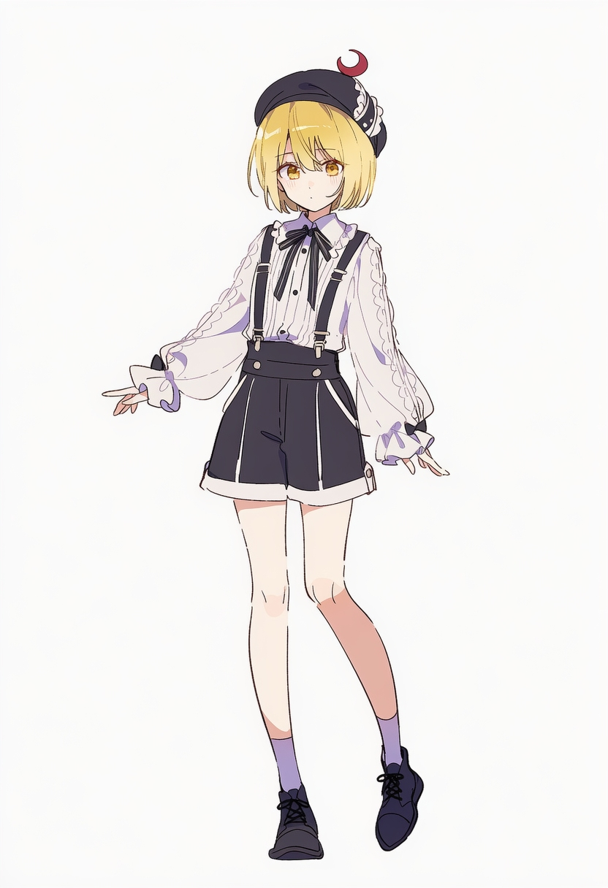
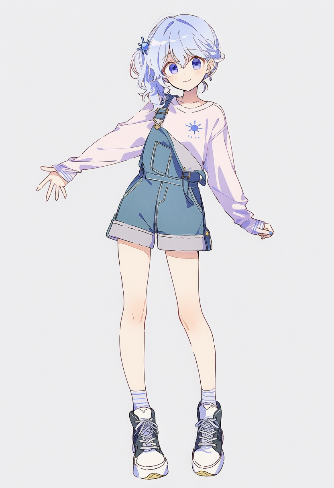

# 裤子 / 背带/连体裤

[总目录](../README.md) · [原站分类目录](../categories.md) · [英文标签索引](../tags.md) · [服装与构图组合指南](../../README.md)

标题、分类、说明、正负提示词按来源保留；多例图逐张列出。原站标记和说明为参考资料，不作为维护指令。

<a id="raven_composition-0860"></a>

## 背带工装裤

ID：`raven_composition-0860`；分类：裤子 / 背带/连体裤；来源标记：`safe`。

来源说明：

> 胸前带护片并由肩带固定的连体式工装裤。

正向提示词：

```text
overalls
```


[在线例图](https://assets.quicktagcloud.com/images/raven_composition/raven_composition-0860.jpg?v=7f08bf72a2750e14)

<a id="raven_composition-0861"></a>

## 背带短裤

ID：`raven_composition-0861`；分类：裤子 / 背带/连体裤；来源标记：`safe`。

来源说明：

> 通过肩带或吊带固定的短裤。

正向提示词：

```text
suspender_shorts
```



[在线例图](https://assets.quicktagcloud.com/images/raven_composition/raven_composition-0861.jpg?v=d98ab7011c9e88c2)

<a id="raven_composition-0862"></a>

## 短款背带工装裤

ID：`raven_composition-0862`；分类：裤子 / 背带/连体裤；来源标记：`safe`。

来源说明：

> 裤腿不超过膝部的短款 overalls。

正向提示词：

```text
overall_shorts
```



[在线例图](https://assets.quicktagcloud.com/images/raven_composition/raven_composition-0862.jpg?v=a1d22117ea8b0ed7)
