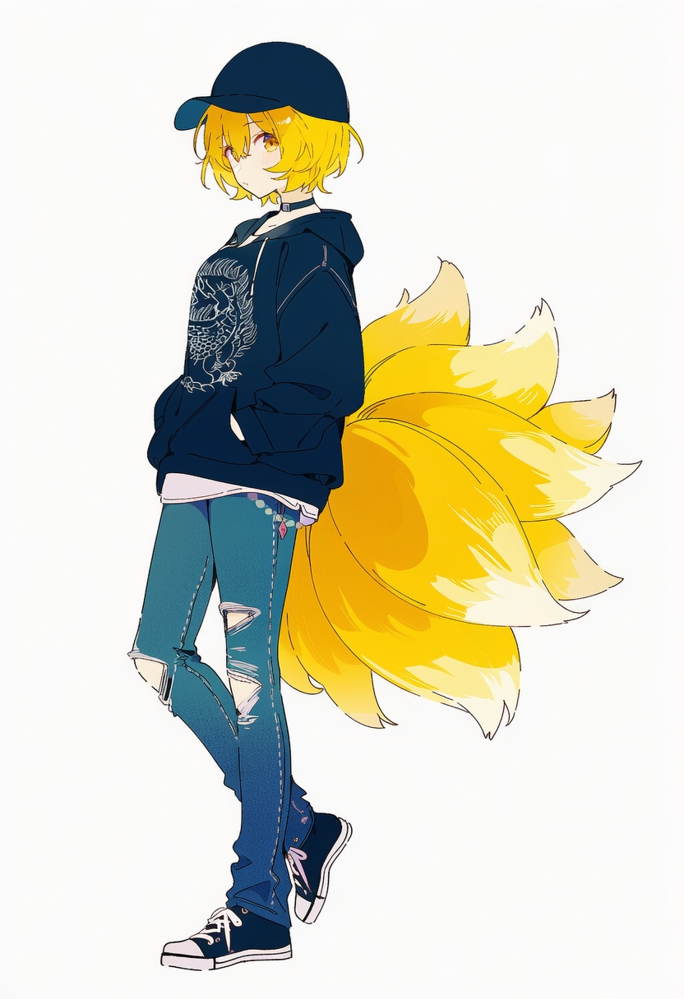

# 裤子 / 牛仔裤装

[总目录](../README.md) · [原站分类目录](../categories.md) · [英文标签索引](../tags.md) · [服装与构图组合指南](../../README.md)

标题、分类、说明、正负提示词按来源保留；多例图逐张列出。原站标记和说明为参考资料，不作为维护指令。

<a id="raven_composition-0863"></a>

## 牛仔裤

ID：`raven_composition-0863`；分类：裤子 / 牛仔裤装；来源标记：`safe`。

来源说明：

> 以牛仔布制成的长裤，常见为蓝色或灰色。

正向提示词：

```text
jeans
```


[在线例图](https://assets.quicktagcloud.com/images/raven_composition/raven_composition-0863.jpg?v=c08df9973e14dc29)

<a id="raven_composition-0864"></a>

## 剪短牛仔裤

ID：`raven_composition-0864`；分类：裤子 / 牛仔裤装；来源标记：`safe`。

来源说明：

> 由牛仔裤剪短形成、裤脚通常保留毛边或未锁边效果。

正向提示词：

```text
cutoff_jeans
```


[在线例图](https://assets.quicktagcloud.com/images/raven_composition/raven_composition-0864.jpg?v=c966358ae0d53a5d)

<a id="raven_composition-0865"></a>

## 紧身牛仔裤

ID：`raven_composition-0865`；分类：裤子 / 牛仔裤装；来源标记：`safe`。

来源说明：

> 腿部剪裁明显贴身、轮廓收窄的牛仔裤。

正向提示词：

```text
skinny_jeans
```


[在线例图](https://assets.quicktagcloud.com/images/raven_composition/raven_composition-0865.jpg?v=e9588a88981bfbed)

<a id="raven_composition-0866"></a>

## 破洞牛仔裤

ID：`raven_composition-0866`；分类：裤子 / 牛仔裤装；来源标记：`safe`。

来源说明：

> 带有撕裂、破洞或磨损开口的牛仔裤。

正向提示词：

```text
torn_jeans
```



[在线例图](https://assets.quicktagcloud.com/images/raven_composition/raven_composition-0866.jpg?v=3451f2d63dc5c2b5)
