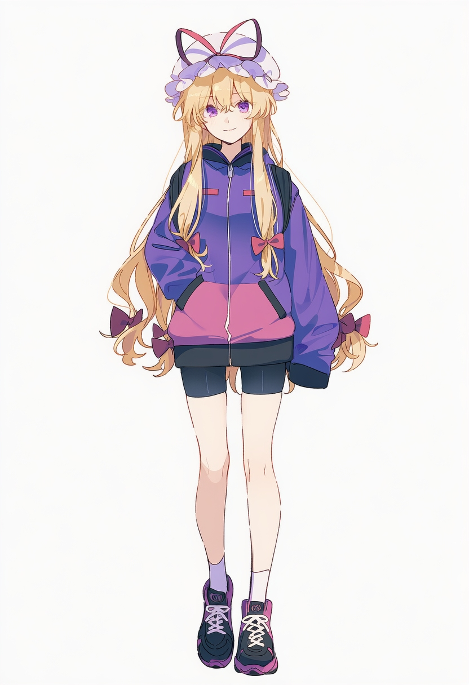
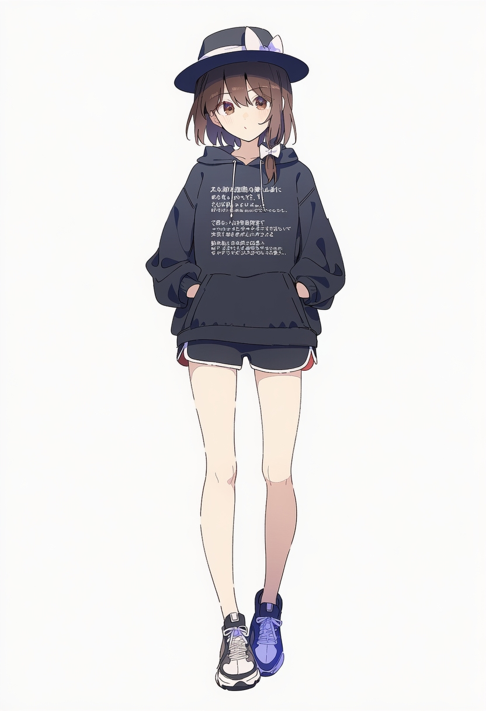
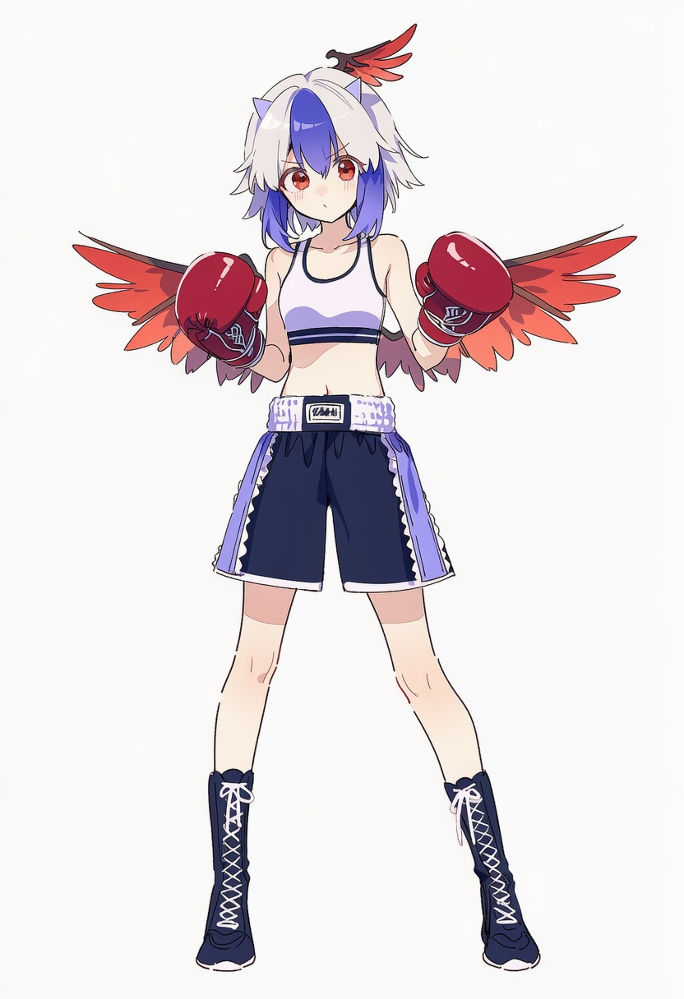
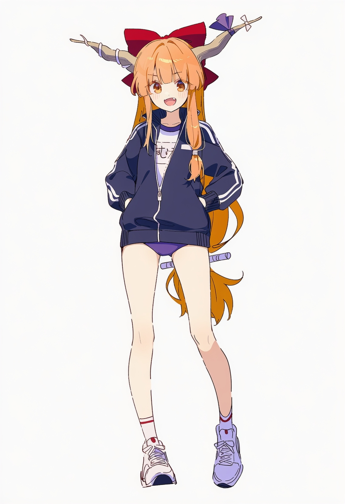
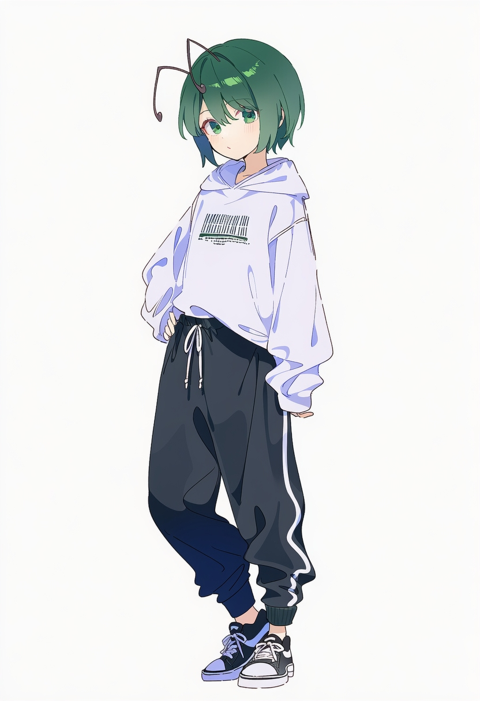
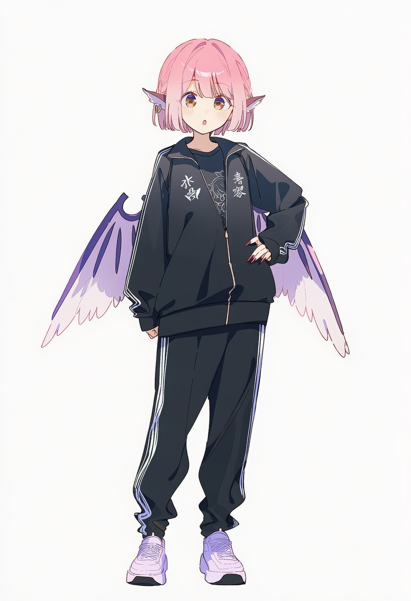
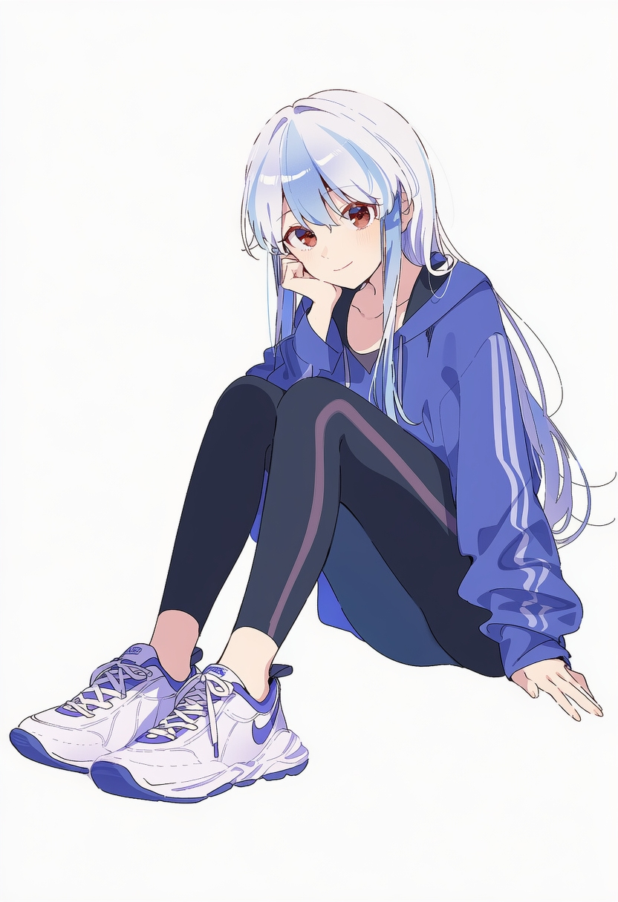

# 裤子 / 运动裤装

[总目录](../README.md) · [原站分类目录](../categories.md) · [英文标签索引](../tags.md) · [服装与构图组合指南](../../README.md)

标题、分类、说明、正负提示词按来源保留；多例图逐张列出。原站标记和说明为参考资料，不作为维护指令。

<a id="raven_composition-0867"></a>

## 骑行短裤

ID：`raven_composition-0867`；分类：裤子 / 运动裤装；来源标记：`safe`。

来源说明：

> 弹力贴身、通常到大腿中部的运动型短裤。

正向提示词：

```text
bike_shorts
```



[在线例图](https://assets.quicktagcloud.com/images/raven_composition/raven_composition-0867.jpg?v=f0c68edabf96f7af)

<a id="raven_composition-0868"></a>

## 海豚短裤

ID：`raven_composition-0868`；分类：裤子 / 运动裤装；来源标记：`safe`。

来源说明：

> 运动风短裤，裤脚圆弧、侧边常有开衩或包边。

正向提示词：

```text
dolphin_shorts
```



[在线例图](https://assets.quicktagcloud.com/images/raven_composition/raven_composition-0868.jpg?v=1626697b6167a72b)

<a id="raven_composition-0869"></a>

## 运动短裤

ID：`raven_composition-0869`；分类：裤子 / 运动裤装；来源标记：`safe`。

来源说明：

> 用于体育、健身或校园运动场景的短裤。

正向提示词：

```text
gym_shorts
```


[在线例图](https://assets.quicktagcloud.com/images/raven_composition/raven_composition-0869.jpg?v=9c8cb2ec9256a695)

<a id="raven_composition-0870"></a>

## 拳击短裤

ID：`raven_composition-0870`；分类：裤子 / 运动裤装；来源标记：`safe`。

来源说明：

> 拳击或格斗运动常见的宽松运动短裤。

正向提示词：

```text
boxing_shorts
```



[在线例图](https://assets.quicktagcloud.com/images/raven_composition/raven_composition-0870.jpg?v=2a7f8f43aebcbf9a)

<a id="raven_composition-0871"></a>

## 日式体操短裤

ID：`raven_composition-0871`；分类：裤子 / 运动裤装；来源标记：`safe`。

来源说明：

> 日本学校体育服中常见的贴身体操短裤。

正向提示词：

```text
buruma
```



[在线例图](https://assets.quicktagcloud.com/images/raven_composition/raven_composition-0871.jpg?v=7c25ead393e1814c)

<a id="raven_composition-0872"></a>

## 运动卫裤

ID：`raven_composition-0872`；分类：裤子 / 运动裤装；来源标记：`safe`。

来源说明：

> 柔软宽松、常用于运动或休闲穿着的长裤。

正向提示词：

```text
sweatpants
```



[在线例图](https://assets.quicktagcloud.com/images/raven_composition/raven_composition-0872.jpg?v=0cec404c0eb06dbc)

<a id="raven_composition-0873"></a>

## 运动长裤

ID：`raven_composition-0873`；分类：裤子 / 运动裤装；来源标记：`safe`。

来源说明：

> 运动套装式长裤，常见侧条纹或运动服面料。

正向提示词：

```text
track_pants
```



[在线例图](https://assets.quicktagcloud.com/images/raven_composition/raven_composition-0873.jpg?v=471aa9f247ecb08a)

<a id="raven_composition-0874"></a>

## 瑜伽裤

ID：`raven_composition-0874`；分类：裤子 / 运动裤装；来源标记：`safe`。

来源说明：

> 弹力贴身、常用于瑜伽或健身的长裤。

正向提示词：

```text
yoga_pants
```



[在线例图](https://assets.quicktagcloud.com/images/raven_composition/raven_composition-0874.jpg?v=f73ac74603a9c971)
