# 发型 / 基础发型

[总目录](../README.md) · [原站分类目录](../categories.md) · [英文标签索引](../tags.md) · [服装与构图组合指南](../../README.md)

标题、分类、说明、正负提示词按来源保留；多例图逐张列出。原站标记和说明为参考资料，不作为维护指令。

<a id="raven_composition-0911"></a>

## 极端超长发

ID：`raven_composition-0911`；分类：发型 / 基础发型；来源标记：`safe`。

来源说明：

> 头发长得非常夸张，远超普通长发。

正向提示词：

```text
absurdly_long_hair
```

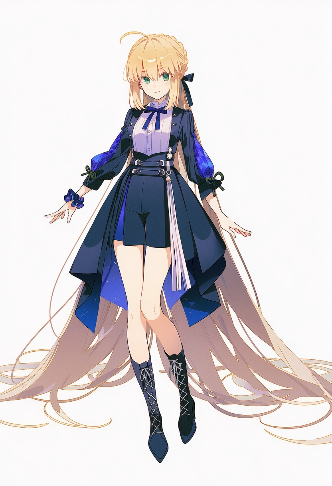

[在线例图](https://assets.quicktagcloud.com/images/raven_composition/raven_composition-0911.jpg?v=c8ba50532c263e37)

<a id="raven_composition-0912"></a>

## 蓬大头发

ID：`raven_composition-0912`；分类：发型 / 基础发型；来源标记：`safe`。

来源说明：

> 头发整体非常蓬大、有体积感。

正向提示词：

```text
big_hair
```

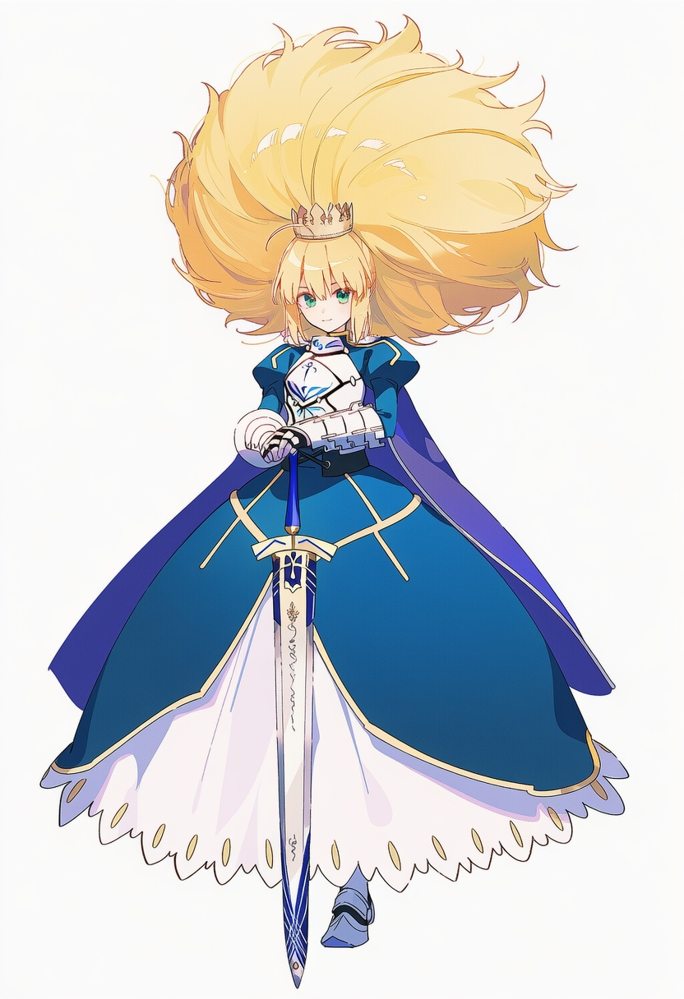

[在线例图](https://assets.quicktagcloud.com/images/raven_composition/raven_composition-0912.jpg?v=326f1fdd22e703b4)

<a id="raven_composition-0913"></a>

## 长发

ID：`raven_composition-0913`；分类：发型 / 基础发型；来源标记：`safe`。

来源说明：

> 明显的长发。

正向提示词：

```text
long_hair
```

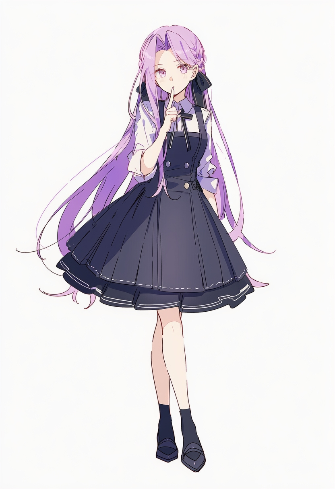

[在线例图](https://assets.quicktagcloud.com/images/raven_composition/raven_composition-0913.jpg?v=420849baa97f012d)

<a id="raven_composition-0914"></a>

## 中长发 / 齐肩发

ID：`raven_composition-0914`；分类：发型 / 基础发型；来源标记：`safe`。

来源说明：

> 长度大约在肩部附近。

正向提示词：

```text
medium_hair
```

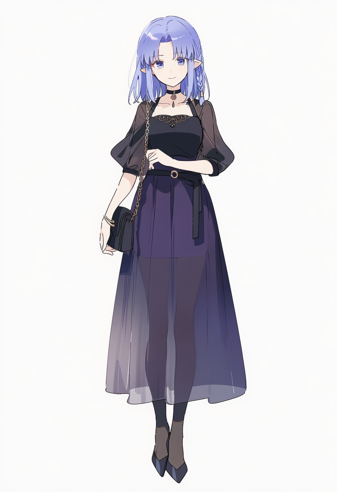

[在线例图](https://assets.quicktagcloud.com/images/raven_composition/raven_composition-0914.jpg?v=aba486e7d7a9b9b3)

<a id="raven_composition-0915"></a>

## 短发

ID：`raven_composition-0915`；分类：发型 / 基础发型；来源标记：`safe`。

来源说明：

> 明显的短发。

正向提示词：

```text
short_hair
```

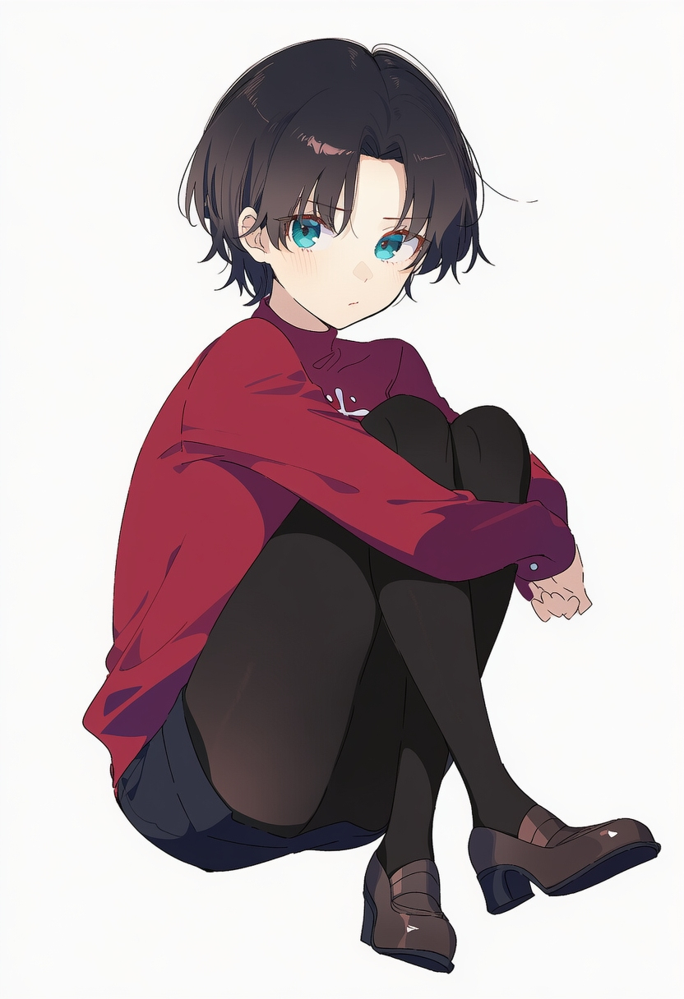

[在线例图](https://assets.quicktagcloud.com/images/raven_composition/raven_composition-0915.jpg?v=2d255884be2715bc)

<a id="raven_composition-0916"></a>

## 超长发

ID：`raven_composition-0916`；分类：发型 / 基础发型；来源标记：`safe`。

来源说明：

> 长度远超过普通长发。

正向提示词：

```text
very_long_hair
```

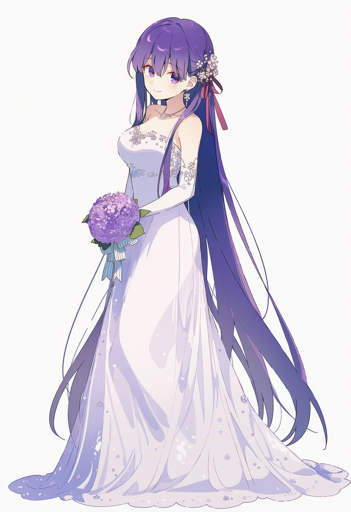

[在线例图](https://assets.quicktagcloud.com/images/raven_composition/raven_composition-0916.jpg?v=9f91f96e173b1bfb)

<a id="raven_composition-0917"></a>

## 极短发

ID：`raven_composition-0917`；分类：发型 / 基础发型；来源标记：`safe`。

来源说明：

> 非常短的头发。

正向提示词：

```text
very_short_hair
```

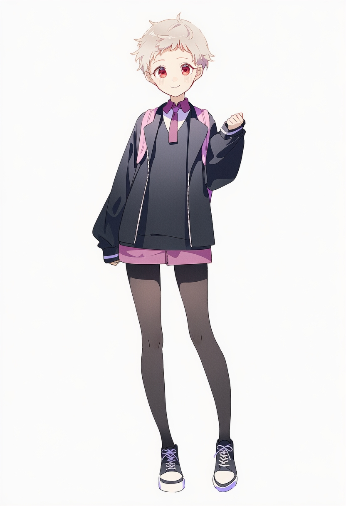

[在线例图](https://assets.quicktagcloud.com/images/raven_composition/raven_composition-0917.jpg?v=70f2d4ccd2a032b6)

<a id="raven_composition-0918"></a>

## 蜂巢高发髻

ID：`raven_composition-0918`；分类：发型 / 基础发型；来源标记：`safe`。

来源说明：

> 头发高高盘起，像蜂巢一样。

正向提示词：

```text
beehive_hairdo
```

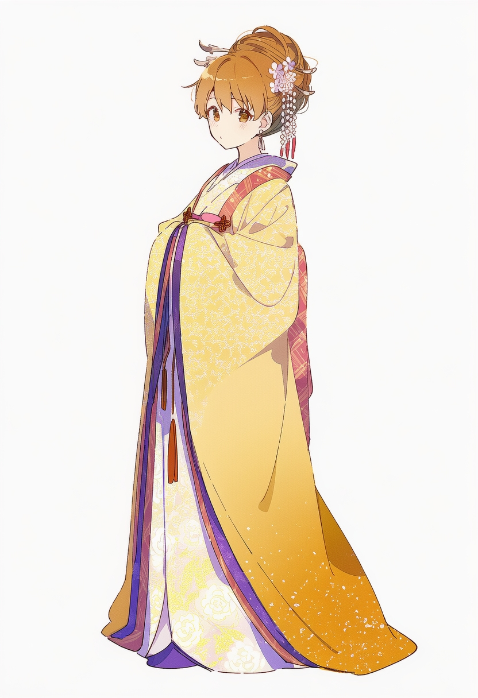

[在线例图](https://assets.quicktagcloud.com/images/raven_composition/raven_composition-0918.jpg?v=bf1737273f01682b)

<a id="raven_composition-0919"></a>

## 波波头

ID：`raven_composition-0919`；分类：发型 / 基础发型；来源标记：`safe`。

来源说明：

> 齐颈或齐下巴的波波头。

正向提示词：

```text
bob_cut
```

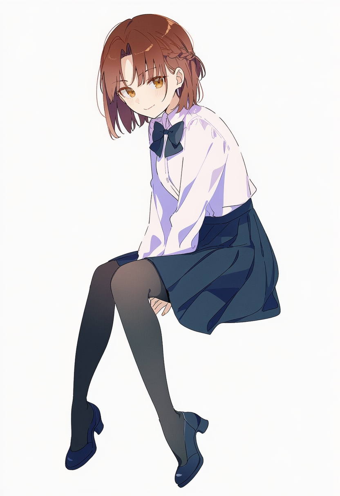

[在线例图](https://assets.quicktagcloud.com/images/raven_composition/raven_composition-0919.jpg?v=9372b68bfe0ab079)

<a id="raven_composition-0920"></a>

## 锅盖头

ID：`raven_composition-0920`；分类：发型 / 基础发型；来源标记：`safe`。

来源说明：

> 头发像锅盖一样整齐包住头部。

正向提示词：

```text
bowl_cut
```

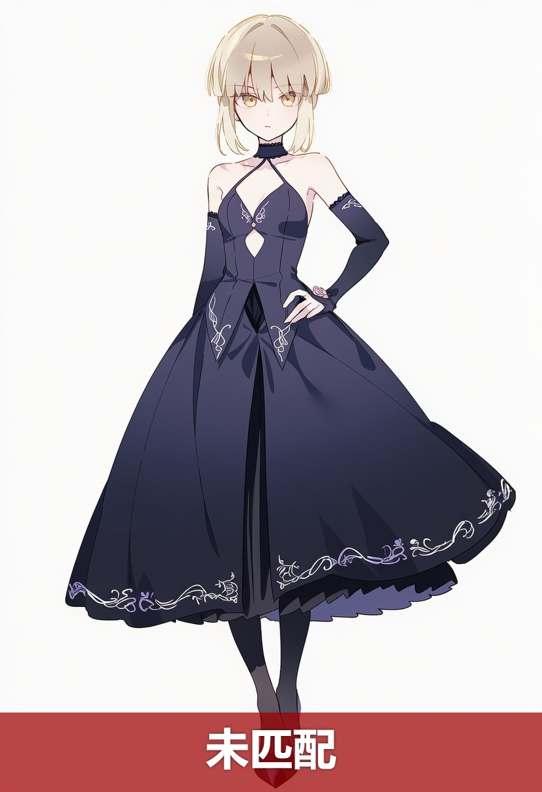

[在线例图](https://assets.quicktagcloud.com/images/raven_composition/raven_composition-0920.jpg?v=935e18121eafff49)

<a id="raven_composition-0921"></a>

## 姬发式

ID：`raven_composition-0921`；分类：发型 / 基础发型；来源标记：`safe`。

来源说明：

> 齐刘海配脸侧长直发束的姬发式。

正向提示词：

```text
hime_cut
```

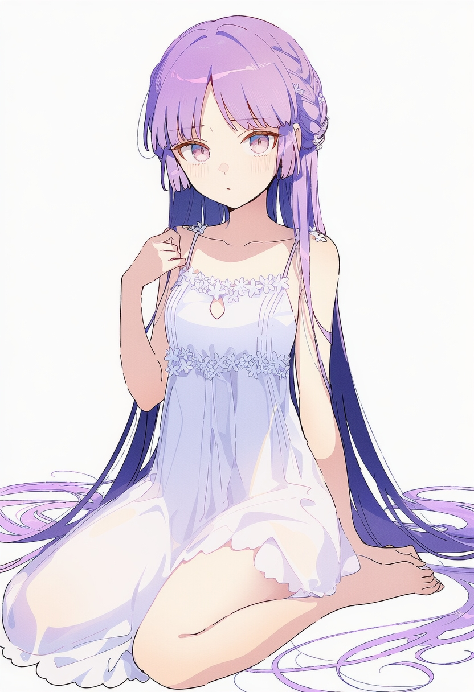

[在线例图](https://assets.quicktagcloud.com/images/raven_composition/raven_composition-0921.jpg?v=7c1e8459aecbf947)

<a id="raven_composition-0922"></a>

## 内长外短倒置波波头

ID：`raven_composition-0922`；分类：发型 / 基础发型；来源标记：`safe`。

来源说明：

> 后短前长的波波头。

正向提示词：

```text
inverted_bob
```

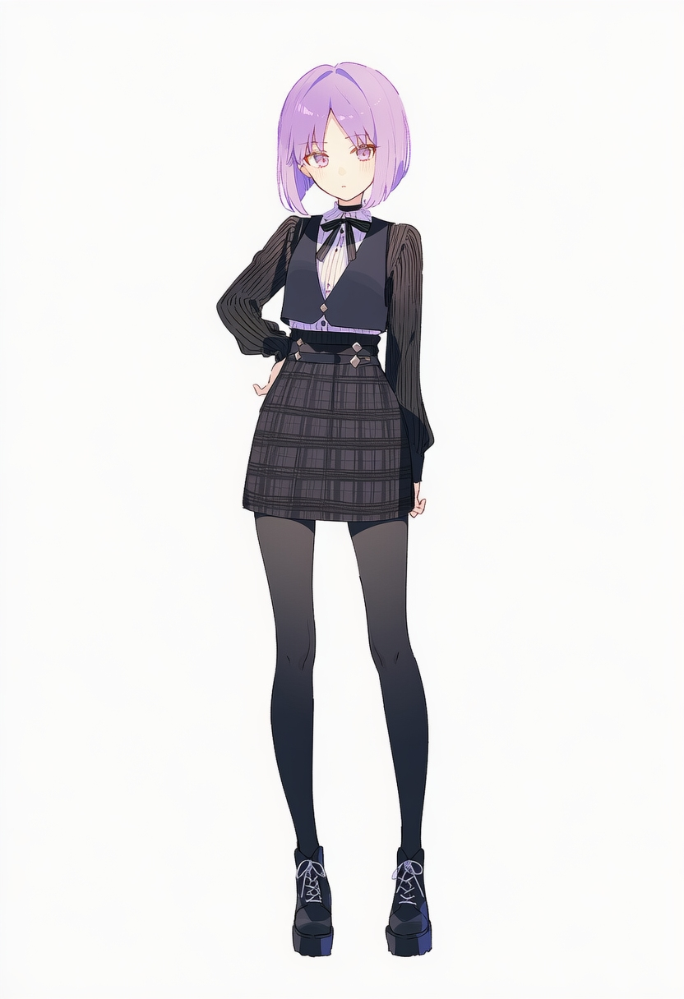

[在线例图](https://assets.quicktagcloud.com/images/raven_composition/raven_composition-0922.jpg?v=025b7c79e93e02d6)

<a id="raven_composition-0923"></a>

## 水母头

ID：`raven_composition-0923`；分类：发型 / 基础发型；来源标记：`safe`。

来源说明：

> 上短下长、像水母层次的发型。

正向提示词：

```text
jellyfish_cut
```

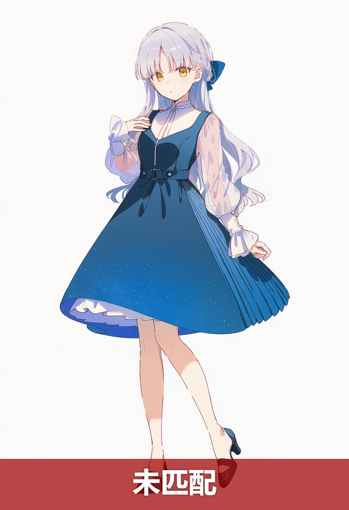

[在线例图](https://assets.quicktagcloud.com/images/raven_composition/raven_composition-0923.jpg?v=16eed1481911c8fd)

<a id="raven_composition-0924"></a>

## 莫西干头

ID：`raven_composition-0924`；分类：发型 / 基础发型；来源标记：`safe`。

来源说明：

> 头顶中间竖起、两侧较短的莫西干头。

正向提示词：

```text
mohawk
```

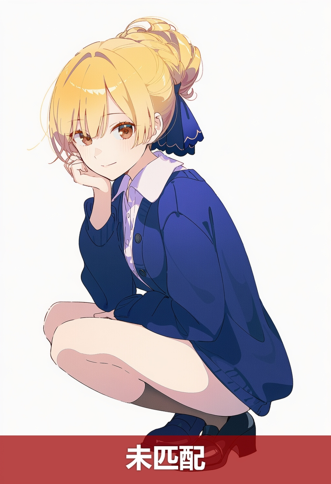

[在线例图](https://assets.quicktagcloud.com/images/raven_composition/raven_composition-0924.jpg?v=cdff6b24e68a7d0d)
