# 发型 / 扎发/编发

[总目录](../README.md) · [原站分类目录](../categories.md) · [英文标签索引](../tags.md) · [服装与构图组合指南](../../README.md)

标题、分类、说明、正负提示词按来源保留；多例图逐张列出。原站标记和说明为参考资料，不作为维护指令。

<a id="raven_composition-0925"></a>

## 半扎发

ID：`raven_composition-0925`；分类：发型 / 扎发/编发；来源标记：`safe`。

来源说明：

> 上半部分头发扎起，下半部分披着。

正向提示词：

```text
half_updo
```

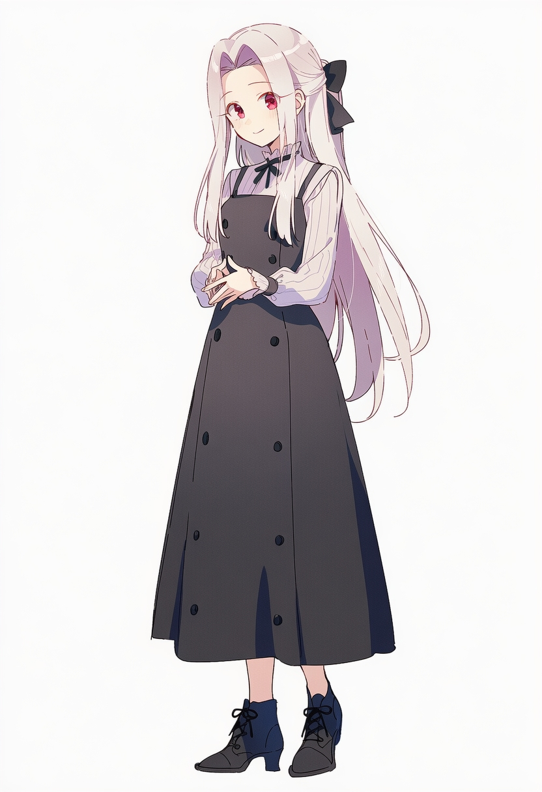

[在线例图](https://assets.quicktagcloud.com/images/raven_composition/raven_composition-0925.jpg?v=9feb7769ae77b8e6)

<a id="raven_composition-0926"></a>

## 高马尾

ID：`raven_composition-0926`；分类：发型 / 扎发/编发；来源标记：`safe`。

来源说明：

> 马尾扎在较高位置。

正向提示词：

```text
high_ponytail
```

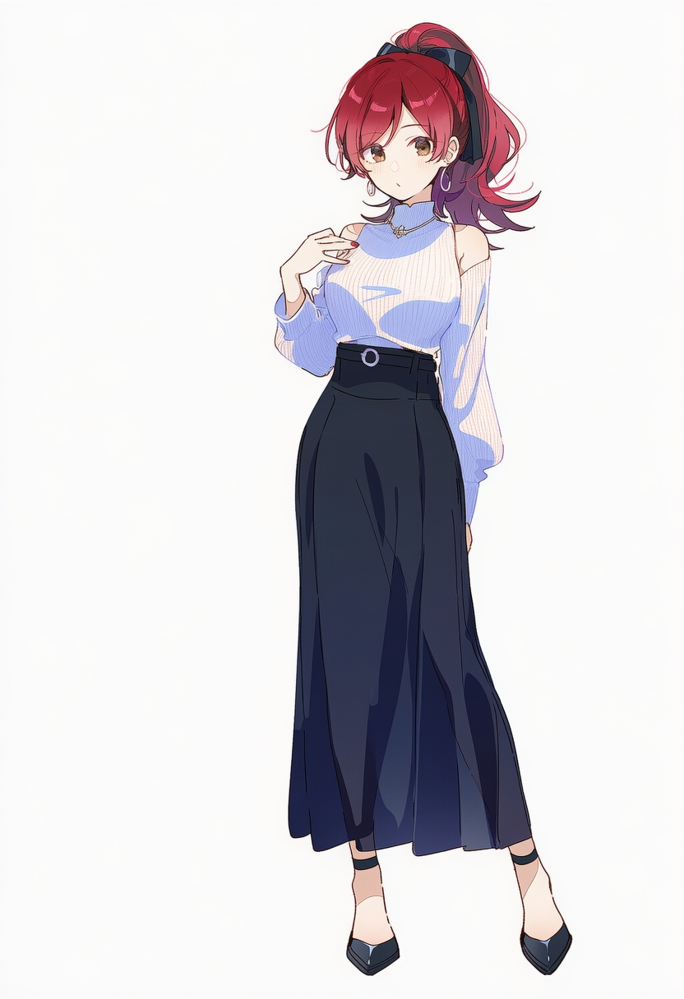

[在线例图](https://assets.quicktagcloud.com/images/raven_composition/raven_composition-0926.jpg?v=157412c5e9ddc3f1)

<a id="raven_composition-0927"></a>

## 高侧马尾

ID：`raven_composition-0927`；分类：发型 / 扎发/编发；来源标记：`safe`。

来源说明：

> 马尾扎在头部较高的侧边。

正向提示词：

```text
high_side_ponytail
```

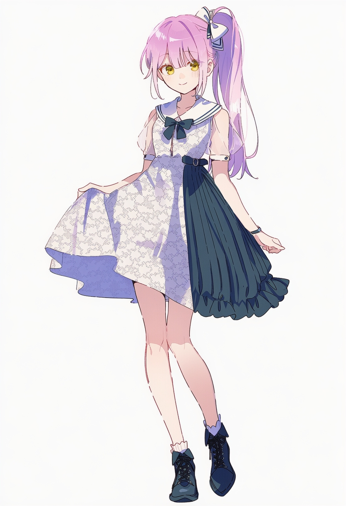

[在线例图](https://assets.quicktagcloud.com/images/raven_composition/raven_composition-0927.jpg?v=fb66ad99156f324e)

<a id="raven_composition-0928"></a>

## 低扎长发

ID：`raven_composition-0928`；分类：发型 / 扎发/编发；来源标记：`safe`。

来源说明：

> 长发在较低位置扎起。

正向提示词：

```text
low-tied_long_hair
```

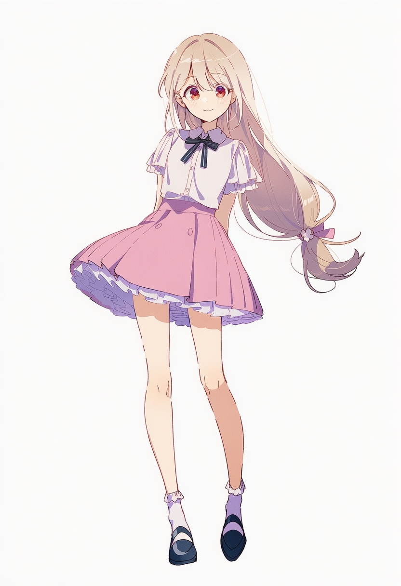

[在线例图](https://assets.quicktagcloud.com/images/raven_composition/raven_composition-0928.jpg?v=36a6ee8a56038861)

<a id="raven_composition-0929"></a>

## 低马尾

ID：`raven_composition-0929`；分类：发型 / 扎发/编发；来源标记：`safe`。

来源说明：

> 马尾扎在后脑较低位置。

正向提示词：

```text
low_ponytail
```

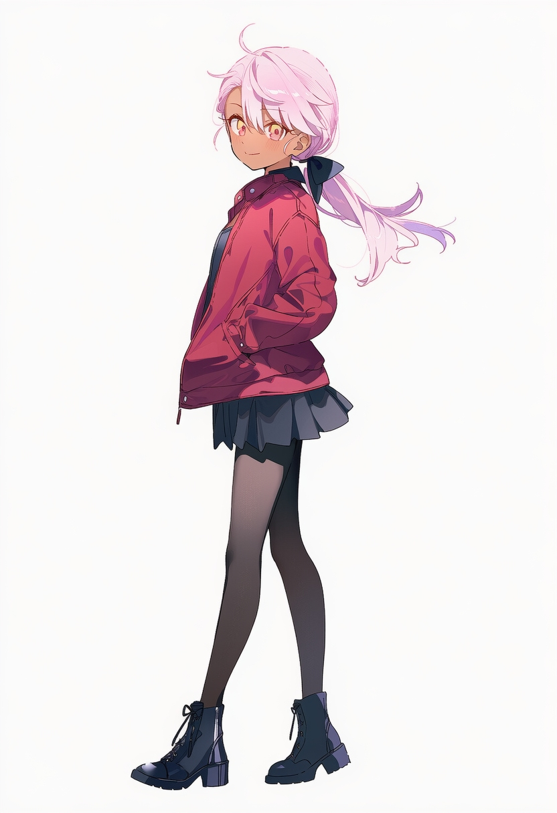

[在线例图](https://assets.quicktagcloud.com/images/raven_composition/raven_composition-0929.jpg?v=31fd1455306396ec)

<a id="raven_composition-0930"></a>

## 低侧马尾

ID：`raven_composition-0930`；分类：发型 / 扎发/编发；来源标记：`safe`。

来源说明：

> 马尾扎在较低的侧边。

正向提示词：

```text
low_side_ponytail
```

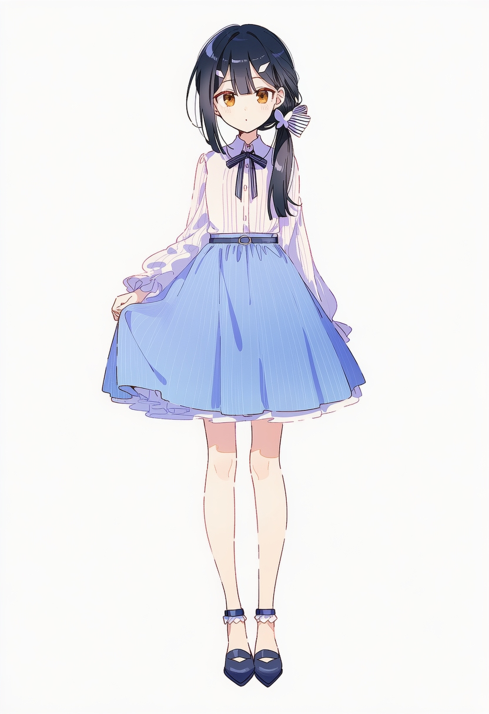

[在线例图](https://assets.quicktagcloud.com/images/raven_composition/raven_composition-0930.jpg?v=56d662caf56def4f)

<a id="raven_composition-0931"></a>

## 多段扎发

ID：`raven_composition-0931`；分类：发型 / 扎发/编发；来源标记：`safe`。

来源说明：

> 一束头发被分成多段扎起。

正向提示词：

```text
multi-tied_hair
```


[在线例图](https://assets.quicktagcloud.com/images/raven_composition/raven_composition-0931.jpg?v=d215c2aa23bf5c4f)

<a id="raven_composition-0932"></a>

## 单侧扎发

ID：`raven_composition-0932`；分类：发型 / 扎发/编发；来源标记：`safe`。

来源说明：

> 只把一侧头发扎起来。

正向提示词：

```text
one_side_up
```

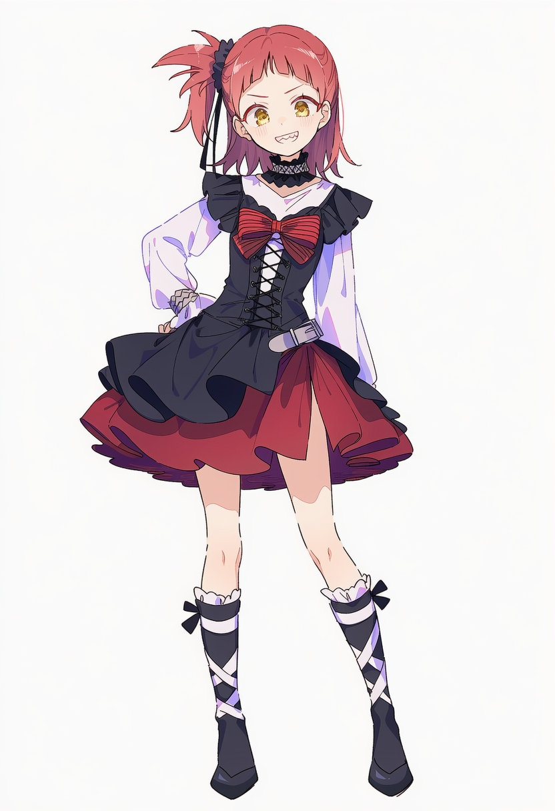

[在线例图](https://assets.quicktagcloud.com/images/raven_composition/raven_composition-0932.jpg?v=8f58212497eed080)

<a id="raven_composition-0933"></a>

## 马尾

ID：`raven_composition-0933`；分类：发型 / 扎发/编发；来源标记：`safe`。

来源说明：

> 头发在后方扎成一束马尾。

正向提示词：

```text
ponytail
```

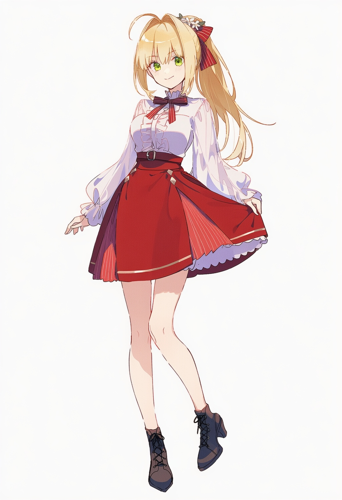

[在线例图](https://assets.quicktagcloud.com/images/raven_composition/raven_composition-0933.jpg?v=c898494f36a83104)

<a id="raven_composition-0934"></a>

## 短马尾

ID：`raven_composition-0934`；分类：发型 / 扎发/编发；来源标记：`safe`。

来源说明：

> 长度较短的马尾。

正向提示词：

```text
short_ponytail
```

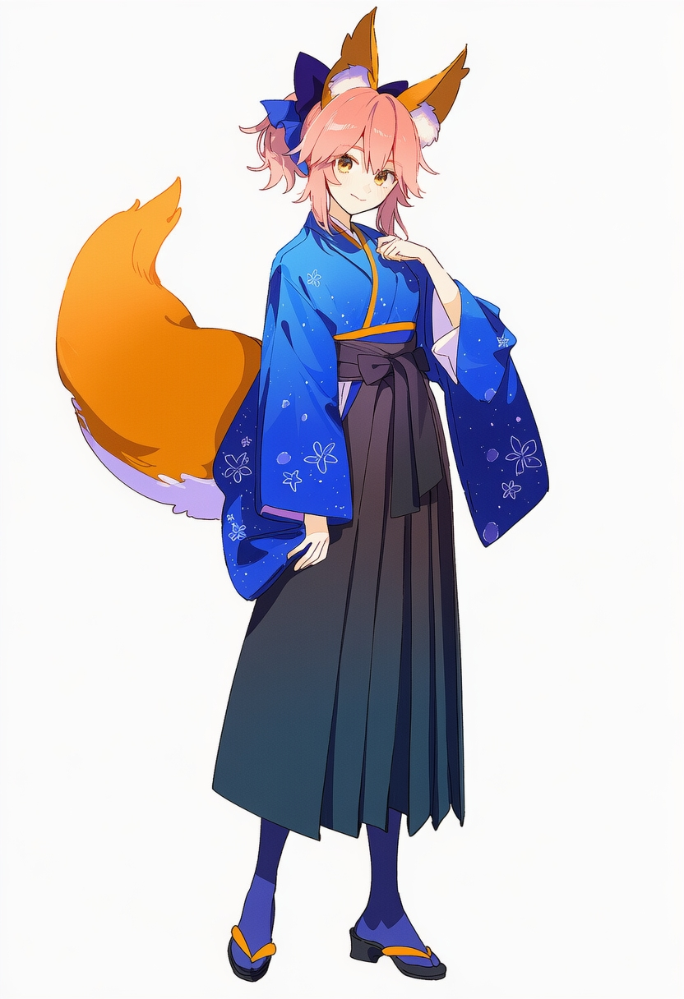

[在线例图](https://assets.quicktagcloud.com/images/raven_composition/raven_composition-0934.jpg?v=43becbc82497ec70)

<a id="raven_composition-0935"></a>

## 短侧马尾

ID：`raven_composition-0935`；分类：发型 / 扎发/编发；来源标记：`safe`。

来源说明：

> 较短的侧马尾。

正向提示词：

```text
short_side_ponytail
```

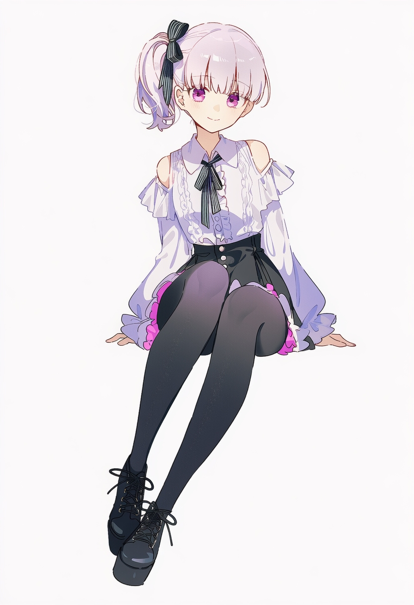

[在线例图](https://assets.quicktagcloud.com/images/raven_composition/raven_composition-0935.jpg?v=3f87ef8f5eb95a97)

<a id="raven_composition-0936"></a>

## 侧马尾

ID：`raven_composition-0936`；分类：发型 / 扎发/编发；来源标记：`safe`。

来源说明：

> 马尾扎在头部侧边。

正向提示词：

```text
side_ponytail
```

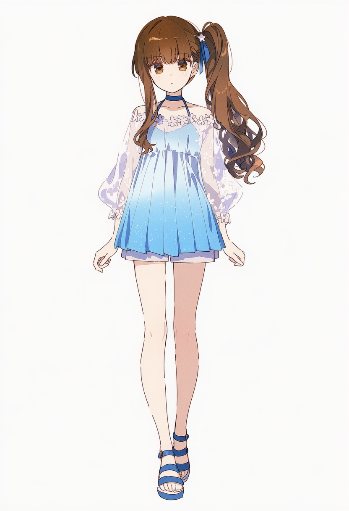

[在线例图](https://assets.quicktagcloud.com/images/raven_composition/raven_composition-0936.jpg?v=b8116cbd617c38db)

<a id="raven_composition-0937"></a>

## 顶髻

ID：`raven_composition-0937`；分类：发型 / 扎发/编发；来源标记：`safe`。

来源说明：

> 头发在头顶扎成小髻。

正向提示词：

```text
topknot
```

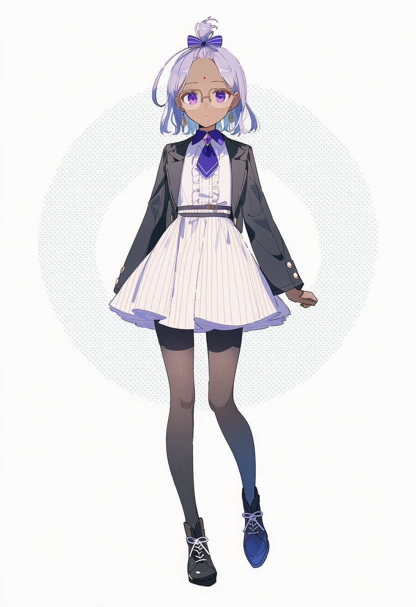

[在线例图](https://assets.quicktagcloud.com/images/raven_composition/raven_composition-0937.jpg?v=38829c532c360015)

<a id="raven_composition-0938"></a>

## 双侧半扎发

ID：`raven_composition-0938`；分类：发型 / 扎发/编发；来源标记：`safe`。

来源说明：

> 左右两侧各扎起一部分头发。

正向提示词：

```text
two_side_up
```

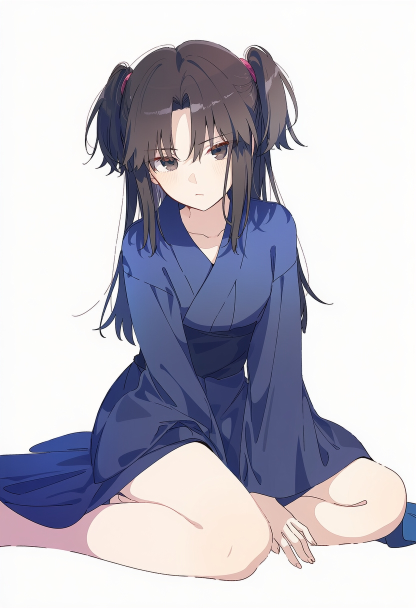

[在线例图](https://assets.quicktagcloud.com/images/raven_composition/raven_composition-0938.jpg?v=a334f74854152a13)

<a id="raven_composition-0939"></a>

## 宽扇形马尾

ID：`raven_composition-0939`；分类：发型 / 扎发/编发；来源标记：`safe`。

来源说明：

> 马尾散得很宽，像扇形。

正向提示词：

```text
wide_ponytail
```

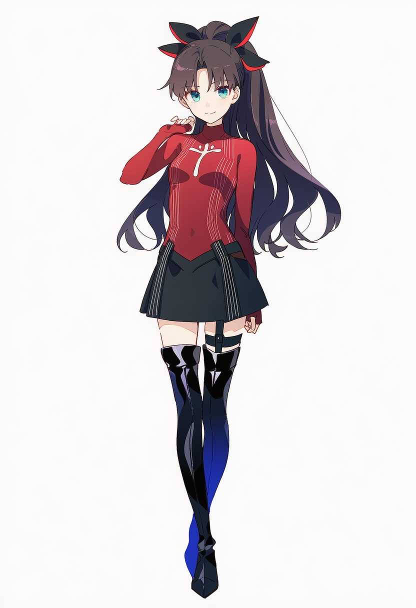

[在线例图](https://assets.quicktagcloud.com/images/raven_composition/raven_composition-0939.jpg?v=8048ddaf54f7ded1)

<a id="raven_composition-0940"></a>

## 辫发

ID：`raven_composition-0940`；分类：发型 / 扎发/编发；来源标记：`safe`。

来源说明：

> 头发编成辫子。

正向提示词：

```text
braid
```

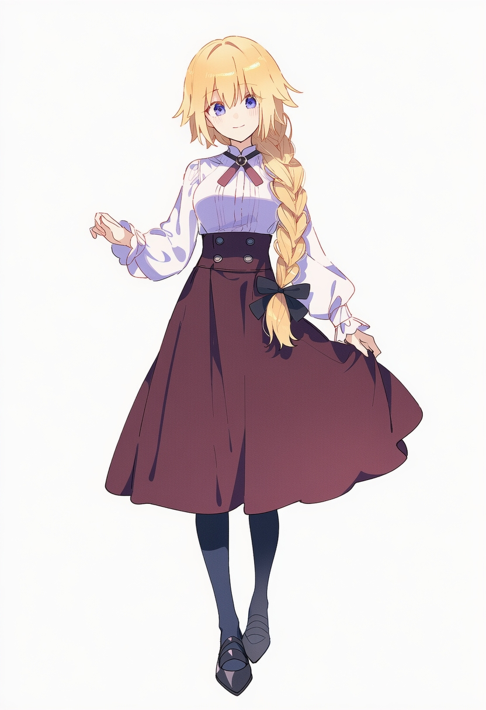

[在线例图](https://assets.quicktagcloud.com/images/raven_composition/raven_composition-0940.jpg?v=c99a51ce4cc553df)

<a id="raven_composition-0941"></a>

## 编辫双马尾

ID：`raven_composition-0941`；分类：发型 / 扎发/编发；来源标记：`safe`。

来源说明：

> 双马尾本身编成辫子。

正向提示词：

```text
braided_twintails
```

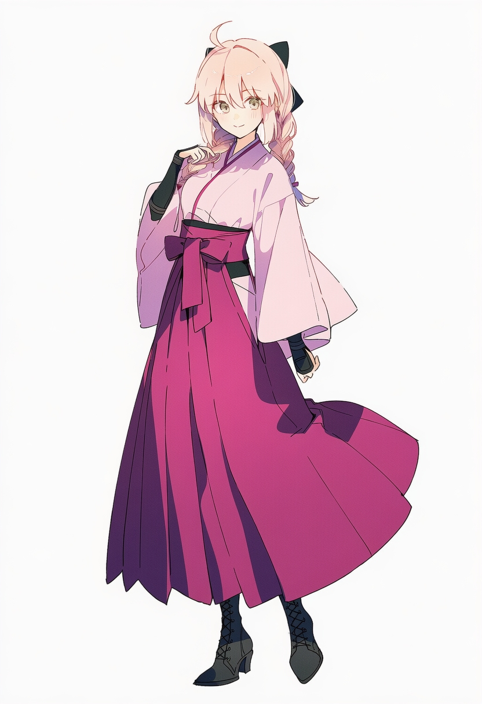

[在线例图](https://assets.quicktagcloud.com/images/raven_composition/raven_composition-0941.jpg?v=b832a2183af2f04d)

<a id="raven_composition-0942"></a>

## 冠状辫

ID：`raven_composition-0942`；分类：发型 / 扎发/编发；来源标记：`safe`。

来源说明：

> 辫子沿头顶围成皇冠状。

正向提示词：

```text
crown_braid
```

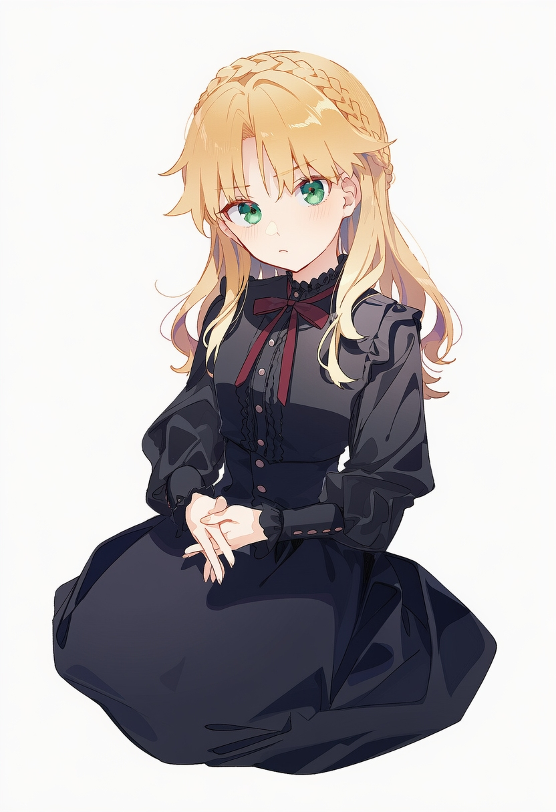

[在线例图](https://assets.quicktagcloud.com/images/raven_composition/raven_composition-0942.jpg?v=983c68fa12a94da1)

<a id="raven_composition-0943"></a>

## 脏辫

ID：`raven_composition-0943`；分类：发型 / 扎发/编发；来源标记：`safe`。

来源说明：

> 头发成束缠结成脏辫。

正向提示词：

```text
dreadlocks
```

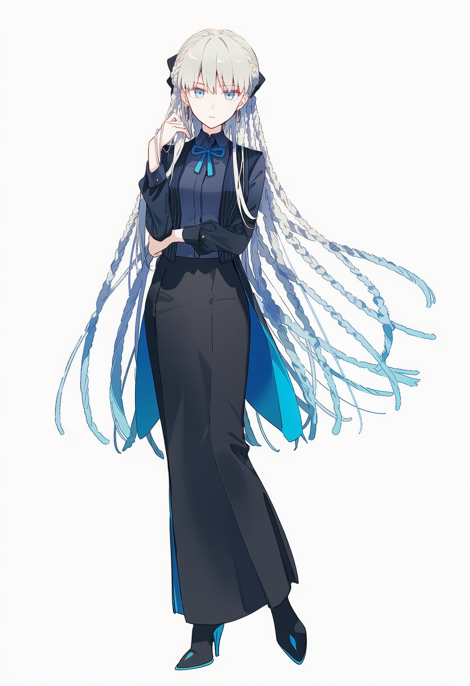

[在线例图](https://assets.quicktagcloud.com/images/raven_composition/raven_composition-0943.jpg?v=075a41c5dd983af2)

<a id="raven_composition-0944"></a>

## 低位编辫长发

ID：`raven_composition-0944`；分类：发型 / 扎发/编发；来源标记：`safe`。

来源说明：

> 长发在低位编成辫子。

正向提示词：

```text
low-braided_long_hair
```

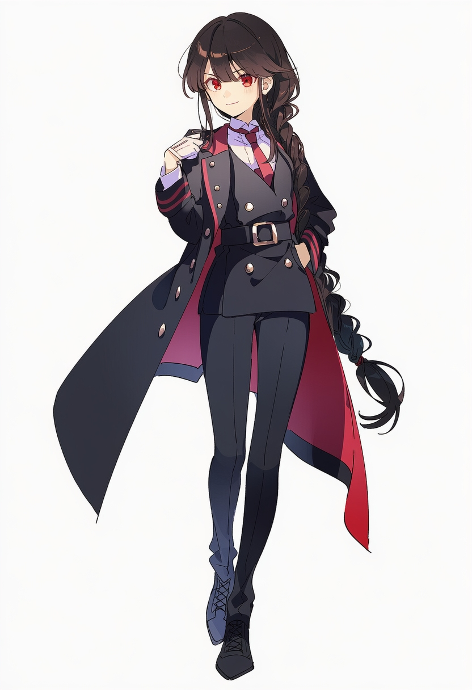

[在线例图](https://assets.quicktagcloud.com/images/raven_composition/raven_composition-0944.jpg?v=436aeb0e8d82f7b5)

<a id="raven_composition-0945"></a>

## 低位双辫

ID：`raven_composition-0945`；分类：发型 / 扎发/编发；来源标记：`safe`。

来源说明：

> 左右两条辫子扎在较低位置。

正向提示词：

```text
low_twin_braids
```

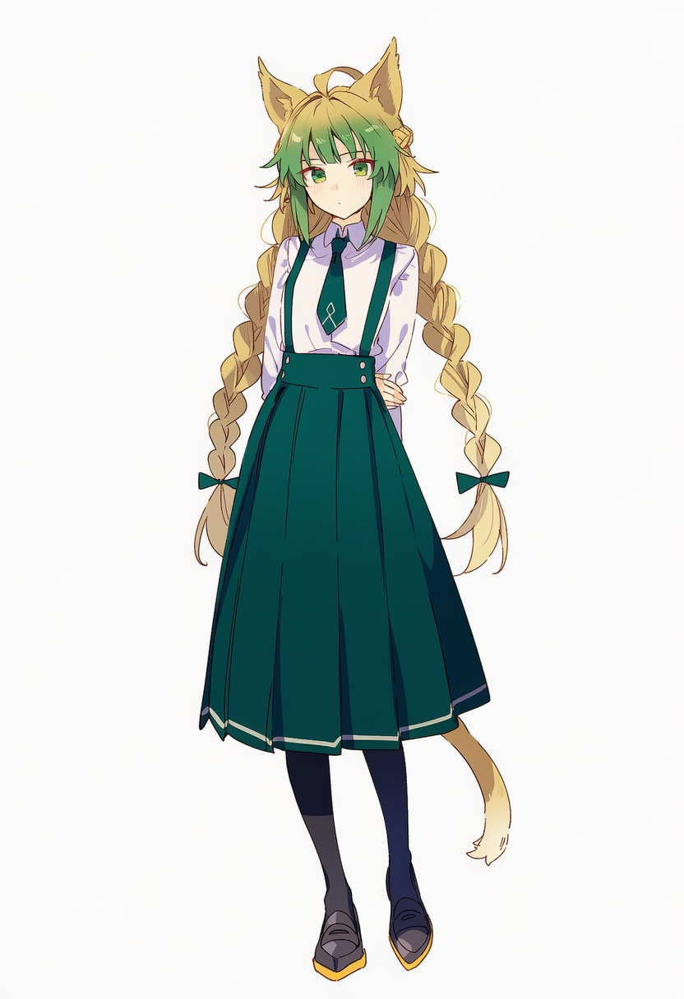

[在线例图](https://assets.quicktagcloud.com/images/raven_composition/raven_composition-0945.jpg?v=6c4d3a801f516c56)

<a id="raven_composition-0946"></a>

## 侧辫

ID：`raven_composition-0946`；分类：发型 / 扎发/编发；来源标记：`safe`。

来源说明：

> 辫子放在头部一侧。

正向提示词：

```text
side_braid
```

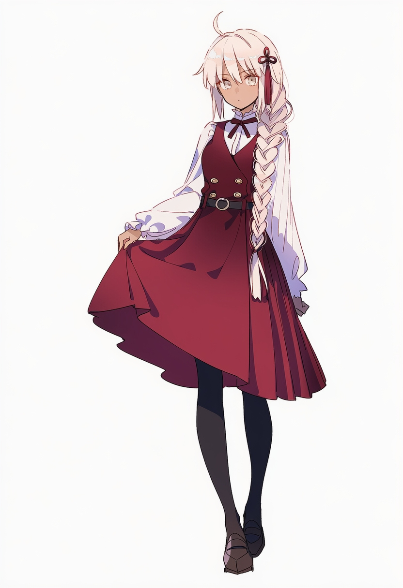

[在线例图](https://assets.quicktagcloud.com/images/raven_composition/raven_composition-0946.jpg?v=1ebf20554046a988)

<a id="raven_composition-0947"></a>

## 单辫

ID：`raven_composition-0947`；分类：发型 / 扎发/编发；来源标记：`safe`。

来源说明：

> 只有一条主要辫子。

正向提示词：

```text
single_braid
```

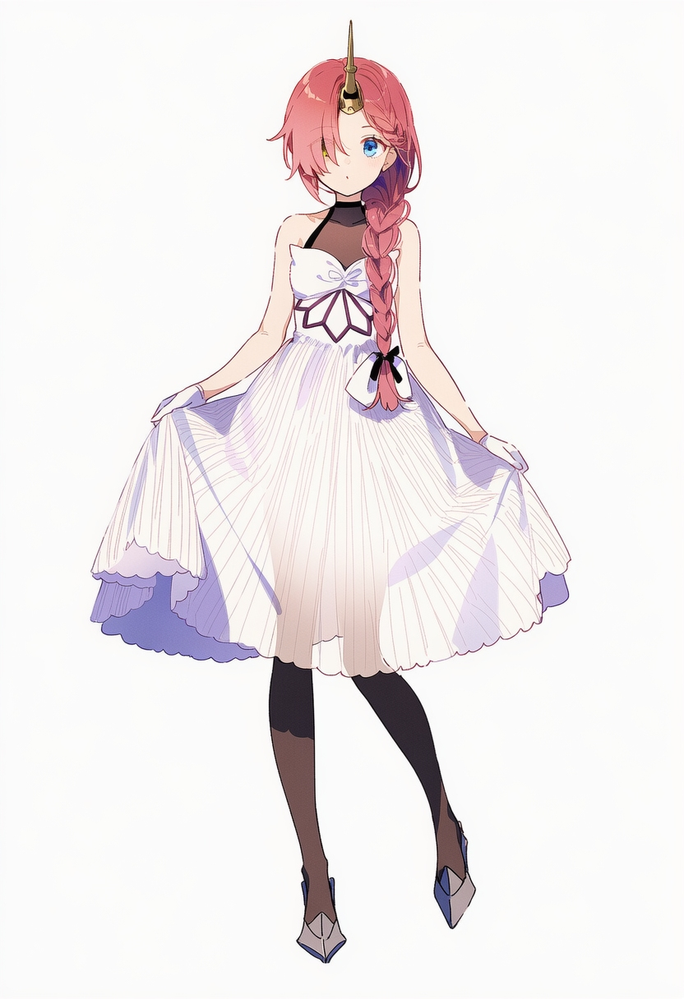

[在线例图](https://assets.quicktagcloud.com/images/raven_composition/raven_composition-0947.jpg?v=adca43d6a6dfc93d)

<a id="raven_composition-0948"></a>

## 双辫子

ID：`raven_composition-0948`；分类：发型 / 扎发/编发；来源标记：`safe`。

来源说明：

> 左右各有一条辫子。

正向提示词：

```text
twin_braids
```

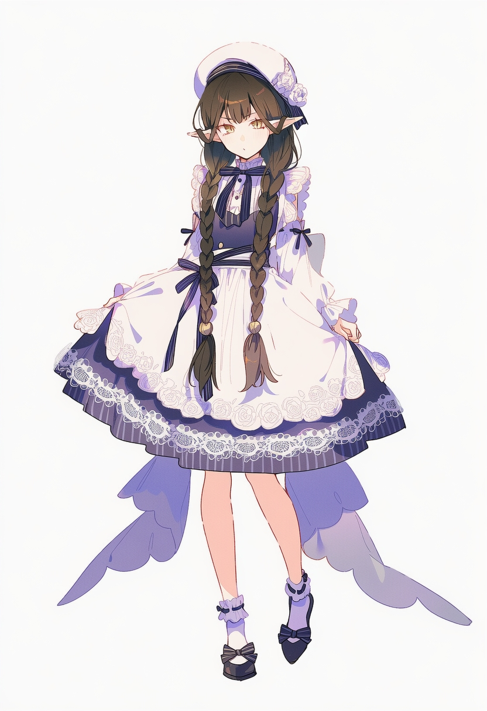

[在线例图](https://assets.quicktagcloud.com/images/raven_composition/raven_composition-0948.jpg?v=c4bbe798181b0395)

<a id="raven_composition-0949"></a>

## 锥形发髻

ID：`raven_composition-0949`；分类：发型 / 扎发/编发；来源标记：`safe`。

来源说明：

> 发髻盘成锥形。

正向提示词：

```text
cone_hair_bun
```

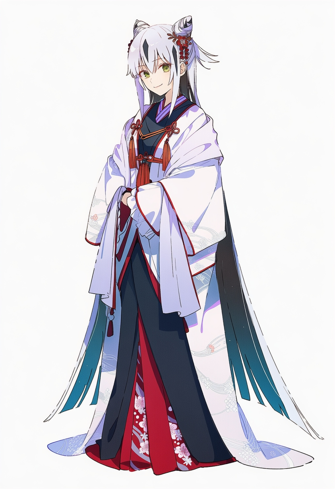

[在线例图](https://assets.quicktagcloud.com/images/raven_composition/raven_composition-0949.jpg?v=292d456ecb405423)

<a id="raven_composition-0950"></a>

## 甜甜圈发髻

ID：`raven_composition-0950`；分类：发型 / 扎发/编发；来源标记：`safe`。

来源说明：

> 发髻盘成圆环状。

正向提示词：

```text
donut_hair_bun
```

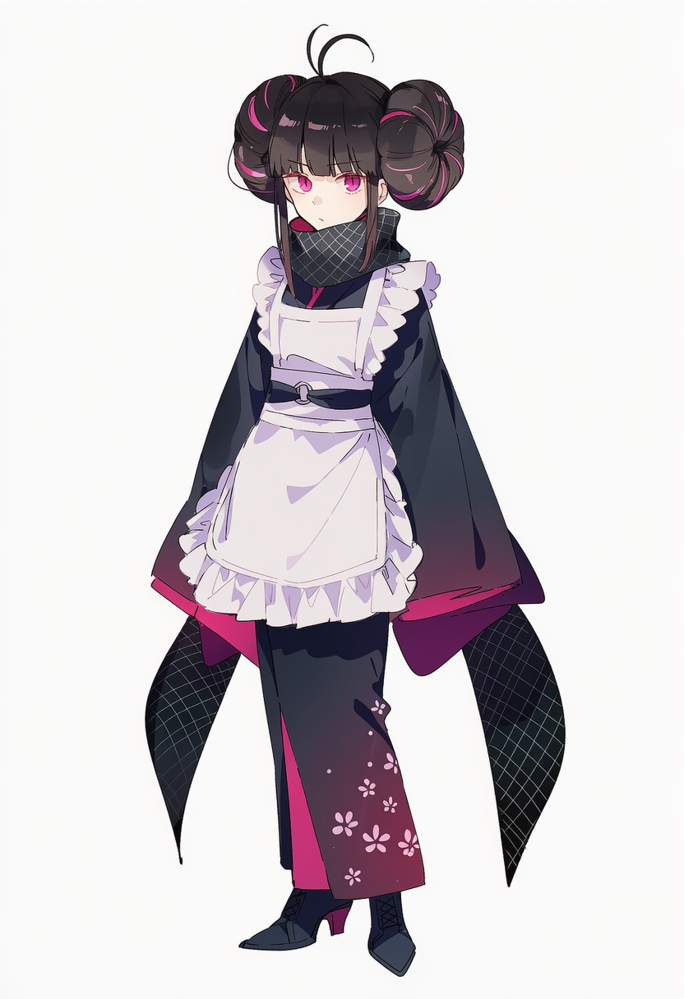

[在线例图](https://assets.quicktagcloud.com/images/raven_composition/raven_composition-0950.jpg?v=d8a63e0951fe4fb7)

<a id="raven_composition-0951"></a>

## 双丸子头

ID：`raven_composition-0951`；分类：发型 / 扎发/编发；来源标记：`safe`。

来源说明：

> 左右各有一个丸子头。

正向提示词：

```text
double_bun
```

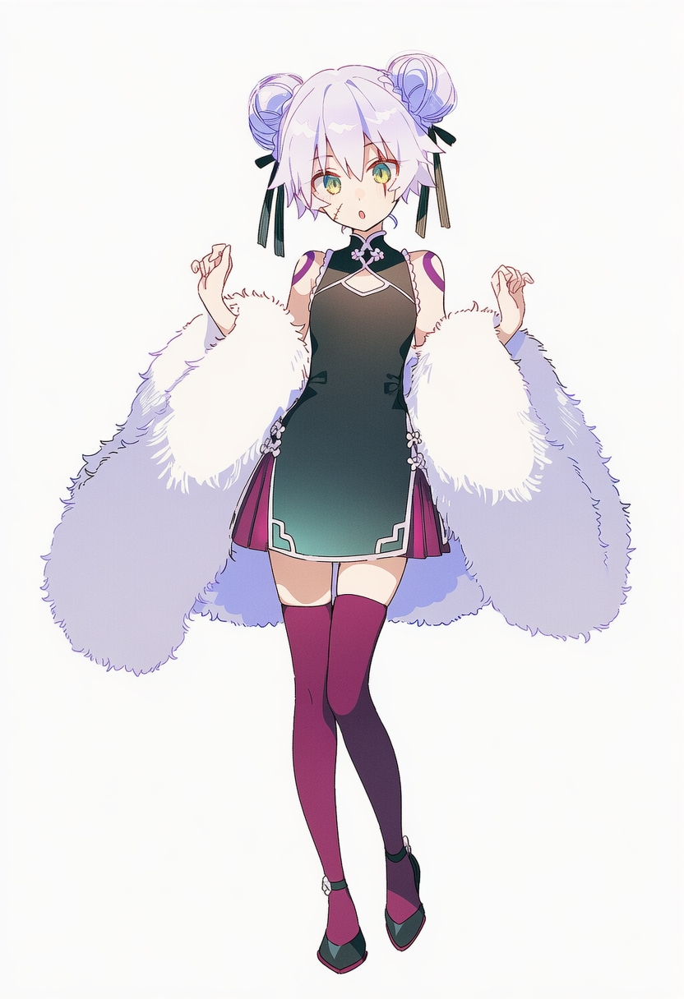

[在线例图](https://assets.quicktagcloud.com/images/raven_composition/raven_composition-0951.jpg?v=9f008222b2deedd7)

<a id="raven_composition-0952"></a>

## 发髻 / 丸子头

ID：`raven_composition-0952`；分类：发型 / 扎发/编发；来源标记：`safe`。

来源说明：

> 头发盘成发髻或丸子头。

正向提示词：

```text
hair_bun
```

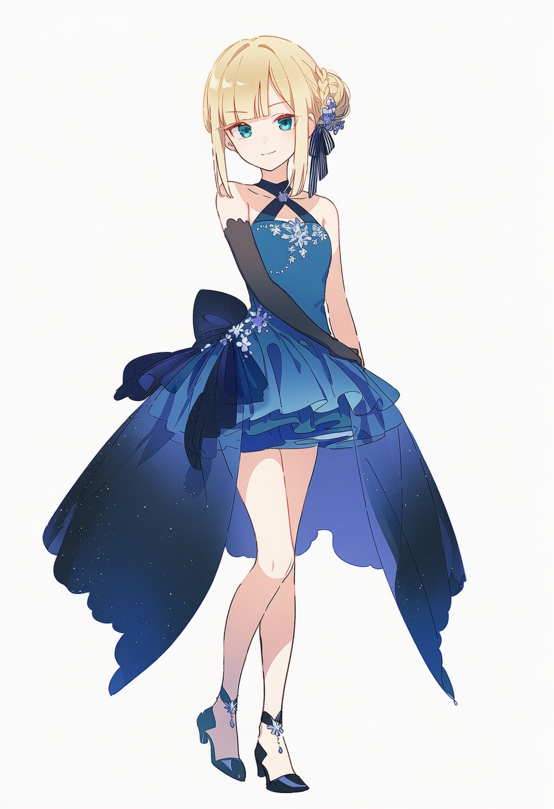

[在线例图](https://assets.quicktagcloud.com/images/raven_composition/raven_composition-0952.jpg?v=4cce36fe6af56b54)

<a id="raven_composition-0953"></a>

## 环状发髻

ID：`raven_composition-0953`；分类：发型 / 扎发/编发；来源标记：`safe`。

来源说明：

> 头发盘成多个环状结构。

正向提示词：

```text
hair_rings
```

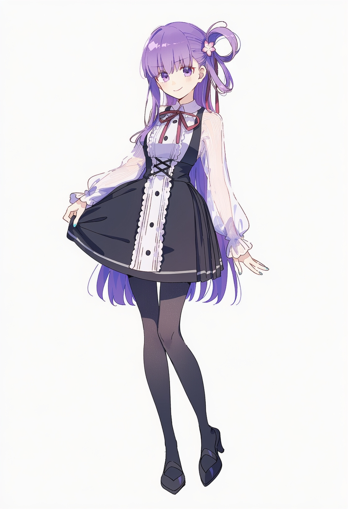

[在线例图](https://assets.quicktagcloud.com/images/raven_composition/raven_composition-0953.jpg?v=5f120e0ecd108975)

<a id="raven_composition-0954"></a>

## 心形发髻

ID：`raven_composition-0954`；分类：发型 / 扎发/编发；来源标记：`safe`。

来源说明：

> 发髻盘成心形。

正向提示词：

```text
heart_hair_bun
```

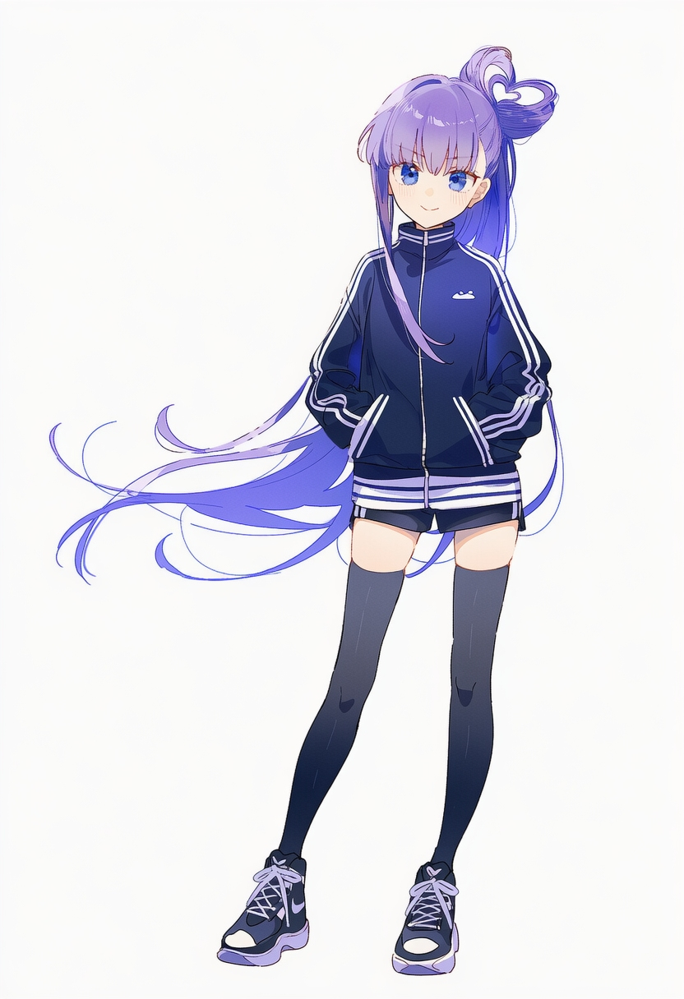

[在线例图](https://assets.quicktagcloud.com/images/raven_composition/raven_composition-0954.jpg?v=978b48592473bbdf)

<a id="raven_composition-0955"></a>

## 单丸子头

ID：`raven_composition-0955`；分类：发型 / 扎发/编发；来源标记：`safe`。

来源说明：

> 只有一个丸子头。

正向提示词：

```text
single_hair_bun
```

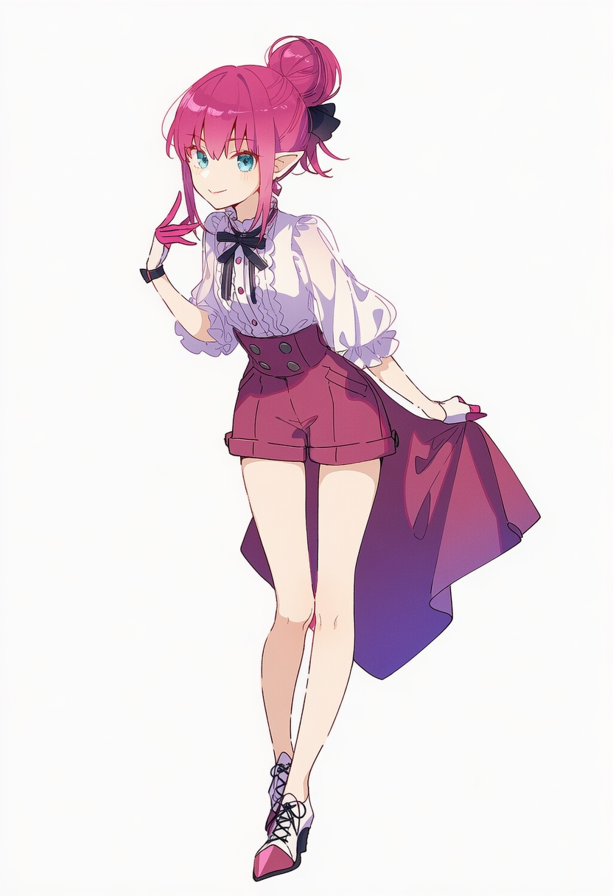

[在线例图](https://assets.quicktagcloud.com/images/raven_composition/raven_composition-0955.jpg?v=9e62a1db3f74f673)

<a id="raven_composition-0956"></a>

## 单环发

ID：`raven_composition-0956`；分类：发型 / 扎发/编发；来源标记：`safe`。

来源说明：

> 头发形成一个明显圆环。

正向提示词：

```text
single_hair_ring
```

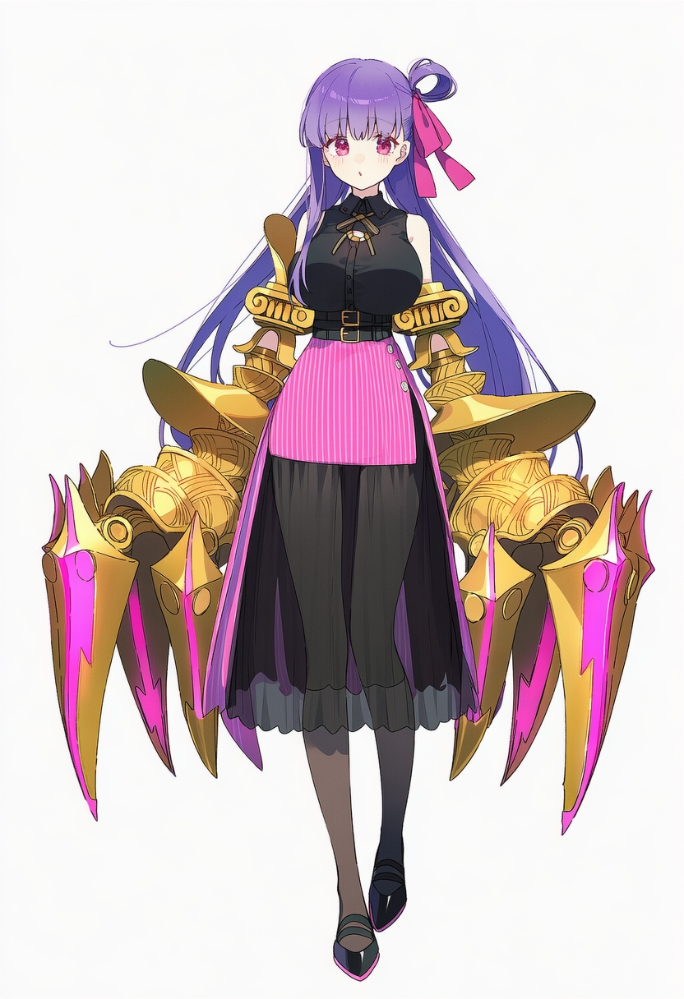

[在线例图](https://assets.quicktagcloud.com/images/raven_composition/raven_composition-0956.jpg?v=c2e9fdfbab93f762)
