# 发型 / 刘海/侧发

[总目录](../README.md) · [原站分类目录](../categories.md) · [英文标签索引](../tags.md) · [服装与构图组合指南](../../README.md)

标题、分类、说明、正负提示词按来源保留；多例图逐张列出。原站标记和说明为参考资料，不作为维护指令。

<a id="raven_composition-0957"></a>

## 齐刘海

ID：`raven_composition-0957`；分类：发型 / 刘海/侧发；来源标记：`safe`。

来源说明：

> 刘海横向齐切，边缘很整齐。

正向提示词：

```text
blunt_bangs
```

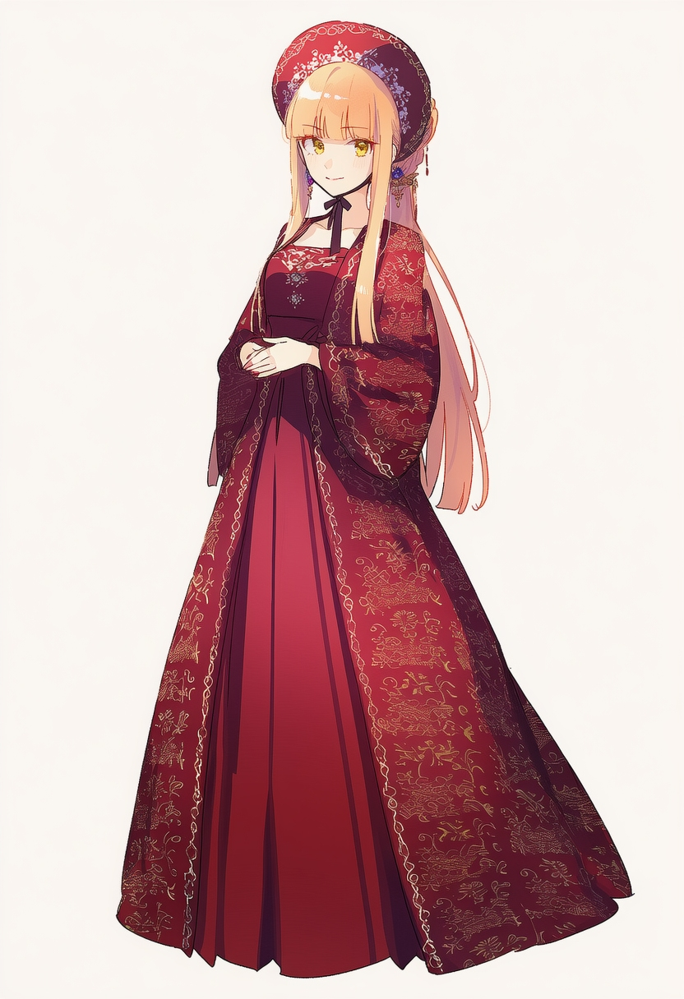

[在线例图](https://assets.quicktagcloud.com/images/raven_composition/raven_composition-0957.jpg?v=bdf50afab344c864)

<a id="raven_composition-0958"></a>

## 交叉刘海

ID：`raven_composition-0958`；分类：发型 / 刘海/侧发；来源标记：`safe`。

来源说明：

> 刘海发束在额前交叉。

正向提示词：

```text
crossed_bangs
```

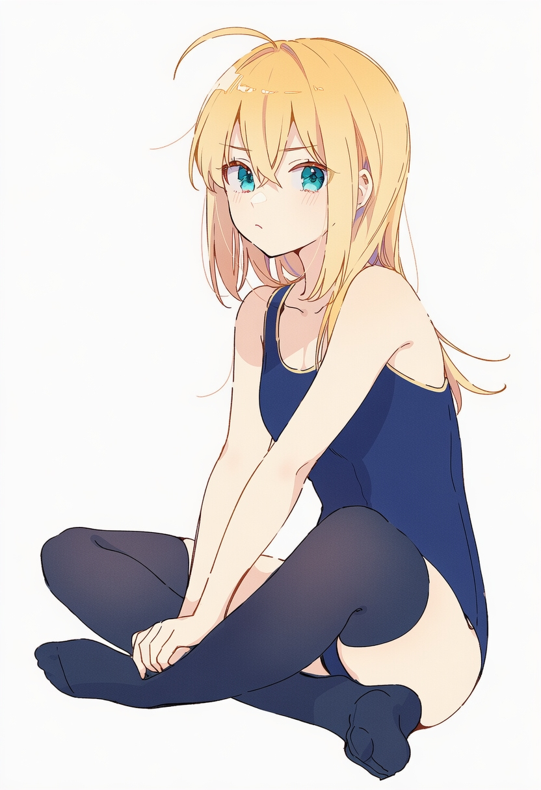

[在线例图](https://assets.quicktagcloud.com/images/raven_composition/raven_composition-0958.jpg?v=ace55fdad6f9a21d)

<a id="raven_composition-0959"></a>

## 帘式刘海

ID：`raven_composition-0959`；分类：发型 / 刘海/侧发；来源标记：`safe`。

来源说明：

> 刘海从中间分开，像帘子一样垂下。

正向提示词：

```text
curtained_hair
```

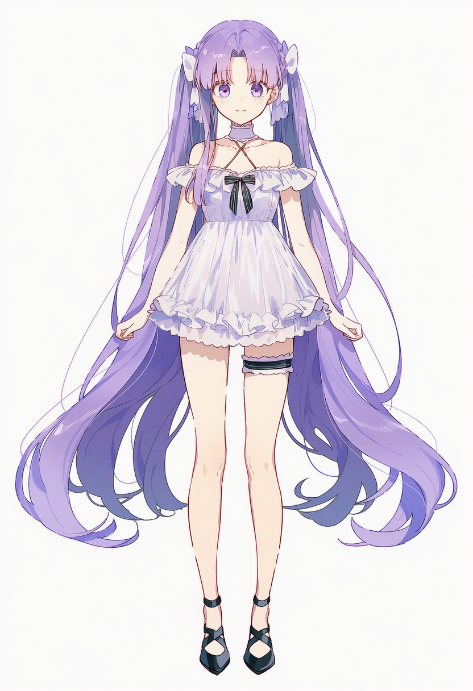

[在线例图](https://assets.quicktagcloud.com/images/raven_composition/raven_composition-0959.jpg?v=296cd3e9c4f5265d)

<a id="raven_composition-0960"></a>

## 斜切刘海

ID：`raven_composition-0960`；分类：发型 / 刘海/侧发；来源标记：`safe`。

来源说明：

> 刘海斜着剪或斜着覆盖额头。

正向提示词：

```text
diagonal_bangs
```

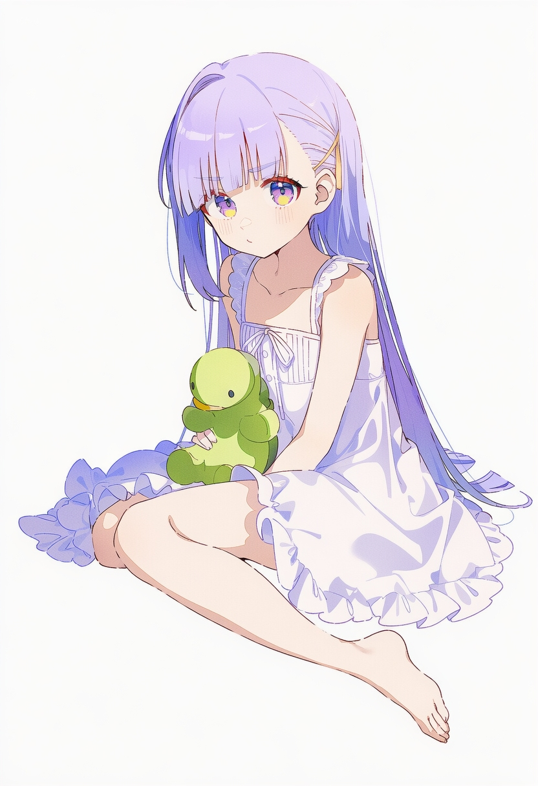

[在线例图](https://assets.quicktagcloud.com/images/raven_composition/raven_composition-0960.jpg?v=b19c016bff890f07)

<a id="raven_composition-0961"></a>

## 双分缝刘海

ID：`raven_composition-0961`；分类：发型 / 刘海/侧发；来源标记：`safe`。

来源说明：

> 刘海有两个明显分缝。

正向提示词：

```text
double-parted_bangs
```

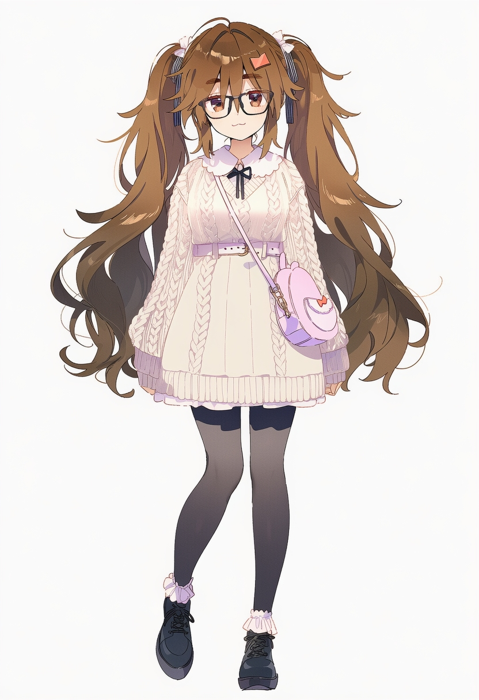

[在线例图](https://assets.quicktagcloud.com/images/raven_composition/raven_composition-0961.jpg?v=0a2b10411ce32327)

<a id="raven_composition-0962"></a>

## 眼间发束

ID：`raven_composition-0962`；分类：发型 / 刘海/侧发；来源标记：`safe`。

来源说明：

> 一束头发垂在两眼之间。

正向提示词：

```text
hair_between_eyes
```

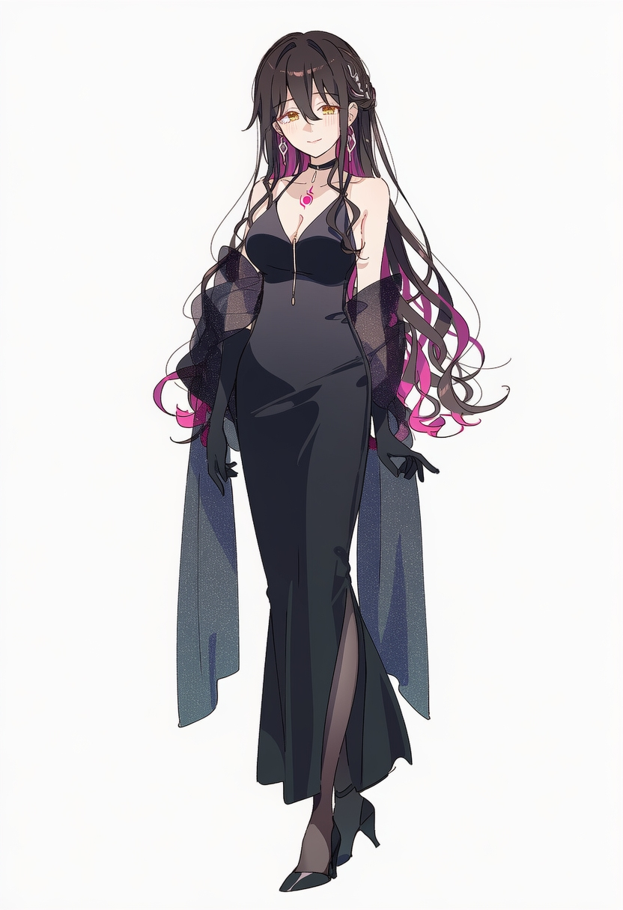

[在线例图](https://assets.quicktagcloud.com/images/raven_composition/raven_composition-0962.jpg?v=c61d4def98579e6a)

<a id="raven_composition-0963"></a>

## 进气口刘海

ID：`raven_composition-0963`；分类：发型 / 刘海/侧发；来源标记：`safe`。

来源说明：

> 额前两侧有向内凹的“进气口”形发束。

正向提示词：

```text
hair_intakes
```

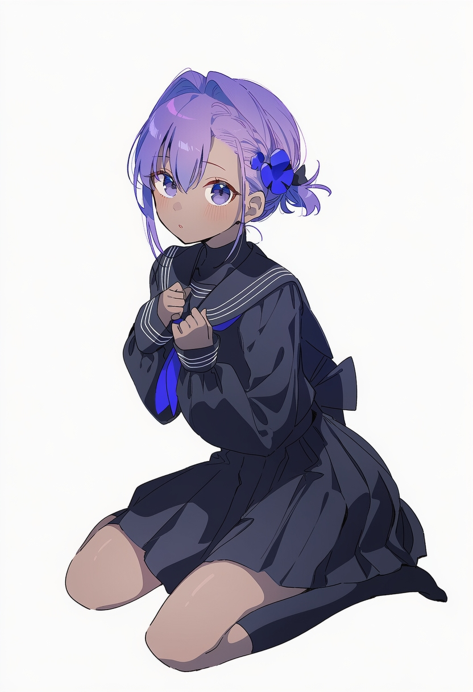

[在线例图](https://assets.quicktagcloud.com/images/raven_composition/raven_composition-0963.jpg?v=0bc05aa7ff5f97b0)

<a id="raven_composition-0964"></a>

## 双眼遮发

ID：`raven_composition-0964`；分类：发型 / 刘海/侧发；来源标记：`safe`。

来源说明：

> 头发遮住双眼。

正向提示词：

```text
hair_over_eyes
```

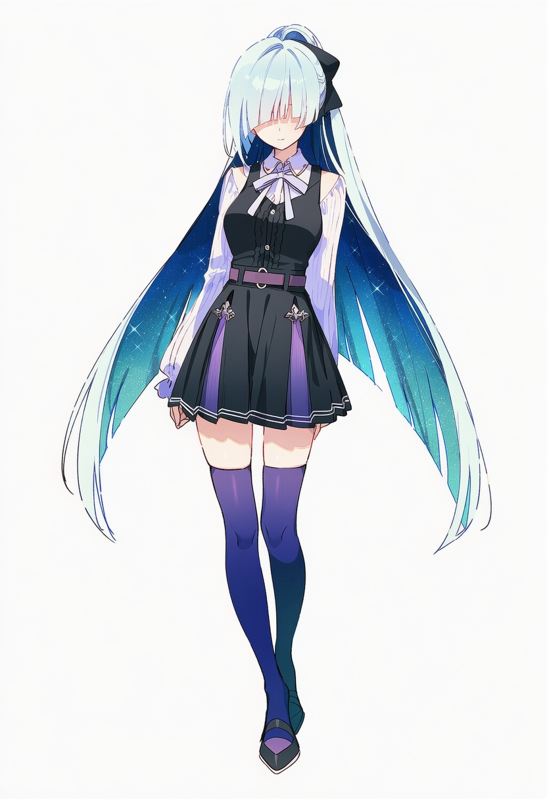

[在线例图](https://assets.quicktagcloud.com/images/raven_composition/raven_composition-0964.jpg?v=17ff0a1258567d08)

<a id="raven_composition-0965"></a>

## 单眼遮发

ID：`raven_composition-0965`；分类：发型 / 刘海/侧发；来源标记：`safe`。

来源说明：

> 头发遮住一只眼睛。

正向提示词：

```text
hair_over_one_eye
```

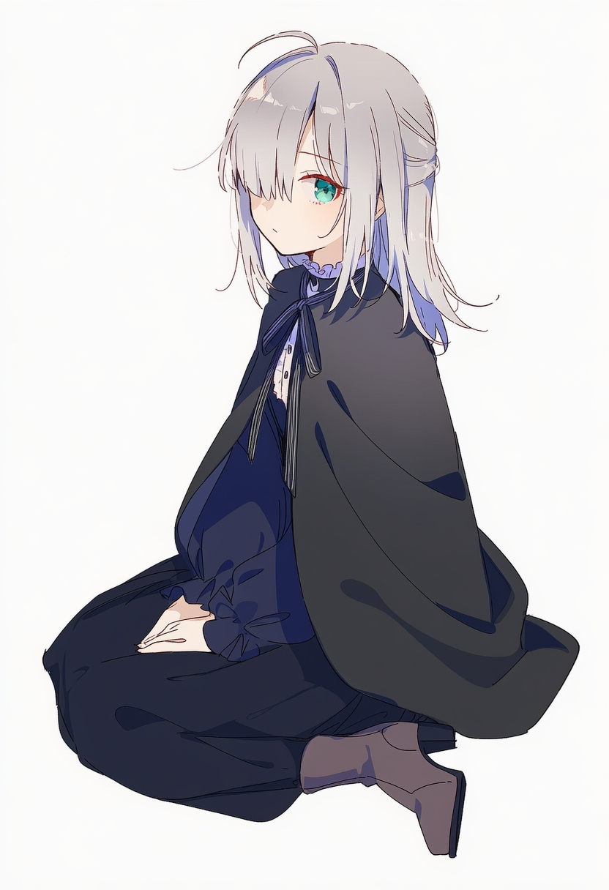

[在线例图](https://assets.quicktagcloud.com/images/raven_composition/raven_composition-0965.jpg?v=ddd7c354ea3df31d)

<a id="raven_composition-0966"></a>

## 长刘海

ID：`raven_composition-0966`；分类：发型 / 刘海/侧发；来源标记：`safe`。

来源说明：

> 刘海很长，明显超过普通长度。

正向提示词：

```text
long_bangs
```

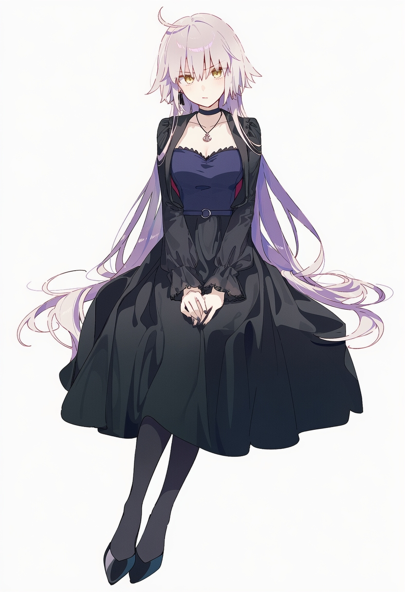

[在线例图](https://assets.quicktagcloud.com/images/raven_composition/raven_composition-0966.jpg?v=fd8752f8897df5a9)

<a id="raven_composition-0967"></a>

## 长眼间发束

ID：`raven_composition-0967`；分类：发型 / 刘海/侧发；来源标记：`safe`。

来源说明：

> 两眼之间垂着很长的发束。

正向提示词：

```text
long_hair_between_eyes
```

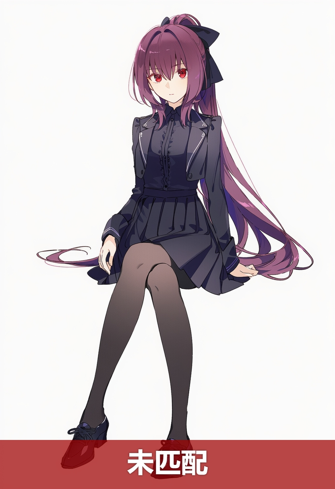

[在线例图](https://assets.quicktagcloud.com/images/raven_composition/raven_composition-0967.jpg?v=d9bccef0d616469e)

<a id="raven_composition-0968"></a>

## 分缝刘海

ID：`raven_composition-0968`；分类：发型 / 刘海/侧发；来源标记：`safe`。

来源说明：

> 刘海从中间或侧边分开。

正向提示词：

```text
parted_bangs
```

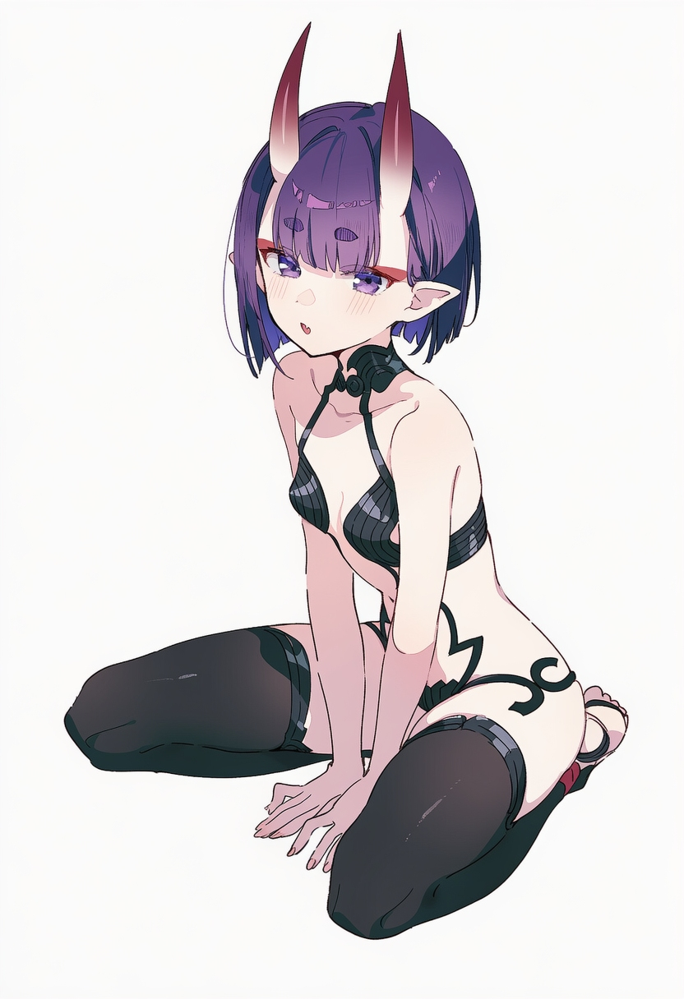

[在线例图](https://assets.quicktagcloud.com/images/raven_composition/raven_composition-0968.jpg?v=1f28c37e2e9c6c7c)

<a id="raven_composition-0969"></a>

## 单侧进气口刘海

ID：`raven_composition-0969`；分类：发型 / 刘海/侧发；来源标记：`safe`。

来源说明：

> 只有一侧有“进气口”形刘海。

正向提示词：

```text
single_hair_intake
```

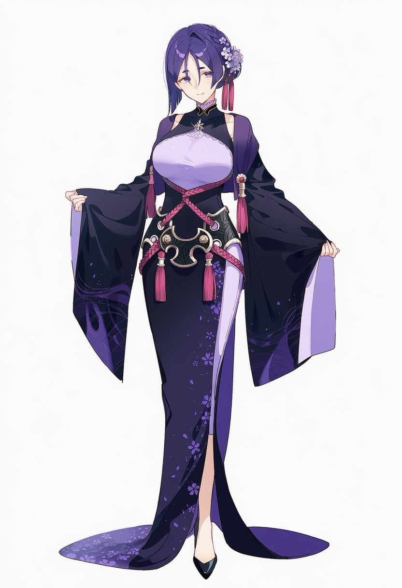

[在线例图](https://assets.quicktagcloud.com/images/raven_composition/raven_composition-0969.jpg?v=ad325902a32b1b0d)

<a id="raven_composition-0970"></a>

## 侧扫刘海

ID：`raven_composition-0970`；分类：发型 / 刘海/侧发；来源标记：`safe`。

来源说明：

> 刘海整体梳向一侧。

正向提示词：

```text
swept_bangs
```

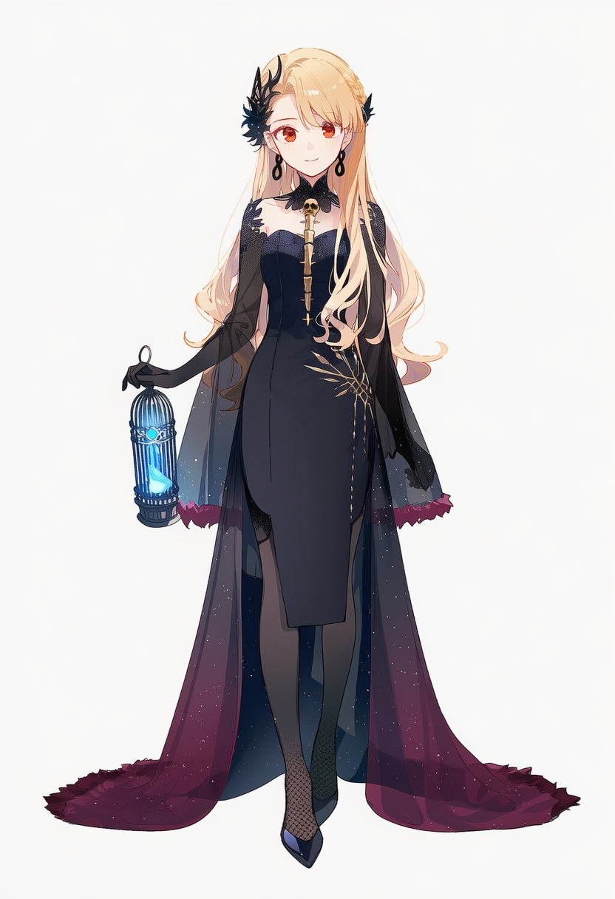

[在线例图](https://assets.quicktagcloud.com/images/raven_composition/raven_composition-0970.jpg?v=74fae2a69ac8a320)

<a id="raven_composition-0971"></a>

## 螺旋鬓发

ID：`raven_composition-0971`；分类：发型 / 刘海/侧发；来源标记：`safe`。

来源说明：

> 脸侧发束卷成螺旋钻状。

正向提示词：

```text
drill_sidelocks
```

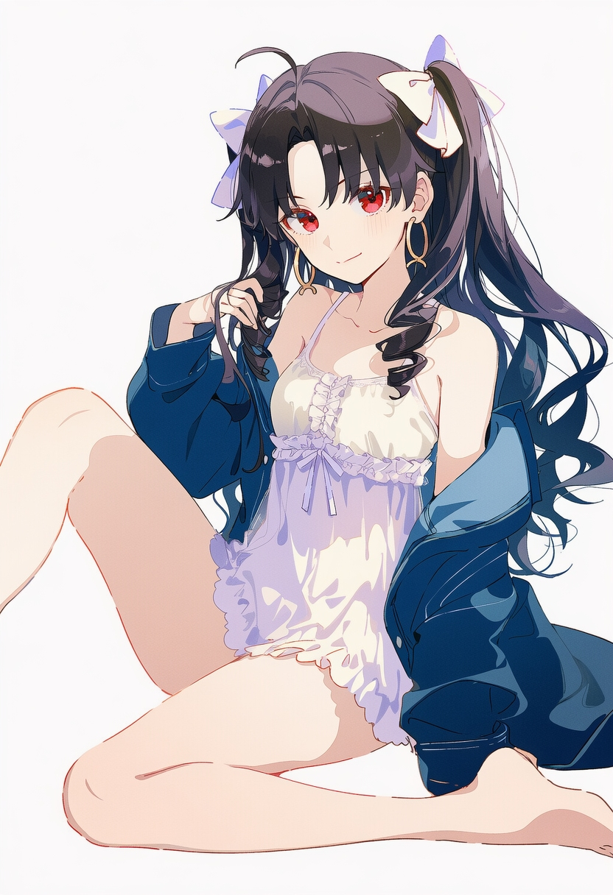

[在线例图](https://assets.quicktagcloud.com/images/raven_composition/raven_composition-0971.jpg?v=73c89204f67c8345)

<a id="raven_composition-0972"></a>

## 头发别到耳后

ID：`raven_composition-0972`；分类：发型 / 刘海/侧发；来源标记：`safe`。

来源说明：

> 一部分头发别到耳朵后面。

正向提示词：

```text
hair_behind_ear
```

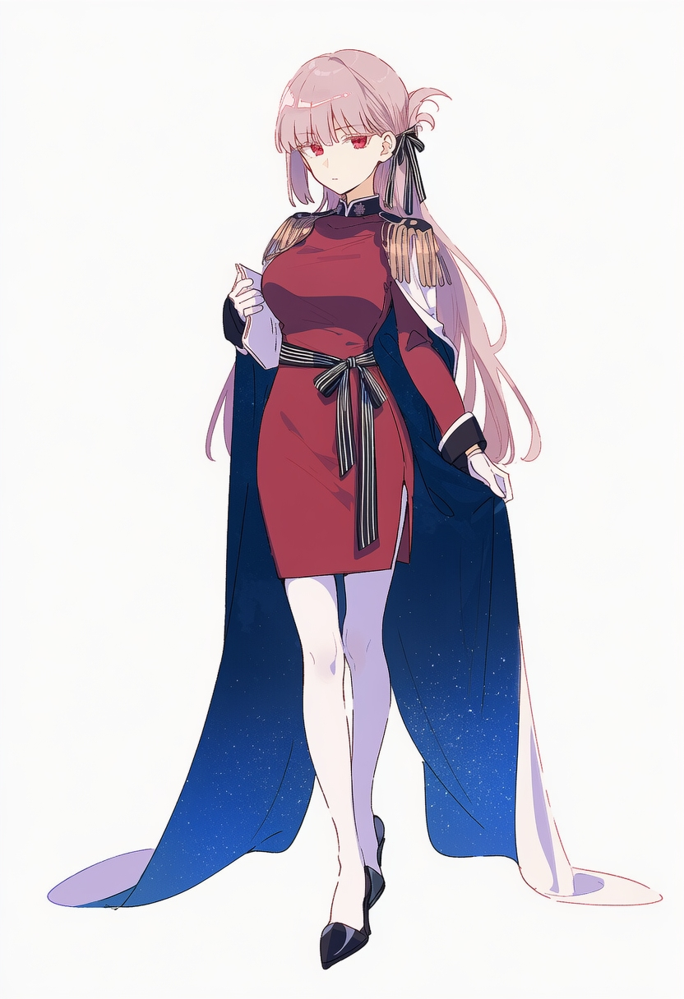

[在线例图](https://assets.quicktagcloud.com/images/raven_composition/raven_composition-0972.jpg?v=775a84894d0660a8)

<a id="raven_composition-0973"></a>

## 耳侧发瓣

ID：`raven_composition-0973`；分类：发型 / 刘海/侧发；来源标记：`safe`。

来源说明：

> 耳边有像小片状垂下的发束。

正向提示词：

```text
hair_flaps
```

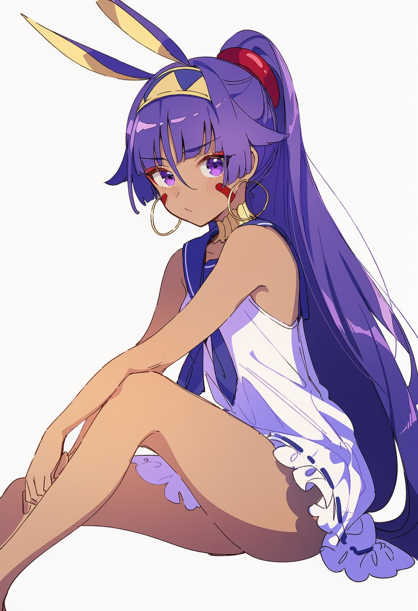

[在线例图](https://assets.quicktagcloud.com/images/raven_composition/raven_composition-0973.jpg?v=650fffd94598fe08)

<a id="raven_composition-0974"></a>

## 长鬓发

ID：`raven_composition-0974`；分类：发型 / 刘海/侧发；来源标记：`safe`。

来源说明：

> 脸侧鬓发很长。

正向提示词：

```text
long_sidelocks
```

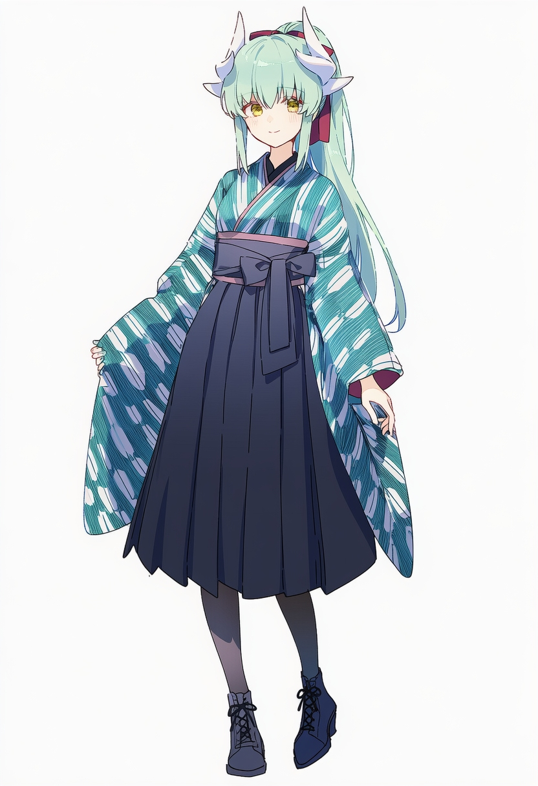

[在线例图](https://assets.quicktagcloud.com/images/raven_composition/raven_composition-0974.jpg?v=3cecf24f6a6bbc26)

<a id="raven_composition-0975"></a>

## 低扎鬓发

ID：`raven_composition-0975`；分类：发型 / 刘海/侧发；来源标记：`safe`。

来源说明：

> 脸侧发束在较低位置扎起。

正向提示词：

```text
low-tied_sidelocks
```

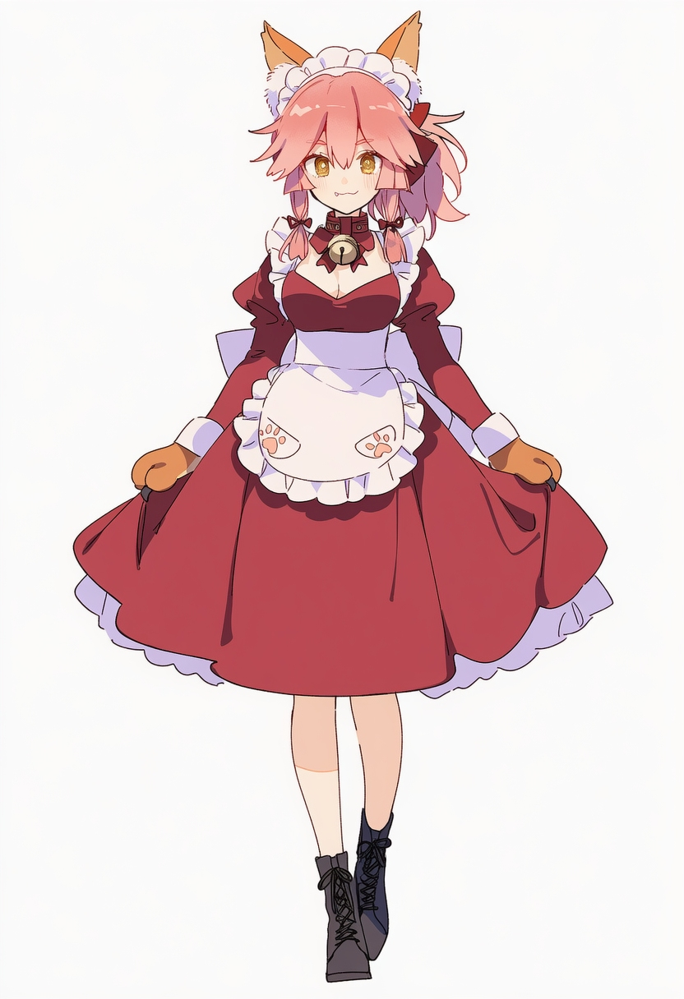

[在线例图](https://assets.quicktagcloud.com/images/raven_composition/raven_composition-0975.jpg?v=6432aba754742ea1)

<a id="raven_composition-0976"></a>

## 鬓发 / 侧发束

ID：`raven_composition-0976`；分类：发型 / 刘海/侧发；来源标记：`safe`。

来源说明：

> 脸两侧垂着明显发束。

正向提示词：

```text
sidelocks
```

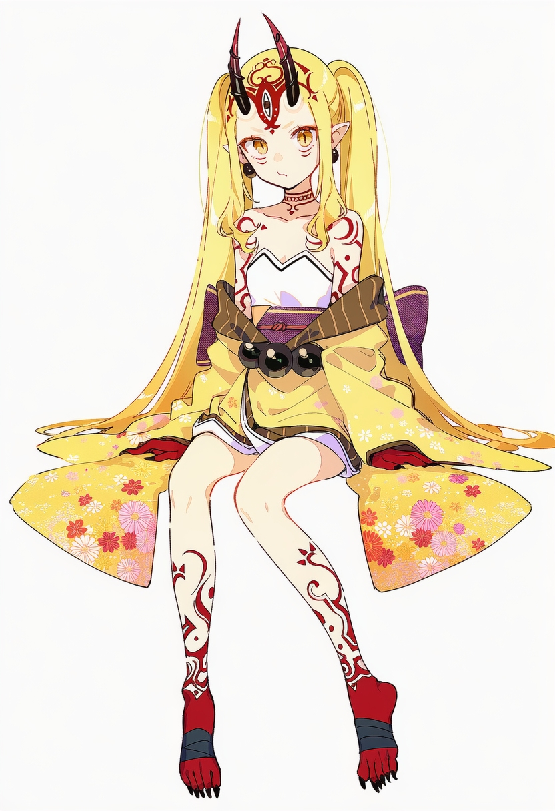

[在线例图](https://assets.quicktagcloud.com/images/raven_composition/raven_composition-0976.jpg?v=07c9e64a62ec3a42)

<a id="raven_composition-0977"></a>

## 单侧鬓发

ID：`raven_composition-0977`；分类：发型 / 刘海/侧发；来源标记：`safe`。

来源说明：

> 只有一侧有明显鬓发。

正向提示词：

```text
single_sidelock
```

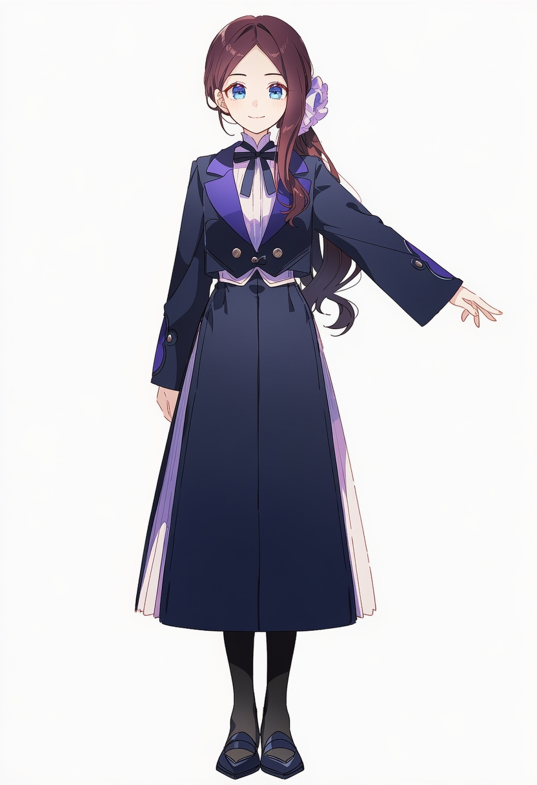

[在线例图](https://assets.quicktagcloud.com/images/raven_composition/raven_composition-0977.jpg?v=0ab3a049a3750343)
