# 发型 / 发质/状态

[总目录](../README.md) · [原站分类目录](../categories.md) · [英文标签索引](../tags.md) · [服装与构图组合指南](../../README.md)

标题、分类、说明、正负提示词按来源保留；多例图逐张列出。原站标记和说明为参考资料，不作为维护指令。

<a id="raven_composition-0978"></a>

## 卷发

ID：`raven_composition-0978`；分类：发型 / 发质/状态；来源标记：`safe`。

来源说明：

> 头发整体呈明显卷曲。

正向提示词：

```text
curly_hair
```

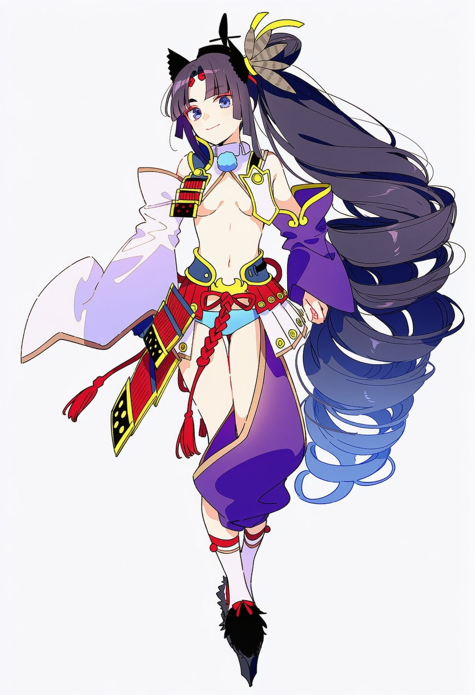

[在线例图](https://assets.quicktagcloud.com/images/raven_composition/raven_composition-0978.jpg?v=3c19a5f2ba8654c3)

<a id="raven_composition-0979"></a>

## 螺旋钻发

ID：`raven_composition-0979`；分类：发型 / 发质/状态；来源标记：`safe`。

来源说明：

> 头发卷成粗大的螺旋钻形。

正向提示词：

```text
drill_hair
```

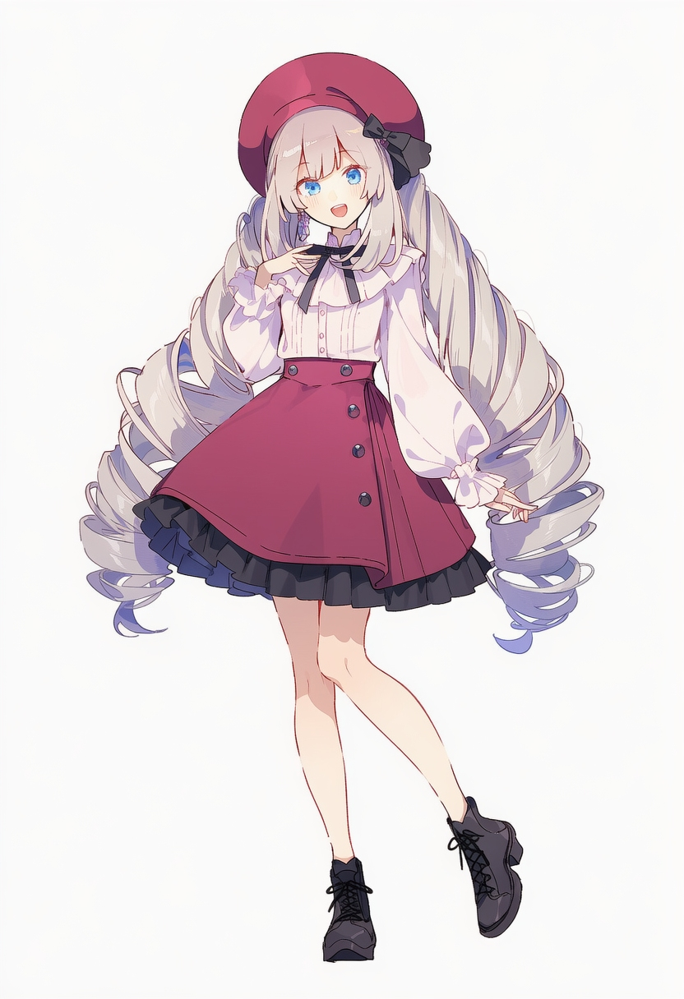

[在线例图](https://assets.quicktagcloud.com/images/raven_composition/raven_composition-0979.jpg?v=115c5e819dd35ef4)

<a id="raven_composition-0980"></a>

## 外翘发

ID：`raven_composition-0980`；分类：发型 / 发质/状态；来源标记：`safe`。

来源说明：

> 发尾明显向外翘。

正向提示词：

```text
flipped_hair
```

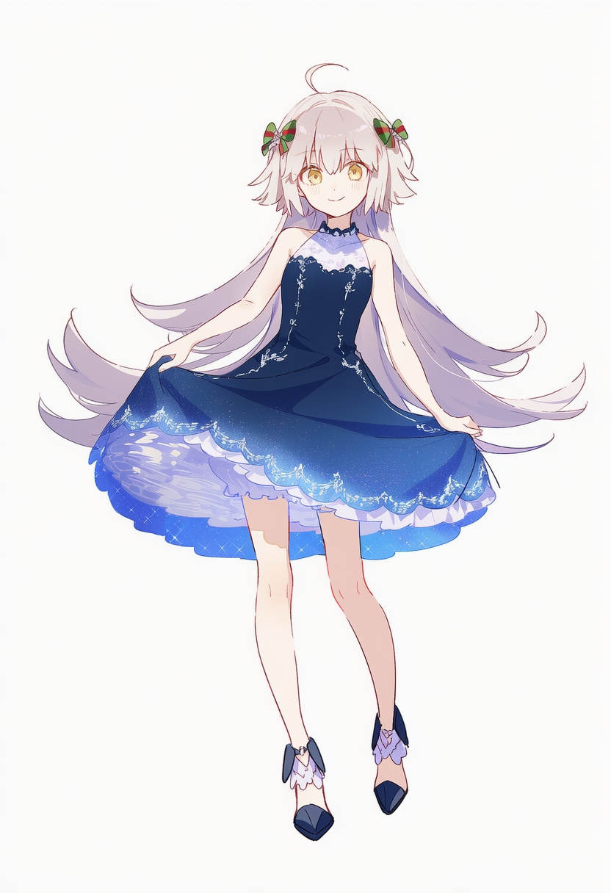

[在线例图](https://assets.quicktagcloud.com/images/raven_composition/raven_composition-0980.jpg?v=abc363483536c6f3)

<a id="raven_composition-0981"></a>

## 蓬松发

ID：`raven_composition-0981`；分类：发型 / 发质/状态；来源标记：`safe`。

来源说明：

> 头发看起来柔软蓬松。

正向提示词：

```text
fluffy_hair
```

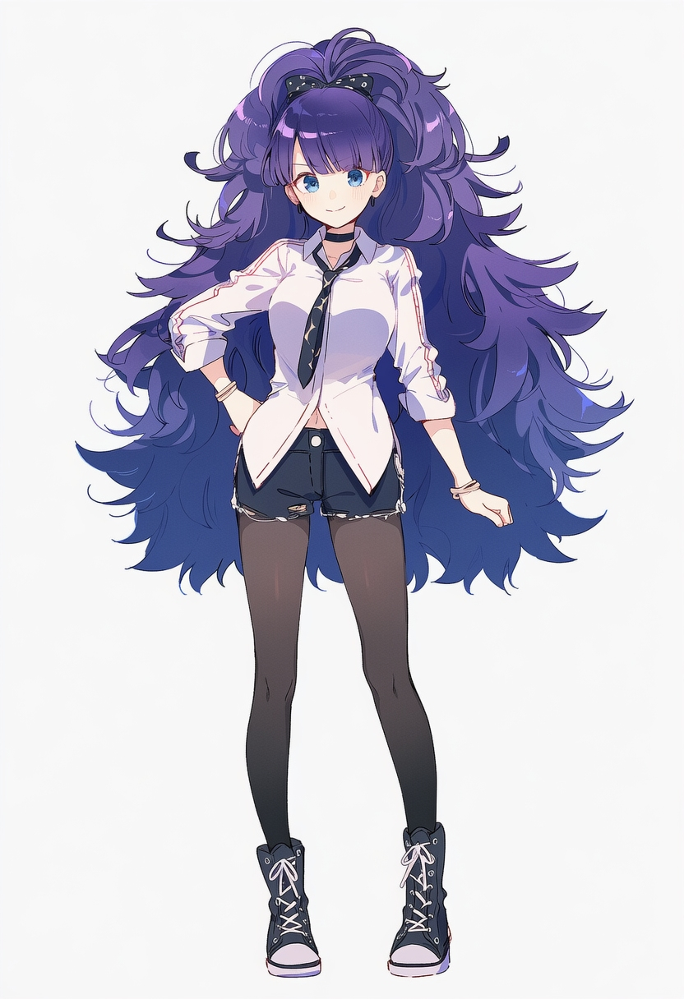

[在线例图](https://assets.quicktagcloud.com/images/raven_composition/raven_composition-0981.jpg?v=2c3194cc3f7c43f2)

<a id="raven_composition-0982"></a>

## 宽扁带状发

ID：`raven_composition-0982`；分类：发型 / 发质/状态；来源标记：`safe`。

来源说明：

> 发束宽而扁，像带子一样。

正向提示词：

```text
kishimen_hair
```

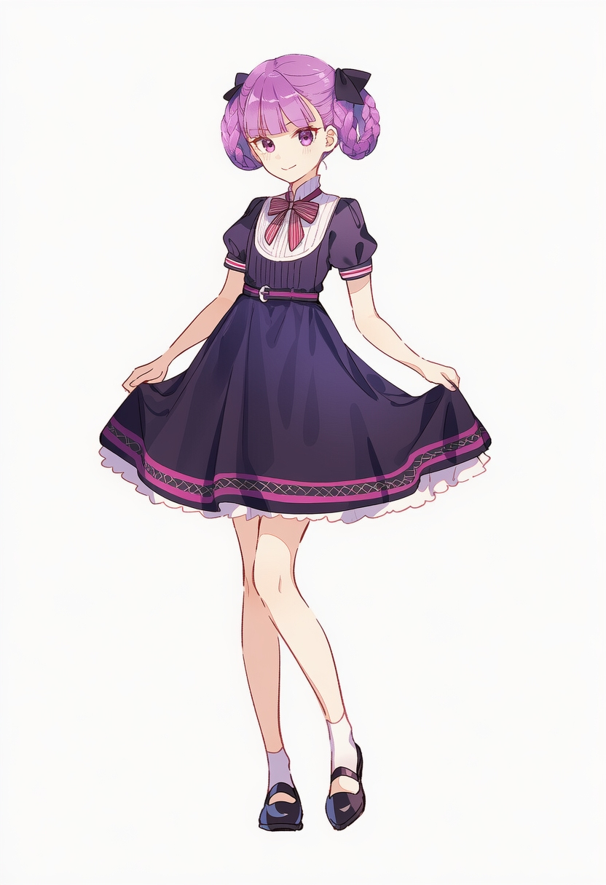

[在线例图](https://assets.quicktagcloud.com/images/raven_composition/raven_composition-0982.jpg?v=63cd8dd33f701a6a)

<a id="raven_composition-0983"></a>

## 凌乱发

ID：`raven_composition-0983`；分类：发型 / 发质/状态；来源标记：`safe`。

来源说明：

> 头发凌乱、不整齐。

正向提示词：

```text
messy_hair
```

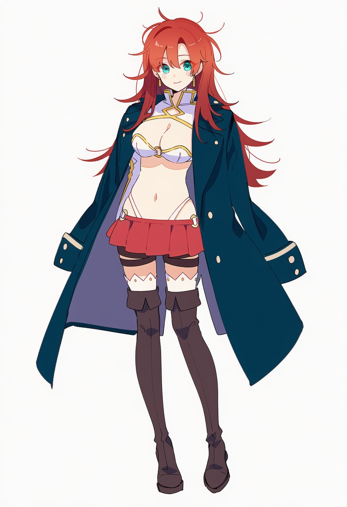

[在线例图](https://assets.quicktagcloud.com/images/raven_composition/raven_composition-0983.jpg?v=bbcc1c2f304c6ea0)

<a id="raven_composition-0984"></a>

## 尖角感头发

ID：`raven_composition-0984`；分类：发型 / 发质/状态；来源标记：`safe`。

来源说明：

> 头发轮廓有明显尖角。

正向提示词：

```text
pointy_hair
```

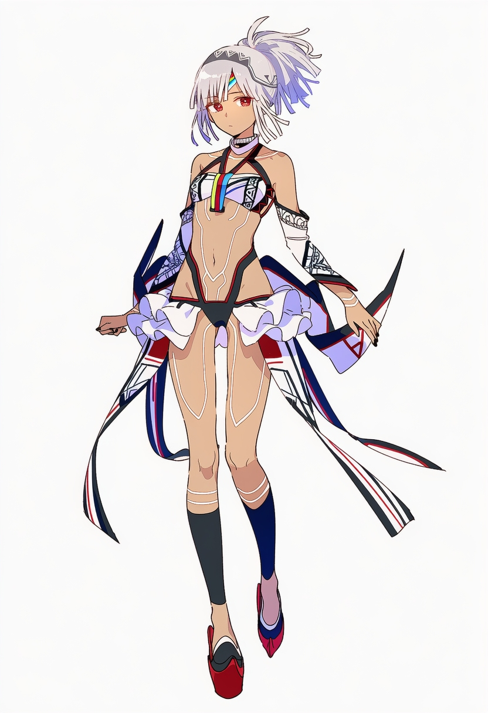

[在线例图](https://assets.quicktagcloud.com/images/raven_composition/raven_composition-0984.jpg?v=b212d2d64ff595f8)

<a id="raven_composition-0985"></a>

## 卷环发

ID：`raven_composition-0985`；分类：发型 / 发质/状态；来源标记：`safe`。

来源说明：

> 头发卷成一个个圆环卷。

正向提示词：

```text
ringlets
```

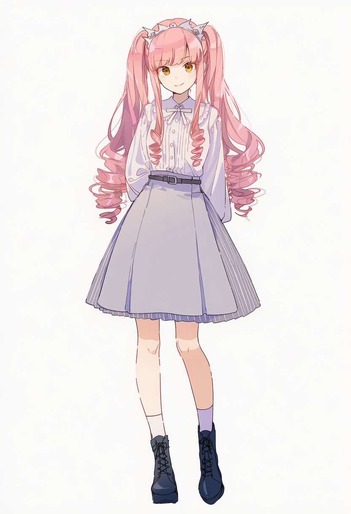

[在线例图](https://assets.quicktagcloud.com/images/raven_composition/raven_composition-0985.jpg?v=f62e3d88f91db52e)

<a id="raven_composition-0986"></a>

## 刺猬尖发

ID：`raven_composition-0986`；分类：发型 / 发质/状态；来源标记：`safe`。

来源说明：

> 头发像刺一样向外竖起。

正向提示词：

```text
spiked_hair
```

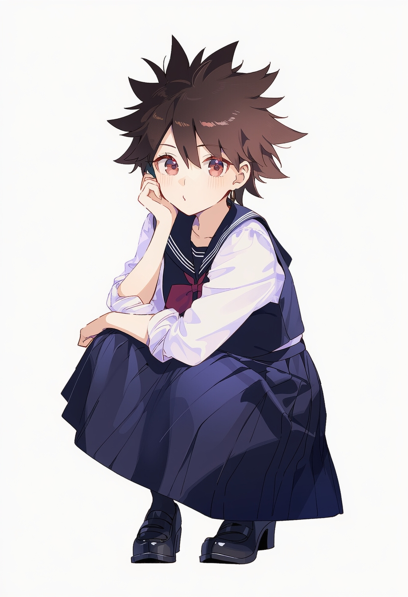

[在线例图](https://assets.quicktagcloud.com/images/raven_composition/raven_composition-0986.jpg?v=b678c995927c73ca)

<a id="raven_composition-0987"></a>

## 直发

ID：`raven_composition-0987`；分类：发型 / 发质/状态；来源标记：`safe`。

来源说明：

> 头发整体笔直。

正向提示词：

```text
straight_hair
```

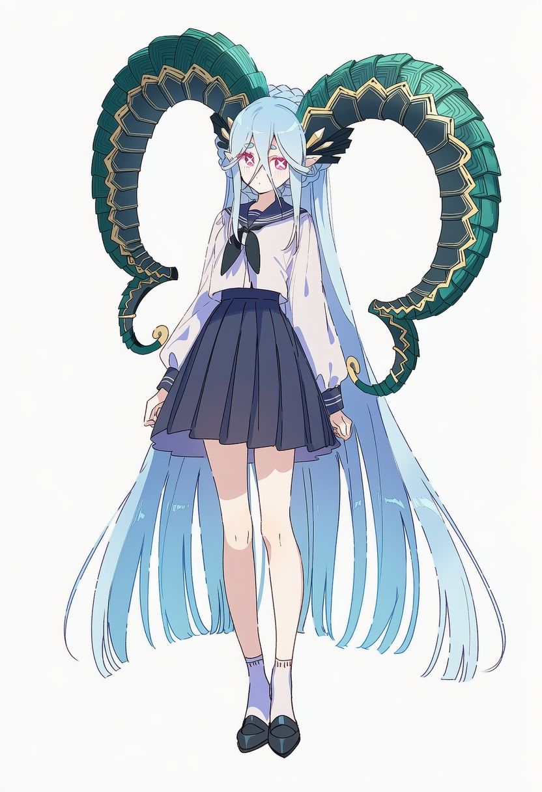

[在线例图](https://assets.quicktagcloud.com/images/raven_composition/raven_composition-0987.jpg?v=08a0b6b4019a8974)

<a id="raven_composition-0988"></a>

## 波浪发

ID：`raven_composition-0988`；分类：发型 / 发质/状态；来源标记：`safe`。

来源说明：

> 头发自然呈波浪状。

正向提示词：

```text
wavy_hair
```


[在线例图](https://assets.quicktagcloud.com/images/raven_composition/raven_composition-0988.jpg?v=99b69783255e910f)

<a id="raven_composition-0989"></a>

## 漂浮头发

ID：`raven_composition-0989`；分类：发型 / 发质/状态；来源标记：`safe`。

来源说明：

> 头发像失重一样漂浮。

正向提示词：

```text
floating_hair
```

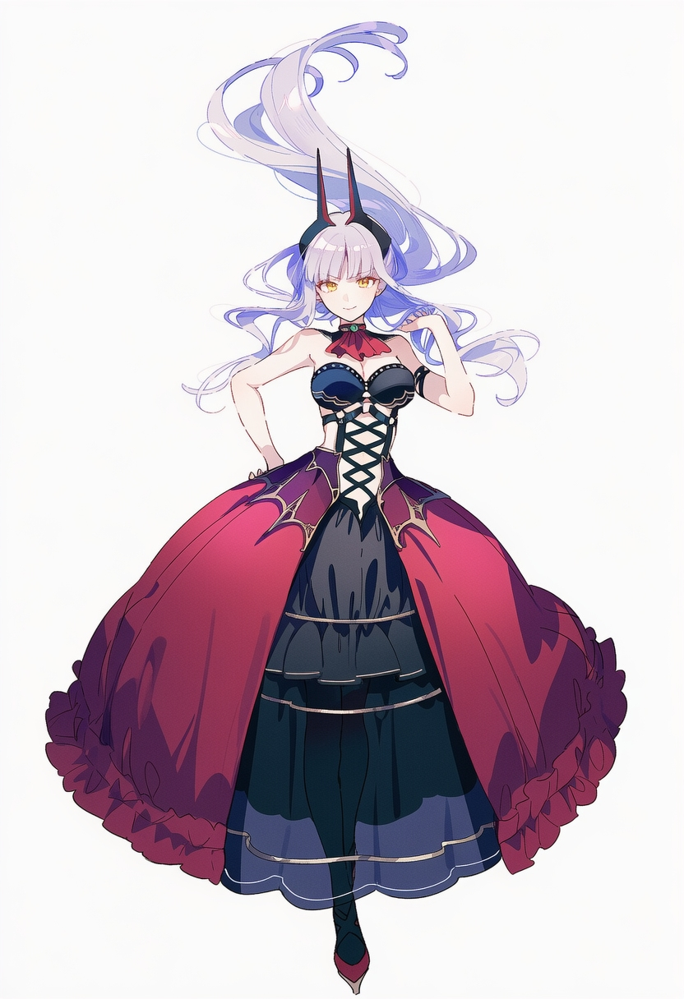

[在线例图](https://assets.quicktagcloud.com/images/raven_composition/raven_composition-0989.jpg?v=085125ebd6bd0cbe)

<a id="raven_composition-0990"></a>

## 折叠发束

ID：`raven_composition-0990`；分类：发型 / 发质/状态；来源标记：`safe`。

来源说明：

> 发束出现明显折叠或弯折。

正向提示词：

```text
folded_hair
```

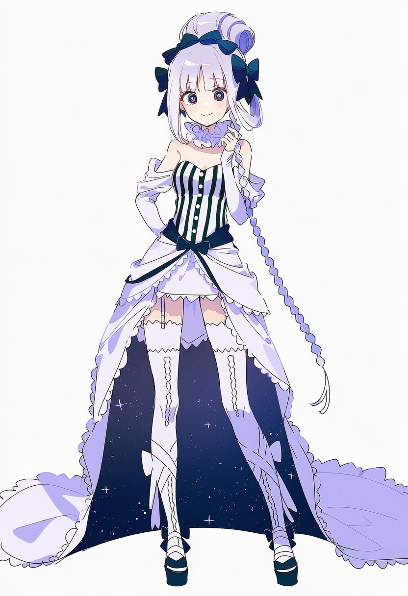

[在线例图](https://assets.quicktagcloud.com/images/raven_composition/raven_composition-0990.jpg?v=d577b404db43ad3b)

<a id="raven_composition-0991"></a>

## 披发

ID：`raven_composition-0991`；分类：发型 / 发质/状态；来源标记：`safe`。

来源说明：

> 头发自然披散下来。

正向提示词：

```text
hair_down
```

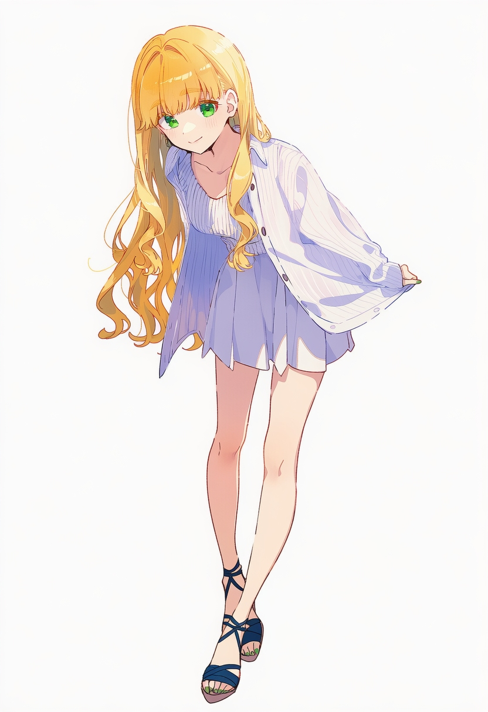

[在线例图](https://assets.quicktagcloud.com/images/raven_composition/raven_composition-0991.jpg?v=fadffb60c5354f67)

<a id="raven_composition-0992"></a>

## 向上漂浮的头发

ID：`raven_composition-0992`；分类：发型 / 发质/状态；来源标记：`safe`。

来源说明：

> 头发整体向上漂浮。

正向提示词：

```text
hair_floating_upwards
```

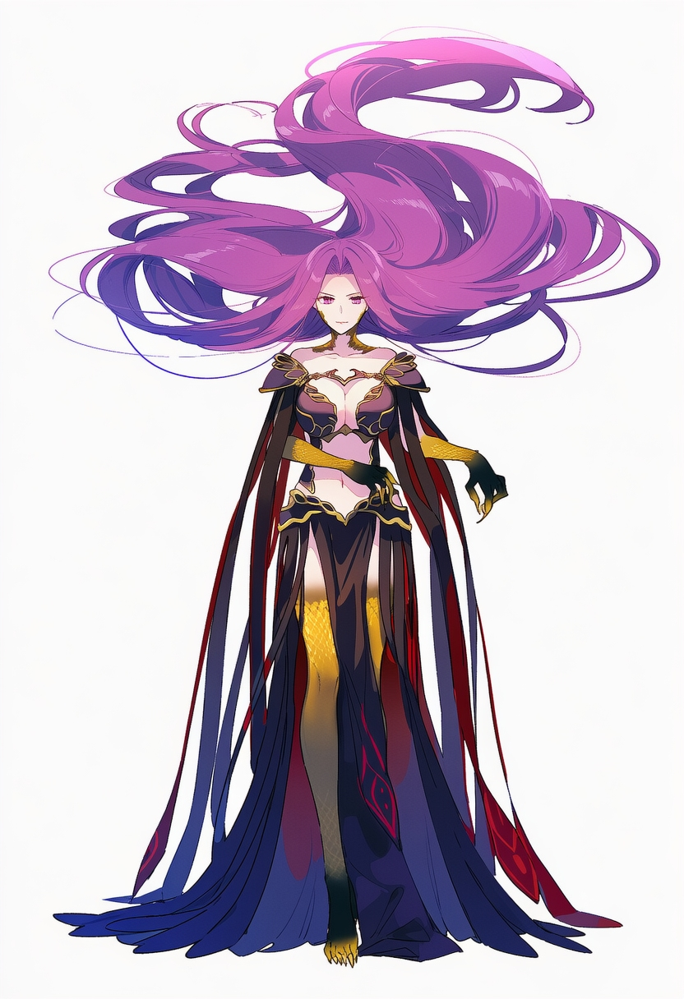

[在线例图](https://assets.quicktagcloud.com/images/raven_composition/raven_composition-0992.jpg?v=383c7a85e4841326)

<a id="raven_composition-0993"></a>

## 半散开发型

ID：`raven_composition-0993`；分类：发型 / 发质/状态；来源标记：`safe`。

来源说明：

> 原本扎好的头发有一部分散开。

正向提示词：

```text
hair_half_undone
```

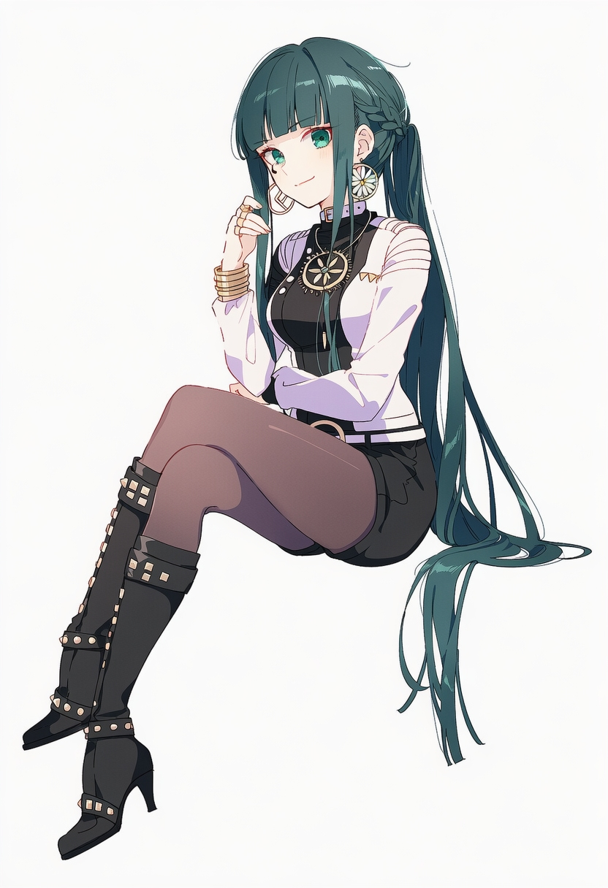

[在线例图](https://assets.quicktagcloud.com/images/raven_composition/raven_composition-0993.jpg?v=22f2d80d6587f242)

<a id="raven_composition-0994"></a>

## 发束翘起

ID：`raven_composition-0994`；分类：发型 / 发质/状态；来源标记：`safe`。

来源说明：

> 一束或几束头发明显翘起。

正向提示词：

```text
hair_lift
```

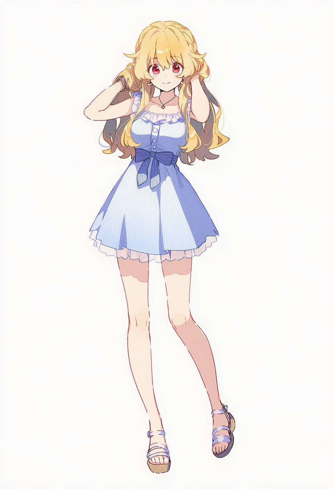

[在线例图](https://assets.quicktagcloud.com/images/raven_composition/raven_composition-0994.jpg?v=9c05254d272636a9)

<a id="raven_composition-0995"></a>

## 头发向后束起

ID：`raven_composition-0995`；分类：发型 / 发质/状态；来源标记：`safe`。

来源说明：

> 头发整体向后收拢。

正向提示词：

```text
hair_pulled_back
```

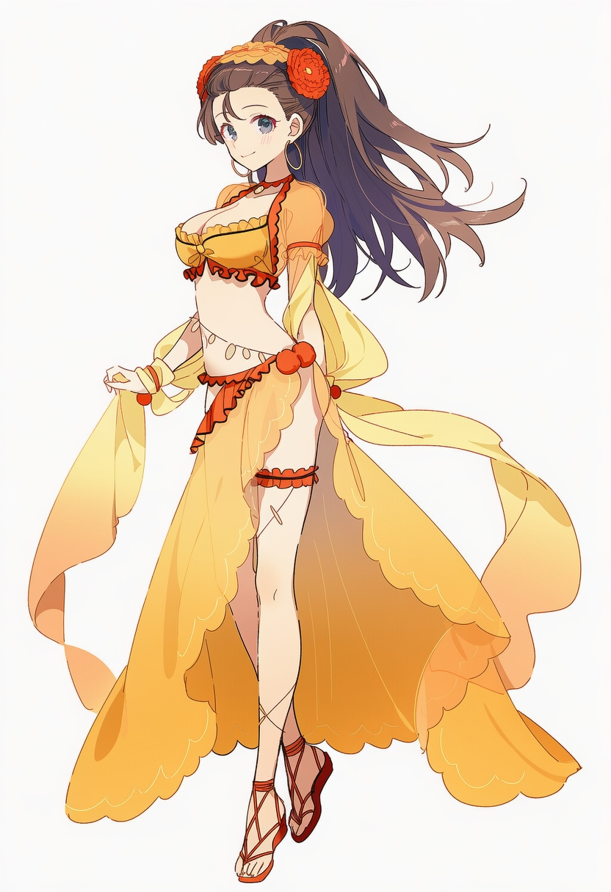

[在线例图](https://assets.quicktagcloud.com/images/raven_composition/raven_composition-0995.jpg?v=4a830f14bfdcec70)

<a id="raven_composition-0996"></a>

## 后梳油头

ID：`raven_composition-0996`；分类：发型 / 发质/状态；来源标记：`safe`。

来源说明：

> 头发贴着头皮向后梳。

正向提示词：

```text
hair_slicked_back
```

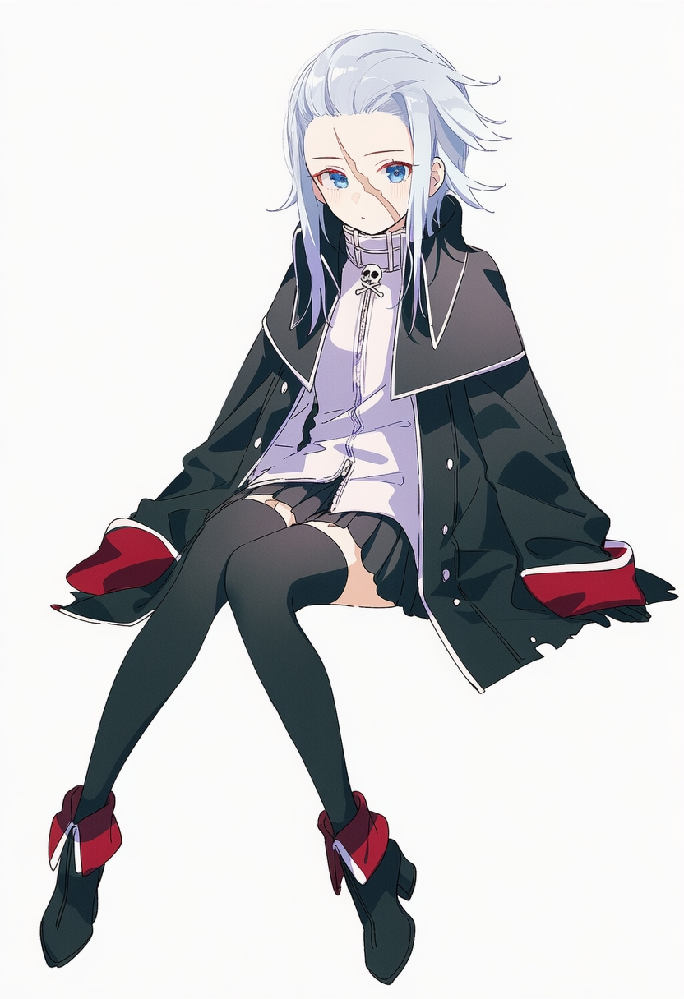

[在线例图](https://assets.quicktagcloud.com/images/raven_composition/raven_composition-0996.jpg?v=8d2a8216e3a1ce84)

<a id="raven_composition-0997"></a>

## 头发散开

ID：`raven_composition-0997`；分类：发型 / 发质/状态；来源标记：`safe`。

来源说明：

> 头发大面积散开铺开。

正向提示词：

```text
hair_spread_out
```

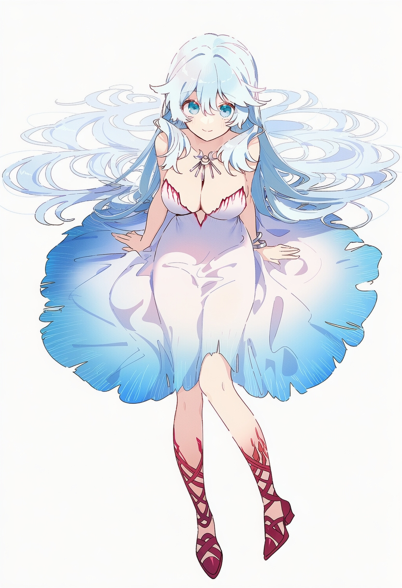

[在线例图](https://assets.quicktagcloud.com/images/raven_composition/raven_composition-0997.jpg?v=7ad136be14bbaf92)

<a id="raven_composition-0998"></a>

## 散开发型

ID：`raven_composition-0998`；分类：发型 / 发质/状态；来源标记：`safe`。

来源说明：

> 原本扎起的头发已经散开。

正向提示词：

```text
hair_undone
```

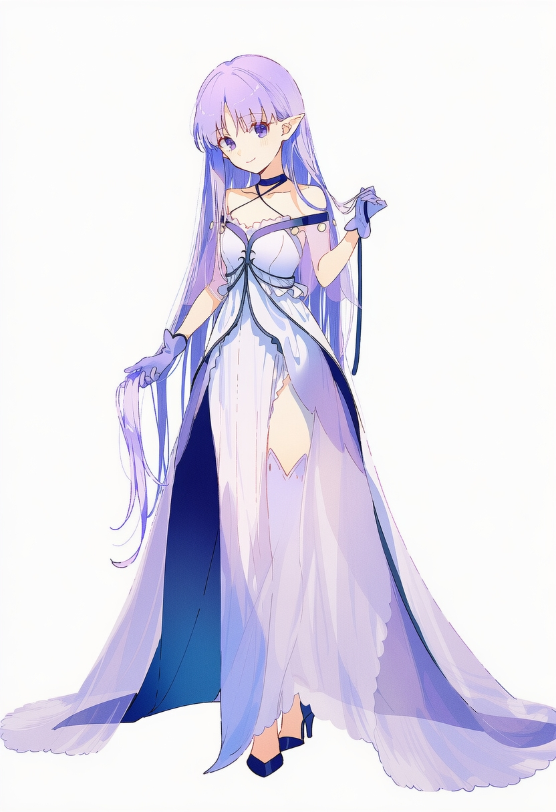

[在线例图](https://assets.quicktagcloud.com/images/raven_composition/raven_composition-0998.jpg?v=26f88767361f0299)

<a id="raven_composition-0999"></a>

## 盘起头发

ID：`raven_composition-0999`；分类：发型 / 发质/状态；来源标记：`safe`。

来源说明：

> 大部分头发被盘起或扎起。

正向提示词：

```text
hair_up
```

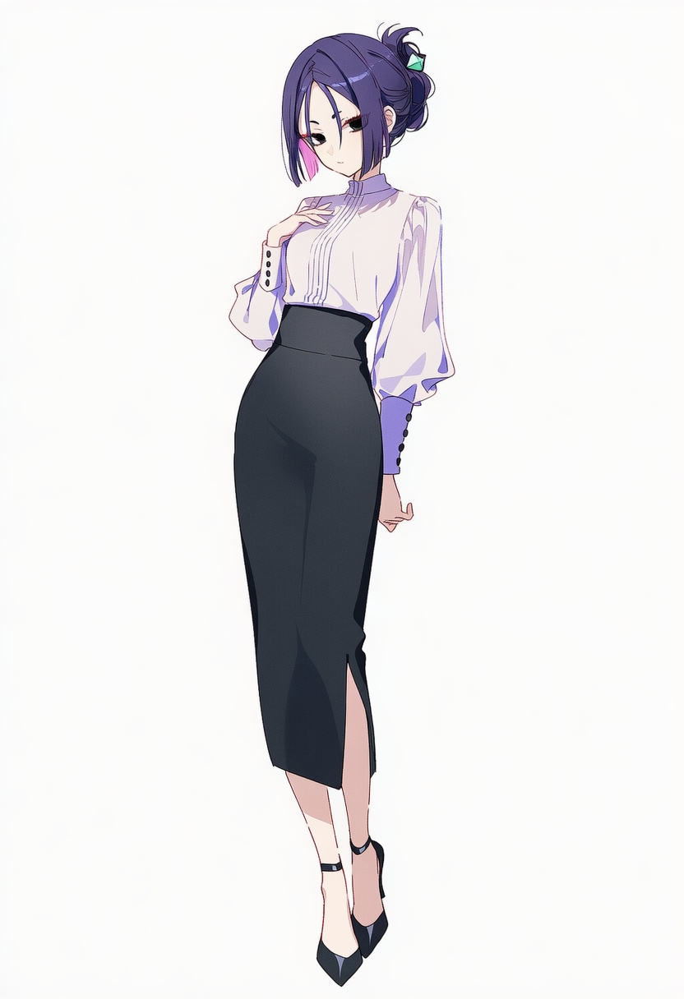

[在线例图](https://assets.quicktagcloud.com/images/raven_composition/raven_composition-0999.jpg?v=63c95bbc4f60e8d9)

<a id="raven_composition-1000"></a>

## 分缝发型

ID：`raven_composition-1000`；分类：发型 / 发质/状态；来源标记：`safe`。

来源说明：

> 头发有明显分缝。

正向提示词：

```text
parted_hair
```

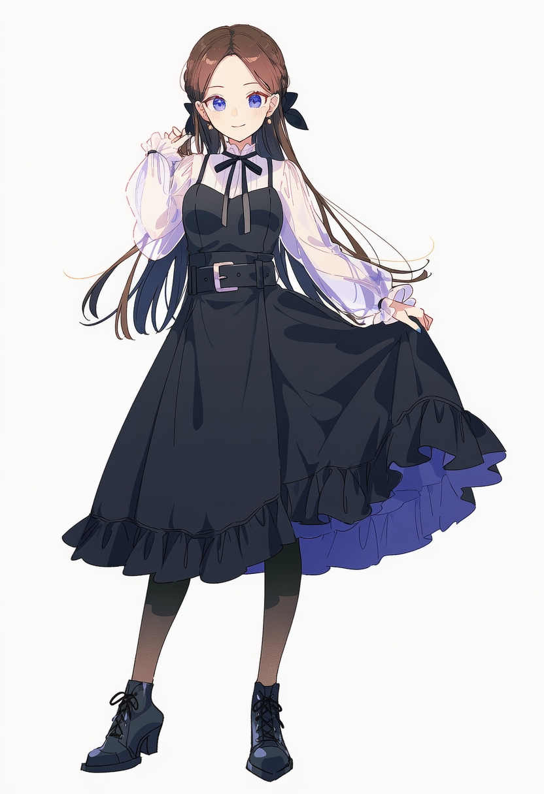

[在线例图](https://assets.quicktagcloud.com/images/raven_composition/raven_composition-1000.jpg?v=25c957a9fb32d5d9)

<a id="raven_composition-1001"></a>

## 透视头发

ID：`raven_composition-1001`；分类：发型 / 发质/状态；来源标记：`safe`。

来源说明：

> 头发呈半透明或透视效果。

正向提示词：

```text
see-through_hair
```

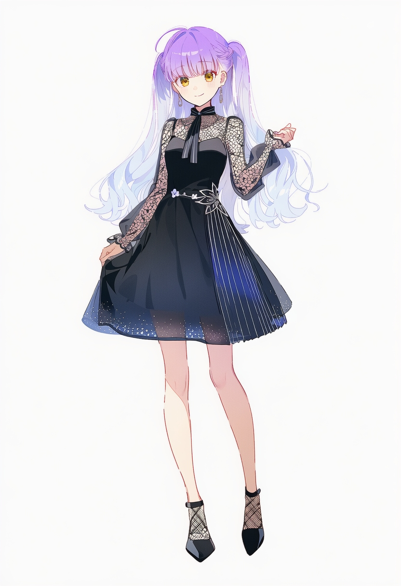

[在线例图](https://assets.quicktagcloud.com/images/raven_composition/raven_composition-1001.jpg?v=14d3045cd5270631)

<a id="raven_composition-1002"></a>

## 湿发

ID：`raven_composition-1002`；分类：发型 / 发质/状态；来源标记：`safe`。

来源说明：

> 头发处于明显湿润状态。

正向提示词：

```text
wet_hair
```

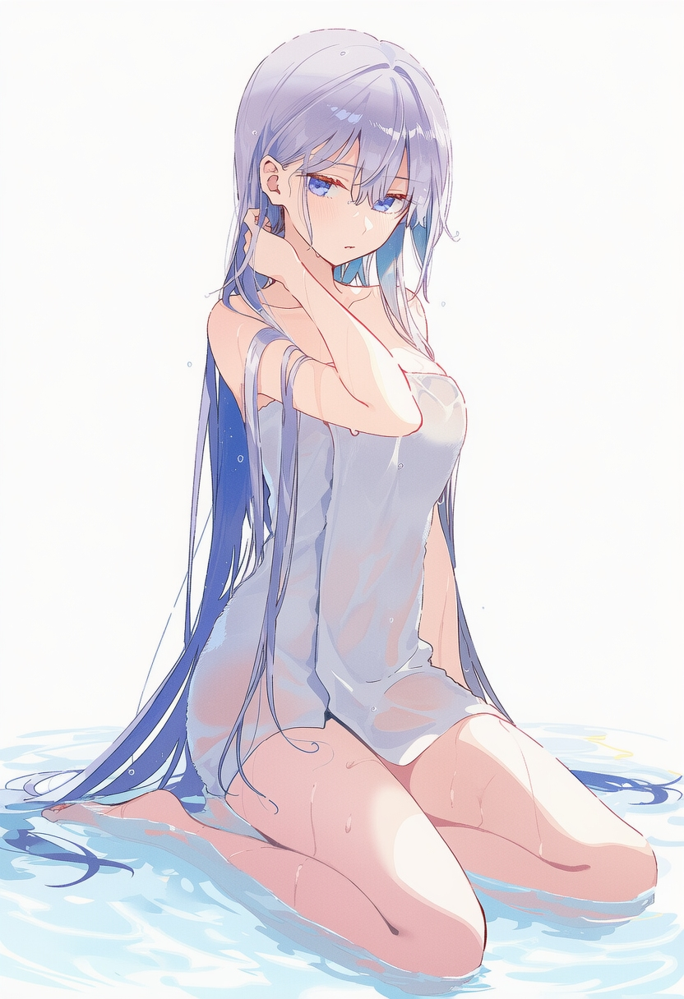

[在线例图](https://assets.quicktagcloud.com/images/raven_composition/raven_composition-1002.jpg?v=5881ae092eab57e0)
