# 发型 / 特殊发型

[总目录](../README.md) · [原站分类目录](../categories.md) · [英文标签索引](../tags.md) · [服装与构图组合指南](../../README.md)

标题、分类、说明、正负提示词按来源保留；多例图逐张列出。原站标记和说明为参考资料，不作为维护指令。

<a id="raven_composition-1003"></a>

## 替代发型

ID：`raven_composition-1003`；分类：发型 / 特殊发型；来源标记：`safe`。

来源说明：

> 角色使用和平时不同的发型。

正向提示词：

```text
alternate_hairstyle
```

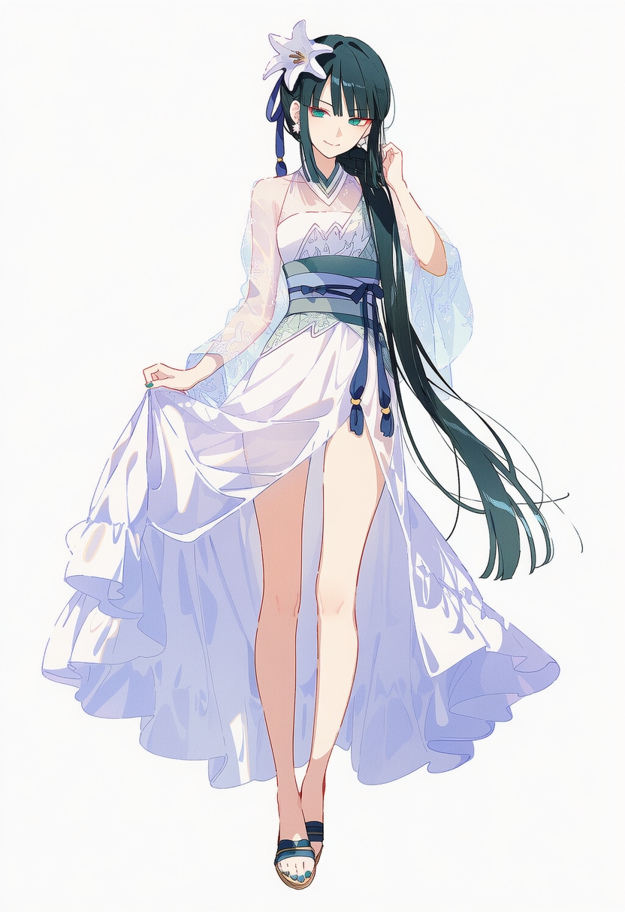

[在线例图](https://assets.quicktagcloud.com/images/raven_composition/raven_composition-1003.jpg?v=d6a093ef1519d6e4)

<a id="raven_composition-1004"></a>

## 天线发

ID：`raven_composition-1004`；分类：发型 / 特殊发型；来源标记：`safe`。

来源说明：

> 有一根或几根像天线一样翘起的头发。

正向提示词：

```text
antenna_hair
```

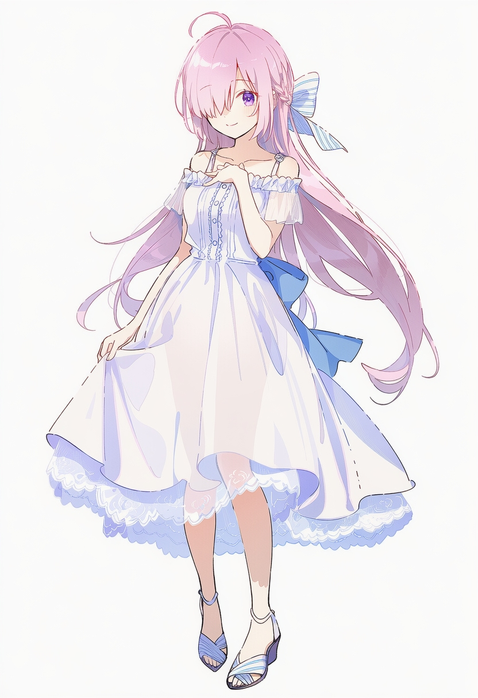

[在线例图](https://assets.quicktagcloud.com/images/raven_composition/raven_composition-1004.jpg?v=0aaeeb62eb18e7bd)

<a id="raven_composition-1005"></a>

## 不对称发型

ID：`raven_composition-1005`；分类：发型 / 特殊发型；来源标记：`safe`。

来源说明：

> 左右两边发型明显不对称。

正向提示词：

```text
asymmetrical_hair
```

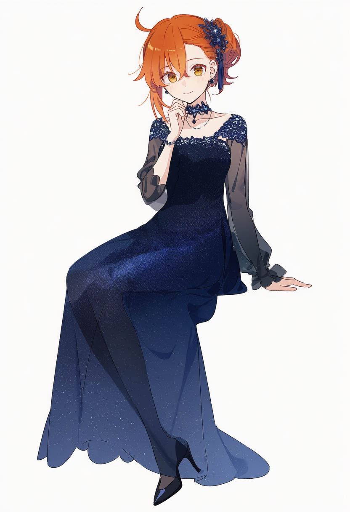

[在线例图](https://assets.quicktagcloud.com/images/raven_composition/raven_composition-1005.jpg?v=d7fc269ca7b55961)

<a id="raven_composition-1006"></a>

## 后部头发

ID：`raven_composition-1006`；分类：发型 / 特殊发型；来源标记：`safe`。

来源说明：

> 突出表现后脑或背后的头发。

正向提示词：

```text
back_hair
```

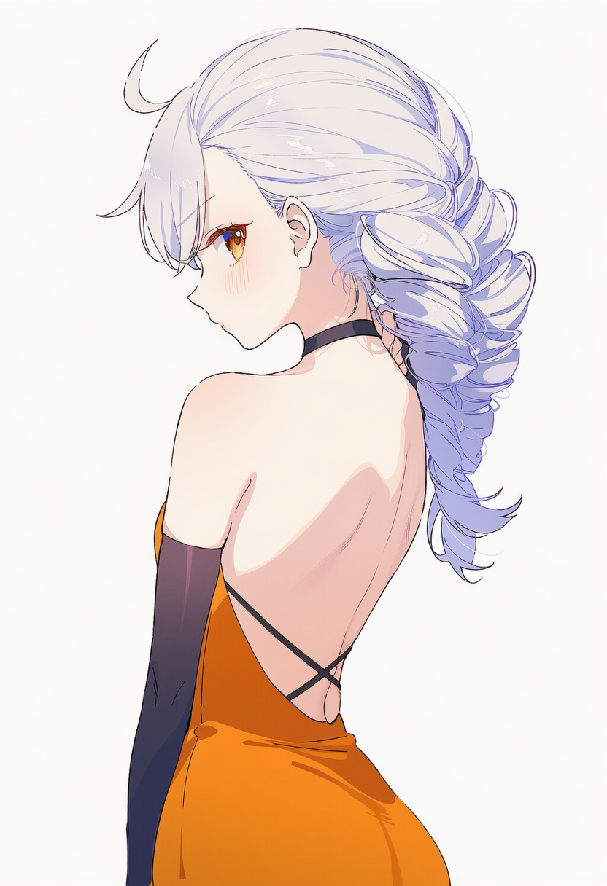

[在线例图](https://assets.quicktagcloud.com/images/raven_composition/raven_composition-1006.jpg?v=32c8b4708670d0a6)

<a id="raven_composition-1007"></a>

## 蝴蝶结形头发

ID：`raven_composition-1007`；分类：发型 / 特殊发型；来源标记：`safe`。

来源说明：

> 头发本身做成蝴蝶结形。

正向提示词：

```text
bow-shaped_hair
```

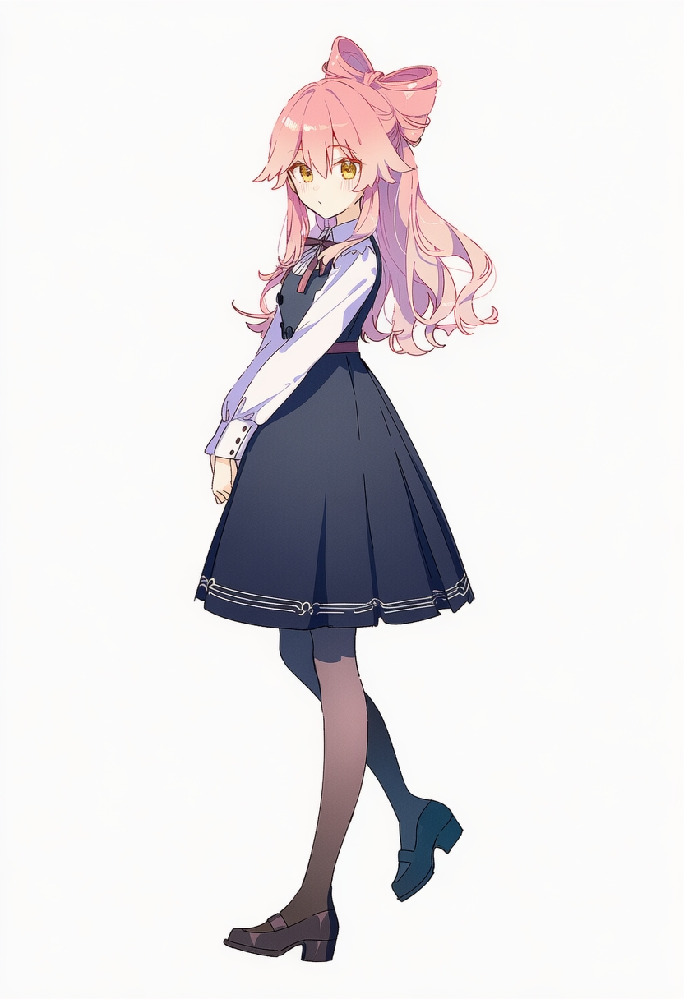

[在线例图](https://assets.quicktagcloud.com/images/raven_composition/raven_composition-1007.jpg?v=d36f690431676008)

<a id="raven_composition-1008"></a>

## 花形头发

ID：`raven_composition-1008`；分类：发型 / 特殊发型；来源标记：`safe`。

来源说明：

> 头发本身做成花朵形。

正向提示词：

```text
flower-shaped_hair
```

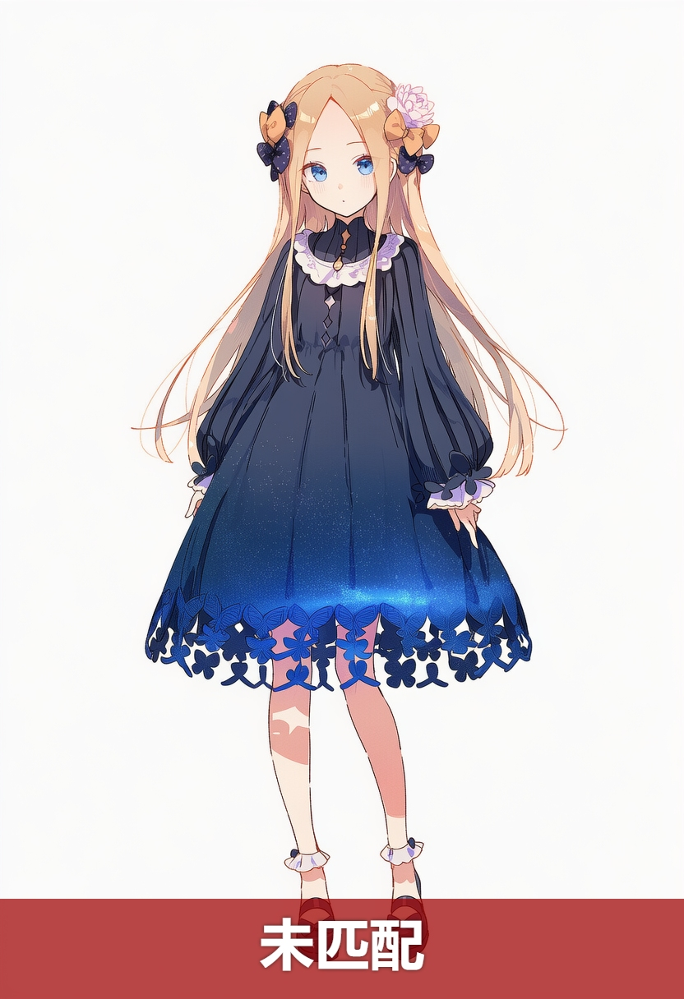

[在线例图](https://assets.quicktagcloud.com/images/raven_composition/raven_composition-1008.jpg?v=c211736c66905189)

<a id="raven_composition-1009"></a>

## 绕耳头发

ID：`raven_composition-1009`；分类：发型 / 特殊发型；来源标记：`safe`。

来源说明：

> 发束围绕耳朵形成造型。

正向提示词：

```text
hair_around_ear
```

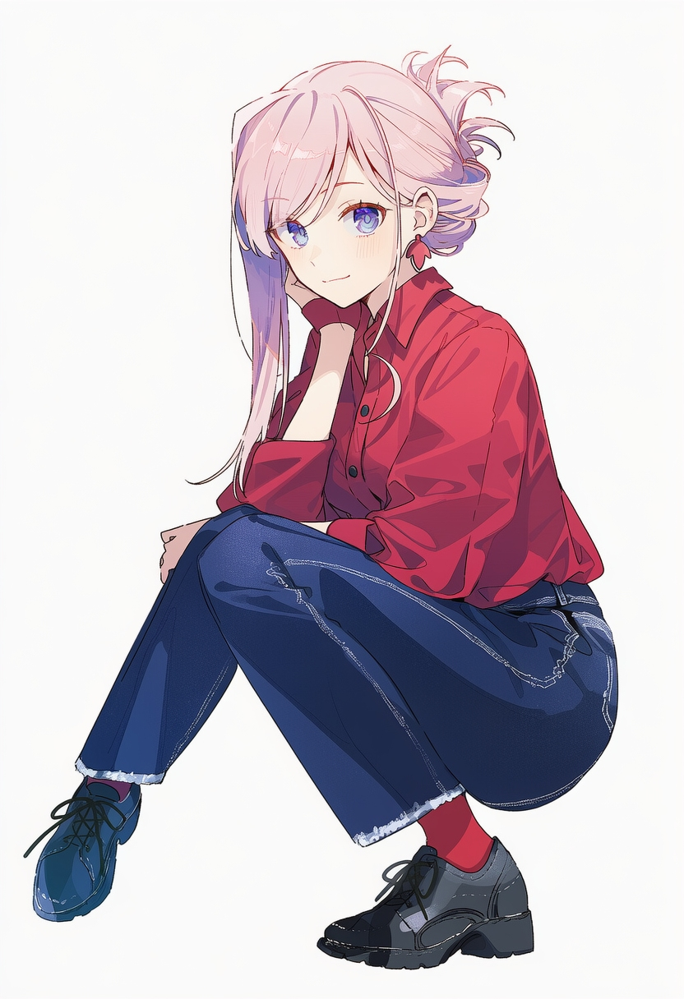

[在线例图](https://assets.quicktagcloud.com/images/raven_composition/raven_composition-1009.jpg?v=206fc8e4be672fc2)

<a id="raven_composition-1010"></a>

## 双角之间的头发

ID：`raven_composition-1010`；分类：发型 / 特殊发型；来源标记：`safe`。

来源说明：

> 头发位于两只角之间。

正向提示词：

```text
hair_between_horns
```

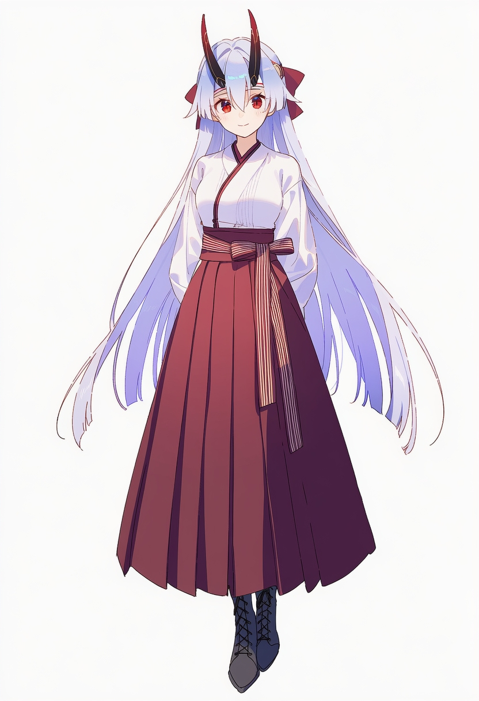

[在线例图](https://assets.quicktagcloud.com/images/raven_composition/raven_composition-1010.jpg?v=eb37d3e4221df982)

<a id="raven_composition-1011"></a>

## 耳朵形头发

ID：`raven_composition-1011`；分类：发型 / 特殊发型；来源标记：`safe`。

来源说明：

> 头发本身做成耳朵形。

正向提示词：

```text
hair_ears
```

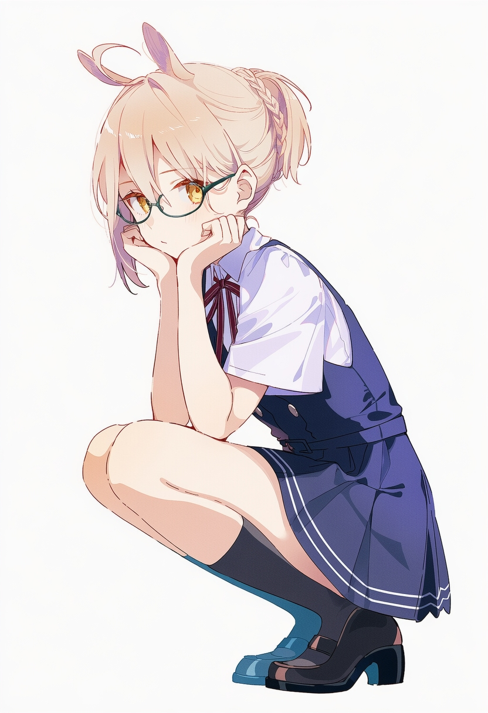

[在线例图](https://assets.quicktagcloud.com/images/raven_composition/raven_composition-1011.jpg?v=e5a7d9e61f739636)

<a id="raven_composition-1012"></a>

## 垂落头发

ID：`raven_composition-1012`；分类：发型 / 特殊发型；来源标记：`safe`。

来源说明：

> 发束明显向下垂落。

正向提示词：

```text
hair_hanging_down
```

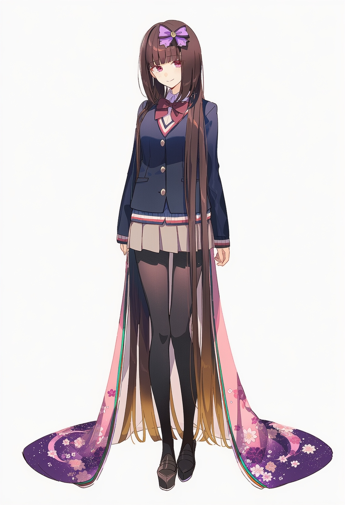

[在线例图](https://assets.quicktagcloud.com/images/raven_composition/raven_composition-1012.jpg?v=ae4462207006d0a1)

<a id="raven_composition-1013"></a>

## 角状头发

ID：`raven_composition-1013`；分类：发型 / 特殊发型；来源标记：`safe`。

来源说明：

> 头发本身做成角的形状。

正向提示词：

```text
hair_horns
```

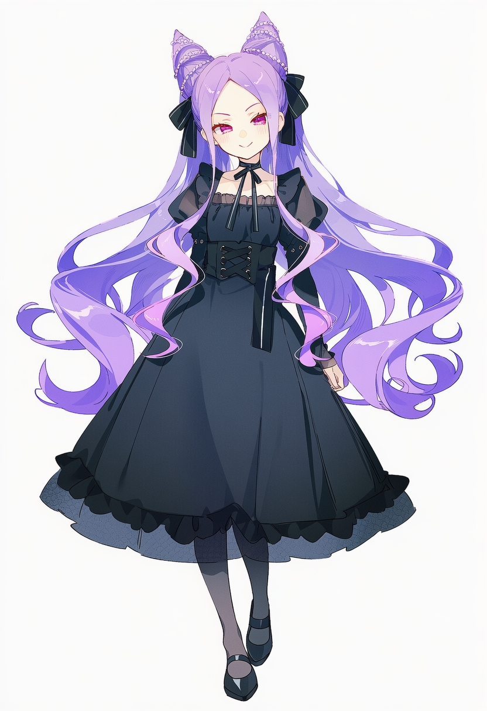

[在线例图](https://assets.quicktagcloud.com/images/raven_composition/raven_composition-1013.jpg?v=4d8aca906c61fc08)

<a id="raven_composition-1014"></a>

## 头发搭肩

ID：`raven_composition-1014`；分类：发型 / 特殊发型；来源标记：`safe`。

来源说明：

> 长发搭在肩膀前后。

正向提示词：

```text
hair_over_shoulder
```

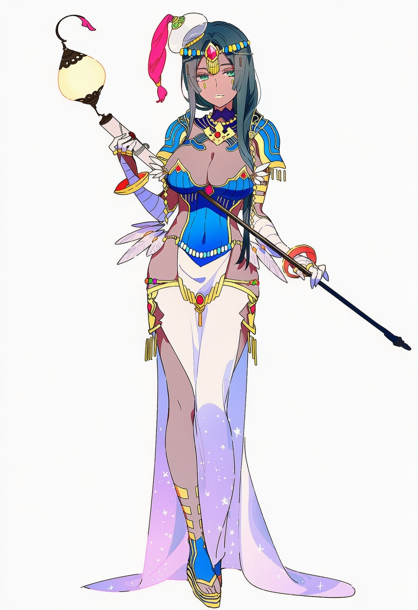

[在线例图](https://assets.quicktagcloud.com/images/raven_composition/raven_composition-1014.jpg?v=52a51b93109316f1)

<a id="raven_composition-1015"></a>

## 头发围巾式造型

ID：`raven_composition-1015`；分类：发型 / 特殊发型；来源标记：`safe`。

来源说明：

> 长发像围巾一样绕在颈肩附近。

正向提示词：

```text
hair_scarf
```

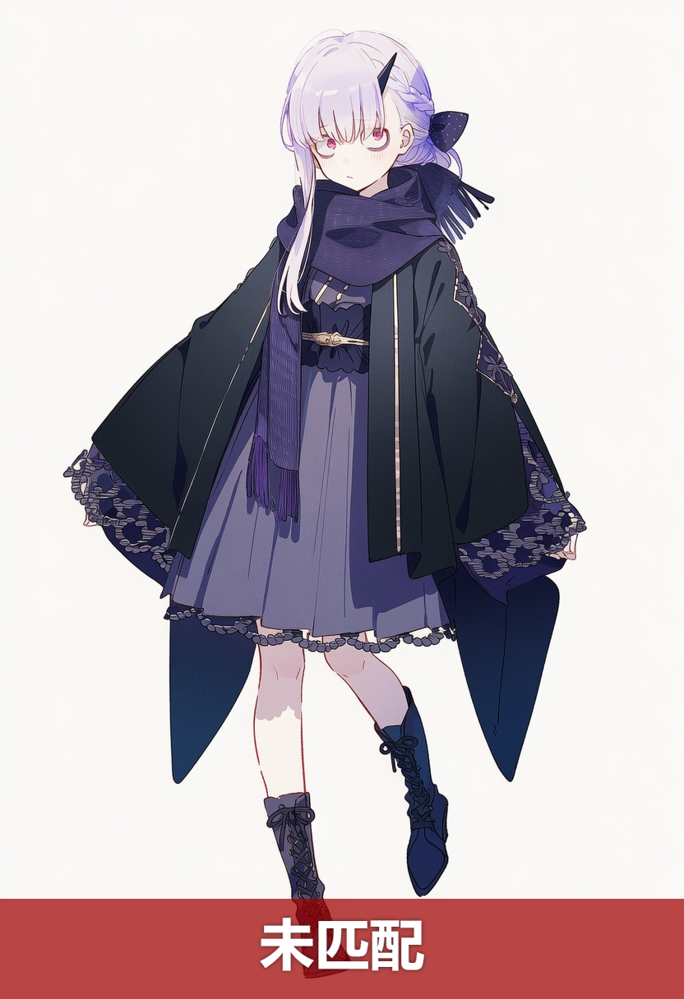

[在线例图](https://assets.quicktagcloud.com/images/raven_composition/raven_composition-1015.jpg?v=a6fb440c40b8aaa4)

<a id="raven_composition-1016"></a>

## 头发穿过头饰

ID：`raven_composition-1016`；分类：发型 / 特殊发型；来源标记：`safe`。

来源说明：

> 头发从帽子或头饰中穿出来。

正向提示词：

```text
hair_through_headwear
```

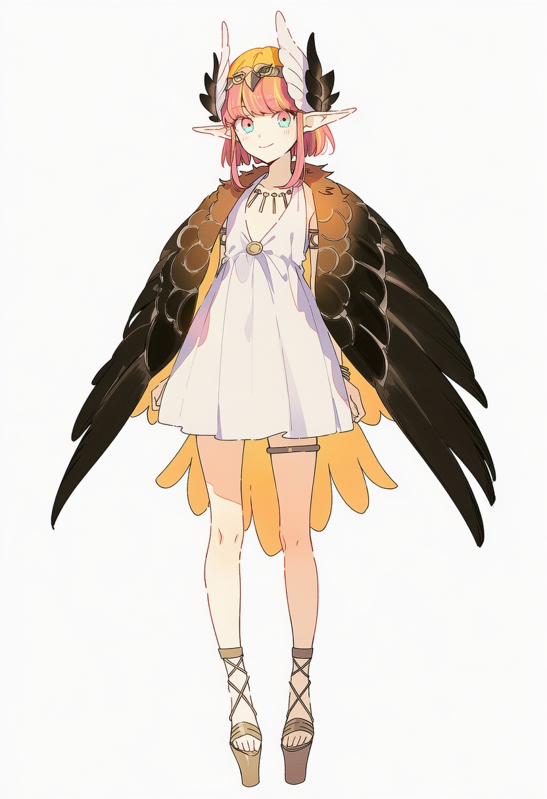

[在线例图](https://assets.quicktagcloud.com/images/raven_composition/raven_composition-1016.jpg?v=e4b64cc24036704b)

<a id="raven_composition-1017"></a>

## 小撮翘发

ID：`raven_composition-1017`；分类：发型 / 特殊发型；来源标记：`safe`。

来源说明：

> 有一小撮明显翘起的头发。

正向提示词：

```text
hair_tuft
```

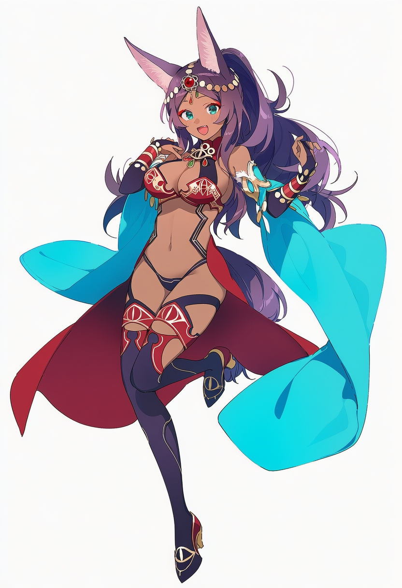

[在线例图](https://assets.quicktagcloud.com/images/raven_composition/raven_composition-1017.jpg?v=8270cc1e86ba7e35)

<a id="raven_composition-1018"></a>

## 翼状头发

ID：`raven_composition-1018`；分类：发型 / 特殊发型；来源标记：`safe`。

来源说明：

> 头发本身形成翅膀状。

正向提示词：

```text
hair_wings
```

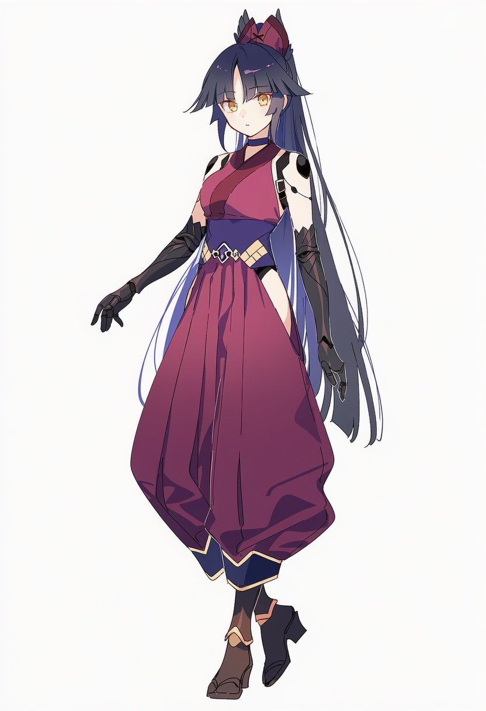

[在线例图](https://assets.quicktagcloud.com/images/raven_composition/raven_composition-1018.jpg?v=e522095e13a3a782)

<a id="raven_composition-1019"></a>

## 心形头发

ID：`raven_composition-1019`；分类：发型 / 特殊发型；来源标记：`safe`。

来源说明：

> 头发本身形成心形。

正向提示词：

```text
heart-shaped_hair
```

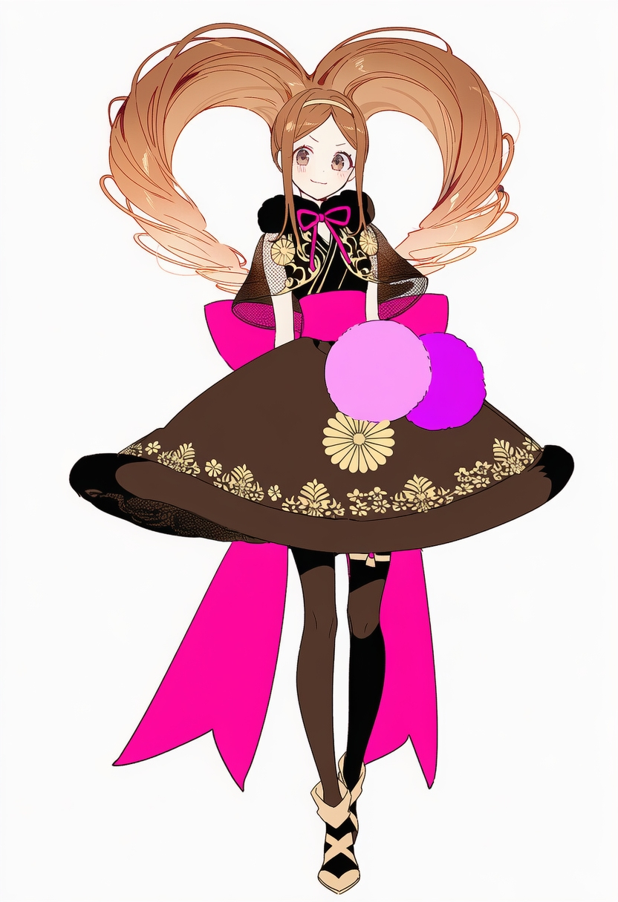

[在线例图](https://assets.quicktagcloud.com/images/raven_composition/raven_composition-1019.jpg?v=ea8e25788b0b124b)

<a id="raven_composition-1020"></a>

## 后颈单发束

ID：`raven_composition-1020`；分类：发型 / 特殊发型；来源标记：`safe`。

来源说明：

> 后颈位置单独留着一束头发。

正向提示词：

```text
lone_nape_hair
```

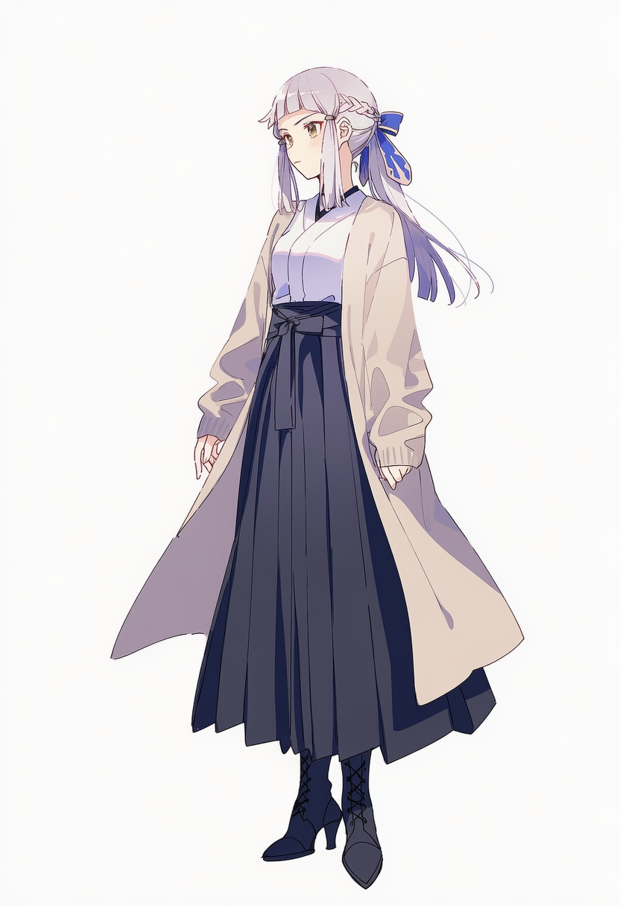

[在线例图](https://assets.quicktagcloud.com/images/raven_composition/raven_composition-1020.jpg?v=203cc5fdaad64d74)

<a id="raven_composition-1021"></a>

## 散落发丝

ID：`raven_composition-1021`；分类：发型 / 特殊发型；来源标记：`safe`。

来源说明：

> 有一束头发从整体发型中散落出来。

正向提示词：

```text
loose_hair_strand
```

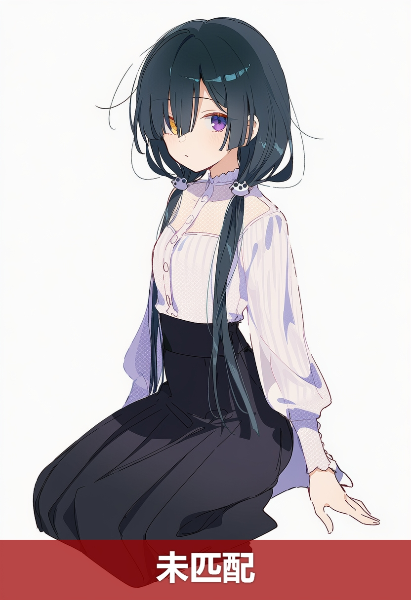

[在线例图](https://assets.quicktagcloud.com/images/raven_composition/raven_composition-1021.jpg?v=292467d5067a9391)

<a id="raven_composition-1022"></a>

## 低双马尾

ID：`raven_composition-1022`；分类：发型 / 特殊发型；来源标记：`safe`。

来源说明：

> 双马尾扎在较低位置。

正向提示词：

```text
low_twintails
```

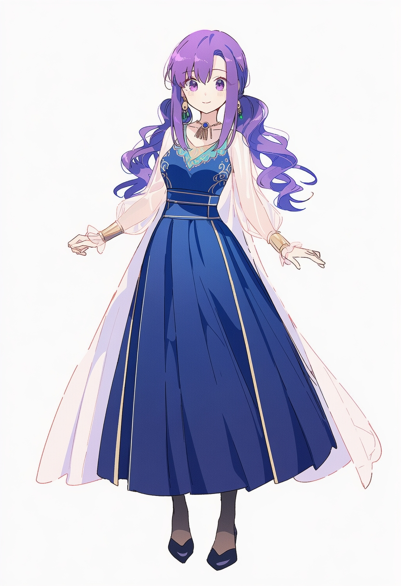

[在线例图](https://assets.quicktagcloud.com/images/raven_composition/raven_composition-1022.jpg?v=36cc1de6401b8082)

<a id="raven_composition-1023"></a>

## 官方替代发型

ID：`raven_composition-1023`；分类：发型 / 特殊发型；来源标记：`safe`。

来源说明：

> 角色官方设定中的另一种发型。

正向提示词：

```text
official_alternate_hairstyle
```

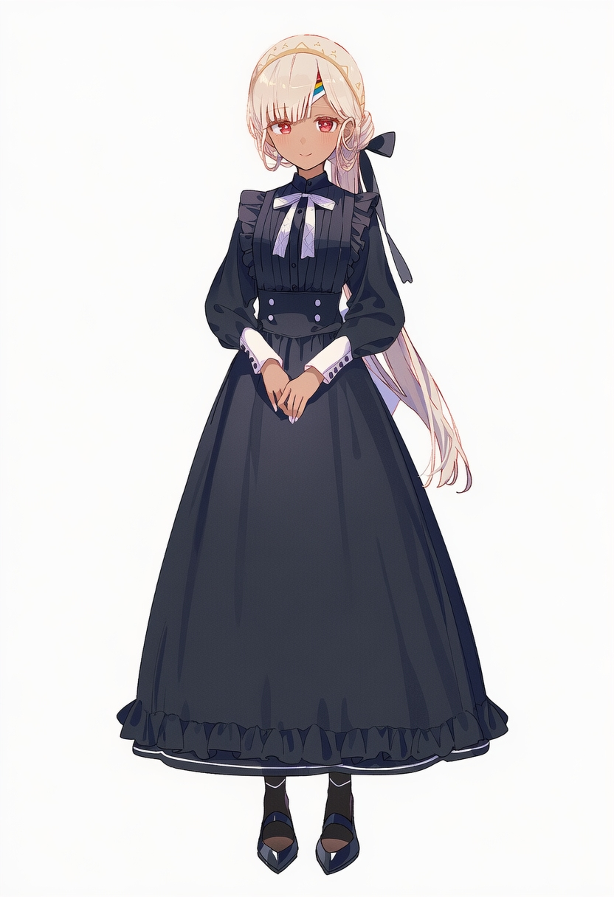

[在线例图](https://assets.quicktagcloud.com/images/raven_composition/raven_composition-1023.jpg?v=d130e5a148ab7635)

<a id="raven_composition-1024"></a>

## 短发配长发束

ID：`raven_composition-1024`；分类：发型 / 特殊发型；来源标记：`safe`。

来源说明：

> 整体是短发，但混有明显长发束。

正向提示词：

```text
short_hair_with_long_locks
```

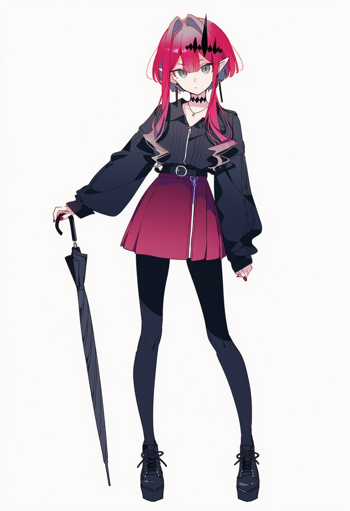

[在线例图](https://assets.quicktagcloud.com/images/raven_composition/raven_composition-1024.jpg?v=46e93e6d7a3e983b)

<a id="raven_composition-1025"></a>

## 高耸发型

ID：`raven_composition-1025`；分类：发型 / 特殊发型；来源标记：`safe`。

来源说明：

> 发型整体向上堆得很高。

正向提示词：

```text
tall_hair
```

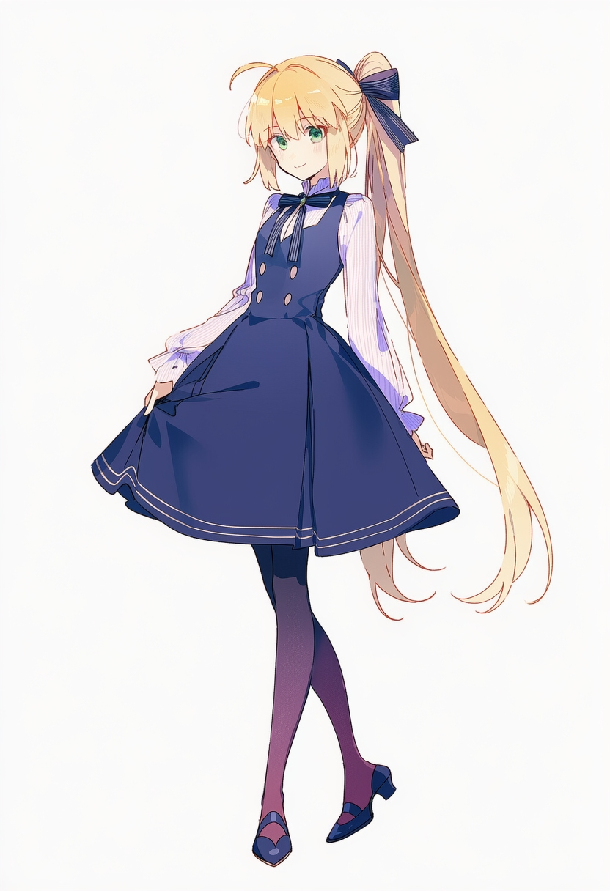

[在线例图](https://assets.quicktagcloud.com/images/raven_composition/raven_composition-1025.jpg?v=0954ffbce07f5230)

<a id="raven_composition-1026"></a>

## 双马尾

ID：`raven_composition-1026`；分类：发型 / 特殊发型；来源标记：`safe`。

来源说明：

> 左右两侧各扎一束马尾。

正向提示词：

```text
twintails
```

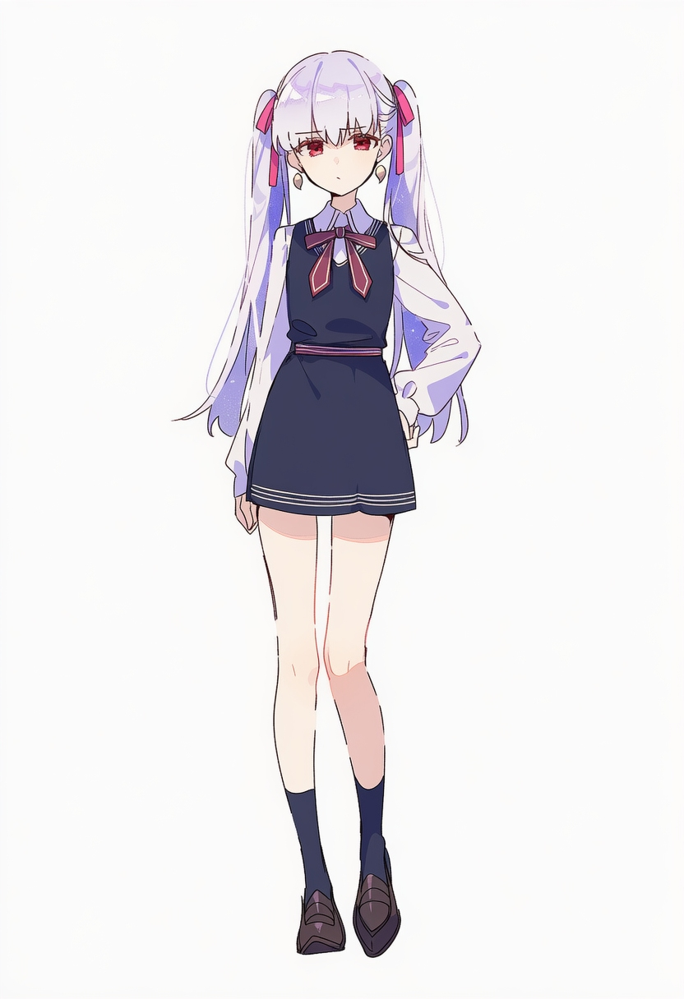

[在线例图](https://assets.quicktagcloud.com/images/raven_composition/raven_composition-1026.jpg?v=06774fd37bc60ee0)

<a id="raven_composition-1027"></a>

## 不对称双马尾

ID：`raven_composition-1027`；分类：发型 / 特殊发型；来源标记：`safe`。

来源说明：

> 左右双马尾长度或位置不一致。

正向提示词：

```text
uneven_twintails
```

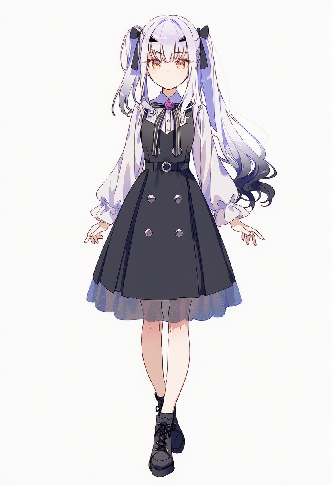

[在线例图](https://assets.quicktagcloud.com/images/raven_composition/raven_composition-1027.jpg?v=ad28693065a6665c)

<a id="raven_composition-1028"></a>

## 电缆状头发

ID：`raven_composition-1028`；分类：发型 / 特殊发型；来源标记：`safe`。

来源说明：

> 头发像电缆或粗线一样。

正向提示词：

```text
cable_hair
```

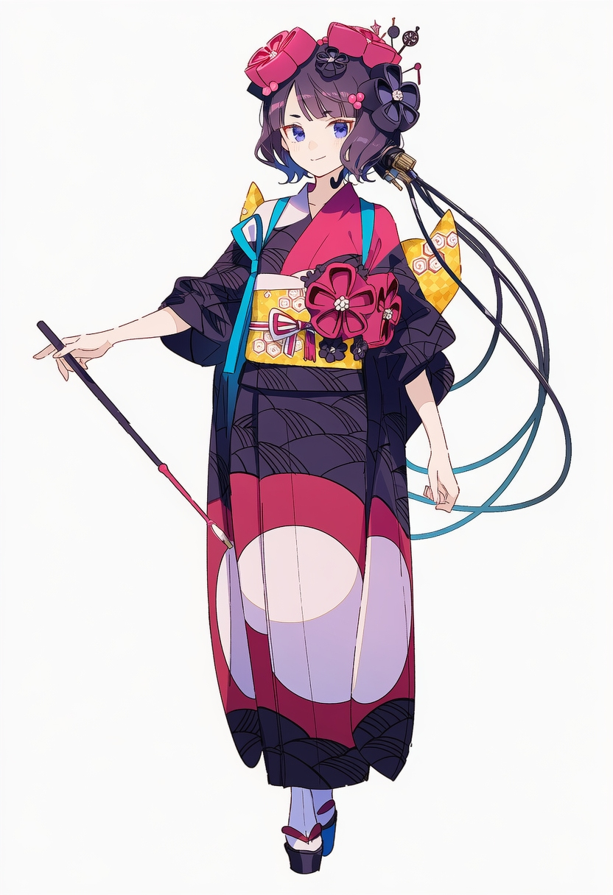

[在线例图](https://assets.quicktagcloud.com/images/raven_composition/raven_composition-1028.jpg?v=a604c9875b3a5317)

<a id="raven_composition-1029"></a>

## 云朵头发

ID：`raven_composition-1029`；分类：发型 / 特殊发型；来源标记：`safe`。

来源说明：

> 头发像云朵一样蓬松或云状。

正向提示词：

```text
cloud_hair
```

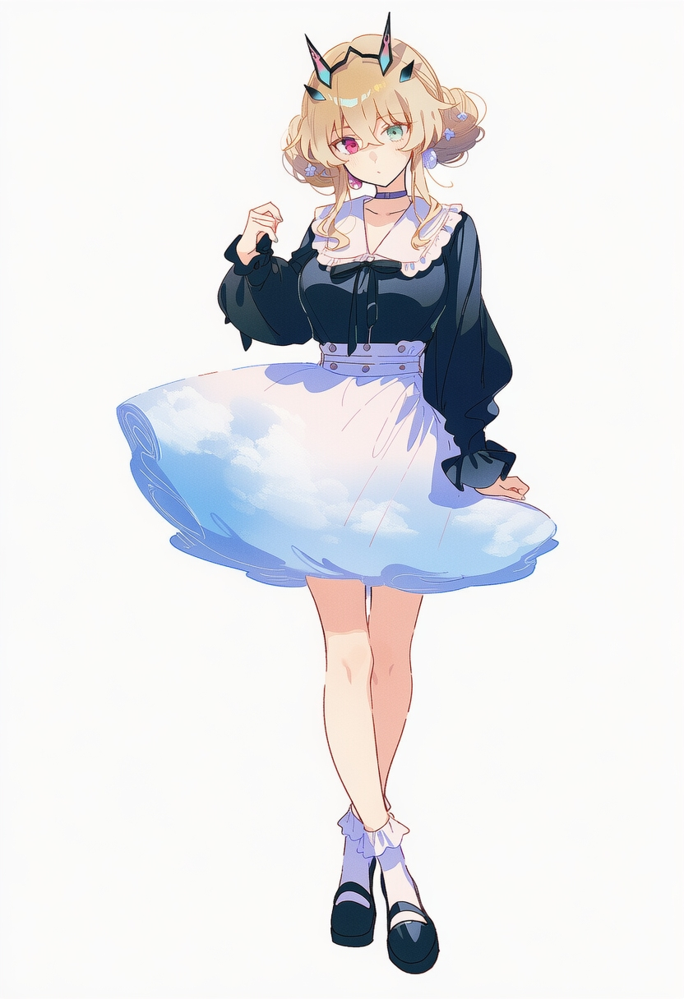

[在线例图](https://assets.quicktagcloud.com/images/raven_composition/raven_composition-1029.jpg?v=e3d18c58bc040a60)

<a id="raven_composition-1030"></a>

## 水晶头发

ID：`raven_composition-1030`；分类：发型 / 特殊发型；来源标记：`safe`。

来源说明：

> 头发呈水晶一样的质感。

正向提示词：

```text
crystal_hair
```

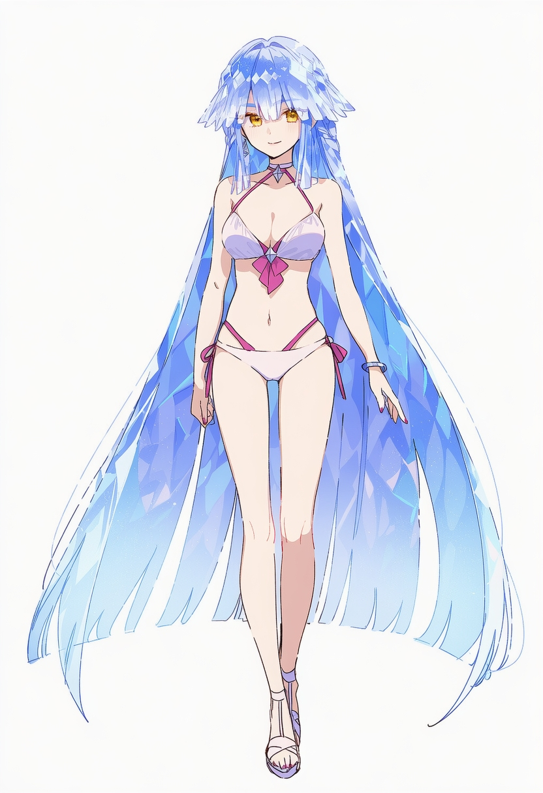

[在线例图](https://assets.quicktagcloud.com/images/raven_composition/raven_composition-1030.jpg?v=e6295402e040c505)

<a id="raven_composition-1031"></a>

## 羽毛头发

ID：`raven_composition-1031`；分类：发型 / 特殊发型；来源标记：`safe`。

来源说明：

> 头发像羽毛或由羽毛构成。

正向提示词：

```text
feather_hair
```

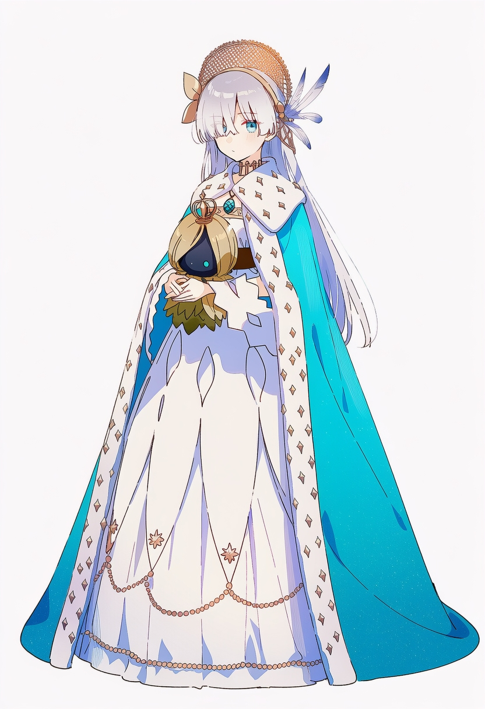

[在线例图](https://assets.quicktagcloud.com/images/raven_composition/raven_composition-1031.jpg?v=ae6e0407e6214434)

<a id="raven_composition-1032"></a>

## 火焰头发

ID：`raven_composition-1032`；分类：发型 / 特殊发型；来源标记：`safe`。

来源说明：

> 头发像火焰一样燃烧或流动。

正向提示词：

```text
fiery_hair
```

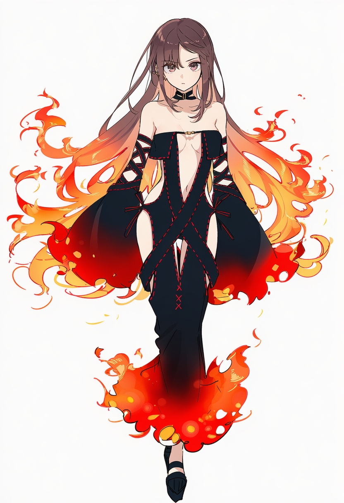

[在线例图](https://assets.quicktagcloud.com/images/raven_composition/raven_composition-1032.jpg?v=cffd3a092dd64dfb)

<a id="raven_composition-1033"></a>

## 食物主题头发

ID：`raven_composition-1033`；分类：发型 / 特殊发型；来源标记：`safe`。

来源说明：

> 头发造型明显带食物元素。

正向提示词：

```text
food-themed_hair
```

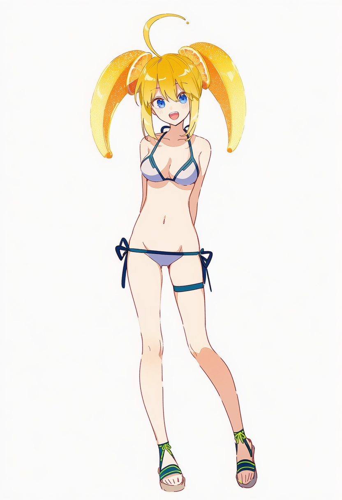

[在线例图](https://assets.quicktagcloud.com/images/raven_composition/raven_composition-1033.jpg?v=f1e52322badf9620)

<a id="raven_composition-1034"></a>

## 发光头发

ID：`raven_composition-1034`；分类：发型 / 特殊发型；来源标记：`safe`。

来源说明：

> 头发本身会发光。

正向提示词：

```text
glowing_hair
```

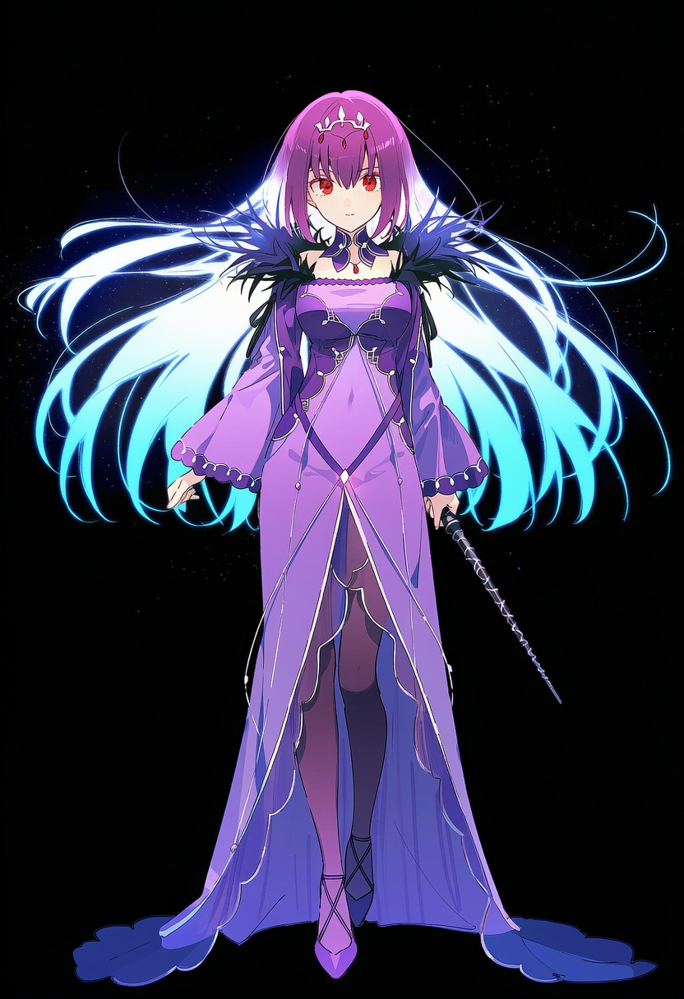

[在线例图](https://assets.quicktagcloud.com/images/raven_composition/raven_composition-1034.jpg?v=60f816d297d39385)

<a id="raven_composition-1035"></a>

## 虹彩头发

ID：`raven_composition-1035`；分类：发型 / 特殊发型；来源标记：`safe`。

来源说明：

> 头发带彩虹般的变彩效果。

正向提示词：

```text
iridescent_hair
```

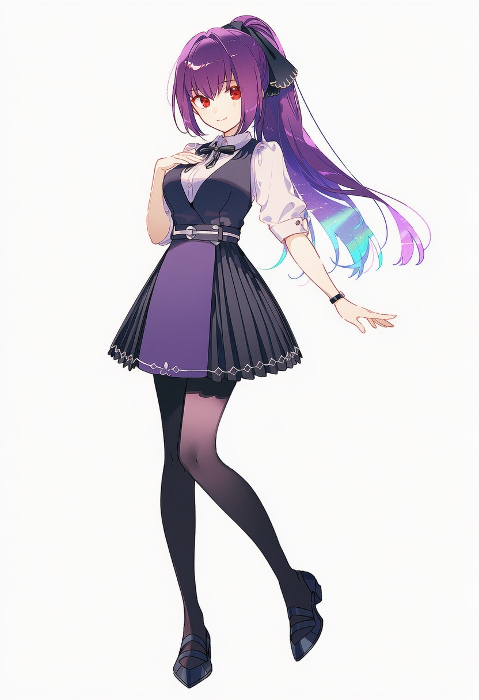

[在线例图](https://assets.quicktagcloud.com/images/raven_composition/raven_composition-1035.jpg?v=8b25fd1ef69ca054)

<a id="raven_composition-1036"></a>

## 液体头发

ID：`raven_composition-1036`；分类：发型 / 特殊发型；来源标记：`safe`。

来源说明：

> 头发呈液体一样流动。

正向提示词：

```text
liquid_hair
```

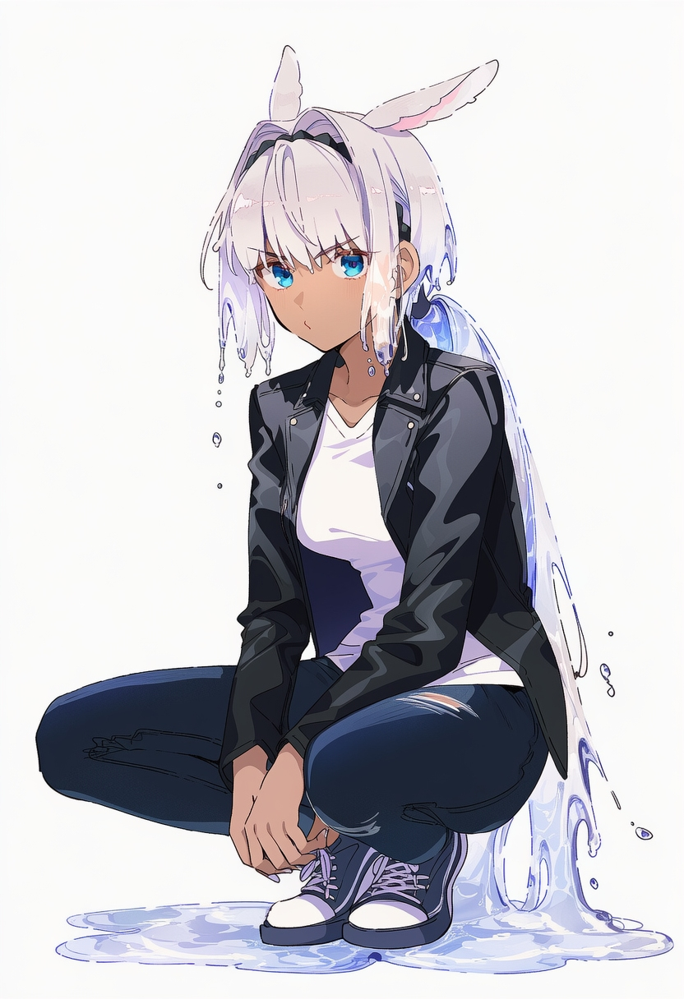

[在线例图](https://assets.quicktagcloud.com/images/raven_composition/raven_composition-1036.jpg?v=8aa14c36e397948f)

<a id="raven_composition-1037"></a>

## 活体头发

ID：`raven_composition-1037`；分类：发型 / 特殊发型；来源标记：`safe`。

来源说明：

> 头发像有生命一样活动。

正向提示词：

```text
living_hair
```

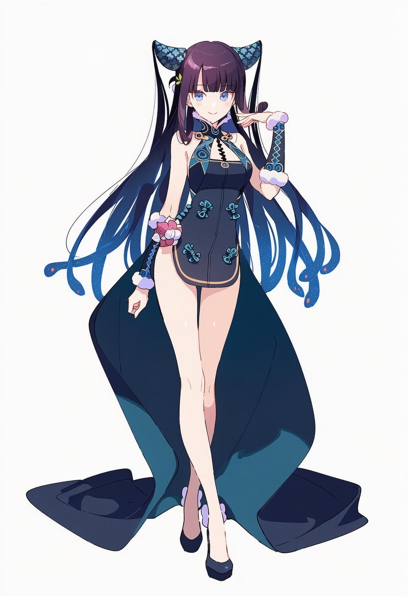

[在线例图](https://assets.quicktagcloud.com/images/raven_composition/raven_composition-1037.jpg?v=bc968a551679cf72)

<a id="raven_composition-1038"></a>

## 机械头发

ID：`raven_composition-1038`；分类：发型 / 特殊发型；来源标记：`safe`。

来源说明：

> 头发呈机械结构或由机械组成。

正向提示词：

```text
mechanical_hair
```

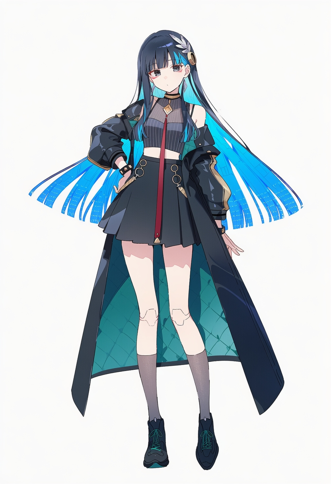

[在线例图](https://assets.quicktagcloud.com/images/raven_composition/raven_composition-1038.jpg?v=32be797c46d107e3)

<a id="raven_composition-1039"></a>

## 金属头发

ID：`raven_composition-1039`；分类：发型 / 特殊发型；来源标记：`safe`。

来源说明：

> 头发具有明显金属质感。

正向提示词：

```text
metal_hair
```

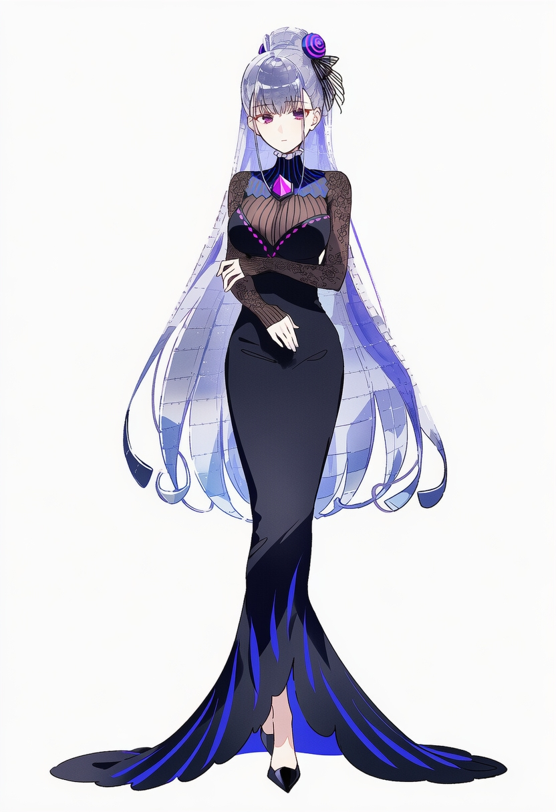

[在线例图](https://assets.quicktagcloud.com/images/raven_composition/raven_composition-1039.jpg?v=9ff21feaa0d0d5df)

<a id="raven_composition-1040"></a>

## 植物头发

ID：`raven_composition-1040`；分类：发型 / 特殊发型；来源标记：`safe`。

来源说明：

> 头发像植物、藤蔓或叶片。

正向提示词：

```text
plant_hair
```

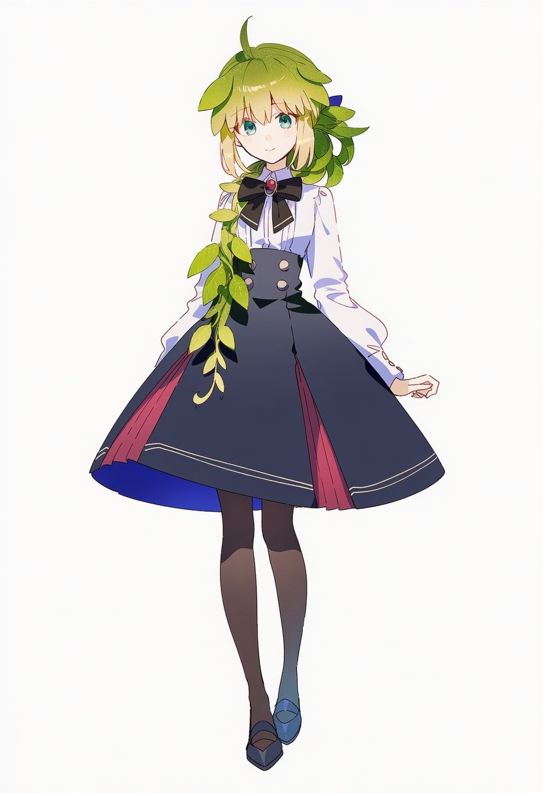

[在线例图](https://assets.quicktagcloud.com/images/raven_composition/raven_composition-1040.jpg?v=7013d82c4f0822b4)

<a id="raven_composition-1041"></a>

## 可操控头发

ID：`raven_composition-1041`；分类：发型 / 特殊发型；来源标记：`safe`。

来源说明：

> 头发能像手脚一样主动抓取或动作。

正向提示词：

```text
prehensile_hair
```

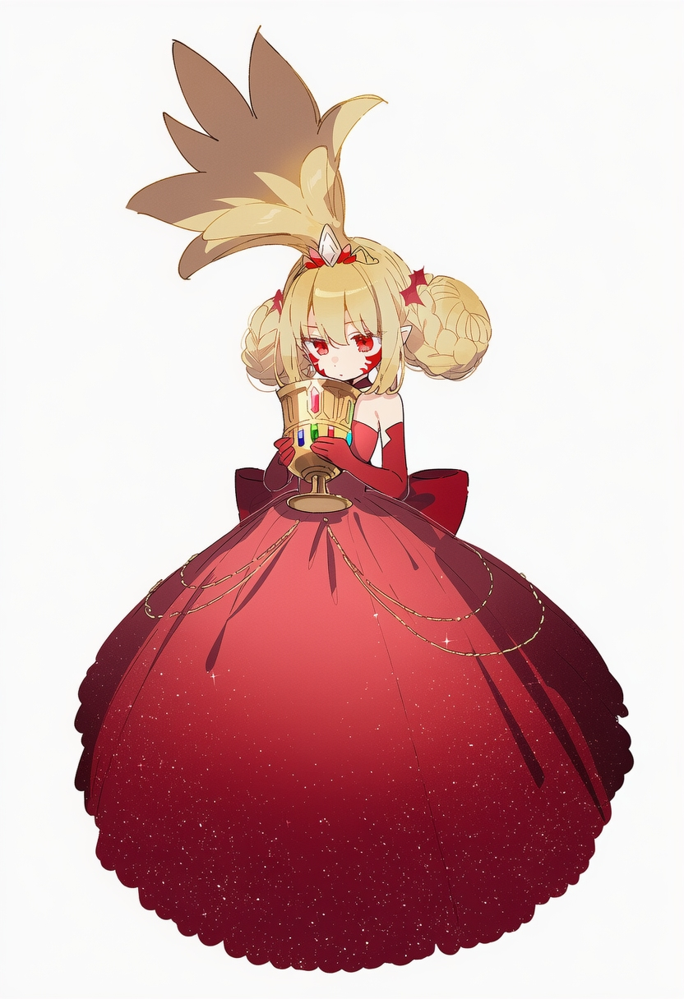

[在线例图](https://assets.quicktagcloud.com/images/raven_composition/raven_composition-1041.jpg?v=2070a43abc16dabc)

<a id="raven_composition-1042"></a>

## 史莱姆头发

ID：`raven_composition-1042`；分类：发型 / 特殊发型；来源标记：`safe`。

来源说明：

> 头发呈史莱姆或胶状质感。

正向提示词：

```text
slime_hair
```

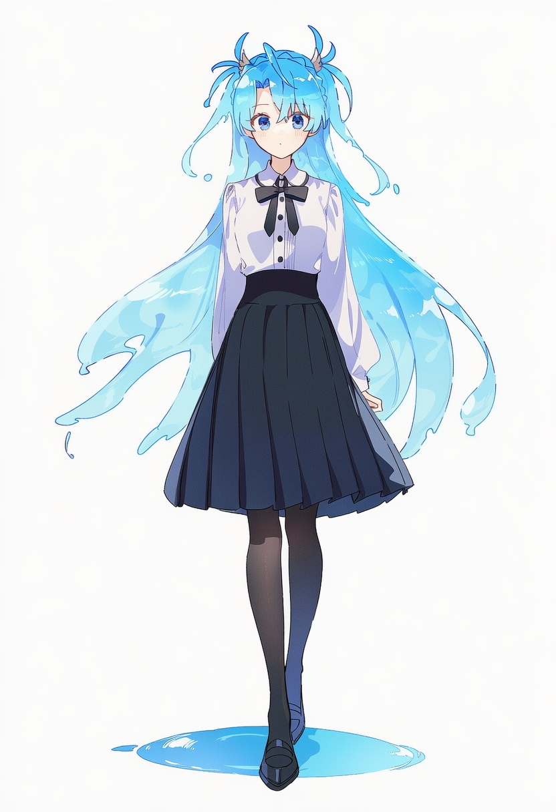

[在线例图](https://assets.quicktagcloud.com/images/raven_composition/raven_composition-1042.jpg?v=d4224b2515ccd401)

<a id="raven_composition-1043"></a>

## 蛇发

ID：`raven_composition-1043`；分类：发型 / 特殊发型；来源标记：`safe`。

来源说明：

> 头发由蛇组成或像蛇一样活动。

正向提示词：

```text
snake_hair
```

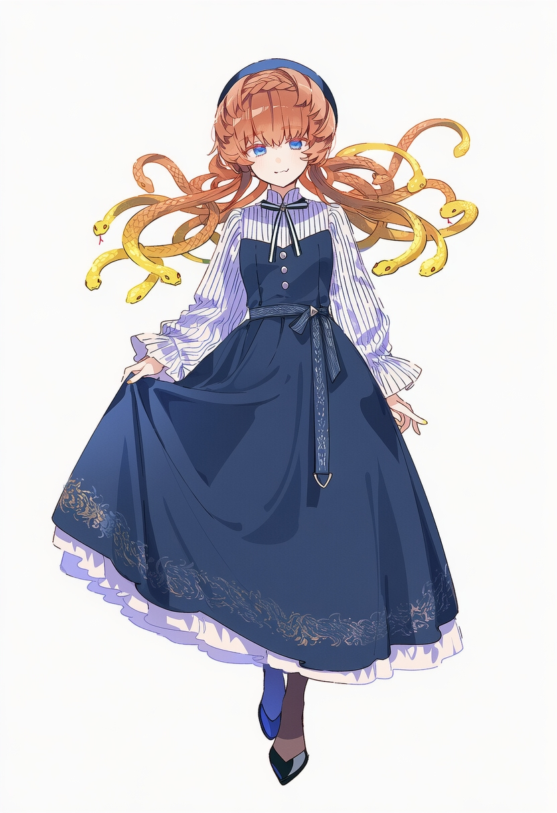

[在线例图](https://assets.quicktagcloud.com/images/raven_composition/raven_composition-1043.jpg?v=a90361761df8137b)

<a id="raven_composition-1044"></a>

## 星空头发

ID：`raven_composition-1044`；分类：发型 / 特殊发型；来源标记：`safe`。

来源说明：

> 头发里带星空或繁星效果。

正向提示词：

```text
starry_hair
```

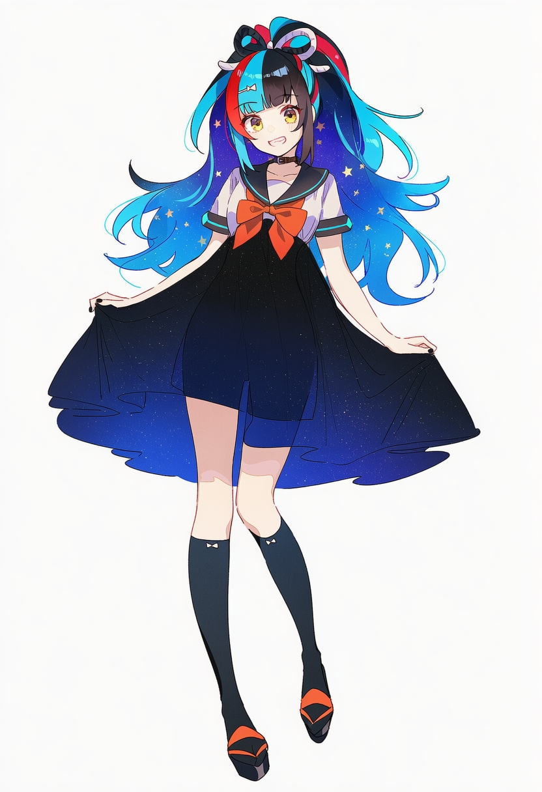

[在线例图](https://assets.quicktagcloud.com/images/raven_composition/raven_composition-1044.jpg?v=dce3511265e1702b)
