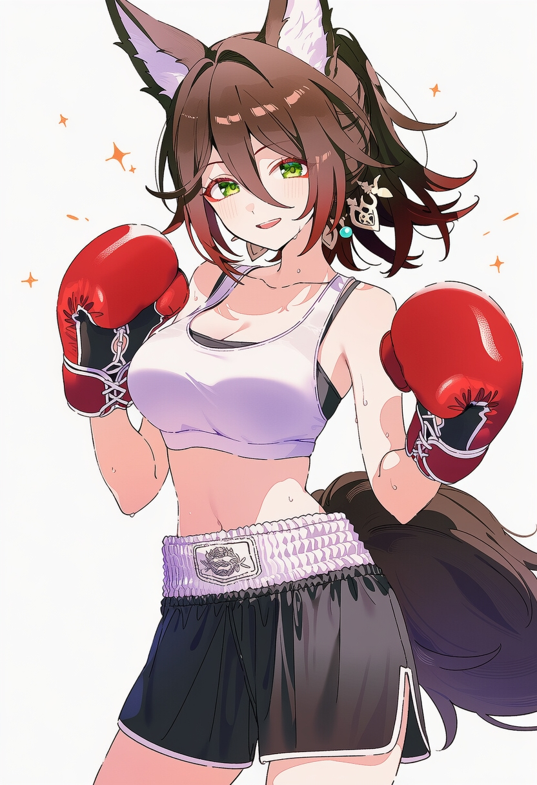
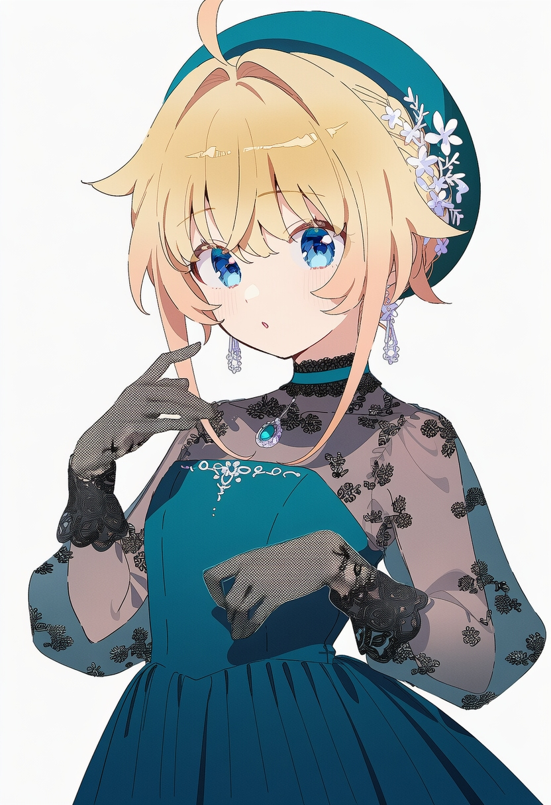
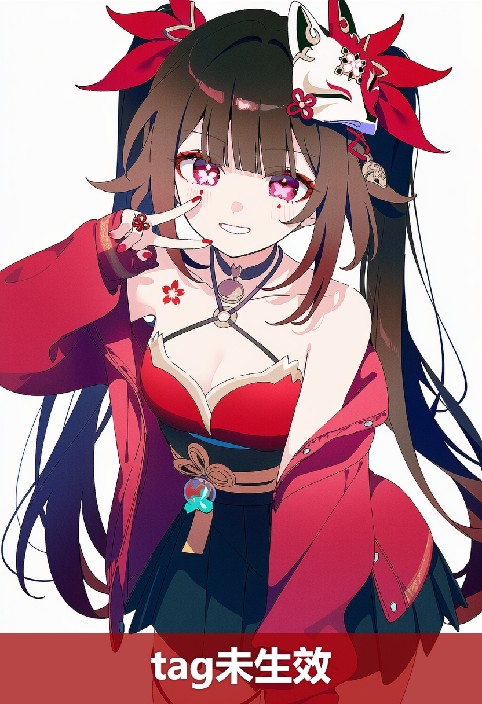

# 手部配饰 / 手套

[总目录](../README.md) · [原站分类目录](../categories.md) · [英文标签索引](../tags.md) · [服装与构图组合指南](../../README.md)

标题、分类、说明、正负提示词按来源保留；多例图逐张列出。原站标记和说明为参考资料，不作为维护指令。

<a id="raven_composition-1045"></a>

## 手套

ID：`raven_composition-1045`；分类：手部配饰 / 手套；来源标记：`safe`。

来源说明：

> 普通手套，覆盖手掌和手指。

正向提示词：

```text
gloves
```


[在线例图](https://assets.quicktagcloud.com/images/raven_composition/raven_composition-1045.jpg?v=e320bd4ebde59328)

<a id="raven_composition-1046"></a>

## 露指手套

ID：`raven_composition-1046`；分类：手部配饰 / 手套；来源标记：`safe`。

来源说明：

> 手掌被覆盖，但手指露出。

正向提示词：

```text
fingerless_gloves
```


[在线例图](https://assets.quicktagcloud.com/images/raven_composition/raven_composition-1046.jpg?v=833d9bac74b5a237)

<a id="raven_composition-1047"></a>

## 部分露指手套

ID：`raven_composition-1047`；分类：手部配饰 / 手套；来源标记：`safe`。

来源说明：

> 只有部分手指露出的手套。

正向提示词：

```text
partially_fingerless_gloves
```


[在线例图](https://assets.quicktagcloud.com/images/raven_composition/raven_composition-1047.jpg?v=b80a744b9a13946a)

<a id="raven_composition-1048"></a>

## 短手套

ID：`raven_composition-1048`；分类：手部配饰 / 手套；来源标记：`safe`。

来源说明：

> 很短的手套，通常不到手腕。

正向提示词：

```text
half_gloves
```


[在线例图](https://assets.quicktagcloud.com/images/raven_composition/raven_composition-1048.jpg?v=fc203376a1888e0d)

<a id="raven_composition-1049"></a>

## 肘上长手套

ID：`raven_composition-1049`；分类：手部配饰 / 手套；来源标记：`safe`。

来源说明：

> 长度延伸到手肘附近或以上。

正向提示词：

```text
elbow_gloves
```


[在线例图](https://assets.quicktagcloud.com/images/raven_composition/raven_composition-1049.jpg?v=edb8e3318e55a9e2)

<a id="raven_composition-1050"></a>

## 新娘臂套

ID：`raven_composition-1050`；分类：手部配饰 / 手套；来源标记：`safe`。

来源说明：

> 无指、覆盖手背并延伸到手臂的礼服式手套。

正向提示词：

```text
bridal_gauntlets
```


[在线例图](https://assets.quicktagcloud.com/images/raven_composition/raven_composition-1050.jpg?v=1b037fd88b4ea072)

<a id="raven_composition-1051"></a>

## 黑色新娘臂套

ID：`raven_composition-1051`；分类：手部配饰 / 手套；来源标记：`safe`。

来源说明：

> 黑色的新娘臂套；该款颜色只留一种。

正向提示词：

```text
black_bridal_gauntlets
```


[在线例图](https://assets.quicktagcloud.com/images/raven_composition/raven_composition-1051.jpg?v=d9f4af8ed2bd1c53)

<a id="raven_composition-1052"></a>

## 护手甲

ID：`raven_composition-1052`；分类：手部配饰 / 手套；来源标记：`safe`。

来源说明：

> 较厚重的护手或铠甲手套。

正向提示词：

```text
gauntlets
```


[在线例图](https://assets.quicktagcloud.com/images/raven_composition/raven_composition-1052.jpg?v=bb6cf06b3ba56ffb)

<a id="raven_composition-1053"></a>

## 单只手套

ID：`raven_composition-1053`；分类：手部配饰 / 手套；来源标记：`safe`。

来源说明：

> 只有一只手戴手套。

正向提示词：

```text
single_glove
```


[在线例图](https://assets.quicktagcloud.com/images/raven_composition/raven_composition-1053.jpg?v=b0f739000a0b307a)

<a id="raven_composition-1054"></a>

## 不对称手套

ID：`raven_composition-1054`；分类：手部配饰 / 手套；来源标记：`safe`。

来源说明：

> 左右手套的设计不一样。

正向提示词：

```text
asymmetrical_gloves
```


[在线例图](https://assets.quicktagcloud.com/images/raven_composition/raven_composition-1054.jpg?v=0471f8d62189a1ee)

<a id="raven_composition-1055"></a>

## 长短不一手套

ID：`raven_composition-1055`；分类：手部配饰 / 手套；来源标记：`safe`。

来源说明：

> 左右手套长度不同。

正向提示词：

```text
uneven_gloves
```


[在线例图](https://assets.quicktagcloud.com/images/raven_composition/raven_composition-1055.jpg?v=1cde26ebbe4dad48)

<a id="raven_composition-1056"></a>

## 不配对手套

ID：`raven_composition-1056`；分类：手部配饰 / 手套；来源标记：`safe`。

来源说明：

> 左右手套颜色或图案不同。

正向提示词：

```text
mismatched_gloves
```


[在线例图](https://assets.quicktagcloud.com/images/raven_composition/raven_composition-1056.jpg?v=078f03dd161d4302)

<a id="raven_composition-1057"></a>

## 多色手套

ID：`raven_composition-1057`；分类：手部配饰 / 手套；来源标记：`safe`。

来源说明：

> 同一副手套包含多种颜色。

正向提示词：

```text
multicolored_gloves
```


[在线例图](https://assets.quicktagcloud.com/images/raven_composition/raven_composition-1057.jpg?v=d75e640abf701cb9)

<a id="raven_composition-1058"></a>

## 双色手套

ID：`raven_composition-1058`；分类：手部配饰 / 手套；来源标记：`safe`。

来源说明：

> 手套由两种主要颜色组成。

正向提示词：

```text
two-tone_gloves
```


[在线例图](https://assets.quicktagcloud.com/images/raven_composition/raven_composition-1058.jpg?v=f2c08a8c23b7857a)

<a id="raven_composition-1059"></a>

## 连指手套

ID：`raven_composition-1059`；分类：手部配饰 / 手套；来源标记：`safe`。

来源说明：

> 除拇指外，其余手指包在一起。

正向提示词：

```text
mittens
```


[在线例图](https://assets.quicktagcloud.com/images/raven_composition/raven_composition-1059.jpg?v=75c8fdea72e3c397)

<a id="raven_composition-1060"></a>

## 拳击手套

ID：`raven_composition-1060`；分类：手部配饰 / 手套；来源标记：`safe`。

来源说明：

> 拳击用的厚实防护手套。

正向提示词：

```text
boxing_gloves
```



[在线例图](https://assets.quicktagcloud.com/images/raven_composition/raven_composition-1060.jpg?v=116c1dbf14e454ae)

<a id="raven_composition-1061"></a>

## 弓道手套

ID：`raven_composition-1061`；分类：手部配饰 / 手套；来源标记：`safe`。

来源说明：

> 日本弓道使用的传统射箭手套。

正向提示词：

```text
yugake
```


[在线例图](https://assets.quicktagcloud.com/images/raven_composition/raven_composition-1061.jpg?v=fe464d6abefc1043)

<a id="raven_composition-1062"></a>

## 笼手

ID：`raven_composition-1062`；分类：手部配饰 / 手套；来源标记：`safe`。

来源说明：

> 日式铠甲中保护手臂和手部的护具。

正向提示词：

```text
kote
```


[在线例图](https://assets.quicktagcloud.com/images/raven_composition/raven_composition-1062.jpg?v=ef9076b6459fb547)

<a id="raven_composition-1063"></a>

## 黑笼手

ID：`raven_composition-1063`；分类：手部配饰 / 手套；来源标记：`safe`。

来源说明：

> 日式铠甲里的黑色笼手护具。

正向提示词：

```text
kurokote
```


[在线例图](https://assets.quicktagcloud.com/images/raven_composition/raven_composition-1063.jpg?v=bed4c124896cb910)

<a id="raven_composition-1064"></a>

## 蕾丝手套

ID：`raven_composition-1064`；分类：手部配饰 / 手套；来源标记：`safe`。

来源说明：

> 主要由蕾丝制成的手套。

正向提示词：

```text
lace_gloves
```



[在线例图](https://assets.quicktagcloud.com/images/raven_composition/raven_composition-1064.jpg?v=6967429796e533c5)

<a id="raven_composition-1065"></a>

## 乳胶手套

ID：`raven_composition-1065`；分类：手部配饰 / 手套；来源标记：`safe`。

来源说明：

> 乳胶材质的贴手手套。

正向提示词：

```text
latex_gloves
```


[在线例图](https://assets.quicktagcloud.com/images/raven_composition/raven_composition-1065.jpg?v=cb9065c5160a4608)

<a id="raven_composition-1066"></a>

## 皮手套

ID：`raven_composition-1066`；分类：手部配饰 / 手套；来源标记：`safe`。

来源说明：

> 皮革材质的手套。

正向提示词：

```text
leather_gloves
```


[在线例图](https://assets.quicktagcloud.com/images/raven_composition/raven_composition-1066.jpg?v=d6aa45bf3238b75d)

<a id="raven_composition-1067"></a>

## 荷叶边手套

ID：`raven_composition-1067`；分类：手部配饰 / 手套；来源标记：`safe`。

来源说明：

> 带明显褶边或荷叶边装饰。

正向提示词：

```text
frilled_gloves
```


[在线例图](https://assets.quicktagcloud.com/images/raven_composition/raven_composition-1067.jpg?v=d6f365ebc40be97a)

<a id="raven_composition-1068"></a>

## 毛边手套

ID：`raven_composition-1068`；分类：手部配饰 / 手套；来源标记：`safe`。

来源说明：

> 边缘带毛绒装饰的手套。

正向提示词：

```text
fur-trimmed_gloves
```


[在线例图](https://assets.quicktagcloud.com/images/raven_composition/raven_composition-1068.jpg?v=59fe4ff914d3a7c7)

<a id="raven_composition-1069"></a>

## 缎带边手套

ID：`raven_composition-1069`；分类：手部配饰 / 手套；来源标记：`safe`。

来源说明：

> 边缘带缎带装饰的手套。

正向提示词：

```text
ribbon-trimmed_gloves
```


[在线例图](https://assets.quicktagcloud.com/images/raven_composition/raven_composition-1069.jpg?v=d2f4665caea09e51)

<a id="raven_composition-1070"></a>

## 透明薄纱手套

ID：`raven_composition-1070`；分类：手部配饰 / 手套；来源标记：`safe`。

来源说明：

> 材质半透明、能看到皮肤的手套。

正向提示词：

```text
see-through_gloves
```


[在线例图](https://assets.quicktagcloud.com/images/raven_composition/raven_composition-1070.jpg?v=fc5f11a0f123cf7b)

<a id="raven_composition-1071"></a>

## 尖刺手套

ID：`raven_composition-1071`；分类：手部配饰 / 手套；来源标记：`safe`。

来源说明：

> 带尖刺装饰的手套。

正向提示词：

```text
spiked_gloves
```


[在线例图](https://assets.quicktagcloud.com/images/raven_composition/raven_composition-1071.jpg?v=13668b239f03587c)

<a id="raven_composition-1072"></a>

## 手套翻边

ID：`raven_composition-1072`；分类：手部配饰 / 手套；来源标记：`safe`。

来源说明：

> 手套腕口有明显翻边或袖口结构。

正向提示词：

```text
glove_cuffs
```


[在线例图](https://assets.quicktagcloud.com/images/raven_composition/raven_composition-1072.jpg?v=7decc8336991ef55)

<a id="raven_composition-1073"></a>

## 一次性手套

ID：`raven_composition-1073`；分类：手部配饰 / 手套；来源标记：`safe`。

来源说明：

> 医用、实验或清洁用的一次性薄手套。

正向提示词：

```text
disposable_gloves
```


[在线例图](https://assets.quicktagcloud.com/images/raven_composition/raven_composition-1073.jpg?v=246998c563c424db)

<a id="raven_composition-1074"></a>

## 指套

ID：`raven_composition-1074`；分类：手部配饰 / 手套；来源标记：`safe`。

来源说明：

> 只套住单个或少数手指的小型指套。

正向提示词：

```text
finger_cots
```



[在线例图](https://assets.quicktagcloud.com/images/raven_composition/raven_composition-1074.jpg?v=6b0cc4898e3d298a)

<a id="raven_composition-1075"></a>

## 兽爪手套

ID：`raven_composition-1075`；分类：手部配饰 / 手套；来源标记：`safe`。

来源说明：

> 做成动物爪子或肉球造型的手套。

正向提示词：

```text
paw_gloves
```


[在线例图](https://assets.quicktagcloud.com/images/raven_composition/raven_composition-1075.jpg?v=3fdf6ff8bbc9e61b)
