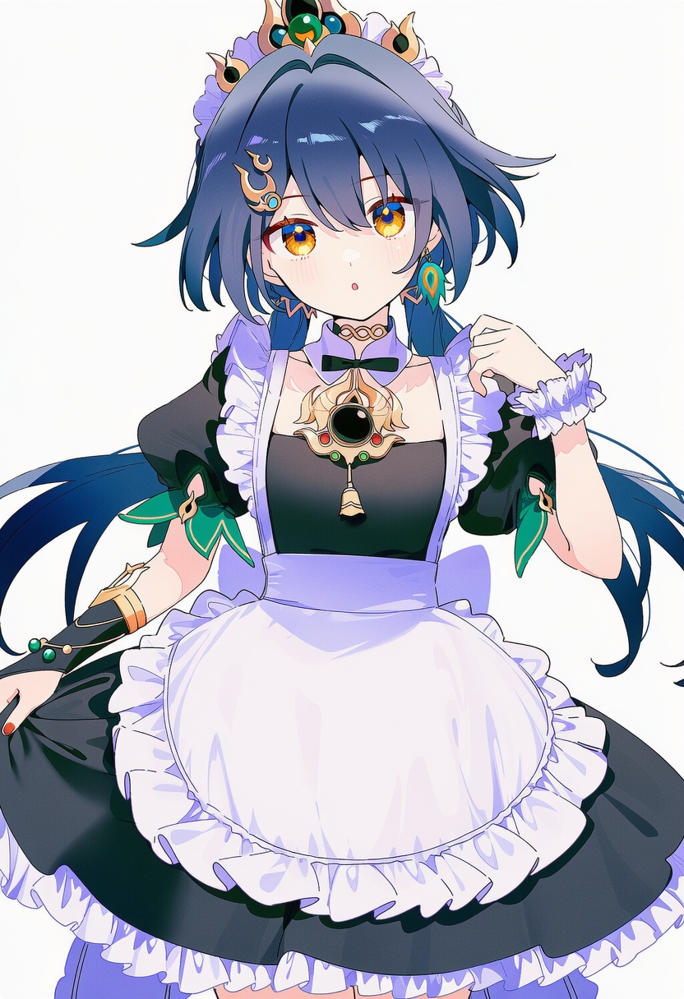
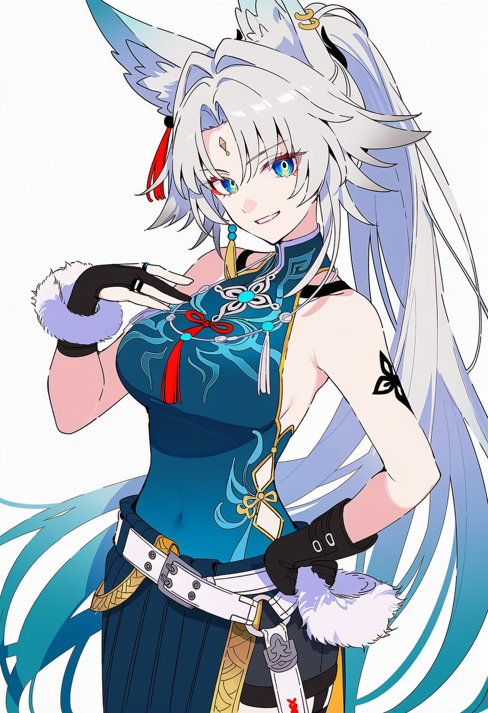
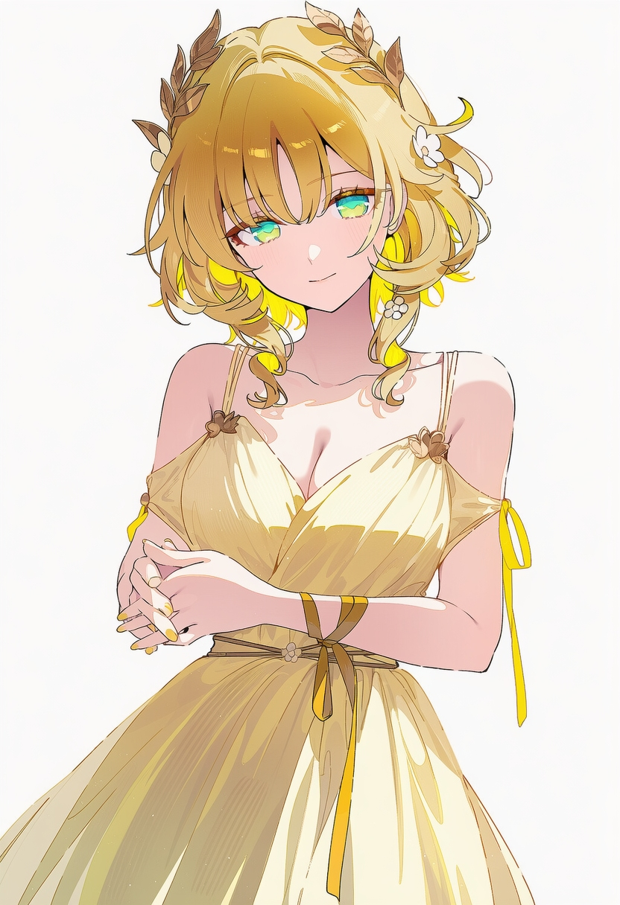
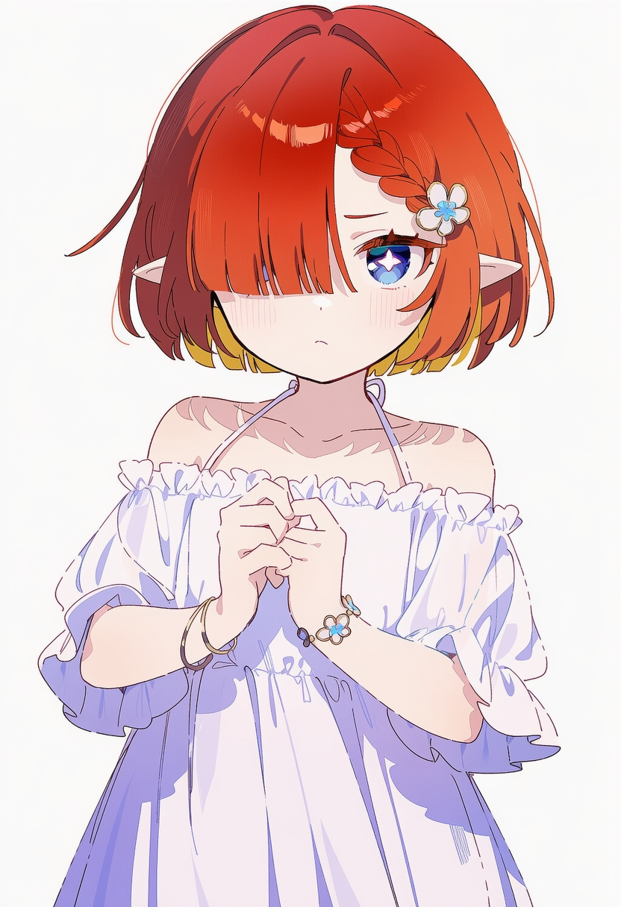
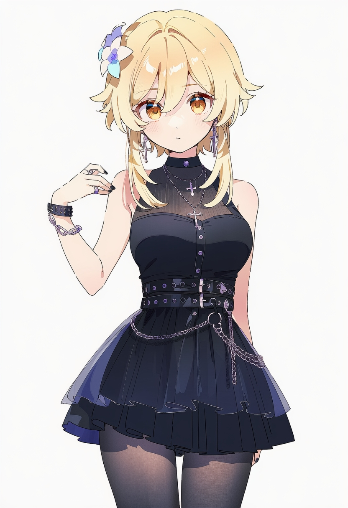
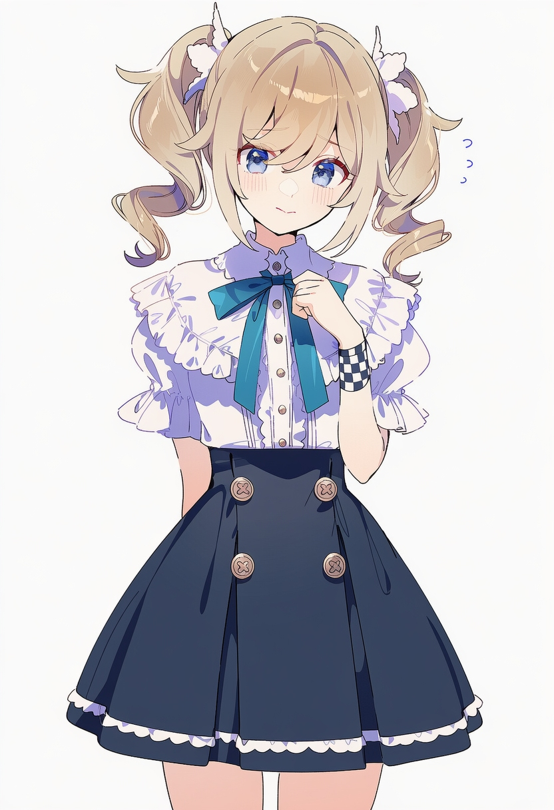
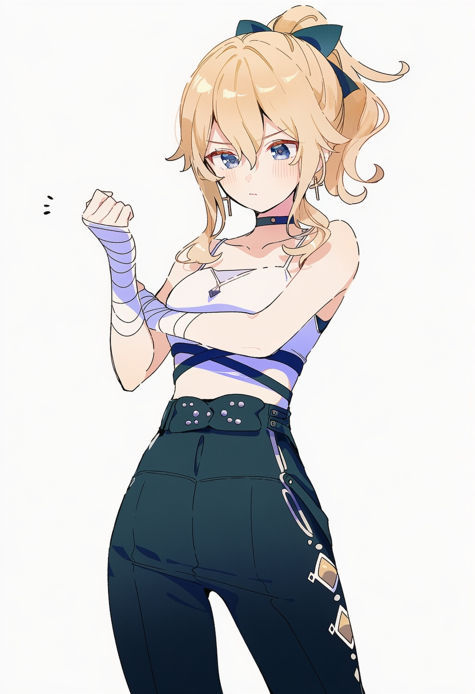
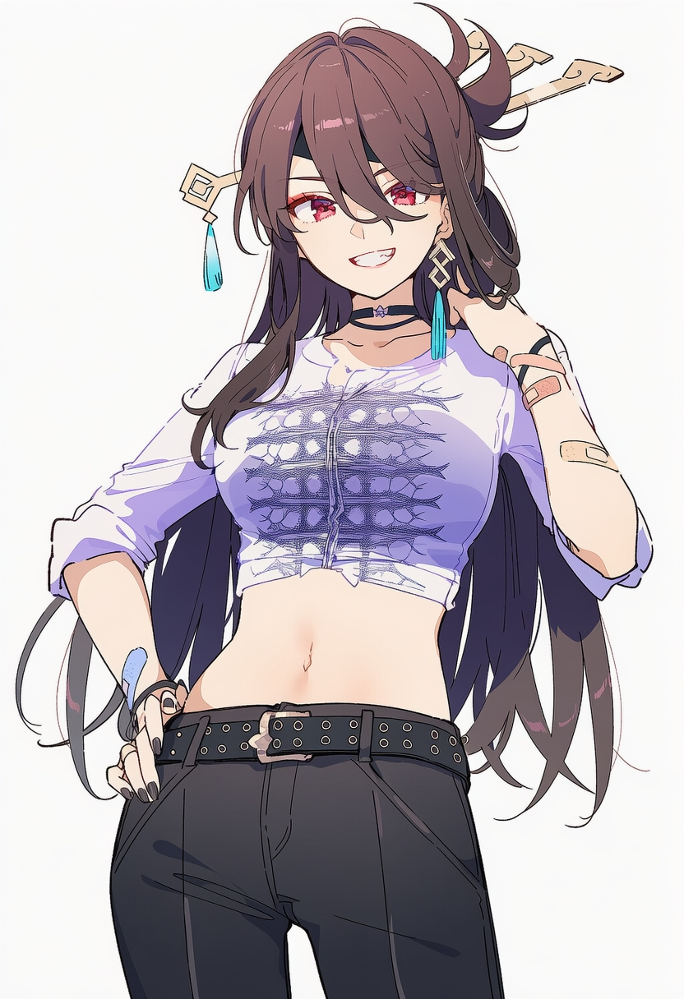

# 手部配饰 / 手腕配饰

[总目录](../README.md) · [原站分类目录](../categories.md) · [英文标签索引](../tags.md) · [服装与构图组合指南](../../README.md)

标题、分类、说明、正负提示词按来源保留；多例图逐张列出。原站标记和说明为参考资料，不作为维护指令。

<a id="raven_composition-1076"></a>

## 腕饰袖口

ID：`raven_composition-1076`；分类：手部配饰 / 手腕配饰；来源标记：`safe`。

来源说明：

> 独立戴在手腕上的装饰性袖口。

正向提示词：

```text
wrist_cuffs
```


[在线例图](https://assets.quicktagcloud.com/images/raven_composition/raven_composition-1076.jpg?v=2d036e29752f5726)

<a id="raven_composition-1077"></a>

## 黑色腕饰袖口

ID：`raven_composition-1077`；分类：手部配饰 / 手腕配饰；来源标记：`safe`。

来源说明：

> 黑色腕饰袖口；颜色款只留这一种。

正向提示词：

```text
black_wrist_cuffs
```


[在线例图](https://assets.quicktagcloud.com/images/raven_composition/raven_composition-1077.jpg?v=2b65709b6781424d)

<a id="raven_composition-1078"></a>

## 荷叶边腕饰

ID：`raven_composition-1078`；分类：手部配饰 / 手腕配饰；来源标记：`safe`。

来源说明：

> 带褶边的装饰性腕饰袖口。

正向提示词：

```text
frilled_wrist_cuffs
```


[在线例图](https://assets.quicktagcloud.com/images/raven_composition/raven_composition-1078.jpg?v=2da828ea84d0e0de)

<a id="raven_composition-1079"></a>

## 单侧腕饰

ID：`raven_composition-1079`；分类：手部配饰 / 手腕配饰；来源标记：`safe`。

来源说明：

> 只有一只手腕戴装饰袖口。

正向提示词：

```text
single_wrist_cuff
```



[在线例图](https://assets.quicktagcloud.com/images/raven_composition/raven_composition-1079.jpg?v=0db3f83458f02e7b)

<a id="raven_composition-1080"></a>

## 毛绒腕饰

ID：`raven_composition-1080`；分类：手部配饰 / 手腕配饰；来源标记：`safe`。

来源说明：

> 毛绒材质的腕部或踝部装饰圈。

正向提示词：

```text
fur_cuffs
```



[在线例图](https://assets.quicktagcloud.com/images/raven_composition/raven_composition-1080.jpg?v=f7c1678399a7b02e)

<a id="raven_composition-1081"></a>

## 腕带

ID：`raven_composition-1081`；分类：手部配饰 / 手腕配饰；来源标记：`safe`。

来源说明：

> 戴在手腕上的带状配饰。

正向提示词：

```text
wristband
```


[在线例图](https://assets.quicktagcloud.com/images/raven_composition/raven_composition-1081.jpg?v=1748fbb5265408a8)

<a id="raven_composition-1082"></a>

## 条纹腕带

ID：`raven_composition-1082`；分类：手部配饰 / 手腕配饰；来源标记：`safe`。

来源说明：

> 带条纹图案的腕带。

正向提示词：

```text
striped_wristband
```


[在线例图](https://assets.quicktagcloud.com/images/raven_composition/raven_composition-1082.jpg?v=c9a000b72f1cccb9)

<a id="raven_composition-1083"></a>

## 荷叶边腕带

ID：`raven_composition-1083`；分类：手部配饰 / 手腕配饰；来源标记：`safe`。

来源说明：

> 带褶边装饰的腕带。

正向提示词：

```text
frilled_wristband
```


[在线例图](https://assets.quicktagcloud.com/images/raven_composition/raven_composition-1083.jpg?v=3ef4ee60db9746f0)

<a id="raven_composition-1084"></a>

## 手腕发圈

ID：`raven_composition-1084`；分类：手部配饰 / 手腕配饰；来源标记：`safe`。

来源说明：

> 把发圈当作腕饰戴在手腕上。

正向提示词：

```text
wrist_scrunchie
```


[在线例图](https://assets.quicktagcloud.com/images/raven_composition/raven_composition-1084.jpg?v=ad470aca4e23282d)

<a id="raven_composition-1085"></a>

## 手腕丝带

ID：`raven_composition-1085`；分类：手部配饰 / 手腕配饰；来源标记：`safe`。

来源说明：

> 丝带直接系在手腕上。

正向提示词：

```text
wrist_ribbon
```



[在线例图](https://assets.quicktagcloud.com/images/raven_composition/raven_composition-1085.jpg?v=5b932dda9cdfe363)

<a id="raven_composition-1086"></a>

## 手腕蝴蝶结

ID：`raven_composition-1086`；分类：手部配饰 / 手腕配饰；来源标记：`safe`。

来源说明：

> 手腕处系着明显的蝴蝶结。

正向提示词：

```text
wrist_bow
```


[在线例图](https://assets.quicktagcloud.com/images/raven_composition/raven_composition-1086.jpg?v=1a87abfc280e7ab7)

<a id="raven_composition-1087"></a>

## 手链 / 手镯

ID：`raven_composition-1087`；分类：手部配饰 / 手腕配饰；来源标记：`safe`。

来源说明：

> 戴在手腕上的首饰。

正向提示词：

```text
bracelet
```



[在线例图](https://assets.quicktagcloud.com/images/raven_composition/raven_composition-1087.jpg?v=f51c3b9dcc231b61)

<a id="raven_composition-1088"></a>

## 金色手链

ID：`raven_composition-1088`；分类：手部配饰 / 手腕配饰；来源标记：`safe`。

来源说明：

> 金色或金质感手链；颜色/材质款留这一种。

正向提示词：

```text
gold_bracelet
```


[在线例图](https://assets.quicktagcloud.com/images/raven_composition/raven_composition-1088.jpg?v=d83d3e6ce11f63de)

<a id="raven_composition-1089"></a>

## 硬质手镯

ID：`raven_composition-1089`；分类：手部配饰 / 手腕配饰；来源标记：`safe`。

来源说明：

> 没有链节、整体偏硬的环形手镯。

正向提示词：

```text
bangle
```


[在线例图](https://assets.quicktagcloud.com/images/raven_composition/raven_composition-1089.jpg?v=cc0eb9e022736c3b)

<a id="raven_composition-1090"></a>

## 珠串手链

ID：`raven_composition-1090`；分类：手部配饰 / 手腕配饰；来源标记：`safe`。

来源说明：

> 由珠子串成的手链。

正向提示词：

```text
bead_bracelet
```


[在线例图](https://assets.quicktagcloud.com/images/raven_composition/raven_composition-1090.jpg?v=8c0837c1fa6a58d3)

<a id="raven_composition-1091"></a>

## 尖刺手环

ID：`raven_composition-1091`；分类：手部配饰 / 手腕配饰；来源标记：`safe`。

来源说明：

> 带尖刺装饰的手链或手环。

正向提示词：

```text
spiked_bracelet
```


[在线例图](https://assets.quicktagcloud.com/images/raven_composition/raven_composition-1091.jpg?v=0449fefbb4d8b143)

<a id="raven_composition-1092"></a>

## 铆钉手环

ID：`raven_composition-1092`；分类：手部配饰 / 手腕配饰；来源标记：`safe`。

来源说明：

> 带铆钉装饰的手环。

正向提示词：

```text
studded_bracelet
```


[在线例图](https://assets.quicktagcloud.com/images/raven_composition/raven_composition-1092.jpg?v=0eac14b18630fdb6)

<a id="raven_composition-1093"></a>

## 链式手链

ID：`raven_composition-1093`；分类：手部配饰 / 手腕配饰；来源标记：`safe`。

来源说明：

> 以金属链节为主体的手链。

正向提示词：

```text
chain_bracelet
```



[在线例图](https://assets.quicktagcloud.com/images/raven_composition/raven_composition-1093.jpg?v=b95bb7281ef24fdf)

<a id="raven_composition-1094"></a>

## 珍珠手链

ID：`raven_composition-1094`；分类：手部配饰 / 手腕配饰；来源标记：`safe`。

来源说明：

> 由珍珠组成或装饰的手链。

正向提示词：

```text
pearl_bracelet
```


[在线例图](https://assets.quicktagcloud.com/images/raven_composition/raven_composition-1094.jpg?v=0357bff51a142109)

<a id="raven_composition-1095"></a>

## 格纹腕带

ID：`raven_composition-1095`；分类：手部配饰 / 手腕配饰；来源标记：`safe`。

来源说明：

> 带棋盘格或方格图案的腕带。

正向提示词：

```text
checkered_wristband
```



[在线例图](https://assets.quicktagcloud.com/images/raven_composition/raven_composition-1095.jpg?v=683dcff8f0b2c7dd)

<a id="raven_composition-1096"></a>

## 吸汗腕带

ID：`raven_composition-1096`；分类：手部配饰 / 手腕配饰；来源标记：`safe`。

来源说明：

> 运动时戴的毛圈或吸汗腕带。

正向提示词：

```text
sweatband
```


[在线例图](https://assets.quicktagcloud.com/images/raven_composition/raven_composition-1096.jpg?v=c212dba7653e64e1)

<a id="raven_composition-1097"></a>

## 手腕缠带

ID：`raven_composition-1097`；分类：手部配饰 / 手腕配饰；来源标记：`safe`。

来源说明：

> 缠绕在手腕上的布带或绑带。

正向提示词：

```text
wrist_wrap
```



[在线例图](https://assets.quicktagcloud.com/images/raven_composition/raven_composition-1097.jpg?v=2072726326734fcd)

<a id="raven_composition-1098"></a>

## 手腕花饰

ID：`raven_composition-1098`；分类：手部配饰 / 手腕配饰；来源标记：`safe`。

来源说明：

> 戴在手腕上的花朵装饰。

正向提示词：

```text
wrist_flower
```


[在线例图](https://assets.quicktagcloud.com/images/raven_composition/raven_composition-1098.jpg?v=e6acd0706bd04366)

<a id="raven_composition-1099"></a>

## 护腕

ID：`raven_composition-1099`；分类：手部配饰 / 手腕配饰；来源标记：`safe`。

来源说明：

> 保护手腕的护具。

正向提示词：

```text
wrist_guards
```


[在线例图](https://assets.quicktagcloud.com/images/raven_composition/raven_composition-1099.jpg?v=a2f031b76e9e1580)

<a id="raven_composition-1100"></a>

## 袖扣

ID：`raven_composition-1100`；分类：手部配饰 / 手腕配饰；来源标记：`safe`。

来源说明：

> 固定衬衫袖口的小型装饰扣。

正向提示词：

```text
cuff_links
```


[在线例图](https://assets.quicktagcloud.com/images/raven_composition/raven_composition-1100.jpg?v=cc8daac99e691cb5)

<a id="raven_composition-1101"></a>

## 手腕缠绷带

ID：`raven_composition-1101`；分类：手部配饰 / 手腕配饰；来源标记：`safe`。

来源说明：

> 手腕位置缠着绷带。

正向提示词：

```text
bandaged_wrist
```


[在线例图](https://assets.quicktagcloud.com/images/raven_composition/raven_composition-1101.jpg?v=9a717d4e8ddd4194)

<a id="raven_composition-1102"></a>

## 手腕创可贴

ID：`raven_composition-1102`；分类：手部配饰 / 手腕配饰；来源标记：`safe`。

来源说明：

> 创可贴贴在手腕上。

正向提示词：

```text
bandaid_on_wrist
```



[在线例图](https://assets.quicktagcloud.com/images/raven_composition/raven_composition-1102.jpg?v=666107009d7e479a)
